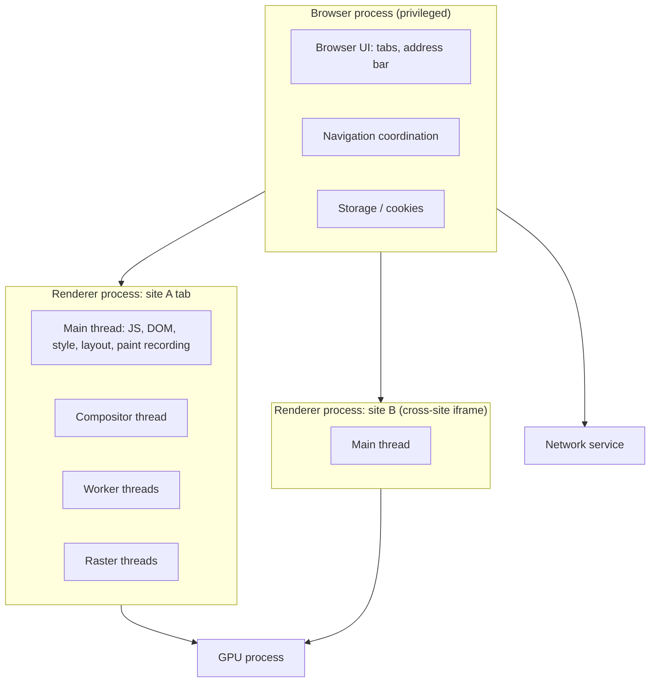
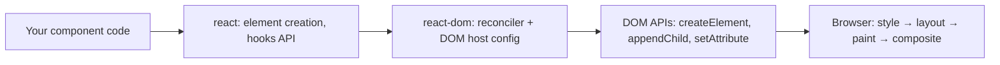
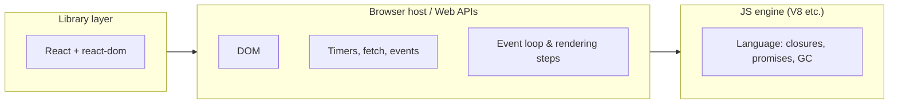

# 00 / 01 — How the Browser Works: Processes, Threads, and Where React Runs

## 1. Lesson metadata

| | |
|---|---|
| **Level** | Beginner |
| **Study time** | 3–4 hours (reading 1.5 h, experiments 1 h, exercises 1 h) |
| **Prerequisites** | None. Basic familiarity with HTML/JS syntax helps. |
| **Next** | [02 — HTML parsing, DOM, CSSOM, render tree](./02-html-parsing-dom-cssom-render-tree.md) |
| **Related later** | [03 — Rendering pipeline](./03-browser-rendering-pipeline.md), [11 — Event loop](./11-event-loop-tasks-microtasks.md), [Phase 2 — Render, reconcile, commit, paint](../02-react-rendering-and-internals/02-render-reconcile-commit-paint.md) |

**Learning objectives.** After this lesson you can:
1. Describe the path from a URL to pixels on screen.
2. Explain which threads exist in a browser tab and which work shares the *main thread*.
3. Explain why a long-running JavaScript task makes a page feel frozen even though "nothing is broken".
4. State precisely where React runs and what it does and does not control.
5. Use the browser Performance panel to see a long task.

**Concepts covered:** browser vs engine, multi-process architecture, renderer process, main thread, compositor thread, raster, network stack, navigation, JavaScript engine vs Web APIs, same-origin sandboxing, frame budget, jank.

---

## 2. Deep conceptual explanation

### 2.1 What problem is this lesson solving?

React is a library for *producing* user interfaces, but it does not draw anything. The browser draws. If you do not know what the browser is doing while your component function runs, you cannot answer questions like:

- Why does a slow component make typing in an unrelated input laggy?
- Why can React "finish rendering" and the screen still not have changed?
- Why does `useTransition` help even though JavaScript is single-threaded?

Every one of those answers depends on the browser's execution model. So we start here, not with React.

### 2.2 Browser vs browser engine vs JavaScript engine

These words are often conflated:

| Term | Meaning | Examples |
|---|---|---|
| **Browser** | The whole application: UI chrome (tabs, address bar), networking, storage, security, plus the engine. | Chrome, Firefox, Safari, Edge |
| **Browser (rendering) engine** | The part that turns HTML/CSS/JS into pixels: parsing, style, layout, paint, compositing, and the DOM implementation. | Blink, Gecko, WebKit |
| **JavaScript engine** | Parses and executes JavaScript: bytecode interpreter, JIT compilers, garbage collector. It knows nothing about the DOM. | V8, SpiderMonkey, JavaScriptCore |
| **Web APIs** | Capabilities the browser *exposes to* JavaScript: DOM, `fetch`, timers, `requestAnimationFrame`, storage. They are not part of the JavaScript language. | `document`, `setTimeout`, `fetch` |

Consequence: `setTimeout`, `document.querySelector`, and `fetch` are not JavaScript. They are host-provided functions. The language (ECMAScript) defines promises and the job queue concept; the HTML standard defines the event loop and timers. React uses both and depends on the host for rendering (`react-dom`).

### 2.3 Multi-process architecture (Chromium as the reference model)

Modern browsers split work across operating-system processes for security (a compromised page should not read another site's memory) and stability (one crashing tab should not kill the browser).



⚠ *Teaching model.* The exact process layout (site isolation, process-per-site-instance, process limits on mobile) differs across browsers, platforms, and versions. The portable facts are: **page code runs in a sandboxed renderer; JavaScript for a document runs on one main thread**.

### 2.4 The renderer: one main thread does a lot

Inside the renderer for a document, the **main thread** is responsible for:

- Parsing HTML and CSS
- Running your JavaScript (including all React render and effect code)
- Building the DOM and computing styles
- Performing layout
- Recording paint instructions (the "display list")
- Dispatching input events to handlers

Other threads:

| Thread | Job | Why it matters for React |
|---|---|---|
| **Compositor** | Combines layers, handles scrolling and some animations (`transform`, `opacity`) without main-thread involvement | Compositor-only animations stay smooth when JS is busy. A scroll-linked effect in JS does not. |
| **Raster** | Turns paint instructions into pixels (often GPU-assisted) | React never touches it. |
| **Web Workers** | Separate JS threads with no DOM access | Off-main-thread computation; React DOM cannot run there. |
| **Network** (service, not in the renderer) | Fetching, caching, TLS | Async: JS only sees the result via callbacks/promises. |

**The most important sentence in this lesson:** *JavaScript execution, style calculation, layout, and recording of paint all compete for the same main thread, and while it is busy it cannot respond to input or produce a new frame.*

### 2.5 The frame budget

A display refreshes at 60 Hz (16.7 ms per frame), or 120 Hz (8.3 ms), etc. For the screen to update, the browser needs, within the frame budget, to have run: input handlers → JS → style → layout → paint recording → (handoff to compositor/raster) → composite. If the main thread is busy for 200 ms in your JS, the browser skips frames. Users perceive:

- **Jank**: dropped frames during animation/scroll.
- **Input delay**: click handlers cannot start until the current task ends. (Measured by the Interaction to Next Paint metric, INP.)

React's concurrent features (Phase 2) do not make JavaScript multi-threaded. They let React **split rendering work into chunks and yield to the browser between them**, so these budgets can be respected. Without this lesson, that sentence is mysterious; with it, it is nearly obvious.

### 2.6 From URL to pixels (navigation)

1. **Navigation starts** in the browser process (typed URL or link).
2. **DNS, TCP, TLS** (or QUIC) connection set-up, handled by the network stack. Caches/service workers may short-circuit this.
3. **HTTP request/response**: browser receives HTML bytes (streamed).
4. A **renderer process** is chosen/created; response bytes stream to it.
5. **Parsing** HTML builds the DOM incrementally; discovered CSS/JS/images trigger further fetches. Classic `<script>` blocks the parser unless `async`/`defer`/`type="module"`.
6. **Style** (CSSOM + computed styles) → **layout** → **paint** → **composite**.
7. **First paint** and later **largest contentful paint**, **interactive**, etc.

For a React SPA, step 3 usually returns a nearly empty HTML shell (`<div id="root"></div>` + script tags). Step 5 downloads and runs a JS bundle; React then builds DOM nodes via DOM APIs, which restarts style/layout/paint for that content. This explains why a pure client-rendered app shows nothing until JS executes, a motivation for SSR (Phase 9).

### 2.7 Common misconceptions

| Misconception | Reality |
|---|---|
| "JavaScript is slow, so UIs are slow." | Modern JIT-compiled JS is fast. UI slowness is most often *too much work on the main thread at once*, layout thrashing, huge DOMs, or network waterfalls. |
| "The browser repaints every time I change the DOM." | DOM changes mark things dirty; the browser typically **batches** style/layout/paint to the next rendering opportunity. |
| "async code runs in parallel." | `await` and promises provide *concurrency* on one thread, not parallelism. Only the underlying I/O (network, disk) and workers run in parallel. |
| "React makes the DOM fast." | React makes UI *code easier to reason about*; it does extra work compared to hand-tuned DOM code. It is fast *enough* and scales its bookkeeping well. |
| "A tab has its own thread for each component." | There is one main thread per document; components are just function calls on it. |

---

## 3. Internal mechanics

### 3.1 What actually happens when JavaScript is running?

When a task (for example, a click handler) starts, the main thread is *occupied until the call stack empties* and the microtask queue drains ([Lesson 11](./11-event-loop-tasks-microtasks.md)). Only then can the browser consider a rendering opportunity. Specification-level detail: the HTML standard's *event loop processing model* picks a task, runs it to completion, performs a microtask checkpoint, and then, **if it is time to render**, runs the "update the rendering" steps (rAF callbacks, style, layout, paint recording, etc.).

*Public guarantee:* tasks run to completion; JS is not preempted by other JS on the same thread.
*Implementation detail:* exactly when the browser chooses to render between tasks is up to the user agent (vsync, visibility, throttling).

### 3.2 Where does React fit?



React (the reconciler) *calls your functions*, decides what changed, and calls DOM APIs in a commit step. It does **not** call layout or paint. Those happen afterward on the browser's schedule. Consequently, "React has rendered" and "the user sees it" are different moments. We formalize this in [Phase 2 / 02](../02-react-rendering-and-internals/02-render-reconcile-commit-paint.md).

### 3.3 Isolation and security boundaries

JavaScript in the renderer is sandboxed from the operating system; cross-origin access is restricted by the same-origin policy. This matters later for authentication, CORS, CSP, and XSS ([Phase 10](../10-production-engineering/06-security-xss-csrf-csp.md)). For now: a script from `https://a.com` cannot read DOM or cookies from `https://b.com`.

---

## 4. Step-by-step execution walkthrough: click → visible change in a React-like app

Scenario: a button click toggles a panel. (We use plain DOM here; the React version in Phase 1 adds layers but the browser timeline is identical.)

1. **Input**: the user presses the mouse button. The OS delivers it to the browser process, which forwards it to the correct renderer process.
2. **Hit test and queueing**: the click is queued as an input task on the renderer's main thread. If another task is running (say, a 300 ms layout of a big list) it **waits**. This wait is *input delay*.
3. **Handler runs**: JS handler executes, mutating the DOM or calling a framework. This is a task.
4. **Microtasks** run after the task (promise callbacks).
5. **Rendering opportunity**: at the next vsync, if there are pending visual updates, the browser runs: `requestAnimationFrame` callbacks → style recalc → layout → paint recording.
6. **Commit to compositor**: layer tree and display lists are handed to the compositor thread.
7. **Raster + GPU + display**: pixels are produced and shown.

*Caveats.* Steps 5–7 may not occur if the tab is hidden or if no visual change is pending. Some input (scrolling) is handled on the compositor without main thread. Event types differ: continuous events (`pointermove`, `scroll`) may be coalesced; discrete events (`click`, `keydown`) are not, which is why React gives them higher priority (Phase 2).

---

## 5. Code examples

### 5.1 Minimal example — observe a long task

```html
<!-- freeze.html -->
<button id="a">Count</button>
<button id="b">Block 2s</button>
<p id="out">0</p>
<script>
  let n = 0;
  a.onclick = () => { out.textContent = ++n; };
  b.onclick = () => {
    const end = performance.now() + 2000;
    while (performance.now() < end) {}   // busy-wait: occupies the main thread
  };
</script>
```

**Predict:** you click "Block 2s", then rapidly click "Count" five times during the freeze. What does the counter show right after the freeze ends, and when does it change on screen?

**Result:** the page appears frozen for 2 s. Afterwards the counter jumps to **5** (clicks were queued, then each handler ran) and the display updates once, at the next frame, not five times.
**Why:** the busy loop occupies the single main thread; input events queue; after the task ends the queued click tasks run back to back; rendering is batched per frame, so intermediate values `1…4` are never painted.
**Relevant React behavior:** the same applies to a heavy component render. React cannot interrupt a *single synchronous component function*; its yielding granularity is between components (Fibers) in concurrent renders ([Phase 2/09, 15](../02-react-rendering-and-internals/15-interruptible-restartable-abandoned-rendering.md)).
**Trade-off:** none; this is a demonstration, not production code.

### 5.2 Practical example — chunking work to stay responsive

```ts
// Process 50,000 rows without blocking input for long.
async function processInChunks<T>(
  items: readonly T[],
  work: (item: T) => void,
  budgetMs = 8,
): Promise<void> {
  let i = 0;
  while (i < items.length) {
    const start = performance.now();
    while (i < items.length && performance.now() - start < budgetMs) {
      work(items[i++]);
    }
    // Yield so the browser can handle input and render.
    await new Promise<void>((resolve) => setTimeout(resolve, 0));
  }
}
```

Line notes:
- `budgetMs` keeps each task short relative to the ~16 ms frame budget.
- `setTimeout(…, 0)` queues a **new task**, letting the browser run input handlers and rendering in between. (Newer APIs such as `scheduler.yield()` exist in some browsers but are not Baseline: MDN lists it as limited availability as of 2026-10-22, so feature-detect and fall back to `setTimeout`.)
- Awaiting a *resolved promise* would **not** work: microtasks run before rendering, so the loop would still starve rendering.

**When appropriate:** CPU-bound work you cannot move to a worker and cannot avoid. **Better when possible:** don't do the work (pagination/virtualization) or move it to a Web Worker.

### 5.3 Incorrect example

```ts
// "Make it async so it doesn't block"
async function expensive() {
  for (let i = 0; i < 1e9; i++) {}
}
button.onclick = async () => { await expensive(); };
```

**Why wrong:** `async` does not move work to another thread. `expensive()` runs synchronously until its first `await` (there is none), blocking the main thread entirely.

### 5.4 Corrected implementation

Move it to a worker:

```ts
// worker.ts
self.onmessage = (e: MessageEvent<number>) => {
  let sum = 0;
  for (let i = 0; i < e.data; i++) sum += i;
  self.postMessage(sum);
};

// main.ts
const worker = new Worker(new URL("./worker.ts", import.meta.url), { type: "module" });
button.onclick = () => {
  worker.onmessage = (e) => (out.textContent = String(e.data));
  worker.postMessage(1e9);
};
```

The worker has its own thread. Trade-off: data crosses by structured clone (copy) unless transferred; no DOM access in the worker.

### 5.5 Advanced example — measure long tasks

```ts
const obs = new PerformanceObserver((list) => {
  for (const entry of list.getEntries()) {
    console.warn(`Long task: ${entry.duration.toFixed(0)}ms`, entry);
  }
});
obs.observe({ type: "longtask", buffered: true });
```

The Long Tasks API reports tasks over 50 ms. *MDN lists the Long Tasks API as limited availability (not Baseline; Chromium-oriented), checked 2026-10-22; feature-detect it and don't depend on it in production.*

---

## 6. Visual explanations

### Main-thread timeline of a healthy frame vs a janky one

```text
Healthy (60 Hz):
|-- input --|-- JS 4ms --|- style -|- layout -|- paint -|        (≈ 10ms, fits in 16.7ms)
Frame 1                                                  Frame 2 ...

Janky:
|-- input --|------------- JS 180ms -------------|- style -|- layout -|- paint -|
Frames 1..10 missed. Clicks arriving during the 180ms wait in the queue.
```

### Who owns what



---

## 7. Alternative approaches and trade-offs

How to keep a UI responsive when work is heavy:

| Approach | Readability | Performance | Complexity | Testability | When to prefer |
|---|---|---|---|---|---|
| Do less work (pagination, virtualization, caching) | High | Best | Low–Medium | High | Almost always first |
| Chunk on main thread (timeouts/`scheduler.yield`) | Medium | Good | Medium | Medium | CPU work that needs DOM or shared state |
| Web Worker | Medium | Excellent for CPU-bound | Medium–High (messaging, serialization) | Medium | Parsing, crunching, search indexing |
| Let the framework schedule (React transitions) | High | Good for render work | Low | High | Work expressed as React renders |
| Server-side computation | High | Offloads client | Network + infra cost | High | Work is sensitive or large |

**When the generally recommended approach (do less work) is not best:** a one-off 30 ms parse on startup is not worth a worker's complexity; a 2 s CSV parse on user upload is.

---

## 8. Best practices and anti-patterns

**Do**
- Treat the main thread as a shared, scarce resource with a ~50 ms/task guideline (the threshold used by the Long Tasks API and the RAIL/INP guidance).
- Measure with the Performance panel rather than guessing.

**Beginner mistakes**
- Believing `async`/`await` makes code non-blocking.
- Doing heavy JSON/array work in event handlers.

**Experienced-developer mistakes**
- Moving work to a worker without measuring serialization cost.
- Optimizing JS when the bottleneck is layout (a huge DOM) or network.

**Smells:** `while`-loops waiting on time; synchronous `localStorage` in hot paths; forced synchronous layout in loops (reading `offsetHeight` after writing styles).

**Exceptions:** busy-waiting is acceptable in a benchmark harness or tests, nowhere else.

---

## 9. Real-world application

*Enterprise data grid (financial dashboard).* A trading UI receives hundreds of WebSocket messages per second. Naively, each message triggers a state update and re-render of a 10,000-cell table → long tasks, delayed clicks on "Cancel order". Constraints: price updates must be visible within ~100 ms, but clicks must feel instant. Solutions we will build toward: coalesce updates per frame, virtualize rows, prioritize interactions over data updates (transitions), and keep parsing in a worker. This lesson supplies the vocabulary: *main-thread budget, long task, input delay*.

---

## 10. Debugging and troubleshooting

**Symptom:** "Buttons respond late; scrolling is choppy."

1. Open Chrome DevTools → **Performance** → check "Screenshots" → Record while reproducing → Stop.
2. In the **Main** track, find tasks with a red corner flag (long task > 50 ms). Click one; the **Bottom-Up / Call Tree** shows which function consumed time.
3. Distinguish categories by color: scripting (yellow), rendering (purple: style/layout), painting (green).
4. Identify root cause class: *scripting-bound* (your code), *rendering-bound* (layout/style), *network-bound* (see Network panel).
5. Fix, re-record with the **same** scenario and compare total blocking time and the longest task. A fix is validated only by measurement.

Useful extras: CPU throttling (4× / 6× slowdown) to emulate low-end devices; the Interaction track for INP candidates.

---

## 11. Exercises

### Level A — Knowledge
A1. What is the difference between a browser engine and a JavaScript engine?
A2. List four jobs that share the renderer main thread.
A3. Why does a click handler's start get delayed during a long task?
A4. Name one thing the compositor thread can do while the main thread is busy.
A5. Is `setTimeout` part of the JavaScript language? Justify.

### Level B — Code comprehension
B1. In what order do `1`, `2`, `3` print, and could the browser paint between any of them?
```js
console.log(1);
setTimeout(() => console.log(2), 0);
Promise.resolve().then(() => console.log(3));
```
B2. In §5.1, if the busy loop is replaced with `await new Promise(r => setTimeout(r, 2000))`, is the page frozen? Why not?
B3. A loop calls `el.style.width = …` then reads `el.offsetWidth` 1,000 times. What cost is likely, and why?

### Level C — Implementation
C1. Write `runWithBudget(tasks: (() => void)[], budgetMs: number)` that executes tasks without letting any single stretch exceed `budgetMs` and yields to the browser between stretches. Return a promise resolving when done.
C2. Add a `PerformanceObserver` snippet that logs only long tasks above 100 ms.

### Level D — Debugging
D1. This code is meant to keep the UI responsive but still freezes. Find and fix the bug.
```js
async function chunked(items) {
  for (const item of items) {
    heavy(item);
    await Promise.resolve();
  }
}
```
D2. A teammate says "I wrapped the 800 ms filter in `useEffect` so it won't block rendering." Explain why that does not remove the blocking.

### Level E — Architecture and engineering decisions
E1. A page parses a 20 MB JSON response (≈ 400 ms main-thread time) on every navigation. Evaluate three options (stream/paginate on the server, worker parse, cache parsed result). Pick one and justify with criteria.
E2. A teammate wants to move all React rendering into a worker "to be fast". What are the obstacles and what is a more realistic approach?

### Level F — Expert challenge
F1. Your analytics show p75 INP of 450 ms on mid-range Android phones but 90 ms on desktops. Describe a diagnostic plan: what data you gather, which hypotheses are testable, and how you decide between "reduce work", "yield more", and "change architecture".

---

## 12. Detailed answers and explanations

> Attempt the exercises first.

**A1.** The *browser engine* (Blink/Gecko/WebKit) implements the rendering pipeline and DOM; the *JavaScript engine* (V8/SpiderMonkey/JSC) executes the language. The JS engine has no concept of the DOM; the browser injects it as host objects. Common wrong answer: "they're the same". Engines are separable (Node uses V8 without a rendering engine).

**A2.** Any four of: HTML parsing, JS execution, style calculation, layout, paint recording, input event dispatch, (DOM construction). Network I/O and rasterization are *not* main-thread work.

**A3.** The main thread runs one task at a time, to completion. Input becomes a task queued behind the current one. A plausible wrong answer is "the browser ignores input"; it doesn't, it defers it.

**A4.** Scrolling and `transform`/`opacity` animations on promoted layers can continue without main-thread work (subject to browser behavior and whether JS-driven scroll handlers are non-passive).

**A5.** No. ECMAScript defines promises and jobs but not timers; timers are specified by the HTML Standard and provided by the host (Node provides its own). Hence behavior can differ across hosts.

**B1.** Prints `1, 3, 2`. `1` is synchronous; the promise callback is a microtask that runs when the current task finishes (before the next task); the timeout is a *new task*. The browser may render between the task containing `setTimeout`'s callback and the previous task, but **not** between `1` and `3` (microtasks run at the end of the same task, before rendering). Whether it paints between `3` and `2` depends on rendering opportunity timing.

**B2.** Not frozen. `setTimeout` is handled by the host timer machinery; the main thread is free during the wait. The cost is *waiting*, not *computation*. Distinguish idle waiting from CPU-bound work.

**B3.** *Layout thrashing* (forced synchronous layout): each read after a write forces the browser to recompute layout immediately instead of batching. Cost scales with DOM size × iterations. Fix: batch reads first, then writes, or use `requestAnimationFrame`. Relevance: React's commit phase tries to batch DOM writes; mixing reads in layout effects can reintroduce thrashing ([Phase 2/19](../02-react-rendering-and-internals/19-layout-vs-passive-effects.md)).

**C1. Reference solution**
```ts
export async function runWithBudget(tasks: (() => void)[], budgetMs = 8): Promise<void> {
  let i = 0;
  while (i < tasks.length) {
    const start = performance.now();
    do { tasks[i++](); } while (i < tasks.length && performance.now() - start < budgetMs);
    if (i < tasks.length) await new Promise<void>((r) => setTimeout(r, 0));
  }
}
```
Notes: `do…while` guarantees progress even if a single task exceeds the budget (otherwise an infinite loop is possible). Edge cases: a task that throws rejects the promise and stops processing; decide whether that's desired. Nested timers are clamped (≥4 ms after nesting depth 5 in browsers), so very many yields cost time; larger budgets reduce overhead.

**C2.**
```ts
new PerformanceObserver((l) => {
  l.getEntries().filter((e) => e.duration > 100).forEach((e) => console.warn(e));
}).observe({ type: "longtask", buffered: true });
```
Caveat: Chromium-centric API.

**D1.** `await Promise.resolve()` yields to the **microtask queue**, which drains before the browser can render or handle input, so the UI still freezes. Fix: yield a *task* (`setTimeout`, `MessageChannel`, `scheduler.yield()` where available) and ideally only every N ms rather than per item:
```js
async function chunked(items) {
  let t = performance.now();
  for (const item of items) {
    heavy(item);
    if (performance.now() - t > 8) { await new Promise(r => setTimeout(r)); t = performance.now(); }
  }
}
```

**D2.** `useEffect` callbacks run on the same main thread. Effects run *after* paint (usually), so the first paint may be unblocked, but when the effect runs, the 800 ms task still blocks input and subsequent frames. To avoid blocking: reduce the work, cache, chunk, move to a worker, or (for work expressed as rendering) use a transition/deferred value so React can interrupt it between components. (Details: [Phase 2/18, 23](../02-react-rendering-and-internals/18-effects-and-their-timing.md).)

**E1. Evaluation criteria and a good answer.** Criteria: user-perceived latency, device spread, engineering cost, correctness risk, caching/security. A well-reasoned answer: *First*, ask whether the client needs 20 MB; paginating or sending a projection removes the cost entirely and also saves bandwidth (best on every criterion except server work). *If* the payload is irreducible, parse in a worker and transfer the result (structured clone cost is not free; measure; consider transferring `ArrayBuffer`s), since caching parsed objects doesn't help first visits and large retained objects increase memory pressure. *Reject* "cache the parsed result" as the primary fix when the long task occurs on first load. Document the measurement that would change your mind (e.g., clone cost > parse cost).

**E2.** Obstacles: React DOM requires DOM APIs unavailable in workers; events originate on the main thread; synchronization of two worlds via messages adds latency and complexity. Realistic approach: keep React on the main thread, move *computation* (parsing, sorting, indexing) to workers, use virtualization to cut render work, and use React's scheduling features. Experimental projects exist (worker-DOM style); treat as high-risk.

**F1. Example plan.** (1) Segment RUM data by interaction type, route, device class; INP gives the *worst interaction* attribution (target element, processing/presentation delay). (2) Reproduce locally with 4–6× CPU throttling and the same interaction. (3) Decompose the interaction: input delay (something else running), processing time (your handlers + React render + effects), presentation delay (layout/paint). (4) Hypotheses: large re-render on keystroke → colocate state/transition; layout cost of huge DOM → virtualize; third-party script long tasks → defer. (5) Decision rule: if processing time dominates and is renderer work → reduce/yield; if input delay dominates → find the *other* task (often third-party or hydration); if presentation delay dominates → DOM size/layout. Change architecture (e.g., server components, less client JS) only when bundle/hydration cost dominates across routes. (6) Validate with the same RUM segment after rollout (p75 is the evaluation metric), not just lab numbers.

---

## 13. Senior engineer interview questions

**Q1. "JavaScript is single-threaded; how can a React app feel responsive during a big update?"**
*Strong answer:* Single-threaded means one *main* thread executes script and shares it with rendering and input. React cannot parallelize, but with concurrent rendering it divides work into small units, yields back to the browser between them (via its own scheduler using macrotask scheduling), and can prioritize urgent updates over transitions, even discarding in-progress low-priority work. Responsiveness comes from *shorter uninterrupted tasks and prioritization*, not parallelism. Caveat: a single expensive component function is still atomic.

**Q2. "A user types in a search box and the characters lag. Where do you look first?"**
*Strong answer:* Treat it as an interaction latency problem: profile the keystroke. Check processing time: is the keystroke state updating a large subtree (state too high, expensive filtering in render)? Check input delay: is something else holding the main thread (timers, third-party)? Check presentation delay: layout cost. Then choose between colocating state, deferring the heavy part (`useDeferredValue`), virtualizing, or moving computation off thread, and re-measure.

**Q3. "Why does a promise-based loop not fix jank?"**
*Strong answer:* Microtasks drain completely before the event loop proceeds to rendering and the next input task. A chain of resolved promises is effectively synchronous with respect to rendering. Yield with a task (macrotask) or an API designed for yielding.

**Q4. "What do the browser and React each own in making pixels?"**
*Strong answer:* React owns computing the next UI tree and applying minimal DOM mutations in commit. The browser owns style, layout, paint, composite, and scheduling of frames. React can influence *when* DOM mutates and keep the main thread free, but cannot force a paint.

---

## 14. Further learning resources

| Resource | URL | Covers / why | Level | Study |
|---|---|---|---|---|
| MDN — How browsers work | <https://developer.mozilla.org/en-US/docs/Web/Performance/How_browsers_work> | Navigation and rendering overview in MDN's performance guide | Beginner | Whole page |
| MDN — Event loop | <https://developer.mozilla.org/en-US/docs/Web/JavaScript/Event_loop> | Concurrency model, tasks vs microtasks | Beginner–Int. | "Zero delays", run-to-completion |
| HTML Standard — Event loops | <https://html.spec.whatwg.org/multipage/webappapis.html#event-loops> | The normative processing model including "update the rendering" | Advanced | Event loop processing model |
| Chrome for Developers — "Inside look at modern web browser" (4-part series) | <https://developer.chrome.com/blog/inside-browser-part1> | Multi-process architecture, navigation, renderer, input handling | Intermediate | All four parts |
| web.dev — Optimize INP | <https://web.dev/articles/optimize-inp> | Input delay / processing / presentation delay decomposition | Intermediate | Interaction phases |
| Chrome DevTools — Performance panel | <https://developer.chrome.com/docs/devtools/performance> | Recording, long tasks, flame chart | Beginner | Analyze runtime performance |
| React docs (for orientation) | <https://react.dev/> | Official documentation index | All | "Learn React" intro |

Links marked were not fetched in this session; if one has moved, use the site search with the quoted title.

---

## 15. Knowledge checkpoint

**You should now understand**
- The browser/engine/JS-engine/Web-API distinction and that timers and DOM are host features.
- That one main thread per document runs JS, style, layout, paint recording and input dispatch.
- The frame budget, long tasks, input delay, and why microtask yielding does not help rendering.
- Where React sits: it computes and mutates the DOM; the browser lays out and paints.

**You should be able to explain without notes**
- Why a heavy `onClick` freezes unrelated UI.
- Why `async` ≠ parallel.
- The sequence from click to pixels.

**You should be able to implement**
- A budgeted chunk runner; a worker offload; a long-task observer.

**You should be able to debug**
- A slow interaction using the Performance panel by classifying it as scripting-, rendering-, or network-bound.

**Before moving on:** read [02 — HTML parsing, DOM, CSSOM, render tree](./02-html-parsing-dom-cssom-render-tree.md). Foundations 05 (call stack) and 11 (event loop) deepen §3.1 and may be read in parallel.
