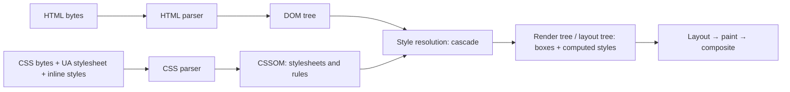
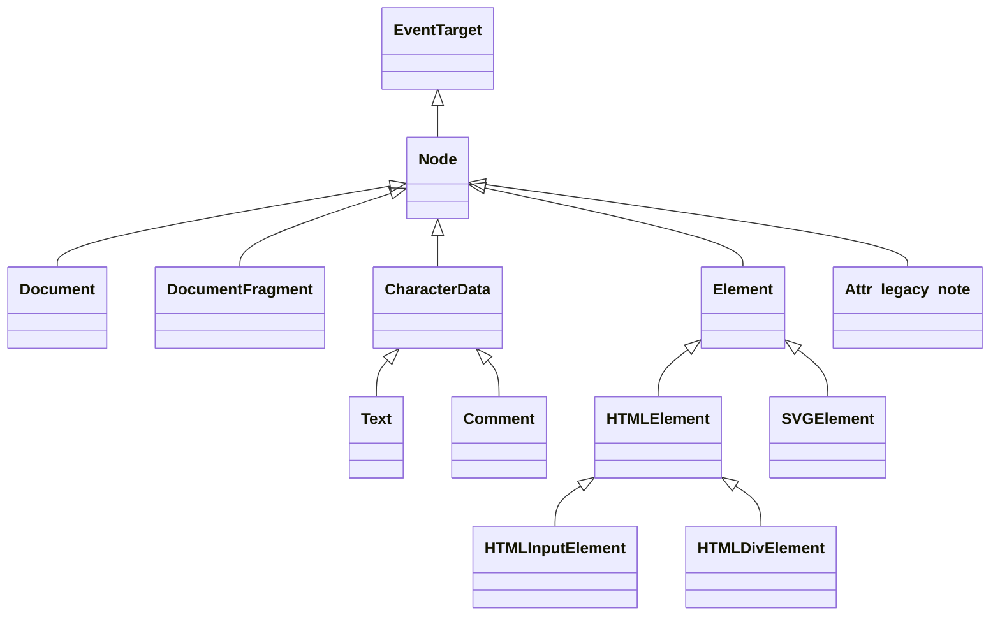
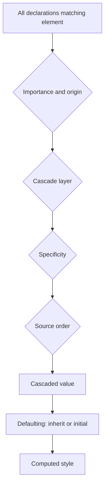
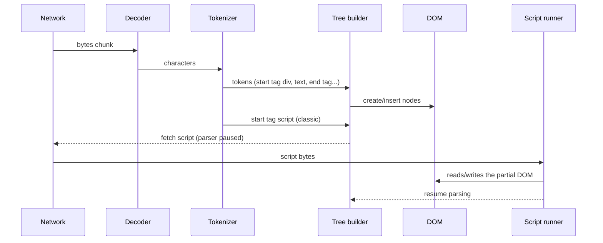
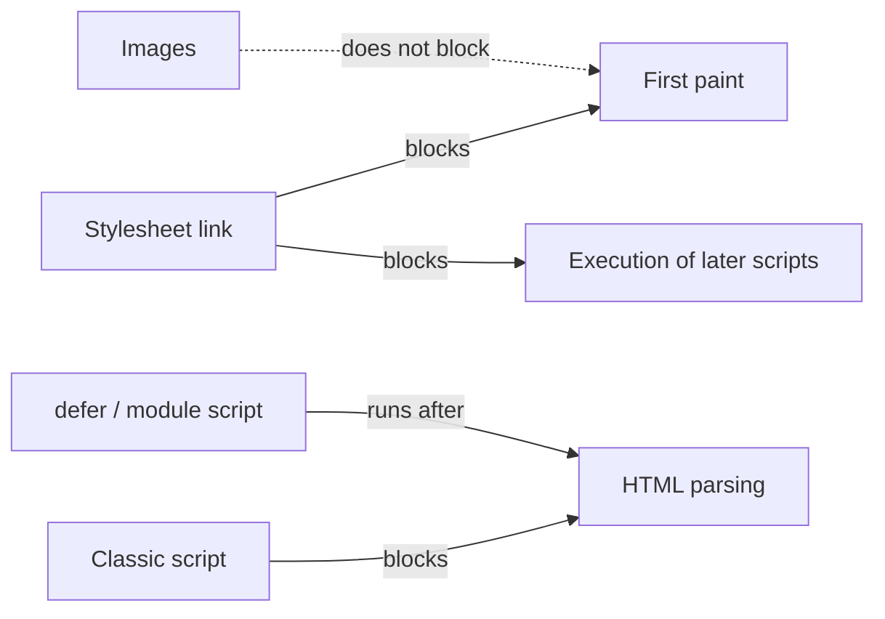

# 00 / 02 — HTML Parsing, the DOM, the CSSOM, and the Render Tree

## 1. Lesson metadata

| | |
|---|---|
| **Level** | Beginner |
| **Study time** | 3–4 hours (reading 1.5 h, experiments 1 h, exercises 1–1.5 h) |
| **Prerequisites** | [01 — How the browser works](./01-how-the-browser-works.md) (main thread, navigation, "parsing builds the DOM"). |
| **Next** | [03 — Style → layout → paint → composite](./03-browser-rendering-pipeline.md) |
| **Related later** | [04 — DOM structure and mutation](./04-dom-structure-and-mutation.md), [Phase 1 / 05 — JSX explained](../01-react-fundamentals/05-jsx-explained.md), [Phase 2 / 05 — React elements vs DOM nodes](../02-react-rendering-and-internals/05-elements-vs-dom-nodes.md), [Phase 2 / 25 — Hydration](../02-react-rendering-and-internals/25-hydration-and-selective-hydration.md) |

**Learning objectives.** After this lesson you can:
1. Describe how a stream of HTML bytes becomes a DOM tree, and why the result can differ from the markup you typed.
2. Explain what the DOM and the CSSOM are, and that they are *data structures with APIs*, not text.
3. Explain what the render tree (Chromium: layout tree) contains and omits, and why `display: none` and `visibility: hidden` differ.
4. Predict which resources block parsing and which block rendering.
5. Explain what React is actually building when it "renders", and why server HTML and client output must agree (hydration).
6. Inspect the DOM, computed styles, and parser-blocking behavior in DevTools.

**Concepts covered:** bytes → characters → tokens → nodes → tree; tokenizer and tree-construction stages; error-tolerant parsing and the implied-element rules; parser-blocking vs render-blocking resources; `async`/`defer`/`type="module"`; `DOMContentLoaded` vs `load`; DOM node types; attributes vs properties; CSS parsing, the cascade, specificity, computed style; CSSOM and `CSSStyleSheet`; render tree vs DOM; `display`, `visibility`, `content-visibility` at an introductory level; fragments and `<template>`; the "React root container"; hydration as parser-output reuse.

---

## 2. Deep conceptual explanation

### 2.1 What problem is this lesson solving?

React's job is to keep a tree of DOM nodes consistent with your state. If you treat the DOM as a magic canvas that "shows your markup", you will be confused by facts like:

- You wrote `<table><div>…</div></table>` in JSX and React warned about "invalid DOM nesting" — or your server-rendered HTML hydrated into something different from what you sent.
- Setting `input.value` in code does not change the `value="…"` you see in the Elements panel.
- A stylesheet loaded late made your page "jump"; a `<script>` in `<head>` made a blank page for seconds.
- `el.hidden = true` keeps an element in the tree but removes it from layout; `visibility: hidden` keeps it in layout but not visible. React's conditional rendering (`{open && <Panel/>}`) is *neither* — the node does not exist at all.

All of these have one root: **the browser converts text into in-memory object graphs, and everything after that (including React) manipulates those graphs, not text.** This lesson builds that graph model, so that later lessons ([03](./03-browser-rendering-pipeline.md), [04](./04-dom-structure-and-mutation.md), Phase 2) can refer to it precisely.

### 2.2 The big picture: text becomes objects, objects become boxes



Three structures are worth separating:

| Structure | What it represents | Who writes it | Exposed to JS as |
|---|---|---|---|
| **DOM** | The document's *content and structure*: elements, text, comments, attributes. | HTML parser, and then any script (`appendChild`, `innerHTML`, React). | `document`, `Node`, `Element`… |
| **CSSOM** | The *style rules*: stylesheets, rules, declarations. Plus per-element inline style objects. | CSS parser, and scripts (`insertRule`, `element.style`). | `document.styleSheets`, `CSSStyleSheet`, `CSSStyleDeclaration` |
| **Render tree** (Chromium/Blink calls it the *layout tree*; the HTML/DOM/CSS specs do not define a single "render tree" object) | The *things that will be drawn*: boxes with resolved (computed) styles, ready for layout. | The browser engine, derived from DOM + CSSOM. | Not directly. Indirectly through `getComputedStyle`, `getBoundingClientRect`. |

Teaching-model note: "render tree" is a pedagogical name that is widely used (including by MDN and older browser-architecture articles). Each engine's real internal structure is more intricate (separate box tree, fragment tree, paint property trees, accessibility tree…). The portable idea: **a derived structure that contains only what takes part in layout and painting, paired with resolved styles.**

### 2.3 HTML parsing: not just "reading tags"

#### 2.3.1 Two stages

The HTML Standard defines parsing as two cooperating algorithms:

1. **Tokenization.** A state machine turns a stream of characters into *tokens*: start tag, end tag, attribute, character data, comment, DOCTYPE, end-of-file.
2. **Tree construction.** A second state machine (with a stack of open elements and several "insertion modes") consumes tokens and creates DOM nodes, deciding where each goes.

Before step 1, bytes are decoded into characters according to the encoding (from HTTP `Content-Type`, a BOM, or `<meta charset>`). Encoding mistakes are a real source of garbled text; declare UTF-8.

#### 2.3.2 The parser is error-tolerant by specification

Unlike XML (or JSON), HTML parsing **never fails**. The standard defines what to do with *every* possible input, including nonsense. This is a public guarantee, and the reason why 1990s pages still render. It also means *the DOM is the parser's interpretation, not your text*.

Examples (all specified behavior):

```html
<p>One
<p>Two
```
`<p>` is auto-closed by the next `<p>`. Result: two sibling `<p>` elements.

```html
<p>Intro <div>Block</div></p>
```
A `<div>` start tag implicitly closes an open `<p>`. The stray `</p>` then creates an *empty* `<p>`. DOM: `p("Intro "), div("Block"), p()`. You wrote one paragraph; you got three nodes.

```html
<table><div>x</div><tr><td>cell</td></tr></table>
```
Content not allowed directly inside `<table>` is moved ("foster parented") to *before* the table, and the parser inserts `<tbody>` around the `<tr>`. DOM: `div`, then `table > tbody > tr > td`.

```html
<html><body>text</body></html>
```
Even when you omit `<html>`, `<head>`, `<body>`, the parser creates them (implied elements).

*Why this matters for React:*

- React does not go through the HTML parser when it creates elements on the client; it calls DOM APIs such as `document.createElement` and `appendChild`, so client-created trees can be "illegal" HTML (e.g., `<div>` inside `<p>`). The browser would never build that tree from markup. React DOM therefore **warns in development** about invalid nesting (`validateDOMNesting`-style warnings; the exact text varies by version).
- On the **server**, React produces an *HTML string*. The browser parses it with the rules above. If your component tree contained `<p><div/></p>`, the parsed DOM differs from React's expected tree, and **hydration** (§2.9) can mismatch. Valid nesting is a correctness rule, not style.

#### 2.3.3 Incremental, streaming construction

The parser consumes bytes as they arrive from the network; the DOM grows *during* download, and the browser may paint before parsing finishes. A consequence you will see in React's SSR streaming ([Phase 9](../09-advanced-rendering-and-ecosystem/01-spa-ssr-ssg-streaming.md)): the HTML is designed to be consumable progressively.

#### 2.3.4 Parser-blocking scripts

A classic `<script src="a.js"></script>` (no attributes) is **parser-blocking**: the parser pauses, the script is fetched and executed, and parsing resumes. The script may call `document.write`, which injects text into the parser's input, so the parser must wait. Two relevant facts:

- **Preload scanner (implementation detail, widely implemented).** Browsers typically run a lightweight secondary scan ahead of the blocked parser to discover and start fetching resources (scripts, styles, images). It is not in the HTML Standard's parsing algorithm as such, but all major engines do something similar. The practical effect: parser blocking costs *execution ordering*, but downloads are not strictly serialized.
- **A script that is placed before the elements it reads will not see them**, because they do not exist yet.

Script loading modes:

| Markup | Fetch | Execution | Preserves order? | Typical use |
|---|---|---|---|---|
| `<script src>` | Blocks parser | Immediately, blocking | Yes | Legacy; avoid in `<head>` |
| `<script defer src>` | Parallel | After parsing completes, before `DOMContentLoaded` | Yes (among deferred) | Classic app bundles |
| `<script async src>` | Parallel | As soon as downloaded (may interrupt parsing) | No | Independent scripts (analytics) |
| `<script type="module" src>` | Parallel | Deferred by default; module graph resolved first | Yes (relative to other deferred/module scripts) | Modern apps. This is what Vite emits: `<script type="module" src="/src/main.tsx">`. |
| Inline `<script>` | n/a | Immediately, blocking | Yes | Tiny bootstraps, theme flash prevention |

(Module scripts honor `async` if you add it; inline module scripts are also deferred.)

#### 2.3.5 Lifecycle events

- `DOMContentLoaded` fires when the document is parsed and deferred/module scripts have run — *not* waiting for images or stylesheets in general (stylesheets can delay *script* execution, hence indirectly the event).
- `load` fires after the page and its subresources (images, etc.) have loaded.
- `document.readyState`: `"loading"` → `"interactive"` → `"complete"`.

Vite SPAs have module scripts, so `createRoot(...).render(...)` runs after the HTML shell is parsed; the `#root` container already exists.

### 2.4 The DOM: a tree of typed objects

The DOM (Document Object Model) is defined by the DOM Standard. Its core types:



*(`Attr` is a `Node` historically but, in the modern standard, no longer a child-tree node. You rarely need it.)*

Key properties of the model:

1. **A node has at most one parent.** Appending a node that is already in the tree *moves* it. Remember this; it is why React reordering can reuse nodes with `insertBefore`.
2. **Nodes have identity.** The element you hold with `const el = document.querySelector(...)` *is* the live object. Replacing the subtree with `innerHTML` creates *new* objects; your old references become detached (still valid objects, no longer in the document). Preview of [Lesson 07](./07-functions-and-referential-identity.md): DOM nodes are compared by reference.
3. **Whitespace is text.** `<ul>\n  <li>` produces whitespace `Text` nodes between elements. `children` lists only elements; `childNodes` lists all nodes.
4. **Live vs static collections.** `getElementsByClassName` returns a live `HTMLCollection`; `querySelectorAll` returns a static `NodeList`.
5. **Everything is an `EventTarget`** — the basis of [Lesson 13](./13-browser-events-and-propagation.md).

#### Attributes vs properties

| | Attribute | Property |
|---|---|---|
| Lives in | The element's attribute list (what the parser read from markup) | The JS object's fields (the IDL attribute) |
| Type | Always a string | Typed (boolean, number, string, object) |
| Example | `<input value="a">` — attribute `value="a"` is the *default value* | `input.value` — the *current value* (the dirty value once the user types) |
| Reflects? | Some reflect (`id` ↔ `id`), some don't, some reflect one-way, e.g. `class` ↔ `className`, `for` ↔ `htmlFor`, `value` attribute → `defaultValue` |

Why React cares: JSX props are mapped to *either* attributes or properties by React DOM, using its own rules (`className`, `htmlFor`, `value`/`checked` for controlled inputs set as properties; `data-*`/`aria-*` as attributes; custom elements treated more directly in React 19). The Phase 1 lessons on controlled inputs rely on this distinction ([Phase 1 / 11](../01-react-fundamentals/11-controlled-and-uncontrolled-inputs.md)).

### 2.5 CSS parsing and the CSSOM

#### 2.5.1 Sources of style

For any element, the browser considers declarations from multiple **origins**:

1. **User-agent stylesheet** (browser defaults: `div { display: block }`, margins on `body`, etc.)
2. **Author stylesheets** (`<link rel="stylesheet">`, `<style>`, `@import`, constructable stylesheets)
3. **Inline style** (`style="…"` / `element.style`)
4. (User stylesheets/accessibility settings exist but are rarely relevant.)

#### 2.5.2 The cascade, specificity, inheritance

Given conflicting declarations for the same property on the same element, the **cascade** picks a winner using, in order (simplified): origin and importance (`!important`), then cascade layers (`@layer`), then **specificity** of the selector, then **source order**. Inheritable properties (`color`, `font-*`) pass to descendants if no declaration applies. The result per property is the **computed value** (and then the *used value* after layout, e.g. `width: auto` → `412px`).



`getComputedStyle(el)` returns the *resolved* style. It can *force* the browser to flush pending style/layout work (§[Lesson 03](./03-browser-rendering-pipeline.md) discusses forced synchronous layout).

#### 2.5.3 CSS is render-blocking

The browser will not paint content it cannot style correctly. A `<link rel="stylesheet">` in the document **blocks rendering** of the page (to avoid a flash of unstyled content) until it loads, with exceptions for `media` queries that do not match (e.g., `media="print"` is fetched at lower priority and does not block). It also **blocks execution of later scripts**, because those scripts may query computed style (`getComputedStyle`) and expect it to reflect all earlier stylesheets. Hence the common advice: put CSS early, scripts deferred.

#### 2.5.4 The CSSOM in JS

```ts
const sheet = document.styleSheets[0];
sheet.insertRule(".toast { opacity: 0 }", sheet.cssRules.length); // mutate CSSOM
document.documentElement.style.setProperty("--accent", "tomato"); // inline custom property
```

Modifying the CSSOM invalidates styles for elements the changed rules might match, causing style recalculation (and perhaps layout/paint) in the next rendering opportunity. **Runtime CSS-in-JS libraries** that inject `<style>` tags or call `insertRule` as components render do exactly this; this is the root of their performance trade-offs (revisit in [Phase 7](../07-performance/23-counterproductive-optimizations.md)).

### 2.6 From DOM + CSSOM to the render tree

The **render tree** (teaching model) contains one entry per *renderable* thing, with styles resolved:

| In DOM | In render tree? | Why |
|---|---|---|
| `<div>` with `display: block` | Yes — block box | |
| `<span>` with `display: inline` | Yes — inline box | |
| `<div style="display:none">` and its entire subtree | **No** | `display: none` generates no boxes |
| `<div style="visibility:hidden">` | **Yes**, takes up space, not painted | Box exists; only painting is suppressed |
| `<head>`, `<script>`, `<meta>`, `<link>` | No | UA stylesheet gives them `display: none` |
| `::before` / `::after` with `content` | **Yes**, though not in the DOM | Pseudo-elements are generated at the style stage |
| Text node of only collapsible whitespace between blocks | Typically no box | Whitespace collapsing |
| `<div hidden>` | No | UA stylesheet maps `[hidden]` to `display: none` |
| Element with `opacity: 0` | Yes | It is laid out and (often) painted/composited, just transparent; still receives pointer events |
| Offscreen element (`left: -9999px`) | Yes | Layout/paint still apply |

(`content-visibility: auto` and `display: contents` are more subtle: skipped rendering for offscreen content, and "box-less" wrappers. See MDN.)

Why the distinction matters in React:

```tsx
// Three ways to "hide" a panel; each has different DOM / render-tree consequences
{open && <Panel />}                                // not in DOM at all; state in Panel is destroyed
<Panel hidden={!open} />                           // in DOM, not in render tree; component state preserved
<Panel style={{ visibility: open ? "visible" : "hidden" }} /> // in DOM and render tree (occupies space)
```

The first removes the component from React's tree *and* the DOM (unmount; state lost — see [Phase 1 / 16](../01-react-fundamentals/16-state-preservation-and-reset.md)). The second keeps both React and DOM nodes but costs no layout. The third keeps layout space. Choosing between them is an engineering decision about **state preservation vs DOM weight vs layout stability**.

### 2.7 The DOM is the output target of React

React DOM's job, restated with this vocabulary:

- You give React a **container** — a DOM element that the parser already created from the HTML shell (`<div id="root">`).
- `createRoot(container).render(<App/>)` makes React compute a tree of *its own* objects (React elements, then internal fiber nodes; see [Phase 2](../02-react-rendering-and-internals/05-elements-vs-dom-nodes.md)) and then call DOM APIs to create and attach host nodes (`createElement`, `createTextNode`, `appendChild`, `setAttribute`, property assignment).
- React **does not run the HTML parser** on the client path for normal elements, and it does not own the whole document; it owns the *subtree under the container*. Anything else (`<head>` content written by a script, browser extensions inserting nodes into your container) can desynchronize assumptions.
- It does not touch the CSSOM, except when a library you use does.

### 2.8 Common misconceptions

| Misconception | Reality |
|---|---|
| "The DOM is my HTML." | The DOM is the parser's *interpretation*, then mutated by scripts. "View source" shows the original text; the Elements panel shows the live DOM. |
| "The render tree equals the DOM." | The render tree omits non-rendered nodes (`display: none`, `head`) and includes generated content (pseudo-elements). |
| "`opacity: 0` is the same as `display: none`." | `opacity: 0` keeps layout and (usually) hit testing and focusability. |
| "CSS doesn't affect JS." | Stylesheets block later script execution and style queries (`getComputedStyle`) flush style computation. |
| "Placing `<script>` at the end of `<body>` is the modern approach." | It was a workaround before `defer`/modules. Prefer `defer` or `type="module"` in `<head>` so downloads start early and execution waits for parsing. |
| "`innerHTML` is just a string assignment." | It invokes the HTML fragment parser, destroys existing child nodes (and listeners on them), and creates new ones. Inserted `<script>` elements do not execute. It is also a classic XSS sink. |
| "React sets the `value` attribute." | For inputs React sets the `value` *property* (plus sync of the attribute in some cases); the distinction is documented in React's `<input>` reference. |

---

## 3. Internal mechanics

### 3.1 The tokenizer and tree builder (public guarantee: the HTML Standard)

*Public guarantee.* The HTML Standard's parsing section specifies a precise algorithm. All conforming browsers produce *the same DOM* for the same input (barring scripting and encoding). That is why the DOM you see in Chrome for a malformed snippet matches Firefox's.

*Stack of open elements and insertion modes.* The tree builder maintains the **stack of open elements** (the current nesting path) and an **insertion mode** (e.g., "in body", "in table", "in select"). A start tag like `<div>` in "in body" mode first runs "close a `p` element if one is in button scope", then inserts. That rule is why `<p><div>` splits.

*Adoption agency algorithm.* Mis-nested formatting elements like `<b><i>text</b>more</i>` are repaired by a defined algorithm (the "adoption agency"). You will virtually never need it, but it explains why the DOM from `<b><i>x</b>y</i>` is `b>i>x` followed by `i>y`.

### 3.2 Scripts pause the parser; script execution can see a partial DOM

When the parser meets a classic script, the tree builder stops; the script runs with `document` containing everything built *so far*. This is why

```html
<script>document.getElementById("root").textContent = "hi"</script>
<div id="root"></div>
```
throws (`getElementById` returns `null`): the `div` is not yet created.

### 3.3 Style resolution (teaching model)

*Teaching model.* After (or while) parsing, the engine:

1. Parses CSS into rules; builds indexes (e.g., buckets by id/class/tag) to find matching rules quickly.
2. For each element, matches selectors **right-to-left** (a descendant selector `.a .b` starts from `.b` elements, then checks ancestors; that is why overly deep selectors are costlier).
3. Runs the cascade to get computed styles.
4. Attaches the computed style to a layout object for elements that generate boxes.

*Implementation detail.* Data structures (rule sets, invalidation sets, shared style caches) are engine-specific and change frequently. Rely on the observable guarantees: cascade rules, inheritance, and that style recalculation is scheduled and can be batched.

### 3.4 Incremental updates

The initial build is the *expensive* case. After load, changes are **incremental**: a class toggle invalidates only the affected elements; DOM insertion invalidates the new nodes (plus siblings and ancestors in some layout modes). This incrementality is why mutating a few nodes is cheap and why React's strategy "touch only what changed" pays off ([04](./04-dom-structure-and-mutation.md), [03](./03-browser-rendering-pipeline.md)).

### 3.5 What React 19 changes in this area

⚠ *Version-sensitive (React 19).* React 19 can **hoist** certain elements to the document `<head>` (`<title>`, `<meta>`, `<link>`; stylesheet `<link>` with `precedence`), and can suspend while a stylesheet loads, so that "CSS render-blocking" is integrated into React's Suspense behavior. Details and bundler/framework interplay evolve; consult the React 19 docs for `<link>`, `<style>`, `<title>`, and resource-preloading APIs (`react-dom`'s `preload`, `preinit`) before relying on them. The principle you need here: React is aware of the CSS-blocks-render rule and can coordinate with it.

---

## 4. Step-by-step execution walkthrough: a Vite SPA's first 300 ms

Input document (`index.html`, abbreviated):

```html
<!doctype html>
<html lang="en">
  <head>
    <meta charset="UTF-8" />
    <title>Shop</title>
    <link rel="stylesheet" href="/assets/app.css" />
    <script type="module" crossorigin src="/assets/index.js"></script>
  </head>
  <body>
    <div id="root"></div>
  </body>
</html>
```

(Production Vite output typically places the module script in `<head>`; exact attributes vary by version and config.)

1. **Bytes arrive** (streamed). The decoder produces characters (UTF-8 declared by `<meta charset>` — and, in practice, by the HTTP header).
2. **Tokenizer** emits `DOCTYPE`, start tag `html`, … The `<!doctype html>` puts the document in **no-quirks (standards) mode**; omitting it triggers *quirks mode*, which changes layout behavior.
3. **Tree builder** creates `Document`, `html`, `head`, `meta`, `title` (+ Text "Shop").
4. **`<link rel=stylesheet>`**: the parser *does not* block on it for parsing, but starts a fetch and marks the document **render-blocked** until it's applied.
5. **`<script type="module">`**: fetch begins in parallel (module graph discovery follows imports); the parser continues. (It is deferred by default.)
6. Parser reaches `<body>`, builds `div#root` (empty). Parsing ends: `readyState = "interactive"`.
7. **CSS arrives**, is parsed to CSSOM. Render-blocking cleared.
8. **First render** (nothing visible except the body's background, since `#root` is empty). Pure client-rendered SPAs paint a blank page here. That is the *time to first paint* but not *first meaningful paint*.
9. **Module scripts execute** (after parsing; before `DOMContentLoaded`). `main.tsx` runs `createRoot(document.getElementById("root")!).render(<App />)`. React renders to its internal tree, then in its commit step *calls DOM APIs* to create `div`, `h1`, text nodes, etc., under `#root`.
10. **Next rendering opportunity**: style resolution for new elements (they match rules from `app.css`), layout, paint, composite.
11. **`DOMContentLoaded`** fires; **`load`** fires once subresources finish.

Compare with **SSR** (preview of [Phase 9](../09-advanced-rendering-and-ecosystem/01-spa-ssr-ssg-streaming.md)): the HTML at step 1 already contains `<div id="root"><h1>…</h1>…</div>`. At step 6 the DOM *already holds* the UI, at step 8 first paint is meaningful, and at step 9 React calls `hydrateRoot` — walks the existing DOM, *attaches* its internal tree to existing nodes, and attaches event handling, instead of creating nodes.

---

## 5. Code examples

### 5.1 Minimal example — the DOM is not your text

```html
<!-- parse-demo.html -->
<div id="host"></div>
<script>
  host.innerHTML = "<p>Intro <div>Block</div></p>";
  console.log(host.childNodes.length);               // ?
  console.log([...host.children].map(c => c.tagName)); // ?
</script>
```

**Predict:** how many child nodes? Which tags?

**Result:** `3`; `["P", "DIV", "P"]`.

**Why:** the fragment parser applies the same tree-construction rules: `<div>` closes the open `<p>`, and the dangling `</p>` creates an empty `<p>`. (This example uses `innerHTML` with a `div` context; the same rule set applies.)

**Trade-off:** none; this is a demonstration. It shows that the tree you ask for in *markup* can differ from the tree you get. React's client path doesn't have this surprise because it builds nodes through DOM APIs — which is exactly why the SSR path can differ from it.

### 5.2 Practical example — inspect what is blocking first paint

```ts
// Run in DevTools console after load, to learn what the page waited for.
const [nav] = performance.getEntriesByType("navigation") as PerformanceNavigationTiming[];
console.table({
  responseEnd: nav.responseEnd,
  domInteractive: nav.domInteractive,                 // parsing done
  domContentLoadedEventStart: nav.domContentLoadedEventStart,
  loadEventStart: nav.loadEventStart,
});
for (const p of performance.getEntriesByType("paint")) {
  console.log(p.name, Math.round(p.startTime), "ms"); // first-paint, first-contentful-paint
}
const css = performance.getEntriesByType("resource").filter(r => r.name.endsWith(".css"));
console.table(css.map(r => ({ url: r.name, start: Math.round(r.startTime), end: Math.round(r.responseEnd) })));
```

Line notes:
- `domInteractive` is the moment parsing finished (`readyState = "interactive"`).
- `first-contentful-paint` can't occur before blocking CSS finishes. If FCP ≈ CSS `responseEnd`, the stylesheet is your critical path.
- `performance.getEntriesByType("navigation")` returns `PerformanceNavigationTiming` objects (broadly supported; verify details on MDN if you target old browsers).

### 5.3 Incorrect example — reading the DOM before it exists

```html
<head>
  <script src="/app.js"></script>      <!-- classic script in head -->
</head>
<body>
  <div id="root"></div>
</body>
```

```ts
// app.js
const root = document.getElementById("root"); // null
createRoot(root!).render(<App />);            // TypeError: createRoot(...): Target container is not a DOM element
```

**Why wrong:** The classic script is parser-blocking and runs *before* `#root` is parsed. Additionally, the file contains JSX, which a browser cannot execute — it requires a build step ([Lesson 20](./20-tooling-transpilation-and-bundling.md)).

### 5.4 Corrected implementation

```html
<head>
  <script type="module" src="/src/main.tsx"></script> <!-- deferred by default -->
</head>
<body>
  <div id="root"></div>
</body>
```

```tsx
// main.tsx
import { createRoot } from "react-dom/client";
import { App } from "./App";

const container = document.getElementById("root");
if (!container) throw new Error("Missing #root container");
createRoot(container).render(<App />);
```

Line notes:
- A module script is **deferred**; it runs after parsing, so `#root` exists.
- The explicit null check gives an actionable error instead of an opaque React one. (`!` hides the failure; use it only when you control the HTML shell and accept the crash.)

### 5.5 Advanced example — hidden, absent, and invisible

```tsx
import { useState, type ReactNode } from "react";

type Mode = "unmount" | "hidden-attr" | "visibility";

function Collapsible({ open, mode, children }: { open: boolean; mode: Mode; children: ReactNode }) {
  switch (mode) {
    case "unmount":
      return open ? <section>{children}</section> : null;
    case "hidden-attr":
      return <section hidden={!open}>{children}</section>;
    case "visibility":
      return <section style={{ visibility: open ? "visible" : "hidden" }}>{children}</section>;
  }
}

function Draft() {
  const [text, setText] = useState("");
  return <textarea value={text} onChange={(e) => setText(e.target.value)} />;
}

export function Demo() {
  const [open, setOpen] = useState(true);
  return (
    <>
      <button onClick={() => setOpen((o) => !o)}>toggle</button>
      <Collapsible open={open} mode="unmount"><Draft /></Collapsible>
      <Collapsible open={open} mode="hidden-attr"><Draft /></Collapsible>
      <Collapsible open={open} mode="visibility"><Draft /></Collapsible>
    </>
  );
}
```

**Predict:** type "abc" into all three textareas, click toggle twice. Which keep "abc"? Which occupy layout space while closed?

**Result:**
- `unmount`: **loses "abc"** (the `Draft` component unmounts; its state is destroyed; no DOM node; no space).
- `hidden-attr`: **keeps "abc"** (component stays mounted; `display: none` from UA rule; no space).
- `visibility`: **keeps "abc"**, and **keeps a gap** in layout.

**Why:** state belongs to the React component instance; the DOM presence is a separate question. The `hidden` attribute is handled by the browser's UA stylesheet (`[hidden] { display: none }`), so author CSS like `section { display: flex }` can *override* it — a famous gotcha.

**Trade-offs:** `hidden` keeps DOM weight and keeps effects running (the component is still mounted; effects still subscribed). For a big hidden subtree, unmounting may be cheaper; for state preservation, hiding is. React 19.2 added a stable `<Activity>` component (react.dev/blog/2025/10/01/react-19-2) that formalizes hiding: with `mode="hidden"` it preserves state, deprioritizes updates, and **unmounts effects** (runs their cleanups), unlike the plain `hidden` attribute, whose effects keep running. See react.dev/reference/react/Activity.

---

## 6. Visual explanations

### 6.1 Parsing pipeline



### 6.2 DOM vs render tree

```text
DOM                                  Render tree (teaching model)
html                                 root box
├─ head (display:none)                 └─ body box
│   ├─ meta                                 ├─ div#root box
│   ├─ link                                 │    ├─ h1 box → text run "Shop"
│   └─ script                               │    └─ ul box
└─ body                                     │         ├─ li box (::marker generated)
    └─ div#root                             │         └─ li box
        ├─ h1                               └─ ...
        ├─ ul
        │  ├─ li
        │  └─ li style="display:none"   ← in DOM, NOT in render tree
        └─ p style="visibility:hidden"  ← in DOM AND in render tree (not painted)
```

### 6.3 Blocking relationships



---

## 7. Alternative approaches and trade-offs

Choosing how to get UI content onto the screen at first load (a preview of Phase 9, grounded in this lesson's vocabulary):

| Approach | Where is the DOM built? | First paint contains content? | Complexity | Cost | Prefer when |
|---|---|---|---|---|---|
| Client-side render (CSR) SPA | In the browser, by React after JS runs | No (empty shell) until JS executes | Low | JS download/execute before content; CPU-bound on low-end devices | Authenticated dashboards with no SEO need, heavy interactivity |
| Server-side render (SSR) + hydrate | HTML parsed from server; React hydrates | Yes | Medium–High (server runtime, hydration correctness) | Duplicate work (render on server + hydrate on client); hydration mismatches | Public content, perceived-load sensitive |
| Static generation (SSG) | Pre-built HTML | Yes | Medium | Rebuild for changes | Content that changes rarely |
| Plain HTML + progressive enhancement | Browser parser only | Yes | Low for simple pages | Interactivity must be hand-written | Content sites, forms |
| Web Components / custom elements | Browser builds shadow DOM | Depends | Medium | Interop with React (mostly improved in 19) | Cross-framework widgets |

**When the "recommended" approach (SSR for fast first paint) is NOT best:** an internal admin tool behind a login, used on managed desktops with a warm cache. SSR adds server infrastructure and hydration risk with no SEO or perceived-load gain; CSR with a good loading skeleton is simpler and adequate.

For the *technique* of hiding UI:

| Criterion | `{open && <X/>}` | `hidden` attribute | `visibility:hidden` | `content-visibility` / `Activity` |
|---|---|---|---|---|
| Keeps state | No | Yes | Yes | Yes |
| DOM nodes | None | Present | Present | Present |
| Layout cost | None | None | Full | Reduced/skipped |
| Effects/subscriptions | Torn down | Still active (unless `Activity`) | Still active | Varies |
| Focusable/accessible | n/a | No (removed from a11y tree) | No | Varies |
| Preferred for | Large or rarely shown UI | Tabs where state must persist | Preserve layout space | Offscreen heavy content (measure and verify) |

---

## 8. Best practices and anti-patterns

**Do**
- Start documents with `<!doctype html>` and `<meta charset="utf-8">`; set `lang`.
- Load scripts with `defer` or `type="module"`; keep CSS in `<head>`.
- Produce **valid nesting** in JSX; treat dev-mode DOM nesting warnings as bugs.
- Keep the React container an element that *only React manages*. Don't hand-modify DOM inside it.
- Use `getComputedStyle` sparingly, knowing it may flush style/layout.

**Beginner mistakes**
- Assuming view-source equals the DOM.
- Using `innerHTML` with user content (XSS) and then wondering why listeners vanished.
- Using `<div>` inside `<p>`, `<a>` inside `<a>`, `<button>` inside `<button>`, block elements in `<span>`-only contexts.
- Forgetting the table structure (`<tr>` directly inside `<table>`; React warns).

**Experienced-developer mistakes**
- Rendering something that differs between server and client (`Date.now()`, `window.innerWidth`, `Math.random()`) and getting hydration mismatches.
- Injecting `<style>` per render with runtime CSS-in-JS, forcing repeated CSSOM updates and style recalc.
- Treating `display: none` as free: the subtree stays in the DOM, memory is retained, and mounted React effects keep running.
- Overriding `[hidden]` with `display: flex` in author CSS.

**Smells:** `document.write`; synchronous scripts in `<head>`; huge inline `<style>` blocks re-generated on each render; `!important` wars (cascade problems); third-party scripts loaded synchronously.

**Justified exceptions:** a tiny inline blocking script in `<head>` that sets `data-theme` before first paint to avoid a theme flash is a legitimate, deliberate parser-blocking script — keep it a few lines.

---

## 9. Real-world application

**E-commerce product page (public, SEO-sensitive).** Constraints: Largest Contentful Paint under ~2.5 s on mid-range phones, indexability, personalized price widgets. Understanding §2 makes the architecture decisions legible: the hero image and title should be in the *parsed HTML* (SSR/SSG) so they paint before JS arrives; the personalized widgets are client-rendered islands; CSS is inlined or small/critical to avoid render-blocking round-trips; third-party tag-manager scripts are `async` and cannot hold up the parser.

**Dashboard behind SSO (internal).** Constraints: dense tables, many widgets, long sessions. Hiding tabs with `hidden` rather than unmounting keeps scroll positions and chart state, but ten hidden tabs with 5,000 DOM nodes each hold memory and subscriptions. Engineering decision: keep the *active* tab mounted, unmount others but persist their view state in a store ([Phase 3 / 18](../03-react-state-and-hooks/18-state-colocation-and-lifting.md)).

**Micro-frontends / embedded widgets.** Constraints: style isolation. Shadow DOM gives each widget a separate DOM subtree and style scope; the global CSSOM rules from the host page don't apply inside. Trade-off: global design tokens must pass via CSS custom properties (which *do* inherit through shadow boundaries).

**Server-rendered email-like/regulated pages.** Constraints: must work without JS (accessibility, compliance). Only the parser path matters; React may be used just for server rendering to static HTML.

---

## 10. Debugging and troubleshooting

### 10.1 Symptom: "My JSX renders fine but React warns about invalid DOM nesting / hydration mismatch."

*Reproduce:*
```tsx
export function Bad() {
  return <p>Hello <div>world</div></p>; // div in p
}
```
*Investigate:* Read the dev warning; it names the offending parent/child. In a server-rendered app, compare **View source** (what the server sent) with the **Elements** panel (what the parser built). If *view source* has `<p>Hello <div>world</div></p>` but Elements shows three nodes, you have found the parser repair.
*Root cause:* the parser's insertion rules (§2.3.2) rearranged the tree; React's expected tree no longer matches.
*Fix:* change to valid structure (`<div>`/`<span>` choices, `<p>` only holds phrasing content).
*Validate:* warning disappears; in a hydrated app there is no mismatch error in the console.

### 10.2 Symptom: "White screen for 3 s, then content."

1. Network panel: look at HTML response, then waterfall: CSS and JS bundle sizes and order. A client-rendered shell is expected to be blank until JS runs.
2. Performance panel: look at the **Timings** (FCP, LCP), main-thread long tasks for script evaluation.
3. Check whether a **render-blocking CSS** (large, third-party, or `@import` chain) delays FCP: in the Network panel, FCP lines up with CSS `responseEnd`.
4. Root causes: huge bundle; blocking CSS chain; blocking third-party script; slow server response (TTFB).
5. Validate by re-recording with same throttling profile; compare FCP/LCP.

### 10.3 Symptom: "Setting `el.value` in the console doesn't change the DOM attribute I see."

*Root cause:* property vs attribute (§2.4). Elements panel shows attributes; the live value is a property. Inspect with `$0.value` after selecting the element, or `$0.getAttribute("value")`.

### 10.4 Symptom: "Flash of unstyled content / layout jump after load."

Check CSS delivery (late or async stylesheet), web font swap, images without width/height. In the Performance panel, enable "Layout Shifts" in the Experience track. Fix with early/critical CSS, `font-display` choices, explicit image dimensions. (Layout shift detail in [03](./03-browser-rendering-pipeline.md).)

### 10.5 Tools

- **Elements panel**: live DOM; toggle `:hover` state; "Computed" tab shows the cascade result and which rule won ("Styles" tab strikes out losers).
- **Rendering drawer → Paint flashing / Layout Shift Regions**.
- **`$0`** (selected element), `getEventListeners($0)` (Chromium), `document.styleSheets`.
- **Sources → Event Listener Breakpoints / DOM breakpoints**: "break on subtree modifications" catches who changes a node.

---

## 11. Exercises

### Level A — Knowledge
A1. Name the two stages of HTML parsing in the HTML Standard.
A2. Why can the DOM differ from the HTML source text?
A3. Which is in the render tree: `display: none` element, `visibility: hidden` element, `<head>`, an element's `::before` with content?
A4. Which scripts execute *before* `DOMContentLoaded`, and in which order?
A5. What is the difference between an attribute and a property? Give one element/attribute where they diverge.

### Level B — Code comprehension
B1. What DOM does this produce? Draw it.
```html
<table><tr><td>a</td></tr></table>
```
B2. Given
```html
<head>
  <link rel="stylesheet" href="slow.css">
  <script>console.log(getComputedStyle(document.body).margin);</script>
</head>
```
Does the `console.log` run before or after `slow.css` finishes? Why?
B3. In what order do these log?
```html
<script>console.log("A")</script>
<script defer>console.log("B")</script>
<script type="module">console.log("C")</script>
<script async src="d.js"></script> <!-- logs "D" -->
<script>console.log("E")</script>
```
(Assume `d.js` is cached and tiny.)
B4. Predict the output:
```ts
const host = document.createElement("div");
host.innerHTML = "<span>a</span><span>b</span>";
const first = host.firstElementChild!;
host.innerHTML = "<span>a</span><span>b</span>";
console.log(first === host.firstElementChild, first.isConnected, host.childNodes.length);
```

### Level C — Implementation
C1. Write a TypeScript function `countRenderableElements(root: Element): number` that counts descendants that likely generate boxes: exclude subtrees where computed `display` is `none`. (Do not count `display: contents` elements as boxes.)
C2. Write a small JSX component `TabPanel` that supports a `keepMounted` prop: when `true` use the `hidden` attribute; when `false` unmount children. Type the props.
C3. Write HTML for a page whose React bundle is loaded so that (a) it does not block parsing, (b) it runs after the DOM exists, (c) fonts/CSS don't delay the script *download*.

### Level D — Debugging
D1. A Vite app shows a blank page and the console says `Target container is not a DOM element`. The script tag is `<script src="/src/main.js"></script>` in `<head>` and it is not a module. Diagnose and fix (two valid fixes).
D2. Server-rendered React logs a hydration warning on a component that renders `<p>{children}</p>` where `children` sometimes contains a `<div>`. What exactly happens in the browser, and how do you fix it?
D3. A `<section hidden>` with CSS `section { display: grid }` is visible. Why? Provide two fixes.

### Level E — Architecture and engineering decisions
E1. A marketing site built in React (CSR) has poor LCP and low search visibility. Propose options (SSR, SSG, hybrid), and for each name the main risk. Choose one for a site with 40 pages that change weekly.
E2. A dashboard has 12 tabs; each renders ~2,000 DOM nodes and subscribes to a WebSocket channel. Decide: unmount vs `hidden` vs virtualized/`Activity`-like approach. Justify with state, memory, network, and complexity criteria.

### Level F — Expert challenge
F1. Design an experiment that proves (not asserts) that a stylesheet blocks the execution of a later inline script but not HTML parsing itself. State the setup, the observation, and what each outcome means. Include how to make the stylesheet artificially slow without modifying the browser.

---

## 12. Detailed answers and explanations

> Attempt the exercises first.

**A1.** Tokenization (characters → tokens) and tree construction (tokens → DOM nodes). A wrong answer is "lexing and parsing to AST" — HTML has no AST; the output is the DOM, built with a stack of open elements.

**A2.** Because the parser is error-tolerant and *normalizes* (implied `html/head/body/tbody`, auto-closed `p`, foster parenting), and because scripts mutate the DOM after parsing. View source shows the bytes; Elements shows the live DOM.

**A3.** Render tree contains: `visibility: hidden` element (yes, occupies space) and the `::before` with `content` (generated). Not: `display: none` element (no boxes), `<head>` (UA `display: none`). Common error: thinking `visibility: hidden` removes layout space.

**A4.** Classic inline/external non-async scripts run immediately at their position (during parsing). Then, after parsing completes, `defer` scripts and module scripts run in document order, before `DOMContentLoaded`. `async` scripts run whenever ready (possibly before or after `DOMContentLoaded`, in any order). Wrong answer: "defer scripts run in the order they finish downloading" — order is preserved.

**A5.** Attribute = string in the element's attribute list from markup (or `setAttribute`). Property = JS object field on the DOM object, typed. Diverge: `<input value="a">`: after the user types, `input.value` is the typed text while the attribute remains `"a"` (the `defaultValue`). Also `checked` vs `defaultChecked`; `<a href>` property returns the *resolved absolute URL*.

**B1.** `table > tbody > tr > td > "a"`. The parser inserts `tbody` (implied). Why plausible wrong answer fails: HTML's DOM isn't a literal transcription; CSS child selectors like `table > tr` never match.

**B2.** The inline script waits until `slow.css` is loaded and applied, then runs. Reason: the script reads computed style; the spec makes script execution wait for earlier pending stylesheets ("script-blocking stylesheet"). The parser is not paused for the stylesheet fetch by itself, but it *is* paused at the inline script, which is in turn waiting on the style. Net effect: parsing stops here until the CSS arrives. Therefore a slow stylesheet followed by *any* inline script can block building the rest of the DOM. Edge case: if the stylesheet's `media` doesn't match, it isn't script-blocking.

**B3.** Guaranteed: `A` before `E` (classic scripts run in position during parsing); `E` before `B` and `C` (deferred and module scripts wait for parsing to finish); `B` before `C` (document order is preserved among deferred/module scripts). `D` (async) is deliberately unordered: it runs whenever its download completes, so it can appear between `A` and `E`, or after them, even after `B`/`C`. Legal outputs include `A E B C D`, `A D E B C`, and `A E D B C`. If you gave one definite position for `D`, you over-claimed. Do not depend on `async` ordering.

**B4.** `false false 2`. `innerHTML` assignment *replaces all children with new nodes*; the old `first` is detached (`isConnected` is `false`; note that `host` itself isn't connected either, but `first` was removed from `host`). Result `childNodes.length` is 2. Lesson: node identity is not preserved by markup replacement; React avoids this by updating nodes in place ([04](./04-dom-structure-and-mutation.md)).

**C1. Reference solution**
```ts
export function countRenderableElements(root: Element): number {
  let count = 0;
  const walk = (el: Element) => {
    const display = getComputedStyle(el).display;
    if (display === "none") return;           // skip whole subtree
    if (display !== "contents") count++;      // contents: no box of its own
    for (const child of el.children) walk(child);
  };
  for (const child of root.children) walk(child);
  return count;
}
```
Evaluation criteria: skips the subtree on `none`; handles `contents`; uses `children` not `childNodes`. Edge cases: `getComputedStyle` calls force style recalculation — O(n) calls can be expensive; elements like `<head>` descendants are already `none`; `content-visibility` and `visibility: hidden` are not excluded (correct: boxes exist). SVG children may report different `display` values. It is an *approximation* of "has a box"; precise answer: `el.getClientRects().length > 0` (but that forces layout).

**C2. Reference solution**
```tsx
import type { ReactNode } from "react";

interface TabPanelProps {
  active: boolean;
  keepMounted?: boolean;
  id: string;
  labelledBy: string;
  children: ReactNode;
}

export function TabPanel({ active, keepMounted = false, id, labelledBy, children }: TabPanelProps) {
  if (!active && !keepMounted) return null;
  return (
    <div role="tabpanel" id={id} aria-labelledby={labelledBy} hidden={!active}>
      {children}
    </div>
  );
}
```
Notes: `hidden={!active}` is a boolean attribute; when `active` it is omitted. Accessibility: `role="tabpanel"` plus `aria-labelledby` association. Pitfall: don't override `display` on `[hidden]` in your CSS.

**C3.**
```html
<!doctype html>
<html lang="en">
<head>
  <meta charset="utf-8" />
  <meta name="viewport" content="width=device-width, initial-scale=1" />
  <link rel="stylesheet" href="/app.css" />
  <script type="module" src="/main.js"></script>
</head>
<body><div id="root"></div></body>
</html>
```
(a) Module scripts don't block parsing; (b) deferred until after parsing; (c) the preload scanner/parallel fetch means the script downloads while CSS downloads; script *execution* waits for CSS only if needed. An equally valid answer uses `<script defer src>`. Wrong: `async` (execution can happen before `#root` exists).

**D1.** Cause: classic script in `<head>` runs before `#root` is parsed; `getElementById` returns `null`. Fix 1: `type="module"` (deferred) or `defer`. Fix 2: move the script to the end of `<body>` (works, but loses early download). Note that JSX requires a build step; if `main.js` contains JSX it won't run at all in the browser without transformation.

**D2.** The server sends `<p>…<div>…</div></p>`. The browser parser closes the `<p>` at `<div>` and creates a stray empty `<p>` at `</p>`. During hydration React expects `p > div` but finds `p, div, p`: mismatch. React 19 reports the mismatch via `onRecoverableError` ("Hydration failed because the server rendered HTML didn't match the client…") and recovers by client-rendering the affected tree (verified in the sandbox with react-dom 19.3: jsdom parses `<p><div>x</div></p>` as `<p></p><div>x</div><p></p>`, React logs the nesting warning plus the recoverable error, and the final DOM is `<p><div>x</div></p>`); exactly how much is re-rendered depends on where the mismatch is. Fix: render `<div>` instead of `<p>` as the wrapper, or ensure `children` is phrasing content; add a lint rule. Wrong fix: suppressing the warning.

**D3.** `[hidden]` is only a UA-stylesheet rule (`display: none`), and author CSS beats UA CSS regardless of specificity (origin order). Fixes: add `section[hidden] { display: none; }` (or `[hidden] { display: none !important; }` in a reset) or render `null`/use a CSS class and `aria-hidden` combos. A reset like that is common in design systems.

**E1.** Options: (1) SSG — pre-render 40 pages at build; low runtime complexity; risk: rebuild pipeline latency (weekly changes make this fine). (2) SSR per request — fresh data; risk: server cost, caching, hydration bugs. (3) Hybrid (SSG + client islands for dynamic parts) — risk: two mental models. Choice: SSG (or framework static export) with hydrated interactive pieces, because content changes weekly and the page is public; evaluate against LCP/SEO/maintenance. Evaluation criteria: LCP, SEO, operational cost, developer experience, hydration risk. Counter-scenario: personalized pages per user need SSR or client fetch.

**E2.** A good answer: *Unmount* inactive tabs by default (memory and subscriptions released; simplest correctness), and store their view state (filters, scroll, selected rows) in a lifted/URL/store state so re-entering is cheap. Use `hidden`/keep-mounted only for a small number of tabs where remount cost is high (chart init, expensive layout) and the WebSocket subscription can be paused. A `<Activity>`-style API, if the React version supports it, can formalize "hidden but preserved" — verify availability and semantics in current docs. Measure: memory (heap snapshot per tab), re-open latency, WebSocket message rate. 12 × 2,000 nodes = 24,000 nodes mostly in `display: none` — style recalc cost is tolerable (not rendered) but memory and subscriptions are the problem.

**F1. Example answer.**
Setup: a tiny local server (for example Node's `http` module) that waits 3 s before responding to `/slow.css`. Two pages.

Page 1 (script after the stylesheet):
```html
<link rel="stylesheet" href="/slow.css">
<script>document.title = "script ran at " + Math.round(performance.now());</script>
<p>after</p>
```
Page 2 (no scripts at all, only a stylesheet):
```html
<link rel="stylesheet" href="/slow.css">
<p>after</p>
```
Observations: in Page 1, log `performance.now()` inside the script. If a pending stylesheet blocks script execution, the value is about 3000 ms or more, and the `<p>` is not yet in the DOM until then (the parser is waiting at the script). In Page 2, read `performance.getEntriesByType("navigation")[0].domInteractive` and the `first-contentful-paint` entry. Parsing is not blocked by the stylesheet alone, so `domInteractive` should be well under 3000 ms, while first paint should not occur before about 3000 ms (render-blocking). Control: repeat with `media="print"`; none of the delays should appear. Caveats: cache, the preload scanner and browser heuristics affect timings, so disable cache and repeat several times.

---

## 13. Senior engineer interview questions

**Q1. "Why does React warn when you nest a `<div>` in a `<p>`? React doesn't parse HTML on the client."**
*Strong answer:* On the client it wouldn't break, because React uses DOM APIs. But the same component tree rendered on the server becomes an HTML string that the browser's parser *repairs*, producing a different DOM from what React expects. Hydration then mismatches. Also screen readers/browsers treat invalid structures inconsistently. The warning protects the invariant "server HTML after parsing equals the tree React would build".

**Q2. "A page is blank for a second though the HTML arrives in 80 ms. Where do you look?"**
*Strong answer:* Distinguish render-blocking (CSS, sync scripts, fonts if `font-display: block`) from "nothing to show" (CSR needs JS). Waterfall in Network panel; compare FCP with CSS end and JS evaluation time; look for a main-thread long task before first React render. Then decide: inline critical CSS/split CSS, `defer`/module, SSR/SSG, smaller bundle.

**Q3. "`display: none` vs unmounting: how do you choose?"**
*Strong answer:* It's about state, cost, and side effects. `display: none`/`hidden` preserves component state and DOM but keeps memory and effects; unmounting frees both but loses uncontrolled state and requires re-creation work. Choose per subtree: preserve for cheap-to-hold, expensive-to-rebuild UI; unmount for heavy, rarely used UI; keep important state outside the component either way.

**Q4. "What is the render tree and why does it exist?"**
*Strong answer:* It is the derived structure pairing renderable DOM nodes with computed style, which layout consumes. It exists because layout/paint only care about generated boxes, not every DOM node, and because styles can generate boxes with no DOM nodes (pseudo-elements). It is a teaching term; engines have more specific trees.

**Q5. "Why might a late stylesheet make a script run later than you'd expect?"**
*Strong answer:* Because scripts may query styles; the spec delays script execution until earlier stylesheets that could affect them finish loading (script-blocking stylesheet). That is a reason to put CSS early or make non-critical CSS non-blocking, and to be careful with inline scripts placed after a link.

---

## 14. Further learning resources

| Resource | URL | Covers / why | Level | Study |
|---|---|---|---|---|
| HTML Standard — Parsing HTML documents | <https://html.spec.whatwg.org/multipage/parsing.html> | Normative tokenizer and tree-construction algorithms; the final word on how markup becomes DOM | Advanced | "Tree construction", insertion modes "in body", "in table" |
| DOM Standard | <https://dom.spec.whatwg.org/> | Node types, tree, mutation, live collections | Advanced | Nodes, Trees, Interface `Node` |
| HTML Standard — Scripting (script processing) | <https://html.spec.whatwg.org/multipage/scripting.html> | Precise `async`/`defer`/module semantics | Advanced | `script` element processing model |
| MDN — Document Object Model | <https://developer.mozilla.org/en-US/docs/Web/API/Document_Object_Model> | API reference and introduction | Beginner | Introduction and Locating DOM elements |
| MDN — Populating the page: how browsers work | <https://developer.mozilla.org/en-US/docs/Web/Performance/Guides/How_browsers_work> | Parsing, render tree, layout, paint | Beginner | Whole page |
| MDN — CSS cascade | <https://developer.mozilla.org/en-US/docs/Learn_web_development/Core/Styling_basics>, or search "Cascade, specificity, and inheritance" on MDN | Cascade and specificity | Beginner | Cascade |
| MDN — `<script>` element | <https://developer.mozilla.org/en-US/docs/Web/HTML/Reference/Elements/script> | `async`, `defer`, `type="module"` | Beginner | Attributes |
| react.dev — `createRoot` | <https://react.dev/reference/react-dom/client/createRoot> | The container concept | Beginner | Parameters and caveats |
| react.dev — `hydrateRoot` | <https://react.dev/reference/react-dom/client/hydrateRoot> | Hydration expectations and mismatch handling | Intermediate | Caveats |
| react.dev — Components (`<link>`, `<title>`) | <https://react.dev/reference/react-dom/components> | React 19 document-metadata and resource components | Intermediate | `<link>`, `<style>`, `<title>` |

Links marked were not fetched in this session; MDN reorganizes paths periodically, so fall back to the site search with the quoted title.

---

## 15. Knowledge checkpoint

**You should now understand**
- HTML parsing as tokenization + tree construction with built-in error repair, so the DOM ≠ source text.
- DOM and CSSOM as live object graphs; the render tree as a derived, box-oriented structure.
- Parser-blocking vs render-blocking resources, and `defer`/module semantics.
- Attributes vs properties, and `hidden`/`visibility`/unmount differences.
- Why React's server output and client output must be valid and equal after parsing.

**You should be able to explain without notes**
- Why `<p><div/></p>` produces a hydration problem.
- What a stylesheet blocks (paint, later script execution) and what it doesn't (parsing by itself).
- What `createRoot` needs from the HTML document.

**You should be able to implement**
- A correct module-based HTML shell; a `TabPanel` with preserved/unmounted modes; a DevTools snippet that reports paint and parse timings.

**You should be able to debug**
- Null container errors, nesting/hydration warnings, blank-first-paint delays, and `[hidden]` overrides.

**Before moving on:** read [03 — Style → layout → paint → composite](./03-browser-rendering-pipeline.md), which takes the render tree built here and turns it into pixels; then [04 — DOM structure and mutation](./04-dom-structure-and-mutation.md). Lessons [05](./05-execution-contexts-and-call-stack.md)–[08](./08-objects-references-immutability.md) (the JavaScript-language track) are independent of 02–04 and can be interleaved.
