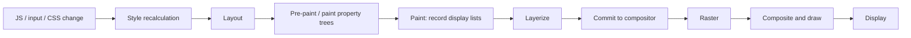
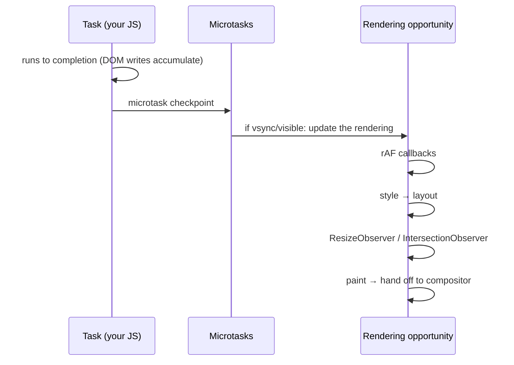
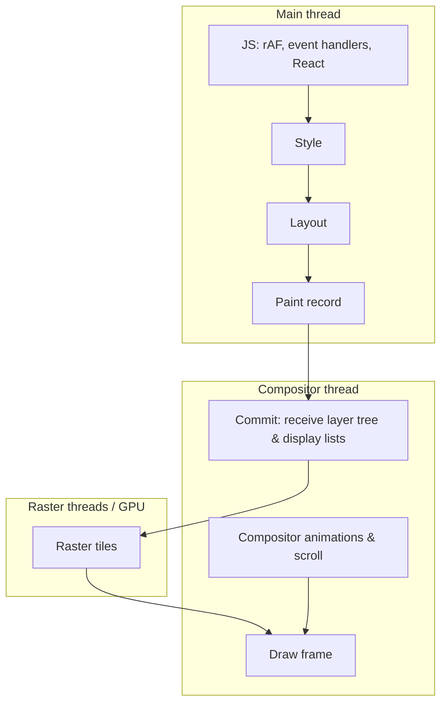
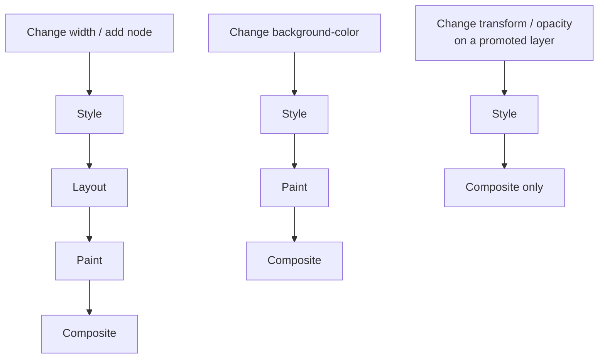

# 00 / 03 — Style → Layout → Paint → Composite: The Browser Rendering Pipeline

## 1. Lesson metadata

| | |
|---|---|
| **Level** | Intermediate |
| **Study time** | 4 hours (reading 2 h, experiments 1 h, exercises 1 h) |
| **Prerequisites** | [01 — How the browser works](./01-how-the-browser-works.md) (main thread, frame budget); [02 — HTML parsing, DOM, CSSOM, render tree](./02-html-parsing-dom-cssom-render-tree.md) (the render tree and computed style). |
| **Next** | [04 — DOM structure and mutation](./04-dom-structure-and-mutation.md) |
| **Related later** | [Phase 2 / 02 — Render, reconcile, commit, paint](../02-react-rendering-and-internals/02-render-reconcile-commit-paint.md), [Phase 2 / 19 — Layout vs passive effects](../02-react-rendering-and-internals/19-layout-vs-passive-effects.md), [Phase 2 / 21 — Browser paint and React updates](../02-react-rendering-and-internals/21-browser-paint-and-react-updates.md), [Lesson 17 — JS performance fundamentals](./17-javascript-performance-fundamentals.md) |

**Learning objectives.** After this lesson you can:
1. Name the stages between "the DOM changed" and "pixels changed", and say what each one computes.
2. Explain what invalidates each stage, and which CSS properties typically trigger which stages.
3. Explain *forced synchronous layout* and *layout thrashing*, and recognize them in code and in a flame chart.
4. Explain why `transform` and `opacity` animations can stay smooth while JavaScript is busy, and what the costs of layers are.
5. Explain what `useLayoutEffect` is for in terms of this pipeline (and why it is rarely the right tool).
6. Interpret the Performance panel's Style/Layout/Paint/Composite activity and a layout-shift region.

**Concepts covered:** rendering opportunity, "update the rendering" steps, style recalculation, layout (reflow), paint (display lists), layer tree, raster, composite, invalidation, dirty bits, CSS triggers, forced synchronous layout, layout thrashing, compositor-only properties, `will-change`, stacking contexts and layers, layout shift, `requestAnimationFrame`, `ResizeObserver`/`IntersectionObserver`, CSS containment, `content-visibility`.

---

## 2. Deep conceptual explanation

### 2.1 What problem is this lesson solving?

[Lesson 02](./02-html-parsing-dom-cssom-render-tree.md) ended with a render tree: boxes plus computed styles. A render tree is still not pixels. Something has to decide *where* each box goes and *what* it looks like, and the cost of that depends heavily on **what you changed**. Changing `color` on one node and changing `width` on a container near the document root can differ by two orders of magnitude in browser work.

React developers hit this lesson in disguise:

- "My list animates smoothly in the demo and stutters in production." (Layout-triggering animation vs compositor-only animation, plus main-thread contention.)
- "I measure an element in `useEffect` and the tooltip flickers into place." (Paint happened before your measurement-based position was applied.)
- "I call `getBoundingClientRect()` in a loop and the page crawls." (Forced synchronous layout.)
- "React finished rendering in 5 ms but the interaction still took 120 ms." (Layout/paint after commit; [Phase 2 / 21](../02-react-rendering-and-internals/21-browser-paint-and-react-updates.md).)

React cannot optimize anything in this lesson on your behalf. It decides **which DOM writes happen and when**; the pipeline below decides what those writes *cost*.

### 2.2 The pipeline at a glance



Condensed as the four names you will use daily:

| Stage | Question it answers | Output | Thread (Chromium-style model) |
|---|---|---|---|
| **Style** | Which rules apply to each element? What are the computed values? | Computed style per element | Main |
| **Layout** (reflow) | How big is each box and where is it? | Geometry (position/size, line breaks) | Main |
| **Paint** | What are the drawing instructions, in what order? | Display lists (draw rect, text, image…) per layer/stacking context | Main (recording) |
| **Composite** | How do layers stack, transform and combine into a frame? | Final frame sent to the display | Compositor thread + GPU/raster |

⚠ *Teaching model.* Real engines break these into more steps (pre-paint tree building, layerization, raster scheduling, tiling, GPU process work). Names differ (WebKit/Blink "layout", Gecko "reflow"). The four-stage model is the standard portable abstraction and is sufficient for every decision in this course.

### 2.3 Where this sits in the event loop

[Lesson 01 §3.1](./01-how-the-browser-works.md) introduced the HTML event loop: a task runs to completion, microtasks drain, and then *if it is time to render*, the browser performs the **"update the rendering"** steps. Among them (HTML Standard, in order, simplified): run `requestAnimationFrame` callbacks, then style recalculation and layout, `ResizeObserver` notifications (which may loop back through layout), `IntersectionObserver` computations, and painting. The user agent decides whether a rendering opportunity exists (vsync cadence, tab visibility, throttling).

Public guarantee: **rAF callbacks run before the frame's style/layout/paint**. Implementation freedom: whether a given loop iteration renders at all.



**Key consequence: DOM and CSSOM writes are lazy.** `el.style.width = "300px"` does not recompute layout. It marks things *dirty*. The browser coalesces all writes in a task (and across microtasks) into one pass at the next rendering opportunity. This is why a React commit that performs 200 DOM mutations does not trigger 200 layouts. It is also why *reading* geometry mid-way (§2.6) is dangerous: it forces the deferred work to happen *now*.

### 2.4 Stage by stage

#### 2.4.1 Style recalculation

Triggered when something that can affect matching or cascade changes: DOM insertion/removal, `class`/`id`/attribute changes, inline style changes, stylesheet changes, media-query/state changes (`:hover`, viewport resize). The engine invalidates (marks dirty) only potentially affected elements, then recomputes their styles.

Cost drivers: number of affected elements, selector complexity, and *scope of invalidation* (changing a class on `<body>` may potentially affect every descendant matching `.dark .card`-style selectors). Modern engines are good at this; it is rarely the first bottleneck, but "style recalc" can dominate with huge DOMs and broad selectors.

#### 2.4.2 Layout

Layout computes the **geometry**: sizes, positions, line breaks, intrinsic sizes for flow, flex, grid, tables, and more. It is *context dependent*: a block's height depends on its children; a child's width may depend on its parent; flex/grid distribute space among siblings. Therefore changing one box's size can ripple to siblings, ancestors, and descendants.

*Dirty bits and subtree layout.* Engines track which boxes need layout, and can often limit work to a subtree (e.g., a fixed-size container isolates its descendants). Properties like `position: absolute` or CSS containment (`contain: layout`, `contain: strict`) strengthen that isolation. Where independence cannot be proven, the engine must re-lay-out more.

Cost drivers: DOM size, depth, layout mode (tables and deep nested flex/grid can be costly), text shaping/line breaking (text-heavy), and **how many times per frame** layout is forced.

#### 2.4.3 Paint

Paint does not rasterize pixels (usually). It **records** a list of draw operations (rect fills, glyph runs, borders, shadows, images, clips) in *paint order* (stacking context rules: backgrounds, then z-index negatives, blocks, floats, inlines, positioned, etc.). Output: display lists, per layer or paint chunk. Properties that change appearance without changing geometry (`color`, `background`, `box-shadow`, `border-radius`) typically need paint but not layout.

*Public guarantee:* stacking-context and paint-order rules are specified in CSS. *Implementation detail:* when and how display lists are split into chunks/layers and rasterized.

#### 2.4.4 Layerization, raster, composite

The engine decides which parts of the page become separate **compositor layers** (surfaces that can be moved, transformed, faded, and cached independently). Reasons include: 3D transforms, `will-change: transform/opacity`, active animations of `transform`/`opacity`, `position: fixed` in some situations, `<video>`/`<canvas>`, overflow scroll containers, etc. The reasons are heuristics and change between browser versions. *Raster* turns display lists into bitmaps (tiles, often on GPU). *Composite* draws layers in order with their transforms, opacity, clips, then presents the frame.

The big payoff: if only a layer's **transform** or **opacity** changes, and the layer is already rasterized, the compositor can produce the next frame **without main-thread work** (no style/layout/paint). This is why `transform: translateX()` animation can stay at 60 fps while JS is blocked, whereas animating `left` re-runs layout and paint on the main thread every frame.

### 2.5 What triggers what

Rule of thumb (see MDN or the "CSS Triggers" idea; verify per engine):

| You change… | Style | Layout | Paint | Composite only |
|---|:-:|:-:|:-:|:-:|
| `width`, `height`, `margin`, `padding`, `top/left`, `font-size`, `display`, adding/removing nodes, text content | ✓ | ✓ | ✓ | |
| `color`, `background-color`, `box-shadow`, `border-radius`, `outline`, `visibility` | ✓ | | ✓ | |
| `transform`, `opacity` (on an element that is/can be its own layer) | ✓ | | | ✓ (ideally) |
| `filter`, `backdrop-filter` | ✓ | | often paint/composite | engine-dependent |

*"Style ✓"* is present in every row because every change must at least recompute style for the affected elements; the interesting differences are the downstream columns.

⚠ These are *heuristics*, not guarantees. Whether a `transform` change is composite-only depends on the element having been promoted to its own layer and not being forced to repaint by something else. Verify with DevTools **Layers** and **Rendering → Paint flashing**.

### 2.6 Forced synchronous layout and layout thrashing

Because layout is lazy, the browser keeps a "layout is dirty" flag. Some JavaScript APIs *return values that depend on layout*:

- `offsetWidth/Height/Top/Left`, `clientWidth/Height`, `scrollTop/Height`, `getBoundingClientRect()`, `getClientRects()`, `innerWidth` (sometimes), `getComputedStyle(el).<layout-dependent property>`, `focus()` scrolling effects, `elementFromPoint`, etc.

If layout is dirty and you call one of them, the browser **must compute layout right now** to answer. That is a **forced synchronous layout** (also "forced reflow"). A single forced layout is normal and sometimes necessary. The trouble is *alternating writes and reads*:

```ts
// Layout thrashing: write → read → write → read ...
for (const el of items) {
  el.style.width = container.offsetWidth / 2 + "px"; // read (forces layout if dirty) then write (dirties it)
}
```

Each iteration reads (forcing full layout because the previous iteration's write made it dirty) then writes (dirtying again). With *n* elements you pay *n* layouts instead of one. The fix is to **batch**: do all reads, then all writes.

```ts
const w = container.offsetWidth / 2;     // one read (one layout if dirty)
for (const el of items) el.style.width = w + "px"; // writes only; layout once, later
```

The Performance panel shows this as repeated purple *Layout* blocks nested in your script with a warning "Forced reflow is a likely performance bottleneck."

#### Why React developers must care

- React's **commit phase** applies DOM writes in a batch; your *layout effects* run synchronously after the writes ([Phase 2 / 19](../02-react-rendering-and-internals/19-layout-vs-passive-effects.md)). A layout effect that *reads* geometry therefore forces one layout (the first read after the writes). That is acceptable and is the purpose of `useLayoutEffect`. But **many components each doing read→setState→write** can multiply forced layouts, since setting state inside a layout effect triggers a synchronous re-render before paint.
- Passive effects (`useEffect`) usually run *after* paint. Measuring there means the user may see one frame with the wrong position — the "flicker" symptom.

### 2.7 Layout shift

When layout results change after content has already been painted — a late image without dimensions, a font swap, an ad inserted above content, a banner injected by an effect — visible content jumps. The Cumulative Layout Shift (CLS) metric scores unexpected shifts. Pipeline view: the shift is "layout produced a different geometry in a later frame than the earlier frame, with no user input". React-specific cause: rendering a placeholder with zero height, then swapping in real content after data arrives. Fix by reserving space (explicit dimensions, aspect-ratio, skeletons of equal size).

### 2.8 Common misconceptions

| Misconception | Reality |
|---|---|
| "Every DOM change repaints the screen immediately." | Changes accumulate; one pipeline pass per rendering opportunity. |
| "Reflow and repaint are the same thing." | Reflow = layout (geometry). Repaint = paint (appearance). A repaint without reflow is cheaper. |
| "`transform` is always free." | Only if the layer exists and nothing forces repaint. Too many layers cost GPU memory and can *slow* things. |
| "Use `will-change` on everything to be fast." | Each promoted layer consumes memory; MDN explicitly advises using `will-change` sparingly, as a last resort, and removing it when done. |
| "React batches DOM writes, so layout thrashing can't happen in React apps." | React batches *its own* commit writes. Your effects, refs, and event handlers can still interleave reads/writes. |
| "`useLayoutEffect` is the correct way to run effects early." | It is for **measuring/adjusting layout before paint**. It blocks painting, so it makes things *slower* if used for non-layout work. |
| "requestAnimationFrame runs after paint." | rAF callbacks run *before* style/layout/paint in the same frame. |
| "60 fps means everything must finish in 16.7 ms." | The *main-thread* budget is lower (input, JS, style, layout, paint recording share it); compositor-only animations don't consume it. |

---

## 3. Internal mechanics

### 3.1 Invalidation and dirty bits (teaching model)

Each stage maintains *what needs recomputation*:

- A mutation records a **style invalidation** for affected nodes (class changes use invalidation sets: "elements that could match a selector using this class").
- Style recalculation computes new `ComputedStyle`s and compares to old; the *difference* (diff) drives what's dirtied next: a change in geometry-affecting properties sets **layout needed** on the box and its ancestors up to a layout boundary; a change in paint-only properties sets **paint invalidation** for that box's visual rect.
- Layout results feed paint invalidation (a moved box needs repainting at old and new positions).

*Public guarantee:* the **observable** behavior: values returned by layout-dependent APIs are always up to date (this is exactly why forced layouts exist). *Implementation detail:* the invalidation machinery, caches, and dirty-bit propagation (e.g., "relayout boundary" concepts) are engine-specific and change.

### 3.2 Frame production across threads



Observations:

- **Commit** (main → compositor handoff) is the synchronization point. In Chromium terminology it blocks the main thread briefly; do not confuse it with **React's commit phase** — different thing, same word. (This ambiguity is a frequent source of confusion; we always write "browser commit" vs "React commit".)
- A scroll or compositor animation can proceed from the compositor's **copy** of the layer tree while the main thread runs JS. This is the mechanism behind "smooth despite jank" and why **non-passive scroll/touch listeners** can undermine it (the compositor has to wait for JS to know whether `preventDefault()` is called). Passive listeners (`{ passive: true }`) tell the browser JS won't cancel the scroll.

### 3.3 Layers, stacking contexts, and memory

Layers are not free: each has backing store sized to its visible/tiled region × device pixel ratio. 4K or high-DPR displays multiply that. A page with hundreds of promoted layers ("layer explosion") can exhaust GPU memory, causing poor performance or fallback. Overlap can force implicit promotion: an element positioned above a composited layer may be promoted ("squashing" heuristics try to limit this).

### 3.4 Containment and skipping work

CSS **containment** lets you declare independence: `contain: layout` (internals don't affect outside layout), `paint` (nothing paints outside), `size` (size independent of children), `style` (counters etc.). `content-visibility: auto` goes further: the browser may **skip rendering work** (style/layout/paint) for off-screen subtrees until near the viewport; you usually supply `contain-intrinsic-size` so the scrollbar doesn't jump. ⚠ Browser support and semantics evolve (it has been Chromium-first and later broadened); check MDN compatibility before relying on it, and measure — for long lists, **virtualization** (not rendering the nodes at all) is stronger ([Phase 7 / 09](../07-performance/09-windowing-and-virtualization.md)).

### 3.5 Fonts, images, and intrinsic sizing

Layout depends on font metrics and image dimensions. Until a font loads, text may be laid out with a fallback font (FOUT) or hidden (FOIT) depending on `font-display`; when the real font arrives, line breaks change and layout reflows. Images without `width`/`height` (or `aspect-ratio`) have zero height until the header bytes arrive → shift. These are not "React problems" but React apps ship them often because components created in isolation lack dimensions.

### 3.6 Version-sensitive notes

⚠ Which properties are compositor-only, which layer-promotion heuristics apply, and what DevTools labels them vary by browser version. Newer web platform features (view transitions, scroll-driven animations, `@starting-style`) change how animations integrate with the pipeline; check MDN and the browser's release notes for current behavior. React's own `<ViewTransition>` integration, where available, is experimental/volatile at the time of writing — verify in current React docs before use.

---

## 4. Step-by-step execution walkthrough: a click expands an accordion in a React app

Scenario: a button toggles `open` state; a panel's height should change from 0 to its content height.

1. **Input task.** `click` is queued; the handler runs on the main thread: `setOpen(true)`.
2. **React render** (still inside the same task for a discrete event): the component function executes; React compares new and old element trees. No DOM changes yet.
3. **React commit.** React mutates DOM: inserts the panel's children, sets `aria-expanded`, maybe changes a `className`. These are DOM/CSSOM writes: style and layout are **marked dirty** only.
4. **Layout effects** (`useLayoutEffect`) run synchronously after DOM mutation. Suppose one reads `panelRef.current.scrollHeight` to set `style.height`: the read **forces style recalculation + layout** now; React then sets the height (dirtying layout again).
5. **Task ends; microtasks drain.** Passive effects (`useEffect`) are typically scheduled to run after paint, but React may flush them earlier in certain cases (e.g., before processing the next discrete event). ⚠ Implementation-level behavior; see [Phase 2 / 18–19](../02-react-rendering-and-internals/18-effects-and-their-timing.md).
6. **Rendering opportunity.** `requestAnimationFrame` callbacks run (if any), then style recalc (remaining dirty), **layout** (the panel's new height pushes content below it down; ancestors resized; siblings moved), `ResizeObserver` callbacks (if any), then **paint recording** (new text and backgrounds; moved content invalidated).
7. **Layerize and commit to compositor**, **raster** new tiles, **composite** and present.
8. The user sees the opened panel. *Total user-visible latency = input delay + handler + render + commit + effects + style + layout + paint + raster/composite + display*. React owns steps 2–5; the browser owns 6–7.

If the panel's `height` is **animated** by CSS transition (`transition: height 200ms`), steps 6–7 repeat every frame for 200 ms, each time running layout for the panel and everything below it. Animating `transform` or `grid-template-rows` (modern technique, check support) / `opacity` instead can reduce that.

---

## 5. Code examples

### 5.1 Minimal example — thrashing vs batching

```ts
function resizeBad(items: HTMLElement[], container: HTMLElement): void {
  for (const el of items) {
    el.style.width = `${container.offsetWidth / 2}px`; // read after previous write
  }
}

function resizeGood(items: HTMLElement[], container: HTMLElement): void {
  const w = container.offsetWidth / 2;               // all reads first
  for (const el of items) el.style.width = `${w}px`; // then all writes
}
```

**Predict:** 2,000 items inside a reasonably complex page. Roughly how many layouts does each version force?

**Result:** `resizeBad` forces up to ~2,000 layouts (one per iteration, because each write dirties layout and the next read demands a clean one); `resizeGood` forces at most one (for the read), with the writes' layout deferred to the rendering opportunity.
**Why:** layout is lazy; a layout-dependent read after a write makes it eager.
**Caveat:** if `container`'s width doesn't actually depend on the items' widths, some engines can skip work when the dirty region is clearly irrelevant, so measured gaps vary, but you shouldn't count on that.

### 5.2 Practical example — measure-then-position (tooltip) with `useLayoutEffect`

```tsx
import { useLayoutEffect, useRef, useState, type ReactNode } from "react";

interface TooltipProps {
  anchor: HTMLElement | null;
  children: ReactNode;
}

export function Tooltip({ anchor, children }: TooltipProps) {
  const ref = useRef<HTMLDivElement>(null);
  const [pos, setPos] = useState<{ top: number; left: number } | null>(null);

  useLayoutEffect(() => {
    if (!anchor || !ref.current) return;
    const a = anchor.getBoundingClientRect();       // read (forces layout once)
    const t = ref.current.getBoundingClientRect();  // read (layout already clean)
    setPos({
      top: a.top - t.height - 8,
      left: a.left + (a.width - t.width) / 2,
    });
  }, [anchor, children]);

  return (
    <div
      ref={ref}
      role="tooltip"
      style={{
        position: "fixed",
        top: pos?.top ?? 0,
        left: pos?.left ?? 0,
        visibility: pos ? "visible" : "hidden", // measured but not shown on first pass
      }}
    >
      {children}
    </div>
  );
}
```

Line notes:
- The first render is invisible (`visibility: hidden` keeps the box laid out so it can be measured; `display: none` would measure as 0×0, see [Lesson 02](./02-html-parsing-dom-cssom-render-tree.md)).
- Both reads happen consecutively before any write → one forced layout.
- `setPos` inside a layout effect makes React re-render **synchronously before the browser paints**, so the user never sees the unpositioned state. With `useEffect` there could be a painted frame with the tooltip at `(0,0)` or hidden — a visible flicker.
- Dependency array `[anchor, children]`: `children` is a React element, so a new object each parent render; this effect re-runs whenever the parent renders. A concrete preview of [Lesson 07](./07-functions-and-referential-identity.md) (identity) — in production code use a stable primitive (e.g., `content: string`) or measure with a `ResizeObserver`.

**Trade-offs:** layout effects block paint; keep them tiny. A CSS-only solution (anchor positioning, `popover` + CSS anchor positioning where supported, or a positioning library like Floating UI) avoids JS measurement. ⚠ CSS Anchor Positioning support is still evolving; check MDN.

### 5.3 Incorrect example — measuring in `useEffect`

```tsx
function Badge({ text }: { text: string }) {
  const ref = useRef<HTMLSpanElement>(null);
  const [width, setWidth] = useState(0);
  useEffect(() => {
    setWidth(ref.current!.offsetWidth);   // after paint (usually)
  }, [text]);
  return <span ref={ref} style={{ minWidth: width }}>{text}</span>;
}
```

**Predict:** what does the user see when `text` changes from "ok" to "a much longer label"?

**Result:** One frame with the old `minWidth` (possibly truncating or shifting siblings), then a second render with updated `minWidth` → visible jump/flicker.
**Why:** passive effects usually run after the browser has painted the first commit; `setWidth` schedules another render and another layout/paint.
**Further problem:** the effect derives state from layout, causing an extra render for what could be CSS (`min-width: fit-content`, or simply no JS).

### 5.4 Corrected implementation

Prefer CSS; if JS is needed, measure before paint:

```tsx
function Badge({ text }: { text: string }) {
  // Usually enough: let the browser size it.
  return <span style={{ display: "inline-block", minWidth: "fit-content" }}>{text}</span>;
}
```

If a pixel value must be known before paint (e.g., to coordinate two siblings), use `useLayoutEffect` as in §5.2. The principle: **decide whether the layout read is required; if yes, do it before paint and keep it minimal.**

### 5.5 Advanced example — animation on the compositor vs layout

```css
/* Layout-bound: runs style+layout+paint every frame */
.panel-bad  { transition: left 300ms; }
.panel-bad.open { left: 0; }

/* Compositor-friendly: transform only */
.panel-good { transform: translateX(-100%); transition: transform 300ms; will-change: transform; }
.panel-good.open { transform: translateX(0); }

@media (prefers-reduced-motion: reduce) {
  .panel-good { transition: none; }
}
```

```tsx
function Drawer({ open, children }: { open: boolean; children: React.ReactNode }) {
  return <aside className={`panel-good${open ? " open" : ""}`} aria-hidden={!open}>{children}</aside>;
}
```

**Predict:** while a 400 ms JS task runs during the transition, which animation continues smoothly?

**Result:** `panel-good` typically continues (the compositor owns the animation), subject to the layer already being promoted and to browser specifics; `panel-bad` freezes (needs main-thread layout each frame) and then jumps.
**Why:** compositor-only animation does not need the main thread.
**Trade-offs:**
- `will-change: transform` creates a layer eagerly; apply it just before the animation or limit it to few elements (MDN guidance). A permanent `will-change` on dozens of elements wastes memory.
- Transform animations don't affect layout: content around the panel doesn't reflow with it. That's usually desired for drawers, not for an accordion that must push content down.
- `aria-hidden` on a focusable region is a footgun if it contains focusable elements; the production version needs `inert` or conditional rendering. (Accessibility is a thread through the course.)
- Honor `prefers-reduced-motion`.

---

## 6. Visual explanations

### 6.1 Which stages run for which change



### 6.2 Healthy vs thrashing main-thread timeline

```text
Batched (one layout):
|-- JS: read, write, write, write, write --|-- style --|-- layout --|-- paint --|

Thrashing (layout inside JS, repeated):
|-- JS: R |layout| W R |layout| W R |layout| W R |layout| W ... --|-- style --|-- layout --|-- paint --|
        ^ each read after a write forces a full layout before JS can continue
```

### 6.3 React commit vs browser pipeline (do not conflate)

```mermaid
sequenceDiagram
  participant R as React render (pure JS)
  participant RC as React commit (DOM writes + layout effects)
  participant B as Browser pipeline
  participant PE as Passive effects (useEffect)
  R->>RC: new tree decided
  RC->>RC: mutate DOM; run layout effects (may force layout)
  RC-->>B: task ends → rendering opportunity
  B->>B: style → layout → paint → composite
  B-->>PE: typically after paint
```

---

## 7. Alternative approaches and trade-offs

How to animate or reveal a panel:

| Approach | Main-thread cost per frame | Smooth under JS load | Layout impact on siblings | Complexity | Notes |
|---|---|---|---|---|---|
| Animate `height` (CSS transition) | Layout + paint | No | Pushes siblings (often desired) | Low | Fine for small, infrequent panels |
| Animate `transform`/`opacity` | None (composite) | Yes | None | Low | Best for overlays/drawers/toasts |
| CSS grid `grid-template-rows: 0fr → 1fr` | Layout per frame (but no JS) | No | Pushes siblings | Low | Modern height-auto animation trick; verify support |
| FLIP (First-Last-Invert-Play) with transform | One measurement + compositor animation | Yes | Final state is true layout | Medium | Used for list reordering; needs measuring in a layout effect |
| JS-driven (`requestAnimationFrame`, a library) | JS every frame | No | Any | Medium–High | Needed for physics/gesture-driven |
| Web Animations API | Browser-driven (compositor where possible) | Yes (for transform/opacity) | Any | Medium | Imperative; works well with refs |
| View Transitions API | Browser snapshots + compositor | Mostly | Cross-state morphs | Medium | ⚠ Evolving; check support |

**When the "recommended" approach (transform/opacity) is NOT best:** a settings-page accordion toggled twice a minute. A height transition is simple, accessible, correct, and the cost is invisible. Optimizing it would add complexity (layers, measurement) for no user benefit. Optimize animations that run *often*, on *large* subtrees, or on *slow devices*, and only after measuring.

---

## 8. Best practices and anti-patterns

**Do**
- Batch DOM reads before writes; use `requestAnimationFrame` to align writes with rendering if you need to schedule them yourself.
- Prefer `transform`/`opacity` for movement and fades; prefer CSS over JS for animation when possible.
- Reserve space for async content (images, embeds, skeletons).
- Use `ResizeObserver`/`IntersectionObserver` instead of polling geometry in scroll handlers.
- Use passive listeners for scroll/touch where you don't `preventDefault()`.
- Verify with DevTools; a "faster" CSS property that you did not measure is a guess.

**Beginner mistakes**
- Reading `offsetHeight` in a loop that also writes.
- Animating `top/left/width/height` for everything.
- Calling `getBoundingClientRect` inside `scroll`/`mousemove` handlers without throttling or batching.
- Measuring in `useEffect` and then flickering.

**Experienced-developer mistakes**
- Using `useLayoutEffect` as a general "run sooner" hook (blocks paint; also warned about in SSR in older React versions; ⚠ check current docs for SSR behavior).
- Setting `will-change` or `translateZ(0)` hacks globally.
- Assuming virtualization fixes everything: a virtualized list with expensive row layouts still thrashes on scroll.
- Ignoring that *style recalc* scales with DOM size, e.g., toggling a theme class on `<html>` with 50k nodes.

**Smells:** `getBoundingClientRect` in render; layout reads inside `.map`; `setState` inside a layout effect on every render; animations implemented as `setInterval` + `setState` at 60 Hz (each tick is a full React render + commit; consider CSS or refs).

**Justified exceptions:** FLIP and measure-then-position patterns require layout reads in layout effects — that's the correct use. Keep reads batched and avoid repeating them.

---

## 9. Real-world application

**Trading grid (finance).** Prices flash green/red on tick. Constraint: thousands of cells, sub-second updates. Changing `background-color` is paint-only; changing text content changes layout *if* the width of the cell can change. Fix width with `tabular-nums` and fixed column widths so tick updates only repaint; animate the flash with an `opacity` overlay or a CSS animation rather than state-driven style changes. Combine with virtualization and `contain: layout paint` on rows. (Detailed in Phase 7.)

**E-commerce product list (infinite scroll).** Constraint: CLS and image-heavy layout. Reserve image aspect ratios (`aspect-ratio`), set `content-visibility: auto` with `contain-intrinsic-size` for below-the-fold cards if measurements justify, and avoid inserting banners above the already-rendered content.

**Dashboard with draggable widgets.** Constraint: smooth drag at 60 fps. During the drag, move the dragged element with `transform: translate3d(...)` (updated through a ref or the Web Animations API), not with `setState({left, top})` on every `pointermove`, which would re-render React on each event and trigger layout. Commit the final position into state on drop.

**Form with dependent field heights.** Auto-growing textarea: the classic implementation reads `scrollHeight` then writes `height`, which is a forced layout per keystroke. Acceptable for a single field; for 50 fields rendered in a table, use CSS `field-sizing: content` (MDN lists it as Baseline "newly available" since June 2026; older browsers may lack it), or batch.

Engineering constraints common to all: low-end devices (4–6× slower CPU), high-DPR memory costs of layers, accessibility (reduced motion, focus management), and the need to measure with realistic data volumes.

---

## 10. Debugging and troubleshooting

### 10.1 Symptom: "Scrolling/animation janks only when the app is busy."

1. **Performance panel** → record the interaction.
2. In the **Main** track, find the long task and see whether it is *Scripting* (yellow) or *Rendering* (purple: Recalculate Style, Layout) or *Painting* (green).
3. Check the **Frames** track for dropped frames, and the **Compositor/GPU** track to see if the animation is running there.
4. If the animation is on `left/top/width/height`, switch to transform and re-record.
5. Enable **Rendering → Paint flashing** to see repaint regions; **Layer borders** to see layers; the **Layers** panel to see why an element was promoted (reasons are listed).

### 10.2 Symptom: "Forced reflow warning" / purple blocks inside my function

*Repro:* the thrash loop in §5.1.
*Investigate:* the flame chart shows `Layout` nested under your function; the summary says "Forced reflow". Click the call stack link to the first layout-dependent read.
*Root cause:* write → read interleaving.
*Fix:* separate phases; or defer writes to `requestAnimationFrame`; or switch to observers.
*Validate:* re-record: expect one Layout per frame, not many.

### 10.3 Symptom: "My React component flickers on mount."

*Investigate:* Record with screenshots. If one frame shows an unpositioned state, find where the final position is computed. If it is in `useEffect` + `setState`, you are painting twice.
*Fix:* compute in `useLayoutEffect` (if measuring is truly needed) or avoid measurement via CSS.
*Validate:* frame-by-frame screenshots no longer show the intermediate state.

### 10.4 Symptom: "Content jumps while loading."

Use the **Layout Shift Regions** overlay and the Performance panel's *Layout Shifts* track (each entry shows the nodes that moved). Typical culprits: images without dimensions, late fonts, injected banners, skeletons smaller than final content. Fix by reserving space; validate with CLS in lab and field (RUM) data.

### 10.5 Symptom: "Memory usage is high; GPU process memory spikes."

Too many layers or a huge layer (full-page `will-change`). Check the Layers panel's memory estimates; remove unnecessary promotion; avoid `will-change` on lists.

---

## 11. Exercises

### Level A — Knowledge
A1. List the four conceptual stages from DOM change to pixels and say which usually run on the main thread.
A2. Which of these changes typically skip layout: `color`, `margin-left`, `opacity`, `font-size`, `box-shadow`?
A3. Define *forced synchronous layout*. Name three APIs that can trigger it.
A4. Why is `visibility: hidden` useful for measuring an element's size, while `display: none` is not?
A5. Where in a frame do `requestAnimationFrame` callbacks run relative to style/layout/paint?
A6. What is the difference between *React's commit* and the *browser's commit to the compositor*?

### Level B — Code comprehension
B1. How many forced layouts (at most) occur in each snippet, assuming layout was clean before the loop starts and `list` has 100 items?
```ts
// (i)
for (const el of list) { el.style.height = "10px"; }
const h = list[0].offsetHeight;
// (ii)
for (const el of list) { el.style.height = "10px"; el.dataset.h = String(el.offsetHeight); }
// (iii)
const hs = list.map((el) => el.offsetHeight);
list.forEach((el, i) => { el.style.height = hs[i] + 1 + "px"; });
```
B2. A React component does the following; what does the user see, and how many commits (React) occur?
```tsx
function Box() {
  const ref = useRef<HTMLDivElement>(null);
  const [h, setH] = useState(0);
  useLayoutEffect(() => { setH(ref.current!.scrollHeight); }, []);
  return <div ref={ref} style={{ height: h || "auto" }}>…long content…</div>;
}
```
B3. In which stage is the work for changing `border-radius`? For adding a child node to a `flex` container?

### Level C — Implementation
C1. Write `batchedMeasureThenWrite<T extends HTMLElement>(els: T[], read: (el: T) => number, write: (el: T, value: number) => void): void` that avoids thrashing.
C2. Write a `useElementHeight<T extends HTMLElement>()` hook returning `[ref, height]` using `ResizeObserver` (no layout reads in render; clean up properly).
C3. Convert this `left`-based `mousemove` drag handler to a transform-based approach using a ref, committing to React state only on `pointerup`.

### Level D — Debugging
D1. A page has a scroll handler that sets `header.style.height` depending on `window.scrollY` and `content.offsetHeight`, and scrolling feels laggy. Identify and fix the problem(s).
D2. A tooltip positioned in `useEffect` is visible for one frame in the wrong place. Explain with the pipeline and give two fixes.
D3. An animation of `width` in a card grid is smooth on a developer laptop but janky on a phone. Provide an investigation plan and a fix.

### Level E — Architecture and engineering decisions
E1. Your design system offers a `Collapsible` component. Decide its default animation strategy (height vs transform vs none), API for `prefers-reduced-motion`, and when consumers can opt into measurement. Justify.
E2. A team proposes adding `will-change: transform` to every card (500 on the page) "for performance". Evaluate.

### Level F — Expert challenge
F1. You must implement an animated list reorder in React (items change position when sorted) with 200 items on mid-range phones. Describe the FLIP technique in terms of the pipeline, where each read/write occurs (render, layout effect, rAF), and the failure modes (interrupted animations, scroll containers, keys). Compare with the View Transitions approach.

---

## 12. Detailed answers and explanations

> Attempt the exercises first.

**A1.** Style, layout, paint (recording of display lists), composite (+ raster). Style, layout, and paint recording run on the main thread; raster and composite run on the compositor/raster threads or GPU (in Chromium-like architectures). Common mistake: placing paint entirely off the main thread; *recording* is on main.

**A2.** `color` (paint), `opacity` (composite-only if layered), `box-shadow` (paint) skip layout. `margin-left` and `font-size` require layout. Caveat: some browsers treat `opacity` changes as paint if the element isn't layered; verify using DevTools.

**A3.** When JS asks for a layout-dependent value while layout is dirty, the browser computes layout synchronously. APIs: `offsetWidth/offsetHeight`, `getBoundingClientRect()`, `scrollTop`, `clientHeight`, layout-dependent `getComputedStyle` values, `elementFromPoint`. (Any three.)

**A4.** `visibility: hidden` keeps the box in layout (occupies space, has dimensions); `display: none` generates no box, so its measurements are 0. (Link: [02 §2.6](./02-html-parsing-dom-cssom-render-tree.md).)

**A5.** Before: rAF callbacks run, then style, layout, paint in the same frame. So a rAF callback that writes DOM gets its writes laid out in that same frame (it does not wait one extra frame), but reads inside rAF can still force layout if prior writes happened.

**A6.** React's commit is the phase where React applies DOM mutations and runs layout effects (JS, on main thread). The browser's commit is the handoff of the main thread's layer/display-list data to the compositor. They are unrelated events; React's commit happens *before* the browser's.

**B1.** (i) At most **1** forced layout: 100 writes, then one read forces a single layout. (ii) Up to **100**: every iteration writes (dirtying layout) and then reads (forcing layout). (iii) **0**: layout was clean before the loop, so all reads return up-to-date values without forcing anything; the writes then only dirty layout, and the real layout happens at the next rendering opportunity. Why wrong answers fail: counting writes as layouts; they only dirty.

**B2.** The user sees the final height only. First render: `h=0` → `height: auto`; React commits the DOM; the layout effect runs *before paint*, reads `scrollHeight` (forced layout), calls `setH`; React re-renders synchronously and commits again before the browser paints. **Two React commits, one browser paint.** Note: `scrollHeight` of an auto-height box equals its content height, so the result is the same as `auto`; this component is pointless and only costs an extra render, an example of unnecessary JS measurement. Edge: in Strict Mode (dev), effects run an extra setup/cleanup cycle ([Phase 2 / 28](../02-react-rendering-and-internals/28-strict-mode-behavior.md)).

**B3.** `border-radius`: paint (no layout), plus style. Adding a child to a flex container: style for the new node + layout (flex distribution may change sibling sizes) + paint.

**C1.**
```ts
export function batchedMeasureThenWrite<T extends HTMLElement>(
  els: T[],
  read: (el: T) => number,
  write: (el: T, value: number) => void,
): void {
  const values = els.map(read);            // phase 1: reads only
  els.forEach((el, i) => write(el, values[i])); // phase 2: writes only
}
```
Evaluation: two distinct loops; `read` must not write; mention that if `write` of element *i* can change the geometry that `read` of element *j* depends on, this computes all reads from the *original* layout — the semantics differ from interleaving, and that's usually the intended meaning. Edge: empty arrays; very large arrays still fine.

**C2.**
```tsx
import { useCallback, useState } from "react";

export function useElementHeight<T extends HTMLElement>() {
  const [height, setHeight] = useState(0);
  // Callback ref: React 19 supports cleanup functions returned from ref callbacks.
  const ref = useCallback((node: T | null) => {
    if (!node) return;
    const ro = new ResizeObserver(([entry]) => {
      setHeight(entry.contentRect.height);
    });
    ro.observe(node);
    return () => ro.disconnect();
  }, []);
  return [ref, height] as const;
}
```
Notes: Ref callback cleanup functions are a React 19 feature (verified in the sandbox: an inline ref callback that returns a cleanup runs `attach0, cleanup0, attach1` across a re-render); in React 18 you would use `useRef` + `useEffect` instead (callback refs received `null` on detach, and returning a function was not supported). TypeScript note: in React 19 types, ref callbacks that return a value other than a cleanup function are an error, which is why implicit-return arrow functions in refs need care. The `useCallback` with `[]` keeps the ref identity stable; otherwise React would detach/re-attach on each render ([Lesson 07](./07-functions-and-referential-identity.md)). `ResizeObserver` callbacks run during "update the rendering", after layout, and setting state in them triggers another render and layout; "ResizeObserver loop completed with undelivered notifications" warnings indicate such loops.

**C3.**
```tsx
function DraggableCard({ onMoved }: { onMoved: (x: number, y: number) => void }) {
  const ref = useRef<HTMLDivElement>(null);
  const start = useRef({ px: 0, py: 0 });
  const delta = useRef({ x: 0, y: 0 });

  const onPointerDown = (e: React.PointerEvent<HTMLDivElement>) => {
    e.currentTarget.setPointerCapture(e.pointerId);
    start.current = { px: e.clientX, py: e.clientY };
  };
  const onPointerMove = (e: React.PointerEvent<HTMLDivElement>) => {
    if (!e.currentTarget.hasPointerCapture(e.pointerId)) return;
    delta.current = { x: e.clientX - start.current.px, y: e.clientY - start.current.py };
    ref.current!.style.transform = `translate(${delta.current.x}px, ${delta.current.y}px)`;
  };
  const onPointerUp = () => {
    onMoved(delta.current.x, delta.current.y); // commit to React state once
  };
  return <div ref={ref} onPointerDown={onPointerDown} onPointerMove={onPointerMove} onPointerUp={onPointerUp} style={{ touchAction: "none" }} />;
}
```
Notes: during the drag React does not re-render; the DOM is mutated directly for the duration, which is acceptable because React does not manage `transform` on this element in the interim. After `onMoved`, the parent must update the position and you must reset the transform, otherwise both apply (omitted for brevity; a good follow-up exercise). `touch-action: none` prevents the browser from interpreting the gesture as a scroll.

**D1.** Problems: (1) reading `content.offsetHeight` after writing `header.style.height` forces layout on every scroll event; (2) scroll events fire at a high rate, and the handler might not be passive; (3) writing `height` triggers layout each time. Fixes: read geometry once per frame (cache `offsetHeight`, update with a `ResizeObserver`), schedule the write in `requestAnimationFrame` (coalescing multiple scroll events per frame), use `{ passive: true }`, animate a `transform` or use CSS `position: sticky`/scroll-driven animations where supported. Better: avoid JS for the behavior entirely.

**D2.** `useEffect` runs after paint; the first commit painted the tooltip with default position; the effect measured and set state; the second commit painted the right position. Two frames, one wrong. Fixes: (a) `useLayoutEffect` to measure and set state before paint; (b) avoid measurement by CSS (anchor positioning or fixed placement); (c) hide until positioned (`visibility: hidden` + `useEffect`), which removes the visible wrong frame but delays showing it by a frame. Strongest: (a) or (b).

**D3.** Plan: record on device (or 4–6× throttling) and see Layout cost per frame; Layers/Frames tracks; check whether the grid has many items affected by width change (grid reflow). Cause: `width` animation triggers layout of the whole grid each frame. Fixes: animate `transform: scale()` (with care for distorted content) or FLIP; limit to the affected card with `contain: layout`; reduce DOM size; or drop the animation on low-end devices (`prefers-reduced-motion`, or a performance budget). Validate: dropped frames and frame time on the same device.

**E1.** Evaluation criteria: correctness (content height unknown → height animation usually needed for accordions), a11y (reduced motion, focus order, `inert`), cost model (few elements, rare toggles), API simplicity. Good answer: default to a simple CSS height transition (via `grid-template-rows` trick if browser support targets allow; otherwise measured height), respect `prefers-reduced-motion` by disabling the transition automatically (not via a prop), unmount or `inert` collapsed content, and expose a `renderWhenCollapsed` prop for state preservation. Opt-in measurement only if consumers need a pixel value. Justify by measuring toggle cost on large content and noting that overlay-style components (menus, drawers) should use transform/opacity instead.

**E2.** Bad idea. Each `will-change: transform` element is promoted to a layer, which consumes memory proportional to its area and increases the compositor's work; 500 layers can cause memory pressure and slower compositing and may *increase* paint/raster. `will-change` is meant as a hint immediately before an animation, scoped to elements that will animate. Better plan: profile to find real jank; promote only animating elements; remove the hint afterwards (set on hover/just before animation start). Exception: a handful of large, frequently animating elements.

**F1. Example answer.** FLIP: *First* — record each item's rect (reads) before the change; *Last* — apply the new order (React render and commit; keys must be stable so nodes are moved, not recreated; see [Phase 1 / 09](../01-react-fundamentals/09-lists-keys-and-identity.md)) and read each item's new rect in a **layout effect** (reads batched: one forced layout); *Invert* — set `transform: translate(dx, dy)` on each item with `transition: none` (writes), so that visually they remain at their old positions; *Play* — in the next frame (rAF or after forcing a style flush deliberately), enable the transition and set `transform: none`. All animated properties are compositor-friendly. Failure modes: (1) interruption — if a new reorder starts mid-animation, you must start from the *current visual* rect (`getBoundingClientRect` includes transforms), not the layout rect; (2) scrolled containers — rects must be relative to the container or compensated for scroll; (3) unstable keys or index keys recreate nodes and lose old rects; (4) 200 items measured each reorder is fine (one layout) but animating all 200 simultaneously may cost compositing memory — animate only visible ones; (5) resizing by transform distorts children if you scale; translate only; (6) reduced motion. View Transitions: the browser snapshots old/new states and cross-fades or animates named elements, so you avoid measuring; trade-offs: less control, support/behavior differences, and React integration is still evolving (verify current docs). Pick FLIP for fine control and broad support; View Transitions for page-level or few-element morphs.

---

## 13. Senior engineer interview questions

**Q1. "Why does animating `transform` stay smooth when the main thread is busy but animating `left` doesn't?"**
*Strong answer:* `left` changes geometry, so each frame requires style → layout → paint recording on the main thread; a busy main thread can't produce frames. A `transform` change on an already-rasterized layer only requires the compositor to re-draw the layer with a new matrix, which it can do independently using its copy of the layer tree. Caveats: needs promotion; memory cost; not every property qualifies; scroll-linked JS can still be blocked.

**Q2. "What is layout thrashing and where do React apps accidentally cause it?"**
*Strong answer:* Interleaving DOM writes and layout-dependent reads so that the browser recomputes layout repeatedly instead of once per frame. In React: reading geometry in `useLayoutEffect`/`ref` callbacks across many components that each set state or styles; measurement in event handlers (scroll/mousemove) that also write; libraries calling `getBoundingClientRect` per row. Fix by batching reads, using observers, memoizing measurements, or CSS.

**Q3. "When would you use `useLayoutEffect` instead of `useEffect`?"**
*Strong answer:* Only when the effect must read layout and synchronously apply a visual change *before the browser paints* to avoid flicker (tooltips, scroll restoration, measuring then positioning). It runs synchronously in the commit, blocks paint, and is not for data fetching, subscriptions, or logging.

**Q4. "A list is virtualized but scrolling is still janky. Why?"**
*Strong answer:* Per-row cost still counts: layout of complex rows, image decode, style recalc from broad selectors, JS work in scroll handlers, non-passive listeners, too many layers, or React re-rendering rows on every scroll offset change. Profile to see whether the bottleneck is scripting or rendering; consider fixed row heights, `contain`, memoized row components, and passive listeners.

**Q5. "How would you decide whether to optimize an animation?"**
*Strong answer:* Measure frame times on target hardware, check frequency/size of affected subtrees, and weigh the added complexity. Optimize if it janks on realistic devices or runs constantly; otherwise keep the simplest accessible implementation.

---

## 14. Further learning resources

| Resource | URL | Covers / why | Level | Study |
|---|---|---|---|---|
| web.dev — Rendering performance | <https://web.dev/learn/performance> | Frame pipeline, layout, paint, compositing guidance | Intermediate | Rendering sections |
| web.dev — Avoid large, complex layouts and layout thrashing | <https://web.dev/articles/avoid-large-complex-layouts-and-layout-thrashing> | Forced layout, batching reads/writes | Intermediate | Whole article |
| web.dev — Stick to compositor-only properties | <https://web.dev/articles/stick-to-compositor-only-properties-and-manage-layer-count> | Layers and transform/opacity | Intermediate | Whole article |
| MDN — `will-change` | <https://developer.mozilla.org/en-US/docs/Web/CSS/will-change> | Hint semantics and warnings about overuse | Intermediate | Usage notes |
| MDN — CSS containment | <https://developer.mozilla.org/en-US/docs/Web/CSS/CSS_containment> | `contain`, `content-visibility` | Advanced | Using containment |
| MDN — `requestAnimationFrame` | <https://developer.mozilla.org/en-US/docs/Web/API/Window/requestAnimationFrame> | Timing of callbacks | Beginner | Whole page |
| HTML Standard — Update the rendering | <https://html.spec.whatwg.org/multipage/webappapis.html#update-the-rendering> | Normative sequence of rendering steps | Advanced | "Update the rendering" |
| Chrome DevTools — Performance panel reference | <https://developer.chrome.com/docs/devtools/performance/reference> | Reading flame charts, Layers, frames | Intermediate | Main, Frames, Layout shifts |
| react.dev — `useLayoutEffect` | <https://react.dev/reference/react/useLayoutEffect> | Official semantics, measuring layout, pitfalls | Intermediate | Usage → "Measuring layout before the browser repaints the screen" |
| react.dev — `useEffect` | <https://react.dev/reference/react/useEffect> | Passive effect timing | Intermediate | "Caveats" about paint timing |

Links marked were not fetched in this session; web.dev and Chrome documentation paths are reorganized from time to time. Use site search with the quoted title if one fails.

---

## 15. Knowledge checkpoint

**You should now understand**
- DOM writes are lazy and coalesced; the pipeline runs per rendering opportunity.
- What style, layout, paint, and composite compute, and which changes trigger which.
- Forced synchronous layout, thrashing, and why reads and writes should be separated.
- Compositor-only animation, layer costs, and `will-change` as a scoped hint.
- How React's commit, layout effects, and passive effects line up with the browser's pipeline.

**You should be able to explain without notes**
- Why measuring in `useEffect` can flicker and `useLayoutEffect` doesn't.
- Why a `transform` animation survives a busy main thread.
- The difference between React's commit and the browser's commit.

**You should be able to implement**
- Batched read/write helpers; a `ResizeObserver`-based hook; transform-based drag.

**You should be able to debug**
- Forced reflows, layout shifts, and animation jank using the Performance panel, Layers, and Rendering overlays.

**Before moving on:** read [04 — DOM structure and mutation](./04-dom-structure-and-mutation.md). Then switch tracks to the JavaScript language lessons: [05 — Execution contexts and the call stack](./05-execution-contexts-and-call-stack.md). The pipeline is revisited with profiling workflows in [17 — JS performance fundamentals](./17-javascript-performance-fundamentals.md).
