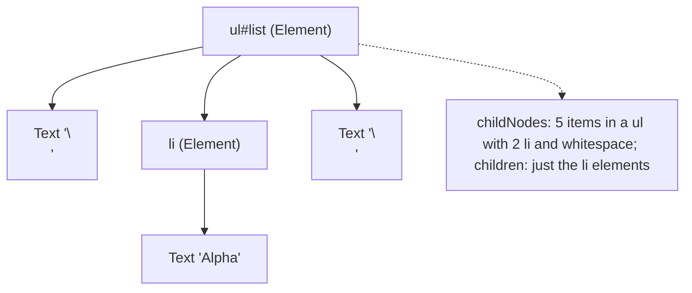
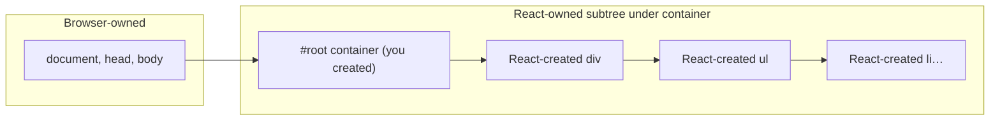
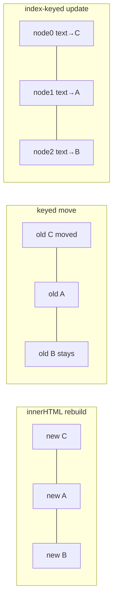
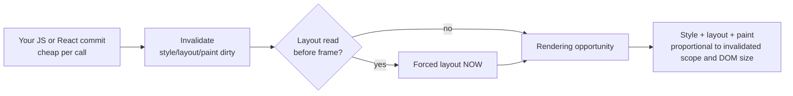

# 00 / 04 — DOM Structure, Mutation, and the Cost of Touching It

## 1. Lesson metadata

| | |
|---|---|
| **Level** | Beginner |
| **Study time** | 3–4 hours (reading 1.5 h, experiments 1 h, exercises 1–1.5 h) |
| **Prerequisites** | [02 — HTML parsing, DOM, CSSOM, render tree](./02-html-parsing-dom-cssom-render-tree.md). Helpful: [03 — Rendering pipeline](./03-browser-rendering-pipeline.md) (what a mutation costs downstream). |
| **Next** | [05 — Execution contexts and the call stack](./05-execution-contexts-and-call-stack.md) (start of the JavaScript-language track) |
| **Related later** | [13 — Browser events and propagation](./13-browser-events-and-propagation.md), [Phase 1 / 02 — Declarative vs imperative UI](../01-react-fundamentals/02-declarative-vs-imperative-ui.md), [Phase 1 / 09 — Lists, keys, identity](../01-react-fundamentals/09-lists-keys-and-identity.md), [Phase 2 / 04 — The "virtual DOM"](../02-react-rendering-and-internals/04-virtual-dom-what-it-means.md), [Phase 2 / 20 — Commit and DOM mutation](../02-react-rendering-and-internals/20-commit-and-dom-mutation.md) |

**Learning objectives.** After this lesson you can:
1. Navigate and query the DOM tree correctly (node vs element APIs, live vs static collections).
2. Choose among the DOM mutation APIs (`append`, `insertBefore`, `replaceChildren`, `textContent`, `innerHTML`, `DocumentFragment`, `cloneNode`) and predict their effect on node identity.
3. Explain what state lives *in* DOM nodes (focus, selection, scroll, input value, media playback, CSS animation) and what is lost when a node is replaced instead of updated.
4. Build an accurate cost model for DOM work: what is cheap, what is expensive, and why "the DOM is slow" is an imprecise statement.
5. Observe mutations with `MutationObserver` and understand its timing (microtask).
6. Explain precisely why React's *minimal mutation* strategy matters, why it is *not* "the virtual DOM is faster than the DOM", and why you must not mutate React-managed DOM by hand.

**Concepts covered:** node/element/text/fragment, traversal, `querySelector*`, live `HTMLCollection` vs static `NodeList`, `createElement`/`append`/`insertBefore`/`replaceChildren`/`remove`, moves vs copies, `DocumentFragment`, `<template>`, `innerHTML`/`textContent`/`insertAdjacentHTML`, `cloneNode`, node identity, DOM-held state, `MutationObserver`, DOM cost model, layout dependence, event listeners on nodes, React ownership of a DOM subtree, refs as escape hatch, Portals.

---

## 2. Deep conceptual explanation

### 2.1 What problem is this lesson solving?

Every React application ends in DOM mutations. React's whole job, seen from the browser's side, is a *stream of DOM operations*: "create this element, set this attribute, move this node, remove that node". To reason about React's behavior (why a text input loses focus on re-render, why a list animation resets, why a third-party widget breaks, why a keyed list reorder is cheap) you need an exact model of:

- what the DOM tree is and how operations on it affect **node identity**;
- what state is attached to a *node object* rather than to your data;
- what DOM operations *cost* and where that cost is paid.

It also corrects the most widespread folk belief about React: that it exists because "the DOM is slow". The reality is more interesting and is set up here, then finished in [Phase 2 / 04](../02-react-rendering-and-internals/04-virtual-dom-what-it-means.md).

### 2.2 The tree and the node types

Recall from [Lesson 02](./02-html-parsing-dom-cssom-render-tree.md): the DOM is a tree of `Node` objects. The ones you manipulate:

| Node | `nodeType` | Notes |
|---|---|---|
| `Document` | 9 | Root; `document.documentElement` is `<html>`. |
| `Element` (`HTMLElement`, `SVGElement`…) | 1 | Has tag name, attributes, children. |
| `Text` | 3 | A run of characters. Whitespace between tags is also `Text`. |
| `Comment` | 8 | `<!-- -->`. React uses comment nodes as markers in server-rendered HTML for some features (e.g., Suspense boundaries) — an implementation detail you should never depend on. |
| `DocumentFragment` | 11 | A lightweight, parent-less container. When inserted, its **children** move into the target and the fragment is left empty. |

Relationships on every node: `parentNode`, `childNodes`, `firstChild`, `lastChild`, `previousSibling`, `nextSibling`. Element-only conveniences: `parentElement`, `children`, `firstElementChild`, `nextElementSibling`. Beginners mix these up; `childNodes` includes text and comment nodes, `children` does not.



### 2.3 Querying and traversal

| API | Returns | Live? | Notes |
|---|---|---|---|
| `getElementById(id)` | `Element \| null` | n/a | Fast; document-scoped |
| `querySelector(sel)` | first match or `null` | n/a | CSS selector syntax; scoped to the element it's called on (but selectors are evaluated against the whole document unless you use `:scope`) |
| `querySelectorAll(sel)` | `NodeList` | **Static** snapshot | Safe to mutate the DOM while iterating |
| `getElementsByClassName/TagName` | `HTMLCollection` | **Live** | Updates as DOM changes; iterating while mutating can skip/loop |
| `children` | `HTMLCollection` | **Live** | |
| `childNodes` | `NodeList` | **Live** | |
| `closest(sel)` | nearest ancestor-or-self match | n/a | Core of event delegation |
| `matches(sel)` | boolean | n/a | |
| `contains(node)` | boolean | n/a | |

Live collections cause a classic bug:

```ts
const lis = document.getElementsByClassName("item");     // live
for (let i = 0; i < lis.length; i++) lis[i].remove();     // removes every *other* item
```

Removing `lis[0]` shrinks the collection, so the former `lis[1]` becomes `lis[0]` and index `1` now refers to the former third element. Use `Array.from(lis)` or `querySelectorAll` (static) first.

### 2.4 The mutation API

#### 2.4.1 Create, insert, move, remove

```ts
const li = document.createElement("li");
li.textContent = "Alpha";
list.append(li);                   // append to end (also accepts strings → Text nodes)
list.prepend(li2);                 // beginning
list.insertBefore(li3, li);        // classic; before reference node
li.before(liX); li.after(liY);     // modern ChildNode methods
li.replaceWith(liZ);
li.remove();                       // detach from parent (idempotent)
list.replaceChildren(...newItems); // clear + insert, one operation
```

**Move semantics (public guarantee, DOM Standard):** a node can have only one parent. Inserting an already-attached node *moves* it: it is removed from the old position and inserted at the new one, and **the same JS object remains**. It does not copy. To copy, use `node.cloneNode(true)`.

Why this is foundational for React: when you reorder a keyed list, React can reuse the existing `<li>` DOM nodes and call `insertBefore` to move them. The node keeps its identity — *and everything attached to the node*: focus, selection, scroll offset, `<input>` text, `<video>` playback position, ongoing CSS transitions (modulo browser details), third-party widgets mounted into it. This is exactly why keys matter ([Phase 1 / 09](../01-react-fundamentals/09-lists-keys-and-identity.md)): *key = identity of the DOM node/React instance across renders*.

#### 2.4.2 Content setting: `textContent`, `innerHTML`, `insertAdjacentHTML`

| API | Parses HTML? | Replaces children? | Node identity of old children | Security |
|---|---|---|---|---|
| `el.textContent = s` | No (inserts a single Text node, escaping is automatic) | Yes | Old children detached | Safe for untrusted text |
| `el.innerText = s` | No (but layout-aware, converts `\n` to `<br>`) | Yes | Detached | Safe; reading `innerText` forces layout |
| `el.innerHTML = s` | **Yes** (fragment parser, [Lesson 02](./02-html-parsing-dom-cssom-render-tree.md)) | Yes | **All old descendants discarded; new objects created** | **XSS sink**: unsanitized user input can execute script via attributes (``); `<script>` inserted this way doesn't run, but event-handler attributes do |
| `el.insertAdjacentHTML(pos, s)` | Yes | No (adds) | Existing nodes keep identity | Same XSS risk |
| `el.append(string)` | No | No | Kept | Safe (becomes Text) |

`innerHTML` **destroys and recreates**. Any element reference you held is now detached; any listener attached directly to those elements is gone with them (the listeners are garbage once the nodes are unreachable); any state held in the nodes is lost. `el.innerHTML += "<li>x</li>"` is therefore a double mistake: it reserializes the existing children to a string, then reparses everything, wiping live state.

#### 2.4.3 Fragments and templates

```ts
const frag = document.createDocumentFragment();
for (const item of items) {
  const li = document.createElement("li");
  li.textContent = item.name;
  frag.append(li);
}
list.append(frag); // one insertion; frag becomes empty
```

A fragment batches insertions into one call. Modern engines already coalesce *rendering work* (DOM writes are lazy; [Lesson 03 §2.3](./03-browser-rendering-pipeline.md)), so the main saving is fewer JS↔DOM boundary calls and fewer mutation records, not fewer layouts. `<template>` elements hold inert, parsed markup in `template.content` (a fragment) that you clone with `template.content.cloneNode(true)`. They are the native "stamp out a repeated chunk" tool and the basis of many fast list implementations that don't use frameworks.

#### 2.4.4 Attributes, properties, classes, styles

```ts
el.setAttribute("aria-expanded", "true");   // attribute (string)
el.hidden = true;                           // property reflecting [hidden]
el.classList.toggle("open", isOpen);        // class manipulation
el.style.setProperty("--x", "12px");        // inline custom property
(el as HTMLInputElement).value = "typed";   // property (not the attribute)
```

Setting an attribute/property to the **same value** is not always a no-op in terms of invalidation cost (engines often short-circuit identical values for some properties but this is not guaranteed). React avoids the question: it diffs props and sets only what *changed* ([Phase 2 / 20](../02-react-rendering-and-internals/20-commit-and-dom-mutation.md)).

### 2.5 State that lives in DOM nodes

This is the most important section for understanding React bugs. A DOM node is not a pure function of your data; it holds *browser-managed state*:

| State | Lives in | Survives node **move** | Survives node **replacement** |
|---|---|:-:|:-:|
| Text typed in an `<input>` (dirty value) | The input element | Yes | **No** |
| Selection/caret position | Element/document selection | Often yes (browser-dependent for moves; removal clears it) | No |
| Keyboard focus | `document.activeElement` | **Usually no**: removing a focused element blurs it; a *move* via `insertBefore` can drop focus in some browsers | No |
| Scroll position (`scrollTop`) | The scroll container element | Generally preserved if only moved *within* the container; resets when detached | No |
| `<video>`/`<audio>` playback | Media element | Resets/pauses when removed from the document | No |
| `<details open>`, `<dialog>` open state | Element | Yes | No |
| In-flight CSS transitions/animations | Computed-style state of the element | Restart often when removed/re-inserted (display toggles restart them) | No |
| Event listeners added with `addEventListener` | Element's listener list | Yes | No |
| iframe browsing context | iframe element | **Reloads when moved or reinserted** | No |
| Third-party widget instances (maps, editors) | Whatever DOM they mounted | Depends | No |

⚠ The exact behavior of focus/selection/scroll across *moves* varies across browsers and is subject to change; the safe, portable statement is: **replacing** loses all of it; **updating in place** keeps it; **moving** keeps most of it with exceptions (iframes, media, focus). React gives you "updating in place" by default and "moving" for keyed reorders; hence the Phase 1 rules.

Here is a one-glance demonstration of *why UI libraries do not re-create the world on every change*:

```ts
const input = document.querySelector("input")!;
input.focus();                  // user types "hello"
app.innerHTML = renderApp(state);  // naive "re-render by string"
// The old input is gone. The new input is empty and unfocused.
```

Every "string template re-render" architecture has to rediscover and solve this (save/restore focus & selection manually, or diff). React's reconciliation is, from this angle, **an algorithm to decide which existing nodes can be kept as they are** ([Phase 2 / 06](../02-react-rendering-and-internals/06-reconciliation-fundamentals.md)).

### 2.6 What does touching the DOM actually cost?

"The DOM is slow" is true only in a narrow, specific sense. Decompose a mutation `el.textContent = "x"`:

1. **The call itself** (JS → native binding). Roughly tens to hundreds of nanoseconds in modern engines; cheap but not free in a hot loop over 100,000 nodes.
2. **The tree change** (allocate nodes, link, notify observers). Proportional to nodes created.
3. **Invalidation** (mark style/layout/paint dirty). Cheap, but the *size of the invalidated region* determines step 4.
4. **Deferred pipeline work** at the next rendering opportunity: style recalc, layout, paint, composite ([Lesson 03](./03-browser-rendering-pipeline.md)). **This is where the real money is**, and it's proportional to *what the change invalidates*, not to how many API calls you made.
5. **Forced synchronous layout** if you *read* layout-dependent values between writes ([Lesson 03 §2.6](./03-browser-rendering-pipeline.md)).
6. **Garbage**: nodes discarded become garbage; large churn raises GC pressure ([Lesson 16](./16-memory-management-and-gc.md)). Memory per DOM node is non-trivial (JS wrapper + native node + style data); 50,000+ nodes begin to hurt on mobile, since style recalc and layout scale with node count.

Cost model summary:

| Operation | Rough cost class | Why |
|---|---|---|
| Read `node.parentNode`, `textContent` | Tiny | Pointer reads; (`textContent` read concatenates descendants, so linear in subtree) |
| `setAttribute`, `classList.toggle` | Small + invalidation | Style invalidation for affected elements |
| Insert/remove small subtree | Small + style/layout for that subtree and potentially siblings | |
| Change geometry on a high-level container | Large (layout of subtree) | Layout is contextual |
| `innerHTML = bigString` | Parse cost + creation + discard of old | Linear in new + old subtree size |
| Layout-dependent read after write | A whole layout, right now | Forced reflow |
| Thousands of nodes on screen | Higher base cost for every style/layout pass | Work scales with DOM size |

The takeaway is: **cost is dominated by invalidation scope and downstream pipeline work, not by "number of DOM API calls"**. Therefore the principle "touch the DOM as little as needed, keep invalidations small, don't interleave reads and writes, keep DOM size sane" holds, and React's strategy of applying only the necessary changes in one batch (commit phase) aligns with it.

### 2.7 MutationObserver

```ts
const mo = new MutationObserver((records) => {
  for (const r of records) console.log(r.type, r.target, r.addedNodes.length, r.removedNodes.length);
});
mo.observe(list, { childList: true, subtree: true, attributes: true, characterData: true });
// later: mo.disconnect();
```

- Callbacks are delivered **asynchronously as a microtask** (batched `MutationRecord`s), after the current script finishes but **before** the next task and before rendering ([Lesson 01 §3.1](./01-how-the-browser-works.md)). You see *all* mutations of the task in one callback; you cannot observe an intermediate state.
- An observer that mutates what it observes can loop forever. Disconnect or guard.
- Use cases: DevTools-like tooling, testing libraries (RTL's `waitFor` uses mutation observation + polling), analytics, integrating with third-party DOM changes (e.g., detect a browser extension injecting nodes into your React root).
- Legacy "Mutation Events" (`DOMNodeInserted`) are deprecated and slow; do not use.

### 2.8 Where React fits: owner of a subtree



React's contract with the DOM:

1. React creates nodes with `createElement`/`createTextNode` and attaches them under a container.
2. On updates it **mutates existing nodes in place** when the element type at a position is unchanged (updates changed attributes/properties/text) — *"update in place" preserves the state in §2.5*.
3. It *moves* keyed nodes with `insertBefore`, and removes with `removeChild`.
4. It assumes **it is the only one mutating that subtree**. React keeps references to nodes it created (via fibers) and expects the DOM structure to match its bookkeeping.

*Teaching model.* Imagine React holding a precise map "this fiber ↔ that DOM node". If you remove a node React created, then React later tries to remove or reorder it, you will see errors such as `Failed to execute 'removeChild' on 'Node': The node to be removed is not a child of this node`. This is a real, common symptom in production, typically caused by browser extensions (e.g., automatic page translators that wrap text nodes in `<font>` elements), third-party scripts, or manual DOM edits in React-managed regions.

*Escape hatches.* Refs give you the DOM node for *non-structural* imperative operations: `focus()`, `scrollIntoView()`, measuring, calling `play()` on media, integrating a vanilla library into **a node React renders as empty** (e.g., `<div ref={mapRef} />`, with React never rendering children inside it). Portals (`createPortal`) let React render *its* children into a different DOM container while keeping them in the same React tree (events still bubble through the React tree); typical for modals and tooltips.

### 2.9 "Is React fast because the virtual DOM is faster than the DOM?"

No, and the precise answer matters in interviews:

- The "virtual DOM" is a **description** (React elements, then fibers) and a **diffing process** that computes *which real DOM operations are needed*. Computing it costs JS time. Strictly speaking, hand-written, perfectly targeted DOM mutations are never slower than React's "diff + the same mutations".
- React's value is **correctness and maintainability at scale**: you describe the UI for a state; React figures out a reasonably minimal mutation set so that *you don't hand-write* the imperative transitions between all state pairs (and don't lose DOM state in the process). It's "fast enough" because diffing is linear-time heuristic and DOM work dominates.
- Where React *does* beat naïve code: naive "re-render everything with `innerHTML`" is slower and destroys state. Compared with that baseline, React's minimal updates win.

Phase 2 formalizes this. For now: *keep the model of "React = compute desired tree, apply minimal mutations in a batch" in mind.*

### 2.10 Common misconceptions

| Misconception | Reality |
|---|---|
| "The DOM is slow, so touching it is always expensive." | Single calls are cheap. Expensive: large invalidations, forced layouts, enormous DOMs. |
| "Appending nodes one by one triggers one layout each." | Layout is deferred until rendering opportunity unless you force it by reading layout between writes. |
| "`innerHTML` is faster, so use it for updates." | For one-off bulk creation it can be fast; for updates it destroys state and listeners, and it's an XSS risk. |
| "`insertBefore` of an existing node copies it." | It moves it. |
| "NodeLists are arrays." | They're array-like. `NodeList` has `forEach`, but not `map`/`filter`. Use `Array.from`. |
| "React re-creates the DOM when state changes." | It updates nodes in place when the element type and position/key match; it recreates a subtree only when identity changes. |
| "I can safely tweak the DOM inside a React component with `document.querySelector`." | Only for non-structural, non-React-managed aspects, via refs and effects, and with great care. |

---

## 3. Internal mechanics

### 3.1 JS wrappers vs native nodes (implementation detail)

In most engines a DOM node has a native C++ object and a JS *wrapper*. Two references to the same node return the same wrapper (`===` holds) while it is alive. Garbage collection of detached subtrees involves both heaps, which is why detached DOM trees held by a stray JS reference are a classic memory leak ([Lesson 16](./16-memory-management-and-gc.md)): `const node = el; el.remove();` keeps the whole subtree alive via `node`.

*Public guarantee:* node identity (`===`) and move semantics. *Implementation detail:* wrapper caching, lazy wrapper creation, cross-heap tracing.

### 3.2 Insertion algorithm (DOM Standard, simplified)

When you call `parent.insertBefore(node, child)` the DOM Standard's "insert" algorithm:

1. Validates the "pre-insertion" rules (e.g., no inserting an ancestor into its own descendant; a `Document` can have only one element child; throws `HierarchyRequestError`).
2. If `node` is a fragment, takes its children; otherwise `[node]`.
3. **Removes the node(s) from the old parent first** (this is why it's a move) — firing mutation-observer records for the removal.
4. Inserts them, runs "insertion steps" (e.g., for `<script>` elements, scripts may run when inserted into a document; for custom elements, `connectedCallback`), and queues MutationObserver records.

Consequence: a move produces a removal record and an addition record — useful to know when a `MutationObserver` shows both for a reorder.

### 3.3 Mutation → invalidation (teaching model)

After mutation, the browser marks affected parts dirty and schedules the next rendering update. Engines use heuristics to avoid repeated work, e.g., skipping style recalculation if the attribute changed has no matching selectors. *Do not depend on these optimizations.* The *guarantee* is only eventual consistency at rendering time, or immediate consistency on layout-dependent reads.

### 3.4 React's commit loop applied to the model (conceptual)

⚠ *Teaching model; consult React's source for specifics and verify against your React version.* Conceptually, a React update has a *render phase* (pure computation of the next tree and a list of "effects" to apply) and a *commit phase* in which React walks the effect list and performs host mutations: placements (`insertBefore`/`appendChild`), updates (property/attribute/text diffs), deletions (`removeChild`), followed by layout effects and refs attachment. Because all writes happen in one synchronous burst inside one task, the browser sees a single batch (nothing is painted in the middle), consistent with the "writes are lazy" principle. [Phase 2 / 11 and 20](../02-react-rendering-and-internals/20-commit-and-dom-mutation.md) detail this.

### 3.5 Events and nodes

`addEventListener` attaches to a node's listener list. React attaches (conceptually) **its own listeners at the root container** and dispatches to your handlers by walking its fiber tree (event delegation; [Lesson 13](./13-browser-events-and-propagation.md), [Phase 1 / 10](../01-react-fundamentals/10-event-handling.md)). This is one reason React nodes carry no per-element listeners and nodes can be updated or moved without re-attaching handlers. Details of which events are delegated and how (⚠ version-sensitive: React 17 moved delegation from `document` to the root container) belong to the later lessons.

---

## 4. Step-by-step execution walkthrough: reordering a list, three ways

Starting DOM: `ul > li[A], li[B], li[C]` where B's `<input>` contains the user's text "draft" and has focus. Goal: new order `C, A, B`.

**Strategy 1: rebuild with `innerHTML`.**
1. Serialize new order into a string; `ul.innerHTML = "<li>C…</li><li>A…</li><li>B…</li>"`.
2. Parser creates 3 new `li` elements and 3 new inputs; old ones detached.
3. Result: correct order; B's input is empty and unfocused; listeners attached before are gone; 6 nodes allocated and old nodes become garbage.

**Strategy 2: move with `insertBefore` (what keyed reconciliation does).**
1. `ul.insertBefore(liC, liA)` — C moves in front of A. (Remove record + add record; same node object.)
2. A and B stay in place (they're already in relative order).
3. Result: order `C, A, B`; the B input is the same element: typed text preserved. Focus: B was not moved, so it stays focused. (If B *had* been moved, focus might be lost depending on the browser. React has historically restored it in some situations; don't rely on this.)
4. The browser's work: invalidate the three rows' positions; one layout pass; paint.

**Strategy 3: update in place by index (what happens with `key={index}`).**
1. React sees position 0: `li` before and after; updates its text from A→C. Position 1: B→A. Position 2: C→B. Only *text/props* change; **the nodes stay at their indices**.
2. Result: visually `C, A, B`, but the `<input>` that belonged to *row B* is still the DOM node at **index 1**, which now represents *row A* data. The typed "draft" appears next to A. This is the classic index-key bug ([Phase 1 / 09](../01-react-fundamentals/09-lists-keys-and-identity.md)).



Strategy 3 shows the real lesson: **what React preserves is DOM nodes (and component state) by identity; identity is determined by position or key**, so choosing the key chooses *which node represents which data*.

---

## 5. Code examples

### 5.1 Minimal example — move vs copy

```ts
const a = document.createElement("li"); a.textContent = "A";
const ul1 = document.createElement("ul");
const ul2 = document.createElement("ul");
ul1.append(a);
ul2.append(a);                         // move
console.log(ul1.children.length, ul2.children.length); // ?
const copy = a.cloneNode(true) as HTMLElement;
ul1.append(copy);
console.log(copy === a, ul1.children.length, ul2.children.length); // ?
```

**Predict** both lines.

**Result:** `0 1`, then `false 1 1`.
**Why:** `append` of an attached node moves it (removes from `ul1`, adds to `ul2`); `cloneNode(true)` creates a new deep copy (not connected until appended), so the object differs. Listeners added with `addEventListener` are *not* copied by `cloneNode`; attributes (including inline `onclick` attributes) are.
**Relevance:** React elements describe nodes; React instance-to-node mapping depends on moves not copies.

### 5.2 Practical example — render a large list efficiently without a framework

```ts
interface Row { id: number; name: string }

function renderRows(list: HTMLUListElement, rows: readonly Row[]): void {
  const frag = document.createDocumentFragment();
  for (const r of rows) {
    const li = document.createElement("li");
    li.dataset.id = String(r.id);
    li.textContent = r.name;               // safe against injection
    frag.append(li);
  }
  list.replaceChildren(frag);              // clear + insert in one operation
}
```

Line notes:
- `textContent` avoids parsing and injection issues.
- `replaceChildren(frag)` replaces all children with the fragment contents; this *discards old nodes* (state lost) — appropriate for "replace entire result set" (e.g., search results where rows have no state), inappropriate for rows with inputs.
- `data-id` lets event delegation find the row (`closest("li")`).

**Trade-offs:** simple and quick for read-only lists up to a few thousand rows. Beyond that, virtualize ([Phase 7 / 09](../07-performance/09-windowing-and-virtualization.md)). For stateful rows, use keyed reconciliation (a library) or targeted updates.

### 5.3 Incorrect example — mutating React's DOM by hand

```tsx
function Banner() {
  useEffect(() => {
    const el = document.getElementById("banner")!;
    el.innerHTML = "<strong>Welcome</strong>";   // React doesn't know
  }, []);
  return <div id="banner">Loading…</div>;
}
```

**Predict:** what happens when `Banner` re-renders with changed props, or when its parent conditionally removes it?

**Result:** *Works at first* (the effect overwrites the text). Problems: (1) React considers the div's child to be the text `Loading…`; replacing it with a different node means that if React later updates that text node (e.g., the text becomes dynamic), it updates a *detached* node and nothing visible changes, or throws when removing; (2) in Strict Mode dev the effect runs twice (harmless here but a sign of non-idempotence); (3) `getElementById` couples to a global id; (4) `innerHTML` with dynamic content is an XSS risk.
**Why wrong:** React and your code now both own the same node's children.

### 5.4 Corrected implementation

```tsx
function Banner({ name }: { name: string }) {
  return (
    <div>
      <strong>Welcome</strong> {name}
    </div>
  );
}
```

React owns the content; no imperative DOM edits. If you *must* integrate a vanilla widget:

```tsx
import { useEffect, useRef } from "react";

// A hypothetical imperative library: mount(container) returns a destroy function.
declare function mountChart(container: HTMLElement, data: readonly number[]): { update(d: readonly number[]): void; destroy(): void };

export function Chart({ data }: { data: readonly number[] }) {
  const hostRef = useRef<HTMLDivElement>(null);
  const chartRef = useRef<ReturnType<typeof mountChart> | null>(null);

  useEffect(() => {
    const chart = mountChart(hostRef.current!, data);
    chartRef.current = chart;
    return () => { chart.destroy(); chartRef.current = null; };
  }, []);                                   // mount once: ⚠ see note

  useEffect(() => { chartRef.current?.update(data); }, [data]);

  return <div ref={hostRef} />;             // React renders it EMPTY: the library owns the children
}
```

Line notes:
- React renders a childless `div`; the library owns everything inside. React never needs to reconcile those children.
- Cleanup destroys the widget (required: in dev Strict Mode, effects run mount → cleanup → mount; without cleanup you would leak two charts).
- The first effect has `[]` while it reads `data`: the "lint rule" `react-hooks/exhaustive-deps` would flag this; it is deliberate (initial data only; updates go through the second effect) but intentional exceptions deserve a comment and are a smell. A cleaner version initializes with `data` and handles `data` changes in the same lifecycle. The *stale closure* risk of this pattern is the subject of [Lesson 06](./06-lexical-scope-and-closures.md) and [Phase 3 / 05](../03-react-state-and-hooks/05-effect-dependencies-and-stale-closures.md).

### 5.5 Advanced example — a `MutationObserver` to detect foreign DOM edits in a React root

```ts
// Diagnostic only; don't ship as a fix.
export function watchForeignMutations(root: HTMLElement): () => void {
  const mo = new MutationObserver((records) => {
    for (const r of records) {
      for (const n of r.addedNodes) {
        if (n instanceof HTMLElement && n.tagName === "FONT") {
          console.warn("Translator-like wrapper inserted into React root", n);
        }
      }
    }
  });
  mo.observe(root, { childList: true, subtree: true });
  return () => mo.disconnect();
}
```

Notes: observers run as microtasks; React's own mutations also appear, so filter by node type or `data-*` markers. Useful to *prove* that a "removeChild" production error is caused by a third party. Mitigation options: `translate="no"` / `<meta name="google" content="notranslate">` on sensitive regions, or render stable wrappers (e.g., wrap text in `<span>`) so the translator's replacement doesn't break React's text node assumptions.

---

## 6. Visual explanations

### 6.1 Where cost is paid



### 6.2 Identity is preserved by update-in-place and move; lost by replace

```text
              identity of <li id=B><input> after the operation
innerHTML     ✗ new node, state lost
replaceChildren(newNodes) ✗ new nodes
insertBefore (move)       ✓ same node (focus/media/iframe caveats)
setAttribute / textContent on same node ✓ same node
React: same type + same key/position   ✓ same node
React: different type or key           ✗ unmount + new node
```

### 6.3 React-owned vs imperative-owned regions

```text
<div id="root">                 ← container (you)
  ├─ <Header/>                  ← React owns children
  ├─ <div ref={chartHost}/>     ← React renders it EMPTY; the library owns children
  └─ <Footer/>                  ← React owns children
```

---

## 7. Alternative approaches and trade-offs

How to keep a UI in sync with data:

| Approach | Readability | Perf for small updates | Preserves DOM state | Complexity as UI grows | Testability | Prefer when |
|---|---|---|---|---|---|---|
| Hand-written imperative DOM updates | Low as app grows | Best (targeted) | Yes (you control) | Explodes (state-pair transitions) | Medium | Tiny widgets, hot paths, performance-critical leaf |
| `innerHTML` full re-render | High (templates) | Poor (re-parse) | **No** | Low | High | Static/read-only fragments, server-rendered snippets |
| Virtual-DOM libraries (React, Preact, Vue vdom) | High | Good | Yes (by identity/keys) | Scales well | High | General application UIs |
| Compiled/fine-grained reactive (Solid, Svelte) | High | Excellent (no tree diff) | Yes | Scales well | High | Perf-sensitive UIs; different mental model than React |
| Web Components with `lit-html` templates | Medium | Good (targeted template parts) | Yes | Medium | Medium | Cross-framework components |
| Canvas/WebGL rendering | Low | Best for massive visuals | n/a (no DOM) | High | Low | Charts with 100k+ points, games, maps |

**When the generally recommended approach (a framework like React) is NOT best:** a single animated indicator on a static marketing page, or a 100,000-point scatterplot. For the former, ten lines of vanilla DOM beat shipping a framework; for the latter, canvas/WebGL beats any DOM-based approach because the cost is in the node count, not the diffing.

---

## 8. Best practices and anti-patterns

**Do**
- Create nodes with `createElement`/`textContent`, or use a framework; avoid string concatenation with user data.
- Use `replaceChildren`, fragments, or templates for vanilla bulk updates.
- Batch reads before writes; avoid layout reads inside loops.
- Keep DOM size in check (thousands, not tens of thousands, of nodes on screen; consider virtualization).
- In React: treat the DOM subtree under a container as owned by React; use refs for focus, scrolling, measuring, and integrating imperative libraries into childless hosts.
- Always clean up observers and listeners you attach imperatively.

**Beginner mistakes**
- `innerHTML +=` in loops; `innerHTML` with unsanitized input.
- Iterating live collections while removing.
- Assuming `NodeList.map` exists.
- Holding references to removed nodes (leaks).

**Experienced-developer mistakes**
- Using `document.querySelector` in a component to modify React-rendered nodes.
- "Fixing" layout shifts by mutating styles in effects instead of reserving space.
- Over-trusting micro-benchmarks of DOM calls; optimizing the 1% (call overhead) instead of the 99% (invalidation scope, DOM size).
- Mounting a vanilla widget into a node that React also renders children into.

**Smells:** `document.getElementById` inside React components; manual `appendChild` in effects; `dangerouslySetInnerHTML` with non-sanitized content; unbounded growth of DOM nodes (infinite scroll without windowing).

**Justified exceptions:** focus management, scroll restoration, media control, and measuring require direct DOM access (through refs). A rich-text editor or map may legitimately own a DOM subtree. Hot paths measured to be bottlenecks (e.g., per-pointermove transforms) may bypass React for the duration of a gesture ([Lesson 03 C3](./03-browser-rendering-pipeline.md)).

---

## 9. Real-world application

**Chat application (realtime).** Messages append at the bottom; users scroll up to read history; the composer keeps focus and draft text. Constraints: keep the scroll position stable when messages arrive above/below the viewport; don't replace the composer's DOM node on each message; cap DOM node count by windowing old messages. Mapping to this lesson: *identity* (keyed messages; composer must be a stable position/type), *scroll state lives in the container* (don't re-create it), *cost model* (appending to the end invalidates little; prepending history shifts layout → use scroll anchoring or manual adjustment).

**Data grid with inline editing (finance).** Constraint: editing a cell must not steal focus or reset caret when streaming updates arrive. Update cell text in place; keep each cell's identity stable using row IDs as keys; never re-key rows on sort *if* focus must persist, or re-focus explicitly (in a layout effect, after commit) when identity necessarily changes.

**Third-party widgets (maps, rich text editors, payment iframes).** Constraint: these libraries expect to own a DOM subtree; some inject global listeners. Wrap in a component whose React output is an empty host element plus lifecycle cleanup; never re-render the widget by key changes casually: iframes reload when re-mounted. Security: payment iframes (e.g., card fields) isolate credentials from your code on purpose; moving or recreating them resets their state and may break PCI-scoped assumptions.

**Browser-extension and translation resilience (consumer apps).** Constraint: real users run translators and extensions that rewrite text nodes. Mitigation: wrap dynamic text in elements React controls, mark regions `translate="no"` where appropriate, and capture `removeChild`/`insertBefore` errors with an error boundary and telemetry ([Phase 10 / 05](../10-production-engineering/05-error-monitoring.md)).

---

## 10. Debugging and troubleshooting

### 10.1 Symptom: "Input loses focus/text every time something updates."

*Repro:*
```tsx
function Form() {
  const [n, setN] = useState(0);
  const Field = () => <input defaultValue="" />;  // component defined inside component
  return (<>
    <button onClick={() => setN(n + 1)}>{n}</button>
    <Field />
  </>);
}
```
*Investigate:* In Elements panel, watch the `<input>` node: it flashes (DOM breakpoints: "Break on → node removal"). `$0` identity: store `window.a = $0` before the click, compare `window.a === $0` after.
*Root cause:* `Field` is a *new function identity on every render*, so React sees a different component type at that position → unmounts and mounts a fresh DOM node. (A preview of [Lesson 07](./07-functions-and-referential-identity.md).)
*Fix:* define `Field` outside `Form`.
*Validate:* `window.a === $0` is `true` afterwards; typing persists.

### 10.2 Symptom: `Failed to execute 'removeChild' on 'Node'` / `insertBefore` in production, not locally.

1. Gather a sample: error monitoring breadcrumbs, user agent, language (translators!), extensions.
2. Reproduce with page translation on, or an extension disabled/enabled.
3. Use the §5.5 observer in a debug build to prove foreign insertions.
4. Fix options: wrap text in `<span>`; `translate="no"`; avoid conditional rendering of *bare text nodes* adjacent to each other; report to the extension author when possible.
5. Validate with translation enabled in a test run.

### 10.3 Symptom: "Page gets slower the longer it stays open."

Suspect DOM growth or leaked detached nodes. DevTools → Memory → heap snapshot → filter "Detached" to find detached DOM trees and their retainers; Performance monitor shows DOM Nodes and JS Event Listeners counts over time. Root causes: listeners never removed, observers never disconnected, caches of node references, infinite lists without windowing. Validate by repeating the action 20× and checking the counts return to baseline. (More in [Lesson 16](./16-memory-management-and-gc.md).)

### 10.4 Symptom: "My loop that removes items skips some."

Live `HTMLCollection` mutated during iteration; see §2.3. Fix with a static snapshot.

### 10.5 Tools

- Elements panel: right-click → **Break on** subtree modifications / attribute modifications / node removal. Shows the stack trace of the writer.
- `monitorEvents($0)`, `getEventListeners($0)` (Chromium console utilities).
- Performance monitor (DOM nodes, listeners); Memory panel (detached elements).
- React DevTools → *Highlight updates when components render* shows renders; compare against Elements flashes to see which DOM nodes actually changed.

---

## 11. Exercises

### Level A — Knowledge
A1. What is the difference between `children` and `childNodes`?
A2. What happens when you `appendChild` a node that is already in the document?
A3. Name three kinds of state held by DOM nodes that are lost when a node is replaced.
A4. Is `querySelectorAll` live or static? What about `getElementsByTagName`?
A5. When is a `MutationObserver` callback invoked relative to rendering?
A6. Why is `el.innerHTML = userInput` dangerous even though `<script>` tags inserted that way do not execute?

### Level B — Code comprehension
B1. What does each `console.log` print?
```ts
const ul = document.createElement("ul");
ul.innerHTML = "<li>a</li>\n<li>b</li>";
console.log(ul.childNodes.length, ul.children.length);
const first = ul.firstElementChild!;
ul.innerHTML = ul.innerHTML;
console.log(first.isConnected, first === ul.firstElementChild, ul.children.length);
```
B2. How many `MutationObserver` records (at least) arrive for this, and of which types?
```ts
mo.observe(ul, { childList: true });
ul.append(li2);
ul.insertBefore(ul.lastElementChild!, ul.firstElementChild); // move
```
B3. A list renders `rows.map((r, i) => <Row key={i} row={r} />)` where `Row` has an uncontrolled `<input>`. The user types in row 1 (second row) and then row 0 is deleted from `rows`. What does the user see and why? Which DOM node was removed?

### Level C — Implementation
C1. Implement `function reconcileList(ul: HTMLUListElement, items: {id: string; text: string}[]): void` that updates an existing list **in place** keyed by `data-id`: updates text of existing items, inserts new, removes missing, and moves items to match order, preserving the same `<li>` node for each id. Minimize moves where easy.
C2. Write a tiny `useDomObserver` hook in TypeScript for React that attaches a `MutationObserver` to a ref'd element and disconnects on unmount.
C3. Write a function `safeSetHtml(el: HTMLElement, trusted: string)` that documents when it is allowed, and an alternative `setTextWithLinks(el, text)` that builds text and anchor nodes (URLs detected with a simple pattern) without using `innerHTML`.

### Level D — Debugging
D1. "After sorting the table, the cursor jumps out of the cell being edited." The table body is rebuilt with `tbody.innerHTML = rows.map(toHtml).join("")`. Explain, and give two fixes (one framework-free, one React).
D2. A React component calls `document.querySelector(".tooltip").remove()` in a click handler to dismiss a tooltip it rendered. Later, React throws `NotFoundError`. Explain and fix.
D3. A page leaks memory: heap snapshots show thousands of detached `<div>` retained by an array in a module scope. Name three plausible causes in a React app and how to confirm each.

### Level E — Architecture and engineering decisions
E1. Your team needs a rich-text editor (existing vanilla library) inside a React form with controlled state. Propose a component boundary: who owns the DOM, how data flows in/out, how you prevent loops, and what you test.
E2. A product manager says "React is slow because it re-creates the DOM." Respond with a precise explanation and a plan to find the real source of slowness in their app.

### Level F — Expert challenge
F1. Design a minimal keyed list reconciler (vanilla) that computes the minimal set of `insertBefore` moves for an arbitrary reorder (hint: longest increasing subsequence). Explain why not simply re-appending every node, and discuss the trade-off between "minimal moves" and implementation complexity. Where do real libraries compromise (e.g., React's reconciliation of children: forward scan with a `lastPlacedIndex`-style heuristic rather than full LIS; verify against current source before citing)?

---

## 12. Detailed answers and explanations

> Attempt the exercises first.

**A1.** `childNodes` is a live `NodeList` of all child nodes (elements, text, comments). `children` is a live `HTMLCollection` of element children only. Whitespace between tags appears in `childNodes` as Text.

**A2.** It is moved: removed from its current parent and inserted at the new position; the same object remains and keeps its properties and listeners. Not copied (that is `cloneNode`).

**A3.** Any three of: typed input value, selection/caret, focus, scroll position, media playback state, dialog/details open state, running animations/transitions, listeners attached via `addEventListener`, iframe browsing context.

**A4.** `querySelectorAll` returns a **static** `NodeList`; `getElementsByTagName` returns a **live** `HTMLCollection`.

**A5.** As a microtask after the script that caused the mutations completes (a "microtask checkpoint"), so before the next task and before the rendering step of that frame.

**A6.** Because event-handler attributes in injected markup run: `` executes when the image fails to load, as does `<a href="javascript:…">` on click. It's an XSS sink. Use `textContent`, DOM construction, a sanitizer (e.g., DOMPurify), or the Sanitizer API where available ⚠ (support varies). In React, the analog is `dangerouslySetInnerHTML`.

**B1.** First log: `3 2` (li, text "\n", li). Second: `ul.innerHTML = ul.innerHTML` reserializes and reparses, so new nodes: `first.isConnected` is `false`, `first === ul.firstElementChild` is `false`, `children.length` is `2`. (`ul` itself is not in the document, but `isConnected` on `first` is `false` regardless; the point is node replacement.)

**B2.** At least: one record of type `childList` for the append (addedNodes: li2). The move is **two** mutations: removal from the old position and insertion at the new one; they may be coalesced into the same record list but appear as separate records (a removal with `removedNodes` and an addition with `addedNodes`). So ≥3 records, all `childList`. Don't assume the exact count across browsers; the DOM Standard's insert algorithm queues one record per removal and insertion step. Mistake to avoid: assuming a move is atomic from the observer's viewpoint.

**B3.** The user typed into the DOM `<input>` at index 1 (row id B). After deleting row 0 (A), `rows = [B, C]`. With `key={i}`, React matches by index: key 0 ← row B (props updated in place), key 1 ← row C, and key 2 (the old third row's node) is removed. So the **last DOM node** is removed; the text typed into the node at index 1 (which was B's node) now sits in the node that represents **C**. The user sees their text next to row C. Fix: `key={r.id}`. Edge case: if the input were controlled, the typed value would come from state and the bug would show differently (state is keyed by index too if stored per-row component state).

**C1. Reference solution**
```ts
interface Item { id: string; text: string }

export function reconcileList(ul: HTMLUListElement, items: readonly Item[]): void {
  const existing = new Map<string, HTMLLIElement>();
  for (const li of Array.from(ul.children) as HTMLLIElement[]) {
    existing.set(li.dataset.id!, li);
  }
  const wanted = new Set(items.map((i) => i.id));

  // remove missing
  for (const [id, li] of existing) {
    if (!wanted.has(id)) { li.remove(); existing.delete(id); }
  }

  // insert/update/move to match order
  let cursor: ChildNode | null = ul.firstChild;
  for (const item of items) {
    let li = existing.get(item.id);
    if (!li) {
      li = document.createElement("li");
      li.dataset.id = item.id;
      existing.set(item.id, li);
    }
    if (li.textContent !== item.text) li.textContent = item.text;
    if (li === cursor) {
      cursor = cursor.nextSibling;          // already in the right place
    } else {
      ul.insertBefore(li, cursor);           // insert new or move existing
    }
  }
}
```
Notes: only touches `textContent` when changed; `cursor` marks the expected next node, so already-ordered items cause no DOM operations; items out of order are moved before the cursor (a simple strategy that may move more nodes than the theoretical minimum, e.g. moving the *first* item to the end results in n−1 moves in this algorithm; LIS gives 1). Assumes the list contains only `li` with `data-id`; whitespace text nodes would confuse `cursor` (use `children`/element siblings in production). Edge cases: duplicate ids (undefined behavior), id changes.

**C2.**
```tsx
import { useEffect, useRef, type RefObject } from "react";

export function useDomObserver<T extends HTMLElement>(
  onMutations: (records: MutationRecord[]) => void,
  options: MutationObserverInit = { childList: true, subtree: true },
): RefObject<T | null> {
  const ref = useRef<T>(null);
  const cb = useRef(onMutations);
  cb.current = onMutations;                  // always call the latest callback (avoid stale closure)
  useEffect(() => {
    const node = ref.current;
    if (!node) return;
    const mo = new MutationObserver((r) => cb.current(r));
    mo.observe(node, options);
    return () => mo.disconnect();
  }, [options]);                             // options object identity matters!
  return ref;
}
```
Notes: assigning `cb.current` during render is a widely used pattern, but writing refs during render is discouraged by the React docs for purity reasons; the stricter alternative is to update it in an effect. The default `options` is created per call, so the effect would re-subscribe on every render when the caller omits it; hoist a module-level constant default, or destructure into primitives. This is a worked example of [Lesson 07](./07-functions-and-referential-identity.md)'s dependency-identity problem. (`RefObject<T | null>` matches React 19 typings; in React 18 types, `useRef<T>(null)` returns `RefObject<T>`.)

**C3.**
```ts
/** Only call with markup you authored or sanitized on a trusted pipeline. Never with user input. */
export function safeSetHtml(el: HTMLElement, trusted: string): void {
  el.innerHTML = trusted;
}

export function setTextWithLinks(el: HTMLElement, text: string): void {
  const frag = document.createDocumentFragment();
  const re = /https?:\/\/[^\s<]+/g;
  let last = 0;
  for (const m of text.matchAll(re)) {
    const start = m.index ?? 0;
    if (start > last) frag.append(text.slice(last, start));   // plain text → Text node
    const a = document.createElement("a");
    a.href = m[0];                                           // validated by http(s) pattern
    a.textContent = m[0];
    a.rel = "noopener noreferrer";
    frag.append(a);
    last = start + m[0].length;
  }
  if (last < text.length) frag.append(text.slice(last));
  el.replaceChildren(frag);
}
```
Notes: only `http(s)` URLs so `javascript:` can't sneak in; text content is never parsed as HTML; `matchAll` requires the `g` flag. The simple URL regex is intentionally naive (trailing punctuation); don't over-promise.

**D1.** Rebuilding via `innerHTML` replaces the edited cell's DOM node; the caret and focus are in the old node, now detached. Framework-free fix: reorder existing `<tr>` nodes by `insertBefore` (keyed by row id) and update only changed cell text (see C1); or save `{rowId, cellIndex, selectionStart}` before and restore after, a brittle workaround. React fix: render rows with `key={row.id}`; React moves the existing `tr` nodes. Caveat: moving a *focused* node may blur it in some browsers; if so, re-focus in `useLayoutEffect` after the commit, using a ref to the active cell.

**D2.** React rendered the tooltip; the handler removed its DOM node behind React's back. When the component later re-renders or unmounts, React tries to update/remove a node that is no longer attached to the parent it expects, giving `NotFoundError`/`removeChild` failures. Fix: control visibility through state (`{open && <Tooltip/>}`) so React removes the node itself.

**D3.** Plausible causes: (1) a `useEffect` registering a `window` listener or `ResizeObserver` without cleanup, whose callback closes over DOM nodes or refs; (2) a module-level cache/array of DOM nodes (e.g., from `ref` callbacks that push but never remove); (3) third-party widget not `destroy()`ed on unmount (or a portal container never removed). Confirm each via heap snapshot's retainer tree (the path from GC root to the detached node), then fix and compare snapshots after repeating the action N times. Explain that a closure retaining `node` ([Lesson 06](./06-lexical-scope-and-closures.md)) is the typical retainer.

**E1. Evaluation criteria and example answer.** Criteria: single source of truth, loop prevention, cleanup, testability, performance, security (sanitization). Example: the editor library *owns* the DOM inside an empty host `div` rendered by React. Data flows in via props (`value` as serialized document) → `editor.setContent()` only if different from the editor's current content (compare to avoid cursor jumps); data flows out via editor change events → `onChange(serialized)`. Prevent loops with an "applying external update" flag or by comparing canonical serializations. Make the component *semi-controlled*: treat `value` as initial/reset value (key by document id to reset), because fully controlled rich text is notoriously hard. Cleanup `editor.destroy()` in effect cleanup (idempotent for Strict Mode). Test: unit-test the adapter with a fake editor; E2E test typing, undo, paste (Playwright), and IME. Security: sanitize pasted HTML before storing. When *not* to wrap: if the editor has a React-native version whose semantics fit.

**E2.** A precise reply: "React doesn't re-create the DOM; it compares the new element tree with the previous one and applies the differences to existing nodes, re-creating nodes only when identity changes (different type or key). The cost of an update is: running component functions (JS), diffing (JS), DOM writes (small), and then browser style/layout/paint (often largest)." Plan: record a Performance profile of the slow interaction; use React Profiler to see which components rendered and why; check commit duration vs browser rendering; look for large DOM, layout thrash, or wide re-renders from state placement; only then optimize (memoization, colocating state, virtualization). Avoid memoizing everything blindly.

**F1. Example answer.** Given old order `[a,b,c,d]` and new order `[d,a,b,c]`, nodes that are in the same relative order as in the old list can stay; only the others need moving. The largest set that can stay is the longest increasing subsequence (LIS) of the old indices as they appear in the new order: here `[1,2,3]` for `a,b,c` — so only `d` moves (1 `insertBefore`) instead of re-appending all 4 (4 moves; each move invalidates layout and may disturb focus/iframes/media). Algorithm: map each new item to its old index (or −1 for new); compute LIS over the old indices (O(n log n)); iterate new list from the end, with a "next sibling" cursor: if the item is in the LIS, skip (it stays), otherwise `insertBefore(node, nextSibling)`; new items are created and inserted similarly; old items absent from the new list are removed. Trade-offs: LIS code is more complex and benefits only for large reorders with many stable items. React's children reconciliation (conceptually) iterates the new children in order, tracking the highest old index seen so far (`lastPlacedIndex`) and moves a node only when its old index is lower than that — a simple heuristic that is optimal for "move one item forward" and suboptimal for "move last item to front" (it moves every other item). Other libraries (Vue 3, ivi, Inferno) use LIS. ⚠ Verify against the React version's reconciler source before citing specifics; this is an implementation detail and not part of React's public contract. Evaluation: correct LIS reasoning, awareness of moves-vs-recreation, mention of identity preservation as the correctness driver (not just speed).

---

## 13. Senior engineer interview questions

**Q1. "Why does React need keys? What does it use them for in terms of the DOM?"**
*Strong answer:* Keys give React a stable identity for each child across renders so it can match old and new elements by identity rather than position. With a match, React reuses the existing component instance and DOM node (updating in place, moving if order changed), which preserves state held in the instance and the node (input text, focus, scroll). Without stable keys (or with index keys on a reordered list) React matches by position and reuses nodes for the wrong data, or tears down and recreates nodes unnecessarily.

**Q2. "Is the virtual DOM faster than the real DOM?"**
*Strong answer:* No: it's extra work on top of the DOM. It's a strategy to make declarative UI practical: compute desired output, diff against previous, apply minimal real mutations in one batch. Perf benefits are relative to naive re-rendering, and the primary win is developer productivity and state preservation. Frameworks without a vDOM (Solid, Svelte) can be faster in micro-benchmarks because they skip the tree diff.

**Q3. "You see `removeChild` errors only in production for a small segment of users. What do you suspect and how do you confirm?"**
*Strong answer:* External DOM mutation inside React's container: page translators, extensions, injected third-party scripts. Check user-agent/language segmentation, reproduce with translation on, add a MutationObserver diagnostic, mitigate with wrappers/`translate="no"`, and capture with error boundaries and telemetry.

**Q4. "How expensive is `appendChild` in a loop of 1,000 items?"**
*Strong answer:* The calls are cheap and layout isn't recomputed per call because rendering is deferred; the cost shows up in the next frame's style/layout/paint proportional to the new nodes' invalidation and in memory. A fragment reduces call overhead and observer records. It becomes expensive if you read layout in the loop (forced reflow). Measure rather than assume.

**Q5. "Where do you draw the line between React-managed DOM and imperative DOM access?"**
*Strong answer:* React manages structure and attributes it renders. Refs may be used for non-structural, idempotent side effects (focus, scroll, measurement, media control). Libraries that need to own children get an empty host element. Never change children/attributes React renders from outside React; and always clean up in effect cleanup.

---

## 14. Further learning resources

| Resource | URL | Covers / why | Level | Study |
|---|---|---|---|---|
| DOM Standard | <https://dom.spec.whatwg.org/> | Normative node tree, insert/remove algorithms, MutationObserver | Advanced | "Mutation algorithms", "Interface MutationObserver" |
| MDN — Document Object Model | <https://developer.mozilla.org/en-US/docs/Web/API/Document_Object_Model> | API reference and tutorials | Beginner | Introduction; Locating DOM elements; Traversing |
| MDN — `Node` | <https://developer.mozilla.org/en-US/docs/Web/API/Node> | Properties/methods incl. `cloneNode`, `insertBefore` | Beginner | Methods |
| MDN — `MutationObserver` | <https://developer.mozilla.org/en-US/docs/Web/API/MutationObserver> | Options, timing, examples | Intermediate | Whole page |
| MDN — `Element.replaceChildren()` | <https://developer.mozilla.org/en-US/docs/Web/API/Element/replaceChildren> | Bulk replace | Beginner | Whole page |
| MDN — `HTMLTemplateElement` | <https://developer.mozilla.org/en-US/docs/Web/API/HTMLTemplateElement> | Template content cloning | Intermediate | Whole page |
| react.dev — Manipulating the DOM with Refs | <https://react.dev/learn/manipulating-the-dom-with-refs> | Official escape-hatch guidance, including "when React attaches refs" and "best practices for DOM mutation with refs" | Beginner | Whole page |
| react.dev — Preserving and Resetting State | <https://react.dev/learn/preserving-and-resetting-state> | How position/type/key determine identity | Beginner | Whole page |
| react.dev — `createPortal` | <https://react.dev/reference/react-dom/createPortal> | Rendering into another DOM node | Intermediate | Usage |
| react.dev — Rendering Lists | <https://react.dev/learn/rendering-lists> | Keys | Beginner | "Keeping list items in order with key" |

All links are standard documentation pages; titles are given in case a path has moved.

---

## 15. Knowledge checkpoint

**You should now understand**
- The DOM as a tree of nodes with identity, move semantics, and distinct node/element APIs.
- That state lives in DOM nodes, so *replace* loses it while *update in place* and *move* preserve most of it.
- A cost model where invalidation scope, DOM size, and forced layout dominate over API-call count.
- That React is an owner of a subtree that mutates minimally and in a batch, and that bypassing it breaks its bookkeeping.

**You should be able to explain without notes**
- Why `key={index}` shows the wrong text in an uncontrolled input after a deletion.
- Why `innerHTML` rebuilds lose focus and listeners.
- Why "the virtual DOM is faster than the DOM" is wrong.

**You should be able to implement**
- A keyed in-place list reconciler; a safe link-text builder; an observer hook with cleanup.

**You should be able to debug**
- Focus/state loss from identity changes, `removeChild` errors from foreign DOM edits, detached-node leaks, live-collection loops.

**Before moving on:** begin the JavaScript-language track with [05 — Execution contexts and the call stack](./05-execution-contexts-and-call-stack.md). Lessons 06–08 (closures, referential identity, immutability) are the language foundations beneath hook dependencies, memoization, and state updates. You will return to DOM events in [13 — Browser events and propagation](./13-browser-events-and-propagation.md).
