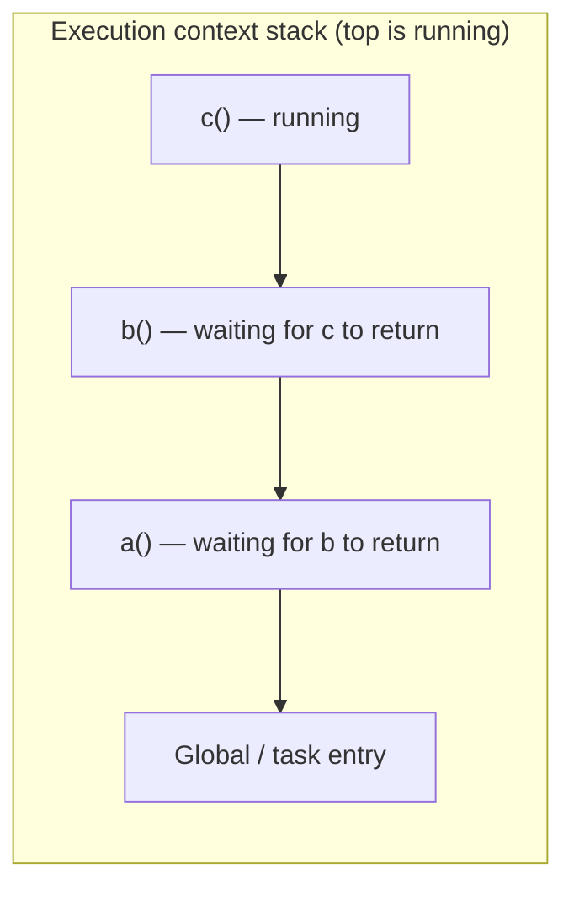
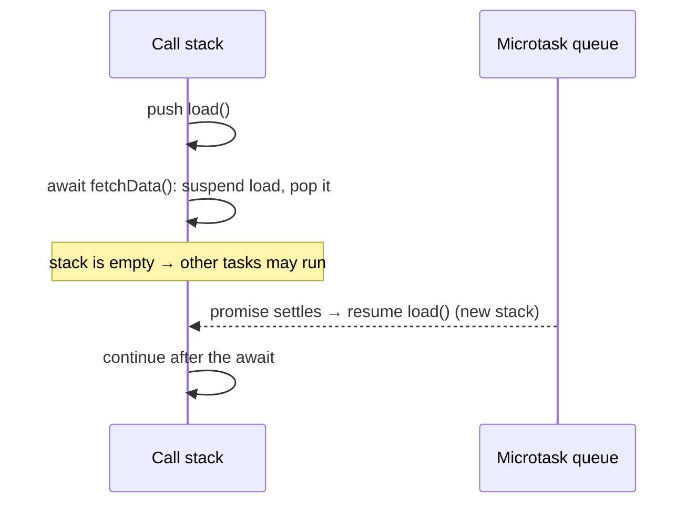
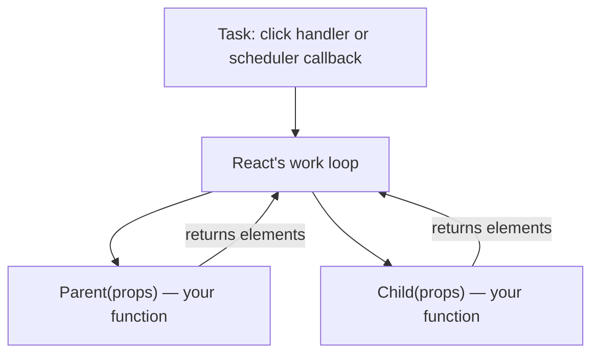
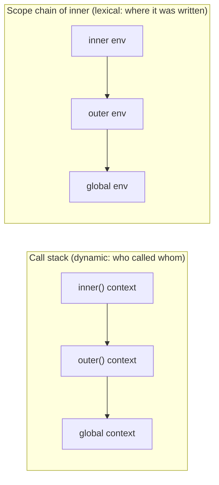
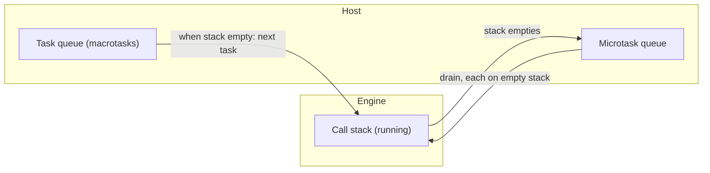

# 00 / 05 — Execution Contexts and the Call Stack

## 1. Lesson metadata

| | |
|---|---|
| **Level** | Beginner |
| **Study time** | 3–4 hours (reading 1.5 h, experiments 1 h, exercises 1–1.5 h) |
| **Prerequisites** | None strictly. Familiarity with JavaScript functions and variables. [01 — How the browser works](./01-how-the-browser-works.md) gives context for "one main thread". |
| **Next** | [06 — Lexical scope and closures](./06-lexical-scope-and-closures.md) |
| **Related later** | [11 — Event loop, tasks, microtasks](./11-event-loop-tasks-microtasks.md), [12 — Promises and async/await](./12-promises-and-async-await.md), [Phase 2 / 08 — Why Fiber exists](../02-react-rendering-and-internals/08-why-fiber.md), [Phase 2 / 17 — How hooks attach to Fiber](../02-react-rendering-and-internals/17-hooks-and-fiber-state.md), [Phase 3 / 16 — Rules of hooks](../03-react-state-and-hooks/16-rules-of-hooks-and-composition.md) |

**Learning objectives.** After this lesson you can:
1. Define an *execution context* and say what it contains (in ECMAScript terms and in teaching-model terms).
2. Trace the call stack for any synchronous JavaScript program, including recursion and exceptions.
3. Explain *hoisting* and the *temporal dead zone* as consequences of how a context's bindings are created before code runs.
4. Explain why recursion can overflow the stack, and why this matters for React's design history (the old recursive "stack reconciler" vs Fiber).
5. Explain how `await` and generators suspend and resume execution contexts without blocking the main thread.
6. Explain why a React component function is "just a function called by React during render", and why "hooks only work when React is currently rendering" is a statement about call-stack-time state.
7. Read a stack trace and use the DevTools Call Stack pane.

**Concepts covered:** execution context, execution context stack ("call stack"), running execution context, global/function/module/eval contexts, lexical and variable environments, environment record, `this` binding, realm, creation/instantiation and execution, hoisting (`var`, function declarations, `let`/`const`/`class`, TDZ), call/return, stack frames, stack overflow (`RangeError`), recursion vs iteration, exceptions unwinding the stack, async suspension (`await`, generators), stack traces, `Error.stack`, React render as a call-stack-time window.

---

## 2. Deep conceptual explanation

### 2.1 What problem is this lesson solving?

Everything you will do in React is a function call on a stack. A parent component renders, which causes React to call a child component function; a handler calls `setState`; an effect runs and calls your callback. If you cannot answer:

- "*When* does this variable get its value?" (hoisting, TDZ),
- "*Which* `count` does this function see?" ([Lesson 06](./06-lexical-scope-and-closures.md), built on contexts),
- "*What is still running* when this error is thrown?" (stack and unwinding),
- "*Why* can't I call `useState` here?" (only valid while React is executing a component),
- "*Why* did the old React freeze on deep trees?" (recursion on the main thread),

then you are guessing. This lesson gives you the machine model: **one stack of execution contexts, run to completion, top frame active**.

### 2.2 Terminology: three layers

| Layer | Name | Notes |
|---|---|---|
| Specification | **Execution context** and **execution context stack**; the top is the **running execution context** | ECMAScript (the language standard) defines these. |
| Everyday | **Call stack**, **stack frame** | Engine implementations talk about frames holding locals, return addresses, etc. |
| Debugger | **Call stack pane**, **stack trace** | What you see in DevTools and `error.stack`. |

An **execution context** is the bookkeeping the engine creates to run a piece of code. It tracks "where are we in this code" and "what bindings (variables) are in scope here". In the ECMAScript specification, each execution context has (at least) these components:

| Component | What it is |
|---|---|
| **code evaluation state** | Where to resume if the context is suspended (matters for generators and `async` functions). |
| **Function** | The function object being executed (null for scripts/modules). |
| **Realm** | The set of intrinsics (`Array`, `Object`, …) and the global object this code belongs to. Different iframes have different realms. |
| **ScriptOrModule** | The script or module the code originated from. |
| **LexicalEnvironment** | Where identifier references are resolved (`let`/`const`/`class`/block-scoped function bindings and the chain to outer environments). |
| **VariableEnvironment** | Where `var` declarations (and function-level declarations) live. |
| **PrivateEnvironment** | For class private names (`#x`). |

(*Public guarantee:* these are the semantics; *implementation detail:* engines don't necessarily allocate objects like this. Optimizing compilers keep locals in registers or on the machine stack, and only heap-allocate environments that **escape** because a closure captures them. See [Lesson 06](./06-lexical-scope-and-closures.md).)

Teaching-model simplification used in most explanations:

> An execution context = **{ variables/bindings visible here, a link to the outer scope, the value of `this` }** plus "which line am I on".

### 2.3 Kinds of execution contexts

| Kind | Created when | Notes |
|---|---|---|
| **Global** (script) | A classic `<script>` starts | `this` is `window` in browsers' sloppy mode global code. `var`/function declarations at top-level of a classic script become properties of `window`; `let`/`const` do not. |
| **Module** | An ES module is evaluated | `this` is `undefined`; top-level declarations are module-scoped, not on `window`. |
| **Function** | A function is *called* (not defined) | One new context **per call**, even for the same function. |
| **Eval** | `eval(...)` runs | Avoid; included for completeness. |

The key insight: **a context is created per call, not per function.** Calling `f()` ten times (or recursively) makes ten contexts, each with *its own* bindings. This is precisely why each React render has its own `count`, and why [Phase 1 / 14 "State as a snapshot"](../01-react-fundamentals/14-state-as-a-snapshot.md) is true.

### 2.4 The call stack



Rules (public guarantee):

1. **Calling** a function pushes a new context on the stack and makes it the running context.
2. **Returning** (or throwing, if uncaught in that function) pops it; the caller's context resumes exactly where it left off.
3. Only the top context runs. JavaScript on a given thread is **run-to-completion**: nothing else on that thread starts until the stack is empty (this is the link to [Lesson 01](./01-how-the-browser-works.md) and [Lesson 11](./11-event-loop-tasks-microtasks.md): the event loop takes the next task *only when the call stack is empty*).

```ts
function c() { console.log("in c"); }
function b() { c(); console.log("b done"); }
function a() { b(); console.log("a done"); }
a();
```
Stack over time: `[global]` → `[global, a]` → `[global, a, b]` → `[global, a, b, c]` → prints `in c` → `[global, a, b]` → prints `b done` → `[global, a]` → prints `a done` → `[global]`.

### 2.5 Two phases per context: instantiate bindings, then run

Before a function body's first statement runs, the engine performs **declaration instantiation** (spec: `FunctionDeclarationInstantiation`; for scripts, `GlobalDeclarationInstantiation`): it *creates all the bindings declared in that scope* and initializes some of them.

Teaching-model summary (often called "creation phase" and "execution phase"):

| Declaration | After instantiation, before the first line runs | Consequence |
|---|---|---|
| Parameters | Bound to the argument values | Available immediately |
| `function f() {}` (declaration) | Binding exists **and is initialized to the function object** | *Callable before its textual position* ("hoisted") |
| `var x = 1` | Binding exists, initialized to `undefined` | Reading before the assignment gives `undefined`, not an error |
| `let x`, `const x`, `class X` | Binding exists but is **uninitialized** | Reading/writing it before its declaration executes throws `ReferenceError` — the **temporal dead zone (TDZ)** |
| Function expressions / arrow functions assigned to `const`/`let`/`var` | Follow the rule of the variable | `const f = () => {}` is in TDZ until that line executes |

"Hoisting" is not code being moved. It is the observable result of **bindings existing from the start of the scope**, with differing initial states.

```ts
console.log(typeof a);   // "function"  (declaration fully hoisted)
console.log(b);          // undefined   (var hoisted, not initialized)
try { console.log(c); }  // ReferenceError: Cannot access 'c' before initialization (TDZ)
catch (e) { console.log((e as Error).name); }
function a() {}
var b = 1;
let c = 2;
```

*Why TDZ exists:* it catches use-before-define bugs and makes `let`/`const` semantics consistent with block scoping (a closure referencing `c` can be created before `c` is initialized, as long as it's called after).

### 2.6 `this` (just enough for now)

Each function context has a `this` binding determined by *how the function is called* (method call `obj.f()`, plain call, `new`, `call/apply/bind`). Arrow functions **don't have their own `this`**; they resolve it lexically from the enclosing context. Full treatment is in [Lesson 09 — Prototypes, `this`, classes](./09-prototypes-and-object-model.md). For function components and hooks, you rarely touch `this`; it matters for class components (legacy) and for event-handler method references.

### 2.7 Errors and stack unwinding

When code throws, the engine unwinds the stack: pop contexts until one with a matching `try/catch` is found. Each popped context's `finally` blocks run. If none exists, the error reaches the host (`window.onerror`, unhandled error reporting) and the *current task ends* (the stack is emptied). The event loop continues with other tasks; **the page does not "crash"**, but the logic after the throw never ran.

In React:

- If a component function throws during render, React catches it (it calls your components inside its own try/catch machinery) and looks upward for an **error boundary** ([Phase 4 / 19](../04-react-architecture/19-error-boundaries.md)). Without one, React unmounts the tree (the whole root) and reports the error.
- Errors thrown in **event handlers** are *not* caught by error boundaries: handlers are called from the event system, not during render.
- Errors in `async` code after an `await` are **not on the original stack**. The original caller returned long ago, so a surrounding `try/catch` only works if you `await` the promise inside it ([Lesson 12](./12-promises-and-async-await.md)).

### 2.8 Stack size and overflow

The stack is finite (a few hundred KB to a few MB depending on engine, platform, and frame size; the usual recursion limit is on the order of 10,000 to 100,000 frames, but it is **not specified** and varies). Exceeding it throws `RangeError: Maximum call stack size exceeded`.

```ts
function sum(n: number): number { return n === 0 ? 0 : n + sum(n - 1); }
sum(1e6); // RangeError in common engines
```

ECMAScript 2015 specified *proper tail calls*, but most engines never implemented them (Safari/JavaScriptCore is the notable exception, as far as I know; treat as ⚠ version-sensitive and don't rely on it). So in JS: **deep recursion → convert to a loop or an explicit stack**.

*Why this matters for React's history.* Before React 16 the reconciler walked the component tree **recursively**: render of a parent called render of children, and so on, all on the call stack. A recursive walk cannot be paused halfway: the state of the walk *is* the call stack, which belongs to the engine; it can only be unwound by finishing or throwing. Fiber ([Phase 2 / 08–09](../02-react-rendering-and-internals/09-fiber-nodes-and-units-of-work.md)) re-implemented the traversal as a **loop over heap-allocated work units**, so that the "where am I" is a data structure React owns, which lets it stop between units and resume later. That is the key idea behind concurrent rendering: *moving control-flow state off the call stack into explicit data*. You should be able to explain it after this lesson.

### 2.9 Suspension: `await` and generators

A function body containing `await` is an **async function**. When it hits `await p`:

1. Its execution context is **suspended** (saved, with its local bindings and resume point) and removed from the stack. Control returns to its caller *immediately*, with a pending promise.
2. When `p` settles, the engine schedules a **microtask** to resume the saved context: it is pushed back onto an (otherwise empty) stack and continues after the `await`.

So `await` does not block the thread; it splits a function into "before" and "after" parts with the stack *emptied in between*. Generators (`function*`/`yield`) are the same mechanism with manual resumption (`next()`). This matters because:

- the "after" part runs in a *different stack* (shallower; its stack trace won't show the original caller; modern DevTools add "async stack traces" to stitch them);
- local variables of the suspended function are retained (closure-like) until resumption: a memory consideration ([Lesson 16](./16-memory-management-and-gc.md));
- code between awaits runs **later**, so state it read earlier may be stale (a React-flavored consequence: handler closures that `await` capture the render snapshot, see [Lesson 06](./06-lexical-scope-and-closures.md)).



### 2.10 React is a caller on your stack

Consider what happens at render:



*Teaching model.* React's work loop calls `Parent(props)`, **it returns** (an element tree describing the output; it does *not* call `Child`), then the loop calls `Child(props)` as a separate call. This is a critical correction to the naive picture "`Parent` calls `Child`": in JSX, `<Child />` is only a *description*; React decides when and whether to call it. Consequences:

- Component functions are **short-lived leaf calls** from React's perspective, which is why React can pause between them (Fiber).
- Component functions' call stack *depth* is shallow (≈ constant), regardless of tree depth. Deep component trees don't overflow the stack in modern React, but deep **recursion in your own code** (rendering a recursive data structure via direct function calls rather than via elements) can.
- **Hooks are call-stack-time state.** When React calls a component, it first records "I am rendering *this* component" in a module-level variable (conceptually: the current dispatcher and the current component's hook list). `useState()` consults this to know *which component's state slot* to return. When React is not mid-render, there is no current component, and calling `useState` gives the notorious *Invalid hook call* error. ⚠ This is an implementation detail — the exact mechanism (a "dispatcher" object swapped in during render) is internal and may change — but the **public rule** is stable: *call Hooks only at the top level of a component or custom hook, unconditionally, during render.* Why "unconditionally" and "in the same order": hooks are matched to state slots by *call order*, so the call sequence must be identical every render ([Phase 3 / 16](../03-react-state-and-hooks/16-rules-of-hooks-and-composition.md) and [Phase 2 / 17](../02-react-rendering-and-internals/17-hooks-and-fiber-state.md)).

### 2.11 Common misconceptions

| Misconception | Reality |
|---|---|
| "Hoisting moves declarations to the top of the file." | Bindings are created when the scope is instantiated; their initial states differ (`undefined`, function object, or uninitialized/TDZ). Source isn't rewritten. |
| "`let` and `const` are not hoisted." | They are hoisted (binding exists for the whole block) but in TDZ until initialized. The proof: an inner `let x` shadows an outer `x` even before its declaration line (`ReferenceError` rather than reading the outer `x`). |
| "A function has one scope/context." | One context **per call**. Recursion creates many. |
| "`await` pauses the whole program." | It suspends one function; other tasks run. |
| "`try/catch` catches errors from callbacks run later." | Only errors thrown while the `try` block's context is on the stack (or awaited within it). |
| "The call stack and the event loop queue are the same." | The stack holds *currently running* synchronous calls; queues hold *pending* tasks/microtasks. |
| "React calls child components from inside parent components." | React's loop calls each component function separately; a parent's function returns before children's functions run. |
| "Recursion overflowed because my recursion is wrong." | Often the recursion is right but unbounded by stack size; the fix is iteration or an explicit stack. |

---

## 3. Internal mechanics

### 3.1 Environment records and scope chains (spec model)

Each LexicalEnvironment consists of an **environment record** (a map from names to bindings) and an **outer** reference. Identifier resolution walks `current → outer → … → global`. Kinds of records: *declarative* (function/block/module), *object* (`with`, global object parts), *global* (composite of declarative + object records), *function* (declarative + `this` binding info).

- A function call creates a new **function environment** whose `outer` is the environment *captured when the function was created* (its `[[Environment]]`), **not** the caller's environment. This is **lexical scoping** and is the foundation of [closures](./06-lexical-scope-and-closures.md). The *stack* order (who called whom) and the *scope chain* (where the code was written) are **two different linked structures**. Beginners conflate them.
- Blocks (`{ }` with `let`/`const`/`class`/function declarations) create *block* environments.


(Same shape in this example only because `inner` is written inside `outer` *and* called by it. If `inner` were written at the top level but called from `outer`, the stack would be `inner → outer → global` but the scope chain would be `inner → global`.)

### 3.2 Stack frames versus environments (implementation)

*Public guarantee:* semantics above. *Implementation detail:* Engines (V8, SpiderMonkey, JSC) typically keep non-captured local variables in registers or **machine-stack frames**, and allocate a heap **context object** only for variables that closures capture ("escape analysis"). This explains why closures retain memory ([Lesson 16](./16-memory-management-and-gc.md)), and why a function that only uses locals is cheap. Inlining optimizers (JIT) can erase frames entirely, so *stack depth limits are not constant across calls* (and optimized vs interpreted frames differ in size). Do not write programs that depend on the exact recursion limit.

### 3.3 Instantiation details worth knowing

1. Function declarations in the same scope with the same name: the last one wins (they're all initialized at instantiation, in source order).
2. `var` and function declarations of the same name: the function wins at instantiation; a later `var x = 1` *assignment* overwrites it when executed.
3. Parameter default expressions get their own scope. Referencing a later parameter or a body `var` can create TDZ errors (`function f(a = b, b) {}` throws on `f()`).
4. In *sloppy mode*, function declarations in blocks have legacy semantics ("Annex B") that vary subtly; in strict mode and in modules they are block-scoped. ES modules and class bodies are always strict, and so is most bundled React code; use strict-mode reasoning.
5. `typeof` on a TDZ variable throws (unlike `typeof undeclared`, which returns `"undefined"`).

### 3.4 How the host starts and ends a stack

The host (browser) creates a stack entry for each *job*: a classic script's evaluation, a module's evaluation, an event handler callback, a timer callback, a microtask (promise reaction). Each starts from an empty stack. When the stack empties after a macrotask, microtasks run (each on an empty stack), then the browser may render ([Lesson 03 §2.3](./03-browser-rendering-pipeline.md)).

**Consequence for React:** `setState` inside an event handler does not re-render *synchronously inside the handler's stack*; React schedules the render to run after the handler returns (batching, [Phase 1 / 15](../01-react-fundamentals/15-update-queues-and-batching.md)). The handler continues running with the **old** snapshot of state. That is not a bug; it follows from "a context's bindings were created for that render" ([Lesson 06](./06-lexical-scope-and-closures.md)).

### 3.5 Stack traces

`new Error().stack` is a **non-standard-but-universal** string of frames (`at fn (file:line:col)`); formatting differs per engine (V8 vs Firefox/Safari). The ECMAScript spec doesn't mandate the format (⚠ some work to standardize is ongoing; treat as engine-specific). Source maps ([Lesson 20](./20-tooling-transpilation-and-bundling.md)) map bundled positions back to source. For async functions, V8 adds *async stack traces* reconstructing awaited chains. React adds a **component stack** (the chain of components being rendered) to its error/warning messages in development; that's React's own bookkeeping, not the JS call stack.

---

## 4. Step-by-step execution walkthrough

### 4.1 Plain JS: a program with hoisting, TDZ, and a call

```ts
var total = 0;
function add(n: number) {
  total += n;
  return total;
}
const result = add(2) + add(3);
console.log(result);
```

1. **Global instantiation** (script/module scope created). Bindings: `total` = `undefined` (var), `add` = function object (hoisted), `result` = *uninitialized* (TDZ), (`console` from the global object).
2. Line 1 executes: `total = 0`.
3. Function declaration line: nothing to do (already initialized).
4. `const result = add(2) + add(3)`: evaluate the right side first. `result` is still in TDZ.
   a. Call `add(2)`: push **context #1**; instantiate bindings: parameter `n = 2`; its outer environment is the global environment (where `add` was defined). Body: `total += 2` (resolves `total` via scope chain → global), `return 2`. Pop. Value `2`.
   b. Call `add(3)`: push **context #2** (a fresh one, `n = 3`), `total` becomes 5, return `5`, pop.
   c. `2 + 5 = 7`; **now `result` is initialized to `7`**.
5. `console.log(7)`: push context for `log` (host function), pop.
6. Stack is empty → the script job ends.

(Exercise: swap the order so that `console.log(result)` comes before `const result = ...`: you get a TDZ `ReferenceError`.)

### 4.2 A React render pass, on the stack

Scenario: a click handler calls `setCount(c => c + 1)` in a function component `Counter`.

1. **Task starts:** the browser dispatches `click`; the stack gets `[task entry, React's event dispatch, your onClick]`.
2. `onClick` calls `setCount(...)`. React *records* the update in a queue and *schedules* a render; **it does not call `Counter` now**. `onClick` returns, the stack unwinds back through React's dispatcher, and the task ends (the stack is empty).
3. **Render** runs later (for a discrete event React flushes it very soon, typically at the end of the event processing or in a microtask; for other updates via its scheduler's task) ⚠ *timing details are version-sensitive; see Phase 2 lessons.* Stack: `[task, React work loop, Counter]`. Within this call: a **new execution context** for `Counter` with fresh locals (`count` = the new value, `handleClick` = a *new* closure created in this call).
4. `Counter` returns a React element tree; its context is popped; the work loop continues with child components (each its own call), then commits DOM changes.
5. Next click: handler from **that** render's context runs.

*Why `count` in an old handler is "stale":* it is the binding in the context of the render that created the handler; later renders create *different* contexts with different bindings. Nothing mutated `count`; a new `count` exists elsewhere ([Lesson 06](./06-lexical-scope-and-closures.md)).

---

## 5. Code examples

### 5.1 Minimal example — trace the stack by hand

```ts
function third()  { console.log(new Error("trace").stack?.split("\n").slice(1).length); }
function second() { third(); }
function first()  { second(); }
first();
```

**Predict:** if the global frame is not counted, how many "frame lines" would be in the stack trace (ignoring the header line `Error: trace`)?

**Result (V8):** at least 4 frame lines: `third`, `second`, `first`, and the top-level module/script frame (often more with loader/bundler frames). Exact count/format varies by engine and tool, so don't hard-code.
**Why:** each active call is a context on the stack at the moment the `Error` is created.
**Relevance:** you read this when an error says "at renderWithHooks…" or "at Counter (Counter.tsx:12)": those lines are React-internal and your own component functions on the stack at the time of the exception.

### 5.2 Practical example — recursion vs explicit stack (tree flatten)

```ts
interface TreeNode { id: string; children?: TreeNode[] }

// Recursive: concise; depth-limited by the call stack.
export function flattenRecursive(node: TreeNode): string[] {
  return [node.id, ...(node.children ?? []).flatMap(flattenRecursive)];
}

// Iterative: explicit stack in the heap; depth only limited by memory.
export function flattenIterative(root: TreeNode): string[] {
  const out: string[] = [];
  const stack: TreeNode[] = [root];
  while (stack.length > 0) {
    const node = stack.pop()!;
    out.push(node.id);
    const kids = node.children ?? [];
    for (let i = kids.length - 1; i >= 0; i--) stack.push(kids[i]); // keep left-to-right order
  }
  return out;
}
```

Line notes:
- The iterative version reproduces the *same pre-order* as the recursive one by pushing children in reverse.
- The `stack` array is exactly "moving control-flow state from the call stack into data". This is the conceptual leap from stack reconciler to Fiber work loop: the structure of the *traversal* becomes data you own, so it can be paused.
- `flatMap(flattenRecursive)` passes `(value, index, array)` into `flattenRecursive`; since the function only declares one parameter it ignores the extras. (Passing an arbitrary function straight to `map` is a classic bug when it takes optional second parameters, like `parseInt`.)

**When appropriate:** recursion for naturally shallow trees (menus, routes); iteration for unbounded or user-controlled depth (file trees, comment threads with deep nesting, parsers).

### 5.3 Incorrect example — calling hooks outside render

```tsx
import { useState } from "react";

function useToggle() {
  const [on, setOn] = useState(false);
  return [on, () => setOn((v) => !v)] as const;
}

function SaveButton() {
  const onClick = () => {
    const [saved, toggle] = useToggle(); // hook called inside an event handler
    toggle();
  };
  return <button onClick={onClick}>Save</button>;
}
```

**Predict:** what happens when the button is clicked?

**Result:** React throws an *Invalid hook call* style error (message text varies by version) — or, in dev with the Rules-of-Hooks ESLint rule, you get a lint error before running.
**Why:** the handler runs from the event system **after** the component function's context was popped. At that moment React is not rendering any component, so there is no "current component" whose hook list `useState` could attach to. Hooks are valid only while React is executing a component or custom hook *on the stack during render*.
**Fix:** call the hook at the top level of the component and use its returned setter in the handler.

### 5.4 Corrected implementation

```tsx
function SaveButton() {
  const [saved, toggle] = useToggle();      // top level of the component, every render
  return <button aria-pressed={saved} onClick={toggle}>{saved ? "Saved" : "Save"}</button>;
}
```

### 5.5 Advanced example — async suspension and what the stack looks like

```ts
async function load(id: string): Promise<string> {
  console.log("A: before await");
  const res = await fetch(`/api/items/${id}`);   // suspend: load's context leaves the stack
  console.log("C: after await");
  return res.text();
}

console.log("1");
const p = load("42");
console.log("B: after calling load()");
```

**Predict:** the order of logs.

**Result:** `1`, `A: before await`, `B: after calling load()`, then later `C: after await` (once fetch resolves and a microtask resumes `load`).
**Why:** `load("42")` runs synchronously until the first `await`: logs `A`, calls `fetch` (which returns a pending promise), then **suspends**: the call returns a promise `p` to the caller. The caller proceeds with `B`. The rest of `load` runs in a **later job** on a fresh stack.
**Consequence for debugging:** the stack trace at `C` does *not* include the code that called `load` (async stack traces in DevTools are a reconstruction).
**Consequence for React:** an effect that awaits and then calls `setState` is running with a **closure from the old render** and possibly after the component unmounted or the inputs changed ([Phase 6 / 02 — cancellation and race conditions](../06-data-fetching-and-state-ecosystems/02-cancellation-and-race-conditions.md)).

---

## 6. Visual explanations

### 6.1 Stack growth for recursion

```text
factorial(3)                              stack depth
 ├─ factorial(2)                          2
 │   └─ factorial(1)                      3   ← deepest
 │        └─ returns 1
 │   returns 2 * 1 = 2
 returns 3 * 2 = 6
```

### 6.2 Stack vs queues



### 6.3 React call-stack window for hooks

```text
time →
[idle][task: handler → setState (queues)][idle][render task begins]
                                              │
                                              ├─ React sets "currently rendering: Counter"   ← hooks legal here
                                              ├─ Counter(props) runs → useState → returns elements
                                              └─ React clears "currently rendering"           ← hooks illegal again
```

---

## 7. Alternative approaches and trade-offs

Handling work on deep or large structures:

| Approach | Readability | Max depth/size | Interruptible? | Complexity | Testability | When to prefer |
|---|---|---|---|---|---|---|
| Direct recursion | High | Limited by call stack | No | Low | High | Shallow, bounded trees |
| Iterative with explicit stack/queue | Medium | Memory-limited | Yes (you control the loop) | Medium | High | Unbounded depth; need to pause/resume |
| Trampolining (return thunks) | Low–Medium | Memory-limited | Yes | Medium | Medium | Mutually recursive functions; teaching |
| Generators (`function*`) | Medium | Memory-limited | Yes (`yield` between steps) | Medium | Medium | Lazy traversal; cooperative scheduling |
| Chunked loop with yielding to the event loop | Medium | Memory-limited | Yes (between tasks) | Medium–High | Medium | CPU-heavy work that must not block UI ([Lesson 01 §5.2](./01-how-the-browser-works.md)) |
| Offload to a worker | Medium | Memory-limited | Separate thread | High | Medium | Pure CPU-bound work, large data |

**When the "recommended" approach (iterate rather than recurse) is NOT best:** a tree that is provably ≤ 20 levels deep (e.g., a navigation menu defined by your team). Recursion is clearer, and a recursive React component (`<TreeNode>` rendering `<TreeNode>` children as elements) doesn't consume stack proportional to depth at all, because React calls each component separately (§2.10); its limits are DOM size and render cost, not stack frames.

---

## 8. Best practices and anti-patterns

**Do**
- Declare variables before use; prefer `const`, then `let`; avoid `var` in new code (it makes hoisting surprises possible).
- Keep top-level (module) code free of side effects that depend on execution order, other than imports.
- Treat component functions as quick calls from React: no blocking work, no side effects.
- Convert unbounded recursion into loops.
- Always handle promise rejections (`await` inside `try/catch`, or `.catch`).

**Beginner mistakes**
- Expecting `var` hoisting to behave like `let`.
- Believing `console.log` ordering proves what happened "in parallel".
- Writing `await` inside `forEach` callbacks (the callbacks suspend independently; `forEach` doesn't wait).
- Calling `setState` in render (infinite loop: the render call causes a scheduled render which calls it again).

**Experienced-developer mistakes**
- Assuming function component bodies run once, or "on mount".
- Reading `Error.stack` format in logic.
- Assuming a deeply recursive utility is safe because it is "only used on small data" until user data grows.
- Treating hook rules as a style choice rather than a consequence of call-order-based slot matching.

**Smells:** a function with conditional `return` *before* a hook call; hooks inside loops/conditions/nested functions; recursion with user-controlled depth; swallowing errors in `catch` blocks with no logging.

**Justified exceptions:** deep recursion in tests or tools where depth is controlled; `var` in some legacy codebases where changing is risky; top-level `await` in modules (supported in modules; it makes the module's evaluation async: consider carefully).

---

## 9. Real-world application

**Dashboards with recursive layouts.** A BI tool renders nested containers (panels in tabs in panels). Developers fear stack overflow from deep nesting. Understanding §2.10 shows that rendering via elements doesn't deepen the JS stack; the real risk is *your own* recursive helpers (e.g., permission checks that traverse the tree on each render). Replace them with iterative traversal plus memoized results.

**Form libraries and validation.** A validator that recurses over a user-supplied JSON schema (arbitrary depth) is a denial-of-service vector: a malicious schema with 100,000 levels overflows the stack. Constraint: stack-safe parsing (iterative) or depth limits. This is the same lesson as §5.2 with a security flavor.

**Auth and error handling.** A handler does `await refreshToken()` then retries the original request. Because `await` splits execution, concurrent calls can interleave; the stack for the retry is not the original caller's. Explicit error propagation (`throw` through awaited promises) and idempotency keys are the engineering responses.

**Realtime UIs.** A WebSocket `onmessage` handler runs as its own task: a throw inside only ends that task; subsequent messages still arrive. A single uncaught error could silently stop *your own* processing logic if you attach it only once and it throws before re-arming. Defensive: wrap handlers, report errors, and keep handler bodies short ([Lesson 01](./01-how-the-browser-works.md) frame-budget reasoning).

**Large lists.** Rendering 10,000 items is not a stack problem (they're siblings, processed in a loop), but computing derived data with `reduce` using spread (`[...acc, x]`) is O(n²) and allocation-heavy. The call stack is fine; the algorithm isn't. (A reminder that "stack overflow" and "slow" are different failure modes.)

---

## 10. Debugging and troubleshooting

### 10.1 Symptom: `RangeError: Maximum call stack size exceeded`

*Repro:* `function f(n) { return f(n + 1); } f(0)`; or in React:
```tsx
function Counter() {
  const [n, setN] = useState(0);
  setN(n + 1);                  // set state during render, unconditionally
  return <div>{n}</div>;
}
```
(React detects this and throws "Too many re-renders" rather than a stack overflow: its own guard. A true stack overflow in React apps usually comes from *your* recursion, a getter calling itself, or mutually recursive effects/handlers invoked synchronously.)

*Investigate:* the error's stack shows the repeating frames; look for the cycle. In DevTools, "Pause on exceptions" shows the call stack at the throw.
*Root cause:* missing/incorrect base case, or unintended synchronous re-entry (e.g., a setter that triggers a callback that calls the setter).
*Fix:* add the base case, restructure, or make it iterative.
*Validate:* test with the largest input you expect (and 10× more).

### 10.2 Symptom: `ReferenceError: Cannot access 'x' before initialization`

*Cause:* TDZ. Typical in circular imports of ES modules (module A's top-level code uses `const` exported by module B, which hasn't evaluated yet) and in code that reorders declarations. *Investigate:* the stack shows the line; check import cycles ([Lesson 10](./10-modules-and-dependency-graphs.md)). *Fix:* reorder, defer access into a function, or break the cycle.

### 10.3 Symptom: "My `try/catch` doesn't catch the error."

*Repro:*
```ts
try {
  setTimeout(() => { throw new Error("late"); }, 0);
} catch { /* never runs */ }
```
*Root cause:* the callback runs in a later task on a fresh stack; the `try` context is long gone. Same for un-awaited promises. *Fix:* catch inside the callback; `await` promises inside `try`; use error boundaries for render errors; use global `error`/`unhandledrejection` handlers for reporting only.

### 10.4 Symptom: "Invalid hook call"

Checklist: hook called conditionally/in a handler/in a class component; **two copies of React** in the bundle (duplicate React in `node_modules`, or mismatched `react`/`react-dom` versions) so the hook consults a different internal "current dispatcher"; calling a component as a plain function from a non-render context. Investigate with `npm ls react react-dom` and ensure one version.

### 10.5 Tools

- DevTools **Sources → Call Stack pane** (when paused at a breakpoint): click frames to see locals/scope per frame (**Scope pane** shows the lexical scope chain, including closures).
- **"Pause on caught/uncaught exceptions"**; **async** toggle in Call Stack to display async frames.
- `console.trace()` prints the current stack without throwing.
- Performance panel flame chart: *the flame chart is call stacks sampled over time* (wide bars = time spent; stack depth upward).

---

## 11. Exercises

### Level A — Knowledge
A1. What is the difference between the call stack and the task queue?
A2. How many execution contexts are created by `function f(){}; f(); f(); f();` (excluding the global one)?
A3. Which declarations are initialized to `undefined` at instantiation, which to the function object, and which are in the TDZ?
A4. Why does `typeof x` throw for a `let x` in TDZ but not for an undeclared `x`?
A5. What happens to a function's execution context when it hits `await`?
A6. Why can a React hook not be called inside an event handler?

### Level B — Code comprehension
B1. What does each line print (or throw)?
```ts
console.log(a, typeof f, typeof g);
var a = 1;
function f() {}
var g = function () {};
```
B2. Predict the output and draw the stack at the moment "X" is logged.
```ts
function one() { two(); console.log("one done"); }
function two() { three(); console.log("two done"); }
function three() { console.log("X"); }
one();
```
B3. What is printed?
```ts
let x = "outer";
function show() {
  console.log(x);
  let x = "inner";
}
try { show(); } catch (e) { console.log((e as Error).name); }
```
B4. Order of logs?
```ts
async function f() { console.log(1); await null; console.log(2); }
f(); console.log(3);
```
B5. In this component, why does the log inside the timeout print the old count, and which *execution context* does that `count` belong to?
```tsx
function Counter() {
  const [count, setCount] = useState(0);
  const onClick = () => {
    setCount(count + 1);
    setTimeout(() => console.log(count), 1000);
  };
  return <button onClick={onClick}>{count}</button>;
}
```

### Level C — Implementation
C1. Rewrite `const depth = (n: TreeNode): number => 1 + Math.max(0, ...(n.children ?? []).map(depth))` iteratively (explicit stack) so that it handles a 200,000-node-deep chain. (Note: spread of large arrays into `Math.max` can itself overflow arguments limits; avoid.)
C2. Write `trampoline` so that a mutually recursive `isEven/isOdd` can handle `isEven(1_000_000)` without stack overflow.
C3. Write a tiny `useRenderCount()` custom hook (using `useRef`) and explain why calling it inside a handler would be wrong.

### Level D — Debugging
D1. This throws `ReferenceError`. Explain precisely and fix in two ways.
```ts
const handlers = { start };
const start = () => console.log("go");
handlers.start();
```
D2. A user reports "the page works but nothing happens after the first error". Handler code:
```ts
socket.onmessage = (e) => { process(JSON.parse(e.data)); };
```
What is likely true about error handling here, and what do you change?
D3. `forEach(async …)` in a submit handler: "the success toast shows before the saves finish". Explain via suspension and fix.

### Level E — Architecture and engineering decisions
E1. Your design system exports a recursive `<Tree>` component for arbitrary user data (up to 50k nodes, depth up to a few thousand). Identify stack-related risks, DOM/render risks, and propose a design (including virtualization and traversal strategy).
E2. A teammate proposes making all validation functions recursive "for clarity" including on server-submitted JSON. Evaluate risks and propose guardrails.

### Level F — Expert challenge
F1. Implement a minimal *pausable* tree walker as a generator that yields after processing N nodes, and a scheduler that processes it in time slices of ~5 ms using `setTimeout`/`MessageChannel`. Explain how this models React's Fiber work loop and where the analogy breaks (priorities, abandonment, tearing/consistency).

---

## 12. Detailed answers and explanations

> Attempt the exercises first.

**A1.** The call stack holds the execution contexts of functions currently running (synchronously nested). The task queue (and microtask queue) hold *pending* callbacks waiting to be run once the stack is empty. Wrong answer: "the stack is a queue of functions to run" — it is the chain of *active* calls.

**A2.** Three, one per call (sequentially; each is popped before the next). Context is per call, not per function.

**A3.** `var` → `undefined`; function declarations → the function object; `let`/`const`/`class` → uninitialized (TDZ). Parameters → arguments.

**A4.** `typeof` normally avoids ReferenceErrors for *unresolvable* references (an undeclared name), but a TDZ binding is *resolvable* yet uninitialized; accessing it throws. (A historical hazard: `typeof` was "safe" before `let`, and TDZ broke that guarantee.)

**A5.** It's suspended: its state (locals, resume point) is saved and it leaves the stack; control returns to the caller with a promise; it resumes later via a microtask on a fresh stack.

**A6.** The handler runs later from the event system when React isn't rendering a component; hooks need the "currently rendering component" context to find the hook's state slot; also, call-order-based identity requires hooks to run in the same sequence during every render.

**B1.** `console.log(a, typeof f, typeof g)` prints `undefined function undefined`. `a` and `g` are `var`: bound to `undefined` at instantiation (assignments not yet executed). `f` is a hoisted declaration: a function.

**B2.** Output order: `X`, `two done`, `one done`. At the time "X" is logged the stack is `[global, one, two, three, console.log]`.

**B3.** `ReferenceError`. The inner `let x` creates a binding in `show`'s scope from the start; the `console.log(x)` refers to *that* binding, which is in TDZ. It does not fall back to the outer `x`. Common wrong answer: `"outer"`.

**B4.** `1, 3, 2`. `f()` runs synchronously until `await`, logs `1`; suspends; the caller logs `3`; then the microtask resumes `f` and logs `2`. (`await null` still yields, because `await` always defers the continuation to a microtask.)

**B5.** The timeout logs the `count` from the render in which `onClick` was created (e.g., `0`), even after `setCount(count + 1)` caused a re-render. `count` is a `const` binding in *that render's* execution context for `Counter`; the closure `onClick` and the timer callback keep that context's environment alive. The re-render creates a *new* context with a new `count` binding (1). Nothing mutated the old `count`. This is the content of [Phase 1 / 14](../01-react-fundamentals/14-state-as-a-snapshot.md).

**C1.**
```ts
interface TreeNode { children?: TreeNode[] }

export function depth(root: TreeNode): number {
  let max = 0;
  const stack: Array<{ node: TreeNode; d: number }> = [{ node: root, d: 1 }];
  while (stack.length > 0) {
    const { node, d } = stack.pop()!;
    if (d > max) max = d;
    for (const child of node.children ?? []) stack.push({ node: child, d: d + 1 });
  }
  return max;
}
```
Notes: no recursion; no spread into `Math.max` (large argument lists can also throw `RangeError`). Memory O(width). For a chain (200,000 deep) the stack array holds at most one element at a time.

**C2.**
```ts
type Thunk<T> = () => T | Thunk<T>;

function trampoline<T>(f: Thunk<T>): T {
  let result: T | Thunk<T> = f;
  while (typeof result === "function") result = (result as Thunk<T>)();
  return result;
}

const isEven = (n: number): boolean | (() => unknown) =>
  n === 0 ? true : () => isOdd(n - 1);
const isOdd = (n: number): boolean | (() => unknown) =>
  n === 0 ? false : () => isEven(n - 1);

trampoline(() => isEven(1_000_000)); // true, constant stack
```
Notes: typing trampolines in TypeScript is awkward (the `unknown` above is a pragmatic compromise); each bounce returns to the loop so the stack never grows. A plain loop `n % 2 === 0` is obviously better for this toy; trampolines matter for genuinely mutually recursive structure. Caveat: a thunk can't be a legitimate result value type.

**C3.**
```ts
import { useRef } from "react";

export function useRenderCount(): number {
  const count = useRef(0);
  count.current += 1;   // mutation during render: acceptable for debug-only counters
  return count.current;
}
```
Calling it inside a handler is wrong because hooks must run during render (React must be rendering a component to associate the `useRef` slot), and in order. Note: mutating a ref during render is *impure*; in Strict Mode dev React double-invokes render so the count increases by 2 per render in dev; so it is a debugging aid only, never program logic ([Phase 2 / 12](../02-react-rendering-and-internals/12-why-rendering-must-be-pure.md)).

**D1.** `handlers` is initialized by evaluating `{ start }` while `start` (a `const`) is still in TDZ → `ReferenceError`. Fix 1: define `start` before `handlers`. Fix 2: make it lazy: `const handlers = { start: () => start() }` (access happens at call time, after initialization). Wrong fix: change to `var` (would give `undefined`, then a `TypeError` calling it, which just moves the problem).

**D2.** A throw in `process(...)` or `JSON.parse` ends that message's task; later messages still invoke `onmessage`, so the *page* works, but if `process` leaves partial state (e.g., a lock flag set before the throw), subsequent processing might silently stall or misbehave. Also no error is surfaced to the user/telemetry. Change: wrap in `try/catch`, validate input, report errors to monitoring, ensure state changes are atomic or have `finally` blocks, and consider closing/reconnecting on protocol errors.

**D3.** `items.forEach(async (item) => { await save(item); })` creates promises that `forEach` ignores; `forEach` returns right away, the toast logic after it runs before saves finish (each callback was suspended at its first `await`). Fix: `await Promise.all(items.map(save))` (parallel) or a `for...of` loop with `await` (sequential), and handle errors (`Promise.allSettled` if partial success should be reported).

**E1. Evaluation criteria and example answer.** Criteria: stack safety, render cost/DOM size, accessibility (tree semantics), state ownership (expanded nodes), testability. *Stack:* component recursion via elements doesn't use the stack proportional to depth, so depth in the thousands won't overflow *rendering*; but any helper traversing the data recursively (flatten, search, count, permission aggregation) will, so write them iteratively with explicit stacks. *Render/DOM:* 50k nodes can't all be in the DOM; keep collapsed branches unmounted; **flatten visible nodes into a list** (`visibleRows` computed from expanded IDs) and virtualize it ([Phase 7 / 09](../07-performance/09-windowing-and-virtualization.md)); indent by depth via CSS, don't nest DOM for depth; for accessibility use `role="tree"`/`treeitem` with `aria-level`, `aria-expanded`, `aria-setsize`, `aria-posinset` (necessary because virtualized rows are not all in the DOM). State: expanded set as a `Set<id>` in the owner; derived visible list memoized with stable inputs. Counter-case: for a ≤200-node menu a simple recursive component is clearer and enough.

**E2.** Risks: stack overflow on adversarial deep JSON (DoS), inconsistent behavior across engines, hard-to-test limits, error messages that leak internals. Guardrails: enforce limits at the boundary (payload size, max depth) before validating (many JSON parsers/validators allow configuring depth; check yours), prefer iterative or schema-driven validators, run fuzz tests with deep payloads, catch `RangeError` at the boundary and return a 4xx rather than 5xx. Recursion remains acceptable inside bounded, trusted structures.

**F1. Example answer.**
```ts
interface TreeNode { id: string; children?: TreeNode[] }

function* walk(root: TreeNode): Generator<TreeNode, void, void> {
  const stack: TreeNode[] = [root];
  while (stack.length) {
    const n = stack.pop()!;
    yield n;                                     // pause point after each node
    for (let i = (n.children?.length ?? 0) - 1; i >= 0; i--) stack.push(n.children![i]);
  }
}

function runSliced(
  gen: Iterator<TreeNode>,
  visit: (n: TreeNode) => void,
  sliceMs = 5,
): Promise<void> {
  return new Promise((resolve) => {
    const channel = new MessageChannel();
    const step = () => {
      const start = performance.now();
      for (;;) {
        const r = gen.next();
        if (r.done) { resolve(); return; }
        visit(r.value);
        if (performance.now() - start >= sliceMs) break;
      }
      channel.port2.postMessage(null);            // schedule the next slice as a new task
    };
    channel.port1.onmessage = step;
    step();
  });
}
```
Model: the generator holds traversal state (like Fiber's `current` pointer and return links stored in heap objects); the scheduler runs a *work loop* until the time slice is exhausted, then yields to the browser (React's scheduler uses a macrotask mechanism, conceptually similar to `MessageChannel`; verify specifics in source). Where the analogy breaks: (1) React can **abandon** the in-progress work entirely if a higher-priority update arrives and restart from the root, while this generator can only resume; (2) React has **priority lanes** and multiple concurrent updates; (3) React's work is split into *render* (interruptible) and *commit* (synchronous, atomic), which prevents a user from seeing half-applied UI, the generator visits have side effects immediately (`visit`), so partial results are observable ("tearing"); (4) React's units are components, whose individual functions are not interruptible. Evaluation: correct generator control flow, no recursion, yield/time check, MessageChannel/timeouts used to create a new task rather than microtask, honest accounting of limitations.

---

## 13. Senior engineer interview questions

**Q1. "Explain hoisting and the temporal dead zone."**
*Strong answer:* Before any code in a scope runs, the engine creates bindings for all declarations in that scope. `var` is initialized to `undefined`, function declarations to the function object, and `let`/`const`/`class` are created *uninitialized* until their declaration executes; access in between throws `ReferenceError` (TDZ). So hoisting is binding creation timing, not code motion. TDZ catches use-before-define and is why a closure can *reference* a later `const` as long as it's *called* after initialization.

**Q2. "Why doesn't a deeply nested React component tree overflow the call stack, but a recursive helper might?"**
*Strong answer:* React's work loop calls each component function separately; a parent's function returns an element description before children are called, so stack depth stays constant (the tree traversal is a loop over heap objects since Fiber). A recursive helper calls itself, adding a frame per level. Overflow depends on engine/frame size and is unspecified. Use iteration or explicit stacks for unbounded depth.

**Q3. "Why can't hooks be called conditionally?"**
*Strong answer:* Hook state is stored per component as an ordered list, and each hook call reads the *next* slot. The identity of a hook is its call position in the sequence, so every render must make the same calls in the same order. A conditional call shifts the following hooks onto the wrong slots. The "only during render" rule comes from hooks relying on React's *currently rendering* context, which exists only while React is calling the component function.

**Q4. "What is the difference between the call stack and the scope chain?"**
*Strong answer:* The call stack is dynamic: who called whom at runtime. The scope chain is lexical: where code was written, determining variable resolution. A function's outer environment is the one where it was *created*, not the one that called it. This is what makes closures work.

**Q5. "What happens when an exception is thrown inside a React component render versus inside an onClick handler?"**
*Strong answer:* Render is invoked by React inside its own error handling; the error propagates to the nearest error boundary (or unmounts the root). Handlers are invoked by the event system outside render; error boundaries don't catch them, so you need `try/catch` or global handlers/reporting. Async errors after `await` are off the original stack and need their own handling.

**Q6. "What does `await` do to the call stack?"**
*Strong answer:* It suspends the async function's context, returns control (and a promise) to the caller immediately, and schedules a microtask to resume it later on an emptied stack; locals are retained across the suspension. So the code after `await` sees *old* variable values from the point of suspension, and stack traces need async-stitching to show the original caller.

---

## 14. Further learning resources

| Resource | URL | Covers / why | Level | Study |
|---|---|---|---|---|
| ECMAScript Language Specification — Executable Code and Execution Contexts | <https://tc39.es/ecma262/#sec-executable-code-and-execution-contexts> | Normative definition of execution contexts, environments, realms | Advanced | "Execution Contexts" and "Environment Records" |
| ECMAScript — FunctionDeclarationInstantiation | <https://tc39.es/ecma262/#sec-functiondeclarationinstantiation> | Exactly how bindings are created before a function body runs | Advanced | The algorithm steps |
| MDN — Hoisting | <https://developer.mozilla.org/en-US/docs/Glossary/Hoisting> | Concise hoisting/TDZ explanation | Beginner | Whole page |
| MDN — `let` (temporal dead zone) | <https://developer.mozilla.org/en-US/docs/Web/JavaScript/Reference/Statements/let> | TDZ semantics and examples | Beginner | "Temporal dead zone (TDZ)" |
| MDN — Call stack | <https://developer.mozilla.org/en-US/docs/Glossary/Call_stack> | Short glossary definition | Beginner | Whole page |
| MDN — Event loop | <https://developer.mozilla.org/en-US/docs/Web/JavaScript/Event_loop> | Stack, queue, run-to-completion | Beginner | "Stack", "Queue", "Run-to-completion" |
| MDN — `RangeError: Maximum call stack size exceeded` | <https://developer.mozilla.org/en-US/docs/Web/JavaScript/Reference/Errors/Too_much_recursion> | Overflow causes | Beginner | Whole page |
| react.dev — Rules of Hooks | <https://react.dev/reference/rules/rules-of-hooks> | Official rules: only call at top level, only from React functions | Beginner | Whole page |
| react.dev — State as a Snapshot | <https://react.dev/learn/state-as-a-snapshot> | The snapshot behavior explained from the React side | Beginner | Whole page |
| React source (for later) | <https://github.com/facebook/react> | Reading the work loop and hooks dispatcher in the `react-reconciler` package (internal; no stability promise) | Advanced | Search for "renderWithHooks" and "workLoop" |

Links checked 2026-10-22 (all returned HTTP 200).

---

## 15. Knowledge checkpoint

**You should now understand**
- An execution context is created per call and holds the bindings, outer-scope link, and `this`; the stack tracks active calls.
- Hoisting and TDZ as binding-instantiation states.
- Exceptions unwind the stack; async code leaves the stack and resumes elsewhere.
- Why recursion is bounded and how moving traversal state into data enables pausing (Fiber's central idea).
- Why hooks are valid only during render and in a stable order.

**You should be able to explain without notes**
- Why the old `count` appears in a delayed callback.
- What the stack looks like at a given line, for nested and recursive calls.
- Why a `try/catch` around `setTimeout` doesn't catch.

**You should be able to implement**
- Iterative traversals, trampolines, and a generator-based sliced walker.

**You should be able to debug**
- Stack overflows, TDZ errors, invalid hook calls, and lost errors in async code using the Call Stack and Scope panes.

**Before moving on:** read [06 — Lexical scope and closures](./06-lexical-scope-and-closures.md), which builds directly on "each call has its own environment whose outer link is where the function was *written*". Then [07](./07-functions-and-referential-identity.md) and [08](./08-objects-references-immutability.md).
