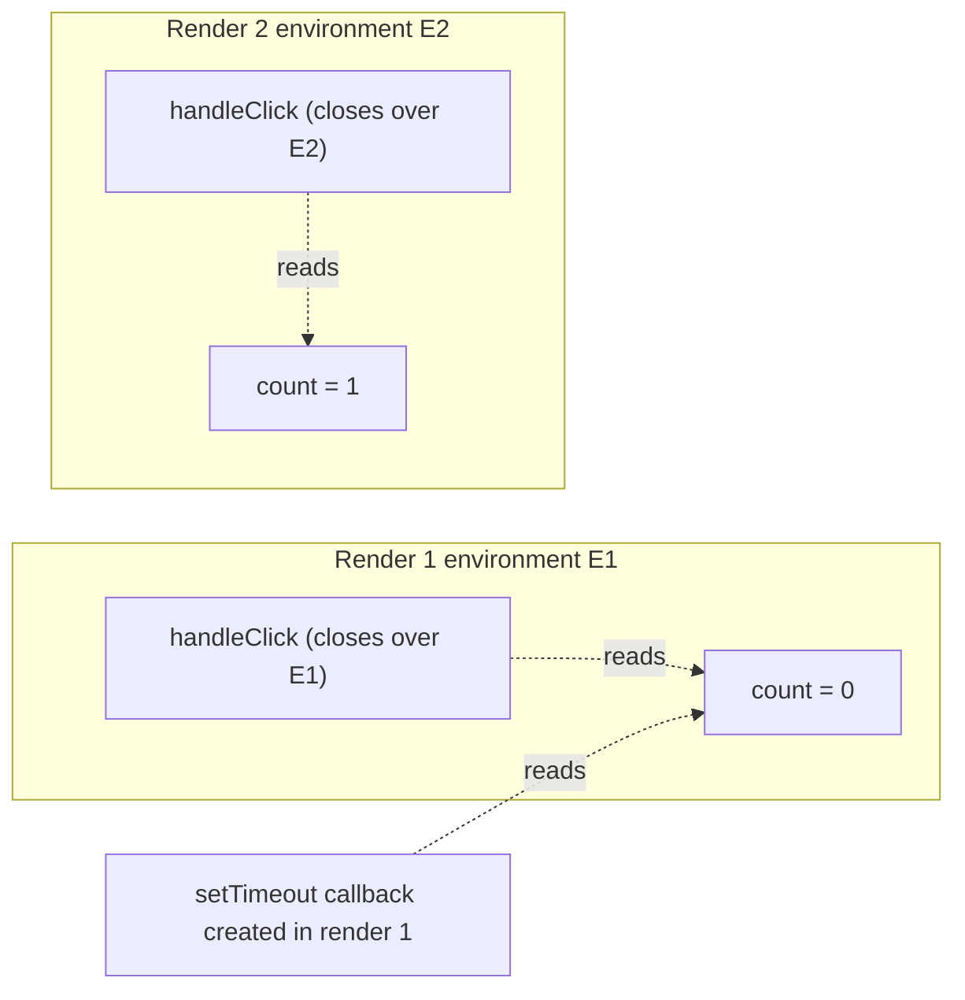
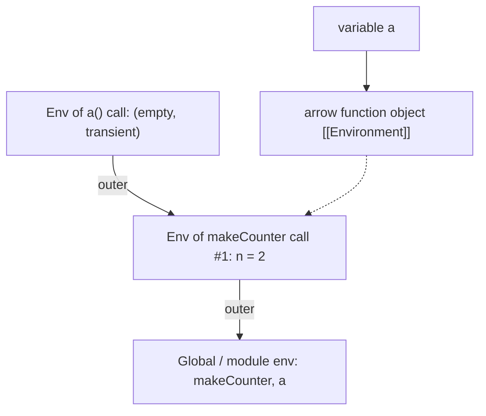
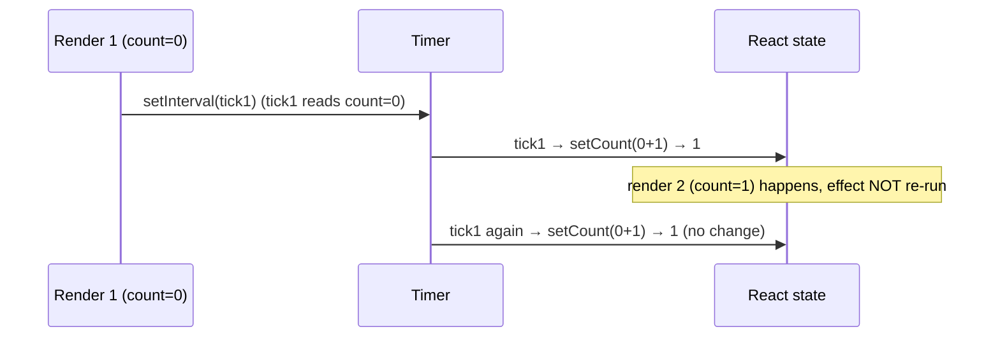

# 00 / 06 — Lexical Scope and Closures

## 1. Lesson metadata

| | |
|---|---|
| **Level** | Intermediate |
| **Study time** | 4–5 hours (reading 2 h, experiments 1 h, exercises 1.5 h) |
| **Prerequisites** | [05 — Execution contexts and the call stack](./05-execution-contexts-and-call-stack.md) (a context per call; environments; hoisting/TDZ). |
| **Next** | [07 — Functions as values; referential identity](./07-functions-and-referential-identity.md) |
| **Related later** | [Phase 1 / 14 — State as a snapshot](../01-react-fundamentals/14-state-as-a-snapshot.md), [Phase 3 / 05 — Effect dependencies and stale closures](../03-react-state-and-hooks/05-effect-dependencies-and-stale-closures.md), [Phase 3 / 02 — Functional state updates](../03-react-state-and-hooks/02-functional-state-updates.md), [Phase 3 / 10 — `useRef` and mutable references](../03-react-state-and-hooks/10-useref-and-mutable-references.md), [Lesson 16 — Memory and GC](./16-memory-management-and-gc.md) |

**Learning objectives.** After this lesson you can:
1. Resolve any identifier by *lexical* scope rules (block, function, module, global), including shadowing.
2. Define a closure precisely: a function together with the environment it was created in; and state what is captured (the *binding*, not a copy of the value).
3. Predict the classic loop-closure results for `var`, `let`, and `const`.
4. Use closures deliberately: private state, factories, partial application, memoization, event handlers.
5. Explain why closures can keep memory alive and how to avoid accidental retention.
6. Explain **React's render snapshot**: each render is a function call with its own bindings, so every handler, effect, and callback created in a render closes over *that render's* props and state.
7. Diagnose and fix **stale closures** (intervals, timeouts, subscriptions, `useEffect` with `[]`, memoized callbacks) with functional updates, correct dependencies, refs, and `useEffectEvent` where appropriate.

**Concepts covered:** lexical scoping vs dynamic scoping, scope chain, block scope, function scope, module scope, shadowing, closures, captured bindings, per-iteration bindings, IIFE and module pattern (historical), currying/partial application, memoization, memory retention, render-time closure, stale closure, functional updates, latest-ref pattern, `useEffectEvent` (volatile), the `exhaustive-deps` lint rule.

---

## 2. Deep conceptual explanation

### 2.1 What problem is this lesson solving?

Closures are the single most important JavaScript concept for React. Every handler you write inside a component, every effect, every callback you pass to `useMemo`/`useCallback`, is a function **created during a render** that reads variables **from that render**. The following questions are all closure questions:

- Why does `console.log(count)` in a `setTimeout` print the *old* count?
- Why does a `setInterval` created in `useEffect(..., [])` count to 1 and stop?
- Why does the lint rule insist on a dependency array containing everything you read?
- Why does `useCallback` with a missing dependency "work" until it doesn't?
- Why is a leaking subscription able to hold a whole component's data in memory?

If you can resolve variables by scope rules and understand what a function *remembers*, all of these are mechanical.

### 2.2 Scope: where an identifier can be seen

**Scope** is the region of code in which a binding (a name bound to a variable) is visible. JavaScript has **lexical (static) scope**: the scope structure is determined by *where code is written in the source*, not by how it is called. (Contrast *dynamic scope*, used by some old Lisps and shell languages, where a function sees the variables of its **caller**. JavaScript doesn't do that. `this` is the one dynamic-flavored binding, and arrow functions opt out of it.)

Kinds of scope:

| Scope | Created by | Holds |
|---|---|---|
| **Global** | The classic script's top level | `var`/function declarations (as properties of the global object), plus `let`/`const`/`class` in a separate declarative record that is *not* properties of `window` |
| **Module** | Each ES module | Top-level declarations private to the module; `import` bindings (live, read-only) |
| **Function** | Each function call | Parameters, `var`, inner function declarations, and `let`/`const` at the function body's top level |
| **Block** | `{ … }` bodies of `if`/`for`/`while`/`switch`/bare blocks, `catch` clauses | `let`, `const`, `class` (and function declarations in strict mode) |
| **Class static block / class body** | `class` | private names; `static {}` blocks have their own scope |

Resolution rule: look in the *current* scope; if not found, look in the *enclosing (outer) scope*, and so on up to global; if not found, `ReferenceError`. **Shadowing**: an inner binding with the same name hides the outer one inside its scope.

```ts
const label = "global";
function outer() {
  const label = "outer";           // shadows global label inside outer
  function inner() {
    return label;                  // resolves to "outer", where inner was WRITTEN
  }
  return inner();
}
console.log(outer()); // "outer"
```

*Who determines the answer?* The *source structure*: `inner` is textually inside `outer`. If `inner` were moved to the top level and called from `outer`, it would see `"global"`, because its outer scope would be the global scope. (Link to [Lesson 05 §3.1](./05-execution-contexts-and-call-stack.md): call stack and scope chain are different structures.)

### 2.3 What a closure is

> A **closure** is a function object together with a reference to the **environment** (the scope chain) in which it was created.

In ECMAScript terms: when a function object is created, the engine stores the *current LexicalEnvironment* in its internal `[[Environment]]` slot. When the function is later called, a new function environment is created whose `outer` is that stored environment. So the function body can resolve names in the scopes that **existed where it was written**, even after those scopes' functions have returned.

```ts
function makeCounter() {
  let n = 0;                          // binding in makeCounter's environment
  return {
    inc: () => ++n,                   // closure #1 captures that environment
    get: () => n,                     // closure #2 captures the SAME environment
  };
}
const c1 = makeCounter();
const c2 = makeCounter();
c1.inc(); c1.inc(); c2.inc();
console.log(c1.get(), c2.get());      // 2 1
```

Why `2 1`: each *call* to `makeCounter` creates a fresh environment with its own `n` ([Lesson 05](./05-execution-contexts-and-call-stack.md): a context per call). `c1.inc` and `c1.get` share one environment; `c2.*` share another. After `makeCounter` returns, the environment lives on **because the closures reference it**. This is the entire mechanism; there is no copy and no magic.

### 2.4 Closures capture *bindings*, not values

A closure doesn't snapshot the *value* at creation time. It keeps access to the **variable** (the binding in the environment). If the variable changes later, the closure sees the new value:

```ts
let message = "hello";
const read = () => message;
message = "bye";
console.log(read()); // "bye"
```

So when people say "React closures capture the state value at render time", the precise statement is: **in React, each render creates new `const` bindings (`const [count, setCount] = useState(0)` is a *new binding* per call of the component), and closures capture *those* bindings, which are never reassigned.** The snapshot behavior comes from *immutability of the binding per render*, not from closures copying values. That precision explains why `let`-mutated variables or refs *do* show changes through closures, while state variables don't.

### 2.5 The loop-closure classic

```ts
const fns: Array<() => number> = [];
for (var i = 0; i < 3; i++) fns.push(() => i);
console.log(fns.map((f) => f())); // [3, 3, 3]
```
`var` is function-scoped: **one** binding `i`, shared by all closures; it is `3` when the loop ends.

```ts
const fns2: Array<() => number> = [];
for (let i = 0; i < 3; i++) fns2.push(() => i);
console.log(fns2.map((f) => f())); // [0, 1, 2]
```
`let` in a `for` head gets a **fresh binding per iteration** (the spec copies the value into a new environment at the start of each iteration). Each closure captures its own `i`. (Note: `for (const i = 0; …; i++)` throws on the increment because `const` can't be reassigned; `for (const x of xs)` is fine because each iteration binds a new `x`.)

### 2.6 What closures are good for

| Use | Example | Notes |
|---|---|---|
| **Encapsulated state** | `makeCounter` | The pre-class way to get privacy |
| **Factories / partial application** | `const add = (a: number) => (b: number) => a + b` | Currying |
| **Callbacks/handlers** | Click handlers that use surrounding variables | Everything in React |
| **Memoization** | `function memo(fn) { const cache = new Map(); return (x) => … }` | Cache lives in closure |
| **Debounce/throttle** | `let timer` captured by the returned function | Closure holds timer id |
| **Module pattern (historical)** | IIFE returning an API | Replaced by ES modules |
| **Iterators/generators** | State captured across calls | |

### 2.7 Closures and memory

A closure keeps its **entire captured environment** reachable by the garbage collector for as long as the closure itself is reachable. Engines optimize by capturing only variables actually used by *some* inner closure in that scope, but **all closures created in the same scope tend to share one environment**, so one long-lived closure can retain variables that only a *different, short-lived* closure used (an engine-dependent behavior; modern V8 context allocation only places captured variables in the heap context, yet any captured variable stays alive as long as *any* closure of that scope is alive).

```ts
function setup() {
  const huge = new Array(1_000_000).fill(0);          // used by the first closure only
  const summarize = () => huge.length;
  const later = () => "hi";                           // doesn't use huge...
  window.addEventListener("resize", later);           // ...but can keep the shared env alive in some engines
  return summarize;
}
```
*Don't rely on engine-specific optimizations either way*: if memory matters, null out or scope big data in a smaller function, and remove listeners. See [Lesson 16](./16-memory-management-and-gc.md).

In React, this surfaces as: a leaked subscription (effect without cleanup) holds a closure from an old render, which holds the old props/state objects, and anything reachable from them (large data arrays, DOM nodes through refs).

### 2.8 React's render is a function call; handlers are closures over it

Place React in the model. A function component is called once per render:

```tsx
function Counter() {
  const [count, setCount] = useState(0);       // new const bindings per call
  const handleClick = () => {                  // new function object per call
    setTimeout(() => console.log(count), 3000);
  };
  return <button onClick={handleClick}>{count}</button>;
}
```

Render #1: environment E1 `{ count: 0, setCount, handleClick }` where `handleClick` closes over E1.
After a click that calls `setCount(1)`: render #2: **a new** environment E2 `{ count: 1, setCount, handleClick' }`; `handleClick'` closes over E2. E1 still exists, because the old `handleClick` (and the pending timeout callback) reference it.



This is the actual content of "**state is a snapshot**": the timeout created in render 1 logs `0` forever, regardless of later renders. No one "forgot to update" anything. It's not a bug to be fixed in React, it's what the code you wrote *means*. The skill is knowing when you *want* the snapshot (event handlers: the user clicked while seeing *that* UI) and when you *don't* (a long-lived subscription that must read fresh data).

### 2.9 What "stale closure" means, exactly

A **stale closure** is a closure that outlives the render in which it was created *and* reads values (props/state/derived values/functions) from that old render, when the programmer's intention was to read the *latest*. Four typical shapes:

| Shape | Why stale | Typical fix |
|---|---|---|
| **Long-lived timer/subscription created once** (`useEffect(..., [])` with `setInterval`/`addEventListener`/WebSocket) | The callback closes over render #1 and is never replaced | Include dependencies and re-subscribe; use functional state updates; use a "latest value" ref; `useEffectEvent` |
| **Async continuation** (`await` then `setState(count + 1)`) | Code after `await` runs later with old variables | Functional update; re-read via ref; abort stale work |
| **Memoized callback with incomplete deps** (`useCallback(fn, [])`) | The memoized function is from render #1 | Correct dependency array; or functional updates/ref |
| **Callback passed to non-React code** (chart library, `setTimeout`) | The library keeps your first callback | Update the library's callback on change, or keep a ref and pass a stable wrapper |

*Stale is not always bad.* In an event handler, "the value when the user clicked" is correct (the user acted on what they saw). In a polling loop, "the value from when the loop started" is a bug.

### 2.10 The remedies, conceptually

1. **Don't close over the changing value; ask React for the latest.** `setCount(c => c + 1)` closes over nothing: React passes the *current* pending state. (→ [Phase 3 / 02](../03-react-state-and-hooks/02-functional-state-updates.md).)
2. **Re-create the closure when inputs change.** Put what the closure reads into the dependency array so the effect re-runs (clean up old, set up new). This is what `react-hooks/exhaustive-deps` enforces: the dependency array must list every reactive value the effect's closure reads, because the closure is only re-created when a dependency changes.
3. **Read through a mutable box.** A `ref` (`useRef`) is an object created once per component instance. Its identity is stable, so closures that captured it all see the same box; you write `ref.current = latestValue` each render and read `ref.current` in the long-lived callback. (This opts out of React's reactivity: changing `ref.current` doesn't re-render. Use for *reading latest in callbacks*, not for UI.)
4. **`useEffectEvent`** *(stable since React 19.2; not available in 19.0/19.1)*: a React-provided way to define a function that always sees the latest props/state **but is not a dependency** of the effect. It formalizes remedy 3. It may only be called from inside Effects (not during render, and not passed to other components), and its identity is intentionally **not** stable, so it must not be put in a dependency array (react.dev/reference/react/useEffectEvent, checked 2026-10-22; the lint rule in `eslint-plugin-react-hooks` enforces this).
5. **Restructure.** Move logic out of the effect (event handlers, derived state) so no long-lived closure is needed. ([Phase 3 / 07 — You might not need an effect](../03-react-state-and-hooks/07-you-might-not-need-an-effect.md).)

### 2.11 Common misconceptions

| Misconception | Reality |
|---|---|
| "Closures copy variable values." | They keep a reference to the *binding*; values appear frozen in React only because each render has distinct `const` bindings. |
| "Closures are a React/Hooks feature." | They're core language semantics since the beginning; hooks just make them prominent. |
| "A stale closure is a bug in React." | It's consequence of your code creating a function in render N and calling it later. React's behavior is deterministic and documented. |
| "Wrapping in `useCallback` fixes staleness." | It makes staleness *more likely*: `useCallback` deliberately keeps the old function until deps change. |
| "Setting the dependency array to `[]` makes it run once, and that's safe." | It runs the effect once and *freezes* its closure to the first render's values. Safe only if the effect reads no reactive values. |
| "Every function inside a component is re-created each render, which is slow." | Creating a closure is cheap (an object allocation). It matters when *identity* matters ([Lesson 07](./07-functions-and-referential-identity.md)), not for CPU. |
| "`var` vs `let` only matters for hoisting." | In loops it decides whether closures share one binding or get one each. |

---

## 3. Internal mechanics

### 3.1 `[[Environment]]` and the call (public guarantee)

Spec-level sketch of how closures work (simplified):

1. **Function creation** (evaluating a function expression/declaration/arrow): create a function object; set `F.[[Environment]] = <running execution context's LexicalEnvironment>`.
2. **Function call** `F(args)`: create a new function environment record `E` with `E.outer = F.[[Environment]]`, bind parameters, run declaration instantiation ([Lesson 05 §2.5](./05-execution-contexts-and-call-stack.md)), and execute the body.
3. **Identifier resolution** walks `E → E.outer → …`.

*Public guarantee:* identifiers resolve via the environment where the function was created; each call has a fresh environment; captured variables remain valid as long as any closure refers to them.

### 3.2 How engines implement it (implementation detail)

- The parser/compiler performs *scope analysis*: it knows statically which variables are captured by inner functions.
- **Non-captured** locals can live on the stack or in registers and vanish at return.
- **Captured** variables are allocated in a heap-allocated **context/closure object** for that scope; inner functions hold a pointer to it. Chains of contexts correspond to the scope chain. Optimizations: skipping empty contexts, hoisting immutable captured constants, inlining closures that don't escape.
- `eval` and `with` defeat scope analysis (hence "avoid `eval`": it forces engines to keep everything reachable by name, and may block optimizations).
- Consequence: *there is no cost to closures that capture nothing; capturing a variable moves it to the heap.* Practically negligible per closure; relevant at large scale (millions of closures) or when a captured variable holds big data.

### 3.3 Per-iteration bindings

`for (let i = 0; i < n; i++) body` is specified as: create a "per-iteration environment", copy the loop variable's current value into it at the start of each iteration (before the *increment* step), then run the test/body/increment in that iteration's environment... Closures created in the body capture the iteration environment. The increment step operates on a *new copy* for the next iteration, which is why closures created earlier keep the old values. (You don't need the exact spec text; know the observable result.)

### 3.4 Where does React hold "state" relative to closures?

*Teaching model.* The *state value* lives in React's data structures (attached to the component's fiber; [Phase 2 / 17](../02-react-rendering-and-internals/17-hooks-and-fiber-state.md)), **not** in your function's environment. Each render, `useState` **reads** the current value from there and returns it, and your function binds it to a fresh `const`. The setter function (`setCount`) is stable across renders (documented: "the `set` function has a stable identity"), and *does not close over `count`*: it enqueues an update. That's exactly why `setCount(c => c + 1)` is immune to staleness: it asks React's stored state, not your closure.

### 3.5 Version-sensitive notes

- *React 18 → 19:* the snapshot semantics are unchanged. React 19's Actions (functions passed to `<form action>`, `useActionState`) are also closures created in a render: their captured values are that render's. `useOptimistic` and `useActionState` have documented patterns to read the latest state without staleness; check the docs.
- *Strict Mode (development):* React deliberately renders components twice and runs effects mount → cleanup → mount, to surface impure code and missing cleanup. A closure bug in a missing cleanup (a leaked interval from the first run) shows up as doubled timers in dev. (Phase 2 / 28.)
- *React Compiler (v1.0 stable since October 2025):* it auto-memoizes values/functions based on analysis of data flow. It does not change closure semantics, but it changes *when new function objects are created*, so code that accidentally relied on a function identity changing every render (or never changing) can behave differently. Write effects with correct dependencies so semantics don't depend on memoization.

---

## 4. Step-by-step execution walkthrough

### 4.1 Plain JS: `makeCounter`

```ts
function makeCounter() {
  let n = 0;
  return () => ++n;
}
const a = makeCounter();
a(); a();
```

1. Global: `makeCounter` bound (hoisted), `a` in TDZ.
2. `makeCounter()` call → push context **M1**. Environment `EM1 = { n: undefined→0 }`, outer = global. Execute `let n = 0` → `n = 0`.
3. The arrow function object is created with `[[Environment]] = EM1`.
4. Return → pop M1. **EM1 survives** (referenced by the arrow function).
5. `a` initialized to the arrow function.
6. `a()` → new context **A1**: environment `EA1 = {}` with `outer = EM1`. `++n` resolves `n` through `EA1` (not found) → `EM1` (found) → increments to 1. Pop A1; `EA1` discarded.
7. `a()` again → context A2: same, `n` becomes 2. The state persisted in `EM1`.

### 4.2 React: a click, a timeout, and a re-render (the key timeline)

Component `Counter` (code in §2.8). Initial `count = 0`.

| Time | Event | What exists | What is logged |
|---|---|---|---|
| t0 | Render 1 | Env E1: `count=0`, `handleClick1` (closes over E1) | |
| t1 | User clicks | `handleClick1` runs: schedules timeout with callback `cb1` (closes over E1) | |
| t2 | `setCount(count + 1)` isn't in this code; assume another click handler did `setCount(1)` | React schedules render 2 | |
| t3 | Render 2 | Env E2: `count=1`, `handleClick2` (closes over E2). DOM updated. E1 still alive (reachable via `cb1`) | |
| t4 | t1 + 3000 ms | `cb1` runs | prints **0** (`count` in E1) |

The log doesn't "miss" the update; `cb1` is a function created in render 1 that reads E1. If you *wanted* "the latest count", the code needs to read from something that is not E1 (a ref, or re-run effect).

Another full timeline: **the `setInterval` with `[]`**.

```tsx
useEffect(() => {
  const id = setInterval(() => setCount(count + 1), 1000);
  return () => clearInterval(id);
}, []);
```

| Time | What happens |
|---|---|
| Mount, render 1 | `count = 0`. Effect runs once (dependencies `[]`): the interval callback `tick1` closes over E1 where `count = 0`. |
| t = 1 s | `tick1` runs → `setCount(0 + 1)` → render 2 (`count = 1`). **The effect does not re-run** (deps unchanged), so `tick1` is still the callback. |
| t = 2 s | `tick1` runs again → `setCount(0 + 1)` → state is already 1 → React bails out (no change). |
| forever | `count` stays at `1`. |

(In dev Strict Mode the effect additionally mounts, cleans up and mounts again; the final state is still one live interval with a closure of render 1.)

---

## 5. Code examples

### 5.1 Minimal example — bindings vs values

```ts
function demo() {
  let x = 1;
  const getX = () => x;
  x = 2;
  return getX();
}
console.log(demo());
```

**Predict:** `1` or `2`?

**Result:** `2`.
**Why:** `getX` closes over the *binding* `x`; `x` was reassigned before the call. The closure doesn't carry a snapshot.
**Why React differs:** in a component, `count` is `const` and a *new binding* exists per render; no reassignment occurs in any given environment, which looks like a snapshot.

### 5.2 Practical example — a debounced function using a closure

```ts
export function debounce<A extends unknown[]>(fn: (...args: A) => void, waitMs: number) {
  let timer: ReturnType<typeof setTimeout> | undefined;   // private, shared by all calls of THIS debounced fn
  const debounced = (...args: A) => {
    clearTimeout(timer);
    timer = setTimeout(() => fn(...args), waitMs);
  };
  debounced.cancel = () => clearTimeout(timer);
  return debounced;
}
```

Line notes:
- `timer` lives in the environment of the `debounce` call; every call to `debounced` sees and updates the same variable. That is the closure doing its job.
- Each `debounce(...)` call creates an independent timer: two debounced functions don't interfere.
- **React trap:** `const onChange = debounce(handler, 300)` *inside a component body* creates a **new debounced function (new `timer`) on every render**, so each render has its own timer and the debouncing silently stops working across renders. Create it once (`useMemo`, `useRef`, module scope) and clean it up. The deeper treatment is in [Lesson 07](./07-functions-and-referential-identity.md) and [Phase 7 / 14](../07-performance/14-debounce-and-throttle.md).

### 5.3 Incorrect example — stale closure in an interval

```tsx
import { useEffect, useState } from "react";

export function Ticker() {
  const [count, setCount] = useState(0);

  useEffect(() => {
    const id = setInterval(() => {
      setCount(count + 1);          // reads `count` from render 1 forever
    }, 1000);
    return () => clearInterval(id);
  }, []);                           // lint: React Hook useEffect has a missing dependency: 'count'

  return <p>{count}</p>;
}
```

**Predict:** What is displayed after 10 seconds?

**Result:** `1`. It never goes beyond 1 (see §4.2 table).
**Why:** the effect ran once; its closure is from render 1 where `count = 0`; each tick sets state to `0 + 1`.
**What's *not* the explanation:** React doesn't "batch away" updates, and `setInterval` isn't broken.

### 5.4 Corrected implementation — three fixes with different trade-offs

**Fix A — functional update (best here).**
```tsx
useEffect(() => {
  const id = setInterval(() => setCount((c) => c + 1), 1000);
  return () => clearInterval(id);
}, []);   // the effect reads no reactive values: `setCount` is stable, `c` is a parameter
```
The closure reads nothing from the render. `[]` is now *honest*: the lint rule has nothing to complain about (state setters are known-stable).

**Fix B — re-create the interval whenever the value changes.**
```tsx
useEffect(() => {
  const id = setInterval(() => setCount(count + 1), 1000);
  return () => clearInterval(id);
}, [count]);
```
Correct but wasteful: the interval is cleared and recreated every second (and each re-creation resets the timing, causing jitter). Use when the *interval itself* must depend on a value (e.g., `delay`), not to carry state.

**Fix C — latest-value ref, for when a long-lived callback must read changing values.**
```tsx
function useLatest<T>(value: T) {
  const ref = useRef(value);
  useEffect(() => { ref.current = value; });   // after each commit; no deps → every render
  return ref;
}

export function Ticker({ step }: { step: number }) {
  const [count, setCount] = useState(0);
  const stepRef = useLatest(step);
  useEffect(() => {
    const id = setInterval(() => setCount((c) => c + stepRef.current), 1000);
    return () => clearInterval(id);
  }, [stepRef]);                               // stable ref object
  return <p>{count}</p>;
}
```
Notes: updating the ref in an effect (not during render) keeps render pure; there is a window between render and effect where `ref.current` is stale: acceptable for timers/subscriptions, not for logic that must be correct *during* render. `useEffectEvent` (React 19.2+) is the first-party alternative: `const onTick = useEffectEvent(() => setCount((c) => c + step));` then call `onTick()` inside the interval, and **don't** put `onTick` in deps.

**Trade-offs:** A is simplest when the update only needs the previous *state*. C/`useEffectEvent` when the callback needs latest *props* or other values. B when the *schedule* should restart.

### 5.5 Advanced example — async continuation and race protection

```tsx
import { useEffect, useState } from "react";

interface User { id: string; name: string }

export function UserCard({ id }: { id: string }) {
  const [user, setUser] = useState<User | null>(null);

  useEffect(() => {
    let ignore = false;                          // lives in THIS effect run's closure
    const ctrl = new AbortController();
    (async () => {
      const res = await fetch(`/api/users/${id}`, { signal: ctrl.signal });
      const data = (await res.json()) as User;
      if (!ignore) setUser(data);                // continuation checks its own run's flag
    })().catch((e) => { if (e.name !== "AbortError") console.error(e); });
    return () => { ignore = true; ctrl.abort(); };
  }, [id]);

  return <div>{user ? user.name : "Loading…"}</div>;
}
```

Line notes:
- `ignore` is a *per-effect-run* variable: when `id` changes, cleanup sets the *old run's* `ignore` to `true`; the new run has its own `ignore = false`. Two concurrent closures, two flags, no interference: closures as isolation.
- The async continuation after `await` is a stale-closure scenario by construction: it uses the `id` and `ignore` from the run that started it. Using the flag ensures *old* responses can't overwrite *newer* data.
- `AbortController` cancels the network request itself (saves bandwidth and avoids parse work); the flag still protects against code after `await` that has no abort integration.
- This is the foundation of [Phase 6 / 02](../06-data-fetching-and-state-ecosystems/02-cancellation-and-race-conditions.md); in production you would typically delegate to TanStack Query ([Phase 6 / 08](../06-data-fetching-and-state-ecosystems/08-tanstack-query.md)).
- In Strict Mode dev, the effect runs, cleans up, runs again: the first request is aborted: expected, and a good test of your cleanup.

---

## 6. Visual explanations

### 6.1 Scope chain of a closure



### 6.2 React: environments per render

```text
render 1 env  ── count=0 ── handlers/effects created here ──┐
render 2 env  ── count=1 ── handlers/effects created here ──┤  each closure reads ITS render's env
render 3 env  ── count=2 ── ...                             │
                                                            ▼
React's fiber memory (outside your functions): "current state = 2", "latest effect deps = ..."
```

### 6.3 Which closure runs: the interval timeline



---

## 7. Alternative approaches and trade-offs

How to give a long-lived callback access to current values:

| Approach | Always latest value? | Re-subscribes on change? | Readability | Risk | When to prefer |
|---|:-:|:-:|---|---|---|
| Close over values + correct deps | Yes (via re-run) | **Yes** | High | Churn (resubscribing timers/sockets) | Cheap to re-subscribe; semantics tied to the value |
| Functional state update | Yes (for state) | No | High | Only for state-derived updates | State transitions |
| Latest-ref pattern (`useLatest`) | Yes (after commit) | No | Medium | Opts out of reactivity; effect-time lag; discourages purity if overused | Long-lived subscriptions that need fresh props |
| `useEffectEvent` | Yes | No | High | Requires React 19.2+; callable only inside Effects; not stable identity | Same as above |
| Store outside React + `useSyncExternalStore` | Yes | No | Medium | More structure | Shared/global mutable sources ([Phase 3 / 20](../03-react-state-and-hooks/20-usesyncexternalstore-and-external-stores.md)) |
| Move logic out of effect into event handler | n/a | n/a | High | Not always possible | When the trigger is a user action, not synchronization |
| `useReducer` + dispatch | Yes (reducer sees current state) | No | Medium | Indirection | Complex updates; `dispatch` is stable |

**When the "recommended" approach (include every dependency and let the effect re-run) is NOT best:** an effect that opens a WebSocket and reads a rapidly changing `filter` value: re-subscribing on every keystroke would thrash the connection. There, separate the *connection lifecycle* (depends on URL only) from *message handling* (reads latest filter through `useEffectEvent`/a ref).

---

## 8. Best practices and anti-patterns

**Do**
- Treat each render's handlers/effects as snapshots; that's usually what you want.
- Prefer functional updates when new state depends on old state.
- Keep effect dependency arrays *honest*; trust the lint rule and fix the design, don't silence it.
- Clean up everything an effect starts (timers, listeners, subscriptions); cleanup closures see the *same* render's values as the effect that created them (important: that's why cleanup uses the correct id).
- Read from refs only in effects/handlers, not in render.

**Beginner mistakes**
- Using `var` in loops with async callbacks.
- Expecting `console.log(count)` after `setCount` in the same handler to show the new value.
- Adding `// eslint-disable-next-line react-hooks/exhaustive-deps` to "fix" a loop.
- Creating `debounce`/`throttle` inside render.

**Experienced-developer mistakes**
- Overusing `useCallback` hoping it "stabilizes" behavior: stabilizing identity *freezes* captured values unless deps are right.
- Storing everything in refs to dodge dependencies (invisible state: no re-render, harder reasoning, broken concurrent rendering assumptions).
- Reading refs during render (not idempotent, can mismatch under concurrent rendering).
- Holding large objects in closures of long-lived callbacks (leaks).

**Smells:** an effect with `[]` that mentions props/state; `useCallback(fn, [])` with a body that reads props; `useRef` mirrors of state updated in handlers; `setTimeout` inside handler reading state after a delay without considering staleness.

**Justified exceptions:** deliberately stale reads (e.g., "log the value as of the click"), `[]` effects that truly read nothing reactive, refs used as instance variables for imperative handles.

---

## 9. Real-world application

**Chat composer with autosave (realtime/forms).** Every 5 s the draft is saved. A naive `setInterval(() => save(draft), 5000)` in an effect with `[]` saves the *initial empty draft* forever: classic stale closure that loses user data. Engineering constraints: don't re-create the interval each keystroke (it would never fire while the user types continuously, since every keystroke restarts the timer), and don't save stale data. Solutions: store the latest draft in a ref read by a stable interval, or debounce saves on change (`useEffect` with `[draft]` and cleanup clearing the pending timer). Pick based on whether "at most every 5 s" or "5 s after typing stops" is the requirement; both are product decisions, not just implementation.

**Dashboard with live metrics (WebSocket).** Messages arrive 50×/s; the handler must read the current `selectedWidgetId` to filter. Re-subscribing on each selection change loses messages during reconnect. Connection effect depends only on the endpoint; the message handler reads a latest-ref (or `useEffectEvent`), and writes into a store; UI subscribes via `useSyncExternalStore` or a state library.

**Payment/checkout (finance, auth).** A "Pay" button's handler closes over the cart total *at render time*. If the cart changes between render and click (e.g., a price update arrives), the snapshot behavior is a *safety feature*: the user pays what they saw. But the *server* must still validate. Engineering rule: the closure captures what the user saw; the authoritative amount lives on the server; send an identifier of the quote/cart version, not just the number.

**Multi-team design systems.** A component library exposes `onChange` callbacks; consumers pass inline arrow functions (new identity each render). Library code that stores the callback in a long-lived structure (e.g., attaches to a third-party widget once) captures the *first* function. Library authors should keep a ref to the latest callback (`useLatest` pattern) and never assume callbacks are stable, a contract that must be documented.

---

## 10. Debugging and troubleshooting

### 10.1 Symptom: "State shows old value inside a callback / timer / listener."

1. Identify *which render* created the function (where it was defined and when it was attached).
2. In DevTools, set a breakpoint inside the callback; in the **Scope** pane, find the `Closure (Counter)` entry and read the captured `count`: you can literally see the old value.
3. Check how the callback was attached: `useEffect` deps? `useCallback` deps? passed to a library once?
4. Confirm with a temporary log of a render counter outside the closure, e.g., `console.log("render", renderId)` and inside the callback `console.log("callback from", renderIdCapturedAtCreation)`.
5. Fix with the strategy matching the shape (§2.9). *Validate:* automated test with fake timers (Vitest `vi.useFakeTimers()`), advance time, assert the DOM updates repeatedly.

### 10.2 Symptom: "Effect runs on every render / infinite loop after I fixed staleness by adding deps."

Cause: the dependency is a non-primitive created in render (object, array, function) → new identity each render → effect re-runs → `setState` → render ([Lesson 07](./07-functions-and-referential-identity.md)). Fix: move the object into the effect, derive primitives, memoize with correct deps, or restructure.

### 10.3 Symptom: "Memory grows with each navigation."

Heap snapshot: look at retainers of old component data. A closure (listed as `(closure)` or `system / Context`) retained by a global listener (`window.addEventListener`) or by a timer. Search for effects missing cleanup. Compare snapshots before/after repeating navigation 10×; detached DOM nodes and arrays tied to old props are the signature.

### 10.4 Symptom: "Handlers fire with outdated props after the parent re-rendered with new ones" in a memoized child.

`React.memo` on the child + parent passing a *stable* (memoized with stale deps) callback → child keeps calling the old function. Inspect the `useCallback` deps. In DevTools Profiler, "Why did this render?" shows whether props changed. Fix deps; if staleness is intended for stability, use a latest-ref wrapper inside the callback.

### 10.5 Tools

- Chrome DevTools **Scope** pane: `Local`, `Closure`, `Script`/`Module`, `Global`.
- ESLint `react-hooks/exhaustive-deps` (don't disable; it's the machine-checkable form of §2.10).
- React DevTools Profiler: *Why did this render?* (props, state, hooks changed).
- Vitest/Jest fake timers and React Testing Library `act` for deterministic timer tests.

---

## 11. Exercises

### Level A — Knowledge
A1. What is the difference between lexical and dynamic scope? Which does JavaScript use for variable resolution?
A2. Define "closure" in one sentence that mentions the environment.
A3. Does a closure capture a variable's value or its binding?
A4. Why does `for (let i…)` produce different closure results than `for (var i…)`?
A5. In a React component, why is the `count` seen by an event handler "frozen"?
A6. Name three shapes of stale closure in React and one fix for each.

### Level B — Code comprehension
B1. What is logged?
```ts
const fns: Array<() => string> = [];
for (var i = 0; i < 3; i++) { let j = i * 2; fns.push(() => `${i}-${j}`); }
console.log(fns.map((f) => f()).join(","));
```
B2. What is logged, and why?
```ts
function outer() {
  const x = 1;
  return function inner() {
    console.log(typeof x, typeof y);
  };
}
const y = 2;
outer()();
```
B3. In this component, the user clicks "Add" three times quickly, then waits. What is shown, and what does the `alert` at the end print?
```tsx
function Cart() {
  const [items, setItems] = useState<string[]>([]);
  const add = () => setItems([...items, "x"]);
  const report = () => setTimeout(() => alert(items.length), 2000);
  return (<>
    <button onClick={add}>Add</button>
    <button onClick={report}>Report</button>
    <p>{items.length}</p>
  </>);
}
```
(Assume three separate clicks, each separated by enough time for a render, then one click on Report followed by two more Adds before the timeout fires.)
B4. Is this effect correct? What does the user see when `page` changes from 1 to 2?
```tsx
useEffect(() => {
  const id = setInterval(() => console.log("page", page), 1000);
  return () => clearInterval(id);
}, [page]);
```
B5. What is the output of the following and why does each `counter` have independent state?
```ts
function createCounter() { let c = 0; return () => ++c; }
const a = createCounter(), b = createCounter();
console.log(a(), a(), b());
```

### Level C — Implementation
C1. Implement `once<T extends (...a: any[]) => any>(fn: T): T` that calls `fn` only the first time and returns the cached result after. Use a closure.
C2. Implement `useLatest<T>(value: T): React.RefObject<T>` and use it to write `useInterval(callback, delayMs | null)` whose callback always sees the latest values while the interval is created once per `delay`.
C3. Write a memoizer `memoize1<A, R>(fn: (a: A) => R): (a: A) => R` using a `Map`, discuss the memory implication and add an optional `maxSize` with FIFO eviction.

### Level D — Debugging
D1. "My window `resize` handler always uses the initial width." Find the bug and fix with two different approaches.
```tsx
function useIsNarrow(threshold: number) {
  const [narrow, setNarrow] = useState(false);
  useEffect(() => {
    const onResize = () => setNarrow(window.innerWidth < threshold);
    window.addEventListener("resize", onResize);
    return () => window.removeEventListener("resize", onResize);
  }, []);
  return narrow;
}
```
D2. The following saves a draft only the first time, then keeps saving the old text. Explain and fix without changing the interval period.
```tsx
const [text, setText] = useState("");
const save = useCallback(() => api.save(text), []);
useEffect(() => { const id = setInterval(save, 5000); return () => clearInterval(id); }, [save]);
```
D3. A list of 1,000 buttons is rendered via `for (var i…) buttons.push(<button onClick={() => remove(i)} />)` inside a function. Every button deletes the last item. Why? (Assume this is not React's `map`.)

### Level E — Architecture and engineering decisions
E1. Your team debates a team-wide rule: "never use `useCallback`; always use `useLatest`-style refs for callbacks". Evaluate with respect to correctness, readability, performance, and concurrency/React Compiler. Give a rule you'd actually adopt.
E2. A reusable `<VirtualList>` accepts `onItemClick`. The implementation attaches one scroll listener once. How should the library guarantee that `onItemClick` is never stale, without forcing consumers to memoize?

### Level F — Expert challenge
F1. Write a *tiny* hook-like closure system (no React): `createComponent(fn)` that re-runs `fn` on `setState`, with a `useState` that stores state outside `fn` indexed by call order. Demonstrate that handlers created in an old "render" see old state, and that functional updates avoid staleness. Explain how this models React and what it omits.

---

## 12. Detailed answers and explanations

> Attempt the exercises first.

**A1.** Lexical scope: names resolve based on where the code is written (the static nesting). Dynamic scope: names resolve in the caller's environment at call time. JavaScript uses lexical scope for identifiers (only `this` has call-site-dependent behavior).

**A2.** A closure is a function bundled with a reference to the lexical environment in which it was created, so it can access that environment's variables even after the creating function has returned.

**A3.** The **binding** (the variable itself). If the variable is reassigned, the closure sees the new value. React's render snapshots arise because each render has *new* `const` bindings.

**A4.** `var` makes one function-scoped binding shared by all iterations; `let` creates a fresh binding per iteration, so each closure captures its own copy.

**A5.** The handler was created during a specific render and closes over that render's `const count`. Later renders create new bindings; the old handler continues to see its own.

**A6.** (1) Long-lived timer/listener with `[]` deps → functional update / re-subscribe / latest-ref. (2) Async continuation after `await` → functional update, abort/ignore flag, re-read from ref. (3) `useCallback` with missing deps → correct deps or functional updates. (4) Callback given to third-party code once → ref wrapper or re-register on change. (Any three.)

**B1.** `3-0,3-2,3-4`. `var i` is shared (3 at the end); `let j` is per-iteration (0, 2, 4).

**B2.** Logs `number number`. `x` resolves in `outer`'s environment (`number`). `y` is looked up through the scope chain to the module/global scope; by the time `outer()()` runs, `const y = 2` has been initialized (TDZ is over), so `typeof y` is `"number"`. If `outer()()` were called *before* the `const y` line executed, `typeof y` would throw `ReferenceError` (TDZ). Common wrong answer: `number undefined`.

**B3.** After the three Adds the UI shows `3`. Suppose Report is clicked when `items.length === 3`; `report`'s closure (from the render with 3 items) is used; two more Adds make the UI `5`. After 2 s, the alert prints **3**, not 5: the timeout callback closes over `items` from the render in which `report` was created. Note also that `add` uses `[...items, "x"]`, so rapid clicks *within the same render* (before React re-renders) would lose updates — in a discrete-event world React re-renders between separate clicks, so it works here, but `setItems(prev => [...prev, "x"])` is more robust (e.g., when called twice in one handler).

**B4.** Correct. The closure reads `page`, so `page` is listed; when `page` changes React runs cleanup (clear old interval) then runs the effect with the new closure; log shows `page 2` thereafter. The cost is restarting the timer (the first tick after the change is a full second later).

**B5.** `1 2 1`. Each `createCounter()` call creates its own environment with its own `c`.

**C1.**
```ts
export function once<T extends (...args: any[]) => any>(fn: T): T {
  let called = false;
  let result: ReturnType<T>;
  return function (this: ThisParameterType<T>, ...args: Parameters<T>): ReturnType<T> {
    if (!called) {
      called = true;
      result = fn.apply(this, args);
    }
    return result;
  } as T;
}
```
Notes: `called` and `result` live in the closure. Edge cases: if `fn` throws, `called` is already `true`, and later calls return `undefined`: decide whether to set `called` only after success. `any` here is the pragmatic generic-constraint idiom; `unknown[]` rejects many function types due to parameter variance. Not suitable for caching *per argument* (see memoize).

**C2.**
```tsx
import { useEffect, useRef, type RefObject } from "react";

export function useLatest<T>(value: T): RefObject<T> {
  const ref = useRef(value);
  useEffect(() => { ref.current = value; });
  return ref;
}

export function useInterval(callback: () => void, delayMs: number | null): void {
  const saved = useLatest(callback);
  useEffect(() => {
    if (delayMs === null) return;
    const id = setInterval(() => saved.current(), delayMs);
    return () => clearInterval(id);
  }, [delayMs, saved]);
}
```
Notes: the interval is created per `delayMs`, not per render; `saved` is a stable ref object, so listing it costs nothing. `null` pauses. The callback is updated in an effect (post-commit) so there is a short window where a tick could call the previous callback: acceptable for timers. ⚠ In React 19 types, `useRef(value)` returns `RefObject<T>`; in React 18 types `MutableRefObject<T>`.

**C3.**
```ts
export function memoize1<A, R>(fn: (a: A) => R, maxSize = Infinity): (a: A) => R {
  const cache = new Map<A, R>();
  return (a) => {
    if (cache.has(a)) return cache.get(a) as R;
    const r = fn(a);
    cache.set(a, r);
    if (cache.size > maxSize) {
      const oldest = cache.keys().next().value as A;   // Map iterates in insertion order
      cache.delete(oldest);
    }
    return r;
  };
}
```
Memory: the cache is in the closure; it keeps every key and result alive for the lifetime of the returned function (potential leak). For object keys prefer `WeakMap` (keys can be GC'd) but that prohibits eviction by size and primitive keys. Keys compare with `SameValueZero`: objects by identity ([Lesson 07](./07-functions-and-referential-identity.md)); `NaN` works as a key. FIFO isn't LRU: a better eviction would reinsert on hit.

**D1.** `[]` freezes `onResize` to render 1, closing over `threshold` from the first render; if `threshold` changes, the handler still compares against the old value. (`innerWidth` is read fresh each time: the *bug* is the stale `threshold`.) Fix 1: include `threshold` in deps: `[threshold]` (re-subscribes when it changes: cheap). Fix 2: `useLatest(threshold)` + stable subscription, or compute `narrow` from a `matchMedia` query keyed by threshold (`window.matchMedia(`(max-width: ${threshold}px)`)` with a change listener): also initialize state from it to avoid a first-render flash. Best: `useSyncExternalStore` over `matchMedia` ([Phase 3 / 20](../03-react-state-and-hooks/20-usesyncexternalstore-and-external-stores.md)).

**D2.** `useCallback(…, [])` creates `save` once; it closes over `text = ""` from render 1 and keeps that function forever; the interval effect depends on `save` (stable), so it never restarts, and always calls the first `save`. Fix: `useCallback(() => api.save(text), [text])` (and accept the interval restarting when `text` changes: possibly never firing while typing); better keep the period stable with a latest ref: `const textRef = useLatest(text); useInterval(() => api.save(textRef.current), 5000)`. Even better: debounce on change or save on blur, depending on requirements.

**D3.** `var i` is function-scoped and shared: after the loop `i` equals the length, so every `remove(i)` removes the item after the last (or the last, depending on off-by-one). Fix: `let i`, or create the handler through a factory/`map` callback parameter that captures the item per iteration.

**E1.** Evaluation criteria: correctness, readability, concurrency safety, tooling alignment. Rules like "never `useCallback`" or "always refs" are overgeneralizations. `useCallback` is a memoization tool: it makes identity stable, which matters for memoized children or dependency arrays; it's neither right nor wrong by default. Refs bypass reactivity and break the purity assumption if read during render; mirrored-ref updates in effects lag; concurrent rendering may discard renders (refs written during render can capture uncommitted values). A reasonable rule: *default to plain functions; use functional updates where state-derived; use `useCallback`/`useMemo` for measured identity needs or to satisfy dependencies; use latest-ref/`useEffectEvent` only for long-lived subscriptions that must read fresh values; do not silence `exhaustive-deps`.* With React Compiler (volatile; verify) many manual memoizations become unnecessary, which further argues against blanket rules.

**E2.** The library should *own* the stability: store `onItemClick` in a latest-ref inside the component (updated in an effect or via `useEffectEvent`, React 19.2+), attach the scroll listener once, and call `ref.current(item)` when needed. Consumers can pass inline functions freely. Document the contract: "callbacks may change identity; the latest is always used". Alternative: internal event delegation (one listener on the container; look up the item via `data-index`) so no per-item closures exist at all, which also reduces memory for large lists. Trade-off: the latest-ref approach introduces a small lag window between render and effect; for click handlers that's irrelevant. Test: consumer re-renders with a different callback; click; assert the new one is called.

**F1. Example answer.**
```ts
type Setter<T> = (v: T | ((prev: T) => T)) => void;
type Hooks = { useState: <T>(initial: T) => [T, Setter<T>] };

function createComponent<P>(component: (hooks: Hooks, props: P) => () => void) {
  const states: unknown[] = [];        // state lives OUTSIDE the component function
  let hookIndex = 0;
  let props!: P;
  let handler: () => void = () => {};

  const hooks: Hooks = {
    useState<T>(initial: T): [T, Setter<T>] {
      const i = hookIndex++;           // identity of a hook = its call position
      if (!(i in states)) states[i] = initial;
      const set: Setter<T> = (v) => {
        const prev = states[i] as T;
        states[i] = typeof v === "function" ? (v as (p: T) => T)(prev) : v;
        render(props);                 // synchronous re-render (no batching)
      };
      return [states[i] as T, set];
    },
  };

  function render(p: P) {
    props = p;
    hookIndex = 0;
    handler = component(hooks, p);     // returns the "event handler" created this render
  }
  return { render, getHandler: () => handler };
}

// Demo
const app = createComponent<{}>((h) => {
  const [n, setN] = h.useState(0);
  console.log("render, n =", n);
  return () => setN(n + 1);            // closes over THIS render's n
});
app.render({});                        // render, n = 0
const h1 = app.getHandler();           // handler from render #1 (closes over n = 0)
h1();                                  // render, n = 1
h1();                                  // render, n = 1  (stale: computes 0 + 1 again)
```
Calling the handler returned by render #1 twice yields `n = 1` both times (each call computes `0 + 1`, as in the stale interval), while a component returning `() => setN((p) => p + 1)` reaches 2, because the updater reads `states[i]`. What it omits: batching and scheduling (updates here re-render synchronously), render/commit separation, effects and cleanup, bail-outs, dependency comparison, keys/identity of multiple component instances, concurrent rendering and priority, error boundaries, and the dispatcher mechanism. Evaluation criteria: state outside the function; index-based hooks; demonstration of stale vs functional behavior; honest list of omissions.

---

## 13. Senior engineer interview questions

**Q1. "Explain a closure without using the word 'remember'."**
*Strong answer:* A function object holds a reference to the lexical environment that was active when it was created; calling it creates a new environment whose outer link is that stored one. So free variables resolve through the creation-time scope chain, regardless of the call site, and those environments stay reachable (not garbage) as long as the function is.

**Q2. "Why does `setInterval(() => setCount(count + 1))` in `useEffect(..., [])` stop at 1?"**
*Strong answer:* The effect ran once, so the interval callback is a closure from the first render, where `count` is a `const` equal to 0. Each tick computes 0+1. React doesn't mutate the binding; it makes new bindings in new renders, which the old closure can't see. Fix by not depending on the binding (functional update), or by re-creating the closure when its inputs change (deps), or by reading via a ref.

**Q3. "Is it always a bug to have a stale closure?"**
*Strong answer:* No. Event handlers *should* act on what the user saw. It's a bug when a long-lived callback is supposed to track current state but was created once. The remedy depends on intent: a snapshot (keep), latest value (ref/event function), or restart when inputs change (deps).

**Q4. "What does `useCallback` do to closures, and when does it cause staleness?"**
*Strong answer:* It returns the previous function object when dependencies are unchanged, so the previously created closure, with *its* captured values, is reused. If a value the function reads isn't in deps, the function keeps the old one: stale. It trades fresh closures for identity stability; the dependency array is the contract.

**Q5. "How would you prevent a leaked listener from retaining a huge component's data?"**
*Strong answer:* Ensure cleanup runs (remove listener/timer/subscription in effect cleanup); avoid capturing large objects in long-lived callbacks (capture IDs, read data from a store/ref at call time); verify with heap snapshots comparing retainers before/after navigation.

**Q6. "Why does `for (let i…)` fix the classic closure bug?"**
*Strong answer:* It creates a new binding for each iteration, so each closure captures a distinct `i`, whereas `var` has a single function-scoped binding shared by all closures and equal to the final value when they run.

---

## 14. Further learning resources

| Resource | URL | Covers / why | Level | Study |
|---|---|---|---|---|
| MDN — Closures | <https://developer.mozilla.org/en-US/docs/Web/JavaScript/Closures> | Lexical scoping, closures, practical uses, loop pitfalls | Beginner–Int. | Whole page |
| MDN — Scope | <https://developer.mozilla.org/en-US/docs/Glossary/Scope> | Scope glossary entry | Beginner | Whole page |
| MDN — Functions (scope and the function stack) | <https://developer.mozilla.org/en-US/docs/Web/JavaScript/Guide/Functions> | Guide chapter including closures and scope | Beginner | "Function scope", "Closures" |
| ECMAScript spec — Environment Records | <https://tc39.es/ecma262/#sec-environment-records> | Normative environment/scope definitions | Advanced | Overview |
| react.dev — State as a Snapshot | <https://react.dev/learn/state-as-a-snapshot> | The snapshot behavior with timers and handlers | Beginner | Whole page |
| react.dev — Synchronizing with Effects | <https://react.dev/learn/synchronizing-with-effects> | Effect lifecycle, cleanup | Intermediate | Whole page |
| react.dev — Lifecycle of Reactive Effects | <https://react.dev/learn/lifecycle-of-reactive-effects> | Why dependencies must match what the effect reads | Intermediate | "Why dependencies can't be omitted", "removing unnecessary dependencies" |
| react.dev — Separating Events from Effects | <https://react.dev/learn/separating-events-from-effects> | Event functions and `useEffectEvent` (stable in 19.2) | Intermediate | Whole page |
| react.dev — `useEffect` reference | <https://react.dev/reference/react/useEffect> | Dependency semantics, cleanup | Intermediate | "Troubleshooting" |
| `eslint-plugin-react-hooks` | <https://github.com/facebook/react/tree/main/packages/eslint-plugin-react-hooks> | The lint rules enforcing honest dependencies | Intermediate | README |

Links checked 2026-10-22 (HTTP 200).

---

## 15. Knowledge checkpoint

**You should now understand**
- Lexical scoping: scope is decided by source structure, resolved through the scope chain.
- Closures as function + creation-time environment, capturing bindings (not values).
- That every React render is a function call with its own bindings, so handlers and effects are snapshots of that render.
- The shapes of stale closures and the toolbox of remedies (functional updates, deps, refs, event functions, restructuring).
- That closures keep environments alive, which matters for memory.

**You should be able to explain without notes**
- Why `setInterval` with `[]` stops at 1, and three ways to fix it.
- Why `for (let…)` and `for (var…)` differ in closures.
- Why `useCallback` can cause staleness.

**You should be able to implement**
- `debounce`, `once`, `memoize1`, `useLatest`, `useInterval`.

**You should be able to debug**
- Stale values using the Scope pane; leaks via retainers; effect loops caused by identity (preview of the next lesson).

**Before moving on:** read [07 — Functions as values; referential identity](./07-functions-and-referential-identity.md): closures explain *what* a function sees; identity explains *when React thinks a function (or object) is "the same"*, the other half of dependency arrays and memoization.
