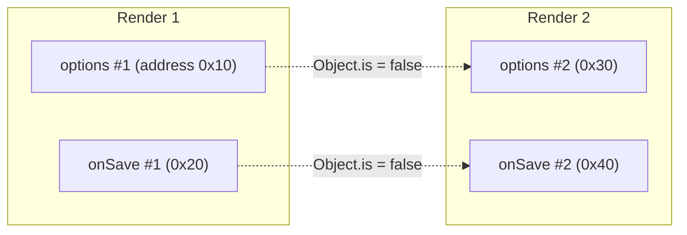
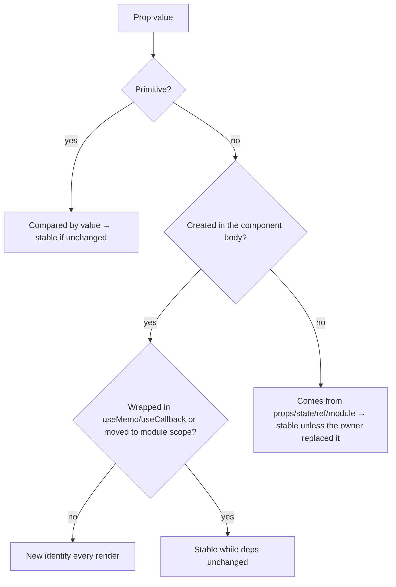

# 00 / 07 — Functions as Values and Referential Identity

## 1. Lesson metadata

| | |
|---|---|
| **Level** | Intermediate |
| **Study time** | 4 hours (reading 1.5–2 h, experiments 1 h, exercises 1–1.5 h) |
| **Prerequisites** | [06 — Lexical scope and closures](./06-lexical-scope-and-closures.md) (a function is created with its environment; each evaluation of a function expression creates a new function object); [05 — Execution contexts and the call stack](./05-execution-contexts-and-call-stack.md). |
| **Next** | [08 — Objects, references, and immutable updates](./08-objects-references-immutability.md) |
| **Related later** | [Phase 1 / 04 — Elements, components, instances](../01-react-fundamentals/04-elements-components-instances.md), [Phase 3 / 11 — `useMemo` and `useCallback`](../03-react-state-and-hooks/11-usememo-and-usecallback.md), [Phase 3 / 12 — `React.memo`](../03-react-state-and-hooks/12-react-memo.md), [Phase 7 / 04 — Memoization trade-offs](../07-performance/04-memoization-trade-offs.md), [Phase 7 / 05 — Referential equality](../07-performance/05-referential-equality.md) |

**Learning objectives.** After this lesson you can:
1. Explain that functions are objects (first-class values): they can be stored, passed, returned, compared, and have properties.
2. Distinguish **value equality** from **referential identity**; use `===`, `Object.is`, and `SameValueZero` correctly and say which one React uses where.
3. Predict when a new function/object/array is created (every evaluation of the expression) and therefore when identity changes.
4. Explain exactly how identity changes cause: effect re-runs, `React.memo` bail-out failures, context consumer re-renders, `useMemo`/`useCallback` recomputation, and component **remounts** (type identity).
5. Choose between stabilizing identity (`useCallback`, `useMemo`, module-level constants, `useRef`) and restructuring so identity does not matter.
6. Explain why memoization is not free and when it's pointless.

**Concepts covered:** first-class and higher-order functions, function objects and their properties, function creation points, identity vs equality, `===`, `Object.is`, `SameValueZero`, `NaN`/`-0`, shallow equality, referential stability, inline object/array/function props, dependency arrays, `React.memo`, `useMemo`, `useCallback`, component type identity (nested component definitions), context value identity, keys as identity, `useRef` as a stable box, React Compiler (volatile).

---

## 2. Deep conceptual explanation

### 2.1 What problem is this lesson solving?

React is built on a decision procedure that appears in a dozen places:

> "Is this the **same** thing as last time?"

If the answer is "yes", React reuses earlier work (skips an effect, skips a child render, keeps a DOM node and its state, keeps a memoized value). If "no", it redoes work. The test React uses is almost always **`Object.is`**, which for objects and functions means **reference identity**, not "looks the same". So:

- `{ a: 1 }` created in render #1 and `{ a: 1 }` created in render #2 are **different** to React.
- `() => save(id)` created in render #1 and render #2 are **different** functions.
- A component defined inside another component is a **different component type** on each parent render, so React unmounts and remounts it (state lost).

Most "mysterious" React behaviors (effects running every render, `React.memo` that doesn't memoize, inputs that lose focus on every keystroke, infinite loops after adding a dependency) are one idea: *new identity on every render*. This lesson gives you the language-level foundation. React-level treatment follows in Phase 3 and Phase 7.

### 2.2 Functions are values (first-class citizens)

In JavaScript a function is an **object** (callable). Therefore:

```ts
function greet(name: string) { return `Hi ${name}`; }

const alias = greet;                       // assign to variables
const table = { greet, shout: (n: string) => greet(n).toUpperCase() }; // store in objects
[greet].map((f) => f("Ada"));              // put in arrays, pass as arguments
const compose = <A, B, C>(f: (b: B) => C, g: (a: A) => B) => (a: A) => f(g(a)); // return from functions
greet.displayName = "Greeter";             // functions are objects: they can carry properties
console.log(greet.name, greet.length);     // "greet" 1  (name and arity are properties)
console.log(typeof greet, greet instanceof Object); // "function" true
```

A function that takes or returns functions is a **higher-order function**. React relies on that style: `array.map(item => <Row />)`, `setState(prev => next)`, `useEffect(() => { … return cleanup; })`, `useMemo(() => compute(a, b), [a, b])`, `memo(Component)` (a function that takes a component and returns a component), and custom hooks that return functions.

**Two syntactic forms, one runtime concept:**

| Form | Hoisted? | Creates a function object | Own `this`/`arguments`? |
|---|---|---|---|
| `function f() {}` (declaration) | Yes (fully, [Lesson 05](./05-execution-contexts-and-call-stack.md)) | Once per *evaluation of the enclosing scope's instantiation* | Yes |
| `const f = function () {}` / `const f = () => {}` | No (TDZ until executed) | Each time the expression is *executed* | Function expr: yes; arrow: no (lexical) |
| Method shorthand `{ f() {} }` | n/a | Each time the object literal is evaluated | Yes |
| Class method | n/a | Once per class definition, on the prototype | Yes |

**The crucial rule:** *Every time a function expression (or declaration, in a scope that is instantiated anew) is **evaluated**, a **new function object** is created.* Inside a component function body, that is *every render*.

```ts
function make() { return () => 1; }
console.log(make() === make()); // false — two evaluations, two objects
```

The two functions have identical source, identical behavior, and (here) identical captured variables, yet they are not `===`. JavaScript does not compare functions structurally (it cannot: function equality is undecidable in general, and engines don't try).

### 2.3 Identity versus equality

| Kind of value | How `===` compares | Examples |
|---|---|---|
| **Primitives** (`string`, `number`, `bigint`, `boolean`, `undefined`, `null`, `symbol`) | By **value** | `"a" === "a"`, `42 === 42` |
| **Objects** (plain objects, arrays, functions, Maps, Sets, Dates, class instances, React elements, DOM nodes) | By **reference identity**: true only if both operands are the very same object | `{} === {}` is `false`; `const o = {}; o === o` is `true` |

An object variable holds a *reference* (a pointer-like handle) to an object stored elsewhere. Assignment copies the **reference**, not the object:

```ts
const a = { n: 1 };
const b = a;           // b and a refer to the same object
b.n = 2;
console.log(a.n);      // 2
console.log(a === b);  // true
const c = { n: 2 };
console.log(a === c);  // false (equal shape, different object)
```

Three algorithms to know (all in the ECMAScript spec):

| Operation | Used by | `NaN` vs `NaN` | `+0` vs `-0` |
|---|---|---|---|
| **IsStrictlyEqual** (`===`) | the operator | `false` | `true` |
| **SameValue** (`Object.is`) | `Object.is`; **React's change detection** | `true` | **`false`** |
| **SameValueZero** | `Array.prototype.includes`, `Map` keys, `Set` | `true` | `true` |

```ts
console.log(NaN === NaN, Object.is(NaN, NaN));   // false true
console.log(0 === -0, Object.is(0, -0));         // true false
console.log([NaN].includes(NaN), [NaN].indexOf(NaN)); // true -1
```

**React uses `Object.is`** for: dependency array comparison (`useEffect`, `useMemo`, `useCallback`, `useLayoutEffect`…), `useState`/`useReducer` bail-out (if the new state is `Object.is`-equal to the current one, React may skip re-rendering), `React.memo`'s default comparison (a *shallow* per-prop `Object.is`), and context value change detection. (These are documented behaviors; see the `useEffect`, `useState`, `memo` reference pages.)

### 2.4 "Shallow" comparison

`React.memo(Component)` compares the previous and next **props objects shallowly**: same set of keys, and for each key `Object.is(prev[key], next[key])`. Shallow equality *does not* look inside nested objects:

```ts
function shallowEqual(a: Record<string, unknown>, b: Record<string, unknown>): boolean {
  if (Object.is(a, b)) return true;
  const ka = Object.keys(a), kb = Object.keys(b);
  if (ka.length !== kb.length) return false;
  return ka.every((k) => Object.prototype.hasOwnProperty.call(b, k) && Object.is(a[k], b[k]));
}
shallowEqual({ x: 1, o: { n: 1 } }, { x: 1, o: { n: 1 } }); // false — `o` differs by identity
```

Therefore: pass primitives where possible; when you must pass objects/functions to a memoized child, keep their identity stable (or accept that the child re-renders).

### 2.5 Where new identities come from in a component

Every render of a component re-executes its body, so every literal and function expression in it creates a new object:

```tsx
function Parent({ userId }: { userId: string }) {
  const options = { userId, includeDeleted: false };         // new object each render
  const ids = [userId];                                      // new array each render
  const onSave = () => save(userId);                         // new function each render
  const style = { padding: 8 };                              // new object each render
  return <Child options={options} ids={ids} onSave={onSave} style={style} />;
}
```

Also new each render: results of `.map`/`.filter`/`.sort` copy (if you create arrays), object spreads, JSX elements themselves (`<Child />` is a fresh element object each render; an important but separate fact for [Phase 2/05](../02-react-rendering-and-internals/05-elements-vs-dom-nodes.md)), and *component functions defined in the body*.

What stays the same across renders:

| Stable by construction | Why |
|---|---|
| Primitive state/props values (when unchanged) | Value comparison |
| The `set` function from `useState` and `dispatch` from `useReducer` | Documented as stable |
| The object returned by `useRef` (the same `{ current }` box each render) | React keeps it per instance |
| Module-level constants and functions | Created once at module evaluation |
| Values returned by `useMemo`/`useCallback` when deps haven't changed | That is their purpose (React may discard cache in some circumstances; documented as a performance hint, not a semantic guarantee) |
| State values that you didn't replace | The same object reference you stored |

### 2.6 What identity changes cost, five concrete consequences

**1. Effect re-runs.** `useEffect(() => {...}, [options])`: if `options` is recreated each render, the effect cleans up and re-runs every render. If the effect sets state, you get an **infinite loop**.

**2. `React.memo` defeat.** `memo(Child)` skips re-rendering when all props are shallow-equal. An inline `onSave` makes the props different every time, so memo does nothing (but still pays the comparison cost).

**3. `useMemo`/`useCallback` invalidation.** Their dependency arrays use `Object.is`: an unstable dependency makes the memoization pointless.

**4. Context consumers re-render.** `<Ctx.Provider value={{ user, logout }}>` creates a new object per provider render, so **every consumer re-renders** whenever the provider's *parent* re-renders, even if `user` did not change ([Phase 3 / 14](../03-react-state-and-hooks/14-context-performance.md)).

**5. Remounts via component type identity.** React's reconciliation compares element **types** by identity. If a component is *defined* inside another component's body, then on every parent render it is a new function, hence a new type:

```tsx
function Page() {
  const [n, setN] = useState(0);
  function Field() { return <input defaultValue="" />; }   // new type every render
  return (<>
    <button onClick={() => setN(n + 1)}>{n}</button>
    <Field />                                               // unmounted & remounted each time
  </>);
}
```
Each parent render produces a different `Field`; React sees a different type at that position, **unmounts** the old subtree (destroying the DOM node, state, focus) and mounts a new one. (Preview: [Phase 2 / 07](../02-react-rendering-and-internals/07-identity-keys-and-reconciliation.md).) Rule: **define components at module scope**.

### 2.7 Stabilizing identity: the toolbox

| Tool | Stabilizes | How | Cost/limits |
|---|---|---|---|
| Move to module scope | Constants, helper functions, components | Created once | Can't capture per-render values |
| `useMemo(() => value, deps)` | Computed objects/arrays/values | Reuses the previous result while deps are `Object.is`-equal | Comparison + memory per instance; deps must be honest; React may recompute (hint) |
| `useCallback(fn, deps)` | Functions | Equivalent to `useMemo(() => fn, deps)` | Same; captures values at the time of the last dep change, so incorrect deps mean stale closures ([Lesson 06](./06-lexical-scope-and-closures.md)) |
| `useRef` | A stable *box* | `{ current }` object persists | Not reactive; writes don't re-render |
| `useState(() => initial)` lazy init as "constant per instance" | An object you never replace | Created once | State semantics |
| Functional/reducer APIs (`setState(prev => …)`, `dispatch`) | Avoid needing the value in closures | | |
| Pass primitives/ids instead of objects | Make identity irrelevant | `userId` instead of `{ userId }` | Sometimes requires restructuring |
| Move object creation inside the effect/handler that uses it | Removes it from deps | | |
| **React Compiler** (v1.0 stable since 2025-10-07; opt-in build step) | Automatically memoizes values/functions in compiled components | Build-time analysis | Requires code to follow Rules of React; not a license to ignore identity; behavior/availability evolves |

*Principle:* **first try to make identity irrelevant; only then make it stable.** Stability by memoization is a performance optimization that must be justified and measured ([Phase 7 / 04](../07-performance/04-memoization-trade-offs.md)).

### 2.8 Equality of data vs identity of references: a design view

Identity is *cheap* to check (a pointer comparison) and *conservative* (it can say "different" for equal data, never "same" for different data, unless you mutate). Deep equality is *expensive* (traverses structures) and can disagree with intent (should two equal-looking objects be one entity?). React chooses cheap identity checks plus **immutable updates**: if data changes, you create a *new* reference for the changed path; if nothing changed, you keep the *same* reference. Then `Object.is` is a reliable "did anything change" signal. This pairing — identity checks + immutable updates — is the subject of the next lesson ([08](./08-objects-references-immutability.md)). Mutating an object in place breaks the contract: the reference is unchanged, so React concludes "same" and skips updates.

### 2.9 Common misconceptions

| Misconception | Reality |
|---|---|
| "Two functions with the same code are equal." | Identity compares objects; each evaluation creates a new function. |
| "`useCallback` makes my function faster." | It doesn't change execution speed; it preserves identity across renders when deps are unchanged. |
| "Wrapping handlers in `useCallback` prevents re-renders." | Only if the receiving component is memoized (or uses the function in deps) and every other prop is also stable. |
| "Inline arrow functions in JSX are slow." | Creating a closure is cheap. They matter only when identity matters (memoized children/effect deps). The performance advice "avoid inline functions" is widely overapplied. |
| "`React.memo` does a deep comparison." | Shallow, per-prop `Object.is` (unless you provide a custom comparator). |
| "If the data is the same, React knows it didn't change." | React only knows reference identity. |
| "`useMemo` guarantees the value never recomputes." | It's a performance hint; React may discard cached values (documented). Don't rely on it for semantic correctness. |
| "`Object.is` and `===` are the same." | They differ for `NaN` and `±0`. |

---

## 3. Internal mechanics

### 3.1 How `useMemo`/`useCallback` compare dependencies (conceptual)

*Public guarantee (documented):* React compares each dependency with `Object.is`; if all are equal to the previous render's, it returns the cached value; otherwise it recomputes and stores the new value and deps. Calling `useMemo`/`useCallback` consumes a hook slot ([Phase 3 / 16](../03-react-state-and-hooks/16-rules-of-hooks-and-composition.md)).

*Teaching model (not exact source):*

```ts
// conceptual per-hook state: { value, deps }
function useMemoConceptual<T>(compute: () => T, deps: readonly unknown[]): T {
  const slot = currentHookSlot();                  // identified by call order
  if (slot.deps && depsEqual(slot.deps, deps)) return slot.value as T;
  const value = compute();
  slot.value = value; slot.deps = deps;
  return value;
}
const depsEqual = (a: readonly unknown[], b: readonly unknown[]) =>
  a.length === b.length && a.every((x, i) => Object.is(x, b[i]));
```
`useCallback(fn, deps)` is `useMemo(() => fn, deps)`. Note that **the `fn` expression is still evaluated every render** (a new function object is created and thrown away if the cache hits): `useCallback` doesn't prevent *creating* the closure, it only decides which one to *return*.

*Implementation detail (verified: in Strict Mode the sandbox saw the compute function called twice at mount):* in development, React (Strict Mode) may call the compute function twice to detect impurity, and may in some situations discard memo caches (e.g., during Suspense/hydration or future features). Treat memoization as an optimization, not state.

### 3.2 How `React.memo` decides (conceptual)

```tsx
// conceptual
function memo<P extends object>(Component: React.ComponentType<P>, areEqual = shallowEqual) {
  return function Memoized(props: P) {
    // React: if prevProps and nextProps are equal AND no state/context change inside → skip render
  };
}
```
*Public guarantee:* with default comparison, a memoized component re-renders when any prop fails `Object.is` against its previous value **or** when its own state/context changes. (A parent re-render with identical props skips the child. State changes *inside* the child, and context values it consumes, still trigger re-renders.)

⚠ React's implementation integrates the bail-out into its rendering algorithm (the fiber work loop; [Phase 2 / 09](../02-react-rendering-and-internals/09-fiber-nodes-and-units-of-work.md)) rather than wrapping the component, as above. The wrapper above is a *teaching model* of the observable behavior.

### 3.3 Identity in the engine (implementation detail)

An object reference is effectively a pointer/handle. `===` on objects compares those handles; no property inspection happens. Closures created from the same function *literal* share the same compiled code (`SharedFunctionInfo`-like metadata) but are distinct function objects with their own environment link. Allocation of small closures is fast (bump allocation in young generation), and short-lived ones are collected cheaply by generational GC ([Lesson 16](./16-memory-management-and-gc.md)). *This is why "creating functions in render is slow" is a myth*; the real costs are downstream: re-rendering, re-running effects, and re-subscribing.

### 3.4 `key` as an explicit identity channel

React also lets you **assert identity yourself**: the `key` prop. Two elements at the same position with the same type but different `key`s are treated as different instances (state reset); the same key preserves identity even if position changes. `key` is compared by string equality (coerced). So React has three identity layers: **element type** (reference identity of the component function or the tag string), **key**, and **position** among siblings (for unkeyed children). Phase 1 / 09 and Phase 2 / 07 cover it in depth.

### 3.5 Version notes

- React 19 docs continue to describe `useMemo`/`useCallback`/`memo` as performance optimizations. React's documentation increasingly points to the **React Compiler** (v1.0 stable since October 2025; opt-in, requires a build-time setup; see react.dev/learn/react-compiler for supported tooling) as the preferred way to get memoization without hand-written hooks, while hand-written memoization remains valid and sometimes necessary (e.g., to stabilize a value used as an effect dependency, where semantic stability is required).
- `ref` is a regular prop in React 19 function components; ref *callback* functions are subject to the same identity rule: a new inline ref callback each render means React calls the old one with `null` and the new one with the node (or, in React 19, runs the previous cleanup and the new callback) on every commit. Use a stable callback (`useCallback`) if the work isn't free.

---

## 4. Step-by-step execution walkthrough

### 4.1 An inline object defeats `memo`

```tsx
const Chart = memo(function Chart({ options }: { options: { color: string } }) {
  console.log("Chart render");
  return <canvas />;
});

function Dashboard() {
  const [tick, setTick] = useState(0);
  return (<>
    <button onClick={() => setTick(tick + 1)}>{tick}</button>
    <Chart options={{ color: "teal" }} />
  </>);
}
```

1. **Render 1:** `Dashboard()` runs, creates `options#1 = { color: "teal" }`, returns elements. React renders `Chart`; logs "Chart render".
2. Click → `setTick(1)`.
3. **Render 2:** `Dashboard()` runs again: creates `options#2` (a different object). React compares `Chart`'s previous and next props: `Object.is(options#1, options#2)` is **false** → `Chart` re-renders; logs again. The memo wrapper compared and failed: *the comparison cost was paid and the skip never happened.*
4. **Fix:** hoist the constant: `const OPTIONS = { color: "teal" }` at module level; the same reference every render → step 3 passes the equality check → `Chart` is skipped.

### 4.2 Unstable dependency causing an effect loop

```tsx
function Search({ term }: { term: string }) {
  const [results, setResults] = useState<string[]>([]);
  const params = { q: term, limit: 10 };          // new object each render

  useEffect(() => {
    fetchResults(params).then(setResults);        // setResults → re-render
  }, [params]);                                   // new identity each render → effect re-runs
  return <ul>{results.map((r) => <li key={r}>{r}</li>)}</ul>;
}
```

Timeline:

| Step | What happens |
|---|---|
| Render 1 | `params#1`; effect scheduled |
| After commit | Effect runs: `fetchResults(params#1)`; request in flight |
| Response | `setResults(array)` → new array identity → state changed → render 2 |
| Render 2 | `params#2` created (≠ `params#1`) → deps changed → effect runs again |
| … | Request → set → render → request … a **network loop** (not a synchronous infinite loop, but a continuous request storm; if the setter is called synchronously it is an immediate "Maximum update depth exceeded") |

Fix options: put `params` construction **inside** the effect and depend on primitives `[term]`; or `useMemo(() => ({ q: term, limit: 10 }), [term])`; or pass primitives to `fetchResults(term, 10)`.

### 4.3 Nested component definition destroying input state

Walk through §2.6 consequence 5: on each keystroke the parent re-renders (if input value is held in the parent state), producing a new `Field` function; React compares old and new element types: `Object.is(Field#1, Field#2)` false → unmount subtree, mount new → the `<input>` DOM node is replaced → typed text and focus disappear after each character. (Typing seems to "only accept one character".)

---

## 5. Code examples

### 5.1 Minimal example — identity quiz

```ts
const f1 = () => 1;
const f2 = () => 1;
const f3 = f1;
console.log(f1 === f2, f1 === f3);
console.log([f1].includes(f3), [f1].includes(f2));
console.log(JSON.stringify({ f: f1 }));  // functions are skipped by JSON.stringify
```

**Predict** each line.

**Result:** `false true`; `true false`; `{}`.
**Why:** `f1` and `f2` come from two *evaluations*; `f3` is a second reference to `f1`'s object. `includes` uses SameValueZero (identity for objects). `JSON.stringify` omits function-valued properties; so you can't use JSON to compare/serialize behavior.
**Relevance:** exactly the same comparisons occur inside React for props and dependencies.

### 5.2 Practical example — stable callback via `useCallback`, used correctly

```tsx
import { memo, useCallback, useState } from "react";

interface RowProps { id: string; label: string; onSelect: (id: string) => void }

const Row = memo(function Row({ id, label, onSelect }: RowProps) {
  return <li><button onClick={() => onSelect(id)}>{label}</button></li>;
});

export function List({ items }: { items: { id: string; label: string }[] }) {
  const [selected, setSelected] = useState<string | null>(null);

  // No dependencies: setSelected is stable; the callback reads no render values.
  const handleSelect = useCallback((id: string) => setSelected(id), []);

  return (
    <>
      <p>Selected: {selected ?? "none"}</p>
      <ul>{items.map((it) => <Row key={it.id} id={it.id} label={it.label} onSelect={handleSelect} />)}</ul>
    </>
  );
}
```

Line notes:
- `Row` is memoized, and all its props are primitives or the stable `handleSelect`: selecting an item re-renders `List` (state changed) but **not** the rows whose `id`/`label`/`onSelect` are unchanged.
- The `onClick={() => onSelect(id)}` *inside* `Row` is still a new function every `Row` render, but `Row` only renders when its props change, and that inline closure is passed to a DOM element (`<button>`), where identity doesn't matter.
- `handleSelect` uses the **`id` parameter**, not a captured render value, so its empty deps are honest ([Lesson 06](./06-lexical-scope-and-closures.md)).

**Trade-offs:** for 20 rows, `memo` + `useCallback` costs more (comparison + hook slots) than re-rendering rows. It pays for itself with expensive rows, hundreds of items, or frequent parent renders. Measure first.

### 5.3 Incorrect example — the memoization that does nothing

```tsx
const Row = memo(function Row({ item, onSelect }: { item: Item; onSelect: (i: Item) => void }) { … });

function List({ items }: { items: Item[] }) {
  return <>{items.map((item) => (
    <Row
      key={item.id}
      item={{ ...item, selected: item.id === selectedId }}   // new object each render
      onSelect={(i) => setSelectedId(i.id)}                  // new function each render
    />
  ))}</>;
}
```

**Predict:** Does `memo` prevent any row from re-rendering when `selectedId` changes?

**Result:** No; *every* row re-renders on *every* `List` render (and `memo` adds comparison overhead).
**Why:** both props are new identities each render; the shallow comparison fails for every row.
**Subtle point:** even where the data inside didn't change, "same data" ≠ "same reference".

### 5.4 Corrected implementation

```tsx
const Row = memo(function Row({ item, selected, onSelect }: { item: Item; selected: boolean; onSelect: (id: string) => void }) { … });

function List({ items, selectedId, setSelectedId }: { items: Item[]; selectedId: string | null; setSelectedId: (id: string) => void }) {
  return <>{items.map((item) => (
    <Row key={item.id} item={item} selected={item.id === selectedId} onSelect={setSelectedId} />
  ))}</>;
}
```

- `item` keeps its identity (same object from the parent's data as long as it wasn't replaced).
- `selected` is a boolean (primitive): only the previously-selected and newly-selected rows get a changed prop.
- `onSelect` receives a stable function (`setSelectedId` from `useState` is stable; if it's a custom function, memoize it in the owner).
Principle: **pass primitives and stable references; derive per-item flags as primitives.**

### 5.5 Advanced example — custom hook returning a stable API, and a custom equality check

```tsx
import { useCallback, useMemo, useReducer, useRef } from "react";

type Action = { type: "add"; text: string } | { type: "toggle"; id: number } | { type: "clear" };
interface Todo { id: number; text: string; done: boolean }

function reducer(state: readonly Todo[], action: Action): readonly Todo[] {
  switch (action.type) {
    case "add":    return [...state, { id: state.length + 1, text: action.text, done: false }];
    case "toggle": return state.map((t) => (t.id === action.id ? { ...t, done: !t.done } : t));
    case "clear":  return state.length === 0 ? state : [];     // return same reference when nothing changes
  }
}

export function useTodos() {
  const [todos, dispatch] = useReducer(reducer, [] as readonly Todo[]);

  // `dispatch` is stable, so these callbacks are stable with empty deps.
  const add = useCallback((text: string) => dispatch({ type: "add", text }), []);
  const toggle = useCallback((id: number) => dispatch({ type: "toggle", id }), []);
  const clear = useCallback(() => dispatch({ type: "clear" }), []);

  // The API object itself is stable until `todos` changes (a consumer may put `api` in deps).
  return useMemo(() => ({ todos, add, toggle, clear }), [todos, add, toggle, clear]);
}
```

Line notes:
- The reducer returns the **same state reference** in the no-change case (`clear` on an empty list); React then bails out of re-rendering ([Phase 3 / 03](../03-react-state-and-hooks/03-usereducer-and-reducer-architecture.md)). Returning `[]` unconditionally would create a new array and cause a pointless render.
- `useMemo` for the returned object means a consumer can write `useEffect(…, [api])` without churn; without it, `{ todos, add, toggle, clear }` would be a new object every render. **Trade-off:** more code and one more hook slot. Many teams instead return a tuple or destructure at the call site (`const { add } = useTodos()`), making consumers depend on individual stable functions.
- Design guideline for custom hooks: **document which returned values are stable** (functions from `useCallback`, dispatchers) and which change (`todos`), because consumers' dependency arrays depend on it.

---

## 6. Visual explanations

### 6.1 Same code, different objects



### 6.2 Decision flow: does this prop change identity?



### 6.3 Where identity is checked in React

| Place | Compared with | Consequence of "different" |
|---|---|---|
| Effect/memo/callback deps | `Object.is` per dep | Effect re-runs / value recomputed |
| `memo(Component)` props | Shallow `Object.is` per prop | Component re-renders |
| `useState` setter bail-out | `Object.is(prev, next)` | If equal: skip re-render |
| Context `value` | `Object.is` | All consumers re-render |
| Element `type` | `Object.is` | Unmount + mount (state lost) |
| `key` | Same string | Different instance (state reset) |

---

## 7. Alternative approaches and trade-offs

Giving a child a callback that depends on parent state:

| Approach | Identity stable? | Staleness risk | Readability | Cost | Prefer when |
|---|:-:|---|---|---|---|
| Inline arrow, no memoization | No | None (always fresh) | Highest | Child re-renders each parent render | Child not memoized or cheap; **default** |
| `useCallback` with correct deps | Until deps change | None if deps honest | Medium | Hook slot + dep compare | Memoized expensive child; dependency of effects |
| `useCallback` + latest-ref inside | Always | Low (reads ref) | Medium–low | Extra ref; effect-time lag | Truly stable identity required (subscriptions, third-party libs) |
| `useEffectEvent` (effects only) | n/a (non-reactive) | None | High | Version-sensitive | Effect needs latest values without re-subscribing |
| Pass id/primitive + stable dispatcher | Yes | None | High | Slight restructure | Lists, tables |
| Lift handler to a context/store (stable setter) | Yes | None | Medium | Architecture cost | Deep trees |
| React Compiler | Auto | None if rules followed | Highest (no hooks) | Build setup | Greenfield / opt-in in supported toolchains |

**When the "recommended" approach (don't memoize by default; make identity irrelevant first) is NOT best:** a chart/map component that re-initializes expensive imperative state whenever an `options` prop changes identity. There, stable identity (or deep comparison by a semantic key such as `JSON.stringify`-d options *only when small*) is *functionally required*, not just a performance nicety. Another case: a context provider with a frequently re-rendering parent and hundreds of consumers: memoizing the `value` is correct engineering.

---

## 8. Best practices and anti-patterns

**Do**
- Define components at module scope.
- Prefer primitives (ids, booleans, strings) as props to memoized children; derive flags instead of passing per-item objects.
- Put object/array construction inside effects/handlers when they're only used there.
- Keep dependency arrays honest; if an unstable dependency causes churn, fix the *source* of instability.
- Return the same reference from reducers/updates when nothing changed.
- Measure before memoizing ([Phase 7 / 01](../07-performance/01-measure-before-optimizing.md)).

**Beginner mistakes**
- Defining a component inside a component.
- Putting an object/array/function literal into a dependency array.
- Assuming `useCallback` alone prevents child re-renders.
- Comparing objects with `===` and expecting structural equality.

**Experienced-developer mistakes**
- Blanket-wrapping everything in `useMemo`/`useCallback`/`memo` (cost > benefit; obscures code; masks real design problems).
- Using `JSON.stringify` of props/deps as a "deep equality hack" on large objects.
- Creating a stable function via `useCallback` with `[]` while reading props (stale closure).
- Passing context `value={{…}}` inline in a high-level provider.
- Memoizing with unstable deps (e.g., `useMemo(…, [options])` where `options` is inline).

**Smells:** `useEffect(..., [obj])` where `obj` is built in the component body; `useMemo` whose deps contain an unmemoized array; `memo` components receiving `style={{…}}`, `onClick={() => …}`, or `children` elements (a new `children` element each render defeats memo; remember JSX children are props); a chain of `useCallback` calls each depending on the others for no measurable benefit.

**Justified exceptions:** stable identity is *required* for subscriptions registered once, third-party widgets keyed by option identity, context values consumed widely, and dependencies of effects with side effects that are expensive to repeat.

---

## 9. Real-world application

**Large data tables (finance/back-office).** 500 rows × 12 cells with frequent selection/sorting. Constraint: interaction under ~100 ms. Strategy: memoized `Row` receiving `row` (stable object from the data store), `selected` (boolean), and stable handlers; avoid passing `{...row, selected}`; virtualize beyond a few hundred rows. Keep **column definitions** at module scope (or memoized) because they are objects with functions and are typically passed to a table library that compares them by identity; an inline `columns` array can reset sorting/column state in some libraries, or trigger full-table re-computation each render. This one detail has caused many real "table is slow" tickets.

**Chart libraries (dashboards).** Chart components often treat a changed `options` identity as "re-initialize" (animations replay, zoom resets). Memoize the options (`useMemo` keyed on the primitive inputs) so the chart updates in place; verify with the library's docs on how it detects changes.

**Forms (controlled inputs).** A common bug: a `Field` component defined inside the form component loses focus every keystroke (§2.6). Another: validation schema objects (e.g., Zod) created in render and passed to a resolver; hoist at module scope.

**Realtime/subscriptions.** Message handlers registered with a socket library capture the first function unless the library is re-registered; use the latest-ref pattern ([Lesson 06](./06-lexical-scope-and-closures.md)) or `useEffectEvent` (React 19.2+). Stable identity for the callback you give the library avoids reconnect churn.

**Multi-team design systems.** Library components should not assume consumers pass stable props: either don't depend on identity internally (compare by value on primitives), or document and test with inline props; component APIs that accept `options`/`items` arrays should handle new identities gracefully (compare relevant fields, not the reference), because consumers will write inline objects.

**Auth/context.** `AuthProvider` value `{ user, signIn, signOut }`: stabilize `signIn/signOut` with `useCallback`, memoize the value on `[user]`; otherwise every route change (parent re-render) re-renders the whole tree of consumers.

---

## 10. Debugging and troubleshooting

### 10.1 Symptom: "Effect fires on every render."

1. Look at the effect's dependency array; identify non-primitive deps.
2. Log identities: 
```tsx
const prev = useRef(options);
useEffect(() => { console.log("options changed identity?", prev.current !== options); prev.current = options; });
```
3. React DevTools **Profiler** → "Why did this render?" (requires "Record why each component rendered" setting) shows which props/hooks changed.
4. Fix by stabilizing or removing the dependency (construct inside the effect, depend on primitives).
5. *Validate:* effect runs only when its logical inputs change (add a counter in tests or logs).

### 10.2 Symptom: "`React.memo` doesn't prevent re-renders."

Profiler → why did it render? If it says "props changed: `onSelect`, `style`", find inline functions/objects/JSX children. Fix at the source; a shallow-diff logger helps:
```ts
function whichPropsChanged(prev: Record<string, unknown>, next: Record<string, unknown>) {
  return Object.keys({ ...prev, ...next }).filter((k) => !Object.is(prev[k], next[k]));
}
```
Also check for **children**: `<Memo><span/></Memo>` passes a new element each render. And context: memo doesn't stop context-triggered renders.

### 10.3 Symptom: "Input loses focus / state resets on every keystroke."

Check for a component defined in a component body, or a changing `key`, or a changing element type at that position (e.g., conditionally wrapping in different tags). Inspect via DevTools Elements: if the `<input>` node flashes (replaced) on every keystroke, identity of the type/key is changing. Fix by hoisting definitions or stabilizing keys.

### 10.4 Symptom: "Maximum update depth exceeded."

A state update during render, or an effect that sets state each time its (unstable) dependency changes (§4.2). Stack trace points to the effect/setter. Fix instability or conditionally set state only when different.

### 10.5 Symptom: "Context consumers all re-render when an unrelated parent state changes."

The provider's `value` literal is new each render. Wrap in `useMemo` with proper deps, or split context into state and dispatch contexts, or move the provider lower so its parent re-renders less. Validate with the Profiler (consumers should no longer appear in the commit).

### 10.6 Tools

- React DevTools Profiler: "Why did this render?" and flamegraph colors (grey = didn't render).
- `why-did-you-render` style libraries (third-party; use dev-only) or a custom hook logging changed deps.
- `eslint-plugin-react-hooks` exhaustive-deps (flags some unstable-deps patterns) and *react-compiler* lint rules if you adopt the compiler.
- Chrome Memory/Performance panels for closure retention costs.

---

## 11. Exercises

### Level A — Knowledge
A1. What does `[1, 2] === [1, 2]` evaluate to, and why?
A2. List the three equality algorithms and which one React uses for dependency arrays.
A3. Name three things that are new objects on every render of a component.
A4. Which hook-returned values are documented as stable across renders?
A5. What does `React.memo` compare by default?
A6. Why does defining a component inside another component cause remounts?

### Level B — Code comprehension
B1. What does each line print?
```ts
console.log(Object.is(NaN, NaN), NaN === NaN, Object.is(0, -0), 0 === -0);
console.log([NaN].includes(NaN), new Set([NaN, NaN]).size, new Set([{}, {}]).size);
```
B2. In this component, how many times does `Child` render after clicking the button three times? Explain.
```tsx
const Child = memo(function Child({ n }: { n: number }) { console.log("child"); return <i>{n}</i>; });
function Parent() {
  const [c, setC] = useState(0);
  return (<><button onClick={() => setC(c + 1)}>{c}</button><Child n={42} /></>);
}
```
B3. Same as B2, but `<Child n={42} style={{ color: "red" }} />` (with `style` added to props). Now how many?
B4. Does this effect re-run on each render? What if `ids` is declared at module scope?
```tsx
function Thing({ id }: { id: string }) {
  const ids = [id];
  useEffect(() => { subscribe(ids); return () => unsubscribe(ids); }, [ids]);
  return null;
}
```
B5. After `setTodos(todos)` (the same array), does the component re-render? After `todos.push(x); setTodos(todos)`? After `setTodos([...todos])` with no changes?

### Level C — Implementation
C1. Implement `shallowEqual<T extends Record<string, unknown>>(a: T, b: T): boolean` with `Object.is`, handling different key counts.
C2. Write a custom hook `useStableCallback<T extends (...a: any[]) => any>(fn: T): T` that returns a function with stable identity which always calls the latest `fn`. Explain the trade-offs and when *not* to use it.
C3. Write `usePrevious<T>(value: T): T | undefined` and a `useWhyDidUpdate(name, props)` dev hook logging changed props by `Object.is`.

### Level D — Debugging
D1. The list below re-renders all rows on every selection. Find *three* identity problems and fix them.
```tsx
const Row = memo(({ data, onClick, style }: RowProps) => …);
<Row data={{ id, label, active: id === sel }} onClick={() => setSel(id)} style={{ padding: 4 }} />
```
D2. A `Modal` component keeps resetting its internal form state whenever the parent re-renders; code: `const Form = () => <input />;` is declared inside `Modal`. Explain and fix.
D3. `const value = { theme, setTheme }` is passed to `ThemeContext.Provider`; 300 consumers re-render when an unrelated counter in the same parent changes. Diagnose and give two fixes with trade-offs.

### Level E — Architecture and engineering decisions
E1. Your team uses `useCallback` for every function in components. Evaluate: costs, benefits, and propose a policy (including React Compiler considerations).
E2. A reusable `<DataGrid columns={[…]} rows={[…]} />` is used by many teams, who write inline `columns`. Design the component so that it behaves well with unstable identities, and document the contract.

### Level F — Expert challenge
F1. Implement a minimal `memoWith(Component, areEqual)` *in plain TypeScript/React* that skips re-rendering when `areEqual(prevProps, nextProps)` is true (you may use `useRef` and `useMemo`). Discuss why an implementation using only `useRef` + early return is subtly wrong with respect to Rules of React / concurrent rendering, and how `React.memo` avoids it.

---

## 12. Detailed answers and explanations

> Attempt the exercises first.

**A1.** `false`. Two array literals create two distinct objects; `===` on objects compares references.

**A2.** IsStrictlyEqual (`===`), SameValue (`Object.is`), SameValueZero (`includes`, `Map`, `Set`). React uses `Object.is` for dependency arrays.

**A3.** Any of: object literals, array literals, inline function expressions, JSX elements, component functions defined in the body, results of `.map`/`.filter` copies, `new Date()`.

**A4.** `useState` setter, `useReducer` `dispatch`, `useRef` object (the same box), values returned by `useMemo`/`useCallback` while deps are unchanged, and (documented) `startTransition`/`useTransition`'s `startTransition` function from `useTransition`. Don't forget: state *values* are stable only if you don't replace them.

**A5.** The props, shallowly: same keys, `Object.is` per value (unless a custom comparator is supplied).

**A6.** Each parent render creates a new function object for the inner component, i.e., a new element *type*; reconciliation sees different types at the same position → unmount old subtree, mount new → state and DOM destroyed.

**B1.** Line 1: `true false false true`. Line 2: `true 1 2` (`Set` uses SameValueZero: two `NaN`s collapse; two `{}` are distinct).

**B2.** `Child` renders **once** (initial mount), regardless of clicks. `n={42}` is a primitive and unchanged; memo skips; the parent's re-render creates a new *element* `<Child n={42}/>`, but memo compares props, not elements.

**B3.** `Child` renders on the initial mount plus **3 more times** (4 total): `style={{…}}` is a new object each Parent render, so shallow comparison fails each time. Fix: hoist the style object or use a primitive/class.

**B4.** Yes: `ids` is a new array each render, so deps differ, the effect cleans up and re-subscribes each render. With `ids` at module scope the reference is constant; the effect runs once (but then the effect wouldn't depend on `id`, so the example would be wrong logically; typically you'd depend on the primitive `id` and construct `[id]` inside the effect).

**B5.** `setTodos(todos)` (same reference): React bails out (`Object.is` equal) — no re-render of this component (React may still call the component function once more before bailing out in some cases; no children re-render, no effects; documented). `todos.push(x); setTodos(todos)`: also *bails out*: same reference, so the UI does not update even though the data changed: the classic mutation bug (see [Lesson 08](./08-objects-references-immutability.md)). `setTodos([...todos])`: a new array → re-render even though contents are equal; children that depend on the array identity re-render or recompute.

**C1.**
```ts
export function shallowEqual<T extends Record<string, unknown>>(a: T, b: T): boolean {
  if (Object.is(a, b)) return true;
  const ka = Object.keys(a);
  const kb = Object.keys(b);
  if (ka.length !== kb.length) return false;
  for (const k of ka) {
    if (!Object.prototype.hasOwnProperty.call(b, k) || !Object.is(a[k], b[k])) return false;
  }
  return true;
}
```
Notes: the key-count check plus `hasOwnProperty` ensures `{a: undefined}` ≠ `{}`; ignores symbol keys (React's implementation also compares own enumerable string keys; verify if you need symbols); `Object.is` rather than `===` matches React.

**C2.**
```tsx
import { useCallback, useEffect, useRef } from "react";

export function useStableCallback<T extends (...args: any[]) => any>(fn: T): T {
  const ref = useRef(fn);
  useEffect(() => { ref.current = fn; });               // latest function after each commit
  return useCallback(((...args: Parameters<T>) => ref.current(...args)) as T, []);
}
```
Trade-offs: the returned function has permanent identity and calls the latest `fn` (no stale closure). Downsides: (1) calling it **during render** may call the previous render's function (the ref updates in an effect), so don't call it in render or pass it to something that calls during render; (2) it hides data dependencies from tooling: a memoized child receiving it will *not* re-render when the logic changes, which can be wrong if the function's *behavior* is part of its output; (3) in concurrent rendering the ref can be updated for a render that ends up committed later than another: reading in handlers/effects is fine. It resembles what `useEffectEvent` formalizes, but scoped to effects. Don't use it to avoid thinking about dependencies in render logic.

**C3.**
```tsx
import { useEffect, useRef } from "react";

export function usePrevious<T>(value: T): T | undefined {
  const ref = useRef<T | undefined>(undefined);
  useEffect(() => { ref.current = value; });
  return ref.current;                                   // value from the previous committed render
}

export function useWhyDidUpdate(name: string, props: Record<string, unknown>): void {
  const prev = usePrevious(props);
  useEffect(() => {
    if (!prev) return;
    const changed = Object.keys({ ...prev, ...props }).filter((k) => !Object.is(prev[k], props[k]));
    if (changed.length) console.log(`[${name}] changed:`, changed);
  });
}
```
Notes: `usePrevious` reads `ref.current` during render, which the React docs discourage for general use (it is not pure with respect to renders that don't commit); fine for debugging helpers, avoid for UI logic (derive from state instead). In Strict Mode dev the effects run twice; log noise is expected.

**D1.** Problems: (1) `data={{ … }}` new object → pass `id`, `label`, `active` as primitives or pass the stable `item` plus `active` boolean; (2) `onClick={() => setSel(id)}` new function → pass `onSelect={setSel}` and let `Row` call `onSelect(id)`; (3) `style={{ padding: 4 }}` new object → hoist to a module constant or use a class. Also check `key`, and that `Row` isn't getting `children`.

**D2.** `Form` is a new component type on every `Modal` render → remount → state reset. Fix: define `Form` at module scope (passing needed values as props) or inline the JSX (`<input />`) without a component. If the `Form` needs closure values, pass them as props instead of capturing.

**D3.** The value object is new on each provider-parent render, so React treats the context as changed and re-renders all consumers. Fix 1: `const value = useMemo(() => ({ theme, setTheme }), [theme])` (`setTheme` from `useState` is stable): consumers re-render only when `theme` changes. Fix 2: split into `ThemeStateContext` (theme) and `ThemeDispatchContext` (setter): components that only need to set don't re-render on theme change; or move the provider's state into its own component so unrelated parent state changes don't re-render it. Trade-offs: memo needs honest deps; splitting adds providers; moving the state down is cleanest when possible. Not a fix: wrapping consumers in `memo` (context changes bypass memo).

**E1.** Evaluation: correctness (a missing dep → stale closure, an extra memo wrapper is harmless semantically), cost (each `useCallback` has a hook slot, a dependency comparison per render, and holds the previous closure and its environment alive), benefits (only when identity matters), readability (noise), and tooling (Compiler). Proposed policy: no blanket rule; use `useCallback`/`useMemo` when (a) value/function is a dependency of an effect/memo and must be stable, (b) passed to a measured-expensive memoized child, (c) provided via context, or (d) passed to a non-React library that keys on identity. Everything else plain. If adopting React Compiler (verify its support status with your toolchain), remove manual memoization in compiled modules unless needed for semantic stability, and keep Rules-of-React lint enabled.

**E2.** Make `DataGrid` robust to unstable inputs: (1) Derive internal state from stable *semantic keys* (e.g., `columns.map(c => c.id).join("|")`) rather than array identity for expensive recomputations; (2) keep user-visible state (sort, widths) keyed by column `id`, not by array position or identity; (3) wrap derived models in `useMemo` keyed by those semantic keys, and read the latest callback via refs for event handlers (`cellRenderer`, `onSort`); (4) document: "inputs may be recreated each render; behavior is keyed by `id`; for large data pass stable `rows` references (e.g., from your store), otherwise sorting/filtering recomputes". (5) Provide a dev-mode warning if `columns` identity changes on every render *and* recomputation exceeds a threshold. Trade-offs: semantic keys cost O(columns) per render (small), and column `id` must be unique and stable: enforce it. When *not* to over-engineer: a small internal grid used by one team.

**F1. Example answer.** A naive attempt:
```tsx
function memoWith<P extends object>(C: React.ComponentType<P>, areEqual: (a: P, b: P) => boolean) {
  return function Memoized(props: P) {
    const prev = useRef<{ props: P; out: React.ReactElement } | null>(null);
    if (prev.current && areEqual(prev.current.props, props)) return prev.current.out;
    const out = <C {...props} />;
    prev.current = { props, out };      // writes to a ref during render
    return out;
  };
}
```
It *appears* to work (returning the previously created element lets React bail out of that subtree because the element reference is identical, an optimization React applies when an element is `===` the previous one). Problems: (1) **writing a ref during render** is impure; a render that is later discarded (concurrent rendering, Suspense, Strict Mode's second invocation) leaves `prev` pointing at props that were never committed, so a later render might compare against uncommitted data and skip a needed update; (2) context changes inside `C` are still handled (they re-render `C` independently) but your wrapper doesn't know; (3) in Strict Mode dev, double rendering writes the ref twice (harmless here but a symptom). `React.memo` instead stores the previous props on the **fiber that React commits** and performs the comparison inside its own render algorithm, where the rules about discarded renders are handled by React. A closer user-land approximation uses `useMemo(() => <C {...props} />, [props.a, props.b])` with explicit field deps (sound, because `useMemo` is the sanctioned memoization primitive), but you must enumerate props, which doesn't generalize to `areEqual`. Evaluation: identify ref-write-in-render, discarded renders, and that React.memo integrates with the work loop ([Phase 2 / 12](../02-react-rendering-and-internals/12-why-rendering-must-be-pure.md)).

---

## 13. Senior engineer interview questions

**Q1. "Why does an inline object prop defeat `React.memo`?"**
*Strong answer:* `memo` compares props shallowly with `Object.is`; an object literal in the parent's body is created anew each render, so the reference differs even if the contents are identical. The comparison fails, the child re-renders, and you've also paid for the comparison. Fix by hoisting, memoizing with honest deps, or passing primitives.

**Q2. "When is `useCallback` useful, and when is it noise?"**
*Strong answer:* Useful when a function's identity is observed: as a dependency of an effect/memo, passed to a memoized child that is expensive to re-render, provided through context, or given to a library that compares identity. Noise when the function is only passed to DOM elements or to non-memoized children, where identity is irrelevant and the memoization adds cost. And it's a stale-closure risk if deps are incomplete.

**Q3. "Explain `Object.is` vs `===` and why React cares."**
*Strong answer:* They differ on `NaN` (equal under `Object.is`) and signed zero (distinct under `Object.is`). React uses `Object.is` so `NaN` states don't re-render forever and `-0` transitions are visible. For objects both are reference comparisons: React deliberately does not deep-compare because it's expensive and ambiguous; it relies on immutable updates to produce new references.

**Q4. "Why shouldn't components be defined inside other components?"**
*Strong answer:* The inner definition is a new function each parent render, and reconciliation treats a different function as a different element type, so React unmounts and remounts the subtree each time, losing state and DOM focus and doing extra work. Define at module scope and pass data via props.

**Q5. "A teammate says memoizing everything is harmless. Respond."**
*Strong answer:* It isn't free: each memo hook stores previous values and deps (memory), compares deps each render (CPU), keeps closures alive (retention), and adds code that can go stale. It also hides the real issue (bad state placement or massive renders). Memoize where measurement shows benefit or where identity is semantically required; consider the Compiler for broad automatic cases.

**Q6. "What does `useMemo` guarantee?"**
*Strong answer:* It's a performance optimization: it returns a cached value while dependencies are unchanged but React may discard the cache (e.g., certain development behaviors or future features). Code must remain correct if the function re-runs; so the computation must be pure and should not carry semantic side effects.

---

## 14. Further learning resources

| Resource | URL | Covers / why | Level | Study |
|---|---|---|---|---|
| MDN — Equality comparisons and sameness | <https://developer.mozilla.org/en-US/docs/Web/JavaScript/Equality_comparisons_and_sameness> | `==`, `===`, `Object.is`, SameValueZero | Beginner–Int. | Whole page |
| MDN — `Object.is()` | <https://developer.mozilla.org/en-US/docs/Web/JavaScript/Reference/Global_Objects/Object/is> | Exact semantics React relies on | Beginner | Whole page |
| MDN — Functions | <https://developer.mozilla.org/en-US/docs/Web/JavaScript/Guide/Functions> | Function guide, first-class functions | Beginner | Whole page |
| react.dev — `memo` | <https://react.dev/reference/react/memo> | Official props comparison and caveats | Intermediate | "Usage", "Troubleshooting: my component re-renders when a prop is an object, array, or function" |
| react.dev — `useMemo` | <https://react.dev/reference/react/useMemo> | Caching semantic and caveats | Intermediate | "Caveats", "Troubleshooting" |
| react.dev — `useCallback` | <https://react.dev/reference/react/useCallback> | Function caching and when it matters | Intermediate | "Usage", "Should you add useCallback everywhere?" |
| react.dev — Preserving and Resetting State | <https://react.dev/learn/preserving-and-resetting-state> | Identity by type/position/key; "Do not nest component function definitions" | Beginner | Whole page |
| react.dev — Removing Effect Dependencies | <https://react.dev/learn/removing-effect-dependencies> | Fixing unstable-object/function dependencies | Intermediate | "Does some reactive value change unintentionally?" |
| React Compiler documentation | <https://react.dev/learn/react-compiler> | Automatic memoization | Intermediate | Introduction |
| TC39 — SameValue / SameValueZero | <https://tc39.es/ecma262/#sec-samevalue> | Normative algorithms | Advanced | Operation definitions |

Links checked 2026-10-22 (HTTP 200).

---

## 15. Knowledge checkpoint

**You should now understand**
- Functions are first-class objects; each evaluation of a function expression creates a new one.
- Identity (reference) vs equality (value), and the three equality algorithms.
- Where React checks identity (deps, memo, bail-out, context, type, key) and the failure modes of unstable identity.
- The stabilization toolbox and when to prefer "make identity irrelevant".
- That memoization is an optimization with costs and stale-closure risk.

**You should be able to explain without notes**
- Why effects re-run, memo fails, and inputs lose focus because of identity.
- Why `useCallback` doesn't make functions faster.
- Why context `value={{…}}` re-renders consumers.

**You should be able to implement**
- `shallowEqual`, `useStableCallback`, `usePrevious`, a debugging hook for changed props.

**You should be able to debug**
- Effect loops, ineffective memo, remounts, and context re-render storms with Profiler and logging.

**Before moving on:** read [08 — Objects, references, and immutable updates](./08-objects-references-immutability.md): identity checks are only trustworthy when updates produce **new references for changed data** and **keep references for unchanged data**; that discipline is how state updates work in React.
