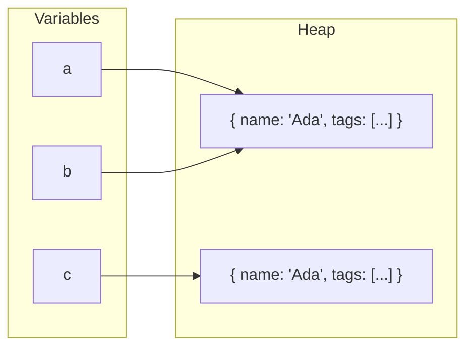
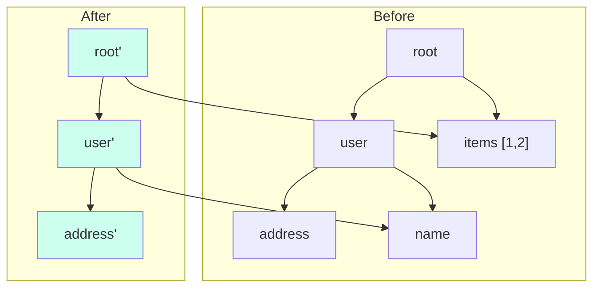
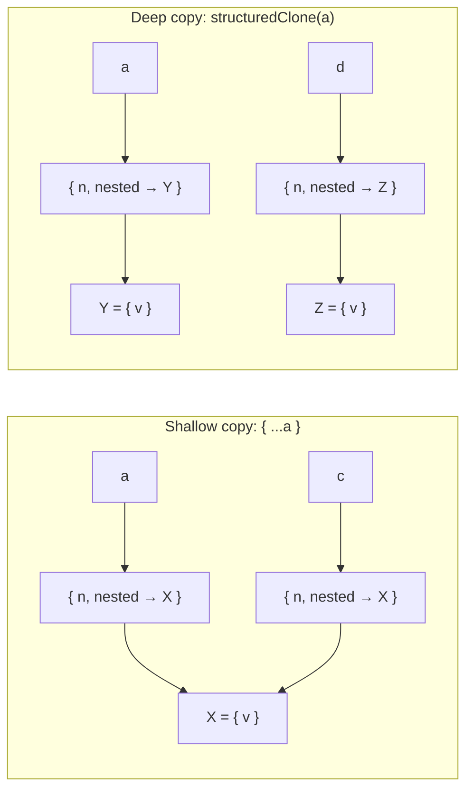
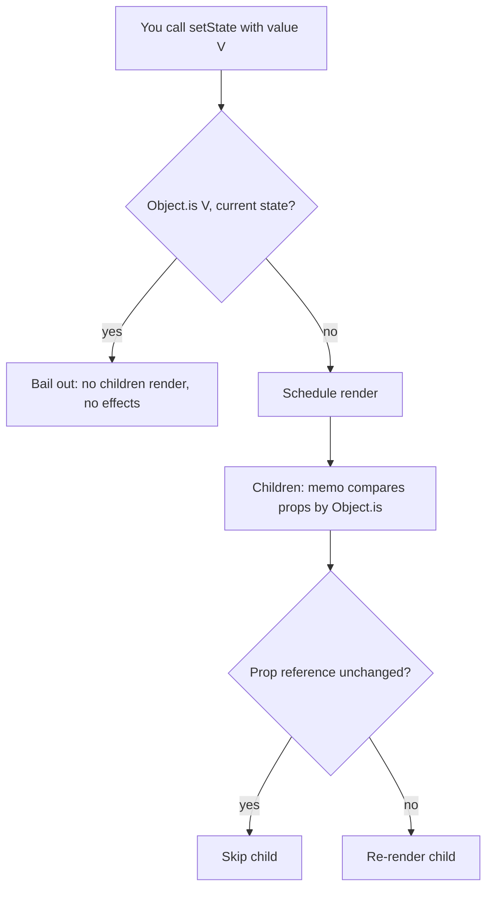

# 00 / 08 — Objects, References, and Immutable Updates

## 1. Lesson metadata

| | |
|---|---|
| **Level** | Intermediate |
| **Study time** | 4–5 hours (reading 2 h, experiments 1 h, exercises 1.5–2 h) |
| **Prerequisites** | [07 — Functions as values; referential identity](./07-functions-and-referential-identity.md) (`Object.is`, identity vs equality; why React uses reference checks). [06 — Lexical scope and closures](./06-lexical-scope-and-closures.md) helps for the snapshot discussion. |
| **Next** | [09 — Prototypes, `this`, classes](./09-prototypes-and-object-model.md) |
| **Related later** | [Phase 1 / 14 — State as a snapshot](../01-react-fundamentals/14-state-as-a-snapshot.md), [Phase 1 / 15 — Update queues and batching](../01-react-fundamentals/15-update-queues-and-batching.md), [Phase 1 / 12 — Component purity](../01-react-fundamentals/12-component-purity.md), [Phase 3 / 01–03 — `useState`, functional updates, `useReducer`](../03-react-state-and-hooks/01-usestate-internals-and-update-semantics.md), [Phase 6 / 04 — API normalization](../06-data-fetching-and-state-ecosystems/04-api-normalization.md), [Lesson 16 — Memory and GC](./16-memory-management-and-gc.md), [Lesson 18 — TypeScript fundamentals](./18-typescript-fundamentals-and-narrowing.md) |

**Learning objectives.** After this lesson you can:
1. Explain the value/reference model: variables hold primitives or references to objects; assignment and argument passing copy the *reference*.
2. Predict aliasing effects: when two names point at the same object and how mutation through one is visible through the other.
3. Distinguish **shallow copy** and **deep copy**, and use spread, `Object.assign`, array methods, and `structuredClone` correctly, knowing what each does *not* copy.
4. Write immutable updates for nested objects, arrays, `Map`, and `Set` without mutating the original, and know which array methods mutate.
5. Explain **structural sharing**: new references only along the changed path; unchanged subtrees keep identity.
6. Explain why React requires immutable state updates (bail-out, memo, deps, snapshots, concurrent rendering, devtools/time travel) and what *exactly* breaks when you mutate.
7. Know when to reach for Immer, reducers, normalized state, or restructuring, and the cost model of copying.
8. Use TypeScript `readonly`/`Readonly`/`as const` to help (and know their limits: compile-time only, shallow).

**Concepts covered:** primitives vs objects, references, aliasing, mutation vs reassignment, `const` (binding immutability, not value immutability), shallow vs deep copy, spread/rest, `Object.assign`, `slice`/`concat`/`map`/`filter`/`toSorted`/`toSpliced`/`with`, mutating methods, `structuredClone`, `Object.freeze`, structural sharing, immutable update patterns, `Map`/`Set` updates, state normalization, Immer drafts, local mutation in render, TypeScript readonly types, state bail-out, derived-state pitfalls.

---

## 2. Deep conceptual explanation

### 2.1 What problem is this lesson solving?

[Lesson 07](./07-functions-and-referential-identity.md) established that React decides "did it change?" by **reference identity**. That is a deliberate bargain: the check is O(1) and requires no knowledge of your data's shape. The bargain only works if you hold up your end:

> **If the data changed, you must give React a *new* reference. If it did not change, keep the *old* reference.**

Break the first half (mutate in place) and React sees "same reference → nothing changed", skipping renders; the UI is stale. Break the second half (recreate everything each time) and memoization/effect optimizations are defeated.

Typical bug reports that are all this one idea:

- "I push into my state array and the list doesn't update."
- "Changing one field in a nested object updates the wrong rows" (shared references).
- "`useEffect` doesn't fire when I update a nested property."
- "My reducer works in tests but the UI sometimes doesn't update / updates twice."
- "Copying my large state on every keystroke is slow."

### 2.2 Values and references

JavaScript has two categories:

| | Primitives | Objects |
|---|---|---|
| Types | `string`, `number`, `bigint`, `boolean`, `undefined`, `null`, `symbol` | everything else: plain objects, arrays, functions, `Date`, `Map`, `Set`, class instances, DOM nodes, React elements… |
| Mutable? | **No.** A primitive value can't be changed, only replaced (`"abc"[0] = "x"` does nothing) | **Yes**: properties can be added, changed, deleted |
| Stored in a variable as | The value | A **reference** to the object |
| `===` | By value | By identity |
| Assignment `b = a` | Copies the value | Copies the **reference** (aliasing) |

Memory picture:


`a === b` (same object), `a !== c` (equal-looking, different object).

**`const` guards the binding, not the object.**

```ts
const user = { name: "Ada" };
user.name = "Grace";      // allowed: mutates the object
// user = { name: "x" };  // error: cannot reassign the binding
```

**Function arguments are passed "by value of the reference"** (often called *call by sharing*): the parameter is a new binding initialized with the *same reference*. Mutating the object through the parameter affects the caller's object; reassigning the parameter does not:

```ts
function rename(u: { name: string }) { u.name = "Grace"; }       // visible to caller
function replace(u: { name: string }) { u = { name: "Grace" }; } // invisible to caller
```

This is why **mutating props is forbidden** in React: a child receives *the parent's reference*; mutation silently changes the parent's data without telling React.

### 2.3 Aliasing: the root of mutation bugs

When two names (or two places in your data) refer to one object, a change via one is observable via the other.

```ts
const defaults = { theme: "light", tags: ["a"] };
const a = { ...defaults };   // shallow copy
const b = { ...defaults };
a.tags.push("x");            // mutates the SHARED array
console.log(b.tags);         // ["a", "x"]  ← surprise: shallow copy shares nested objects
```

Aliasing in React shows up as: state initialized from a shared module-level constant (`useState(DEFAULTS)` then mutated), props passed down and mutated, "copying" state with a shallow spread and mutating the nested part, or the same object inserted into two places in a state tree.

### 2.4 Mutation vs reassignment vs immutable update

| Style | Code | Original object changed? | Reference changes? |
|---|---|---|---|
| **Mutation** | `user.name = "G"` | Yes | No (same ref) |
| **Reassignment of a variable** | `user = other` (with `let`) | No | The variable now points elsewhere |
| **Immutable update** | `user = { ...user, name: "G" }` or `setUser({ ...user, name: "G" })` | **No** | **Yes** (new object) |

Immutable update means "treat existing objects as read-only; to 'change' data, create a new object that is a copy with the change". The old object remains valid and unchanged for anyone still holding it (the previous render, a memoized child, a history entry, an in-flight async callback from [Lesson 06](./06-lexical-scope-and-closures.md)).

### 2.5 Shallow vs deep copying

```ts
const state = { user: { name: "Ada", address: { city: "London" } }, items: [1, 2] };

const s1 = { ...state };               // shallow: new top-level object; s1.user === state.user
const s2 = structuredClone(state);     // deep: new objects at every level; s2.user !== state.user
```

| Technique | Depth | Copies | Does NOT handle |
|---|---|---|---|
| `{ ...obj }`, `Object.assign({}, obj)` | Shallow (own enumerable props) | Property values (references for objects) | Nested objects shared; prototypes (spread creates a plain object); non-enumerable/accessors flattened (getters are *invoked* and their values copied) |
| `[...arr]`, `arr.slice()`, `Array.from(arr)` | Shallow | Elements (refs for objects) | Nested |
| `structuredClone(x)` | Deep | Plain objects, arrays, primitives, `Date`, `RegExp`, `Map`, `Set`, `ArrayBuffer`/typed arrays, `Error` (partially), cycles preserved | **Functions** (throws `DataCloneError`), DOM nodes, class instances become plain objects (prototype chain not preserved), symbol keys, getters/setters (values read) |
| `JSON.parse(JSON.stringify(x))` | Deep (lossy) | JSON-compatible data | `undefined` dropped, `Date`→string, `Map`/`Set`→`{}`, `NaN`/`Infinity`→`null`, functions/symbols dropped, cycles throw, `-0`→`0`, BigInt throws |
| Hand-written/library deep clone (e.g., lodash `cloneDeep`) | Deep | Configurable | Cost; semantics per library |

`structuredClone` is available in modern browsers and Node 17+ (baseline across current evergreen browsers; checked in Node 24: clones `Date`, `Map`, `Error` subtypes and cycles, throws `DataCloneError` for functions and symbol values, drops class prototypes and flattens getters to data properties). **Deep-cloning state on every update is almost never the right React strategy** (see §2.7).

### 2.6 Immutable update patterns

#### Objects

```ts
interface User { id: string; name: string; address: { city: string; zip: string }; tags: string[] }
declare const user: User;

// change a top-level field
const u1 = { ...user, name: "Grace" };

// change a nested field: copy every object ALONG THE PATH
const u2 = { ...user, address: { ...user.address, city: "Paris" } };

// remove a key (without mutating): rest destructuring
const { tags: _removed, ...withoutTags } = user;

// computed key
const field = "name" as const;
const u3 = { ...user, [field]: "X" };
```

#### Arrays

| Goal | Mutating (avoid on state) | Non-mutating |
|---|---|---|
| Add to end | `push`, `unshift` | `[...arr, x]`, `arr.concat(x)` |
| Insert at index | `splice(i, 0, x)` | `[...arr.slice(0, i), x, ...arr.slice(i)]`, `arr.toSpliced(i, 0, x)` |
| Remove | `splice(i, 1)`, `pop`, `shift`, `delete arr[i]` | `arr.filter((_, j) => j !== i)`, `arr.toSpliced(i, 1)` |
| Replace one | `arr[i] = x` | `arr.map((v, j) => (j === i ? x : v))`, `arr.with(i, x)` |
| Sort | `sort` (**mutates and returns the same array**) | `[...arr].sort(cmp)`, `arr.toSorted(cmp)` |
| Reverse | `reverse` (mutates) | `[...arr].reverse()`, `arr.toReversed()` |

`toSorted`, `toReversed`, `toSpliced`, `with` are ES2023 "change array by copy" methods. They exist in current evergreen browsers and Node 20+; check your browser support matrix and TypeScript `lib` setting (`ES2023`) before using them; the spread-copy alternatives work everywhere.

Nested arrays of objects (very common in React state):

```ts
interface Todo { id: number; text: string; done: boolean }

const toggle = (todos: readonly Todo[], id: number): Todo[] =>
  todos.map((t) => (t.id === id ? { ...t, done: !t.done } : t)); // new object only for the changed todo
```
Note what is **kept**: every other `todo` object has the *same reference* as before. That is **structural sharing** (§2.8).

#### `Map` and `Set`

```ts
const m2 = new Map(m1).set(key, value);                          // copy, then set
const m3 = new Map([...m1].filter(([k]) => k !== key));          // delete without mutating
const s2 = new Set(s1).add(x);
const s3 = new Set([...s1].filter((v) => v !== x));
```
Mutating `m1.set(...)` and then `setState(m1)` fails exactly like pushing into an array: same reference → React bails out. (Plain objects/arrays are usually easier to keep in React state than `Map`/`Set` for that reason; if you need them, always create a new one on update.)

#### Class instances and dates

`{ ...instance }` produces a plain object without the prototype (methods lost). Avoid storing class instances with methods in React state; store plain data and put behavior in functions. For `Date`, treat as immutable: `new Date(d.getTime() + ms)`; `setHours` etc. mutate. Prefer ISO strings or timestamps in state; convert at the edges.

### 2.7 The cost model: copying isn't free, but usually fine

Updating with spread/`map` is **O(size of each copied container)**, not O(size of the whole state tree). For `todos.map(...)` with 10,000 todos it is O(10,000) per toggle: ~tens to hundreds of microseconds for pointer copies in modern engines (the cost is dominated by allocation); fine for UI event rates. It becomes a problem when:

- the container is huge (100k+ items) and updated at high frequency (e.g., per-frame, per-message at hundreds/second);
- you deep-clone everything instead of copying the path;
- unnecessary copies defeat memoization (every item gets a new reference even though only one changed: `items.map(i => ({ ...i }))`).

Remedies: structural sharing (copy only the changed path), normalized state (maps keyed by id: updating one entity copies the entity + the map, not a nested tree; [Phase 6 / 04](../06-data-fetching-and-state-ecosystems/04-api-normalization.md)), batching/coalescing high-frequency updates, moving hot data out of React state ([Phase 3 / 20](../03-react-state-and-hooks/20-usesyncexternalstore-and-external-stores.md)), virtualization, or persistent data structures / libraries (below).

### 2.8 Structural sharing

When you update a nested field, you create new objects for the **changed node and each ancestor up to the root**, and *reuse* every other subtree by reference:

```ts
const next = { ...state, user: { ...state.user, address: { ...state.user.address, city: "Paris" } } };
```


New nodes (green): `root'`, `user'`, `address'`. Reused: `items` and `name`. Consequences for React:

- `Object.is(prev.items, next.items)` is **true** → a memoized component receiving `items` skips rendering; an effect depending on `[state.items]` doesn't fire.
- `Object.is(prev.user, next.user)` is **false** → components depending on `user` update.
- Equality checks for "did anything change under here?" are O(1) at every node.

This property (unchanged ⇒ same reference) is what makes immutable updates *performance-positive* with `memo` and dependency arrays, not just correct.

### 2.9 Why React needs this (the five reasons)

1. **Change detection by reference.** `useState`'s bail-out, `memo`, dependency arrays, `useMemo`, context all use `Object.is`. Mutating in place yields identical references, so they conclude "nothing changed".
2. **State as a snapshot.** Each render sees the state of its time ([Lesson 06](./06-lexical-scope-and-closures.md)). If you mutate the object that a previous render's closure still holds, the "old snapshot" silently changes: handlers and effects from earlier renders observe new data, defeating the model.
3. **Concurrent rendering.** React may start a render, pause/abandon it, and render again with different inputs ([Phase 2 / 15](../02-react-rendering-and-internals/15-interruptible-restartable-abandoned-rendering.md)). Render must be a pure function of props/state; mutating shared objects during render leaks effects of abandoned renders.
4. **Pure updater functions and reducers.** `setState(prev => next)` and reducers must be pure; in Strict Mode development React invokes them twice to detect impurity. A mutating updater applies its mutation **twice**:
```ts
setTodos((prev) => { prev.push(newTodo); return prev; }); // mutates; in StrictMode dev, pushes twice AND returns same ref
```
5. **Tooling and time travel.** DevTools, Redux DevTools, undo/redo, optimistic updates ([Phase 6 / 05](../06-data-fetching-and-state-ecosystems/05-optimistic-updates.md)) depend on retaining previous states untouched.

**Local mutation is fine.** The rule is "don't mutate data that *existed before this render* (props, state, context, module-level objects)". Objects you create **during** the same render/function call may be mutated freely:

```ts
function visibleItems(items: readonly Item[], filter: string): Item[] {
  const out: Item[] = [];                   // created here, owned here
  for (const it of items) if (it.name.includes(filter)) out.push(it);  // fine
  return out;
}
```

### 2.10 Freezing and TypeScript readonly

- `Object.freeze(obj)` makes the object's own properties non-writable (silently ignoring writes in sloppy mode; throwing `TypeError` in strict mode, which ES modules always use). It is **shallow**: nested objects are not frozen. Useful for module-level constants and as a *development-time tripwire* (some libraries freeze state in development to surface accidental mutation). It has a runtime cost, and a frozen object copied via spread produces an *unfrozen* copy (copying doesn't preserve frozenness).
- TypeScript `readonly`/`Readonly<T>`/`ReadonlyArray<T>`/`readonly T[]`/`as const` give **compile-time** protection: assignments and mutating methods (`push`) become type errors. They are erased at runtime (no enforcement for untyped code, `any`, casts) and, like `freeze`, are **shallow** unless you use a `DeepReadonly` helper (which has its own complexity and edge cases).

```ts
interface State { readonly todos: readonly Todo[]; readonly filter: "all" | "open" }
function bad(s: State) { s.todos.push({ id: 1, text: "x", done: false }); } // error: 'push' does not exist on readonly Todo[]
```
Type your state and props as readonly: it turns many mutation bugs into compile errors. It's one of the highest-value TypeScript habits in React code.

### 2.11 Immer and reducers: ergonomic immutability

Hand-writing deep spread chains is verbose and error-prone. **Immer** lets you write "mutating" code against a *draft* proxy; it records changes and produces a new immutable structure with structural sharing:

```ts
import { produce } from "immer";

const next = produce(state, (draft) => {
  draft.user.address.city = "Paris";       // looks like mutation; operates on a draft
  draft.items.push(3);
});
// `state` is unchanged; `next` shares unchanged subtrees with `state`
```
- React's `useImmer`/`use-immer` hooks and **Redux Toolkit** (which uses Immer inside `createSlice` reducers) make this common ([Phase 6 / 09](../06-data-fetching-and-state-ecosystems/09-redux-toolkit.md)).
- Rules: either mutate the draft **or** return a new value from the recipe, not both; don't leak the draft out of the recipe; the result is auto-frozen by default (Immer's docs say any state tree modified with `produce` is frozen; this is not limited to development in current Immer versions; `setAutoFreeze(false)` opts out).
- Costs: Proxy overhead and a dependency; for tiny state, plain spread is simpler. For deeply nested updates, Immer is often clearer and less buggy.

### 2.12 Common misconceptions

| Misconception | Reality |
|---|---|
| "`const` makes my object immutable." | `const` forbids rebinding the variable; the object can still be mutated. |
| "Spread copies the object, so it's safe to mutate the copy." | Spread is shallow; nested objects/arrays are shared. |
| "React re-renders when state changes." | React re-renders when it's *told* via a setter **and** the new value isn't `Object.is`-equal to the old. Mutation doesn't call a setter at all; mutation + setter-with-same-reference gets a bail-out. |
| "`setState(sameObjectMutated)` works if I also set another state variable." | It may appear to work by accident (the other update triggers a render which then reads the mutated data); this is the worst kind of bug: order-dependent and flaky. |
| "Immutability is slow." | Copying a path is cheap and structural sharing keeps the rest; it often *speeds up* rendering via memo/bail-outs. Deep-clone-everything is slow. |
| "`Object.freeze` solves immutability in React." | It's shallow, development-oriented, and doesn't change how you must write updates. |
| "`structuredClone` is the best way to copy state." | It deep-copies everything → every reference changes → defeats memoization and costs O(n). |
| "Sorting `state.items.sort()` is fine if I then call `setItems(state.items)`." | `sort` mutates in place and returns the same array → same reference → bail-out; also mutates the previous snapshot. |
| "Mutating inside `useEffect` is okay because effects are impure." | The state/props objects are still shared with the render snapshot and children; mutate by setters. |

---

## 3. Internal mechanics

### 3.1 How React compares state (public guarantee)

For `useState`'s setter: if the new state is `Object.is`-equal to the current state, React skips re-rendering the component and its children (and does not fire effects for that update). React's reference documents add the caveat that it *may* still call the component function once more before bailing out; it will not render children or fire effects in that case. For functional updates `setX(prev => next)`, the updater runs (during render, queued) and the same comparison applies on its result. This is documented behavior and the basis of "return the same reference when nothing changed" in reducers.

*Teaching model of an update queue:*

```ts
// Conceptual: not React's actual code.
type Update<S> = S | ((prev: S) => S);
function process<S>(base: S, queue: Update<S>[]): S {
  let state = base;
  for (const u of queue) state = typeof u === "function" ? (u as (p: S) => S)(state) : u;
  return state;
}
// After processing: if (Object.is(state, base)) → bail out; else schedule render with `state`.
```
This explains: (a) why `setCount(count + 1)` called three times in one handler results in +1 (each queued value is `base + 1` computed from the closure's `count`), while `setCount(c => c + 1)` ×3 results in +3; (b) why updater functions must be pure (they may be run more than once, e.g., Strict Mode double invocation or when React re-processes a queue after interruption). See [Phase 1 / 15](../01-react-fundamentals/15-update-queues-and-batching.md) and [Phase 3 / 02](../03-react-state-and-hooks/02-functional-state-updates.md).

### 3.2 Engine view: objects, shapes, copying (implementation detail)

Engines represent objects with *hidden classes/shapes* and property storage; spread on a plain object allocates a new object with the same shape (fast path) and copies properties. Large arrays of objects use contiguous storage with element kinds (`PACKED_SMI`, `PACKED_DOUBLE`, `PACKED_ELEMENTS`); `slice`/spread copy the pointer array (a memcpy-like operation). Therefore "copy the array of 10,000 pointers" is far cheaper than people expect, and **the dominant cost is usually GC pressure from many small allocations**, which generational collectors handle well ([Lesson 16](./16-memory-management-and-gc.md)). Don't micro-optimize copying without profiling.

### 3.3 What Immer does (conceptual)

`produce(base, recipe)`: wraps `base` in a Proxy (a *draft*). Reads return nested drafts lazily; writes are recorded on a *copy-on-write* shadow of that node (the original is untouched). After the recipe, Immer finalizes: nodes that were modified are replaced by new plain objects; unmodified nodes keep their original references (structural sharing); the result is typically frozen in development. ⚠ Implementation details and defaults (auto-freeze, Map/Set support requires `enableMapSet()`, patches plugin) vary by version; check the docs for the version you install.

### 3.4 The `Object.is` bail-out and *derived references*

A frequent pitfall: *derived* values computed in render without memoization are new references each render (`const sorted = [...items].sort()`), so children/effects receiving them see changes even though `items` didn't change. Stabilize with `useMemo(…, [items])` (valid precisely because `items` obeys the immutability contract: same ref ⇔ same content) or avoid passing derived arrays down. This is the bridge from this lesson to [Lesson 07](./07-functions-and-referential-identity.md) and [Phase 7 / 05](../07-performance/05-referential-equality.md).

### 3.5 Version notes

- **React 19 / Strict Mode:** development double-invocation of component bodies, updater functions, `useMemo` and `useState` initializers, and reducers is how impurity such as mutation gets exposed. Production runs once.
- **React Compiler** (still evolving; see react.dev/learn/react-compiler): it assumes you follow the Rules of React, including not mutating props/state/hook arguments; mutation breaks its memoization correctness assumptions. Immutability discipline is a *prerequisite* for adopting it safely.
- **Language:** `Array.prototype.toSorted/toReversed/toSpliced/with` (ES2023) and `structuredClone` have broad but not universal support in older environments; check your target browsers and Node versions.

---

## 4. Step-by-step execution walkthrough

### 4.1 Mutation vs immutable update on a list in React

Component:

```tsx
interface Todo { id: number; text: string; done: boolean }

function TodoApp() {
  const [todos, setTodos] = useState<Todo[]>([{ id: 1, text: "write", done: false }]);

  const addBad = () => {
    todos.push({ id: 2, text: "test", done: false }); // mutate
    setTodos(todos);                                  // same reference
  };
  const addGood = () => setTodos((prev) => [...prev, { id: 2, text: "test", done: false }]);

  return (<>
    <button onClick={addBad}>bad</button>
    <button onClick={addGood}>good</button>
    <TodoList todos={todos} />
  </>);
}
const TodoList = memo(({ todos }: { todos: Todo[] }) => <ul>{todos.map((t) => <li key={t.id}>{t.text}</li>)}</ul>);
```

**Click "bad":**
1. `todos` (the array referenced by render #1's closure) is mutated: length is now 2. Render #1's snapshot changes retroactively.
2. `setTodos(todos)`: the new value is `Object.is`-equal to the current state → React bails out. No render, no DOM change. The UI still shows one item though the data has two.
3. Later, any *unrelated* re-render (say another `useState` toggles) calls `TodoApp` again; the render reads the (mutated) array and `TodoList`... receives the *same reference* as before, so `memo` skips it. **The list still doesn't update**, even though the parent re-rendered. Only when something produces a new array reference does the UI catch up. This delayed, inconsistent behavior is what makes mutation bugs hard to find.

**Click "good":**
1. Updater runs: `prev` is the current array; returns a new array with 2 items.
2. `Object.is(prev, next)` false → render scheduled.
3. `TodoApp` re-renders; `TodoList` gets a new reference → re-renders; `<li>` for `id: 2` is created. The old array is untouched (any closure still holding it sees one item: consistent snapshots).

### 4.2 Structural sharing and memo on a nested update

State: `{ filter: "all", todos: [t1, t2, t3] }` with memoized `<TodoItem todo={t} />` per item. User toggles `t2`.

```ts
setState((s) => ({ ...s, todos: s.todos.map((t) => (t.id === 2 ? { ...t, done: !t.done } : t)) }));
```
Reference results:

| Value | Same reference as before? |
|---|---|
| `s` (root) | No (new) |
| `s.filter` | Yes (primitive, equal) |
| `s.todos` (array) | No (new array from `map`) |
| `t1`, `t3` | **Yes** |
| `t2` | No (new object) |

Render: parent renders (state changed). Three `TodoItem`s receive props `todo`: `t1` same → skipped; `t2'` new → re-renders; `t3` same → skipped. **Only one item re-renders.** If instead you wrote `s.todos.map(t => ({ ...t }))` or deep-cloned, all three would re-render, with no visible benefit.

### 4.3 Shared reference initial state

```ts
const EMPTY_FORM = { name: "", tags: [] as string[] };   // module-level
function Form() {
  const [form, setForm] = useState(EMPTY_FORM);          // state starts as the SAME object as the constant
  const addTag = (t: string) => { form.tags.push(t); setForm({ ...form }); }; // mutation + shallow copy
  …
}
```
1. First `Form` instance: `form === EMPTY_FORM`. `addTag("a")` mutates `EMPTY_FORM.tags` (shared!).
2. `setForm({ ...form })` creates a new top-level object (so React re-renders and the bug looks "fixed"), but `tags` is still the same array as the module constant.
3. A second `Form` instance (or the same form after "reset" `setForm(EMPTY_FORM)`) starts with `tags: ["a"]`. **State leaks across instances.**
Fix: `setForm(f => ({ ...f, tags: [...f.tags, t] }))`, and create initial state through a function (`useState(() => ({ name: "", tags: [] }))`) or `structuredClone(EMPTY_FORM)` so each instance owns its data.

---

## 5. Code examples

### 5.1 Minimal example — aliasing and shallow copy

```ts
const a = { n: 1, nested: { v: 1 } };
const b = a;
const c = { ...a };
b.n = 2;
c.nested.v = 99;
console.log(a.n, c.n, a.nested.v, a === b, a === c, a.nested === c.nested);
```

**Predict:** all six values.

**Result:** `2 1 99 true false true`.
**Why:** `b` is an alias of `a` (so `a.n` is 2). `c` is a shallow copy: own `n` copied at the time (1), but `c.nested` is the same object as `a.nested`, so writing `c.nested.v = 99` is visible through `a`.
**Relevance:** this is exactly the "spread-then-mutate-nested" bug.

### 5.2 Practical example — immutable updates for a nested form state (typed, readonly)

```ts
interface Address { readonly street: string; readonly city: string }
interface Profile {
  readonly id: string;
  readonly name: string;
  readonly address: Address;
  readonly tags: readonly string[];
}

export const setCity = (p: Profile, city: string): Profile =>
  p.address.city === city ? p : { ...p, address: { ...p.address, city } };   // keep reference if unchanged

export const addTag = (p: Profile, tag: string): Profile =>
  p.tags.includes(tag) ? p : { ...p, tags: [...p.tags, tag] };

export const removeTag = (p: Profile, tag: string): Profile =>
  p.tags.includes(tag) ? { ...p, tags: p.tags.filter((t) => t !== tag) } : p;
```

Line notes:
- Each function returns the **same reference** when the update is a no-op: React then bails out and memoized children stay put. (Returning a fresh equal copy would cause useless renders.)
- `readonly` makes `p.tags.push(...)` a compile-time error and documents intent.
- Pure functions on plain data are trivially testable and reusable in reducers ([Phase 3 / 03](../03-react-state-and-hooks/03-usereducer-and-reducer-architecture.md)).
- Use: `setProfile((p) => setCity(p, "Paris"))` (functional update avoids staleness, [Lesson 06](./06-lexical-scope-and-closures.md)).

**Trade-off:** manual spread chains scale poorly with depth (see 5.5 for Immer).

### 5.3 Incorrect example — mutating state in a handler and in a sort

```tsx
function Leaderboard({ initial }: { initial: Player[] }) {
  const [players, setPlayers] = useState(initial);       // aliases the prop array!

  const addPoint = (id: string) => {
    const p = players.find((x) => x.id === id)!;
    p.score += 1;                                         // mutates an object inside state (and inside props)
    setPlayers(players);                                  // same reference
  };
  const sortByScore = () => setPlayers(players.sort((a, b) => b.score - a.score)); // sort mutates and returns same array

  return (<ol>{players.map((p) => <li key={p.id}>{p.name}: {p.score}</li>)}</ol>);
}
```

**Predict:** What happens on `addPoint` and on `sortByScore`?

**Result:** Neither updates the UI reliably. `addPoint`: object mutated, same array reference → bail-out; UI stale until some unrelated re-render. `sortByScore`: `players.sort` reorders the array **in place** and returns the *same array* → bail-out. Additionally `initial` (the parent's data) is mutated by both, because `useState(initial)` stored *the same array and the same player objects*; the parent's other consumers silently see changed scores and order.
**Why wrong:** violates the contract "new reference for changed data" and mutates data owned by the parent.

### 5.4 Corrected implementation

```tsx
interface Player { readonly id: string; readonly name: string; readonly score: number }

function Leaderboard({ initial }: { initial: readonly Player[] }) {
  const [players, setPlayers] = useState<readonly Player[]>(initial);   // not mutated anywhere; sharing is safe

  const addPoint = (id: string) =>
    setPlayers((prev) => prev.map((p) => (p.id === id ? { ...p, score: p.score + 1 } : p)));

  const sortByScore = () =>
    setPlayers((prev) => [...prev].sort((a, b) => b.score - a.score));  // copy first, then sort

  return (<>
    <button onClick={sortByScore}>Sort</button>
    <ol>{players.map((p) => (
      <li key={p.id}>{p.name}: {p.score} <button onClick={() => addPoint(p.id)}>+1</button></li>
    ))}</ol>
  </>);
}
```

Notes:
- Sharing `initial` with parent is now safe because nobody mutates it (readonly types enforce it).
- Sorting state to *display* it is often better as **derived data**, not stored state: keep `players` unsorted and compute `const sorted = useMemo(() => [...players].sort(cmp), [players, sortKey])`. Storing both invites inconsistency ([Phase 3 / 17 — Derived state](../03-react-state-and-hooks/17-derived-state.md)).
- If you needed `sort` to be stable across equal scores: `Array.prototype.sort` is stable in all current engines (specified since ES2019).

### 5.5 Advanced example — Immer for deep updates, with a test

```ts
import { produce, type Draft } from "immer";

interface Cart {
  readonly items: readonly { readonly sku: string; readonly qty: number; readonly options: { readonly gift: boolean } }[];
  readonly coupon: { readonly code: string; readonly applied: boolean } | null;
}

export function setGift(cart: Cart, sku: string, gift: boolean): Cart {
  return produce(cart, (draft: Draft<Cart>) => {
    const item = draft.items.find((i) => i.sku === sku);
    if (item) item.options.gift = gift;        // "mutation" of the draft
  });
}

// vitest-style checks
const before: Cart = { items: [{ sku: "A", qty: 1, options: { gift: false } }, { sku: "B", qty: 2, options: { gift: false } }], coupon: null };
const after = setGift(before, "A", true);
// after !== before, after.items !== before.items, after.items[0] !== before.items[0]
// after.items[1] === before.items[1]   ← structural sharing: B untouched
// before.items[0].options.gift === false ← original unchanged
const same = setGift(before, "ZZZ", true);
// same === before                         ← no-op returns the same reference (Immer detects no changes)
```

Line notes:
- `Draft<Cart>` strips `readonly` so you can write to it inside the recipe; the *returned* type is still the readonly `Cart`.
- If nothing is modified, `produce` returns the original reference, giving you the bail-out behavior for free.
- Hand-written equivalent is four nested spreads plus `map`, which is easy to get subtly wrong.
- **Trade-offs:** Immer adds a dependency and Proxy overhead; recipe functions must not return and mutate simultaneously; drafts can't escape; with huge arrays and many small updates, measure. In React state, `useImmer` or RTK reducers are the common integration points.

---

## 6. Visual explanations

### 6.1 Aliasing, shallow copy, deep copy



### 6.2 What React does with each kind of update



### 6.3 The immutable-update checklist

```text
For each update, ask:
 1. Did I create a new object/array for EVERY node on the path from root to the changed value?
 2. Did I keep the old reference for everything off that path?
 3. Did I avoid mutating methods (push/pop/shift/unshift/splice/sort/reverse/fill/copyWithin, delete, assignment to properties)?
 4. If nothing changed, did I return the SAME reference?
 5. Is the initial state owned by this component instance (not a shared module-level object)?
```

---

## 7. Alternative approaches and trade-offs

Representing and updating nested client state:

| Approach | Correctness risk | Readability | Perf (updates) | Perf (reads/memo) | Testability | Prefer when |
|---|---|---|---|---|---|---|
| Plain spread/`map` immutable updates | Medium (easy to miss a level) | High for shallow, low for deep | Good | Excellent (structural sharing) | High (pure functions) | State depth ≤ 2–3 |
| Immer (`produce`/`useImmer`/RTK) | Low | High | Good (Proxy overhead) | Excellent | High | Deeply nested or many update shapes |
| Normalized state (`byId` + `ids`) + simple updates | Low | Medium (indirection) | Excellent | Excellent | High | Server entities, lists with edits, cross-references |
| `structuredClone`/deep clone then mutate then set | Low | High | Poor (O(n)) | **Poor** (every ref new → memo defeated) | High | Rarely; one-off snapshots (e.g., "draft" copy in an editor) |
| Mutable store + subscription (MobX, Valtio proxies, signals) | Different model | High | Excellent | Excellent (fine-grained) | Medium | Teams that want mutable-style code; not React's default model |
| Persistent data structures (Immutable.js, HAMT-based libs) | Low | Medium (new API) | Excellent for very large collections | Good | Medium | Huge collections with frequent updates |
| `useReducer` with pure reducers | Low | Medium-high | Good | Excellent | **Very high** | Complex transitions, multiple actions |
| Flatten/restructure so state is smaller or primitive | Lowest | High | Excellent | Excellent | High | Whenever possible |

**When the "recommended" approach (immutable updates with spread) is NOT best:** a high-frequency data stream into a 100k-row grid: copying a 100k array per message is wasteful. Use a mutable external store with versioned snapshots (`useSyncExternalStore`), batch updates per frame, or windowed data. Another: a forms library storing per-field refs imperatively to avoid re-rendering on every keystroke (uncontrolled inputs): mutation is *outside* React's state and intentional.

---

## 8. Best practices and anti-patterns

**Do**
- Treat props, state, context values, and anything from hooks as **read-only**.
- Use functional updates (`setX(prev => …)`) whenever the next state depends on the previous.
- Type state and props as `readonly`; prefer `ReadonlyArray`/`readonly T[]`.
- Return the same reference when nothing changes.
- Prefer state shapes that make updates shallow (normalization, splitting state).
- Initialize state per instance (`useState(() => makeInitial())`).
- Use a reducer or Immer when the update logic gets deep.

**Beginner mistakes**
- `state.x = …` / `array.push` then `setState(state)`.
- `setState(state.sort())`, `setState(state.reverse())`.
- Assuming spread deep-copies.
- Putting the same object in state and in another structure, then editing one.
- `useState(props.items)` and mutating (aliases the parent's array).

**Experienced-developer mistakes**
- Deep-cloning on every update "to be safe" (breaks memoization, burns CPU).
- Mutating inside `useMemo`/selectors (mutating shared inputs).
- Storing class instances/Maps/Sets in state and mutating them, or storing functions/DOM nodes in state.
- Mixing mutable external objects with React state without a subscription contract.
- Mutating in reducers "because it's inside a reducer" (Redux Toolkit allows it *only because Immer wraps it*; in a plain `useReducer`, no).
- Using `JSON.parse(JSON.stringify(...))` to clone and silently losing `Date`/`undefined`/`Map`.

**Smells:** `.sort()`/`.reverse()` on a state variable; `Object.assign(state, …)` (first argument is the target); `delete state.key`; `state.items[i] = x`; `let` bindings used to accumulate on state; copying state to a ref and mutating it to "avoid re-render" without understanding the consequences; `// eslint-disable` around purity rules.

**Justified exceptions:** local mutation of objects created within the same function; performance-critical code that uses mutable buffers (typed arrays, canvas pixel data, game loops) *outside* React state; refs as intentional mutable boxes; external stores that expose immutable snapshots to React but mutate internally.

---

## 9. Real-world application

**E-commerce cart (state ownership, optimistic UI).** The cart is `{ lines: Line[], coupon }`. Operations: add, change qty, remove, apply coupon, with optimistic UI and server reconciliation. Immutable updates provide **cheap rollbacks**: keep the previous cart reference (`const prev = cart`); on server failure `setCart(prev)`. With mutation, `prev` would already be corrupted. Constraint: money values should be integers (cents) or a decimal library, not floats; the shape stores `qty` and `unitPriceCents` and *derives* totals in render (not stored) to avoid inconsistent copies.

**Dashboard filters + large tables.** State: `{ filters, sort, selectedIds: Set<string>, rows }`. Using a `Set` in state requires copy-on-write (`new Set(prev).add(id)`); many teams use `Record<string, true>` or arrays for selected IDs to keep updates simple and serializable. Structural sharing ensures rows not touched by an edit keep identity so memoized `Row` components skip. Performance constraint: 50k rows → virtualization + normalized `byId` + selectors; never `rows.map(r => ({...r}))`.

**Forms with nested arrays (invoice lines).** `invoice.lines[3].taxes[1].rate` updates are deep; Immer or a reducer with path helpers keeps code readable and correct. Validation errors keyed by path; "dirty" tracking by comparing initial and current *by reference at each node* (cheap with structural sharing) rather than deep equality.

**Undo/redo and collaboration.** Undo stacks store references to *previous states*: cheap with structural sharing (each snapshot shares most of its structure). Mutation destroys this model. For collaborative editing (CRDT/OT), the library owns data; adapt through immutable snapshots exposed to React.

**Auth/session state.** The `user` object from `AuthContext` is read-only app-wide; never `user.preferences.theme = "dark"` in a component: it changes the object seen by all consumers without notification, and persists across navigation without being saved. Use a setter/mutation function that updates the store and the server.

**Realtime feeds.** A WebSocket delivers 200 messages/second. Appending each to React state `[...prev, msg]` is O(n) per message. Constraint: smooth 60 fps. Solution: buffer messages in a mutable ring buffer outside React, flush at most once per frame (`requestAnimationFrame`) into state (single new array), and cap/virtualize ([Phase 6 / 17](../06-data-fetching-and-state-ecosystems/17-real-time-websockets-subscriptions.md)).

---

## 10. Debugging and troubleshooting

### 10.1 Symptom: "UI doesn't update after I change state."

1. Open React DevTools → Components: select the component; inspect state **before and after** the action. Does the value look right in DevTools? If the data *is* updated but UI isn't, you likely mutated and bailed out.
2. Add a temporary identity check:
```ts
const prev = useRef(state);
useEffect(() => { console.log("state identity changed?", prev.current !== state); prev.current = state; });
```
3. In the handler, `console.log(next === state)` before calling the setter. If `true`, you passed the same reference.
4. Search the handler for mutating calls (`push`, `splice`, `sort`, assignments through the state variable).
5. Fix with an immutable update; add a unit test for the pure update function; type with `readonly` to make regressions compile errors.

### 10.2 Symptom: "Two components/instances share data unexpectedly."

Aliasing through module-level constants, default props objects, `useState(propArray)`, or shallow copies with shared nested objects. Reproduce with two instances; in DevTools check identity (`window.a = $r.state` trick via React DevTools "Store as global variable") and compare nested references. Fix by initializing per instance and copying along the mutation path.

### 10.3 Symptom: "My `useEffect` with `[state.nested]` doesn't run" or "runs too often."

- Doesn't run: you mutated `nested` in place (same reference).
- Runs too often: you replaced `nested` with an equal copy every time (e.g., `{...nested}` in an updater that doesn't change anything). Return the same reference in no-op cases or depend on primitives.

### 10.4 Symptom: "In dev, my list gets two items per click (but one in production)."

Strict Mode double-invokes updater functions; an impure updater (`prev.push(x); return prev`) pushes twice. Make the updater pure: `[...prev, x]`. This is a feature of Strict Mode revealing a latent bug.

### 10.5 Symptom: "`structuredClone` throws `DataCloneError`."

The value contains functions, DOM nodes, or unsupported types. Clone data only; keep functions out of state. Or write a targeted clone for the known shape.

### 10.6 Tools

- React DevTools (Components: view/edit state; Profiler: "why did this render" shows hooks/props changed).
- ESLint with `react-hooks` rules; (third-party) `eslint-plugin-react`'s `no-direct-mutation-state` is for legacy class components; for modern code, rely on `readonly` types and tests. ⚠ Verify current lint rule availability (the React Compiler lint rules flag some mutations).
- TypeScript strict mode and `readonly` types.
- Immer's auto-freeze (throws on mutation of produced state in strict mode), and `Object.freeze` in test fixtures as a tripwire.

---

## 11. Exercises

### Level A — Knowledge
A1. What does `const` protect, and what doesn't it protect?
A2. What is the difference between a shallow and a deep copy? Give one tool for each.
A3. List four mutating array methods and a non-mutating alternative for each.
A4. What is structural sharing, and what does React gain from it?
A5. Why is mutating an object received through props a bug even if the UI looks right?
A6. What is "local mutation" and why is it allowed in render?

### Level B — Code comprehension
B1. What is logged?
```ts
const a = [{ id: 1 }, { id: 2 }];
const b = [...a];
const c = a.map((x) => ({ ...x }));
b[0].id = 99;
console.log(a[0].id, c[0].id, a[0] === b[0], a[0] === c[0], a === b);
```
B2. In each case, will React re-render the component? (Assume `todos` is state: an array of objects.)
```ts
// (i)   setTodos(todos);
// (ii)  todos[0].done = true; setTodos(todos);
// (iii) setTodos([...todos]);
// (iv)  setTodos(todos.filter(() => true));
// (v)   setTodos(prev => prev);
```
B3. After this update, which of `s`, `s.a`, `s.b`, `s.b.c`, `s.d` have the same reference as before?
```ts
const prev = { a: { x: 1 }, b: { c: { y: 2 } }, d: [1, 2] };
const s = { ...prev, b: { ...prev.b, c: { ...prev.b.c, y: 3 } } };
```
B4. What does this return and mutate?
```ts
const nums = [3, 1, 2];
const sorted = nums.sort();
const sorted2 = [...nums].sort((a, b) => b - a);
console.log(nums, sorted === nums, sorted2);
```
B5. In dev Strict Mode, how many items are in the list after one click?
```ts
setItems((prev) => { prev.push("x"); return [...prev]; });
```

### Level C — Implementation
C1. Write generic helpers `updateAt<T>(arr: readonly T[], index: number, f: (t: T) => T): readonly T[]` and `removeAt`/`insertAt` that return the same reference for no-ops.
C2. Implement a typed `setIn<T>(obj: T, path: readonly (string | number)[], value: unknown): T` that updates a nested path immutably with structural sharing (copy only along the path; create arrays vs objects appropriately for existing containers). Return the same reference if the value is already `Object.is` equal.
C3. Write a reducer `todosReducer(state: readonly Todo[], action: Action): readonly Todo[]` for add/toggle/remove/clearDone with no-op reference preservation, and a test showing a toggle of a missing id returns the same array.
C4. Write `deepFreeze` for tests and explain its limits (cycles, Maps/Sets, performance), then show how you'd use it to catch mutation in a test.

### Level D — Debugging
D1. A "Select all" button does `selected.add(id)` for each row on a `Set` stored in state, then `setSelected(selected)`. The checkbox column doesn't update. Explain and fix, discussing alternatives to a `Set`.
D2. This reducer passes unit tests but the UI sometimes doesn't update after "toggle". Find the bug.
```ts
function reducer(state: Todo[], action: Action): Todo[] {
  switch (action.type) {
    case "toggle": {
      const t = state.find((x) => x.id === action.id)!;
      t.done = !t.done;
      return [...state];
    }
    …
  }
}
```
(Hint: why might `TodoItem` memo not re-render?)
D3. Two settings pages show the same default notification preferences, and changing one changes the other when both are mounted. Code: `const DEFAULTS = { email: true, push: { enabled: false } }; const [prefs, setPrefs] = useState({ ...DEFAULTS });` and `setPrefs({ ...prefs, push: Object.assign(prefs.push, { enabled: true }) })`. Explain and fix.

### Level E — Architecture and engineering decisions
E1. Your app stores a 5-level-deep settings tree in `useState` with hand-written spread chains; bugs recur. Evaluate: Immer, `useReducer`, normalization, flattening, and external store. Recommend an approach with migration steps.
E2. A collaborative whiteboard has 20k shapes updated by drag at 60 Hz. Evaluate immutable React state, a mutable store with snapshots, and canvas-based rendering. What belongs in React state?

### Level F — Expert challenge
F1. Implement a minimal `produce(base, recipe)` (without Proxy; use a path-recording "draft" API such as `draft.set(path, value)`/`draft.update(path, fn)`) that guarantees structural sharing and returns the original reference when no changes occur. Then explain what Proxy-based Immer adds, what it costs, and 3 edge cases (arrays, `Map`/`Set`, drafts escaping) a production-grade implementation must handle.

---

## 12. Detailed answers and explanations

> Attempt the exercises first.

**A1.** `const` prevents reassigning the *binding* to a different value. It does not prevent mutating the object (properties, array elements) that the binding references. For immutability of contents use discipline, `readonly` types, or freezing (shallow).

**A2.** Shallow copy duplicates only the top-level container; nested objects are shared (`{...obj}`, `[...arr]`, `Object.assign({}, obj)`). Deep copy duplicates nested objects recursively (`structuredClone`, lodash `cloneDeep`). Wrong answer: "spread deep-copies one level of nesting". It copies *one level of own properties*; nested objects remain shared.

**A3.** `push` → `[...a, x]`/`concat`; `splice` → `toSpliced`/`slice`+spread/`filter`; `sort` → `[...a].sort()`/`toSorted`; `reverse` → `[...a].reverse()`/`toReversed`; also `pop` → `slice(0, -1)`; `shift` → `slice(1)`; direct index assignment → `with`/`map`.

**A4.** On updates, only the changed nodes and their ancestors get new references; unchanged subtrees keep their old references. React gains O(1) change detection at every node: `memo`/deps/bail-out can skip unchanged parts, and snapshots (previous states) remain intact and cheap to retain.

**A5.** The child doesn't own that data. Mutating it changes the parent's object without notifying React or the parent's other consumers; it breaks the snapshot model, `memo` comparisons (same reference), and purity (render can't have side effects on shared data). The UI may look correct momentarily because a re-render happened for another reason.

**A6.** Mutating objects that were created during the *current* function call/render and haven't escaped. Nobody else can observe the mutation, so purity (same inputs → same output, no outside effects) is preserved.

**B1.** `99 1 true false false`. `b` is a shallow copy of `a` (new array, same element objects), so `b[0].id = 99` changes `a[0]`. `c` is a copy of each element (one level deeper), so `c[0]` is independent. `a[0] === b[0]` true; `a[0] === c[0]` false; `a === b` false.

**B2.** (i) **No** re-render (same reference; bail-out). (ii) **No** re-render (same reference) even though contents changed: the bug. (iii) **Yes**: new array. (iv) **Yes**: `filter` returns a new array even if every element is kept. (v) **No**: updater returns the same reference; bail-out. Note on (i)/(v): React may call the component function once more before bailing, but won't render children or run effects.

**B3.** `s`: no (new). `s.a`: **yes**. `s.b`: no. `s.b.c`: no. `s.d`: **yes**. Path from root to `y` was copied; `a` and `d` were off the path.

**B4.** `nums.sort()` sorts in place (default sort is *lexicographic by string*: `[1, 2, 3]` happens to be the same here) and returns the same array: `sorted === nums` is `true`; `nums` is `[1, 2, 3]`. `sorted2` is `[3, 2, 1]` (copy sorted descending), `nums` unaffected by that. Output: `[1, 2, 3] true [3, 2, 1]`. Pitfall: default `sort()` on numbers sorts as strings (`[10, 9, 1]` → `[1, 10, 9]`); always pass a comparator for numbers.

**B5.** In development Strict Mode the updater is invoked twice with the **same** `prev` array. The first call pushes `"x"` onto `prev` (mutating it) and returns a copy with one more item; the second call pushes again onto the already-mutated `prev`, so its result has one more item still. React keeps only one of the two results, and which one is an implementation detail, so the number of added items in dev is not reliable (typically you observe two items instead of one). In production the updater runs once and adds one. The lesson is the divergence itself: pure updaters give identical results on every invocation. Fix: `(prev) => [...prev, "x"]`.

**C1.**
```ts
export function updateAt<T>(arr: readonly T[], index: number, f: (t: T) => T): readonly T[] {
  if (index < 0 || index >= arr.length) return arr;
  const next = f(arr[index]);
  if (Object.is(next, arr[index])) return arr;
  const copy = arr.slice();
  copy[index] = next;
  return copy;
}

export function removeAt<T>(arr: readonly T[], index: number): readonly T[] {
  if (index < 0 || index >= arr.length) return arr;
  return [...arr.slice(0, index), ...arr.slice(index + 1)];
}

export function insertAt<T>(arr: readonly T[], index: number, item: T): readonly T[] {
  const i = Math.max(0, Math.min(index, arr.length));
  return [...arr.slice(0, i), item, ...arr.slice(i)];
}
```
Notes: all return the original reference when nothing changes (except `insertAt`, which always changes the list). `slice()` creates the one copy; mutating `copy` is *local mutation*. Index validation avoids sparse arrays/NaN indices. Evaluation: purity, no-op identity preservation, bounds handling.

**C2.**
```ts
export function setIn<T>(obj: T, path: readonly (string | number)[], value: unknown): T {
  if (path.length === 0) return value as T;
  const [head, ...rest] = path;
  const container = obj as unknown as Record<string | number, unknown> | unknown[] | null | undefined;
  const current = container == null ? undefined : (container as Record<string | number, unknown>)[head];
  const nextChild = setIn(current, rest, value);
  if (Object.is(nextChild, current)) return obj;                       // no change → same reference
  if (Array.isArray(container)) {
    const copy = container.slice();
    copy[head as number] = nextChild;
    return copy as unknown as T;
  }
  const base = (container ?? (typeof head === "number" ? [] : {})) as Record<string | number, unknown> | unknown[];
  if (Array.isArray(base)) { const copy = base.slice(); copy[head as number] = nextChild; return copy as unknown as T; }
  return { ...base, [head]: nextChild } as T;
}
```
Notes: copies only along the path; returns the same reference if the new value is `Object.is` to the existing one at the end of the path (propagates upward); creates arrays for numeric heads on missing containers, objects otherwise. Limitations: loses class prototypes, Map/Set, symbol keys not special-cased; TypeScript can't type arbitrary path strings safely without a template-literal-path type (advanced; see [Lesson 19](./19-typescript-generics-and-utility-types.md)); `__proto__`/`constructor` path segments are a prototype-pollution hazard if paths come from user input — reject them. Immer is the maintained alternative.

**C3.**
```ts
interface Todo { readonly id: number; readonly text: string; readonly done: boolean }
type Action =
  | { type: "add"; id: number; text: string }
  | { type: "toggle"; id: number }
  | { type: "remove"; id: number }
  | { type: "clearDone" };

export function todosReducer(state: readonly Todo[], action: Action): readonly Todo[] {
  switch (action.type) {
    case "add":
      return [...state, { id: action.id, text: action.text, done: false }];
    case "toggle": {
      if (!state.some((t) => t.id === action.id)) return state;
      return state.map((t) => (t.id === action.id ? { ...t, done: !t.done } : t));
    }
    case "remove": {
      const next = state.filter((t) => t.id !== action.id);
      return next.length === state.length ? state : next;
    }
    case "clearDone": {
      const next = state.filter((t) => !t.done);
      return next.length === state.length ? state : next;
    }
  }
}

// test
const s0: readonly Todo[] = [{ id: 1, text: "a", done: false }];
expect(todosReducer(s0, { type: "toggle", id: 99 })).toBe(s0);          // same reference
expect(todosReducer(s0, { type: "toggle", id: 1 })[0]).not.toBe(s0[0]);
expect(s0[0].done).toBe(false);                                        // original untouched
```
Notes: exhaustive `switch` + discriminated union; the compiler checks return paths (with `noImplicitReturns`/`never` check). The "add" case generates ids in the caller to keep the reducer pure (don't call `Date.now()`/`Math.random()` inside).

**C4.**
```ts
export function deepFreeze<T>(value: T, seen = new WeakSet<object>()): T {
  if (value === null || typeof value !== "object" || seen.has(value as object)) return value;
  seen.add(value as object);
  Object.freeze(value);
  for (const key of Reflect.ownKeys(value as object)) {
    deepFreeze((value as Record<PropertyKey, unknown>)[key], seen);
  }
  return value;
}

// Test usage: any mutation attempt throws TypeError in strict mode (ES modules are strict).
const state = deepFreeze({ todos: [{ id: 1, done: false }] });
expect(() => reducerThatMutates(state)).toThrow(TypeError);
```
Limits: cycles handled via `WeakSet`; `Map`/`Set` contents remain mutable even when frozen (freezing doesn't prevent `map.set`); typed arrays can't be frozen if non-empty (`TypeError`); cost O(n) so use in tests/dev only; frozen objects in sloppy-mode code fail silently (which is why strict mode/module tests matter).

**D1.** `Set.prototype.add` mutates the existing `Set`; `setSelected(selected)` passes the same reference → bail-out. Fix: `setSelected((prev) => { const next = new Set(prev); for (const id of allIds) next.add(id); return next; })`. Alternatives: store selected IDs as an array/`Record<string, true>` (serializable, DevTools-friendly), or a normalized `selectedById` map. For huge selections (100k), consider a representation like "all selected except these IDs" to avoid O(n) copies.

**D2.** The reducer mutates the existing todo (`t.done = !t.done`) and returns a new *array* containing the same *element objects*. The top-level `useReducer` state updates (new array), so the parent re-renders, but `TodoItem` is `memo`ized with `todo={t}`: `t` is the same reference as before, so `memo` skips it → the checkbox doesn't reflect the change. Plain unit tests that assert on the returned array's content pass. Also it mutates previous state (undo breaks) and double-toggles in Strict Mode (the reducer is called twice; the second call toggles back): "sometimes doesn't update" is that. Fix: `state.map((x) => (x.id === id ? { ...x, done: !x.done } : x))`.

**D3.** `{ ...DEFAULTS }` copies only the top level; `prefs.push` is the **shared** `DEFAULTS.push` object. `Object.assign(prefs.push, { enabled: true })` mutates that shared object, so every component initialized from `DEFAULTS` is affected (and `DEFAULTS` itself is corrupted for future mounts). Fix: initialize with a factory that creates fresh nested objects (`useState(() => structuredClone(DEFAULTS))` or `() => ({ email: true, push: { enabled: false } })`) and update immutably: `setPrefs((p) => ({ ...p, push: { ...p.push, enabled: true } }))`. Freeze `DEFAULTS` (deep) in dev to surface the mistake early; type it `Readonly`.

**E1.** Evaluation criteria: update correctness, readability, performance, testability, migration cost, team familiarity. Recommendation: *First* ask if the state should be five levels deep: split it into independent pieces (`useState` per section), or normalize entities with ids, because most deep nesting is incidental. If the structure is intrinsically nested (a document tree), adopt Immer (via `useImmer` or a `useReducer` with `produce`) because it localizes mutation-style code to recipes and returns structurally shared results. Keep a pure `reducer(state, action)` boundary with tests. Migration: (1) type the state `readonly`/introduce `Draft` handling; (2) wrap existing update functions in `produce` one at a time with tests asserting reference preservation (unchanged siblings `toBe` same); (3) delete hand-written spread chains; (4) add the dev-time freeze. When *not* to use Immer: tiny shallow states, or where bundle size/Proxy support is a constraint (Immer has a non-Proxy fallback in some configurations: verify in docs).

**E2.** React state for the *document* (shapes, structure) changed at human speed (drop, resize end), while drag-in-progress is transient: keep the live drag in a mutable structure (refs/imperative canvas), render at 60 Hz directly to canvas/SVG attributes without React reconciliation per frame, and commit one immutable update on drag end (this also creates a clean undo step). For 20k shapes, DOM-based rendering of each shape as a React component is likely too heavy; use canvas/WebGL with a spatial index (quadtree) and hit testing in JS; expose selected-shape/inspector state to React. Mutable store with immutable snapshot API (`useSyncExternalStore`) for sharing state with panels. Rationale: per-frame immutable copying of 20k objects plus reconciliation can't hit budgets; the model "React for UI chrome, imperative engine for the canvas" is standard.

**F1. Example answer.** 
```ts
type Path = readonly (string | number)[];

class Draft<T> {
  private ops: Array<{ path: Path; value: unknown }> = [];
  constructor(private readonly base: T) {}
  set(path: Path, value: unknown) { this.ops.push({ path, value }); }
  update(path: Path, f: (v: unknown) => unknown) {
    this.ops.push({ path, value: f(getIn(this.base, path)) });   // reads original base
  }
  finish(): T {
    return this.ops.reduce((acc, { path, value }) => setIn(acc, path, value), this.base);
  }
}
const getIn = (o: unknown, p: Path): unknown =>
  p.reduce<unknown>((cur, k) => (cur == null ? undefined : (cur as Record<string | number, unknown>)[k]), o);

export function produce<T>(base: T, recipe: (d: Draft<T>) => void): T {
  const d = new Draft(base);
  recipe(d);
  return d.finish();     // returns `base` itself if every op was a no-op (setIn preserves reference)
}
```
(`setIn` is from C2.) Guarantees: only path nodes are copied; the original is never touched; no-op ⇒ same reference. Limitations of this path-based API: you can't write natural code like `draft.items.push(x)`, and `update` reads from the *original* base so successive ops on overlapping paths don't see each other's results (a naive version of read-your-writes: fix by reading from the accumulated state). What Proxy-based Immer adds: (1) *natural syntax*: reads/writes on nested proxies, including array mutators (`push`, `splice`, `sort` on the draft) and `delete`; (2) **lazy copy-on-write per node**: only touched nodes are copied; (3) auto-freezing; (4) patches (JSON patch generation for undo/sync). Costs: Proxy overhead on drafts (reads through proxies are slower), dependency size, and conceptual rules (don't return and mutate; don't leak drafts; drafts are only valid during the recipe). Edge cases a production implementation must handle: **arrays** (length changes, index assignment, `splice`/`sort` semantics on drafts; sparse arrays), **`Map`/`Set`** (need explicit support; Immer requires `enableMapSet()`), **drafts escaping** (storing a draft in an outer variable or async continuation: it's revoked after the recipe), **class instances** (not draftable by default; need `immerable`), **cycles/shared references** (the same object appearing at two paths yields two independent copies when modified), and **`Date`/non-plain objects** (treated as opaque values). Evaluation: correct structural sharing, no-op preservation, honest treatment of limits.

---

## 13. Senior engineer interview questions

**Q1. "Why does React require immutable state updates?"**
*Strong answer:* React detects change by reference equality (`Object.is`) at several decision points: state bail-out, `memo`, effect/memo dependencies, context. Mutating in place keeps the reference, so those checks incorrectly say "unchanged". Beyond that: render snapshots must not change retroactively (closures from old renders), concurrent rendering may restart/abandon renders so render must be pure, updater/reducer functions may be invoked twice (Strict Mode), and time-travel/undo/optimistic rollback depend on keeping old states intact. Immutable updates with structural sharing make equality checks O(1) and let unchanged subtrees skip work.

**Q2. "Is spreading an object enough to avoid mutation bugs?"**
*Strong answer:* Only for the top level. Nested objects/arrays are shared between the copy and the original, so mutating nested data through the copy still mutates the original. You must copy every level along the path you modify or use Immer. And you must not mutate before copying (`state.list.push(x); setState({...state})` is still mutation).

**Q3. "How is it OK that React state updates copy arrays on each change? Isn't that O(n)?"**
*Strong answer:* Copying a pointer array is cheap and per-update (human-scale event rates); structural sharing means the copied array's *elements* keep their references so memoized children skip. It becomes a problem at very large sizes or very high update rates, where you normalize, batch, window, or move hot data to an external mutable store with snapshot subscription. Deep-cloning on each update is the real anti-pattern: it's O(total size) *and* breaks memoization.

**Q4. "What does `Object.freeze` do for React state, and what doesn't it do?"**
*Strong answer:* It makes an object's own properties read-only (shallow), turning in-place writes into TypeErrors under strict mode, which is useful as a development tripwire. It doesn't freeze nested objects, doesn't prevent creating modified copies, has no effect on type checking, and isn't the mechanism React relies on. TypeScript `readonly` gives compile-time feedback at zero runtime cost, and Immer auto-freezes results in dev.

**Q5. "A reducer mutates its argument but returns a new array. What breaks?"**
*Strong answer:* The new array triggers a parent render, but the mutated element objects keep their references, so memoized children skip, producing stale UI; the previous state is corrupted (undo/time-travel and any closure holding it); and under Strict Mode double invocation the mutation may apply twice (e.g., toggles revert). Reducers must treat state as read-only and return new objects for changed nodes.

**Q6. "When would you *not* store something in React state immutably?"**
*Strong answer:* High-frequency or very large mutable data (canvas buffers, game loops, streaming data) where copy cost is prohibitive and fine-grained updates are needed: keep it in refs or an external store and expose immutable snapshots or subscribe with `useSyncExternalStore`; also mutable values that must not trigger renders (timers, DOM handles). The criterion is whether the value participates in rendering output and needs change detection.

---

## 14. Further learning resources

| Resource | URL | Covers / why | Level | Study |
|---|---|---|---|---|
| react.dev — Updating Objects in State | <https://react.dev/learn/updating-objects-in-state> | Official guidance on immutable object updates, nested updates, Immer | Beginner | Whole page |
| react.dev — Updating Arrays in State | <https://react.dev/learn/updating-arrays-in-state> | Add/remove/replace/sort patterns; table of mutating vs non-mutating methods | Beginner | Whole page |
| react.dev — Choosing the State Structure | <https://react.dev/learn/choosing-the-state-structure> | Avoiding deep nesting, duplication, redundant state | Intermediate | Whole page |
| react.dev — Keeping Components Pure | <https://react.dev/learn/keeping-components-pure> | Local mutation vs mutating pre-existing data | Beginner | "Local mutation" |
| react.dev — Rules of React | <https://react.dev/reference/rules> | Props/state are immutable; pure render | Intermediate | "Props and state are immutable" |
| MDN — Spread syntax | <https://developer.mozilla.org/en-US/docs/Web/JavaScript/Reference/Operators/Spread_syntax> | Shallow-copy semantics | Beginner | "Copying an array/object" |
| MDN — `structuredClone()` | <https://developer.mozilla.org/en-US/docs/Web/API/Window/structuredClone> | Deep clone behavior and supported types | Intermediate | Whole page |
| MDN — `Object.freeze()` | <https://developer.mozilla.org/en-US/docs/Web/JavaScript/Reference/Global_Objects/Object/freeze> | Shallow freezing | Beginner | Whole page |
| MDN — Array methods: `toSorted`, `toSpliced`, `with` | <https://developer.mozilla.org/en-US/docs/Web/JavaScript/Reference/Global_Objects/Array/toSorted> | Copying array methods and browser support | Intermediate | Browser compatibility |
| Immer documentation | <https://immerjs.github.io/immer/> | `produce`, drafts, pitfalls, Map/Set, freezing | Intermediate | "Introduction", "Pitfalls" |
| TypeScript Handbook — `readonly` / `ReadonlyArray` | <https://www.typescriptlang.org/docs/handbook/2/objects.html> | Readonly properties and arrays | Beginner | "readonly Properties" |
| Redux Toolkit — Writing reducers with Immer | <https://redux-toolkit.js.org/usage/immer-reducers> | How RTK uses Immer | Intermediate | Whole page |

URLs in this table were checked for HTTP 200 on 2026-10-22; any still marked *(unverified)* could not be checked automatically. A 200 does not guarantee the page content still matches the description; if a link has moved, search the site for the quoted title.

---

## 15. Knowledge checkpoint

**You should now understand**
- Primitives vs object references, aliasing, `const` semantics, call-by-sharing.
- Shallow vs deep copy; what spread, `slice`, `structuredClone`, and JSON round-trips do and don't copy.
- Immutable update patterns for nested objects, arrays, `Map`, `Set`; which array methods mutate.
- Structural sharing and how it pairs with `Object.is` checks to make React's optimizations work.
- Why React demands immutability (bail-out, memo, deps, snapshots, concurrency, purity of updaters/reducers) and where local mutation is fine.
- Tools: `readonly` types, `Object.freeze`, Immer, reducers, normalization.

**You should be able to explain without notes**
- Why `setState(sameArrayAfterPush)` doesn't update the UI and why `.sort()` on state is a bug.
- Why `{...state}` doesn't protect nested data.
- Why Strict Mode double-invocation exposes mutating updaters.

**You should be able to implement**
- No-op-preserving update helpers (`updateAt`, `setIn`), pure reducers with tests, deep-freeze test helpers, and an Immer-based nested update.

**You should be able to debug**
- Stale UI from same-reference updates, shared-reference leaks across instances, over-rendering from needless deep copies, and Strict Mode double-effects of impure updaters.

**Before moving on:** this completes the JavaScript semantics core that Phase 1 relies on (closures → snapshots, identity → memo/deps, immutability → state updates). Continue with [09 — Prototypes, `this`, classes](./09-prototypes-and-object-model.md) or, if you are following the React track, [Lesson 10 — Modules](./10-modules-and-dependency-graphs.md) and [11 — Event loop](./11-event-loop-tasks-microtasks.md). Revisit this lesson when you reach [Phase 1 / 14 — State as a snapshot](../01-react-fundamentals/14-state-as-a-snapshot.md).
