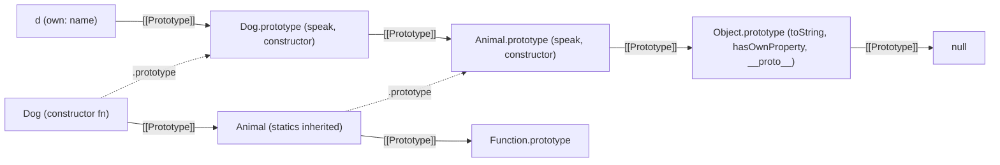
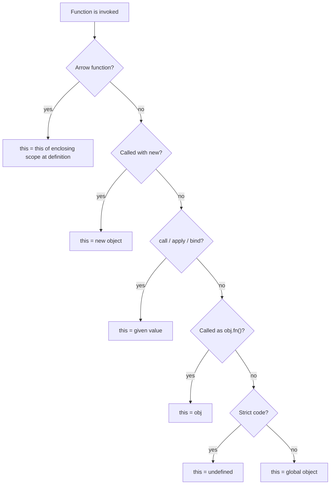

# 00 / 09 — Prototypes, `this`, and Classes

## 1. Lesson metadata

| | |
|---|---|
| **Level** | Intermediate |
| **Study time** | 4–5 hours (reading 2 h, experiments 1 h, exercises 1.5 h) |
| **Prerequisites** | [08 — Objects, references, immutability](./08-objects-references-immutability.md), [07 — Functions and referential identity](./07-functions-and-referential-identity.md), [06 — Lexical scope and closures](./06-lexical-scope-and-closures.md) |
| **Next** | [10 — ES modules, dependency graphs, tree shaking](./10-modules-and-dependency-graphs.md) |
| **Related later** | [Phase 1 / 17 — Lifecycle concepts (class history)](../01-react-fundamentals/17-lifecycle-concepts.md), [Phase 3 / 16 — Rules of Hooks and composition](../03-react-state-and-hooks/16-rules-of-hooks-and-composition.md), [Phase 5 / 03 — Composition over inheritance](../05-design-patterns/03-composition-over-inheritance.md) |

**Learning objectives.** After this lesson you can:
1. Explain how property lookup walks the prototype chain and how it differs from assignment.
2. Predict the value of `this` for any call expression using the five binding rules.
3. Explain what `class` syntax compiles down to conceptually, including fields, methods, `super`, and `#private` members.
4. Explain why `onClick={this.handleClick}` loses `this` in a class component, and three ways to fix it.
5. Explain why React moved from classes to functions, and which parts of the object model still matter in modern React code (error boundaries, `instanceof`, spread/clone behaviour, stores, `Error` subclasses).
6. Recognise prototype-related security risks (prototype pollution) in code that merges untrusted objects.

**Concepts covered:** own vs inherited properties, `[[Prototype]]`, `Object.create`, `Object.getPrototypeOf`, `prototype` vs `__proto__`, constructor functions, `new`, `class`, `extends`/`super`, instance fields, private fields, static members, accessors, the `this` binding rules, arrow functions and `this`, `call`/`apply`/`bind`, `instanceof`, realms, spread and prototype loss, prototype pollution.

---

## 2. Deep conceptual explanation

### 2.1 What problem is this lesson solving?

Modern React code is almost entirely functions and plain objects. So why spend a lesson on prototypes and classes?

- **React's own history and a large body of existing code is class-based.** You will read and maintain class components. Error boundaries *still* require a class in React 19 (there is no hook equivalent) — see [Phase 4 / 19](../04-react-architecture/19-error-boundaries.md).
- **`this` is the single biggest source of "why is this undefined?" bugs** in JavaScript, and the reason class components needed `.bind(this)` rituals. Understanding it is the cleanest way to understand *why hooks and closures replaced it*.
- **Objects you do not write yourself are class instances**: `Map`, `Set`, `Date`, `Error`, `URL`, `AbortController`, `Promise`, DOM nodes, `Response`. Whether they survive `{...spread}`, `JSON.stringify`, `structuredClone`, or `useState` equality checks depends on the object model.
- **Immutable-update rules from [Lesson 08](./08-objects-references-immutability.md)** (spread to copy) quietly lose the prototype. If you store a class instance in state you will meet this.
- **Security:** prototype pollution is a real class of vulnerability in utility code that deep-merges objects.

The goal is not to teach classical OOP. It is to give you an accurate model of the machinery under every object you touch.

### 2.2 Objects are property bags with a hidden link

A JavaScript object is a collection of properties plus an internal slot called `[[Prototype]]` that points to another object or to `null`. That link is the *only* inheritance mechanism in the language. (`class` is syntax over it.)

**Property read** (`obj.x`): the engine looks for an *own* property `x` on `obj`. If absent, it follows `[[Prototype]]` and looks there, and so on, until found or the chain ends at `null` (result `undefined`).

**Property write** (`obj.x = v`): *normally creates or updates an own property on `obj`*, even if `x` exists higher in the chain. Exceptions: if an inherited property is an accessor (a setter) the setter is called; if an inherited data property is non-writable, the assignment fails (silently in sloppy mode, `TypeError` in strict mode).

This asymmetry (reads walk the chain, writes do not) is the key idea, and it is the reason mutating through an inherited object is surprising:

```js
const base = { n: 1 };
const child = Object.create(base);
child.n++;                      // read 1 from base, write 2 as an OWN property of child
console.log(base.n, child.n);   // 1 2
```

### 2.3 `prototype`, `[[Prototype]]`, `__proto__`: three different things

| Name | What it is |
|---|---|
| `[[Prototype]]` | The internal link of *every* object. Read with `Object.getPrototypeOf(obj)`; set with `Object.setPrototypeOf` (slow, avoid) or at creation via `Object.create(proto)`, `new`, class `extends`, or an object literal's `__proto__:` key. |
| `obj.__proto__` | A legacy accessor on `Object.prototype` that gets/sets `[[Prototype]]`. Standardised for web compatibility; **do not use in new code**. It is also the vector for prototype pollution (§2.9). |
| `Fn.prototype` | An ordinary property that exists on **functions usable as constructors**. It is *the object that will become `[[Prototype]]` of instances created with `new Fn()`*. It is not Fn's own prototype link. |

```js
function Dog(name) { this.name = name; }
Dog.prototype.speak = function () { return this.name + " barks"; };

const d = new Dog("Rex");
Object.getPrototypeOf(d) === Dog.prototype;   // true
Object.getPrototypeOf(Dog) === Function.prototype; // true: Dog is itself an object
d.constructor === Dog;                         // true, inherited from Dog.prototype
```

The chain for `d` is: `d` → `Dog.prototype` → `Object.prototype` → `null`.

### 2.4 What `new` does

`new F(args)` performs, conceptually:

1. Create a fresh object whose `[[Prototype]]` is `F.prototype`.
2. Call `F` with `this` bound to that object.
3. If `F` returns an *object*, that becomes the result; otherwise the fresh object is the result.

That is why a constructor function called **without** `new` (`Dog("x")`) assigns to the wrong `this`. Classes forbid this: calling a class without `new` throws `TypeError`.

### 2.5 `class` is syntax over this machinery

```ts
class Animal {
  name: string;                       // TS declaration (field)
  constructor(name: string) { this.name = name; }
  speak() { return `${this.name} makes a sound`; }   // method → on Animal.prototype
  static create(name: string) { return new Animal(name); } // static → on Animal itself
}

class Dog extends Animal {
  speak() { return `${super.speak()} (woof)`; }
}
```

What the syntax gives you beyond the older pattern, still *conceptually* the same chain:

- Methods are defined on `Class.prototype` as **non-enumerable** properties (so `for…in` skips them).
- `extends` links *two* chains: `Dog.prototype`'s prototype is `Animal.prototype` (instances inherit methods) and `Dog`'s prototype is `Animal` (statics are inherited).
- `typeof Animal === "function"`. A class *is* its constructor function.
- Class bodies are always **strict mode**.
- Calling without `new` throws; class declarations are in the temporal dead zone before evaluation (like `let`).
- Instance **fields** (`count = 0;`) are created *per instance*, in the constructor phase. **Private fields** (`#secret`) are lexically scoped to the class body and not accessible from outside, even via `Object.keys` or Proxies in the ordinary sense.

### 2.6 `this`: determined by how the function is *called*

`this` is not lexical (except in arrow functions). For ordinary functions, the call site decides. The binding rules, in order of precedence:

| # | Call form | `this` |
|---|---|---|
| 1 | `new F()` | the newly created object |
| 2 | `F.call(ctx)`, `F.apply(ctx)`, or a function made by `F.bind(ctx)` | `ctx` (a bound function's `this` cannot be overridden by later `call`) |
| 3 | `obj.method()` | `obj` (the thing before the dot at the call site) |
| 4 | `method()` (plain call) | `undefined` in strict code (modules, classes), the global object in sloppy scripts |
| 5 | Arrow function | **no own `this`**: uses the `this` of the enclosing scope where it was *defined* (lexical, like any other variable) |

Everything confusing about `this` is rule 3 vs rule 4: `obj.method` is just a *function value*; the "connection" to `obj` exists only if you call it in the form `obj.method()`.

```js
const counter = { n: 0, inc() { this.n++; } };
counter.inc();          // rule 3: this === counter
const f = counter.inc;
f();                    // rule 4: this is undefined (module) → TypeError on undefined.n
```

Passing `counter.inc` as a callback (`setTimeout(counter.inc, 0)`, `button.addEventListener("click", counter.inc)`, or `<button onClick={this.handleClick}>`) is a detached call. (One DOM-specific wrinkle: `addEventListener` with a regular function sets `this` to `event.currentTarget` — a different, host-defined binding, still not `counter`.)

### 2.7 Why React moved from classes to functions

React did not drop classes because classes are "bad"; it moved because of specific problems that the object model creates. Understanding them explains hooks.

1. **`this` binding ceremony.** Every handler passed as a prop needed `.bind(this)` in the constructor or a class-field arrow function. Easy to forget; compiler-invisible.
2. **`this` is mutable, which makes it a different thing from a render's props.** In a class component, `this.props` is *the current props object at the time you read it*. An async callback that reads `this.props.user` after a delay sees the **latest** props, not the props from the render that scheduled it. Function components close over the props of *their* render, so the callback sees a consistent snapshot ([Lesson 06](./06-lexical-scope-and-closures.md), [Phase 1 / 14](../01-react-fundamentals/14-state-as-a-snapshot.md)). Either behaviour can be useful; the problem was that the class behaviour was implicit and caused subtle bugs.
3. **Lifecycle methods split related logic and merged unrelated logic.** A subscription was set up in `componentDidMount`, updated in `componentDidUpdate`, and torn down in `componentWillUnmount`; unrelated concerns (analytics, data) shared the same methods.
4. **Reuse via inheritance, HOCs and render props** produced wrapper hell; hooks make stateful logic a function ([Phase 3 / 15](../03-react-state-and-hooks/15-custom-hooks.md)).
5. **Optimisation and tooling.** Functions are easier to analyse and minify than classes with methods that can be reassigned at runtime. (This is a motivation often cited by the team; treat as context, not a measured guarantee.)

**Status in React 19:** class components are still supported (react.dev: "Class components are still supported by React, but we don't recommend using them in new code"). The one remaining necessity is **error boundaries**, which must be class components (`static getDerivedStateFromError` and/or `componentDidCatch`). Verified against <https://react.dev/reference/react/Component> on 2026-10-22.

### 2.8 Where the object model still shows up in modern React

- **Error boundaries** (class).
- **Custom `Error` subclasses** for typed API errors (`class HttpError extends Error`). `instanceof` checks drive `catch` logic in data layers.
- **External stores** (Zustand/Redux internals, `useSyncExternalStore` stores) are often classes or closures holding subscribers (`Set<() => void>`).
- **Platform objects**: `Map`/`Set` in state need copy-on-write; `new Map(old)` rather than spread.
- **Spread, `structuredClone`, and `JSON` on class instances** lose or transform the prototype (§3.5).
- **TypeScript**: structural typing means a plain object can satisfy a class's *type* without being an instance. `instanceof` is a runtime check; the type system does not guarantee it.
- **React itself uses the prototype to tell class components from function components**: conceptually, the reconciler checks whether the component's `prototype` has a marker (`isReactComponent`) set by `React.Component`. This is an *implementation detail*; `isReactComponent` is present in the installed `react@19.3.1` source; read it if you need the specifics ([Phase 2 / 31](../02-react-rendering-and-internals/31-reading-react-source.md)). It is the reason `typeof Component === "function"` is not enough and why arrow-function components (which have no `prototype`) work.

### 2.9 Prototype pollution (the security angle)

Because `__proto__` is an accessor on `Object.prototype`, assigning to `obj["__proto__"]` changes the prototype of `obj`, and a *recursive merge* that follows keys naively can end up writing to `Object.prototype` itself, adding a property to **every** object in the realm:

```js
// Dangerous naive deep merge
function merge(target, source) {
  for (const key in source) {
    if (typeof source[key] === "object" && source[key] !== null) {
      target[key] = merge(target[key] ?? {}, source[key]);
    } else {
      target[key] = source[key];
    }
  }
  return target;
}
merge({}, JSON.parse('{"__proto__": {"isAdmin": true}}'));
({}).isAdmin; // true: every object now "is admin"
```

`JSON.parse` creates an own property literally named `"__proto__"`; the merge then reads `target["__proto__"]`, which resolves to `Object.prototype`, and writes into it. Mitigations: skip `__proto__`, `constructor`, `prototype` keys; use `Object.create(null)` dictionaries or `Map`; use `Object.hasOwn`; prefer vetted libraries. Relevant wherever you merge query strings, JSON from the network, or user-provided config ([Phase 10 / 06](../10-production-engineering/06-security-xss-csrf-csp.md) covers the broader security model).

### 2.10 Common misconceptions

| Misconception | Reality |
|---|---|
| "JavaScript classes work like Java/C# classes." | They are syntax over prototype delegation. There is one dynamic object model; methods live on a shared prototype object and can be modified at runtime. |
| "`this` refers to the function/the class instance where it's written." | `this` depends on the *call*, except in arrow functions where it is lexical. |
| "Arrow functions are just shorter functions." | They have no own `this`, `arguments`, `super`, or `new.target`, and cannot be used with `new`. |
| "Inherited properties are copied into the child." | Nothing is copied. Lookup *delegates* at read time; changing the prototype later affects existing instances. |
| "`{...obj}` clones an object." | It makes a shallow copy of *own enumerable* properties into a plain object with `Object.prototype`. Methods on the prototype and private fields are not copied. |
| "Class instances in state are fine." | Allowed, but you must follow the same immutability rules, and the copy-on-write must preserve the prototype (`Object.assign(Object.create(Object.getPrototypeOf(x)), x, patch)`), which is usually a sign to use plain data instead. |
| "Class component `this.state` updates immediately after `setState`." | No. `this.state` is replaced at render time; see [Phase 1 / 15](../01-react-fundamentals/15-update-queues-and-batching.md). |

---

## 3. Internal mechanics

### 3.1 Property lookup and engine optimisation

*Public guarantee (ECMAScript):* `[[Get]]` consults own properties then the prototype chain; `[[Set]]` creates an own data property unless a setter or non-writable inherited property intervenes.

*Teaching model:* "a chain of dictionaries".

*Implementation detail:* engines do not walk dictionaries on every access. V8, SpiderMonkey and JavaScriptCore attach **hidden classes / shapes** to objects and use **inline caches** at each property-access site; objects created by the same constructor with properties added in the same order share a shape, so lookups become a shape check plus an offset. Consequences that are *performance advice rather than semantics*: initialise all fields in the constructor in a consistent order; avoid `delete` on hot objects; avoid `Object.setPrototypeOf` after creation. Measure before acting; these are engine-specific heuristics.

### 3.2 Method sharing vs per-instance functions

```ts
class A {
  method() {}              // one function object on A.prototype, shared by all instances
  field = () => {};        // a NEW function object per instance (class field initialiser)
}
new A().method === new A().method; // true
new A().field  === new A().field;  // false
```

This is the same referential-identity story as [Lesson 07](./07-functions-and-referential-identity.md): the arrow *field* is a fix for `this` loss because it closes over the instance, at the cost of one closure per instance and a handler that is not on the prototype (so `jest.spyOn(Class.prototype, "field")`-style patching does not work).

### 3.3 The class construction order (fields and `super`)

For `class B extends A`:

1. `new B()` enters B's constructor. `this` is **not yet created** (derived constructors must call `super(...)` before touching `this`).
2. `super(...)` runs A's constructor logic (A's fields are initialised, then A's constructor body).
3. Control returns to B: **B's own fields are initialised now**, after `super` returns.
4. The rest of B's constructor body runs.

Consequence: if A's constructor calls an overridable method that reads a field B defines, it sees `undefined` (B's field has not yet run). Avoid calling overridable methods from constructors.

### 3.4 Private fields and static blocks

`#x` is a *private name*, scoped to the class body; access to `obj.#x` for an object lacking it throws `TypeError` (use `#x in obj` for brand checks). Private fields are **not** properties: they are invisible to `Object.keys`, `JSON.stringify`, spread, and proxies unwrapping. TypeScript's `private` keyword, by contrast, is a compile-time-only annotation with no runtime enforcement; `#private` is real. Both are fine; choose deliberately.

### 3.5 What survives copying?

| Operation on a class instance | Own data props | Prototype methods | Accessors (getters) | Private `#` fields | Result's prototype |
|---|---|---|---|---|---|
| `{ ...x }` / `Object.assign({}, x)` | copied (enumerable own only; getters are *invoked* and their values copied) | lost | lost as accessors (their values become data) | lost | `Object.prototype` |
| `structuredClone(x)` | copied | lost | values at the time | lost | `Object.prototype` (class identity not preserved) |
| `JSON.parse(JSON.stringify(x))` | JSON-serialisable only; `toJSON` respected | lost | own enumerable only | lost | `Object.prototype` |
| `Object.create(Object.getPrototypeOf(x), Object.getOwnPropertyDescriptors(x))` | copied | kept (shared) | kept as accessors | **lost** (private state is not copied) | same as `x` |

The last row shows the structural limit: *you cannot clone an instance with private fields from the outside*. A class must expose its own `with(...)` method. For React state this is the strongest argument for **plain serialisable data + functions** over class instances.

### 3.6 `this` inside React class components

`React.Component` provides `this.props`, `this.state`, `this.setState`, `this.forceUpdate`. React constructs your class with `new`, sets props, and calls lifecycle methods on the instance it keeps in the Fiber (Phase 2). Handlers you pass as props are called by the event system *without* your instance as receiver, thus the detachment problem. ⚠ The legacy `React.createClass` and the `UNSAFE_*` lifecycles are historical; do not use them in new code.

---

## 4. Step-by-step execution walkthrough

### 4.1 `d.speak()` where `d = new Dog("Rex")` (constructor-function style)

Using the `Dog` example from §2.3:

1. `new Dog("Rex")`: engine allocates an empty object `o` with `[[Prototype]] = Dog.prototype`.
2. Calls `Dog` with `this = o`: `this.name = "Rex"` creates an own property.
3. Constructor returns `undefined`, so `o` is the result; `d = o`.
4. `d.speak`: look for own `speak` on `d` → none. Follow `[[Prototype]]` to `Dog.prototype` → found.
5. `d.speak()` is a *call expression with a member reference*, so rule 3 applies: `this = d`.
6. Inside, `this.name` resolves to the own property `"Rex"`. The function returns `"Rex barks"`.

### 4.2 The detached handler in a class component

```tsx
class Counter extends React.Component<{}, { n: number }> {
  state = { n: 0 };
  handleClick() { this.setState({ n: this.state.n + 1 }); }
  render() { return <button onClick={this.handleClick}>{this.state.n}</button>; }
}
```

1. `render()` is called as `instance.render()`; `this` is the instance. It reads `this.handleClick`, a *function value* from `Counter.prototype`, and puts it in the props of a `<button>` element.
2. Later the user clicks. React's event system ([Lesson 13](./13-browser-events-and-propagation.md) and [Phase 1 / 10](../01-react-fundamentals/10-event-handling.md)) finds the handler and calls it as a plain function: conceptually `handler(syntheticEvent)`.
3. This is rule 4 (plain call). Class bodies are strict, so `this === undefined`.
4. `this.setState` → `TypeError: Cannot read properties of undefined (reading 'setState')`. (Exact message text varies by engine.)

---

## 5. Code examples

### 5.1 Minimal example: the chain and shadowing

```js
const proto = { greet() { return "hi " + this.name; }, kind: "proto" };
const a = Object.create(proto);
a.name = "A";
const b = Object.create(proto);
b.name = "B";

console.log(a.greet(), b.greet());    // ?
b.kind = "own";
console.log(a.kind, b.kind, proto.kind); // ?
console.log(Object.keys(a), "kind" in a, Object.hasOwn(a, "kind")); // ?
```

**Predict** each line before reading on.

**Result:**
```
hi A hi B
proto own proto
[ 'name' ] true false
```
**Why:** `greet` is shared (found on `proto`), but `this` is the receiver (`a` or `b`), so each reads its own `name`. `b.kind = "own"` *shadows* rather than modifies `proto.kind`. `Object.keys` lists only own enumerable keys; `in` walks the chain; `Object.hasOwn` (ES2022) checks only own properties (prefer it over `obj.hasOwnProperty`, which breaks for `Object.create(null)` objects).

### 5.2 `this` rules in one place

```js
"use strict";
const o = {
  name: "o",
  regular() { return this?.name; },
  arrow: () => this === undefined,    // `this` of the surrounding scope (module/top: undefined in a module)
  later() { return [1].map(() => this.name); },        // arrow keeps this = o
  laterRegular() { return [1].map(function () { return this; }); }, // plain call: undefined
};
console.log(o.regular());                  // ?
const r = o.regular; console.log(r());     // ?
console.log(o.later());                    // ?
console.log(o.laterRegular());             // ?
console.log(r.call({ name: "x" }));        // ?
console.log(r.bind({ name: "y" }).call({ name: "z" })); // ?
```

**Result:** `"o"`, `undefined` (optional chaining on `undefined` `this`), `["o"]`, `[undefined]`, `"x"`, `"y"`.
**Why:** call-site rules; the arrow inside `later` captures `later`'s `this`; the `function` in `map` is a plain call; `bind` fixes `this` permanently so `.call` cannot override it. (The `arrow` property's result depends on where the file runs: in an ES module, top-level `this` is `undefined`; in a classic script it is `window`. Do not use arrow functions as object methods when you need `this`.)

### 5.3 Practical: a typed error hierarchy used in a data layer

```ts
export class HttpError extends Error {
  readonly status: number;
  readonly body: unknown;

  constructor(status: number, message: string, body?: unknown, options?: ErrorOptions) {
    super(message, options);
    this.name = "HttpError";     // otherwise `name` is inherited "Error"
    this.status = status;
    this.body = body;
  }

  get isClientError() { return this.status >= 400 && this.status < 500; }
}

export class NetworkError extends Error {
  constructor(options?: ErrorOptions) {
    super("Network request failed", options);
    this.name = "NetworkError";
  }
}

export async function getJson<T>(url: string, init?: RequestInit): Promise<T> {
  let res: Response;
  try {
    res = await fetch(url, init);
  } catch (cause) {
    if (cause instanceof DOMException && cause.name === "AbortError") throw cause;
    throw new NetworkError({ cause });
  }
  if (!res.ok) throw new HttpError(res.status, res.statusText, await res.text().catch(() => undefined));
  return (await res.json()) as T;
}

// Consumer (e.g. in an error boundary or a TanStack Query retry predicate)
function shouldRetry(failureCount: number, error: unknown): boolean {
  if (error instanceof HttpError && error.isClientError) return false; // 4xx won't fix itself
  return failureCount < 3;
}
```

Line notes:
- `extends Error` works in all modern engines. With *old* transpile targets (ES5), `instanceof` against Error subclasses broke because built-in constructors could not be properly subclassed; a `Object.setPrototypeOf(this, new.target.prototype)` workaround was needed. With a modern `target` (ES2015+) you do not need it. Verify your TS `target`.
- `ErrorOptions`/`cause` (ES2022) preserve the original error for debugging.
- `getter isClientError` lives on `HttpError.prototype`, so it disappears if you spread the error — a reason not to put such errors into serialised state (Redux requires serialisable state).
- Abort errors are rethrown as-is: `AbortError` is *not* a failure; see [Lesson 14](./14-web-apis-and-network-requests.md).

**Trade-off:** `instanceof` fails across realms (iframes, some test environments with multiple VM contexts, duplicated bundled copies of the same module). A discriminant property (`error.kind === "http"`) is more robust at module boundaries. Use classes for convenience *inside* a boundary, discriminated unions *across* it ([Lesson 19](./19-typescript-generics-and-utility-types.md)).

### 5.4 Incorrect: class handler loses `this`

```tsx
import { Component } from "react";

class SaveButton extends Component<{ onSave: () => void }> {
  saved = false;
  handleClick() {
    this.saved = true;          // not even state; intentionally naive
    this.props.onSave();
  }
  render() {
    return <button onClick={this.handleClick}>Save</button>;
  }
}
```

**Predict:** what happens on click?

**Result:** `TypeError` — `this` is `undefined` inside `handleClick`. **Why:** §4.2.

### 5.5 Corrected (three fixes, with trade-offs)

```tsx
import { Component } from "react";

type Props = { onSave: () => void };

// Fix 1: bind once in the constructor. One bound function per instance, stable identity.
class A extends Component<Props> {
  constructor(props: Props) {
    super(props);
    this.handleClick = this.handleClick.bind(this);
  }
  handleClick() { this.props.onSave(); }
  render() { return <button onClick={this.handleClick}>Save</button>; }
}

// Fix 2: class field + arrow function. Closes over the instance. Most common in class-era code.
class B extends Component<Props> {
  handleClick = () => { this.props.onSave(); };
  render() { return <button onClick={this.handleClick}>Save</button>; }
}

// Fix 3: arrow in JSX. Works, but creates a new function every render (identity changes).
class C extends Component<Props> {
  handleClick() { this.props.onSave(); }
  render() { return <button onClick={() => this.handleClick()}>Save</button>; }
}

// The modern answer: no `this` at all.
function D({ onSave }: Props) {
  return <button onClick={onSave}>Save</button>;
}
```

Fix 3's identity churn only matters if the child is memoised (`PureComponent`/`memo`); for a DOM `<button>` it is harmless. Do not treat "arrow in JSX is always slow" as a rule; see [Phase 7](../07-performance/) for measured guidance.

### 5.6 Practical: an external store as a class, wired to React

```ts
// counter-store.ts
type Listener = () => void;

export class CounterStore {
  #count = 0;
  #listeners = new Set<Listener>();

  // Arrow properties so these can be passed to useSyncExternalStore detached
  subscribe = (listener: Listener): (() => void) => {
    this.#listeners.add(listener);
    return () => { this.#listeners.delete(listener); };
  };
  getSnapshot = (): number => this.#count;

  increment() {
    this.#count += 1;
    for (const l of this.#listeners) l();
  }
}

export const counterStore = new CounterStore();
```

```tsx
import { useSyncExternalStore } from "react";
import { counterStore } from "./counter-store";

export function Counter() {
  const n = useSyncExternalStore(counterStore.subscribe, counterStore.getSnapshot);
  return <button onClick={() => counterStore.increment()}>{n}</button>;
}
```

Notes: `subscribe` and `getSnapshot` are passed *detached* to the hook, so they must not rely on a call-site receiver; hence arrow-valued fields. `increment` is called as `counterStore.increment()` so a prototype method is fine. The snapshot is a primitive, so referential stability is trivially satisfied (for object snapshots you must return the *same reference* until the data changes, see [Phase 3 / 20](../03-react-state-and-hooks/20-usesyncexternalstore-and-external-stores.md)). `#count` cannot be mutated from outside, which is the point of using a class here.

### 5.7 Advanced: mixing identity and prototypes: spread of a class instance in state

```ts
class Money {
  constructor(readonly cents: number, readonly currency: string) {}
  format() { return new Intl.NumberFormat("en", { style: "currency", currency: this.currency }).format(this.cents / 100); }
  add(other: Money) { return new Money(this.cents + other.cents, this.currency); }
}

const price = new Money(1999, "USD");
const copy = { ...price };
// copy.format is undefined → "copy.format is not a function" at runtime.
// TypeScript: `copy` has type { cents: number; currency: string }  (methods are not own properties; TS drops them from spread)
```

TypeScript models this correctly for spread: the spread type includes only own *properties*, not methods. The same bug appears untyped with `JSON.parse(JSON.stringify(price))` (typed as `any`/`Money` via a cast), where TS cannot help. Recommended design for UI state: keep `{ cents, currency }` as plain data and use *functions* `formatMoney(m)`/`addMoney(a, b)`. Classes remain fine for *services* (store, API client) that are constructed once and never cloned.

---

## 6. Visual explanations

### Prototype chains for a `Dog` instance



### `this` decision tree



### Why the handler is detached

```text
render()                          click
  this.handleClick  ── value ──►   React calls handler(event)    // no "instance." in front
  (function from prototype)        this = undefined (strict)  →  this.setState → TypeError
```

---

## 7. Alternative approaches and trade-offs

**Modelling a stateful concept in a React app** (e.g. a shopping cart):

| Approach | Readability | Perf | Complexity | Testability | Fits React's model |
|---|---|---|---|---|---|
| Plain data + pure functions (`addItem(cart, item)`) | High | Good | Low | Very high | Excellent: serialisable, snapshot-friendly, devtools-friendly |
| Class with immutable methods returning new instances | Medium | Good | Medium (private fields prevent generic cloning) | High | Fine if kept out of persisted/serialised state |
| Class with mutating methods + `forceUpdate`/subscription | Medium | Good for fine-grained updates | Medium–High | Medium | Needs an external-store bridge (`useSyncExternalStore`); easy to violate snapshot rules |
| Object with closures (factory function, no `this`) | High | Good | Low | High | Good for stores/services; avoids `this` loss |
| Mutable proxies (Immer-like drafts) | High for nested updates | Good | Library dependency | High | Good for reducers ([Phase 3 / 03](../03-react-state-and-hooks/03-usereducer-and-reducer-architecture.md)) |

**Recommended default** for UI state: plain data and functions.

**When it is not the best choice.** A rich domain service with invariants and private state (a WebSocket session manager with reconnect logic, a drag-and-drop controller, an undo/redo history engine, a canvas scene graph with thousands of nodes) benefits from a class with private state and a small public API, exposed to React through `useSyncExternalStore` or a custom hook. Cloning on every mutation of such an object would be wasteful and loses encapsulation.

**For handler binding in legacy class code:** field arrows (Fix 2) are the lowest-friction option; constructor bind (Fix 1) gives a prototype-visible method (better for `spyOn`) and stable identity as well.

---

## 8. Best practices and anti-patterns

**Do**
- Check `Object.hasOwn(o, k)` for dictionary-like objects; use `Map` for arbitrary keys.
- Use `class … extends Error` with `name`, `cause`, and a discriminant when error types drive control flow.
- Keep classes out of serialisable state (Redux, URL state, persisted storage, props that cross `postMessage`/`structuredClone`).
- Use `#private` or closures for true encapsulation; remember TS `private` is compile-time only.

**Beginner mistakes**
- Passing `obj.method` as a callback and expecting `this` to follow.
- Using `function` inside a method for a callback and expecting the method's `this`.
- Using an arrow function as an object *method* and reading `this`.
- Expecting `{...instance}` to preserve methods.
- Mutating `Foo.prototype` or built-ins ("monkey patching") in app code.

**Experienced-developer mistakes**
- Deep class hierarchies in UI code ("`BaseTable` → `FilterableTable` → `AdminTable`"); inheritance couples render logic to a rigid chain ([Phase 5 / 03](../05-design-patterns/03-composition-over-inheritance.md)).
- Calling overridable methods in constructors (§3.3).
- `instanceof` against types from another bundle copy, iframe, or Node `vm` context.
- Deep-merging untrusted JSON with a hand-rolled recursive merge (prototype pollution).
- Relying on `constructor.name` for logic (minifiers rename it).

**Smells:** `.bind(this)` in `render`; `Object.setPrototypeOf` in app code; `this` aliased to `self`/`that` in modern code (use arrows); `for…in` without `Object.hasOwn` on objects that may be extended.

**Justified exceptions:** an arrow class field handler in an existing class component (consistent with the codebase); a class for a long-lived service object; deliberately mutating a prototype in a polyfill, with feature detection.

---

## 9. Real-world application

*Multi-team design system with legacy class components.* A fintech's design system has 200 components from 2017, some as classes with `PureComponent`. A new feature needs an error boundary around each dashboard widget. Constraints: boundaries must report to a monitoring service, reset on route change, and render a fallback. The boundary is a class (the only legal option); everything else in the widget is function components. Engineers learn two rules: the class is a *thin adapter* (`getDerivedStateFromError`, `componentDidCatch` → report), and fallbacks are function components passed as props. Teams may use a vetted library wrapper (e.g. `react-error-boundary`) *(verify current API at its repository)* to avoid writing classes at all.

*Typed API layer.* The same company's API client throws `HttpError`/`NetworkError`. The retry policy (`shouldRetry`, §5.3) and UI mapping ("show re-login on 401, inline validation on 422") use `instanceof` inside the module that created the errors, and a `kind` discriminant when errors cross a package boundary in the monorepo (two copies of the client package can produce two `HttpError` classes; `instanceof` then returns `false`, a real-world production bug).

*Security.* A "workspace settings" feature deep-merges a user-supplied JSON into defaults. A penetration test sends `{"__proto__":{"role":"admin"}}`; subsequent role checks like `if (user.role === "admin")` on objects *without* an own `role` start passing. Remediation: drop dangerous keys, create objects with `Object.create(null)` for dictionaries, use a vetted merge utility with pollution protection, and make permission checks use `Object.hasOwn` and server-side enforcement (client checks are UX, not security).

---

## 10. Debugging and troubleshooting

**Symptom 1:** `TypeError: Cannot read properties of undefined (reading 'setState' | 'props' | 'state')` on click.
*Repro:* §5.4. *Investigation:* set a breakpoint in the handler; in DevTools **Scope/Call Stack**, `this` shows `undefined`. Look at the call stack's caller: a framework/event dispatcher, not your render. *Root cause:* detached call. *Fix & validate:* apply Fix 1 or 2; click again; confirm `this` is the instance. Add an ESLint rule (e.g. `@typescript-eslint/unbound-method`) to catch passing unbound methods. *(Verify rule name in your version.)*

**Symptom 2:** `x.format is not a function` after state restore (from `localStorage`, `JSON`, `postMessage`, Redux persist).
*Investigation:* `console.log(Object.getPrototypeOf(x) === Money.prototype)` → `false`. `console.dir(x)` in DevTools shows `[[Prototype]]: Object` instead of `Money`. *Root cause:* serialisation or spread dropped the prototype. *Fix:* rehydrate via `new Money(raw.cents, raw.currency)` or move to plain data + functions.

**Symptom 3:** `instanceof` returns `false` for an object that was obviously created by that class.
*Investigation:* compare `err.constructor === HttpError`; `Object.getPrototypeOf(err)` identity; check the bundle for duplicate copies of the module (`npm ls`, bundle analyser), or whether the object originates from an iframe/other realm. *Fix:* deduplicate dependencies, or use a discriminant.

**Symptom 4:** Every object in the app suddenly has an unexpected property, `for…in` loops list unexpected keys.
*Investigation:* in the console, run `({}).suspiciousKey`. If truthy, `Object.prototype` is polluted. Search for recursive merges / `lodash`-style `set` calls on untrusted paths; check dependency advisories (`npm audit`). *Fix:* patch the merge, upgrade the dependency, add key filtering; validate the fix with a regression test that merges `{"__proto__":{"x":1}}` and asserts `({}).x === undefined`.

**DevTools tips:** in the console, expand an object and look at `[[Prototype]]` to see the chain; `console.dir(Class)` shows `prototype`; `getEventListeners`/`monitorEvents` help for the DOM `this` case; the Sources panel's **Scope** pane shows `this` in each frame.

---

## 11. Exercises

### Level A — Knowledge
A1. What is the difference between `Fn.prototype` and `Object.getPrototypeOf(Fn)`?
A2. What does `new F()` do, in order?
A3. State the `this` rules in precedence order.
A4. Name two things an arrow function does *not* have.
A5. Why must error boundaries still be classes in React 19?
A6. What does `{ ...instance }` copy, and what does it drop?

### Level B — Code comprehension
B1. What does this print? (Assume an ES module.)
```js
function Counter() { this.n = 0; }
Counter.prototype.inc = function () { this.n++; return this.n; };
const c = new Counter();
const inc = c.inc;
console.log(c.inc());
try { console.log(inc()); } catch (e) { console.log(e.constructor.name); }
```
B2. What does this print?
```js
class A { x = 1; getX() { return this.x; } }
class B extends A { x = 2; }
console.log(new B().getX());
```
B3. What does this print?
```js
const a = { n: 1 };
const b = Object.create(a);
b.n++;
console.log(a.n, b.n, Object.hasOwn(b, "n"));
```
B4. What does each line log?
```js
class T {
  v = 1;
  m() { return this?.v; }
  arrow = () => this.v;
}
const t = new T();
const { m, arrow } = t;
console.log(t.m(), m(), arrow());
```
B5. Given `class P { #s = 1; static has(o: object) { return #s in o; } }`, what are `P.has(new P())`, `P.has({})`, and `P.has({ ...new P() })`?

### Level C — Implementation
C1. Implement `class Emitter<Events extends Record<string, unknown>>` with typed `on(event, fn)` returning an unsubscribe function, and `emit(event, payload)`. Handlers must work when passed detached. Write a `useEmitter` hook using `useEffect` and cleanup.
C2. Write `safeMerge(target, source)`, a deep merge for plain JSON objects that is immune to prototype pollution. Include a test for `{"__proto__": {"x": 1}}`.
C3. Write an immutable `with` method for a class that has private fields, so React state can hold it safely: `class Range { #lo; #hi; with(patch) {…} }`.

### Level D — Debugging
D1. The code below intermittently shows `undefined` in the label. Find the bug without changing the `render` method.
```tsx
class Label extends React.Component<{ id: string }> {
  name = "";
  async componentDidMount() {
    this.name = await fetchName(this.props.id);
    this.forceUpdate();
  }
  render() { return <span>{this.name}</span>; }
}
```
D2. `export class ValidationError extends Error {}` — `err instanceof ValidationError` is `false` in production but `true` in tests. Give three candidate causes and how to verify each.
D3. A teammate stores `new Map()` in `useState` and updates with `setMap({ ...map, [k]: v })`. Explain what breaks and fix it.

### Level E — Architecture and engineering decisions
E1. Your team is deciding between (a) class-based domain models (`Order`, `Cart`) that render themselves via methods, and (b) plain data + function modules. Evaluate for a codebase that uses Redux Toolkit, SSR, and persisted state. Recommend.
E2. A 600-component legacy codebase uses class components extensively. Propose a migration policy (what to convert, what to leave, how to enforce).

### Level F — Expert challenge
F1. Design a `deepClone` for a mixed object graph that must preserve class instances (via an opt-in `clone()` protocol), handle cycles, and refuse to traverse `__proto__`. Outline the algorithm, edge cases (private fields, `Map`/`Set`/`Date`, getters), and testing strategy.
F2. Explain, from the object model, why `const { handleClick } = this;` in a class method `render` produces a *working* reference only if the method was converted to an arrow field or bound, and why a Proxy-wrapped instance can break `#private` access. (Hint: private names are checked against the real object, not the proxy.)

---

## 12. Detailed answers and explanations

> Attempt the exercises first.

**A1.** `Fn.prototype` is the object that becomes the `[[Prototype]]` of instances made by `new Fn()`. `Object.getPrototypeOf(Fn)` is `Fn`'s *own* prototype link: `Function.prototype` for a normal function (or the parent class for `class Child extends Parent`). Wrong-but-common answer: "they are the same". They sit on different objects.

**A2.** (1) Create an object with `[[Prototype]] = F.prototype`; (2) call `F` with that object as `this`; (3) if `F` returns an object use it, else use the new object. Classes add: calling without `new` throws, derived classes get `this` only after `super()`.

**A3.** `new` → `call/apply/bind` → `obj.fn()` (member call) → plain call (undefined in strict / global in sloppy). Arrow functions skip all of this and use lexical `this`. Bound functions' `this` cannot be overridden by `call`, but `new` on a bound function constructs a new object (edge case).

**A4.** Any of: own `this`, `arguments`, `super`, `new.target`; they cannot be constructors (`new` throws), and have no `prototype` property.

**A5.** The error-boundary mechanism is defined in terms of the class lifecycle methods `static getDerivedStateFromError` and `componentDidCatch`. There is no hook equivalent as of the current documented API. react.dev's `Component` reference (checked 2026-10-22) still documents error boundaries only via these class methods; no hook version is part of the stable API. Libraries wrap the class so application code can avoid writing it.

**A6.** Copies own *enumerable* data properties (and invokes getters on the source to copy their *values*). Drops: prototype (result's prototype is `Object.prototype`), non-enumerable properties, symbols that are non-enumerable (enumerable own symbols *are* copied), private fields, and accessor *definitions*.

**B1.** `1`, then `TypeError`. `c.inc()`: member call, `this = c`, `n` becomes 1. `inc()` is a plain call inside a strict module so `this` is `undefined` and `undefined.n++` throws `TypeError`. In a *sloppy classic script* `this` would be `globalThis`, `this.n++` would compute `NaN` and return `NaN` with no error. This is why environments matter in predictions. Wrong answer "1, 2": `this` does not follow the function.

**B2.** `2`. `new B()` runs `A`'s field initialisers (`x = 1`) during `super()`, then `B`'s field initialisers (`x = 2`) overwrite. `getX` reads `this.x` on the instance. Wrong answer `1`: fields are *per instance*, not looked up on a prototype, and the derived field is assigned later.

**B3.** `1 2 true`. `b.n++` = read (found on `a`: 1) then write (creates own `b.n = 2`). `a.n` is untouched. Edge: if `a.n` were defined with `Object.defineProperty(a, "n", { value: 1, writable: false })`, the write would fail (silently in sloppy mode, `TypeError` in strict).

**B4.** `1 undefined 1`. `t.m()` is a member call (`this = t`). Destructured `m` is called plainly, class bodies are strict → `this` is `undefined` → `this?.v` is `undefined` (without `?.` it would throw). `arrow` was created per instance, closing over `this = t`, so `1`.

**B5.** `true false false`. `#s in o` is a brand check: only real `P` instances have the private name. A spread copy is a plain object without the private slot. A plain object does not either.

**C1.**
```ts
export class Emitter<E extends Record<string, unknown>> {
  #handlers: { [K in keyof E]?: Set<(payload: E[K]) => void> } = {};

  // Arrow fields: safe to pass detached (e.g. into hooks or other modules).
  on = <K extends keyof E>(event: K, fn: (payload: E[K]) => void): (() => void) => {
    const set = (this.#handlers[event] ??= new Set());
    set.add(fn);
    return () => { set.delete(fn); };
  };

  emit = <K extends keyof E>(event: K, payload: E[K]): void => {
    // Copy so handlers that unsubscribe during emit don't mutate the set we iterate
    for (const fn of [...(this.#handlers[event] ?? [])]) fn(payload);
  };
}

// Hook
import { useEffect } from "react";
export function useEmitter<E extends Record<string, unknown>, K extends keyof E>(
  emitter: Emitter<E>, event: K, handler: (payload: E[K]) => void,
) {
  useEffect(() => emitter.on(event, handler), [emitter, event, handler]);
}
```
Evaluation: unsubscribe returned; no `this` dependency; copy-on-iterate; effect cleanup is the returned function; the `handler` dependency means an inline handler re-subscribes each render (correct but churny; mention `useEffectEvent` (stable since React 19.2) as an option, or a ref-held latest handler, see [Phase 3 / 05](../03-react-state-and-hooks/05-effect-dependencies-and-stale-closures.md)). Edge: errors in one handler stop the loop; decide policy.

**C2.**
```ts
const FORBIDDEN = new Set(["__proto__", "constructor", "prototype"]);
type Json = null | boolean | number | string | Json[] | { [k: string]: Json };
const isObj = (v: unknown): v is { [k: string]: Json } =>
  typeof v === "object" && v !== null && !Array.isArray(v);

export function safeMerge<T extends { [k: string]: Json }>(target: T, source: { [k: string]: Json }): T {
  for (const key of Object.keys(source)) {      // own enumerable keys only
    if (FORBIDDEN.has(key)) continue;
    const s = source[key];
    const t = (target as Record<string, Json>)[key];
    if (isObj(s) && isObj(t) && Object.hasOwn(target, key)) {
      safeMerge(t, s);
    } else {
      (target as Record<string, Json>)[key] = isObj(s) ? safeMerge({}, s) : s;
    }
  }
  return target;
}

// test
const out = safeMerge({}, JSON.parse('{"__proto__":{"x":1}}'));
console.assert(({} as any).x === undefined && !("x" in out));
```
`Object.keys` includes the own `"__proto__"` key created by `JSON.parse`; the filter skips it. This mutates `target` (a documented contract); an immutable variant would copy. Edge: arrays are replaced, not merged: document it.

**C3.**
```ts
class Range {
  #lo: number; #hi: number;
  constructor(lo: number, hi: number) {
    if (lo > hi) throw new RangeError("lo > hi");
    this.#lo = lo; this.#hi = hi;
  }
  get lo() { return this.#lo; }
  get hi() { return this.#hi; }
  with(patch: Partial<{ lo: number; hi: number }>): Range {
    return new Range(patch.lo ?? this.#lo, patch.hi ?? this.#hi);
  }
}
```
Because the class constructs its own copies, private state and invariants survive. State updates: `setRange(r => r.with({ hi: 10 }))`. Trade-off: not serialisable; add `toJSON()` and a static `fromJSON`.

**D1.** `this.name = …; this.forceUpdate()` mutates an instance field and forces a re-render. It *works*, but races: if `id` changes, the earlier request may resolve after the later one and overwrite `name` with stale data (and no `componentDidUpdate` handles `id` changes at all). Also if the component unmounts before the promise resolves, `forceUpdate` is called on an unmounted component. Fix: store in `state` via `setState`, handle `componentDidUpdate(prevProps)` for `id` changes, and guard with a request token / `AbortController` ([Lesson 14](./14-web-apis-and-network-requests.md)). The deeper point: class-based async logic is spread over three lifecycle methods, which is exactly the problem hooks' `useEffect` solves ([Phase 3 / 04](../03-react-state-and-hooks/04-useeffect-synchronization.md)).

**D2.** Candidates: (1) *Duplicate module copies*: two bundles/packages each define `ValidationError`; verify with `Object.getPrototypeOf(err) === ValidationError.prototype` and bundle analysis. (2) *Transpilation target*: ES5 target and subclassing `Error` break the prototype chain (`err` is a plain `Error`); verify via `Object.getPrototypeOf(err).constructor.name`; fix with a modern target or `Object.setPrototypeOf(this, new.target.prototype)`. (3) *Error crosses a boundary that serialises it* (worker `postMessage`, `structuredClone`, server → client): the receiving side has an `Error` (structured clone preserves some built-in error types but not custom subclasses). Verify at the boundary with `console.dir`. Bonus: minification renaming breaks `constructor.name` comparisons.

**D3.** Spread over a `Map` yields an object with *no entries*, since `Map` entries are not own enumerable properties; `map` becomes a plain object, `map.get` is no longer a function. Fix: `setMap(prev => new Map(prev).set(k, v))` (copy-on-write using the iterable constructor). Alternatively use a plain object/record if keys are strings.

**E1. Evaluation criteria:** serialisation (Redux Toolkit's serialisability middleware warns on non-plain values), SSR hydration (state must serialise to JSON and rehydrate), time-travel/devtools, testability, domain invariants, team skills. *Good answer:* choose (b) for state that flows through Redux/SSR/persistence; enforce invariants in functions/Zod schemas at boundaries; permit classes for *non-state* services. Note the exception: if the domain model is large with heavy invariants and logic (an insurance pricing engine), keep it as a class **behind** the store boundary (service layer), exposing plain snapshots to React. Document the measurement/event that would change your mind (e.g., repeated invariant bugs due to scattered functions).

**E2.** *Good policy:* (1) freeze new class components (lint rule banning `extends Component` except in allow-listed error-boundary files); (2) convert opportunistically when a component is modified for another reason, starting with leaf components; (3) leave stable, untouched classes alone (conversion risk, no user value) — with exceptions for those blocking upgrades or concurrent-mode correctness (components using `UNSAFE_` lifecycles; the legacy lifecycles are the most important to migrate; ⚠ verify the deprecation status in the docs for your React version); (4) migrate HOCs to hooks last; (5) cover converted components with tests before conversion (behaviour-preserving); (6) track progress with a metric (count of class components) but do not set it as an OKR that rewards risky rewrites. Also: shared context/error boundary classes stay.

**F1.** *Sketch:* `clone(value, seen = new WeakMap())`: primitives return as-is; check `seen` for cycles and return the stored clone; if `value` has a `[CLONE]` symbol method (opt-in protocol), call it and register; handle `Date`, `Map`, `Set`, arrays, typed arrays explicitly; for plain objects create `Object.create(Object.getPrototypeOf(v))` only if the prototype is `Object.prototype` or `null`, copy own keys via `Reflect.ownKeys`, skip `__proto__` as a *key* (define with `Object.defineProperty` to avoid the setter if you must keep it); throw on unknown class instances unless they implement the protocol; functions return by reference. *Edge cases:* getters (copy descriptor vs value), non-enumerable, symbols, frozen state, private fields (impossible externally → protocol), `WeakMap`/`Promise` (uncloneable), huge graphs (iterative to avoid stack overflow). *Testing:* property-based tests for cycles and shared references (diamond shape should remain shared), prototype pollution regression, round-trip equality on fixtures, and a benchmark against `structuredClone` (which is probably the right answer when you don't need class identity).

**F2.** In F2's first part: a method on the prototype is a plain function value when destructured, so `const { handleClick } = this` detaches it (rule 4) unless it was already bound or is an arrow field that closes over the instance. The second part: private names are stored on the *actual* object; a `Proxy` is a different object without those slots, so `proxy.getSnapshot()` runs the method with `this = proxy`, and `this.#count` throws `TypeError` (private brand check fails). Workarounds: bind methods to the target in the `get` trap or avoid proxying objects with private fields. This is a known interoperability limitation to verify with a quick experiment; relevant to libraries that wrap objects in proxies for change tracking (Immer-style drafts apply to plain data/arrays/Maps/Sets, and require class instances to opt in via a documented marker; verify in that library's docs).

---

## 13. Senior engineer interview questions

**Q1. "Why did `this.handleClick` lose its context in a class component?"**
*Strong answer:* `this` is determined at call time, not definition time. `this.handleClick` evaluates to a function value from the prototype; React's event dispatch later calls it as a plain function with no receiver, and class bodies are strict, so `this` is `undefined`. Fixes preserve a receiver (bind) or close over the instance (arrow field). The deeper observation: function components avoid the entire category because they use lexical scope instead of a call-site-determined receiver.

**Q2. "How are classes in JavaScript different from classes in Java?"**
*Strong answer:* JS classes are syntax over prototype delegation; instances hold own state and delegate method lookups to the shared prototype at runtime. There is no copying of methods into subclasses, the chain is mutable, `instanceof` checks the prototype chain rather than a nominal type, and `private` was historically conventional (now `#private`). In TypeScript, typing is structural so compile-time "is-a" is shape-based, while `instanceof` is nominal-ish at runtime. This matters when state crosses serialisation boundaries.

**Q3. "Would you put a class instance in React state?"**
*Strong answer:* Usually no. State updates require producing a new reference, so you need immutable copies that preserve the prototype, which is impossible from outside if private fields are involved. Also state frequently needs serialising (SSR hydration, Redux devtools, persistence). I would keep plain data in state and put behaviour in functions; use classes for long-lived services connected via `useSyncExternalStore`. Exception: an immutable value object (e.g. `Money`) with methods that return new instances, ideally not stored in a serialised store.

**Q4. "What is prototype pollution and how do you prevent it?"**
*Strong answer:* An attacker-controlled key such as `__proto__` (or `constructor.prototype`) steers an assignment or merge into `Object.prototype`, adding properties to all objects. Prevent by filtering these keys, using `Map` or `Object.create(null)` for dictionaries, using `Object.hasOwn` for presence checks, freezing prototypes in hardened environments (`--disable-proto` in Node, with caveats), validating input with schemas, and keeping dependencies patched. Authorisation must never depend on client-side object properties.

**Q5. "Why must error boundaries be classes, and what do you do about it?"**
*Strong answer:* Boundaries rely on `getDerivedStateFromError`/`componentDidCatch`, lifecycle hooks into the render/commit machinery with no hook counterpart in the stable API. In practice, write one small boundary class (or use a maintained library) and make everything else functional. Verify in the current React docs, since this may change.

---

## 14. Further learning resources

| Resource | URL | Covers / why | Level | Study |
|---|---|---|---|---|
| MDN — Inheritance and the prototype chain | <https://developer.mozilla.org/en-US/docs/Web/JavaScript/Inheritance_and_the_prototype_chain> | Canonical explanation of chains, shadowing, `Object.create` | Int. | Whole page |
| MDN — Classes | <https://developer.mozilla.org/en-US/docs/Web/JavaScript/Reference/Classes> | Fields, private members, static, `extends` | Int. | Fields, private, static blocks |
| MDN — `this` | <https://developer.mozilla.org/en-US/docs/Web/JavaScript/Reference/Operators/this> | Binding rules by context | Int. | Function context, arrow section |
| MDN — Arrow functions | <https://developer.mozilla.org/en-US/docs/Web/JavaScript/Reference/Functions/Arrow_functions> | Lexical `this`, limitations | Beginner | Description |
| MDN — `Object.hasOwn` | <https://developer.mozilla.org/en-US/docs/Web/JavaScript/Reference/Global_Objects/Object/hasOwn> | Safe own-property checks | Beginner | Whole page |
| ECMAScript specification | <https://tc39.es/ecma262/> | Normative `[[Get]]`/`[[Set]]`, class evaluation order | Advanced | Ordinary Object Internal Methods |
| React — `Component` reference | <https://react.dev/reference/react/Component> | Class component API, legacy status, error boundaries | Int. | Error boundary section, "Alternatives" |
| React — Legacy APIs | <https://react.dev/reference/react/legacy> | What is historical | Beginner | Overview |
| TypeScript Handbook — Classes | <https://www.typescriptlang.org/docs/handbook/2/classes.html> | TS class semantics (`private` vs `#`) | Int. | Member visibility |
| OWASP — Prototype Pollution Prevention Cheat Sheet | <https://cheatsheetseries.owasp.org/cheatsheets/Prototype_Pollution_Prevention_Cheat_Sheet.html> | Prevention techniques | Int. | Whole page |

URLs in this table were checked for HTTP 200 on 2026-10-22; any still marked *(unverified)* could not be checked automatically (blocked or unreachable). A 200 response does not guarantee the page content still matches the description; if a link has moved, search the site for the quoted title.

---

## 15. Knowledge checkpoint

**You should now understand**
- Reads walk the prototype chain; writes create own properties.
- `class` is syntax over constructors and prototypes, with distinct field, method, static and private semantics.
- `this` is decided by the call site (or lexically for arrows).
- Why class component handlers detach, and why function components + closures avoid it.
- What spreading, cloning and serialising do to prototypes.

**You should be able to explain without notes**
- The `this` decision tree.
- Why `{...instance}` loses methods.
- Why an error boundary is a class.
- How prototype pollution works.

**You should be able to implement**
- A typed error hierarchy; a detached-safe emitter/store; a pollution-safe merge; an immutable `with` method.

**You should be able to debug**
- "`this` is undefined", "`x.method is not a function` after rehydration", and "`instanceof` returns false".

**Before moving on:** read [10 — ES modules, dependency graphs, tree shaking](./10-modules-and-dependency-graphs.md). Then revisit this lesson's §3.6 when you reach [Phase 1 / 17 — Lifecycle concepts](../01-react-fundamentals/17-lifecycle-concepts.md).
