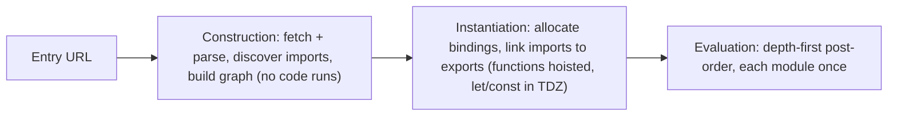
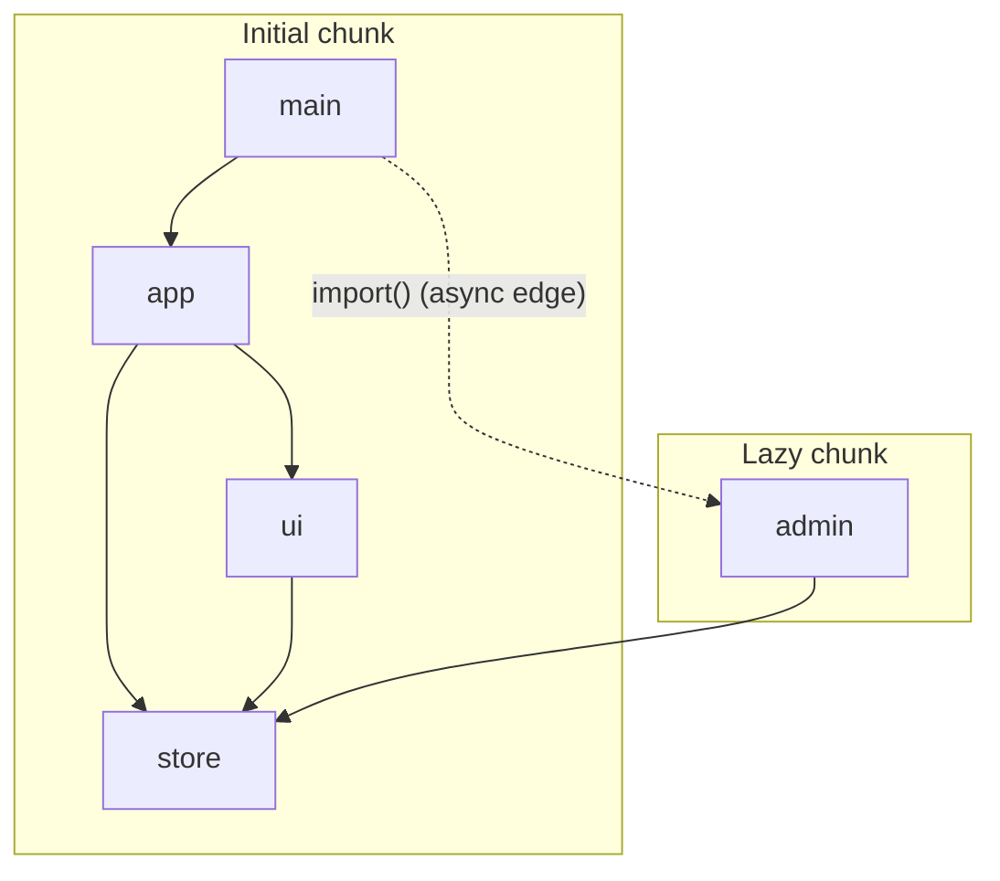
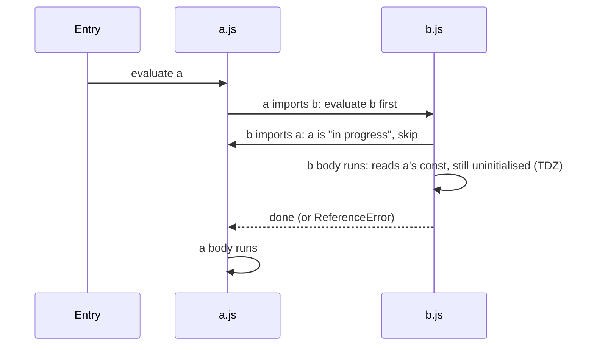

# 00 / 10 — ES Modules, Dependency Graphs, and Tree Shaking

## 1. Lesson metadata

| | |
|---|---|
| **Level** | Intermediate |
| **Study time** | 4 hours (reading 1.5 h, experiments 1 h, exercises 1.5 h) |
| **Prerequisites** | [05 — Execution contexts and the call stack](./05-execution-contexts-and-call-stack.md). Helpful: [06 — Lexical scope and closures](./06-lexical-scope-and-closures.md) |
| **Next** | [11 — Event loop, tasks, microtasks](./11-event-loop-tasks-microtasks.md) |
| **Related later** | [20 — Tooling, transpilation, bundling](./20-tooling-transpilation-and-bundling.md), [Phase 1 / 05 — JSX explained](../01-react-fundamentals/05-jsx-explained.md), [Phase 7 — Performance](../07-performance/) |

**Learning objectives.** After this lesson you can:
1. Explain what an ES module is, how it differs from a script and from CommonJS, and why `import`/`export` are *static*.
2. Describe the three phases of module loading (construction, instantiation, evaluation) and predict evaluation order, including cycles.
3. Explain live bindings and why `export let` differs from copying a value.
4. Explain code splitting with dynamic `import()` and connect it to `React.lazy` and `Suspense`.
5. Explain why tree shaking works, what defeats it (side effects, CommonJS, barrel files), and how to verify bundle contents.
6. Diagnose real React-module problems: duplicate React copies ("Invalid hook call"), circular imports, module-level singletons leaking across SSR requests, Fast Refresh full reloads.

**Concepts covered:** script vs module, module scope, static `import`/`export`, named vs default exports, live bindings, module record, module graph, loading phases, cycles and the temporal dead zone, module caching and singletons, top-level `await`, dynamic `import()`, `import.meta`, import maps, CommonJS vs ESM interop, tree shaking, `sideEffects`, `/*#__PURE__*/`, barrel files, code splitting, chunk, bundle, peer dependency, "use client" as a module-level boundary.

---

## 2. Deep conceptual explanation

### 2.1 What problem is this lesson solving?

Every React file you write starts with `import`. Behind that line is machinery that decides: *which code is downloaded, in what order it runs, how many copies of a library exist, and what ends up in the production bundle*. Real React problems live there:

- "Invalid hook call" errors that disappear when you remove a symlinked package: two copies of `react` in the module graph.
- A 1.2 MB initial bundle because one icon was imported from a barrel file.
- A circular import that makes a context default value `undefined` only on some entry points.
- A module-level `Map` cache that leaks one user's data to another during server rendering.
- A route that should be lazy-loaded but is statically imported by a shared utility, so splitting does nothing.

You cannot reason about these without a precise model of modules, and the model is smaller than most developers think.

### 2.2 Before modules: scripts share one global scope

Classic `<script>` tags execute in the **global scope**: top-level `var` and function declarations become properties of `window`. Ordering is the order of tags in the HTML; dependencies are implicit (`jQuery` must be above the plugin). Naming collisions and ordering bugs followed. Tools then invented module formats: **CommonJS** (`require`/`module.exports`, designed for Node's synchronous file system), **AMD** (async, browser), and **UMD** wrappers. The language standard eventually added **ES modules (ESM)** in ES2015, and browsers and Node now support them natively.

### 2.3 What an ES module is

A module is a source file evaluated in **module mode**:

- **Own scope.** Top-level declarations are private to the module unless exported. Nothing leaks to `window`.
- **Strict mode** always.
- **Static structure.** `import` and `export` declarations may only appear at the top level and their specifiers are string *literals*. The set of dependencies and exports is knowable by *parsing*, without running code.
- **Evaluated once** per module graph (per realm), then cached by its resolved URL/identity. Every importer receives the *same* module instance (singleton behaviour).
- **Deferred by default** in browsers (`<script type="module">` behaves like `defer`).
- **Top-level `await`** is allowed (ES2022).
- `this` at top level is `undefined`; `import.meta` provides metadata (`import.meta.url`; bundler-specific extras like `import.meta.env` in Vite are *tool* features, not language features).

```html
<script type="module" src="/src/main.js"></script>
```

### 2.4 Static import/export syntax and what it enables

```ts
// math.ts
export const PI = 3.14159;                 // named export
export function area(r: number) { return PI * r * r; }
export default class Circle { /* … */ }    // default export (one per module)

// app.ts
import Circle, { area, PI as pi } from "./math";   // default + named + rename
import * as math from "./math";                    // namespace object
export { area } from "./math";                     // re-export
export * from "./math";                            // re-export all named (not default)
import type { Foo } from "./types";                // TS: erased at compile time
```

Because imports are static, tools can answer, *before running anything*:
1. The complete **dependency graph** (what imports what).
2. Which exports are **never used** (tree shaking).
3. Whether an import name exists (compile-time errors in TS and bundlers).
4. Which imports can be **hoisted** and fetched in parallel.

The price: you cannot write `import(x)`-style computed specifiers with plain `import` declarations. For dynamic loading there is the separate expression form `import("./x")` (§2.8).

### 2.5 Live bindings: imports are views, not copies

An imported name is a **read-only live binding** to the exporting module's variable. If the exporter changes the variable, importers see the new value; importers cannot assign to it.

```js
// counter.js
export let count = 0;
export function increment() { count++; }

// main.js
import { count, increment } from "./counter.js";
console.log(count);   // 0
increment();
console.log(count);   // 1  (live!)
count = 5;            // TypeError: Assignment to constant variable (imports are read-only)
```

Contrast with CommonJS, where `const { count } = require("./counter")` copies the value at that moment. Live bindings are also why **circular imports can work** (§3.3), and why `export let` mutable state is possible, though usually a design smell (§8).

### 2.6 Named vs default exports

| Aspect | Named | Default |
|---|---|---|
| Name at import site | Must match (or be explicitly renamed) | Importer chooses any name |
| Refactor safety | Rename tools and "find usages" track it; typos fail | Different names for the same thing across the codebase |
| Tree shaking | Granular | Fine when the module has a single default export; can be less granular for default-exported *objects* |
| Re-exports | `export { x } from` | Need `export { default as X } from` |
| Required by | most libraries | `React.lazy` (the promise must resolve to `{ default: Component }`) |

Many teams standardise on **named exports** for components (better IDE rename and grep) and use a thin default export only where a tool demands one (a lazy-loaded route module, a framework file convention like a page/route file). This is a team convention, not a language rule.

### 2.7 CommonJS vs ESM

| | CommonJS | ES modules |
|---|---|---|
| Syntax | `require()`, `module.exports` | `import`, `export` |
| Loading | Synchronous, executes code at the `require` call | Parse → link → evaluate; asynchronous-capable |
| Shape | Dynamic: you can compute specifiers and conditionally require | Static (except `import()`) |
| Bindings | Value copy of `module.exports` property at require time | Live read-only bindings |
| Tree shaking | Generally not reliable (the export shape is a runtime value) | Designed for it |
| `this` / strict | Sloppy by default | Strict, `this` undefined |

Interop is a frequent source of friction: Node decides module type from file extension (`.mjs`/`.cjs`) or the nearest `package.json` `"type"` field, and a package may expose different entry points via `"exports"` conditions (`import`, `require`, `browser`, `development`, `production`). A package that ships both a CJS and an ESM build can *itself* produce two copies of its state in one app (the "dual package hazard"). ⚠ Interop behaviour (default import of CJS, `require` of ESM) has changed across Node versions; verify against the current Node docs for your version.

### 2.8 Dynamic `import()`

`import("./Chart")` is an expression returning a **Promise** of the module namespace. The module (and its own static dependencies) is fetched and evaluated on demand; if already loaded, the same cached instance is returned.

```ts
button.onclick = async () => {
  const { renderChart } = await import("./chart");   // only fetched on first click
  renderChart(data);
};
```

Bundlers treat each `import()` as a **split point**: the target and everything only it needs become a separate **chunk** loaded over the network at call time. This is **code splitting** and it is the primary tool for reducing initial JS (Phase 7).

### 2.9 How React uses this

- **`React.lazy`**: wraps a function returning a promise from `import()`; the component suspends while the chunk loads. Requires the module to provide a default export (or you adapt with `.then`).
- **Suspense**: the loading boundary shown while a lazy component (or data) is pending ([Phase 2 / 24](../02-react-rendering-and-internals/24-suspense-conceptual-internals.md)).
- **JSX transform**: modern tooling compiles JSX to calls imported from `react/jsx-runtime` ([Phase 1 / 05](../01-react-fundamentals/05-jsx-explained.md)), so every JSX file has a hidden import.
- **"use client" / "use server" directives** (React Server Components): file-level directives create *module-level* boundaries; a module marked `"use client"` and everything it imports is part of the client bundle, whereas server modules never ship. The bundler must understand the graph. ⚠ RSC bundler integration is framework-specific and evolving; verify against the framework's current docs ([Phase 2 / 27](../02-react-rendering-and-internals/27-react-server-components-intro.md)).
- **Fast Refresh** (dev HMR): the tooling re-executes a changed module and updates components while preserving state *if* the module only exports React components; files that mix component and non-component exports commonly trigger a full module-graph invalidation/reload. ⚠ Tooling behaviour; verify with your tool's docs.
- **Peer dependencies**: libraries that use hooks declare `react` as a `peerDependency` so there is exactly one React copy. Violating this is the classic "Invalid hook call".

### 2.10 Common misconceptions

| Misconception | Reality |
|---|---|
| "`import` runs the file every time." | Evaluated once per graph; subsequent imports share the instance. |
| "Imports are hoisted copies of values." | Hoisted *declarations* with live bindings. |
| "Importing a file only brings in the parts I use." | The whole module is evaluated (side effects run) unless a bundler proves it can drop it. Unused *exports* can be dropped only if evaluation has no side effects. |
| "Tree shaking is automatic." | It requires static ESM, side-effect-free modules/flagging, minification, and production mode. |
| "Dynamic import makes my app lazy." | Only if *nothing else* statically imports that module; one static import elsewhere pulls it into the main chunk. |
| "Barrel files (index.ts re-exports) are free." | They can pull large module sets into dev servers, tests, and sometimes production if side effects aren't excluded. |
| "Bundlers are required for ESM." | Browsers load ESM natively. Bundling still helps with request counts, minification, and tree shaking, and Vite's dev server serves modules unbundled while production builds are bundled. |

---

## 3. Internal mechanics

### 3.1 Module loading phases (teaching model that matches the spec)

The ECMAScript spec defines loading in terms of **Module Records** and three conceptual stages:

1. **Construction** (parse + fetch): starting at the entry module, fetch the source, parse it to find `import` specifiers, resolve and fetch those, recursively, building the **module graph**. Nothing executes. Syntax errors and missing files fail here. (Because parsing requires only syntax, fetches of siblings can proceed in parallel; deep chains still cost round trips, the motivation for bundling or `modulepreload`.)
2. **Instantiation** (linking): memory slots for exported bindings are created for every module, and importer bindings are wired to the exporter's slots. Function declarations are initialised here (hoisting); `let`/`const`/`class` bindings exist but are **uninitialised** (the temporal dead zone).
3. **Evaluation**: modules run in **depth-first post-order** on the graph: a module's dependencies execute first, then the module body. Each module runs at most once. With top-level `await`, evaluation of a module may suspend, and importers wait.

*Public guarantee:* evaluation order is deterministic by the spec (post-order of the import tree in source order), each module once. *Implementation detail:* caching, parallel fetch strategies, and how bundlers emulate this (they usually emit a function per module and a small runtime; scope-hoisting/"module concatenation" merges simple graphs into one scope and may change observable timing of rarely-observed things like function identity or error stacks).

### 3.2 Module identity and caching

A module's identity is its **resolved specifier (URL)** in a given module map. Consequences:
- `./a.js` and `./a.js?v=2` are *different* modules (two instances, two evaluations).
- Two different physical copies of a package (`node_modules/react` and `packages/ui/node_modules/react`) are different modules even if the code is identical. Hooks rely on module-level shared state inside React (the dispatcher). If the renderer and your component import different copies, hooks read the wrong dispatcher and you see "Invalid hook call". This is the **duplicate React** problem.
- Module-level variables are process-wide (per realm) singletons. In browsers that means per tab; **on a Node server that means shared across all requests**. A module-level `const cache = new Map()` or `let currentUser` used during SSR can leak data between users ([Phase 2 / 26](../02-react-rendering-and-internals/26-ssr-and-client-rendering.md)).

### 3.3 Circular dependencies

A cycle (`a` imports `b`, `b` imports `a`) is allowed. The evaluation algorithm, when it meets a module already "in progress", does not recurse again; it treats it as satisfied and moves on. Consequence: the *first-reached* module's dependency evaluates **before** the first module's body, so it may read bindings that are not initialised yet:

- **Function declarations** are initialised during instantiation → usable.
- **`const`, `let`, `class`** (including `export const Foo = () => …` and `export class`) are in the TDZ → `ReferenceError: Cannot access 'x' before initialization`. Bundlers that transform modules may instead surface the symptom as `undefined` rather than a `ReferenceError`, which is why cycles produce confusing, *entry-point-dependent* bugs.

Cycles are more common in React apps than people expect: `context.ts` ↔ `Provider.tsx` ↔ `useThing.ts`, or barrel files that re-export a module which imports the barrel.

### 3.4 Tree shaking: how it works

Tree shaking is **dead code elimination at module-export granularity**, performed by a bundler and minifier in production mode:

1. Parse all modules; build the graph and, for each module, the set of exports and which are referenced by importers.
2. Mark **used exports** transitively from entry points.
3. For a module with unused exports, remove the declarations *if removing them cannot change program behaviour*, i.e. no side effects. Bundlers analyse statements: a top-level `const f = () => {}` is pure; `registerPlugin(f)` or `Foo.displayName = "Foo"` or `new Thing()` may not be provable pure.
4. A minifier then removes unreferenced code inside the merged scope.

Because the bundler cannot know whether third-party code has side effects, two *signals* exist:
- `"sideEffects": false` (or a list of files with side effects) in a package's `package.json` tells bundlers (webpack, Rollup via plugins, esbuild, Vite) that *importing a module only for its exports, then not using them, may be dropped entirely*. A lie here breaks behaviour (e.g. CSS imports or polyfills silently disappear), so applications flag CSS: `"sideEffects": ["*.css"]`.
- `/*#__PURE__*/` annotations on calls (`/*#__PURE__*/ createContext(null)`) tell minifiers that the call is removable when its result is unused. Compilers like Babel and tools that emit React components often add these.

What defeats tree shaking:

| Cause | Why |
|---|---|
| CommonJS modules | Export shape is dynamic; the bundler can't prove which properties are used |
| Transpiling ESM to CJS before bundling (e.g. a misconfigured Babel `modules: "commonjs"`) | Destroys static structure |
| Barrel files with side effects or `export *` of CJS | Forces evaluating all re-exported modules |
| Top-level side effects (registering, mutating globals, `Object.assign(Foo, …)`) | Not removable |
| Default-exported *objects* (`export default { a, b, c }`) | Properties of an object literal can't be individually removed by most bundlers |
| Classes with static initialisers or decorators | Often treated as impure |
| Dynamic access `lib[name]` | Cannot determine used export |

Exact heuristics differ among webpack, Rollup, esbuild, and Rust-based bundlers. Note: Vite 8 (current as of 2026-10; vite.dev/blog/announcing-vite8) ships Rolldown as its single bundler for both dev pre-bundling and production, where Vite 7 and earlier used esbuild + Rollup. Do not memorise rules; **verify with a bundle analyser**.

### 3.5 Code splitting and chunk graphs

Each dynamic `import()` creates an *async edge* in the graph. The bundler computes the set of modules reachable **only** through that edge and puts them in a chunk; modules shared by several chunks may be extracted into shared chunks (strategy is configurable: vendor chunks, manual chunks). A static import of module M anywhere on the *synchronous* path from the entry puts M in the initial chunk. Hence the classic mistake: lazy-loading `HeavyChart`, while `utils/index.ts` (statically imported by the app shell) re-exports `HeavyChart`'s helpers and drags the library in.

Loading: the runtime fetches the chunk file (JS, plus CSS for that chunk), evaluates it, resolves the promise. Prefetch/preload hints (`<link rel="modulepreload">`, `rel="prefetch"`) are a separate optimisation.

### 3.6 Top-level await

A module with top-level `await` makes its *importers'* evaluation wait. It's valid and sometimes useful (loading config, WASM), but it delays everything downstream and, with cycles, can deadlock evaluation; avoid in shared library modules and in the application critical path. Support in older bundler targets can be limited; ⚠ check your build target.

---

## 4. Step-by-step execution walkthrough

Graph:

```text
main.ts ── imports ──► app.ts ── imports ──► store.ts
   │                      └─────────────────► ui.ts ──► store.ts
   └─ dynamic: import("./admin.ts") ──► store.ts
```

Source:

```ts
// store.ts
console.log("store: evaluating");
export const store = { user: null as string | null };

// ui.ts
import { store } from "./store";
console.log("ui: evaluating");
export const render = () => `user=${store.user}`;

// app.ts
import { store } from "./store";
import { render } from "./ui";
console.log("app: evaluating");
store.user = "ada";
export const run = () => render();

// admin.ts
import { store } from "./store";
console.log("admin: evaluating");
export const adminView = () => `admin:${store.user}`;

// main.ts
import { run } from "./app";
console.log("main: evaluating");
console.log(run());
document.querySelector("button")!.onclick = async () => {
  const { adminView } = await import("./admin");
  console.log(adminView());
};
```

**Predict** the console output on page load, then after two clicks.

**Walkthrough (native ESM semantics):**
1. **Construction.** Fetch `main.ts` (compiled to JS); parse; see `import "./app"`; fetch `app`; it imports `store` and `ui`; fetch both; `ui` imports `store` (already known). `admin` is **not** fetched: dynamic imports are not part of the static graph.
2. **Instantiation.** Bindings for `store`, `render`, `run` created and linked.
3. **Evaluation, depth-first post-order:** `main`'s first dep is `app`; `app`'s first dep is `store`: **store runs first** (logs `store: evaluating`), then `ui` (its dependency `store` is done): logs `ui: evaluating`; then `app` body: logs `app: evaluating`, sets `store.user = "ada"`; then `main` body: logs `main: evaluating`, then `run()` → `render()` → `user=ada`.
4. **First click:** `import("./admin")` fetches `admin.js`; its dependency `store` is *already in the module map*, so **it is not re-evaluated**; `admin` runs: logs `admin: evaluating`; the promise resolves; `adminView()` → `admin:ada` (the shared `store` object retains the mutation).
5. **Second click:** the module is cached, no log of `admin: evaluating`; logs `admin:ada` again.

**Output:**
```
store: evaluating
ui: evaluating
app: evaluating
main: evaluating
user=ada
(click 1) admin: evaluating
(click 1) admin:ada
(click 2) admin:ada
```

*Caveat:* a bundler may emit different structure, but the observable order is preserved by design for conforming code.

---

## 5. Code examples

### 5.1 Minimal: live bindings vs copies

```ts
// flag.ts
export let ready = false;
export function markReady() { ready = true; }

// main.ts
import { ready, markReady } from "./flag";
console.log(ready);   // false
markReady();
console.log(ready);   // true
```

**Predict** the second line if `flag.ts` used `module.exports = { ready, markReady }` and `main` did `const { ready } = require("./flag")`. **Answer:** `false` both times, because `ready` is a copied value.

Why it matters in React: re-exporting mutable module state as a "store" works for non-React consumers, but React won't re-render when a live binding changes. Rendering depends on React *knowing* about the change ([Phase 3 / 20](../03-react-state-and-hooks/20-usesyncexternalstore-and-external-stores.md)).

### 5.2 Practical: lazy route with Suspense and an error boundary

```tsx
// routes.tsx
import { lazy, Suspense } from "react";

// Chart.tsx has: export function Chart(props) {...}  (named export, no default)
const Chart = lazy(() => import("./Chart").then((m) => ({ default: m.Chart })));

export function AnalyticsPage() {
  return (
    <Suspense fallback={<p role="status">Loading chart…</p>}>
      <Chart />
    </Suspense>
  );
}
```

Line notes:
- `lazy` receives a *function* so the import does not start until first render of `<Chart>`.
- The `.then` adapts a named export to the `{ default }` shape.
- `lazy` should be called at **module top level**, not inside a component: defining it inside gives a new component type each render, so React would unmount/remount and refetch ([Phase 1 / 16 — State preservation and reset](../01-react-fundamentals/16-state-preservation-and-reset.md)).
- A failed chunk load (offline, deploy invalidated the old chunk hash) rejects the promise; the error is thrown during render and needs an error boundary ([Phase 4 / 19](../04-react-architecture/19-error-boundaries.md)).

**Trade-off:** each lazy boundary adds a network request and a loading state. Split at *route* and *rarely used heavy feature* boundaries, not per button.

### 5.3 Practical: prefetch on intent

Keep the loader function in a variable so both `lazy` and an intent handler can call it:

```tsx
import { lazy } from "react";

const loadChart = () => import("./Chart").then((m) => ({ default: m.Chart }));
const Chart = lazy(loadChart);

export function ChartLink() {
  return (
    <a
      href="/analytics"
      onPointerEnter={() => void loadChart()}   // warms the module cache; React's later call reuses it
      onFocus={() => void loadChart()}
    >
      Analytics
    </a>
  );
}
```

`import()` of an already-requested module returns the same promise/instance, so prefetch and `lazy` share one fetch. Trade-off: speculative downloads on hover cost bandwidth on metered connections (honour `navigator.connection?.saveData` where supported, or prefetch only on user intent).

### 5.4 Incorrect: defeating the split

```ts
// features/index.ts  (barrel)
export * from "./Chart";        // Chart imports a 300 kB charting library
export * from "./Table";

// App.tsx
import { Table } from "./features";            // static import of the barrel
const Chart = lazy(() => import("./features/Chart"));
```

**Predict:** is the charting library in the initial chunk?

**Result:** It may be. `features/index.ts` statically imports `./Chart`. Whether the bundler can discard that depends on `sideEffects` flags and whether `Chart` is provably side-effect-free. If `Chart.tsx` (or the library) has top-level side effects, importing the barrel for `Table` evaluates `Chart` and keeps it in the main chunk, and the lazy import then points at an already-loaded module. Even when shaking works in production builds, **dev servers and test runners** (which do not tree-shake) load the whole barrel, slowing startup.

### 5.5 Corrected

```ts
// App.tsx: import from the file, not the barrel
import { Table } from "./features/Table";
const Chart = lazy(() => import("./features/Chart").then((m) => ({ default: m.Chart })));
```

Alternatives: keep the barrel but ensure the package/app declares `"sideEffects": false` accurately; or split barrels per feature; or use lint rules to restrict deep/barrel imports (e.g. `no-restricted-imports`). Verify the result with a bundle analyser.

### 5.6 Practical: a safe module-level singleton vs a per-request instance

```ts
// BAD for SSR: module-level mutable state is shared by all requests
let currentUser: User | null = null;
export const setCurrentUser = (u: User) => { currentUser = u; };

// GOOD: create per-request / per-tree state and pass via context
import { createContext, useContext } from "react";
export function createStore(initial: User | null) { return { user: initial }; }
export const StoreContext = createContext<ReturnType<typeof createStore> | null>(null);
export function useStore() {
  const s = useContext(StoreContext);
  if (!s) throw new Error("useStore must be used within <StoreContext.Provider>");
  return s;
}
```

Module singletons are fine for *immutable constants and truly global, stateless utilities*. They are dangerous for anything per-user on a server, and awkward in tests (state leaks between test cases; reset with `vi.resetModules()` in Vitest *(verify API)*).

### 5.7 Advanced: breaking a cycle with dependency direction

```text
Before:                        After:
context.ts ◄──► Provider.tsx   types.ts  ◄── context.ts ◄── Provider.tsx
                                                  ▲
                               useThing.ts ───────┘
```

```ts
// context.ts: only creates the context; imports nothing from Provider
import { createContext } from "react";
import type { ThingApi } from "./types";
export const ThingContext = createContext<ThingApi | null>(null);

// Provider.tsx: imports context, never the reverse
import { ThingContext } from "./context";
// useThing.ts: imports context only
```

Rule: **dependencies must form a DAG**: lower layers (types, constants, context objects) never import higher layers (providers, features). `import type` is erased at compile time and does not create a runtime edge (with `verbatimModuleSyntax`/`importsNotUsedAsValues` conventions; check your TS config), which is one tool for breaking *type-level* cycles. [Phase 4 / 05](../04-react-architecture/05-composition-and-dependency-direction.md) generalises this into architecture, and [Phase 4 / 25](../04-react-architecture/25-architectural-fitness-and-enforcement.md) covers enforcing it with tools such as dependency-cruiser or ESLint boundaries *(verify current tooling)*.

### 5.8 Advanced: measuring what you ship

```bash
# Vite: build and inspect (one of several options)
npx vite build
# Visualise with a plugin such as rollup-plugin-visualizer (verify it's compatible with your Vite version)
# webpack: webpack-bundle-analyzer; Next.js: @next/bundle-analyzer
```

Look for: duplicate packages (two versions of the same library), your own large modules in the entry chunk, whole-library inclusions (`moment` locales, all of `lodash`, all icons). Record the number before and after each change. Tree shaking is a *claim to verify*, never to assume.

---

## 6. Visual explanations

### Module loading phases



### Static vs dynamic edges in a graph



### Why a cycle yields TDZ errors



---

## 7. Alternative approaches and trade-offs

**How to organise loading of a heavy feature (say a 400 kB editor):**

| Approach | Readability | Performance | Complexity | Testability | Notes |
|---|---|---|---|---|---|
| Static import (single bundle) | Highest | Slow first load; fastest later navigation | None | High | Fine for small apps or if the feature is on every page |
| `React.lazy` at route level | High | Good: smaller entry | Low | High (needs Suspense in tests) | Default recommendation for pages |
| `React.lazy` at feature level + prefetch on intent | Medium | Very good perceived speed | Medium | Medium | For heavy, rarely used widgets |
| Manual `import()` in event handlers | Medium | Good | Medium (manual loading state) | Medium | When you need the module's *functions*, not a component |
| Separate micro-frontend / remote module (module federation) | Low | Depends | High | Low | Multi-team deploy independence; shared-dependency and version risk (singleton React) |
| Server Components keep the code off the client entirely | High | Excellent for non-interactive parts | Framework-specific | Medium | ⚠ Requires an RSC-capable framework; verify current docs |

**When static import is better than the recommended code splitting:** an above-the-fold component that is needed immediately on every page. Lazy-loading it adds a waterfall (HTML → entry JS → chunk fetch) and a flash of fallback, making Largest Contentful Paint *worse*. Split what is not needed for the first meaningful interaction.

**Module format for a library you publish:** ship ESM (with `"exports"`, `"sideEffects"`, types) and optionally CJS for older consumers. Not shipping ESM prevents tree shaking for your consumers.

---

## 8. Best practices and anti-patterns

**Do**
- Prefer named exports for components and utilities; reserve default exports for tool-mandated cases.
- Keep module top levels *pure* (declarations only) so bundlers can prune and tests can import safely.
- Make the import graph a DAG; types/constants at the bottom.
- Split code at route boundaries first; measure before splitting further.
- Mark your app's CSS and polyfill imports as side effects; mark libraries you publish `sideEffects: false` only when true.
- Declare `react` and `react-dom` as `peerDependencies` in libraries; dedupe in apps (`npm ls react`, package-manager overrides/resolutions, bundler `resolve.dedupe` *(Vite option; verify)*).
- Use `import type` for type-only imports.

**Beginner mistakes**
- Assuming imports are copied values or that import order is arbitrary.
- Importing an entire library for one function (`import _ from "lodash"` vs `import debounce from "lodash/debounce"` or `lodash-es`; verify each library's guidance).
- Defining `lazy()` inside a component.
- Importing from deep internal paths of a package (`pkg/dist/internal/x`) which can duplicate modules and break `exports` maps.

**Experienced-developer mistakes**
- Barrel files everywhere ("`index.ts` in every folder") creating hidden cycles and slow dev/test startup.
- Module-level mutable singletons in code that also runs on the server.
- Trusting tree shaking without analysis; wrong `sideEffects: false` that silently deletes CSS or polyfills in production only.
- Using top-level `await` in shared modules.
- Re-exporting `export *` from CJS dependencies.
- Splitting too finely: dozens of tiny chunks and request waterfalls.

**Smells:** `import ../../../..` chains; files that import from their own barrel; a utility module imported by 200 files that imports a feature; different results between dev and production caused by module-order assumptions.

**Justified exceptions:** a deliberately small public-API barrel for a package boundary (it *is* the API); a polyfill module imported for side effects; default exports for framework file conventions.

---

## 9. Real-world application

*E-commerce storefront.* The product listing must render fast on mid-range phones. The checkout, admin tools, and a 250 kB charting library for the seller dashboard are rarely visited by buyers. Constraints: LCP < 2.5 s at p75, a JS budget for the initial route, deployments multiple times per day. Approach: route-level lazy loading (checkout, account), seller dashboard in a separate route chunk, bundle-size budgets in CI that fail the build when the entry chunk exceeds a threshold. Deployment risk: a user with the old HTML open requests an old chunk hash that no longer exists → "Loading chunk failed". Mitigation: keep previous build assets available for a period, catch chunk load errors in an error boundary and prompt/auto-reload once.

*Multi-team dashboard platform.* Three teams ship widgets as packages into one shell. Constraint: **one** React instance. Packages declare `react` as a peer; the shell's build uses `resolve.dedupe`/overrides; CI runs a check that fails if `npm ls react` shows more than one version. For micro-frontend/module-federation setups, React is configured as a shared singleton; mismatched versions produce runtime errors that are hard to attribute, so contracts include version ranges and an integration test that mounts all widgets.

*Financial app and SSR.* A pricing module caches exchange rates in a module-level `Map`. Under SSR, one request's authenticated custom rates are served to another user. Fix: scope caches to the request (context/closure), cache only public, user-independent data at module level with a TTL, and add a test that renders two requests concurrently ([Phase 2 / 26](../02-react-rendering-and-internals/26-ssr-and-client-rendering.md)).

---

## 10. Debugging and troubleshooting

**Symptom 1: "Invalid hook call" / `Cannot read properties of null (reading 'useState')`** in a component library consumed by an app.
*Investigation:* (1) Confirm it is not a Rules-of-Hooks violation ([Phase 3 / 16](../03-react-state-and-hooks/16-rules-of-hooks-and-composition.md)). (2) `npm ls react react-dom` or `pnpm why react`: more than one copy/version? (3) In the browser console: `window.React1 = require("react")` is not available in bundles; instead temporarily add `console.log(React.version)` in both the app and the library, or compare module identity in the debugger. (4) Check symlinked packages (`npm link`/workspace linking) resolving `react` from the library's own `node_modules`. *Root cause:* two React module instances. *Fix:* peerDependencies, dedupe/alias to one path, single package manager lockfile. *Validate:* single `react` in the analyser; error gone.

**Symptom 2: initial bundle is huge although routes are lazy.**
*Investigation:* build with a visualiser; find the large dependency; use the analyser's "imported by" chain (or `--stats`/`why` options in your bundler) to find the static importer. Typically: a shared util/barrel imports it. *Fix:* point imports directly at modules, split the barrel, or move the heavy usage behind `import()`. *Validate:* entry chunk size down; the library appears only in the lazy chunk.

**Symptom 3: `ReferenceError: Cannot access 'X' before initialization`, or a value `undefined` that is defined in the source,** only on some entry points / only after a refactor.
*Investigation:* find the cycle: tools like `madge --circular` or dependency-cruiser *(verify)*, or ESLint `import/no-cycle`. Add a `console.log` at top of each module in the cycle to see evaluation order. *Fix:* §5.7.

**Symptom 4: feature works in dev, CSS/polyfill missing in production.**
*Investigation:* check for `"sideEffects": false` in your app's `package.json` (or a library's) which allowed the bundler to drop a `import "./styles.css"`. *Fix:* `"sideEffects": ["*.css"]`.

**Symptom 5: "Loading chunk X failed" after deploy.**
*Investigation:* Network panel: 404 for an old hashed chunk. *Fix:* retain old assets, version skew handling, error boundary + reload, immutable caching strategy ([Lesson 15](./15-http-caching-and-navigation.md)).

**Symptom 6: edits to a component file cause a full page reload instead of Fast Refresh.**
*Investigation:* the file also exports non-components (constants, hooks, helpers) or anonymous default exports; the dev tool logs "Fast refresh had to perform a full reload" in some setups. *Fix:* separate non-component exports into their own module.

DevTools: **Network** (Initiator column shows which module requested a chunk), **Sources** (module list), **Coverage** panel (unused JS bytes on load; unused ≠ removable, but guides splitting).

---

## 11. Exercises

### Level A — Knowledge
A1. List four properties that distinguish an ES module from a classic script.
A2. What does "static structure" of `import` mean, and name two things it enables.
A3. What is a live binding? What happens if an importer assigns to an imported name?
A4. Name the three phases of module loading and say what happens in each.
A5. Why does a static import of M anywhere in the entry's synchronous path defeat `import("M")` splitting?
A6. What does `"sideEffects": false` promise?

### Level B — Code comprehension
B1. What prints, in order?
```js
// a.js
import { b } from "./b.js";
export const a = "A";
console.log("a sees b =", b);
// b.js
import { a } from "./a.js";
export const b = "B";
console.log("b sees a =", a);
// main.js
import "./a.js";
```
B2. Change `export const a = "A"` to `export function a() {}` in the above. What changes?
B3. What is logged?
```js
// c.js
export let n = 0;
export const inc = () => { n++; };
// main.js
import { n, inc } from "./c.js";
import * as ns from "./c.js";
inc(); inc();
console.log(n, ns.n);
```
B4. In the Section 4 graph, how many times is `store.ts` evaluated if the user clicks the button 3 times?
B5. Is this valid? Why or why not?
```js
const name = "./x.js";
import { y } from name;
if (cond) { import { z } from "./z.js"; }
```

### Level C — Implementation
C1. Write a `lazyWithPreload` helper: `const Chart = lazyWithPreload(() => import("./Chart"))` returning a component that also has `.preload()`. Type it in TypeScript.
C2. Write a Vite/Rollup-style `manualChunks`-like strategy description (pseudo-config) that puts `react`, `react-dom` into a `vendor-react` chunk and the charting library into its own chunk. State a risk of manual chunking.
C3. Write an ESLint-style rule description (or a small script using the TypeScript compiler API outline) that fails CI if any file under `src/features/a` imports from `src/features/b` internals.

### Level D — Debugging
D1. After adding an `index.ts` barrel to `components/`, Storybook starts 3× slower and a lazy route no longer produces its own chunk. Explain both and propose a fix.
D2. You published `@acme/ui`. A consumer reports "Invalid hook call" only when `@acme/ui` is installed via `npm link`. Explain the cause, how to confirm, and how to fix it on both sides.
D3. A library sets `"sideEffects": false` but its `index.js` does `import "./theme.css"`. In production the styles vanish. Why? Fix it two ways.

### Level E — Architecture and engineering decisions
E1. Your app has 40 routes. A teammate proposes `lazy()` on *every* component for "maximum performance". Evaluate; propose a splitting policy with measurable criteria.
E2. A multi-team organisation wants independently deployable widgets loaded at runtime into a shell. Compare (a) npm packages with versioned releases, (b) module federation/runtime remotes, (c) iframes. Recommend for a regulated finance product and name the risks that decide it.

### Level F — Expert challenge
F1. Design CI checks for module health: bundle budgets, duplicate-dependency detection, cycle detection, side-effect audits, chunk-load failure telemetry. Specify thresholds, failure behaviour, and how you avoid noisy false positives.
F2. Explain exactly why `export default { a, b }` and `export const a`, `export const b` may shake differently. Then describe an experiment (with a bundler and analyser) that would verify your claim for your actual toolchain.

---

## 12. Detailed answers and explanations

> Attempt the exercises first.

**A1.** Own scope (no globals), always strict mode, static `import`/`export`, evaluated once and cached, deferred by default in browsers, top-level `await`, `this` is `undefined`. Any four. Wrong: "modules are async-only" (the *loading* is async-capable; evaluation is ordered).

**A2.** Import/export declarations are top-level and use literal specifiers, so the graph and export names are known by parsing alone. Enables: tree shaking, parallel prefetch, compile-time error checks, cycle analysis, IDE refactors, ahead-of-time linking.

**A3.** A read-only reference to the exporter's variable; changes made by the exporter are visible to importers. Assigning to an import throws a `TypeError` (assignment to an immutable binding). The exporter can change it; importers cannot.

**A4.** Construction (fetch/parse/graph), instantiation (allocate and link bindings; functions initialised, `let/const/class` in TDZ), evaluation (run bodies, post-order, once each).

**A5.** The module is part of the initial chunk, already loaded and evaluated. `import("M")` then just resolves the existing instance; there is no separate chunk to defer. Wrong answer: "dynamic import cancels static imports". It doesn't.

**A6.** That importing a module from this package *solely for its exports*, and then not using those exports, can be skipped entirely: evaluating it does nothing observable. It's a package-wide claim, and it is wrong when any module performs registration, CSS import, polyfilling, or global mutation (unless those files are listed).

**B1.** Evaluation starts at `main` → `a` → (dep) `b` → (dep) `a` is in progress, skipped. `b`'s body runs first and reads `a` while `a` is in the TDZ → `ReferenceError: Cannot access 'a' before initialization` (message wording varies by engine). Nothing else prints. Wrong answer: "b sees a = A". `a`'s `const` is not initialised until `a`'s body runs, which is *after* `b`.

**B2.** Function declarations are initialised at instantiation, so `b` logs `b sees a = [Function: a]` (formatting varies), then `a` logs `a sees b = B`. Order: `b` first, then `a`. Lesson: cycles "work" only with hoisted declarations, which is fragile.

**B3.** `2 2`. Both are views on the live `n`. In a CommonJS-transpiled scenario via a tool with incorrect interop you might see `0`. Edge: `ns` is a module namespace object whose properties are live and read-only.

**B4.** Once. The first click's `import("./admin")` evaluates `admin.ts` once; `store.ts` was already evaluated at startup; later clicks reuse the cached module record.

**B5.** Invalid on both counts: specifiers must be string literals (`from name` is a syntax error), and `import` declarations may appear only at the top level of a module. Dynamic equivalents: `const { y } = await import(name)` and `if (cond) { const { z } = await import("./z.js"); }`. Trade-off: dynamic forms lose static analysis, so bundlers may need hints (for variable paths, Vite's `import.meta.glob` or webpack magic comments; verify syntax in each tool).

**C1.**
```tsx
import { lazy, type ComponentType, type LazyExoticComponent } from "react";

type Loader<T extends ComponentType<any>> = () => Promise<{ default: T }>;
type Preloadable<T extends ComponentType<any>> = LazyExoticComponent<T> & {
  preload: () => Promise<{ default: T }>;
};

export function lazyWithPreload<T extends ComponentType<any>>(load: Loader<T>): Preloadable<T> {
  let promise: Promise<{ default: T }> | undefined;
  const loadOnce = () => (promise ??= load());       // memoise so preload and render share one request
  const Component = lazy(loadOnce) as Preloadable<T>;
  Component.preload = loadOnce;
  return Component;
}
```
Notes: memoising matters even though the module cache dedupes, because it keeps the same *promise*; if the promise rejects (chunk failed), a cached rejected promise would never retry. Improve: on rejection, reset `promise = undefined` so a later render/preload can retry:
`const loadOnce = () => (promise ??= load().catch((e) => { promise = undefined; throw e; }));`. `React.lazy` itself caches its first result *including a rejection* (verified with React 19.3.1: the factory ran once across two separate mounts), so a retry needs a new lazy component created with a fresh factory call.

**C2.** Pseudo-config (Rollup/Vite shape; verify option names for your version):
```ts
build: { rollupOptions: { output: { manualChunks(id) {
  if (id.includes("node_modules/react/") || id.includes("node_modules/react-dom/")) return "vendor-react";
  if (id.includes("node_modules/some-chart-lib/")) return "vendor-charts";
}}}}
```
Risks: manual chunking can create circular chunk dependencies, force-load a library into pages that don't need it (if grouping too much), and break the default optimal splitting; cache benefit (stable vendor chunk) must be weighed against extra requests. Also `vendor-charts` only helps if the charting library is reached via a dynamic import; otherwise it's loaded eagerly.

**C3.** Using ESLint `no-restricted-imports` with `patterns` for `**/features/b/**` in overrides for `src/features/a/**`, allowing only `features/b/index.ts` (public API). Or `eslint-plugin-boundaries`/dependency-cruiser rules *(verify current names)*. A TS-compiler script: parse each file's import declarations, resolve to absolute paths, check `from` and `to` directory prefixes against an allow-list, exit non-zero with a message listing violations. Evaluation criteria: rule is declarative, covers dynamic `import()` too, has an escape hatch with comment justification, and runs in CI and editor.

**D1.** Dev servers (Vite's native ESM dev) and test runners don't tree-shake; importing anything from `components/index.ts` loads *every* module it re-exports, including heavy stories/libraries: startup slows. For the chunk: if a lazy route's module is re-exported by the barrel and the barrel is statically imported in the shell, the route is in the initial graph, so no separate chunk. Fix: import from specific files, remove the lazy route from the barrel, or split barrels by boundary; add a lint rule restricting barrel imports within the package.

**D2.** `npm link` symlinks `@acme/ui` to its source directory. Node/bundler resolution then finds `react` from **the library's own `node_modules`** (via real path), producing a second copy next to the app's. Confirm: `npm ls react` in both, or print `require.resolve("react")` from each; check the bundle analyser for two React copies. Fixes: *consumer*: `resolve.dedupe: ["react", "react-dom"]` (Vite) or alias to the app's copy; use `pnpm`/workspaces instead of link. *Library*: `peerDependencies` plus `devDependencies` for local development and avoid bundling React into the dist (mark external).

**D3.** With `sideEffects: false`, the bundler may drop `import "./theme.css"` since the import binds nothing and the module is declared effect-free. Fix 1: `"sideEffects": ["*.css"]` (or the list of files). Fix 2: import the CSS in the consumer's entry, or make CSS part of an exported object the code uses; or use CSS Modules with named usage. Validate by building and checking the CSS asset exists.

**E1.** Criteria: initial JS size, navigation latency (waterfalls), number of requests, cache hit ratios, complexity of loading states, chunk-failure surface. Splitting everything makes many tiny chunks, creating waterfalls and layout shifts from fallbacks, and increases failure modes. Policy: lazy at **route level** by default; lazy for heavy (≥ some measured size, say >30–50 kB gzipped; choose a threshold from your own data) and rarely-used features; never lazy for above-the-fold content; prefetch chunks for likely next routes on idle/intent; bundle budgets in CI; review the analyser quarterly. The recommended approach is *not* right where the component renders on every page.

**E2.** Compare on: independent deploy, runtime isolation, shared React singleton, performance, security review surface, versioning/rollback, auditability. (a) Packages: strong typing/testing, reproducible builds, but deploys are coupled to the shell build (slow release train). (b) Federation: independent deploys, but shared singletons/version skew, runtime failures, harder static analysis/security review. (c) iframes: strongest isolation and security boundary (sandbox attribute, CSP), independent stacks, but UX/accessibility/focus/theming/perf cost and cross-frame messaging. For a regulated finance product: prefer (a) with a disciplined release train, or (c) for third-party/untrusted widgets; use (b) only with a strict contract, signed assets, version pinning, and integration tests. Decisive risks: auditability and blast radius of a bad widget deploy.

**F1.** A strong answer includes: *Bundle budgets* per entry/route measured after gzip/brotli with a baseline from main; fail on >X% regression with an override label requiring justification. *Duplicate detection*: script over lockfile and bundle stats failing on multiple versions of an allow-list of singletons (react, react-dom, state libs). *Cycles*: `import/no-cycle` or madge on the module graph; fail on new cycles (ratchet: allow existing, block new). *Side-effect audit*: a test that builds and asserts expected CSS/polyfill assets exist; lint for top-level calls in library modules. *Telemetry*: report chunk-load failures with release id; alert on rate; *RUM* for LCP/INP by route. *False positives*: ratchet rather than absolute thresholds, compare against merge-base, ignore generated chunks, allow `// allow-cycle: reason` with expiry. Explain who owns the budgets.

**F2.** `export default { a, b }`: the object literal is one value; the minifier/bundler would have to prove that removing property `b` is safe, which requires escape analysis (the object may be passed anywhere, mutated, iterated). Most bundlers treat the object as used if default is imported. Named exports are separate bindings, each independently referenced or not. Experiment: create a module exporting both styles with a large dependency inside `b`; import only `a` in each variant; build in production mode; inspect the bundle for the `b` payload (grep for a sentinel string, or use the analyser). Repeat with the toolchain's minify setting both on and off. Report the toolchain version, because heuristics change.

---

## 13. Senior engineer interview questions

**Q1. "Why can't you tree-shake CommonJS?"**
*Strong answer:* A CJS module's exports are the runtime value of `module.exports`, assigned by arbitrary code and accessed with computed keys. A bundler cannot determine statically which properties will be read, nor whether evaluating the module has side effects. ESM exports/imports are declarative and static, so the used set is computable by graph analysis. Practical advice: depend on ESM builds, avoid transpiling to CJS before bundling, and verify with an analyser.

**Q2. "Our lazy route isn't producing a separate chunk. Why?"**
*Strong answer:* Something on the synchronous import path from the entry statically imports that module, often through a barrel or a shared utility. A dynamic `import()` only creates a split if the target isn't reachable synchronously elsewhere. I'd use the bundler's analysis/stats to find the importer chain, import from the leaf file, and add a lint rule restricting the barrel.

**Q3. "What is the module caching behaviour and why do SSR people care?"**
*Strong answer:* Modules evaluate once per realm and are shared by all importers. In a browser tab that's per user; on a Node server it's per *process*, so module-level mutable state is shared across concurrent requests, causing data leaks and cross-request contamination. Per-request state must be created inside the request handler and passed through context, and tests should reset modules between cases.

**Q4. "How do circular imports fail, and how do you fix them structurally?"**
*Strong answer:* Evaluation is post-order with in-progress modules skipped; a dependency may run before the module it imports and read bindings still in TDZ (or `undefined` after bundler transformation). The fix is to remove the cycle by extracting shared declarations (types, constants, context objects) into a lower layer, so dependencies form a DAG. Enforce with a lint rule/CI check and a ratchet.

**Q5. "A library works in the app but 'Invalid hook call' appears with a symlinked version. Walk me through it."**
*Strong answer:* Hooks depend on React's internal dispatcher in a module instance of `react`; two module instances means the renderer sets the dispatcher on one while the hook reads another. The symlink makes the library resolve its own `react`. Confirm by `npm ls`, bundle analysis, comparing `require.resolve`; fix by peerDependencies/dedupe/alias and workspace tooling. I'd also rule out true Rules-of-Hooks violations first.

---

## 14. Further learning resources

| Resource | URL | Covers / why | Level | Study |
|---|---|---|---|---|
| MDN — JavaScript modules guide | <https://developer.mozilla.org/en-US/docs/Web/JavaScript/Guide/Modules> | Static import/export, dynamic import, `type="module"` | Beginner–Int. | Whole guide |
| MDN — `import` statement | <https://developer.mozilla.org/en-US/docs/Web/JavaScript/Reference/Statements/import> | Syntax forms, live bindings | Int. | Description, forms |
| MDN — `export` statement | <https://developer.mozilla.org/en-US/docs/Web/JavaScript/Reference/Statements/export> | Named/default/re-exports | Int. | Whole page |
| MDN — `import()` | <https://developer.mozilla.org/en-US/docs/Web/JavaScript/Reference/Operators/import> | Dynamic import semantics | Int. | Whole page |
| MDN — Tree shaking (glossary) | <https://developer.mozilla.org/en-US/docs/Glossary/Tree_shaking> | Concept definition | Beginner | Whole page |
| HTML Standard — Scripts (module scripts) | <https://html.spec.whatwg.org/multipage/webappapis.html#scripting> | Browser module loading rules | Advanced | Module script processing |
| ECMAScript — Modules | <https://tc39.es/ecma262/#sec-modules> | Normative loading/linking/evaluation | Advanced | Module Semantics, cycles |
| React — `lazy` | <https://react.dev/reference/react/lazy> | Lazy loading components, caveats | Int. | Usage, caveats |
| React — `Suspense` | <https://react.dev/reference/react/Suspense> | Fallbacks for lazy loading | Int. | Usage |
| Node.js — Modules: ECMAScript modules | <https://nodejs.org/api/esm.html> | Node's ESM/CJS interop and `package.json` fields | Int. | Packages, interoperability |
| webpack — Tree Shaking guide | <https://webpack.js.org/guides/tree-shaking/> | `sideEffects`, `usedExports`, pure annotations | Int. | Whole guide |
| Vite — Features / Build | <https://vite.dev/guide/features.html> | Native ESM dev, dynamic import, glob imports | Int. | Features, Build guide |
| ESLint `import/no-cycle` (eslint-plugin-import) | <https://github.com/import-js/eslint-plugin-import> | Cycle linting | Int. | `no-cycle` rule docs |

URLs in this table were checked for HTTP 200 on 2026-10-22; any still marked *(unverified)* could not be checked automatically (blocked or unreachable). A 200 response does not guarantee the page content still matches the description; if a link has moved, search the site for the quoted title.

---

## 15. Knowledge checkpoint

**You should now understand**
- ES modules have private scope, static structure, live bindings and are evaluated once.
- Loading has three phases; evaluation is post-order; cycles run dependencies before bodies and can hit the TDZ.
- Dynamic `import()` creates async edges that bundlers turn into chunks; `React.lazy` rides on it.
- Tree shaking needs static ESM, side-effect knowledge and verification; barrel files and CJS undermine it.
- Duplicate module copies and module-level singletons are the root of common React production bugs.

**You should be able to explain without notes**
- Why a lazy import may not split.
- Why "Invalid hook call" can be caused by module resolution.
- What the output of a small cyclic graph is.

**You should be able to implement**
- Route-level lazy loading with prefetch, an error boundary and a Suspense fallback.
- A cycle break by dependency direction; a per-request store instead of a module singleton.

**You should be able to debug**
- Bundle bloat with an analyser; duplicate React; cycle errors; missing CSS from a wrong `sideEffects` flag.

**Before moving on:** read [11 — Event loop, tasks, microtasks](./11-event-loop-tasks-microtasks.md). Later, [20 — Tooling, transpilation, bundling](./20-tooling-transpilation-and-bundling.md) expands on how bundlers implement what you learned here.
