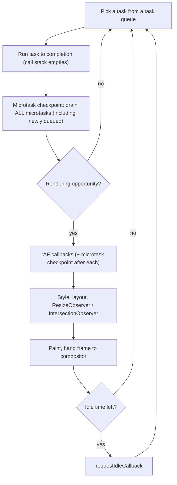

# 00 / 11 — The Event Loop: Tasks, Microtasks, and Rendering Opportunities

## 1. Lesson metadata

| | |
|---|---|
| **Level** | Intermediate |
| **Study time** | 5 hours (reading 2 h, experiments 1.5 h, exercises 1.5 h) |
| **Prerequisites** | [01 — How the browser works](./01-how-the-browser-works.md), [05 — Execution contexts and the call stack](./05-execution-contexts-and-call-stack.md) |
| **Next** | [12 — Promises and async/await](./12-promises-and-async-await.md) |
| **Related later** | [13 — Browser events and propagation](./13-browser-events-and-propagation.md), [17 — JavaScript performance fundamentals](./17-javascript-performance-fundamentals.md), [Phase 2 / 13 — Scheduler and priorities](../02-react-rendering-and-internals/13-scheduler-and-priorities.md), [Phase 2 / 21 — Browser paint vs React updates](../02-react-rendering-and-internals/21-browser-paint-and-react-updates.md) |

**Learning objectives.** After this lesson you can:
1. Describe the HTML Standard's event loop processing model: task queues, microtask checkpoints, "update the rendering".
2. Predict the exact output order of programs mixing synchronous code, `setTimeout`, promises, `queueMicrotask`, `await`, `requestAnimationFrame`, and DOM events.
3. Explain why microtasks can starve rendering and why `setTimeout(0)` does not.
4. Explain how timers actually behave: minimum delays, clamping, throttling, drift.
5. Explain, conceptually, how React's scheduler yields to the browser and why its yield mechanism is a *task*, not a microtask.
6. Debug "my loading state never shows", "my effect ran too late", "my test needs `await`", and "my page froze with no loops" type problems.

**Concepts covered:** run-to-completion, call stack vs queues, task (macrotask), task source, microtask, microtask checkpoint, `queueMicrotask`, promise jobs, timers and clamping, rendering opportunity, "update the rendering" steps, `requestAnimationFrame`, `requestIdleCallback`, `MessageChannel`, task starvation, input delay, `scheduler.postTask`/`scheduler.yield` (⚠ support varies), Node.js differences (`process.nextTick`, `setImmediate`).

---

## 2. Deep conceptual explanation

### 2.1 What problem is this lesson solving?

JavaScript executes one piece of code at a time on a thread, yet pages respond to clicks, timers, network responses, and animations "at the same time". The **event loop** is the mechanism that makes this possible: it decides *what runs next* when the current code finishes. If you cannot predict that order, you cannot answer these React questions:

- When exactly do my state updates get processed after `setState` in a click handler? (Before the browser paints, but not synchronously inside the handler.)
- Why does `useEffect` run "later" than `useLayoutEffect`? What does "later" mean in browser terms?
- Why is a long render a problem if React is "async"?
- How can React interrupt a render and resume it? (It cannot interrupt a function; it yields *between* units of work, using a task.)
- Why do tests complain about `act(...)` and need `await`?
- Why is `await Promise.resolve()` in a loop not a way to "let the UI breathe"?

[Lesson 01](./01-how-the-browser-works.md) established that the main thread is shared. This lesson specifies *the scheduler of that thread*.

### 2.2 The ingredients

| Ingredient | What it is |
|---|---|
| **Call stack** | Where synchronous code runs ([Lesson 05](./05-execution-contexts-and-call-stack.md)). One at a time. |
| **Task** (often "macrotask") | A unit of work queued by the host: run a script, dispatch an input event, fire a timer callback, handle a network completion, process a `postMessage`. The loop runs **one task at a time to completion**. |
| **Task queue(s)** | Tasks are grouped by **task source** (timers, user interaction, DOM manipulation, networking, …). The spec says the browser picks *which queue* to service next; it may prioritise (for example, input over timers). There is not literally one global FIFO. Within one source ordering is FIFO. |
| **Microtask** | A short job queued by the *language/host* to run "as soon as the stack is empty": promise reactions (`then`/`catch`/`finally`, `await` continuations), `queueMicrotask(fn)`, `MutationObserver` callbacks. |
| **Microtask queue** | One FIFO queue. It is drained **completely** at each *microtask checkpoint*, including microtasks queued while draining. |
| **Rendering opportunity** | A moment where the browser *may* update the display (typically once per display refresh when something visual changed and the document is visible). Between tasks the loop may run the **update the rendering** steps. |

### 2.3 The loop (HTML Standard processing model, simplified)

```text
forever:
  1. Choose a task queue that has a runnable task; take the oldest task from it.
  2. Run that task to completion (the call stack empties).
  3. Microtask checkpoint: run ALL queued microtasks (until the queue is empty).
  4. If it is time to render (a rendering opportunity):
       a. run pending resize/scroll/media-query steps
       b. run requestAnimationFrame callbacks (then a microtask checkpoint after each callback)
       c. recalc style, layout (as needed); run ResizeObserver, IntersectionObserver notifications
       d. paint / produce a frame (hand off to compositor)
  5. If there is spare time (idle period), may run requestIdleCallback callbacks.
  6. Go to 1.
```

*Public guarantee (HTML Standard):* tasks run to completion; microtasks run after the current task (when the stack empties) and before the next task or rendering; `requestAnimationFrame` callbacks run before the next paint of that document.
*Implementation detail:* how often a rendering opportunity occurs (60/120/144 Hz, throttled to lower rates in background tabs or on battery saver), which queue gets priority, and whether a particular frame is skipped. The standard deliberately leaves these to the browser.

### 2.4 Run-to-completion

Once a task starts, **nothing else in that thread's JavaScript runs until it finishes**. No other handler, timer, or promise callback preempts it. This is a strong guarantee (no data races in your own JS), and the source of the main liability: a long task blocks everything, including rendering and input.

React's render is just JavaScript inside a task. If React were to render a huge tree in one task, nothing else could happen for the duration. Concurrent React's central trick is to **end the task early** and schedule the continuation as a *new* task, giving the browser a chance to render and handle input between slices.

### 2.5 Tasks vs microtasks: the one-sentence difference

> A **task** gives the browser the chance to do *other* things (render, handle input, run other tasks) before it runs. A **microtask** runs *before* any of those.

Hence:
- Microtasks are great for "do this immediately after the current synchronous code, but before anything else observes the intermediate state". Promise callbacks use them so that `then` handlers run consistently *after* the current code finishes yet *before* the next event.
- Microtasks are the wrong tool for yielding. A chain of microtasks keeps the browser from rendering until the chain ends.

### 2.6 Timers

`setTimeout(fn, delay)` means: *after at least `delay` ms, queue a task to run `fn`*. It's a **minimum**, not a guarantee. Reasons for lateness:
- The main thread is busy with another task (the common one).
- **Clamping:** nested timers (a timer callback setting another timer, 5+ levels deep) are clamped to at least 4 ms in browsers per the HTML Standard. Historically many browsers also clamp `setTimeout(fn, 0)` to ~1 ms. *(Treat exact numbers as implementation-sensitive.)*
- **Throttling:** hidden/background tabs often throttle timers to once per second or less, or even more aggressively after the tab has been hidden for a while (Chromium "intensive throttling"). Don't build correctness on timers in background tabs.
- Timers are not drift-free: `setInterval(fn, 1000)` can run late and bunch up. Compute elapsed time with `performance.now()`/`Date.now()` instead of counting ticks.

`setTimeout(fn, 0)` therefore means "run `fn` in a *future task*, after the current task, all its microtasks, and possibly after a render". That is why it works as "yield to the browser" and why `Promise.resolve().then(fn)` does not.

### 2.7 `requestAnimationFrame` (rAF) and idle callbacks

- `requestAnimationFrame(cb)`: run `cb` once, right before the browser's next paint. Use it for visual work you want to batch per frame. Callbacks do not run in hidden tabs (generally), and they run every frame only if you re-request.
- `requestIdleCallback(cb)`: run low-priority work when the loop is otherwise idle; has a `timeout` option. ⚠ Support and timing vary (Safari historically lacked it; check MDN's compatibility table) and idle periods can be rare on busy pages. React does not use it for its scheduler; its own scheduler is built on tasks.
- **Ordering of rAF vs `setTimeout`** is not guaranteed by specification; a timer may fire before or after the next frame's rAF callbacks. Do not write code that depends on it.

### 2.8 How React plugs into this (conceptual)

| React behaviour | Event-loop mechanism |
|---|---|
| Handlers called from a DOM event | They run inside the *input task* for that event. State updates inside are **batched**; React then processes the update before the browser gets a rendering opportunity (for discrete events like click, React treats them as high priority and renders synchronously-ish, *not* waiting for a later task). In React 18/19 the sync-lane update is flushed from a **microtask** scheduled when `setState` is called (`scheduleMicrotask` → `processRootScheduleInMicrotask` in `react-dom`; checked in the installed 19.3.1 source), so for a real user click the render happens right after the root listener returns (the stack is empty, so a microtask checkpoint runs) and before later listeners on `document`. This is an implementation detail; do not depend on it. |
| Non-urgent renders (transitions, deferred values, normal-priority updates) | React's **Scheduler** package splits the work into slices and schedules continuation using a *task* mechanism. In browsers it conceptually uses `MessageChannel` (post a message to yourself) because it queues a task without the throttling and clamping that nested `setTimeout` has; in Node/jsdom-like environments it uses `setImmediate` where available; `setTimeout` is a fallback. It yields after a short slice (on the order of a few ms; a ~5 ms default is cited in source discussions) to let the browser handle input and paint. *These are implementation details of the `scheduler` package; verify against the source ([Phase 2 / 31](../02-react-rendering-and-internals/31-reading-react-source.md)).* |
| `useLayoutEffect` | Runs synchronously during the commit, **before** the browser paints (same task as the commit). It can force a paint-blocking re-render. |
| `useEffect` (passive effects) | Scheduled to run *after* the commit, typically after the browser has had a chance to paint, using a scheduler task. Exception (verified in 19.3.1 source: `pendingEffectsLanes & SyncLane` triggers `flushPendingEffects`): effects caused by a discrete user event such as a click are flushed synchronously at the end of the commit so that subsequent interactions see consistent state (this refinement is documented in React 18's notes and discussed in [Phase 2 / 19](../02-react-rendering-and-internals/19-layout-vs-passive-effects.md)). |
| `flushSync` | Forces React to process updates synchronously, right now, inside the current task, bypassing batching. Use rarely. |
| Suspense / lazy chunk resolves | A network task completes and a promise callback (microtask) wakes React, which schedules a render. |
| Testing Library `act` / `await findBy…` | Wait for the loop to run React's scheduled work, microtasks, and your async effects before asserting. |

### 2.9 Common misconceptions

| Misconception | Reality |
|---|---|
| "`setTimeout(fn, 0)` runs immediately." | It runs in a **later task**, after the current code and all microtasks, and after any currently queued earlier timers. |
| "Promises make code async/parallel." | `new Promise(executor)` runs the executor **synchronously**. Only `then` callbacks are deferred, and only to a microtask. Nothing runs in parallel. |
| "`async` function bodies run later." | An async function runs *synchronously* until its first `await`; only the continuation after `await` is queued. |
| "The event loop is JavaScript's." | The language defines jobs/promises; the event loop is defined by the host (HTML Standard for browsers, libuv-based Node loop for Node). |
| "Rendering happens after every task." | Only at rendering opportunities; many tasks can run between frames, and no rendering happens if nothing visual changed or the tab is hidden. |
| "Microtasks are lightweight so they cannot hurt." | They run to exhaustion; an infinitely self-queuing microtask freezes the tab as surely as `while(true)`. |
| "React state updates are async because React uses setTimeout." | React defers by *batching* inside its own bookkeeping; the event loop is involved only when the work is scheduled as a task. |

---

## 3. Internal mechanics

### 3.1 The queues in detail

*Teaching model:* think of two queues, "tasks" and "microtasks".
*Specification:* multiple task queues per event loop (per task source), a microtask queue, and the "update the rendering" algorithm. A browser must keep ordering for tasks of the *same source*; between sources it can prioritise. Chromium, for instance, prioritises input and rendering-related work and treats timers as lower priority. ⚠ The practical consequence: do not assume strict global FIFO between, say, a timer task and a `postMessage` task. Two timers with the same delay do fire in order; a timer vs a message event: not specified.

**Microtask checkpoint** is performed:
- after each task,
- after each callback when the JS stack becomes empty (including after each event listener invoked by a *native* event dispatch; §3.4),
- after each rAF callback and other rendering-step callbacks (the "clean up after running script" step: whenever the stack empties, run microtasks).

### 3.2 Promise jobs

`promise.then(cb)`: if `promise` is already settled, a job to run `cb` is queued **immediately** into the microtask queue; if pending, it's queued *when the promise settles* (when `resolve` is called). `await x` is (approximately) `Promise.resolve(x).then(continuation)` plus suspension of the async function; for native promises the continuation takes **one** microtask tick in modern engines. (Older engines took three ticks for `await` of a native promise; the spec optimisation was applied years ago. Don't write code that depends on tick counts of *unrelated* async chains.)

Details of promises are in [Lesson 12](./12-promises-and-async-await.md).

### 3.3 Why `Promise.then` chains starve rendering

```js
function spin() { Promise.resolve().then(spin); }
spin();
```

Step 3 of the loop never finishes: each microtask queues another before the queue empties. The loop never reaches "update the rendering" or the next task. The tab freezes without any loop in sight, and DevTools shows one never-ending task. Contrast `setTimeout(spin)`, which re-queues a *task*, so rendering and input interleave (at the cost of ~4 ms clamping once nested).

### 3.4 Native vs script-initiated events and microtask timing

When the user clicks, the browser dispatches the event to listeners from native code. Between listeners, the JS stack is empty, so a microtask checkpoint happens **after each listener**. When script triggers the same event with `el.click()` or `dispatchEvent`, the script (the caller) is still on the stack while the listeners run, so microtasks queued by listeners wait until the whole synchronous call returns. This produces visibly different orderings (Exercise B3).

Why React developers care: React's own handlers attach at the root (event delegation, [Lesson 13](./13-browser-events-and-propagation.md)), so *a native listener and a React `onClick` for the same click run in different listener callbacks*, and microtasks queued by one can run between them.

### 3.5 Node.js differences

Node uses libuv phases (timers, pending, poll, check, close) rather than the HTML model, but the same ideas hold: `process.nextTick` queue and promise microtasks run between operations (`nextTick` before promise jobs), `setImmediate` runs in the "check" phase, and `setTimeout(0)` vs `setImmediate` ordering from the main module is nondeterministic. This matters for SSR code and tests (Vitest/Jest run in Node): `await` semantics are the same, timers can be faked ([Phase 8](../08-testing-and-quality/)). ⚠ Verify details against the current Node docs when depending on phase ordering.

### 3.6 `scheduler.postTask` and `scheduler.yield`

Browsers are adding explicit scheduling APIs: `scheduler.postTask(cb, { priority })` and `scheduler.yield()` (yield to the browser and resume with higher priority than a fresh task). ⚠ Support has been Chromium-first, with others catching up; check MDN/caniuse before relying on them, and feature-detect (`"scheduler" in globalThis && "yield" in scheduler`) with a `setTimeout`/`MessageChannel` fallback. React's scheduler does not currently depend on them *(verify)*.

### 3.7 What "frame" means for tasks

If the display is 60 Hz and the main thread has a 40 ms task, the browser can't render for ≥ 40 ms; it may skip 2 frames. Input events that arrive are queued behind it. A **long task** (≥ 50 ms by the Long Tasks API definition) is the unit used by performance tooling to flag jank ([Lesson 17](./17-javascript-performance-fundamentals.md)).

---

## 4. Step-by-step execution walkthrough

### 4.1 The classic ordering program

```js
console.log("A");                                  // 1
setTimeout(() => console.log("B"), 0);             // 2
Promise.resolve().then(() => console.log("C"));    // 3
queueMicrotask(() => console.log("D"));            // 4
(async () => {
  console.log("E");                                // 5
  await null;
  console.log("F");                                // 6 (continuation)
})();
console.log("G");                                  // 7
```

**Predict** the output before reading on.

**Walkthrough** (the whole script is *one task*: "run this script"):
1. `A` is logged synchronously.
2. `setTimeout` registers a timer; when it expires a **task** will be queued. Nothing is logged now.
3. The promise is already resolved, so its `then` callback is queued as **microtask #1** (`C`).
4. `queueMicrotask` queues **microtask #2** (`D`).
5. The async function runs synchronously: logs `E`. At `await null`, the continuation is queued as **microtask #3** (`F`); the function returns a promise and control returns to the caller.
6. `G` is logged. The script task ends; the stack is empty.
7. **Microtask checkpoint:** run #1 (`C`), #2 (`D`), #3 (`F`) in order.
8. Later (a future task, after possibly a render): the timer task logs `B`.

**Output:** `A E G C D F B`.

### 4.2 A click in a React component

```tsx
function Counter() {
  const [n, setN] = useState(0);
  console.log("render", n);
  return (
    <button
      onClick={() => {
        setN((x) => x + 1);
        setN((x) => x + 1);
        console.log("handler end");
      }}
    >
      {n}
    </button>
  );
}
```

Timeline (React 18/19, concurrent root, outside StrictMode double-render):
1. User clicks → browser queues an **input task**.
2. The task runs: React's root listener finds the `onClick` and invokes your handler.
3. Both `setN` calls enqueue updates on the component's queue; React notes the work is needed and, for a discrete event, gives it the highest (sync) priority. **No render happens yet** (batching, [Phase 1 / 15](../01-react-fundamentals/15-update-queues-and-batching.md)).
4. `console.log("handler end")` prints. (`n` in the handler's closure is still the old value.)
5. The handler returns. React processes the pending update **before the browser can paint** (in a microtask queued by the first `setN`; verified in React 19.3.1 source and in a jsdom test that logs `handler end` then `render 2`): it re-invokes `Counter` → `render 2` is logged, with `n === 2`, because both functional updates applied. The DOM text is mutated in commit.
6. Control returns to the browser, which can now style/layout/paint the new `2` in the next rendering opportunity.

Order of logs: `handler end`, then `render 2`. (In StrictMode development, the render function runs twice and logs twice; see [Phase 2 / 28](../02-react-rendering-and-internals/28-strict-mode-behavior.md).)

### 4.3 A concurrent (transition) render yielding

```tsx
const [isPending, startTransition] = useTransition();
onChange={(e) => {
  setQuery(e.target.value);                         // urgent
  startTransition(() => setFilterQuery(e.target.value)); // non-urgent
}}
```

1. Keystroke task: urgent update is rendered and committed first (input field reflects the character).
2. The transition render is scheduled with lower priority: a new **scheduler task** (via the message-channel mechanism) begins rendering the expensive list in slices.
3. After each slice (small time budget) React checks whether it should yield; if so it ends the task and queues a continuation task. Between slices the browser can paint and handle the *next* keystroke.
4. If a new keystroke arrives, the in-progress transition render is abandoned/restarted with the newer value ([Phase 2 / 15](../02-react-rendering-and-internals/15-interruptible-restartable-abandoned-rendering.md)).
5. When the render completes, a commit happens in one go (commit is not interruptible) and the list updates.

The *only* reason this helps is the event-loop fact that each slice is a separate task.

---

## 5. Code examples

### 5.1 Minimal: tasks vs microtasks vs frames

```js
button.onclick = () => {
  box.style.background = "red";
  Promise.resolve().then(() => { box.style.background = "green"; });
  setTimeout(() => { box.style.background = "blue"; }, 0);
};
```

**Predict:** what colours can the user see, and in what order?

**Result:** red is *never painted* (overwritten by green in the microtask before any rendering opportunity). The user may see green for one frame and then blue, **or** might only ever see blue if the timer task runs before the next rendering opportunity (timer tasks and frames are not strictly ordered). So: *definitely not red*; green possibly; blue finally.
**Why:** microtask runs before rendering; the timer is a later task which may or may not be separated from the click task by a frame.
**Relevance:** intermediate values of synchronous updates, including `setState` calls batched in one handler, are never seen by the user.

### 5.2 Practical: a `yieldToMain` helper with fallbacks

```ts
export function yieldToMain(): Promise<void> {
  // scheduler.yield: yields, and resumes ahead of other queued tasks (when supported)
  const s = (globalThis as { scheduler?: { yield?: () => Promise<void> } }).scheduler;
  if (s?.yield) return s.yield();
  return new Promise<void>((resolve) => {
    const { port1, port2 } = new MessageChannel();
    port1.onmessage = () => { port1.close(); resolve(); };
    port2.postMessage(undefined);
  });
}

export async function processInSlices<T>(
  items: readonly T[],
  work: (item: T) => void,
  sliceMs = 8,
): Promise<void> {
  let sliceStart = performance.now();
  for (const item of items) {
    work(item);
    if (performance.now() - sliceStart >= sliceMs) {
      await yieldToMain();
      sliceStart = performance.now();
    }
  }
}
```

Line notes:
- `MessageChannel` queues a *task* with no clamping (unlike nested timers) so it is a cheap yield; this is conceptually what React's scheduler uses. It may run before a pending rendering opportunity, so a frame is not *guaranteed* between yields. If you need "after the next paint", combine `requestAnimationFrame` and a task (§5.5).
- We check the clock every item, which is cheap relative to useful work; for ultra-fine work check every N items.
- `scheduler.yield` is feature-detected; the TypeScript lib types may not include it yet, hence the cast. ⚠ Check support.

**Trade-offs:** total time goes up slightly (yield overhead); correctness concerns: the loop is now interleaved with other code, so inputs might change while processing. Add cancellation via `AbortSignal` ([Lesson 14](./14-web-apis-and-network-requests.md)).

### 5.3 Incorrect: "show a spinner, do work, hide the spinner"

```tsx
function Export() {
  const [busy, setBusy] = useState(false);
  return (
    <button
      onClick={() => {
        setBusy(true);
        buildHugeReport();     // 800 ms synchronous
        setBusy(false);
      }}
    >
      {busy ? "Working…" : "Export"}
    </button>
  );
}
```

**Predict:** does the user ever see "Working…"?

**Result:** No. `setBusy(true)` and `setBusy(false)` are batched; by the time React processes updates the final value is `false`. Even if they were not batched, the browser cannot paint until the task ends. **Why:** run-to-completion + batching. **React is not at fault;** no library could show the spinner here, because rendering requires the main thread.

### 5.4 Corrected (three options, increasing quality)

```tsx
// (a) Defer the work to a later task AFTER React has committed "busy" and the browser can paint.
onClick={() => {
  setBusy(true);
  requestAnimationFrame(() => {
    setTimeout(() => {          // after the frame in which the spinner is painted
      buildHugeReport();        // still blocks input for 800 ms
      setBusy(false);
    }, 0);
  });
}}

// (b) Slice the work (see processInSlices) so the UI stays interactive.
onClick={async () => {
  setBusy(true);
  await processInSlices(rows, addRowToReport);
  setBusy(false);
}}

// (c) Move the work off the main thread (Worker); the main thread stays free.
onClick={async () => {
  setBusy(true);
  try { await reportWorker.build(rows); } finally { setBusy(false); }
}}
```

(a) is the quick fix: the double-deferral "rAF then timeout" is a known idiom to run *after the next paint*, but it still freezes input during the work and is timing-based. (b) keeps input alive. (c) is best for CPU-bound work. Errors: (b) and (c) should use `try/finally` so the spinner doesn't stick on failure. Also guard against double-clicks while `busy`.

### 5.5 Advanced: "run after paint" helper

```ts
export function afterNextPaint(): Promise<void> {
  return new Promise((resolve) => {
    requestAnimationFrame(() => {
      // rAF runs BEFORE paint of this frame; a task queued now runs after it in practice.
      const { port1, port2 } = new MessageChannel();
      port1.onmessage = () => { port1.close(); resolve(); };
      port2.postMessage(undefined);
    });
  });
}
```

⚠ This is a *heuristic*: the standard doesn't guarantee that the next task runs after the paint; in practice the two-step approach works in major browsers. For measuring paint time use the `PerformanceObserver` `paint`/`event`/`long-animation-frame` entries (support varies) rather than guessing.

### 5.6 Microtask starvation and debounce: a practical timer example

```ts
export function debounce<A extends unknown[]>(fn: (...a: A) => void, ms: number) {
  let id: ReturnType<typeof setTimeout> | undefined;
  const debounced = (...args: A) => {
    clearTimeout(id);
    id = setTimeout(() => fn(...args), ms);
  };
  debounced.cancel = () => clearTimeout(id);
  return debounced;
}

// React usage: stable identity + cleanup
function Search({ onQuery }: { onQuery: (q: string) => void }) {
  const onQueryRef = useRef(onQuery);
  useEffect(() => { onQueryRef.current = onQuery; });
  const debounced = useMemo(() => debounce((q: string) => onQueryRef.current(q), 300), []);
  useEffect(() => () => debounced.cancel(), [debounced]);
  return <input onChange={(e) => debounced(e.target.value)} />;
}
```

Notes: `debounce` depends on *tasks* (timers), not microtasks. Component code must keep **one** debounced function across renders (`useMemo`/`useRef`; otherwise each render has a fresh timer id and nothing is debounced; see [Lesson 07](./07-functions-and-referential-identity.md)), must cancel on unmount (otherwise the callback may fire after unmount), and reads the latest callback via a ref to avoid stale closures ([Phase 3 / 05](../03-react-state-and-hooks/05-effect-dependencies-and-stale-closures.md)). Because the timer is clamped/throttled in background tabs, it's for UX smoothing, not correctness. For derived rendering work consider `useDeferredValue` instead ([Phase 3 / 22](../03-react-state-and-hooks/22-modern-hooks-and-apis.md)).

### 5.7 Practical: latest-value `setInterval` and drift-free clock

```tsx
function useNow(intervalMs = 1000): number {
  const [now, setNow] = useState(() => Date.now());
  useEffect(() => {
    const id = setInterval(() => setNow(Date.now()), intervalMs);
    return () => clearInterval(id);
  }, [intervalMs]);
  return now;
}
```

The interval may fire late or be throttled in background tabs; because we read the **clock** (`Date.now()`) on each tick rather than adding `intervalMs`, the displayed time is always right even if ticks are delayed. For countdowns derive remaining time from a target timestamp, never from a tick counter. Under StrictMode the effect runs, cleans up, and runs again in development, which is why cleanup is mandatory ([Phase 2 / 28](../02-react-rendering-and-internals/28-strict-mode-behavior.md)).

---

## 6. Visual explanations

### The loop



### Timeline: where things run (script from §4.1)

```text
Task 1: run script
  stack: A, [setTimeout reg], [then reg], [queueMicrotask reg], E, [await reg], G
  microtask checkpoint: C, D, F
  (maybe) rendering opportunity
Task 2: timer callback → B
```

### React slices as tasks

```text
|== task: keystroke handler + urgent render + commit ==|  (paint)  |== slice 1 of transition ==|(input/paint)|== slice 2 ==|(…)|== slice 3 + commit ==|
                                                                    ^ browser can handle input between slices
```

---

## 7. Alternative approaches and trade-offs

**How to defer or slice work:**

| Mechanism | Queue type | Fires before next paint? | Clamped/throttled? | Cancellable | Good for |
|---|---|---|---|---|---|
| `queueMicrotask` / `Promise.then` | Microtask | Yes (always before) | No | Not directly | Ordering guarantees *within* the current turn; coalescing multiple synchronous updates |
| `requestAnimationFrame` | Rendering step | It *is* the pre-paint step | Paused in hidden tabs | `cancelAnimationFrame` | Visual updates, measuring layout after changes |
| `setTimeout(0)` | Task | Not guaranteed | Nested clamping ≥ 4 ms; background throttling | `clearTimeout` | Simple "later" yield |
| `MessageChannel` | Task | Not guaranteed | No timer clamping | Close port / flag | Low-overhead yields (what schedulers use) |
| `scheduler.postTask` / `scheduler.yield` | Task with priority | Not guaranteed | Priority-based | `AbortSignal` / `TaskController` | Priority-aware scheduling (⚠ support) |
| `requestIdleCallback` | Idle | No | Browser-controlled | `cancelIdleCallback` | Non-urgent analytics, prefetch (⚠ Safari support) |
| Web Worker | Separate thread | N/A | N/A | `terminate` | CPU-bound work |
| React `startTransition`/`useDeferredValue` | React scheduler tasks | N/A | N/A | Superseded by newer update | Work expressed as React rendering |

**When the generally recommended approach is not best:** The advice "yield with tasks, not microtasks" is wrong when your goal is *atomicity*: e.g. coalescing several synchronous store updates into one notification (`queueMicrotask(flush)`). That's precisely the point of microtasks: the flush runs before the browser can render, so no inconsistent intermediate frame is visible. Many state libraries and React's own sync-lane flush use microtask-style coalescing for this reason.

---

## 8. Best practices and anti-patterns

**Do**
- Treat any single task over ~50 ms as a smell on the main thread.
- Use microtasks for coalescing and ordering; tasks (or `scheduler.yield`) for yielding.
- Derive time from clocks, not from counting timer ticks.
- Clean up timers, rAF requests, and listeners in effect cleanups.
- Feature-detect newer scheduling APIs.

**Beginner mistakes**
- Relying on `setTimeout(0)` for ordering of unrelated code.
- Calling `setState` in a loop and expecting intermediate renders.
- Expecting `console.log` after `setState` to show the new state.
- Awaiting a resolved promise to "let the UI update".

**Experienced-developer mistakes**
- Using `setTimeout(…, 0)` to "fix" an effect-ordering bug without understanding it (it often masks a missing dependency or a layout/paint ordering assumption).
- Writing code that depends on rAF vs timer ordering.
- Long `useEffect` work assuming it runs "off-thread" because it's post-paint.
- Polling with `setInterval` where `AbortSignal.timeout`, server push, or request deduplication would do.
- Performing synchronous layout reads in `ResizeObserver` callbacks (can create loops: "ResizeObserver loop completed with undelivered notifications").

**Smells:** `setTimeout(fn, 0)` sprinkled around; `await new Promise(r => setTimeout(r, 0))` used to "wait for React" in tests; recursive `Promise.resolve().then(poll)`; rAF loops that never cancel.

**Justified exceptions:** `setTimeout(0)` to wait for a browser focus/selection quirk with a comment and a link to the bug; microtask deferral in libraries for batching notifications.

---

## 9. Real-world application

*Financial dashboard with a market-data WebSocket.* Messages arrive each few milliseconds, each message is a task (`onmessage`). Calling `setState` per message triggers a render per message whenever React finds time; under load the render queue falls behind and the UI shows stale prices while clicks lag. Engineering fix: **coalesce on a frame boundary**: write incoming ticks into a mutable buffer (ref/store), and flush it at most once per animation frame (`requestAnimationFrame`) into state, or subscribe via `useSyncExternalStore` with a snapshot updated per frame. Latency budget: price paints within ≤ 1 frame (~16 ms) after the most recent data; no per-message React render. Constraints: ordering of ticks must be preserved, and the buffer must be bounded to avoid memory growth in background tabs where rAF pauses (use a timer or `visibilitychange` strategy). See [Phase 6 / 17](../06-data-fetching-and-state-ecosystems/17-real-time-websockets-subscriptions.md).

*Autocomplete in e-commerce search.* Each keystroke is a discrete event; filtering 50,000 SKUs client-side is 120 ms. Strategy: keep the input controlled and urgent; defer the list update with `useDeferredValue`/`startTransition` so each keystroke stays a short task and the list render is sliced and abandoned if outdated; debounce *network* requests (timers) and cancel stale ones (`AbortController`, [Lesson 14](./14-web-apis-and-network-requests.md)).

*Forms with analytics.* Click handlers send analytics events synchronously in the click task, adding 30 ms to every interaction. Defer non-critical work: `queueMicrotask` doesn't help (still before paint); use `scheduler.postTask` with background priority, `requestIdleCallback`, or `navigator.sendBeacon` for page unload. Constraint: don't lose events on navigation.

---

## 10. Debugging and troubleshooting

**Symptom 1: UI frozen, CPU pegged, no obvious loop.**
*Investigation:* Performance panel → Record; see one huge "Task". Flame chart shows repeated promise callbacks ("Run Microtasks"). Look for a promise-returning function that re-schedules itself unconditionally (a polling loop or recursion). *Fix:* add a terminating condition and a real delay (`await sleep(…)`), i.e. a task boundary. *Validate:* tasks become short and idle gaps appear.

**Symptom 2: "Loading…" never appears / appears late.**
*Reproduce:* §5.3. *Investigation:* Performance panel: the task containing the handler also contains the heavy work, and the frame with the spinner starts after it. *Root cause:* run-to-completion. *Fix:* §5.4 (slice or worker). *Validate:* the "Working…" frame is visible in the screenshots strip before the long task starts.

**Symptom 3: effect runs after the user already sees stale content (flash).**
*Investigation:* React Profiler plus Performance track; effect (passive) ran after paint. *Root cause:* `useEffect` is post-paint; layout-dependent measurement needs `useLayoutEffect` ([Phase 3 / 08](../03-react-state-and-hooks/08-uselayouteffect.md)). *Validate:* no flash with layout effect; ensure the layout effect is cheap since it blocks paint.

**Symptom 4: tests warn "not wrapped in act(...)" or assertions race.**
*Investigation:* the component updates state in a promise callback or timer after the test asserts. *Fix:* `await screen.findByText(...)`/`waitFor`, use fake timers with `act` advancing; avoid `setTimeout(0)` sleeps. *Why:* tests must wait for the same loop turns React waits for ([Phase 8](../08-testing-and-quality/)).

**Symptom 5: timer-based UI is wrong when the tab was in the background (countdown lags, polling bursts).**
*Investigation:* log `performance.now()` deltas in the callback; tick interval is ≥ 1000 ms when hidden. *Fix:* compute from timestamps; listen to `visibilitychange`; pause/resume polling intentionally.

**Tooling.** DevTools Performance: **Main** track shows Tasks, "Run Microtasks", "Animation Frame Fired", "Timer Fired", "Event: click"; **Interactions** track; red long-task markers. Use `console.time`/`performance.mark`/`measure` to label regions. `monitorEvents`/`getEventListeners` for event debugging. CPU throttling to expose slow-device behaviour.

---

## 11. Exercises

### Level A — Knowledge
A1. Distinguish *task* from *microtask* in one sentence each, and name three sources of each.
A2. State the guarantee "run to completion" and one benefit and one cost.
A3. What is a microtask checkpoint, and when does it happen?
A4. Why does `setTimeout(fn, 0)` not run `fn` immediately? Give two reasons beyond "it's queued".
A5. What does `requestAnimationFrame` guarantee about *when* its callback runs relative to paint?
A6. Why does React's scheduler use a task mechanism rather than microtasks to continue rendering?

### Level B — Code comprehension
B1. Output order?
```js
console.log("A");
setTimeout(() => console.log("B"), 0);
Promise.resolve().then(() => console.log("C"));
queueMicrotask(() => console.log("D"));
(async () => { console.log("E"); await null; console.log("F"); })();
console.log("G");
```
B2. Output order?
```js
setTimeout(() => console.log(1), 0);
Promise.resolve().then(() => {
  console.log(2);
  Promise.resolve().then(() => console.log(3));
});
setTimeout(() => console.log(4), 0);
console.log(5);
```
B3. For the markup below, what is logged (a) when the user physically clicks the button, and (b) when script calls `inner.click()`?
```js
inner.addEventListener("click", () => {
  Promise.resolve().then(() => console.log("micro-inner"));
  console.log("inner");
});
outer.addEventListener("click", () => {
  Promise.resolve().then(() => console.log("micro-outer"));
  console.log("outer");
});
// <div id="outer"><button id="inner"></button></div>
```
B4. Order?
```js
async function f() { console.log(1); await g(); console.log(2); }
async function g() { console.log(3); }
f();
console.log(4);
```
B5. Which of these freezes the tab, and why?
```js
(a) function a() { setTimeout(a, 0); }           a();
(b) function b() { Promise.resolve().then(b); }  b();
(c) function c() { requestAnimationFrame(c); }   c();
```

### Level C — Implementation
C1. Implement `sleep(ms, signal?)` that resolves after `ms` and rejects with an `AbortError` when the signal aborts (clear the timer).
C2. Implement `rafThrottle(fn)` that calls `fn` with the **latest** arguments at most once per animation frame, with a `cancel()`.
C3. Implement `useInterval(callback, delayMs | null)` that always calls the *latest* callback, supports pausing with `null`, and cleans up.
C4. Implement `batchMicrotask(fn)` which coalesces any number of synchronous calls into a single call to `fn` in the next microtask, with the *last* arguments.

### Level D — Debugging
D1. This hook should show elapsed seconds, but drifts and sometimes shows the same second twice. Fix it.
```tsx
function useElapsed() {
  const [s, setS] = useState(0);
  useEffect(() => {
    const id = setInterval(() => setS(s + 1), 1000);
    return () => clearInterval(id);
  }, []);
  return s;
}
```
D2. A teammate fixed a flaky focus bug with `setTimeout(() => inputRef.current?.focus(), 0)`. It works in dev but fails sometimes in production on slow phones. Give likely causes, a better fix, and how you would verify.
D3. A test passes locally and fails on CI with "Unable to find element" for content set after a promise resolves. The test uses `await new Promise(r => setTimeout(r, 0))` before asserting. Explain why that is fragile and rewrite it.

### Level E — Architecture and engineering decisions
E1. A telemetry module flushes events in `onClick` handlers synchronously (20–40 ms). Choose a scheduling strategy with explicit trade-offs (loss on navigation, ordering, battery, support), and justify.
E2. You are building a live trading blotter that receives 500 updates/s. Describe where to coalesce (message → store → React), at what boundary (microtask, rAF, timer), and what you would measure.

### Level F — Expert challenge
F1. Explain, using the event-loop model, why `flushSync` inside a `useEffect` can cause problems or warnings, and what the effect of calling it from a click handler is relative to normal batching. (Reason from the model; verify the exact warnings in the React docs.)
F2. Design an experiment (code and instrumentation) that demonstrates, in a real browser, that microtasks run between two native listeners of one click but not between two listeners triggered by `dispatchEvent`. State what you expect to measure and the caveats.

---

## 12. Detailed answers and explanations

> Attempt the exercises first.

**A1.** *Task:* a unit of host-scheduled work that runs to completion, after which the browser may do other things (render, other tasks). Sources: timers, user input events, network/`postMessage`/`MessageChannel` messages, DOM manipulation tasks, history traversal. *Microtask:* a job that runs when the JS stack empties, before the next task or render. Sources: promise reactions (`then`, `await`), `queueMicrotask`, `MutationObserver` callbacks.

**A2.** Once a task starts nothing else in that thread's JS runs until it finishes. Benefit: no preemption means no data races or locking inside JS. Cost: any long task blocks input, timers, and rendering.

**A3.** The step where the loop runs all queued microtasks until the queue is empty. It occurs after each task, and whenever the call stack becomes empty after running a callback (e.g. after each native event listener, after each rAF callback).

**A4.** (1) The callback is queued as a *task* only after the current task and its microtasks finish; anything already queued earlier runs first. (2) Delay is a minimum: timer clamping for nesting, throttling in background tabs, and the main thread may be busy. Common wrong answer: "because `0` is rounded up to 1ms"; true in some engines, but not the main issue.

**A5.** The callback runs at the "update the rendering" step, **before** the browser paints that frame (after other rendering-steps work like scroll/resize steps, before style/layout). It does not guarantee a frame occurs (hidden tabs pause rAF) and it is not "after paint".

**A6.** A microtask continuation runs *before* the browser can render or handle input, so slicing with microtasks would not give the browser anything. A task boundary lets input and rendering interleave. MessageChannel specifically avoids timer clamping and throttling. (Implementation details of the `scheduler` package: verify in source.)

**B1.** `A E G C D F B`. See §4.1. Wrong answer "A E G B C D F": timers are tasks, so after microtasks. Wrong answer "A E G C F D": microtasks are FIFO by *queue time*; `D` was queued before the async continuation `F` (which is queued when execution reaches `await`).

**B2.** `5, 2, 3, 1, 4`. `5` sync. Then the checkpoint drains: `2`, and the microtask queued *during* the checkpoint (`3`) also runs in this same checkpoint. Then the two timer tasks `1`, `4` in order. Wrong answer "5 2 1 3 4": a microtask queued by a microtask is still drained before the next task.

**B3.** (a) Physical click: `inner`, `micro-inner`, `outer`, `micro-outer`. After the inner listener returns, the stack is empty, so microtasks run before the browser calls the outer listener (bubbling). (b) `inner.click()` from script: `inner`, `outer`, `micro-inner`, `micro-outer`. The script that called `click()` is still on the stack throughout dispatch, so no checkpoint occurs between listeners; microtasks run after the call returns (here, at the end of the surrounding script/task). Edge: if (b) is invoked from within another microtask, the microtasks queue behind it. Relevance: React's root-level delegated listener and native listeners fire in different callbacks; tests that dispatch synthetic events (`fireEvent`) behave differently from real clicks.

**B4.** `1, 3, 4, 2`. `f()` runs synchronously: logs `1`, calls `g()` which runs synchronously: logs `3` and returns a resolved promise; `await` queues the continuation as a microtask and returns to the caller; `4` logs; then microtask logs `2`. Common wrong answer: `1 3 2 4` (thinking `await` of a resolved promise continues synchronously). It never does.

**B5.** Only **(b)**. (a) re-queues a *task*; input and rendering interleave (the page stays responsive although the CPU is busy; timers get clamped to ≥ 4 ms after nesting). (c) requests a callback once per frame; rendering continues (it runs at 60 Hz), a waste but not a freeze. (b) re-queues a microtask before the queue empties, so the loop never proceeds to tasks or rendering.

**C1.**
```ts
export function sleep(ms: number, signal?: AbortSignal): Promise<void> {
  return new Promise((resolve, reject) => {
    if (signal?.aborted) return reject(signal.reason ?? new DOMException("Aborted", "AbortError"));
    const id = setTimeout(() => { signal?.removeEventListener("abort", onAbort); resolve(); }, ms);
    function onAbort() {
      clearTimeout(id);
      reject(signal!.reason ?? new DOMException("Aborted", "AbortError"));
    }
    signal?.addEventListener("abort", onAbort, { once: true });
  });
}
```
Notes: handles already-aborted signals; removes the listener on normal completion to avoid leaks; `signal.reason` is `AbortError` `DOMException` by default for `controller.abort()`. Edge: `ms` large; clamping; in Node `timers/promises` has a built-in.

**C2.**
```ts
export function rafThrottle<A extends unknown[]>(fn: (...a: A) => void) {
  let frame = 0;
  let latest: A | undefined;
  const throttled = (...args: A) => {
    latest = args;
    if (frame) return;
    frame = requestAnimationFrame(() => {
      frame = 0;
      const a = latest!; latest = undefined;
      fn(...a);
    });
  };
  throttled.cancel = () => { if (frame) cancelAnimationFrame(frame); frame = 0; latest = undefined; };
  return throttled;
}
```
Notes: coalesces to the latest arguments; rAF doesn't run in hidden tabs, so work is deferred (fine for visuals). Good for `pointermove`/scroll handlers that update state or layout.

**C3.**
```tsx
function useInterval(callback: () => void, delayMs: number | null) {
  const saved = useRef(callback);
  useEffect(() => { saved.current = callback; });         // latest callback, no resubscribe
  useEffect(() => {
    if (delayMs === null) return;
    const id = setInterval(() => saved.current(), delayMs);
    return () => clearInterval(id);
  }, [delayMs]);
}
```
Why it works: the interval is created once per `delayMs`, but reads the latest callback through a ref (avoids stale closure). `useEffectEvent` is the newer idiom for this pattern and became stable in React 19.2 (react.dev blog, 2025-10-01) ([Phase 3 / 22](../03-react-state-and-hooks/22-modern-hooks-and-apis.md)).

**C4.**
```ts
export function batchMicrotask<A extends unknown[]>(fn: (...a: A) => void) {
  let scheduled = false;
  let latest: A;
  return (...args: A) => {
    latest = args;
    if (scheduled) return;
    scheduled = true;
    queueMicrotask(() => { scheduled = false; fn(...latest); });
  };
}
```
Edge cases: if `fn` throws, `scheduled` has already been reset, so later calls still work; the error becomes an uncaught exception (reported via `window.onerror`). Evaluation: single microtask per burst; last-args semantics.

**D1.** The effect has `[]` deps, so `setS(s + 1)` closes over `s === 0` forever, so the value goes `1, 1, 1…` (stale closure) rather than counting. Also tick counting drifts if ticks are late. Fix:
```tsx
function useElapsed() {
  const [now, setNow] = useState(() => Date.now());
  const start = useRef(now);                 // or useState(() => Date.now())
  useEffect(() => {
    const id = setInterval(() => setNow(Date.now()), 250);
    return () => clearInterval(id);
  }, []);
  return Math.floor((now - start.current) / 1000);
}
```
Using the clock removes drift; a faster tick (250 ms) avoids visibly skipped seconds when ticks are late. ([Phase 3 / 05](../03-react-state-and-hooks/05-effect-dependencies-and-stale-closures.md) for the closure part.)

**D2.** Causes: the element is not yet mounted/visible/enabled when the timer fires (conditional rendering, transitions, Suspense); on slow devices the render that mounts it spans more time than the timer; focus is stolen by a later effect; the timer fires before the commit. A timeout is a *guess about timing*. Better: focus in a callback ref or in `useLayoutEffect`/`useEffect` that depends on the condition (`if (open) inputRef.current?.focus()`), or the `autoFocus` attribute (React handles it on mount). Verify: throttle CPU 6×, loop open/close 100 times; check focus with `document.activeElement`; add an e2e test (Playwright) under CPU throttling.

**D3.** `setTimeout(0)` waits for *one* timer task; whether the promise chain and React's scheduled render have completed is not guaranteed (a network mock may need several tasks; React might schedule its work in a later task). On CI under load the order differs. Rewrite: `expect(await screen.findByText("Done")).toBeInTheDocument();` (it polls with timeouts and `act` handling) or `await waitFor(() => expect(...))`; mock network deterministically (MSW) and use fake timers for time-based logic ([Phase 8](../08-testing-and-quality/)).

**E1.** Options: (a) `navigator.sendBeacon`/`fetch(..., { keepalive: true })` with batching on `visibilitychange`/`pagehide` for reliability at navigation; (b) enqueue into an in-memory buffer synchronously (O(1)), flush later via `scheduler.postTask({priority: "background"})` or `requestIdleCallback` with a timeout, plus a forced flush at `pagehide`. Trade-offs: loss on crash/unload if only idle callbacks are used; ordering is kept by the queue; battery impact from many small network requests is reduced by batching; support requires fallbacks (`setTimeout`). Recommended: (b) + sendBeacon at hide. Criteria: handler cost < few ms, no loss rate above target (measured server-side by sequence numbers), simple fallback.

**E2.** `onmessage` → append to a bounded ring buffer/map keyed by instrument (latest value wins) → mark dirty → a single rAF (or `setTimeout(…, 100)` when hidden) flushes a snapshot into a `useSyncExternalStore` store → components subscribe to *slices* (per-row selectors) so only changed rows re-render. Microtask coalescing is too fine (still one render per task burst, no relation to frames); rAF aligns to paints. Measure: messages/s processed, flush duration, long tasks (Performance panel/`PerformanceObserver`), INP while the stream runs, dropped updates, memory. Correctness: preserve ordering per instrument; apply sequence gaps handling; decide semantics under hidden tab (pause rendering but keep consuming).

**F1.** `flushSync` forces a synchronous render and commit *now*. Inside `useEffect` (which runs during React's own passive-effect flush) React is already in the middle of a work loop, so a nested synchronous render would re-enter the scheduler. React logs a console error ("flushSync was called from inside a lifecycle method. React cannot flush when React is already rendering. Consider moving this call to a scheduler task or micro task.") and does **not** flush synchronously: the DOM still shows the old value on the next line and the update is processed afterwards (verified with React 19.3.1 + jsdom). Called from a click handler (outside React's render/commit), it *bypasses batching*: state set before the call is flushed immediately, so the DOM is updated by the time the next line runs (useful, for example, to scroll to a newly added element), at the cost of extra renders and blocking the task. In the event-loop model: normal updates are processed after the handler returns and before paint; `flushSync` moves that processing *earlier within the same task*; it cannot make it happen *after* paint.

**F2.** Create nested `outer`/`inner` listeners each queueing a microtask and logging `performance.now()` and a sequence id (§B3). Run (1) real click via Playwright/Puppeteer `page.mouse.click` (produces a trusted native event) and (2) `inner.click()`/`dispatchEvent` from `page.evaluate`. Record order of logs. Expected: native → `inner, micro-inner, outer, micro-outer`; scripted → `inner, outer, micro-inner, micro-outer`. Caveats: automated "trusted" clicks still go through native dispatch, which is what you want; `page.evaluate` runs on the stack so scripted ones show the other behaviour; browsers conform per HTML spec ("clean up after running script" only checkpoints when the stack is empty), but verify in each engine since this is a classic interop-bug area.

---

## 13. Senior engineer interview questions

**Q1. "Walk me through what happens between `setState` in a click handler and the pixel changing."**
*Strong answer:* The click is an input task; React's delegated listener runs the handler inside it; `setState` enqueues an update and marks the root for work with sync/discrete priority, no render yet (batching). When the handler returns, React processes the update before yielding to the browser: render phase (calls components), then commit (DOM mutations, layout effects). The task ends; a rendering opportunity later runs style, layout, paint and composite; passive effects run after paint (or are flushed synchronously for discrete events). The user sees pixels only after the browser's rendering step; React doesn't control that.

**Q2. "Why does `await Promise.resolve()` in a loop not stop my UI freezing but `await new Promise(r => setTimeout(r))` does?"**
*Strong answer:* Microtasks drain completely before the loop proceeds; a loop yielding via microtasks never lets the browser render or run input tasks. A timer callback is a separate task, so between iterations the browser may render and handle events. Better: yield with `scheduler.yield()` or `MessageChannel` to avoid timer clamping and only yield when a time budget is exceeded.

**Q3. "How does React keep a long render from blocking input?"**
*Strong answer:* It cannot interrupt a running function, so it slices rendering into units (fibers), and between units checks whether it has used up its time slice or an urgent update arrived. If so it ends the current task, and the scheduler queues a continuation as a new task via a message-channel mechanism, giving the browser the chance to process input and paint. Urgent updates (typing) are rendered first; a stale transition render is discarded. A single expensive component is still atomic. Commit is not sliced.

**Q4. "What's the difference between `useEffect` and `useLayoutEffect` in event-loop terms?"**
*Strong answer:* Layout effects run synchronously in the commit (same task), before the browser can paint, so they can read layout and trigger a synchronous re-render with no flash, but they block paint. Passive effects are scheduled as a later task after paint (flushed early for discrete events or before the next render), so they don't delay the frame but can show an intermediate state.

**Q5. "A countdown timer in a React app is wrong after the user switches tabs. Why?"**
*Strong answer:* Background tabs throttle timers (often to ≥ 1 s intervals), and rAF is paused. A counter that increments per tick loses time. Store a target timestamp and compute `remaining = target - Date.now()` on each tick/visibility change. Correctness shouldn't depend on timer cadence.

---

## 14. Further learning resources

| Resource | URL | Covers / why | Level | Study |
|---|---|---|---|---|
| HTML Standard — Event loops | <https://html.spec.whatwg.org/multipage/webappapis.html#event-loops> | Normative processing model, microtask checkpoint, update the rendering | Advanced | Processing model |
| MDN — The event loop | <https://developer.mozilla.org/en-US/docs/Web/JavaScript/Event_loop> | Run-to-completion, queues, zero delays | Beginner–Int. | Whole page |
| MDN — Using microtasks in JavaScript with `queueMicrotask()` | <https://developer.mozilla.org/en-US/docs/Web/API/HTML_DOM_API/Microtask_guide> | Microtask guide, when to use | Int. | Whole page |
| MDN — `setTimeout` | <https://developer.mozilla.org/en-US/docs/Web/API/Window/setTimeout> | Delay semantics, reasons for delays, clamping | Beginner | "Reasons for delays longer than specified" |
| MDN — `requestAnimationFrame` | <https://developer.mozilla.org/en-US/docs/Web/API/Window/requestAnimationFrame> | Frame callbacks | Beginner | Whole page |
| MDN — Prioritized Task Scheduling API | <https://developer.mozilla.org/en-US/docs/Web/API/Prioritized_Task_Scheduling_API> | `scheduler.postTask`, `yield` | Int. | Overview + compat table |
| Jake Archibald — "Tasks, microtasks, queues and schedules" | <https://jakearchibald.com/2015/tasks-microtasks-queues-and-schedules/> | Visual walkthrough including the native-click vs `click()` microtask difference | Int. | Whole article |
| web.dev — Optimize long tasks | <https://web.dev/articles/optimize-long-tasks> | Yielding strategies | Int. | Whole article |
| React — `useTransition` | <https://react.dev/reference/react/useTransition> | Non-blocking updates | Int. | Usage, caveats |
| React — `flushSync` | <https://react.dev/reference/react-dom/flushSync> | Forcing synchronous flush; caveats | Int. | Pitfalls |
| Node.js — Event loop, timers, and `process.nextTick()` | <https://nodejs.org/en/learn/asynchronous-work/event-loop-timers-and-nexttick> | Node's phases (for SSR/tests) | Int. | Whole page |
| React source: `scheduler` package | <https://github.com/facebook/react/tree/main/packages/scheduler> | The actual scheduling implementation (verify structure in the repo) | Advanced | Scheduler implementation file(s) |

URLs in this table were checked for HTTP 200 on 2026-10-22; any still marked *(unverified)* could not be checked automatically (blocked or unreachable). A 200 response does not guarantee the page content still matches the description; if a link has moved, search the site for the quoted title.

---

## 15. Knowledge checkpoint

**You should now understand**
- Tasks run to completion; microtasks drain fully after each task; rendering happens at rendering opportunities between tasks.
- Why timers are minimum delays, and why microtask loops starve the browser.
- That React's concurrency is *slicing into tasks*, not threads, and that batching explains "no intermediate renders".
- How passive vs layout effects relate to paint.

**You should be able to explain without notes**
- The output of mixed sync/promise/timer/async programs.
- Why `setTimeout(0)` ≠ immediate, and why `await` ≠ yield-to-browser.
- The difference between native and scripted event dispatch with respect to microtasks.

**You should be able to implement**
- A budgeted `yieldToMain`, an rAF throttle, an abortable `sleep`, `useInterval`, a microtask coalescer.

**You should be able to debug**
- Frozen tabs, never-visible spinners, stale intervals, flaky timers in tests and background tabs.

**Before moving on:** read [12 — Promises and async/await](./12-promises-and-async-await.md), which details the microtask machinery used here. Then [13 — Browser events and propagation](./13-browser-events-and-propagation.md) for the event half of "event loop".
