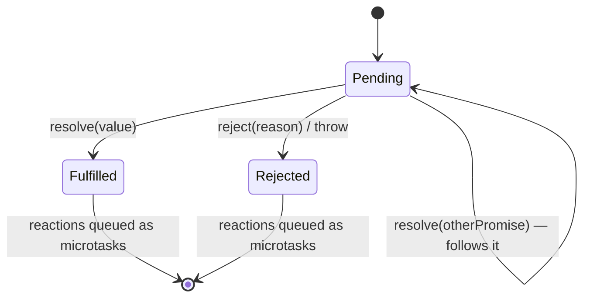
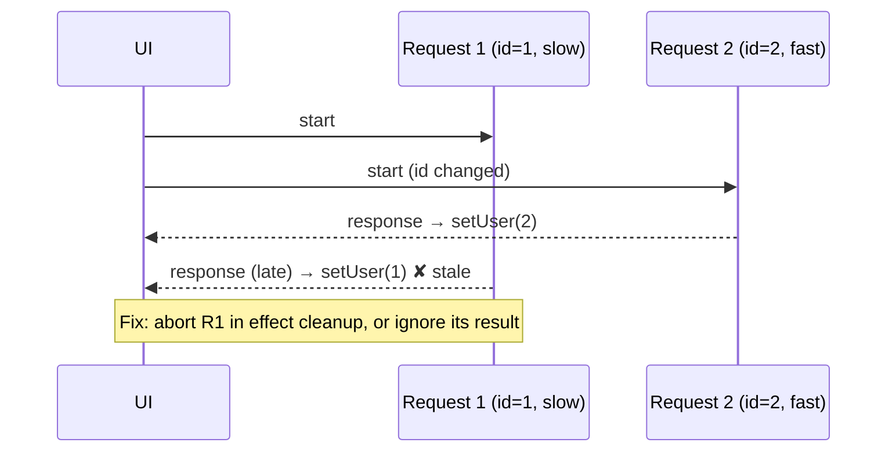

# 00 / 12 — Promises and async/await

## 1. Lesson metadata

| | |
|---|---|
| **Level** | Intermediate |
| **Study time** | 5 hours (reading 2 h, experiments 1 h, exercises 2 h) |
| **Prerequisites** | [11 — Event loop, tasks, microtasks](./11-event-loop-tasks-microtasks.md); also [06 — Lexical scope and closures](./06-lexical-scope-and-closures.md) |
| **Next** | [13 — Browser events and propagation](./13-browser-events-and-propagation.md) (events) or [14 — Web APIs and network requests](./14-web-apis-and-network-requests.md) (fetch builds directly on this lesson) |
| **Related later** | [Phase 2 / 24 — Suspense and thrown thenables](../02-react-rendering-and-internals/24-suspense-conceptual-internals.md), [Phase 3 / 22 — Modern hooks and APIs (`use`, Actions)](../03-react-state-and-hooks/22-modern-hooks-and-apis.md), [Phase 6 / 02 — Cancellation and race conditions](../06-data-fetching-and-state-ecosystems/02-cancellation-and-race-conditions.md) |

**Learning objectives.** After this lesson you can:
1. Describe a promise as a state machine (pending, fulfilled, rejected) and explain what `then` really returns.
2. Predict the interleaving of multiple promise chains and `await` continuations.
3. Explain error propagation, `catch`, `finally`, unhandled rejections, and why `try/catch` around an un-awaited promise does nothing.
4. Choose correctly among `Promise.all`, `allSettled`, `race`, `any`, and know what each does *not* do (cancel).
5. Translate `async/await` into promise chains and identify sequential-vs-parallel mistakes, `forEach(async …)`, and floating promises.
6. Explain how promises meet React: effects cannot be `async`, stale responses race, `use(promise)`, Suspense thenables, and async Actions/transitions in React 19.

**Concepts covered:** promise states, executor, resolve/reject, thenables and adoption, `then`/`catch`/`finally`, chaining, microtask scheduling of reactions, unhandled rejections, combinators, `async`/`await`, error handling, sequential vs parallel, concurrency limits, cancellation-by-convention, `Promise.withResolvers` (⚠ support), `use`, async Actions.

---

## 2. Deep conceptual explanation

### 2.1 What problem is this lesson solving?

Much of a UI's work is *waiting*: for the network, for a timer, for a file, for the user. Waiting must not block the main thread ([Lesson 01](./01-how-the-browser-works.md), [Lesson 11](./11-event-loop-tasks-microtasks.md)). Early JavaScript expressed "do this when that finishes" with callbacks. Callbacks compose poorly: nesting ("callback hell"), repeated error handling, and *inversion of control* (you hand your continuation to code you do not control; will it call you once? twice? never? synchronously?).

A **promise** is a first-class object representing *the eventual result of an operation*. It turns the continuation into data you can pass around, compose, and attach to later. `async/await` is syntax that lets you write promise-based code in the shape of synchronous code.

React-relevant questions this lesson answers:
- Why can't `useEffect(async () => { … })` be the callback?
- Why does a fast second request sometimes get overwritten by a slow first one?
- What does `use(promise)` in React 19 consume, and why must the promise be stable?
- Why does an update scheduled after `await` inside a transition behave differently?
- Why does `await` inside `Promise.all` vs a `for` loop change page-load time from 100 ms to 1 s?

### 2.2 A promise is a state machine

```text
        resolve(value)
 pending ───────────────► fulfilled (value)
    │
    │ reject(reason)  or  executor throws
    └───────────────────► rejected (reason)
```

- **Pending**: initial state.
- **Fulfilled / rejected**: terminal states. Together called **settled**. A settled promise never changes state or value again. Extra `resolve`/`reject` calls are ignored.
- A promise is **resolved** when its fate is locked in, which can happen before it settles (e.g. resolved *with another pending promise*, so it follows that one). "Resolved" and "fulfilled" are not synonyms; casual usage blurs them.

```ts
const p = new Promise<number>((resolve, reject) => {
  // The executor runs SYNCHRONOUSLY, right now, inside `new Promise(...)`.
  setTimeout(() => resolve(42), 100);
});
```

### 2.3 `then`: reactions and a new promise

`p.then(onFulfilled, onRejected)`:
1. Registers *reactions* on `p`.
2. **Immediately returns a new promise** `q`.
3. When `p` settles, the matching handler is queued as a **microtask**. Its return value resolves `q`; if it throws, `q` rejects. If the corresponding handler is absent (or not a function), `q` adopts `p`'s outcome (pass-through).

This is the whole trick behind chaining: each `then` makes a new promise representing "the result of this step".

```ts
fetchUser()                       // Promise<User>
  .then((u) => u.id)              // Promise<number>   (handler returns a value)
  .then((id) => fetchPosts(id))   // Promise<Post[]>   (handler returns a promise → q adopts it)
  .then((posts) => posts.length)  // Promise<number>
  .catch((e) => 0);               // Promise<number>   (recover)
```

**Adoption (a.k.a. flattening):** if a handler returns a *thenable* (an object with a `then` method), the new promise doesn't fulfil with that object; it *follows* it. So you never get `Promise<Promise<T>>`. (TypeScript's `Awaited<T>` models this.)

**Guarantees (public, ECMAScript):**
- Handlers are **never called synchronously**; always asynchronously via a microtask, even if the promise is already settled. This removes the "sometimes sync, sometimes async" ("releasing Zalgo") hazard of callbacks.
- Each handler is called **at most once**.
- Handlers on the *same* promise run in registration order.

### 2.4 `catch` and `finally`

- `p.catch(f)` is `p.then(undefined, f)`.
- A rejection **skips** every `then` without an `onRejected` until it hits a handler; returning from the handler **recovers** (the chain continues fulfilled); throwing/re-throwing continues the rejection.
- `p.finally(f)`: runs `f` (no arguments) after settle either way; the result of `f` is *ignored*, and the original value/reason passes through, **unless** `f` throws or returns a rejected promise, in which case that rejection replaces the outcome. Use it for cleanup (hide spinner), not for transforming results.

### 2.5 Unhandled rejections

A rejected promise with no handler by the time the engine checks (end of the microtask checkpoint for browsers; Node has its own policy) is an **unhandled rejection**. Browsers fire `unhandledrejection` on the global object (and later `rejectionhandled` if one is attached afterwards) and log "Uncaught (in promise)". Node's default (since v15) is to **terminate the process** on an unhandled rejection. Practical meaning: every promise you create must have its rejection handled *somewhere*: awaited in a `try/catch`, `.catch`ed, returned to a caller who does, or deliberately forwarded to a global reporter.

```ts
window.addEventListener("unhandledrejection", (e) => {
  reportError(e.reason);          // last-resort telemetry; not a substitute for local handling
});
```

### 2.6 `async` functions and `await`

- An `async` function **always returns a promise**. `return x` resolves it with `x` (adopting if `x` is a thenable); `throw` rejects it.
- The body runs **synchronously** until the first `await` ([Lesson 11](./11-event-loop-tasks-microtasks.md), §4.1).
- `await expr` converts `expr` to a promise (via `Promise.resolve`), **suspends the function** (not the thread), and resumes it in a microtask when the promise fulfils; if the promise rejects, the `await` expression *throws* at that point, which is why ordinary `try/catch` works.
- The caller gets control back immediately after the first `await`.

Desugaring (conceptually):

```ts
// async version
async function load(id: string) {
  try {
    const user = await getUser(id);
    const posts = await getPosts(user.id);
    return { user, posts };
  } catch (e) {
    return null;
  } finally {
    stop();
  }
}

// roughly equivalent promise chain
function load2(id: string) {
  return getUser(id)
    .then((user) => getPosts(user.id).then((posts) => ({ user, posts })))
    .catch(() => null)
    .finally(stop);
}
```

(The real transformation is a state machine/generator-like coroutine; the chain shows the semantics, not the implementation.)

### 2.7 Combinators

| Method | Fulfils when | Rejects when | Result | Common use |
|---|---|---|---|---|
| `Promise.all(iterable)` | all fulfil | **first** rejection (fail-fast) | array of values in input order | Independent requests all required |
| `Promise.allSettled` | all settle (never rejects) | never | array of `{status, value|reason}` | Best-effort batch; show partial results |
| `Promise.race` | first to **settle** (fulfil *or* reject) | same | that outcome | Timeouts (with caveats) |
| `Promise.any` | first to **fulfil** | all reject → `AggregateError` | first value | Redundant sources (mirrors) |
| `Promise.resolve(x)` / `Promise.reject(e)` | | | already-settled promise | Normalisation, tests |
| `Promise.withResolvers()` ⚠ newer (ES2024; check support) | | | `{ promise, resolve, reject }` | Turning callback/event APIs into promises without the executor boilerplate |

**None of these cancel anything.** `Promise.all` rejecting early does not stop the other operations; `Promise.race` for a timeout leaves the loser running (network request continues, memory held). Cancellation is a different mechanism: `AbortSignal` ([Lesson 14](./14-web-apis-and-network-requests.md)). Promises themselves are not cancellable by design: a promise is a *read-only view of a result*, not a handle on the operation.

### 2.8 Concurrency vs parallelism: sequential vs parallel awaits

```ts
// Sequential: ~ a + b + c
const a = await fetchA();
const b = await fetchB();
const c = await fetchC();

// Parallel: ~ max(a, b, c): start all first, then await
const [a2, b2, c2] = await Promise.all([fetchA(), fetchB(), fetchC()]);
```

`await` *pauses this function*. If the operations do not depend on each other, start them together. This is the "network waterfall" problem that appears again in React as **fetch-on-render waterfalls** ([Phase 6 / 01](../06-data-fetching-and-state-ecosystems/01-fetch-lifecycle.md), [Phase 6 / 13](../06-data-fetching-and-state-ecosystems/13-suspense-data-loading.md)).

### 2.9 Where promises meet React

| Place | What happens | Notes |
|---|---|---|
| Event handlers | May be `async`. React ignores the returned promise. | Errors become unhandled rejections: React does **not** catch them (error boundaries only catch errors thrown during rendering, lifecycle, and constructors, not in async handlers/timers). You must `try/catch` or report. |
| `useEffect(fn)` | `fn` must return `undefined` or a cleanup **function**. An `async` function returns a promise → wrong. | Define an inner async function and call it; handle ignore/abort in cleanup. |
| Data fetching | The component often has `loading/error/data` states updated by promise callbacks. | Race conditions: responses can arrive out of order ([§5.5](#55-corrected-a-guard-for-stale-responses), Phase 6). |
| `use(promise)` (React 19) | Reads a promise's value during render; **suspends** until fulfilled; rejection goes to the nearest error boundary. | The promise must be *stable across renders*, created outside render (parent/Server Component, cache, route loader). A new promise in a Client Component's render would suspend forever/loop. Verified against react.dev/reference/react/use (2026-10-22). |
| Suspense | Components "suspend" by throwing a *thenable* conceptually; React attaches `then` and retries when it settles. | Implementation detail; [Phase 2 / 24](../02-react-rendering-and-internals/24-suspense-conceptual-internals.md). |
| Actions (`startTransition(async () => …)`, `<form action={fn}>`, `useActionState`) | React 19 supports async functions in transitions: pending state spans the promise. | ⚠ State updates **after an `await`** inside the async function are not automatically part of the transition; wrap them in another `startTransition` (documented caveat; verified on react.dev/reference/react/useTransition, 2026-10-22). |
| `lazy(() => import(...))` | `import()` returns a promise. | [Lesson 10](./10-modules-and-dependency-graphs.md). |

### 2.10 Common misconceptions

| Misconception | Reality |
|---|---|
| "A promise starts the work when you call `then`." | The work starts when the *operation* starts (e.g. when `fetch()` is called). `then` only attaches a reaction. A promise is not lazy. |
| "`await` blocks the thread." | It suspends only the async function; the thread returns to the event loop. |
| "`async` makes a function run in the background." | The body runs synchronously until the first `await`. CPU-heavy code in an async function still blocks ([Lesson 01 §5.3](./01-how-the-browser-works.md)). |
| "`try { fetchData() } catch {}` handles errors." | Without `await`, the rejection happens later, outside the `try`. |
| "`Promise.all` cancels the rest on failure." | It only *stops waiting*. |
| "A `.then` callback runs before the next line." | It runs after the current synchronous code (and queued microtasks ahead of it). |
| "Promises make the UI update." | Updates happen only when you call `setState`, `dispatch`, etc. |
| "Returning a value from `useEffect`'s async function is the cleanup." | It returns a promise, which React treats as a (wrong) cleanup; modern React/TS flags it. |

---

## 3. Internal mechanics

### 3.1 Spec model: reactions and jobs

*Public guarantee:* a promise has internal slots `[[PromiseState]]`, `[[PromiseResult]]`, lists of fulfil and reject reactions. `then` appends reaction records (if pending) or enqueues a **PromiseReactionJob** immediately (if settled). Settling a promise enqueues one job per registered reaction. These jobs run on the host's microtask queue (HostEnqueuePromiseJob → HTML microtask queue).

*Teaching model:* "every handler runs as a microtask after the settle point."

*Implementation detail:* engines optimise heavily (e.g. avoid allocating intermediate promises for `await` on native promises; V8 has "async stack traces" implemented via promise chains).

### 3.2 Interleaving of chains

```js
Promise.resolve().then(() => console.log("a1")).then(() => console.log("a2")).then(() => console.log("a3"));
Promise.resolve().then(() => console.log("b1")).then(() => console.log("b2"));
```

Both first-level handlers are queued immediately: microtask queue = [a1, b1]. Run a1 → resolves the promise for a2 → queue becomes [b1, a2]. Run b1 → queue [a2, b2]. Run a2 → [b2, a3]; b2; a3. Output: `a1 b1 a2 b2 a3`.

Chains advance **one link per "round"**, interleaved. This is the model for reasoning about two `async` functions running "at once".

### 3.3 Resolving with a promise costs extra ticks

If you `resolve(promiseB)` or `return promiseB` from a handler (or an `async` function returns a promise), the outer promise needs extra jobs to adopt `promiseB` (the spec's `NewPromiseResolveThenableJob`, then a `then` on it). Therefore `return somePromise` can take **more microtask turns** than `return value`. *Teaching consequence:* never write code that depends on the exact number of turns between unrelated chains. Only ordering *within* a single dependency chain is a guarantee.

### 3.4 Unhandled-rejection tracking

The host (HTML/Node) is notified when a promise is rejected with no handler (`HostPromiseRejectionTracker`) and again if a handler is added later. Browsers batch notifications and fire `unhandledrejection` after the microtask checkpoint, so attaching a handler in the *same synchronous turn* (or a microtask) is fine; attaching it after a task boundary (`setTimeout`) is too late for the event but still works for the handler. Node's `--unhandled-rejections` modes differ. ⚠ Verify Node version behaviour.

### 3.5 Async stack traces

Because continuations run from the microtask queue with an empty stack, a naive stack trace after `await` would show nothing useful. DevTools reconstruct "async stack traces" by linking promise chains (Chrome's `async` frames in the call stack). Use **Async** checkbox / "async stack trace" features when debugging; and give your errors `cause`s.

### 3.6 `await` in loops, `forEach`, and iteration

- `for…of` with `await` inside runs sequentially (each iteration awaits).
- `array.forEach(async (x) => { await … })` does **not** wait: `forEach` ignores returned promises, so the outer code continues immediately (and errors become unhandled rejections). Use `for…of` (sequential) or `await Promise.all(array.map(async …))` (parallel).
- `for await (const x of asyncIterable)` consumes async iterators (streams, paginated APIs).

### 3.7 Promise-like objects in React

React treats any object with a `then` method as a **thenable**; `use` and Suspense integration rely on that duck-typing. React may attach extra properties (a status/value record) to the promise it's given to track state (an implementation detail; do not depend on it). ⚠ Verify against current React docs on `use`.

---

## 4. Step-by-step execution walkthrough

### 4.1 A chain with recovery and `finally`

```js
Promise.resolve(1)
  .then((v) => { console.log(v); return 2; })
  .then((v) => { console.log(v); throw new Error("x"); })
  .then(() => console.log("skipped"))
  .catch((e) => { console.log(e.message); return "recovered"; })
  .finally(() => console.log("fin"))
  .then((v) => console.log(v));
```

**Predict** the output.

**Walkthrough:** Each `.then/.catch/.finally` creates a new promise; handlers run as microtasks, one link per round.
1. `1`: first handler returns `2` → next promise fulfils with `2`.
2. `2`: handler throws → next promise **rejects** with the Error.
3. The next `then(() => …)` has no `onRejected`, so it passes the rejection through: `"skipped"` never prints.
4. `catch` receives the error: prints `x`; returns `"recovered"` → fulfilled.
5. `finally` runs its callback (no args): prints `fin`; its return value is ignored, and the fulfilled `"recovered"` passes through.
6. Final `then` prints `recovered`.

**Output:** `1, 2, x, fin, recovered`.

### 4.2 Two async functions interleaving

```js
async function a() { console.log("a1"); await null; console.log("a2"); await null; console.log("a3"); }
async function b() { console.log("b1"); await null; console.log("b2"); }
a(); b(); console.log("sync end");
```

1. `a()` runs sync: `a1`; `await null` queues continuation A2; returns.
2. `b()`: `b1`; queues B2.
3. `sync end`.
4. Microtask checkpoint: A2 → prints `a2`, `await null` queues A3. B2 → prints `b2`. A3 → `a3`.

**Output:** `a1, b1, sync end, a2, b2, a3`.

### 4.3 A stale response in a React component (timeline)

```text
t=0     user selects id=1  → effect starts request R1 (slow, 800 ms)
t=100   user selects id=2  → effect starts request R2 (fast, 100 ms)
t=200   R2 resolves        → setUser(user2)  → UI shows user 2 ✔
t=800   R1 resolves        → setUser(user1)  → UI now shows user 1 while selection is 2 ✘  (race condition)
```

Nothing in promises orders R1 and R2 for you; each `then` runs when *its* promise settles. The fix is to make the older response's handler a no-op, by ignoring or aborting it (§5.5).

---

## 5. Code examples

### 5.1 Minimal: promise constructor and `then` ordering

```ts
console.log("1 start");
const p = new Promise<void>((resolve) => {
  console.log("2 executor");   // synchronous
  resolve();
});
p.then(() => console.log("4 then"));
console.log("3 end");
```

**Predict:** order? **Result:** `1 start`, `2 executor`, `3 end`, `4 then`. The executor is synchronous; the handler is a microtask even though `p` was already fulfilled.

### 5.2 Practical: typed fetch wrapper with error normalisation

```ts
export class HttpError extends Error {
  constructor(readonly status: number, message: string) {
    super(message);
    this.name = "HttpError";
  }
}

export async function getJson<T>(url: string, signal?: AbortSignal): Promise<T> {
  const res = await fetch(url, { signal });           // rejects only on network failure/abort
  if (!res.ok) throw new HttpError(res.status, `GET ${url} → ${res.status}`);  // HTTP errors are NOT rejections by default
  return (await res.json()) as T;                      // parsing can reject too
}
```

Line notes:
- `fetch` fulfils for HTTP 404/500; you must check `res.ok` ([Lesson 14](./14-web-apis-and-network-requests.md)).
- The `as T` is an assertion, not validation. At trust boundaries parse with a schema validator (Zod, Valibot) ([Phase 4 / 14](../04-react-architecture/14-api-boundaries-and-data-access.md)).
- Errors propagate as rejections: callers `await` and `try/catch`, or compose with `.catch`.

### 5.3 Incorrect: `async` effect, floating promise, swallowed error

```tsx
function Profile({ id }: { id: string }) {
  const [user, setUser] = useState<User | null>(null);

  useEffect(async () => {                 // ✗ returns a Promise, not a cleanup function
    const res = await fetch(`/api/users/${id}`);
    setUser(await res.json());            // ✗ no error handling, no stale-response guard
  }, [id]);

  return <h1>{user?.name}</h1>;
}
```

**Problems:** (1) TypeScript flags the callback type: `EffectCallback` must return `void | Destructor`. Even without TS, React would treat the promise as a malformed cleanup and warn in development. (2) A rejection (offline, JSON parse error) becomes an unhandled rejection; the UI silently shows nothing. (3) Race (§4.3). (4) `res.ok` unchecked: a 404 JSON body (e.g. `{ error: ... }`) gets set as the user.

### 5.4 Corrected: inner async function + abort + error state

```tsx
type State =
  | { status: "loading" }
  | { status: "error"; error: unknown }
  | { status: "success"; user: User };

function Profile({ id }: { id: string }) {
  const [state, setState] = useState<State>({ status: "loading" });

  useEffect(() => {
    const controller = new AbortController();
    setState({ status: "loading" });

    (async () => {
      try {
        const user = await getJson<User>(`/api/users/${id}`, controller.signal);
        setState({ status: "success", user });
      } catch (error) {
        if (controller.signal.aborted) return;          // expected: superseded or unmounted
        setState({ status: "error", error });
      }
    })();

    return () => controller.abort();                    // cleanup runs on id change and unmount
  }, [id]);

  if (state.status === "loading") return <p>Loading…</p>;
  if (state.status === "error") return <p role="alert">Something went wrong.</p>;
  return <h1>{state.user.name}</h1>;
}
```

Line notes:
- The IIFE (`(async () => {…})()`) is the "inner async function": the effect itself stays synchronous and returns a proper cleanup function.
- `controller.abort()` rejects the in-flight `fetch` with `AbortError`; we ignore errors that happen *because* we aborted.
- The state is a discriminated union ([Lesson 19](./19-typescript-generics-and-utility-types.md)), so impossible combinations (loading *and* error) cannot be represented.
- Under StrictMode (development) the effect mounts, cleans up and mounts again: the first request is aborted: *expected*, and a good test of your cleanup ([Phase 2 / 28](../02-react-rendering-and-internals/28-strict-mode-behavior.md)).

**Trade-offs:** hand-written fetching in effects is fine for small cases but ignores caching, deduplication, retries, background refetch: that is what TanStack Query or framework loaders solve ([Phase 6](../06-data-fetching-and-state-ecosystems/)). Also, the "ignore flag" variant (`let ignore = false; … return () => { ignore = true }`) also prevents state updates but doesn't cancel the network request; abort is better when supported.

### 5.5 Corrected: a guard for stale responses (without AbortController)

```ts
function useLatestRequest<T>() {
  const ticket = useRef(0);
  return useCallback(async (run: () => Promise<T>, onResult: (v: T) => void) => {
    const mine = ++ticket.current;
    const value = await run();
    if (mine === ticket.current) onResult(value);   // only the latest request may write
  }, []);
}
```

Use when you can't abort (e.g. a third-party SDK returning promises). This protects UI state but wastes the work; document that.

### 5.6 Practical: sequential vs parallel, timed

```ts
const sleep = (ms: number) => new Promise<void>((r) => setTimeout(r, ms));

async function sequential() {
  const t0 = performance.now();
  await sleep(100); await sleep(100); await sleep(100);
  return Math.round(performance.now() - t0);        // ≈ 300
}
async function parallel() {
  const t0 = performance.now();
  await Promise.all([sleep(100), sleep(100), sleep(100)]);
  return Math.round(performance.now() - t0);        // ≈ 100
}
```

**Predict:** durations. **Result:** about 300 ms vs about 100 ms (timers can be later but never earlier than specified; `performance.now()` precision is reduced in browsers for security reasons). Real-world: dashboard loading profile, notifications, and permissions with three sequential awaits turns 3×80 ms into 240 ms; in parallel it's ~80 ms. Constraint: if the second call *depends* on the first (needs `user.id`), it's inherently sequential: restructure the API (a single endpoint, or server-side composition) rather than fighting it.

### 5.7 Practical: `allSettled` for partial dashboards

```ts
type Widget<T> = { status: "ok"; data: T } | { status: "failed"; reason: unknown };

async function loadDashboard() {
  const [sales, alerts, traffic] = await Promise.allSettled([
    getJson<Sales>("/api/sales"),
    getJson<Alert[]>("/api/alerts"),
    getJson<Traffic>("/api/traffic"),
  ]);
  const toWidget = <T,>(r: PromiseSettledResult<T>): Widget<T> =>
    r.status === "fulfilled" ? { status: "ok", data: r.value } : { status: "failed", reason: r.reason };
  return { sales: toWidget(sales), alerts: toWidget(alerts), traffic: toWidget(traffic) };
}
```

One failing widget doesn't blank the dashboard. With `Promise.all` the first rejection loses the other results (they still complete, but you throw them away).

### 5.8 Advanced: bounded concurrency (a tiny `pLimit`)

```ts
export async function mapLimit<T, R>(
  items: readonly T[],
  limit: number,
  fn: (item: T, index: number) => Promise<R>,
): Promise<R[]> {
  const results = new Array<R>(items.length);
  let next = 0;
  let failed = false;
  async function worker() {
    while (!failed) {
      const i = next++;                       // safe: single-threaded, no await between read and increment
      if (i >= items.length) return;
      try {
        results[i] = await fn(items[i], i);
      } catch (e) {
        failed = true;                        // tell the other workers to stop pulling new items
        throw e;
      }
    }
  }
  await Promise.all(Array.from({ length: Math.min(limit, items.length) }, worker));
  return results;
}
```

Why it works: `limit` workers each pull the next index; JavaScript's run-to-completion guarantees `next++` isn't interleaved. Semantics: fail-fast: the first rejection rejects the result and stops *new* items from starting, but items already in flight still run to completion (no cancellation; pass an `AbortSignal` into `fn` if you need that). Use when firing 500 requests at once would hit browser per-origin limits (HTTP/1.1: ~6 connections) or rate limits.

### 5.9 Advanced: retry with backoff, abortable

```ts
export async function retry<T>(
  fn: (attempt: number) => Promise<T>,
  { retries = 3, baseMs = 200, signal }: { retries?: number; baseMs?: number; signal?: AbortSignal } = {},
): Promise<T> {
  for (let attempt = 0; ; attempt++) {
    try {
      return await fn(attempt);               // `await` is REQUIRED so the catch below sees rejections
    } catch (e) {
      if (attempt >= retries || signal?.aborted) throw e;
      const delay = baseMs * 2 ** attempt * (0.5 + Math.random() / 2);   // exponential + jitter
      await new Promise<void>((resolve, reject) => {
        const id = setTimeout(resolve, delay);
        signal?.addEventListener("abort", () => { clearTimeout(id); reject(signal.reason); }, { once: true });
      });
    }
  }
}
```

Notes: `return await` inside `try` matters (§8). Retry only *idempotent* operations (GET; or POST with an idempotency key) and not on 4xx. [Phase 6 / 15](../06-data-fetching-and-state-ecosystems/15-error-recovery-and-retries.md) covers policy.

### 5.10 React 19: `use` with a stable promise, and an async Action

```tsx
import { Suspense, use, useState, useTransition } from "react";

type Comment = { id: string; text: string };

function Comments({ commentsPromise }: { commentsPromise: Promise<Comment[]> }) {
  const comments = use(commentsPromise);        // suspends until fulfilled; rejects → nearest error boundary
  return <ul>{comments.map((c) => <li key={c.id}>{c.text}</li>)}</ul>;
}

export function Page({ commentsPromise }: { commentsPromise: Promise<Comment[]> }) {
  // The promise is created by a parent / route loader / Server Component, NOT here during render.
  return (
    <Suspense fallback={<p>Loading comments…</p>}>
      <Comments commentsPromise={commentsPromise} />
    </Suspense>
  );
}

export function AddComment({ post }: { post: (t: string) => Promise<void> }) {
  const [text, setText] = useState("");
  const [isPending, startTransition] = useTransition();
  return (
    <form
      onSubmit={(e) => {
        e.preventDefault();
        startTransition(async () => {            // async transitions: React 19
          await post(text);
          startTransition(() => setText(""));    // updates after `await` need their own transition wrapper
        });
      }}
    >
      <input value={text} onChange={(e) => setText(e.target.value)} />
      <button disabled={isPending}>Post</button>
    </form>
  );
}
```

Verified against react.dev (2026-10-22): `use`, async transitions, and the "wrap post-`await` updates in `startTransition`" rule are as described, though React may refine them. For forms, prefer `<form action>` + `useActionState` ([Phase 3 / 22](../03-react-state-and-hooks/22-modern-hooks-and-apis.md)).

---

## 6. Visual explanations

### Promise lifecycle and reactions



### Chain propagation

```mermaid
flowchart LR
  P0["p0 fulfilled(1)"] -->|then h1 returns 2| P1["p1 fulfilled(2)"]
  P1 -->|then h2 throws| P2["p2 rejected(Error)"]
  P2 -->|then h3 (no onRejected): pass through| P3["p3 rejected(Error)"]
  P3 -->|catch returns 'recovered'| P4["p4 fulfilled('recovered')"]
  P4 -->|finally: result ignored| P5["p5 fulfilled('recovered')"]
```

### Await as suspension

```text
async function f() {          caller
  A();                        │ f() ───────► runs A() synchronously
  await p;     ◄──── returns to caller here: f's promise (pending) is returned
  B();                        │ caller continues...
}                             │
                              ... microtask: p fulfilled → resume f at `await`, run B()
```

### The race in §4.3



---

## 7. Alternative approaches and trade-offs

**Handling async data in React:**

| Approach | Readability | Correctness (races, caching) | Complexity | Testability | Notes |
|---|---|---|---|---|---|
| `useEffect` + `fetch` + abort | Medium | You own all of it | Medium (grows fast) | Medium | Fine for one-off, simple cases |
| Data library (TanStack Query, SWR, RTK Query) | High | Dedupes, cancels, caches, retries | Library dependency | High (mock network) | Default for server state in client apps |
| Framework loaders / RSC data fetching | High | Handled by the framework | Framework coupling | Medium | ⚠ Verify current framework docs |
| `use(promise)` + Suspense | High | Needs stable, cached promise | Needs cache layer | Medium | Great with a loader/cache; footgun if you create the promise in render |
| Callbacks/event emitters | Low | Hard | Medium | Low | Legacy APIs; wrap in promises |
| Observables (RxJS) | Medium | Excellent for streams, cancellation built-in | High | High | Heavy for simple requests; shines for streams/complex orchestration |

**When the recommended approach (use a data library) is *not* best:** a tiny widget in a library you publish should not impose a data library on consumers; a plain `fetch` + abort effect (or accepting a `loader` prop) is right. Likewise one-shot non-cacheable mutations (a "send feedback" form) don't need a cache: a simple async handler with pending/error state suffices.

**`async/await` vs `.then` chains:** `await` reads better for sequences and `try/catch`; `.then` chains are fine for point-free composition (`promise.then(parse).catch(report)`). Don't mix them in a single function without reason.

---

## 8. Best practices and anti-patterns

**Do**
- Treat every promise as something that must be awaited, returned, or explicitly `.catch`ed. Enable lint rules such as `@typescript-eslint/no-floating-promises` and `no-misused-promises` *(verify rule names in your version)*.
- Use `return await` **inside** `try/catch`/`finally` when you want the catch to apply; outside try blocks, `return promise` is fine.
- Start independent operations first, then await them together.
- Check `res.ok` for `fetch`; wrap network + HTTP + parse errors in one error type.
- Pair every async effect with cancellation (abort) or a stale-guard.
- Use `Promise.allSettled` when partial success is a product feature.

**Beginner mistakes**
- `forEach(async …)`; missing `await`; `try` around a non-awaited call.
- `new Promise` wrapping an API that already returns a promise (the *explicit construction anti-pattern*).
- Async `useEffect` callback.
- Forgetting that `await` in a loop is sequential.
- Mutating state after unmount (React no longer warns about it in 18+, but stale updates are still logic bugs).

**Experienced-developer mistakes**
- Assuming `Promise.race` timeouts cancel work; leaking the loser.
- Unbounded concurrency (`Promise.all` of thousands of requests).
- Depending on microtask tick counts for cross-chain ordering.
- Retrying non-idempotent writes.
- Creating the promise passed to `use` during render.
- Swallowing errors with `.catch(() => {})` without reporting.
- Catching `AbortError` and showing it as an error to users.

**Smells:** `.then` pyramids inside `async` functions; `async` function without `await` (sometimes intentional to return a promise, but check); `catch (e) { console.log(e) }` only; `let loading` flags set/reset manually across branches (use `finally` or a state machine).

**Justified exceptions:** fire-and-forget analytics (`void track(event)` with a `.catch` inside `track` that reports, and a comment); `new Promise` to wrap callback/event APIs (`withResolvers` where available).

**The `return` vs `return await` rule.**
```ts
async function a() { try { return fetchX(); }       catch { return fallback; } }  // ✗ rejection NOT caught: promise returned un-awaited
async function b() { try { return await fetchX(); } catch { return fallback; } }  // ✓ caught
```

---

## 9. Real-world application

*Auth / token refresh.* Many requests fire concurrently when an access token expires. Naively, each gets a 401 and each triggers a refresh, so the refresh token is consumed by the first and the others fail. **Single-flight pattern:** store one in-flight refresh promise and have all callers await it.

```ts
let refreshing: Promise<string> | null = null;
export function getFreshToken(): Promise<string> {
  return (refreshing ??= doRefresh().finally(() => { refreshing = null; }));
}
```
All callers share one promise (promises are shareable, multi-consumer values). Constraints: error propagation to all waiters, refresh-token rotation, multi-tab races (use `BroadcastChannel`/Web Locks; `navigator.locks` ⚠ check support).

*Checkout.* Pay button: `async` handler, disabled while pending, **idempotency key** generated once per attempt so a retry after a timeout doesn't double-charge; optimistic UI optional ([Phase 6 / 05](../06-data-fetching-and-state-ecosystems/05-optimistic-updates.md)); handle `AbortError` on navigation.

*Search typeahead.* Debounced input, abort previous request on each keystroke, show the last successful results while loading (avoid flicker), and ignore stale responses. This is race handling + microtask/timer knowledge combined.

*Multi-team platform.* A shared `apiClient` returns typed promises and throws typed errors; teams must not swallow errors silently. A lint rule forbids floating promises; global `unhandledrejection` telemetry reports leaks with route and release; on-call dashboards track rate.

---

## 10. Debugging and troubleshooting

**Symptom 1: "Uncaught (in promise) …" in console; UI silently stale.**
*Investigation:* expand the error; use async stack trace to see the originating call; set "Pause on caught/uncaught exceptions" (Sources → right panel). Search for floating promises with the lint rule. *Root cause:* missing `catch`/`await`. *Fix:* handle where you can render an error state or report. *Validate:* force the failure (DevTools offline, `fetch` mock 500) and see the UI show an error.

**Symptom 2: UI shows data for the previous selection.**
*Investigation:* Network panel waterfall: overlapping requests, completion order differs from start order. Add logs with request ids. *Root cause:* race (§4.3). *Fix:* abort or ticket guard (§5.4, §5.5), or a data library. *Validate:* throttle network to "Slow 3G", click quickly through ids; UI must match the last selection; confirm earlier requests show "(canceled)" in the Network panel.

**Symptom 3: "Page takes 3 s but each API is 1 s."** Waterfall of sequential awaits or nested component fetches. *Fix:* start independent work in parallel; hoist fetches; use route-level loaders/prefetch.

**Symptom 4: `forEach(async)` loop "finishes" early; later code runs before data is ready.** Replace with `for…of` or `Promise.all(map(...))`.

**Symptom 5: `use(promise)` causes an infinite suspend/render loop.** The promise is recreated every render (inline `fetch` in the component). Move creation to a parent, cache by key, or use a loader/query library.

**Symptom 6: Test warns "An update to X inside a test was not wrapped in act(...)".** A promise resolved after the assertion and set state. *Fix:* `await` the UI change via `findBy…`/`waitFor`; avoid arbitrary sleeps ([Phase 8](../08-testing-and-quality/)).

DevTools tips: Console "Preserve log"; Network → throttling and "Offline"; Sources → "Async" call stacks; Performance → shows "Run Microtasks"; `console.trace()` inside `then` for provenance.

---

## 11. Exercises

### Level A — Knowledge
A1. Name the three promise states and the two terminal ones. What does "settled" mean? How is "resolved" different from "fulfilled"?
A2. What does `then` return? What happens if the handler returns a promise?
A3. When are `then` handlers invoked relative to the code that follows `then(...)`?
A4. What does `finally` do with its callback's return value?
A5. Explain why `Promise.all` does not cancel the other operations.
A6. Why can't the callback passed to `useEffect` be `async`?

### Level B — Code comprehension
B1. Output?
```js
Promise.resolve().then(() => console.log("a1")).then(() => console.log("a2")).then(() => console.log("a3"));
Promise.resolve().then(() => console.log("b1")).then(() => console.log("b2"));
```
B2. Output?
```js
console.log(1);
new Promise((resolve) => { console.log(2); resolve(3); }).then((v) => console.log(v));
console.log(4);
```
B3. Output and final state of `p`?
```js
const p = Promise.reject(new Error("boom"))
  .finally(() => { console.log("cleanup"); return "ignored"; });
p.catch((e) => console.log("caught", e.message));
```
B4. Which of these catch the failure? Explain each.
```js
async function a() { try { return Promise.reject(new Error("x")); } catch { return "caught"; } }
async function b() { try { return await Promise.reject(new Error("x")); } catch { return "caught"; } }
async function c() { try { Promise.reject(new Error("x")); } catch { return "caught"; } return "no error"; }
```
B5. How long does this take (approximately), and how would you make it ~200 ms?
```js
const items = [1, 2, 3, 4];
const t0 = Date.now();
for (const i of items) { await sleep(200); }
console.log(Date.now() - t0);
```
B6. What does this print, and why is it a bug?
```js
const ids = [1, 2, 3];
let total = 0;
ids.forEach(async (id) => { total += await getValue(id); });
console.log(total);
```

### Level C — Implementation
C1. Implement `timeout<T>(promise: Promise<T>, ms: number): Promise<T>` that rejects with a `TimeoutError` after `ms` and **clears the timer** when the promise settles first. Explain what it does *not* do.
C2. Implement `promiseAllSettled` from scratch using only `then`/`catch` (no `Promise.allSettled`).
C3. Implement `useAsync<T>(fn, deps)` returning a discriminated-union state `{status: 'idle'|'loading'|'success'|'error'}` that aborts/ignores stale runs.
C4. Implement a single-flight cache: `singleFlight(key, fn)` so concurrent calls with the same key share one in-flight promise, which is removed on settle.
C5. Implement a minimal `MyPromise` (constructor, `then`, `catch`) that obeys: async handlers, chaining, adoption of thenables, once-only settle. (Outline acceptable; full code is a stretch.)

### Level D — Debugging
D1. This component sometimes shows an old user's name. Find all defects.
```tsx
function Name({ id }: { id: string }) {
  const [name, setName] = useState("");
  useEffect(() => {
    fetch(`/api/u/${id}`).then((r) => r.json()).then((u) => setName(u.name));
  }, []);
  return <p>{name}</p>;
}
```
D2. `await Promise.all(files.map(upload))` fires 300 simultaneous uploads and many fail with network errors. Diagnose and fix.
D3. A "Save" handler shows "Saved!" even when the server returned HTTP 500. Find the bug.
```ts
async function save(data: Data) {
  try {
    await fetch("/api/save", { method: "POST", body: JSON.stringify(data) });
    toast("Saved!");
  } catch { toast("Failed"); }
}
```
D4. `use(fetchUser(id))` inside a Client Component re-suspends every time the component renders, never settling. Explain and fix.

### Level E — Architecture and engineering decisions
E1. Your team debates `async/await` with scattered `try/catch` vs a `Result<T, E>` return type vs letting errors bubble to error boundaries. Evaluate and recommend a policy for a large React codebase with a typed API layer.
E2. Design how a design-system `<AsyncButton onClick={async () => …}>` should behave: pending state, double-click protection, error reporting, unmount safety, accessibility. Which decisions belong to the component and which to the caller?

### Level F — Expert challenge
F1. Given `a()`, `b()` below, determine the order of logs and justify using microtask rounds, including the extra turns from returning a promise from an async function:
```js
async function a() { console.log("a1"); await b(); console.log("a2"); }
async function b() { console.log("b1"); return Promise.resolve("x"); }
a(); Promise.resolve().then(() => console.log("p1")).then(() => console.log("p2")).then(() => console.log("p3"));
```
(Reason from the spec model; then explain why you should not depend on the result.)
F2. Design a cancellation strategy for a React app where user navigation, component unmount, and a "Cancel" button should abort requests *and* running CPU-bound pipeline stages, composing signals. Outline APIs (`AbortSignal.any`, `AbortSignal.timeout` ⚠ support) and failure modes.

---

## 12. Detailed answers and explanations

> Attempt the exercises first.

**A1.** Pending, fulfilled, rejected. Fulfilled and rejected are terminal; "settled" = either. A promise is *resolved* once its outcome is determined or locked-in (including being resolved with another promise it now follows), which may be before it is settled. A promise resolved with a pending promise is resolved but still pending.

**A2.** A new promise representing the handler's outcome. If the handler returns a promise (thenable), the new promise adopts its state (flattening), so no `Promise<Promise<T>>`.

**A3.** Always after the current synchronous code completes, as a microtask: even if the promise is already settled. Handlers are never invoked synchronously.

**A4.** Ignores it; passes through the original outcome, unless the callback throws/returns a rejected promise, in which case that rejection replaces the outcome.

**A5.** A promise is a read-only result; the operations are independent. `all` merely settles its own result promise on the first rejection and stops waiting. The others continue unless you abort them via `AbortSignal`, which fetch and many APIs support.

**A6.** `useEffect` expects the callback to return nothing or a cleanup *function*; async functions return a promise. React would try to treat it as a cleanup (it warns). Also TypeScript rejects it. Using an inner async function lets you return a real cleanup (abort).

**B1.** `a1 b1 a2 b2 a3` (§3.2). Wrong answer: `a1 a2 a3 b1 b2`: chains do not run to completion before others; each link is a separate microtask appended to the queue.

**B2.** `1, 2, 4, 3`. The executor is sync (`2`), `then` handler is a microtask (`3`) after `4`.

**B3.** Output: `cleanup`, then `caught boom`. `finally` runs its callback; the return value `"ignored"` is discarded; `p` stays *rejected* with the original error; `p.catch` handles it. (If you did not attach `p.catch`, the rejection of `p` would be unhandled.) Subtle: the promise returned by the first `Promise.reject(...)` itself has a handler (`finally`) so isn't unhandled; but `p` is.

**B4.** `a` does **not** catch: `return Promise.reject(...)` returns the promise un-awaited; the async function's own promise adopts the rejection *after* leaving the `try`, so the function rejects. `b` catches (returns `"caught"`). `c` does not catch: the rejection happens asynchronously and is unhandled; the function returns `"no error"` and an unhandled rejection is reported.

**B5.** ≈ 800 ms (sequential). Make it parallel: `await Promise.all(items.map(() => sleep(200)))` ≈ 200 ms, if the operations are independent (and consider concurrency limits for big arrays).

**B6.** Prints `0`. `forEach` ignores the returned promises; the callbacks suspend at `await`, and `console.log(total)` runs immediately. Also a possible data race on `total` isn't an issue in single-threaded JS here, but the read of `total` before additions *is*. Fix: `const values = await Promise.all(ids.map(getValue)); const total = values.reduce((a, b) => a + b, 0);` (no shared mutable accumulator).

**C1.**
```ts
export class TimeoutError extends Error { constructor(ms: number) { super(`Timed out after ${ms}ms`); this.name = "TimeoutError"; } }

export function timeout<T>(promise: Promise<T>, ms: number): Promise<T> {
  let id: ReturnType<typeof setTimeout>;
  const timer = new Promise<never>((_, reject) => { id = setTimeout(() => reject(new TimeoutError(ms)), ms); });
  return Promise.race([promise, timer]).finally(() => clearTimeout(id));
}
```
Does **not** cancel the underlying work. For `fetch` pass `AbortSignal.timeout(ms)` ⚠ (check support) so the request itself is aborted. Edge: if `promise` rejects after the timeout already won, that later rejection is "handled" by `race` (race attached handlers), so no unhandled warning.

**C2.**
```ts
export function allSettled<T>(ps: readonly (T | PromiseLike<T>)[]): Promise<PromiseSettledResult<Awaited<T>>[]> {
  return Promise.all(
    ps.map((p) =>
      Promise.resolve(p).then(
        (value): PromiseFulfilledResult<Awaited<T>> => ({ status: "fulfilled", value: value as Awaited<T> }),
        (reason): PromiseRejectedResult => ({ status: "rejected", reason }),
      ),
    ),
  );
}
```
Why correct: each element is converted into a promise that *never rejects* (both handlers return values), so `Promise.all` never fails fast, and order is preserved. Edge: empty array resolves to `[]`; non-promise inputs are normalised by `Promise.resolve`.

**C3.**
```tsx
type AsyncState<T> =
  | { status: "idle" }
  | { status: "loading" }
  | { status: "success"; data: T }
  | { status: "error"; error: unknown };

export function useAsync<T>(fn: (signal: AbortSignal) => Promise<T>, deps: React.DependencyList): AsyncState<T> {
  const [state, setState] = useState<AsyncState<T>>({ status: "idle" });
  useEffect(() => {
    const controller = new AbortController();
    setState({ status: "loading" });
    fn(controller.signal).then(
      (data) => { if (!controller.signal.aborted) setState({ status: "success", data }); },
      (error) => { if (!controller.signal.aborted) setState({ status: "error", error }); },
    );
    return () => controller.abort();
    // eslint-disable-next-line react-hooks/exhaustive-deps -- deps are supplied by the caller
  }, deps);
  return state;
}
```
Evaluation: abort + guard (belt and braces for APIs ignoring the signal); no async effect callback; discriminated union. Trade-off: the lint disable is a smell, so many teams prefer passing a stable `fn` (useCallback) or using a library. Mention the `exhaustive-deps` custom hook configuration (`additionalHooks`).

**C4.**
```ts
const inflight = new Map<string, Promise<unknown>>();
export function singleFlight<T>(key: string, fn: () => Promise<T>): Promise<T> {
  const existing = inflight.get(key) as Promise<T> | undefined;
  if (existing) return existing;
  const p = fn().finally(() => inflight.delete(key));
  inflight.set(key, p);
  return p;
}
```
Notes: the entry is removed on settle (success or failure); callers share the same promise (and the same error). Caveat: module-level `Map` is shared across SSR requests: don't key user-specific data unless the key includes the user ([Lesson 10](./10-modules-and-dependency-graphs.md) §3.2). Cancellation: aborting one caller shouldn't abort others, so use a ref-count if you pass signals.

**C5.** Evaluation outline: store `state`, `value`, `handlers[]`; `resolve` ignores second calls; if `resolve(x)` and `x` is thenable → call `x.then(resolve, reject)` once (guard against thenables calling both); `then` returns a new `MyPromise`; handlers invoked via `queueMicrotask`; if handler missing, pass through; exceptions in handlers reject the derived promise; a `then` registered after settlement still schedules via microtask; prevent self-resolution (`TypeError` on `p.then(() => p)` cycle). The Promises/A+ test suite (`promises-aplus-tests`) *(verify package)* is the conformance check.

**D1.** Defects: (1) empty deps `[]` → doesn't refetch when `id` changes (stale name; ESLint `exhaustive-deps` would flag it); (2) no cancellation/stale guard (race on quick `id` changes if deps were fixed); (3) no `res.ok` check; (4) no error handling (unhandled rejection, no error UI); (5) no loading state, so old name remains visible while loading the new one. Fix as §5.4.

**D2.** All 300 requests start simultaneously: browser per-origin connection limits (HTTP/1.1), server rate limits, memory and bandwidth contention; failures due to timeouts. Fix with bounded concurrency (`mapLimit(files, 4, upload)`), use `allSettled` to report per-file results and retry only retryable failures, show progress, and consider chunked/resumable upload. Verify: Network panel's waterfall shows ≤ N in flight.

**D3.** `fetch` doesn't reject on HTTP errors; a 500 fulfils, and "Saved!" is shown. Fix: `const res = await fetch(...); if (!res.ok) throw new HttpError(res.status, ...);`. Also consider `res.json()` error handling and not parsing a non-JSON body, and idempotency for retries.

**D4.** `fetchUser(id)` creates a new promise on every render; `use` suspends on a new unresolved promise each time, React re-renders after it resolves, creating yet another new promise → loop. Fix: create the promise outside render and pass it down (parent/loader/Server Component), or memoise/cache by key in a cache layer (`cache()` in RSC; a query library on the client). `useMemo` is *not* a semantic guarantee of stability, so use a cache rather than relying on it. Consistent with the current `use` docs.

**E1.** Criteria: error-handling consistency, type safety, boundary placement, observability, developer ergonomics, interop with libraries (TanStack Query expects thrown/rejected errors). *Good answer:* in a React codebase, use rejections with **typed error classes** at the API layer; data libraries convert them to `error` states; render-time errors from `use`/Suspense go to error boundaries; handlers use `try/catch` for *expected* failures (validation, conflict) and map them to UI state; unexpected errors propagate to a global reporter. `Result<T,E>` is valuable at domain boundaries where failures are *values* (parsing, validation), but wrapping every fetch in `Result` fights library conventions and adds ceremony. Policy: lint for floating promises, require `cause` on rethrow, never swallow without reporting. State what would change your recommendation (e.g., a team that already uses `neverthrow` across the stack).

**E2.** *Component owns:* pending state while the returned promise is unsettled (`aria-busy`, disabled or `aria-disabled` to keep focus), ignoring clicks while pending (or a `allowConcurrent` prop), catching rejections to avoid unhandled rejections and exposing `onError`, unmount safety (don't set state if unmounted: use a mounted ref or `useTransition`/`useActionState` which handle it), announcing state via live region. *Caller owns:* what to do on success/failure (toast, navigation), cancellation semantics and idempotency keys (pass a signal in the handler args). Edge cases: handler throws synchronously; handler returns non-promise; promise never settles (offer timeout prop); StrictMode double effects don't trigger handlers (handlers aren't effects).

**F1.** Reasoning (spec model; not to be depended on). Synchronously: `a1`, `b1`. `b` returns `Promise.resolve("x")`, so b's promise is resolved *with a promise*; the spec queues a thenable job (J1) to call `x.then(...)`. `a` then awaits b's (still pending) promise. Then `p1` is queued. Queue: [J1, p1].
Round 1: J1 runs and queues a reaction R (x is already fulfilled); `p1` runs (logs `p1`) and queues `p2`. Queue: [R, p2].
Round 2: R fulfils b's promise, which queues `a`'s continuation A; `p2` runs (logs `p2`) and queues `p3`. Queue: [A, p3].
Round 3: A runs (logs `a2`), then `p3`.
Predicted order: `a1, b1, p1, p2, a2, p3`. Had `b` returned a plain value (`return "x"`), its promise would already be fulfilled when `a` awaits it, so `a`'s continuation would be queued before `p1`: `a1, b1, a2, p1, p2, p3`. Run in Node 24 (V8) it prints exactly this: `a1 b1 p1 p2 a2 p3`, and `a1 b1 a2 p1 p2 p3` for the plain-value variant. The *lesson*: the number of turns is an artefact of spec details that engines have optimised over time (e.g. the 2018 `await` optimisation); test in your engine if curious, and never encode such ordering assumptions between unrelated chains in production code. Verify by running it.

**F2.** Strategy: one root `AbortController` per *user intent* (route navigation, search session); child signals created per operation via `AbortSignal.any([navSignal, componentSignal, cancelButtonSignal])` ⚠ (check support; polyfill by manual forwarding) and `AbortSignal.timeout(ms)` for deadlines. Every async API takes `{ signal }`; CPU stages check `signal.throwIfAborted()` between slices (see [Lesson 11](./11-event-loop-tasks-microtasks.md) `processInSlices`) and workers are `terminate()`d or receive an abort message. Failure modes: libraries ignoring signals (use the ticket guard), abort during commit of a mutation (server may have applied the write: abort ≠ rollback), `AbortError` reported as a failure, listener leaks, partial results written to shared caches. Provide `isAbortError(e)` helper and test with deliberate delays.

---

## 13. Senior engineer interview questions

**Q1. "Explain how `await` works and what's the difference between `await x` and `x.then(...)`."**
*Strong answer:* `await` converts the operand to a promise, suspends the async function (saving its state), and queues the continuation as a microtask when the promise fulfils; on rejection it throws at the await point. The thread isn't blocked. `then` is the underlying primitive; `await` gives sequential-looking code and ordinary `try/catch`/`finally`, with the same timing (continuations are microtasks). Semantic difference mostly in ergonomics, stack traces, and the "return vs return await" rule.

**Q2. "Why do we get race conditions in React data fetching, and how do you prevent them?"**
*Strong answer:* Requests are independent operations that settle in whatever order the network produces; each `then` writes state when *its* response arrives, so a slow earlier request can overwrite a later one. Prevent by tying the response's right-to-write to the current inputs: abort in cleanup, ignore flags/tickets, or use a library that keys state by query key. Also handle unmount, StrictMode double effects, and show consistent loading state. Mention that `Promise.all`/`race` don't cancel.

**Q3. "What's an unhandled rejection and why do senior teams treat them as bugs?"**
*Strong answer:* A promise that rejects with no handler by the time the host checks. It means an error went nowhere: no UI, no log (except the console), possibly a crashed Node process. They indicate missing error paths in code that is likely user-facing. Enforce with lint (`no-floating-promises`), global `unhandledrejection` telemetry, and tests simulating failures.

**Q4. "`Promise.all` vs `allSettled` vs `race` vs `any`?"**
*Strong answer:* All concern *waiting* semantics, not cancelling. `all`: all-or-nothing, fail fast; `allSettled`: partial results; `race`: first settle (a rejection wins too); `any`: first success, `AggregateError` if all fail. Use `all` for required dependent data, `allSettled` for independent widgets, `any` for redundant sources, `race` for deadlines but prefer abort-based timeouts so the work stops.

**Q5. "How would you use `use(promise)` safely?"**
*Strong answer:* The promise must have a stable identity across renders and be created outside the rendering of the consuming client component: a parent Server Component, a route loader, or a cache keyed by inputs. Wrap in Suspense for loading and an error boundary for rejections. Avoid creating promises inline, or you create an infinite suspend loop. Prefer established cache layers (framework/data library) rather than hand-rolled caches; verify current React guidance.

---

## 14. Further learning resources

| Resource | URL | Covers / why | Level | Study |
|---|---|---|---|---|
| MDN — Using promises | <https://developer.mozilla.org/en-US/docs/Web/JavaScript/Guide/Using_promises> | Chaining, error handling, composition, timing | Beginner–Int. | Whole guide |
| MDN — `Promise` reference | <https://developer.mozilla.org/en-US/docs/Web/JavaScript/Reference/Global_Objects/Promise> | Static methods, thenable semantics | Int. | Static methods, "Promise concurrency" |
| MDN — `async function` / `await` | <https://developer.mozilla.org/en-US/docs/Web/JavaScript/Reference/Statements/async_function> | Semantics and control flow | Int. | Description |
| MDN — `AbortSignal` | <https://developer.mozilla.org/en-US/docs/Web/API/AbortSignal> | Cancellation, `timeout`, `any` | Int. | Static methods |
| ECMAScript — Promise Objects | <https://tc39.es/ecma262/#sec-promise-objects> | Normative reaction/job algorithms | Advanced | Promise abstract operations |
| Promises/A+ specification | <https://promisesaplus.com/> | The interoperable `then` contract | Int. | Whole page |
| React — `use` | <https://react.dev/reference/react/use> | Reading promises in render | Int. | Usage, caveats |
| React — `Suspense` | <https://react.dev/reference/react/Suspense> | Boundaries for pending promises | Int. | Usage |
| React — "Synchronizing with Effects" / data fetching | <https://react.dev/learn/synchronizing-with-effects> | Effect cleanup, fetching race example | Int. | "Fetching data" section |
| React — `useTransition` | <https://react.dev/reference/react/useTransition> | Async transitions and caveats | Int. | Async functions in transitions |
| typescript-eslint — `no-floating-promises` | <https://typescript-eslint.io/rules/no-floating-promises/> | Lint rule for unhandled promises | Int. | Rule docs |
| TanStack Query docs | <https://tanstack.com/query/latest> | Production-grade async state | Int. | Overview, Query Cancellation |

---

## 15. Knowledge checkpoint

**You should now understand**
- A promise is a single-assignment result container; `then` registers microtask reactions and returns a new promise.
- Chains progress one link per microtask round; handlers are never sync.
- `async/await` is suspension of a function, not of the thread; the body runs synchronously until the first `await`.
- Combinators coordinate waiting; cancellation requires `AbortSignal`.
- React interactions: no async effect callbacks, stale-response races, stable promises for `use`, async transitions.

**You should be able to explain without notes**
- The output of interleaved chains and `await` programs.
- Why `return` vs `return await` matters in `try/catch`.
- Why `fetch` doesn't reject on 404, and what `Promise.all` does and does not do.

**You should be able to implement**
- `timeout`, `allSettled`, `mapLimit`, `retry`, `singleFlight`, and an abortable effect pattern.

**You should be able to debug**
- Unhandled rejections, stale-response races, sequential waterfalls, `forEach(async)`, `use` loops.

**Before moving on:** go to [14 — Web APIs and network requests](./14-web-apis-and-network-requests.md) (apply promises to `fetch`/`AbortController`) and [13 — Browser events and propagation](./13-browser-events-and-propagation.md).
