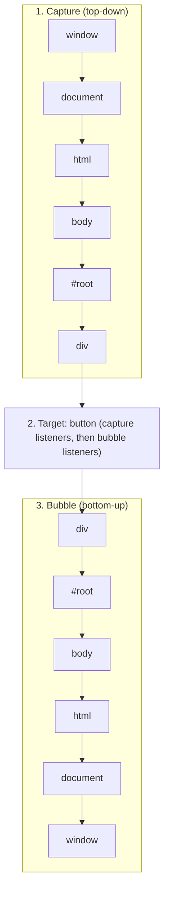
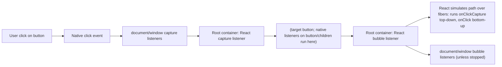

# 00 / 13 — Browser Events: Capture, Target, Bubble, and Delegation

## 1. Lesson metadata

| | |
|---|---|
| **Level** | Intermediate |
| **Study time** | 4–5 hours (reading 1.5 h, experiments 1.5 h, exercises 1.5 h) |
| **Prerequisites** | [04 — DOM structure and mutation](./04-dom-structure-and-mutation.md), [11 — Event loop, tasks, microtasks](./11-event-loop-tasks-microtasks.md). Helpful: [09 — Prototypes, `this`, classes](./09-prototypes-and-object-model.md) |
| **Next** | [14 — Web APIs and network requests](./14-web-apis-and-network-requests.md) |
| **Related later** | [Phase 1 / 10 — Event handling and the synthetic event system](../01-react-fundamentals/10-event-handling.md), [Phase 1 / 11 — Controlled and uncontrolled inputs](../01-react-fundamentals/11-controlled-and-uncontrolled-inputs.md), [Phase 2 / 21 — Browser paint vs React updates](../02-react-rendering-and-internals/21-browser-paint-and-react-updates.md) |

**Learning objectives.** After this lesson you can:
1. Describe the three phases of DOM event dispatch (capture, target, bubble) and compute the exact order in which listeners run.
2. Distinguish `target` from `currentTarget`, `preventDefault` from `stopPropagation` from `stopImmediatePropagation`, and `bubbles` from `cancelable`.
3. Use event delegation correctly (`closest`, `matches`), and explain when it is and is not appropriate.
4. Explain how React 17+ implements events: root-level listeners, a synthetic event wrapper, simulated capture/bubble over the *component tree*, and what that implies for native listeners, `stopPropagation`, and portals.
5. Use `passive`, `once`, `capture`, and `signal` options, and clean up listeners in effects.
6. Debug "my handler never fires", "clicking outside closes the menu instantly", "scroll is janky", and "third-party code swallows React clicks".

**Concepts covered:** `EventTarget`, `Event` types, dispatch path, capture/target/bubble, listener options (`capture`, `once`, `passive`, `signal`), `target`/`currentTarget`/`relatedTarget`, `composedPath`, `bubbles`/`cancelable`/`composed`, default actions, event delegation, non-bubbling events (`focus`, `blur`, `mouseenter`), pointer/mouse/touch events, `CustomEvent`, `isTrusted`, shadow DOM retargeting, React root listeners, synthetic events, discrete vs continuous events, portals and React-tree bubbling.

---

## 2. Deep conceptual explanation

### 2.1 What problem is this lesson solving?

React's `onClick` looks like HTML's `onclick`, but it is *not* a listener attached to that element. If you treat it as one, you will be confused when:

- a third-party widget's `stopPropagation()` makes a React `onClick` on a parent never fire,
- an "outside click closes the menu" hook closes the menu on the same click that opened it,
- a modal rendered into `document.body` through a portal triggers an `onClick` on a component that is *not* its DOM ancestor,
- `onScroll` does not bubble, or `onFocus` "bubbles" although the native `focus` does not,
- scroll jank appears because a touch/wheel listener is blocking,
- a native `document.addEventListener("keydown")` fires before or after a React `onKeyDown` in an unexpected order.

All of those are explained by (1) the DOM event model, and (2) React's delegation strategy built on top of it. This lesson covers (1) completely and (2) at the level needed for Phase 1.

### 2.2 What an event is

An **event** is an object (an instance of `Event` or a subtype such as `MouseEvent`, `PointerEvent`, `KeyboardEvent`, `InputEvent`, `CustomEvent`) delivered to an **event target** (`EventTarget`: elements, `document`, `window`, `XMLHttpRequest`, `AbortSignal`, `WebSocket`, `MessagePort`, …). Anything with `addEventListener` is an `EventTarget`.

Events come from three sources:
1. **The user agent** in response to user input or browser activity (`click`, `keydown`, `input`, `load`, `visibilitychange`). `event.isTrusted` is `true`.
2. **Platform APIs** (a network socket receiving a message, a timer is *not* an event; a `MessageChannel` delivering a message is).
3. **Your code**: `el.dispatchEvent(new CustomEvent("cart:add", { detail, bubbles: true }))` (`isTrusted` is `false`), or convenience methods like `el.click()`.

Each event is *processed as a task* from the event loop ([Lesson 11](./11-event-loop-tasks-microtasks.md)): the browser queues an input task; when it runs, the browser **dispatches** the event, synchronously calling all applicable listeners in a defined order, and then performs the default action (if not prevented).

### 2.3 The dispatch path and the three phases

When an event is dispatched to a target node, the browser computes the **event path**: the target and its ancestors up to the `Window` (for DOM nodes: target → parent → … → `html` → `document` → `window`; some events such as `load` skip the window). Dispatch visits the path three ways:

```text
window ─ document ─ html ─ body ─ #root ─ div ─ button(target)

1. CAPTURE phase:  window → document → html → body → #root → div        (top-down, listeners registered with capture: true)
2. TARGET phase:   button                                                 (listeners on the target itself)
3. BUBBLE phase:   div → #root → body → html → document → window         (bottom-up, listeners registered with capture: false, default)
```

- Only events with `bubbles: true` participate in the bubble phase (most UI events do: `click`, `input`, `keydown`, `pointerdown`; some do not: `focus`, `blur`, `mouseenter`, `mouseleave`, `load` on elements, `scroll` on elements (it does not bubble from elements; the `document`-level scroll event bubbles to `window`), `media` events).
- All events with a path participate in capture, regardless of `bubbles`.
- `addEventListener(type, fn)` registers a **bubble** listener by default; `addEventListener(type, fn, true)` or `{ capture: true }` registers a **capture** listener on that node.
- At the target node, the DOM Standard (since a 2021-era change adopted by all major engines) invokes **capture listeners first, then non-capture listeners**, regardless of registration order. *Older engines invoked target listeners strictly in registration order.* ⚠ Do not rely on mixing capture and non-capture listeners on the same node unless you have verified your support matrix.

### 2.4 `target`, `currentTarget`, and `relatedTarget`

| Property | Meaning |
|---|---|
| `event.target` | The innermost node the event was dispatched *at* (the origin), e.g. the `<span>` inside the `<button>` that the pointer was over. Same value for every listener on the path (except for shadow DOM retargeting). |
| `event.currentTarget` | The node whose listener is *currently running*. Changes as the event travels. Valid only during dispatch (it's `null` afterwards if you inspect it asynchronously). |
| `event.relatedTarget` | The "other" node for `mouseover/out`, `focusin/out`, `focus/blur`, `pointerover/out` (where the pointer/focus came from or went to). |
| `event.composedPath()` | The array of nodes in the path (including shadow-tree internals where open). |
| `event.eventPhase` | 1 capture, 2 at target, 3 bubble. |

This is *the* reason delegation works: a single ancestor listener can examine `event.target` to find out which descendant triggered it.

### 2.5 Controlling the event: three different things

| Method | Effect | Typical misuse |
|---|---|---|
| `event.preventDefault()` | Cancels the **default action** (follow link, submit form, toggle checkbox, scroll on wheel/touch, focus change on mousedown…) *if the event is `cancelable`* and the listener is not `passive`. Does **not** stop propagation. | Believing it stops other handlers. |
| `event.stopPropagation()` | Stops the event from moving to **other nodes** on the path (further capture/bubble). Remaining listeners **on the current node** still run. Does not cancel default action. | Using it to "prevent bubbling" as a design tool: it hides events from legitimate observers (analytics, outside-click hooks, design-system overlays). |
| `event.stopImmediatePropagation()` | Like the above, *and* skips the remaining listeners on the **current node**. | Fighting listener ordering. |

Independent properties: `event.bubbles` (can it bubble?), `event.cancelable` (can the default be prevented?), `event.defaultPrevented` (has someone prevented it?), `event.composed` (does it cross a shadow DOM boundary?).

### 2.6 Listener options

```ts
el.addEventListener("wheel", onWheel, {
  capture: false,   // phase
  once: true,       // auto-remove after the first call
  passive: true,    // promise never to call preventDefault (enables scrolling optimisation)
  signal: controller.signal, // removes the listener when the signal aborts
});
```

- **`passive: true`**: tells the browser the handler won't call `preventDefault()`, so the browser can start scrolling immediately instead of waiting for the main thread to run the handler (which would block scrolling if the main thread is busy). Browsers treat `touchstart`, `touchmove`, and `wheel` listeners registered on `window`, `document`, or `body` as passive by default (Chromium, Firefox, Safari with variations). In a passive listener, `preventDefault()` is ignored (with a console warning). If you must prevent scrolling (custom drag), register non-passive on the specific element and use CSS `touch-action` where possible.
- **`once: true`**: the listener is removed *before* it's invoked.
- **`signal`**: lets one `AbortController` remove many listeners, which works well with effect cleanup ([Lesson 14](./14-web-apis-and-network-requests.md)).
- **Identity matters for removal.** `removeEventListener(type, fn, capture)` only removes a listener registered with the *same function reference* and same capture flag. Anonymous arrow functions cannot be removed ([Lesson 07](./07-functions-and-referential-identity.md)). Adding the same function+capture twice registers it once.
- **`this`** in a regular-function listener is `event.currentTarget`; in an arrow function it's lexical ([Lesson 09](./09-prototypes-and-object-model.md)).

### 2.7 Event delegation

**Idea:** instead of attaching a listener to every item, attach *one* to a common ancestor and use `event.target` to determine the origin.

```ts
const list = document.querySelector("ul#todos")!;
list.addEventListener("click", (event) => {
  const target = event.target;
  if (!(target instanceof Element)) return;
  const item = target.closest<HTMLElement>("[data-todo-id]");
  if (!item || !list.contains(item)) return;     // ignore clicks outside items (and in nested lists)
  toggle(item.dataset.todoId!);
});
```

Benefits: constant memory regardless of item count; works for items added later; one place to manage; fewer listener add/remove calls. Costs: only works for events that bubble (or use capture for those that don't, or their bubbling counterparts, e.g. `focusin`/`focusout` instead of `focus`/`blur`, `mouseover`/`mouseout` instead of `mouseenter`/`mouseleave` with extra logic); a handler on an ancestor may see events from nested interactive elements; `stopPropagation` anywhere below breaks it; `event.target` may be a descendant of the element you care about, so use `closest`.

### 2.8 How React uses all this

React 17+ attaches **one listener per event type on the root container** (the DOM node passed to `createRoot`), registered for both capture and bubble phases, *at the time the root is created* (conceptually; the exact timing and the list of event types are implementation details). React's event system then:

1. Receives the native event at the root.
2. Finds the **target fiber** from the native `event.target` DOM node (React stores a reference from DOM nodes to their fibers).
3. Walks the **component (fiber) tree** from that target upward, collecting the `onXxx` / `onXxxCapture` props of host elements along the way, to form the *React propagation path*.
4. Builds a **SyntheticEvent** wrapper (a cross-browser-normalised object with `nativeEvent`, `target`, `currentTarget`, `stopPropagation`, `preventDefault`, `isPropagationStopped()`, …).
5. Invokes capture handlers top-down, then bubble handlers bottom-up, honouring `e.stopPropagation()` *within the React path*.
6. Event handlers run inside React's batching context ([Lesson 11 §4.2](./11-event-loop-tasks-microtasks.md)), so state updates inside are batched and processed at the end.

*Public guarantees (documented):* handlers receive a `SyntheticEvent` (not the native event); `e.stopPropagation()` and `e.preventDefault()` work as expected; capture handlers are named `onClickCapture` etc.; events from portals propagate according to the React tree; React 17+ no longer pools events (you can use `e` asynchronously); `onChange` for `<input>` fires on each `input` event; `onFocus`/`onBlur` bubble in React and are implemented using the bubbling `focusin`/`focusout` natives; `onScroll` does not bubble (since React 17). *Teaching model:* "one native listener at the root, a simulated dispatch over the fiber tree". *Implementation detail:* the plugin architecture that extracts events, priority assignment per event type, which native events are used for which React events ⚠ (verify in [Phase 2 / 31](../02-react-rendering-and-internals/31-reading-react-source.md) and react.dev if you depend on them).

**History.** ⚠ In React 16 and earlier, listeners were attached to `document`. React 17 moved them to the root container so multiple React copies / non-React code coexist and `e.stopPropagation()` on a React handler behaves intuitively w.r.t. other native listeners *inside* the root. If you maintain older code or read old blog posts, take this into account.

**Consequences you can predict from the model:**
- **Native listeners on elements inside the root run before React handlers** for the same click (the native event reaches the element during bubble, long before it reaches the root). A native `stopPropagation()` inside the tree prevents React from ever seeing the event.
- **Native listeners on `document`/`window` bubble-phase run after React's root listener**; they do not see events for which a React handler called `e.stopPropagation()` (React forwards that to the native event).
- **Capture-phase native listeners on `document`/`window` run before React** (they are above the root in capture order).
- **Portals:** the DOM path of an event from a portal child goes to `document.body`, but React's path goes through the portal's *React parent*; React handlers on that parent fire. Native listeners follow the DOM path.
- **`currentTarget`**: React sets it to the element whose handler is running, as in the DOM.

### 2.9 Discrete vs continuous events (priorities)

React classifies events: **discrete** (`click`, `keydown`, `input`, `submit`, `focusin`…) get high priority and are flushed before the next interaction; **continuous** (`pointermove`, `scroll`, `mouseover`, `drag`…) get a lower priority and may be coalesced. This is why, conceptually, updates caused by discrete events are processed before the browser paints ([Phase 2 / 13](../02-react-rendering-and-internals/13-scheduler-and-priorities.md)). The browser itself also coalesces continuous events (`pointermove`, `touchmove`) to once per frame (`pointerrawupdate`/`getCoalescedEvents()` exist for fine-grained input).

### 2.10 Common misconceptions

| Misconception | Reality |
|---|---|
| "`onClick` in React puts a listener on that element." | It's a prop read by React's root-level dispatcher. |
| "`stopPropagation` prevents default." | Those are independent; use `preventDefault` for default actions. |
| "`event.target` is the element I attached the handler to." | That's `currentTarget`. `target` is the origin (may be a child). |
| "Return `false` cancels the event." | Only in old inline `onclick="return false"` handlers. In `addEventListener` and React JSX it does nothing. |
| "Events are async." | Dispatch is **synchronous**: `dispatchEvent` returns after all listeners run. The *trigger* (user input) is queued as a task. |
| "All events bubble." | `focus`, `blur`, `mouseenter`, `mouseleave`, `load`, element `scroll`, and others don't. |
| "A removed element can't receive more events in the current dispatch." | The path is computed *before* dispatch; removing nodes mid-dispatch doesn't change who is visited, though listeners removed before being reached won't run. |
| "`once` removes after the handler ran." | The listener is removed *before* it runs (so re-entrancy doesn't re-trigger it). |
| "React's synthetic events are slower, so use native for performance." | The synthetic layer's overhead is rarely measurable; what matters is the handler's work and the re-renders it triggers. |

---

## 3. Internal mechanics

### 3.1 The DOM Standard's dispatch algorithm (condensed)

*Public guarantee (DOM Standard):*
1. Build the **event path** (including shadow-tree adjustments and `composed` rules) from the target.
2. For each node from the root-most down to the target's parent: invoke *capture* listeners (phase = CAPTURING).
3. At the target: invoke capture listeners, then bubble listeners (phase = AT_TARGET).
4. If `bubbles`, for each ancestor bottom-up: invoke non-capture listeners (phase = BUBBLING).
5. If `stopPropagation` was called, stop before moving to the next node; if `stopImmediatePropagation`, stop before the next listener.
6. After dispatch, if the event is `cancelable` and not `defaultPrevented`, the browser performs the **activation/default behaviour**.
7. Listener list is **snapshotted per node** before invoking: listeners added to the *current* node during dispatch do not run in this dispatch; listeners removed before being invoked won't run. Listeners added to a *later* node on the path (e.g. `document`) *will* run if added before dispatch reaches that node. (This detail explains the classic outside-click bug in §10.)

### 3.2 Microtask checkpoints between listeners

For native, user-initiated events the JS stack is empty between listener callbacks, so microtasks queued by one listener run **before the next listener** (Lesson 11 §3.4). For `dispatchEvent`/`el.click()` from script they run after the entire dispatch returns. React handlers run within one root listener callback; state updates and microtasks queued inside run after it returns.

### 3.3 Shadow DOM and retargeting

Events that cross a shadow boundary (`composed: true`, which includes most UI events) are **retargeted**: to listeners outside the shadow root, `event.target` appears to be the *shadow host*, not the internal element. `event.composedPath()` can reveal the real path for *open* shadow roots. Custom Elements/Web Components inside React apps (design systems built on them) often need `composed: true, bubbles: true` on custom events to be visible in the light DOM. React 19 improved custom element support (property vs attribute handling and custom event handlers via `on` props) Verified in a React 19.3.1 + jsdom test (`onFocus` on a parent fires when the child input is focused).

### 3.4 Default actions and `cancelable`

Examples of default actions you can cancel: link navigation (`click` on `<a>`), form submission (`submit`, or `click` on a submit button), checkbox toggle (`click`), text insertion (`beforeinput`/`keydown`), context menu (`contextmenu`), wheel/touch scrolling (non-passive only), drag start. **Non-cancelable events** (`scroll`, `input`, `focus`, `load`, many others) ignore `preventDefault()`. React forms: `onSubmit` + `e.preventDefault()` to avoid a full page navigation (or use a form Action in React 19: `<form action={fn}>` which React handles; [Phase 3 / 22](../03-react-state-and-hooks/22-modern-hooks-and-apis.md)).

### 3.5 Pointer events: the unifying model

`pointerdown/move/up/cancel/enter/leave/over/out` unify mouse, touch, and pen. They carry `pointerType`, `pointerId`, pressure, tilt. **Pointer capture** (`el.setPointerCapture(id)`) routes all subsequent pointer events for that pointer to `el` regardless of position: essential for drag handles and sliders. Legacy compat: browsers also fire mouse/touch events after pointer events (compat mouse events), so mixing handlers (`onMouseDown` and `onTouchStart`) can double-fire. Prefer pointer events; use CSS `touch-action` to control browser gestures.

### 3.6 Event timing and INP

Interaction to Next Paint (INP) measures from input to the next paint: **input delay** (waiting for the main thread) + **processing time** (all handlers for that event, including React's render if flushed synchronously) + **presentation delay**. Heavy `onClick`/`onChange` handlers directly contribute. `performance.eventCounts` and the Event Timing API (`PerformanceObserver` with `type: "event"`) expose this *(support: Chromium-first; verify)*.

---

## 4. Step-by-step execution walkthrough

### 4.1 One click, native listeners only

Markup: `<div id="a"><div id="b"><button id="c">x</button></div></div>`

```js
const log = (m) => console.log(m);
a.addEventListener("click", () => log("a capture"), true);
c.addEventListener("click", () => log("c capture"), true);
c.addEventListener("click", () => log("c bubble"));
b.addEventListener("click", () => log("b bubble"));
a.addEventListener("click", () => log("a bubble"));
```

**Predict** the order when the user clicks the button.

**Walkthrough:**
1. Pointer/mouse input → `click` event queued as an input task. Task runs; browser builds path: `c, b, a, body, html, document, window`.
2. **Capture** descends: `window`, `document`, `html`, `body` (no listeners), `a` → logs **a capture**, `b` (none).
3. **Target** `c`: capture listener first → **c capture**, then bubble listener → **c bubble**.
4. **Bubble** ascends: `b` → **b bubble**; `a` → **a bubble**; then higher nodes.
5. Default action: nothing for a plain button.

**Output:** `a capture, c capture, c bubble, b bubble, a bubble`.

### 4.2 One click through React

```tsx
function App() {
  return (
    <div id="a" onClickCapture={() => console.log("a capture")} onClick={() => console.log("a bubble")}>
      <button
        id="c"
        onClick={(e) => { console.log("c bubble", e.currentTarget.id); }}
      >
        x
      </button>
    </div>
  );
}
createRoot(document.getElementById("root")!).render(<App />);

// plus, elsewhere, native listeners:
document.getElementById("root")!.addEventListener("click", () => console.log("native root bubble"));
document.addEventListener("click", () => console.log("native document bubble"));
document.addEventListener("click", () => console.log("native document capture"), true);
```

**Predict** the order of logs. (Assume React 17+ and that the `native root` listener was added *after* `createRoot`.)

**Walkthrough:**
1. Native capture: `window` → **document capture** runs first (above the root).
2. React's *capture* listener on the root container runs: React finds the fiber path `button → div`, runs capture handlers top-down: **a capture**.
3. The event reaches the target `button` (no native listeners there); then bubbles up to the root. Order on the root container's *bubble* phase: listeners run in registration order, so React's bubble listener (registered at `createRoot`) first: **c bubble c**, then **a bubble**; then the **native root bubble** listener registered later.
4. Then `document` bubble: **native document bubble**.

**Output:** `native document capture, a capture, c bubble c, a bubble, native root bubble, native document bubble`.

*Check yourself:* if the `button`'s React handler called `e.stopPropagation()`, React would skip `a bubble` and also call the native `stopPropagation()`, so the event wouldn't reach `document` (so `native document bubble` is not logged). Listeners on the *same* root node still run (stopPropagation doesn't cancel same-node listeners): `native root bubble` still logs. This is the model-based prediction; verify in your environment ([Exercise B2](#11-exercises)).

---

## 5. Code examples

### 5.1 Minimal: `target` vs `currentTarget`

```html
<button id="b"><span id="s">Click me</span></button>
<script>
  b.addEventListener("click", (e) => {
    console.log(e.target.id, e.currentTarget.id);
  });
</script>
```

**Predict:** clicking the text. **Result:** `s b`. Clicking the button's padding: `b b`. Hence code like `if (e.target === button)` silently fails when the click lands on the inner `<span>` or `<svg>` icon, a very common bug. Use `e.currentTarget` for "the element I attached to", `closest()` for delegation.

### 5.2 Practical: a reusable, typed `useEventListener` hook

```tsx
import { useEffect, useRef } from "react";

type Target = Window | Document | HTMLElement | null;

export function useEventListener<K extends keyof WindowEventMap>(
  type: K,
  handler: (event: WindowEventMap[K]) => void,
  target?: Window | null,
  options?: AddEventListenerOptions,
): void;
export function useEventListener<K extends keyof DocumentEventMap>(
  type: K,
  handler: (event: DocumentEventMap[K]) => void,
  target: Document,
  options?: AddEventListenerOptions,
): void;
export function useEventListener(
  type: string,
  handler: (event: Event) => void,
  target: Target = typeof window === "undefined" ? null : window,
  options?: AddEventListenerOptions,
): void {
  const saved = useRef(handler);
  useEffect(() => { saved.current = handler; });          // always call the latest handler

  useEffect(() => {
    if (!target) return;
    const listener = (e: Event) => saved.current(e);
    const controller = new AbortController();
    target.addEventListener(type, listener, { ...options, signal: controller.signal });
    return () => controller.abort();                      // removes the exact listener
  }, [target, type, options?.capture, options?.passive, options?.once]);
}
```

Line notes:
- **Latest-handler ref:** the listener identity stays stable while always calling the latest handler: no re-subscription per render and no stale closure ([Phase 3 / 05](../03-react-state-and-hooks/05-effect-dependencies-and-stale-closures.md)). `useEffectEvent` is the newer idiom for this (stable since React 19.2).
- `signal` removal avoids storing the function for `removeEventListener`.
- The default target guards SSR (`window` doesn't exist on the server; effects don't run on the server anyway, but the default-parameter expression does).
- Dependencies list individual option fields because an inline `options` object would change identity every render.
- Overloads provide event typing (`"keydown"` → `KeyboardEvent`).

### 5.3 Practical: delegation in a framework-free widget

```ts
export function delegate<K extends keyof HTMLElementEventMap>(
  root: HTMLElement,
  type: K,
  selector: string,
  handler: (event: HTMLElementEventMap[K], matched: HTMLElement) => void,
  options?: AddEventListenerOptions,
): () => void {
  const listener = (event: HTMLElementEventMap[K]) => {
    const t = event.target;
    if (!(t instanceof Element)) return;                  // text nodes, SVG documents, etc.
    const matched = t.closest<HTMLElement>(selector);
    if (matched && root.contains(matched)) handler(event, matched);
  };
  root.addEventListener(type, listener as EventListener, options);
  return () => root.removeEventListener(type, listener as EventListener, options);
}

// usage
const off = delegate(table, "click", "button[data-action]", (e, btn) => {
  runAction(btn.dataset.action!, btn.closest("tr")!.dataset.rowId!);
});
```

Trade-offs: with 10,000 rows this uses one listener instead of 10,000; but handler logic is now string/`dataset`-based (less type-safe than closures in React), and any ancestor `stopPropagation` blocks it. In React you rarely need this because React already delegates at the root; per-item `onClick` props are cheap (they're just props, not listeners).

### 5.4 Incorrect: outside-click that closes the menu on the same click that opens it

```tsx
function Menu() {
  const [open, setOpen] = useState(false);
  const ref = useRef<HTMLDivElement>(null);

  useEffect(() => {
    if (!open) return;
    const onDocClick = (e: MouseEvent) => {
      if (!ref.current?.contains(e.target as Node)) setOpen(false);
    };
    document.addEventListener("click", onDocClick);
    return () => document.removeEventListener("click", onDocClick);
  }, [open]);

  return (
    <div>
      <button onClick={() => setOpen(true)}>Open</button>     {/* button is OUTSIDE ref */}
      {open && <div ref={ref} role="menu">…</div>}
    </div>
  );
}
```

**Predict:** click "Open". **Likely result:** the menu flashes open and closes. **Why (model):** the click's React handler runs at the root during bubble and sets `open = true`. For discrete events React flushes the update (in a microtask) and its passive effects (synchronously at the end of that commit), so for a real user click the effect adds the `document` listener *while the same click event is still bubbling*, and `document` is later on the path, so the newly added listener runs for this very click. The target (`button`) is not inside `ref`, so `setOpen(false)` runs. ⚠ **Correction from testing (React 19.3.1, jsdom):** with a *scripted* `button.click()` the menu does **not** flash, because React flushes the update in a microtask and a scripted dispatch has no microtask checkpoint between listeners, so the effect adds its listener only after the click finished. With a *real* user click the stack empties after the root listener, the microtask runs the render and the sync-lane passive effect, and the `document` listener (still ahead on the path) can see the same click (the lesson-11 B3 distinction). So the bug is real in browsers but will not reproduce in `fireEvent`/`.click()` tests. React's flush timing is an implementation detail; the *robust* lesson is: **never depend on whether a listener added during a dispatch will see the same event.**

### 5.5 Corrected: robust outside-press hook

```tsx
function useOutsidePress(ref: React.RefObject<HTMLElement | null>, onOutside: () => void, enabled: boolean) {
  const latest = useRef(onOutside);
  useEffect(() => { latest.current = onOutside; });

  useEffect(() => {
    if (!enabled) return;
    const onPointerDown = (e: PointerEvent) => {
      const el = ref.current;
      if (el && !e.composedPath().includes(el)) latest.current();   // composedPath handles portals & shadow DOM (open)
    };
    // pointerdown happens BEFORE the click that toggled state; capture so stopPropagation below can't hide it
    document.addEventListener("pointerdown", onPointerDown, true);
    return () => document.removeEventListener("pointerdown", onPointerDown, true);
  }, [ref, enabled]);
}
```

Why it works: it listens to `pointerdown` (a different, earlier event) so it never sees the opening click; it uses capture so a descendant's `stopPropagation` can't hide the outside press; it uses `composedPath()` to treat clicks in portaled children *DOM-wise* (portals need extra handling, e.g. also exclude the trigger element or use a shared ancestor ref). **Trade-offs:** keyboard (Escape) and focus-out must be handled separately for accessibility; touch long-press and drag-select-from-inside-to-outside edge cases. In production prefer a vetted headless library (Radix UI, React Aria, Floating UI) *(verify)* that handles focus management, `Escape`, nested layers, and portal ordering ([Phase 5 / 07](../05-design-patterns/07-headless-components.md)).

### 5.6 Practical: passive scroll/touch listeners

```ts
// Reading only → passive: browser may scroll without waiting for JS
window.addEventListener("scroll", onScroll, { passive: true });
window.addEventListener("touchstart", onTouch, { passive: true });

// Must prevent default (custom drag surface) → non-passive on the specific element + CSS
canvas.style.touchAction = "none";
canvas.addEventListener("pointerdown", onDown);        // pointer events don't need passive
```

React: `onWheel`, `onTouchStart`, `onTouchMove` are registered as **passive** by React's root listeners in modern React (so `e.preventDefault()` inside them logs a warning and does nothing). If you need non-passive behaviour (prevent page scroll while dragging), attach a native listener with `{ passive: false }` via a ref/effect, or (better) use `touch-action` CSS and pointer events. Verified: React 19.3.1 registers `wheel`, `touchstart` and `touchmove` root listeners with `{ passive: true }` (checked in jsdom by spying on `addEventListener`).

### 5.7 Advanced: custom events as a decoupled channel (with React)

```ts
// emitter on a DOM node (works across frameworks, bubbles to ancestors)
export function emit<T>(node: EventTarget, name: string, detail: T) {
  node.dispatchEvent(new CustomEvent<T>(name, { detail, bubbles: true, composed: true }));
}

// listening component
useEffect(() => {
  const el = rootRef.current;
  if (!el) return;
  const onAdd = (e: Event) => setCount((c) => c + (e as CustomEvent<{ qty: number }>).detail.qty);
  el.addEventListener("cart:add", onAdd);
  return () => el.removeEventListener("cart:add", onAdd);
}, []);
```

Appropriate for cross-framework micro-frontend boundaries and web components (`bubbles` + `composed` so the event crosses shadow roots). Inappropriate as the primary state mechanism inside one React app: events are untyped by default, invisible to React DevTools, and lack ordering/consistency guarantees. Use state/context/stores there.

### 5.8 Practical: keyboard shortcut handling with correct target filtering

```ts
function isEditable(t: EventTarget | null): boolean {
  if (!(t instanceof HTMLElement)) return false;
  return t.isContentEditable || ["INPUT", "TEXTAREA", "SELECT"].includes(t.tagName);
}

window.addEventListener("keydown", (e) => {
  if (e.defaultPrevented || e.isComposing) return;         // someone handled it; IME composition in progress
  if (isEditable(e.target)) return;                        // don't hijack typing
  if (e.key === "/" && !e.metaKey && !e.ctrlKey && !e.altKey) {
    e.preventDefault();
    searchInput.focus();
  }
});
```

Notes: `e.key` (logical) vs `e.code` (physical, layout-independent): shortcuts by position (WASD) use `code`; by character use `key`. `isComposing` avoids breaking IME input (Japanese, Chinese, Korean). Respect `defaultPrevented` to cooperate with component-level handlers. Document shortcuts for accessibility; allow disabling (WCAG 2.1 SC 2.1.4 Character Key Shortcuts).

---

## 6. Visual explanations

### Phases on a path



### React 17+ delegation



### Portal: DOM path vs React path

```text
DOM tree                          React tree
body                              <App>
 ├─ #root                           └─ <Toolbar onClick={...}>   ← receives bubbled click (React path)
 │   └─ div.toolbar                      └─ <Modal> (createPortal → body)
 └─ div.modal  ← actual DOM node               └─ <button>
     └─ button  ← user clicks here
Native listeners on .toolbar:  NOT called (not a DOM ancestor)
React onClick on <Toolbar>:    CALLED (React-tree ancestor)
```

---

## 7. Alternative approaches and trade-offs

**Where to attach event logic:**

| Approach | Readability | Performance | Complexity | Testability | When to prefer |
|---|---|---|---|---|---|
| React `onXxx` props | Highest | Fine for nearly all UIs | Lowest | High (RTL `userEvent`) | Default for element-level interactions |
| Native listener on element via ref + effect | Medium | Equivalent | Medium (lifecycle, cleanup) | Medium | Non-passive touch/wheel; events React doesn't expose; custom elements ⚠ |
| Native listener on `window`/`document` in an effect | Medium | Good | Medium | Medium | Global concerns: resize, keyboard shortcuts, visibility, outside press |
| Delegation by hand inside a component | Low–Medium | Rarely needed in React | Medium | Medium | Non-React DOM you must handle (embedded HTML content, `dangerouslySetInnerHTML` markup) |
| Pub/sub store (Zustand, Redux, `useSyncExternalStore`) | High | Good | Medium | High | Cross-component coordination (not DOM-bound) |
| CustomEvent bus on DOM | Low | Good | Medium | Low | Cross-framework boundaries only |

**When delegation is *not* best:** a handler that must run during the **capture** phase before anything else (e.g. a modal "focus trap" or a global "block interaction while loading" overlay) is better implemented with a capture listener, or by using `inert`/overlays, than with delegated bubble handlers. And for events that don't bubble (`mouseenter`, `focus`) delegation requires switching to `mouseover`/`focusin` plus bookkeeping, so a per-element listener may be simpler.

**`stopPropagation` vs alternatives:** instead of stopping propagation to keep an outer handler from reacting, prefer checking `e.target`/`e.currentTarget` in the outer handler, or `e.defaultPrevented` as a "handled" convention, or restructuring the DOM so the inner control isn't inside the outer interactive region (also better accessibility: no nested interactive elements).

---

## 8. Best practices and anti-patterns

**Do**
- Use semantic elements (`<button>`, `<a>`, `<input>`) so keyboard and assistive tech events (click from Enter/Space) work; avoid `onClick` on `<div>` without role, tabindex, and key handlers.
- Use `currentTarget` for "my element"; `closest()` for delegation.
- Register scroll/touch/wheel observers as `passive: true`.
- Clean up every manual listener (return a cleanup in the effect; or use `signal`).
- Keep handlers small; offload heavy work to transitions/workers ([Lesson 11](./11-event-loop-tasks-microtasks.md)).
- Prefer pointer events and `touch-action` over separate mouse/touch handling.

**Beginner mistakes**
- Comparing `e.target` to the element instead of using `currentTarget`/`closest`.
- Inline arrow in `addEventListener` then `removeEventListener` with another arrow (never removes).
- `return false` to cancel.
- Calling `preventDefault()` on non-cancelable or passive events.
- Adding listeners in render (each render adds another).

**Experienced-developer mistakes**
- `stopPropagation()` as architecture: breaks analytics, outside-press hooks, portal layering.
- Mixing React handlers and native `document` listeners and assuming ordering (see §2.8).
- Using `mouse*` and `touch*` handlers together (double firing).
- Leaving `window` listeners with changing identities (re-subscribing every render).
- Assuming `onChange` means "committed value" (it fires on every input event).
- Treating `onMouseEnter` as bubbling (it doesn't) or `onMouseOver` as non-bubbling (it does and flickers across children).

**Smells:** `document.querySelector` inside components to attach events; `setTimeout(…, 0)` to "let the click finish" before adding listeners; `if (e.target.className === "…")` checks; a global `click` handler that decides behaviour by walking `parentNode` manually.

**Justified exceptions:** a capture-phase `stopPropagation` on a modal overlay to block interaction with the app beneath (verify accessibility: prefer the `inert` attribute on the background content and a proper dialog element or library); non-passive touch handlers for a drawing canvas.

---

## 9. Real-world application

*E-commerce product grid.* 2,000 product cards each with "Add to cart", "Wishlist", and "Quick view" buttons. In React each is an `onClick` prop: no listener cost, but 2,000 × 3 closures are re-created per render of the grid. Strategy: memoise the card (`React.memo`) with stable callbacks (`useCallback` taking `productId` from a `data-` attribute or a curried handler), or one `onClick` on the grid container that reads `data-action`/`data-product-id` via `closest`, then dispatches. Delegation by hand *inside* React is a legitimate micro-optimisation for huge lists, at the cost of type safety, so measure first ([Phase 7](../07-performance/)).

*Design-system overlays.* A multi-team component library provides `Popover`, `Dialog`, `Tooltip`. Stacked layers must close in the right order on `Escape` and outside press; events from portaled content must be recognised as "inside" the layer. The library maintains a *layer stack* and a single capture-phase listener; individual components register with the stack. `stopPropagation` is avoided so analytics and app-level shortcuts still work; `defaultPrevented` signals "handled". Constraints: nested portals, iframes, shadow DOM hosts, and focus restoration.

*Dashboards with drag/resize.* Grid widgets are dragged with pointer events and pointer capture; `touch-action: none` on handles; `pointermove` coalesced via `requestAnimationFrame` ([Lesson 11](./11-event-loop-tasks-microtasks.md) §5, `rafThrottle`); `passive: false` only where needed. INP budget: handlers < 50 ms.

*Forms in a regulated finance product.* Keyboard accessibility is mandatory: all actions reachable by Tab/Enter/Space; shortcuts must not interfere with typing; `submit` handled in one place with `preventDefault` + validation; paste events allowed on account-number fields (blocking paste is an accessibility and password-manager problem).

---

## 10. Debugging and troubleshooting

**Symptom 1: React `onClick` on a parent/child never fires after adding a third-party widget.**
*Investigation:* DevTools → Elements → select the element → **Event Listeners** pane (check "Ancestors"); look for a native `click` listener that calls `stopPropagation()` on a node *inside* the React root. `getEventListeners(el)` in Console. Add a temporary capture listener on `window` that logs `e.composedPath()` and `e.cancelBubble`. *Root cause:* a native listener stopped propagation before the event reached React's root listener. *Fix:* configure the widget (option to not stop propagation), listen in capture phase at the root instead, or handle the event natively through that widget's API. *Validate:* click and check handlers fire.

**Symptom 2: Menu/popover closes immediately after opening.** §5.4. *Investigation:* log `e.type`, `e.timeStamp`, `e.eventPhase` in both handlers; observe the same event object ([Lesson 11](./11-event-loop-tasks-microtasks.md) timing). *Fix:* §5.5; validate with keyboard and touch too.

**Symptom 3: Scrolling is janky on mobile when a handler is present.** *Investigation:* Performance panel: look for "Event: touchmove/wheel" long handler; Chrome DevTools Issues/console warns "Added non-passive event listener to a scroll-blocking event". *Fix:* `{ passive: true }`; move work off the handler; `touch-action`. *Validate:* record scroll; main-thread blocking disappears; check the scroll FPS.

**Symptom 4: Handler runs twice per click.** *Investigation:* StrictMode (effects run twice in dev; a listener added in an effect without cleanup doubles); duplicated registrations (`addEventListener` called in render or on each effect run without cleanup); both `onMouseDown` and `onTouchStart`; an event bubbling to two nested elements each with the handler. *Fix:* cleanup; pointer events; `currentTarget === target` checks; `{ once: true }`.

**Symptom 5: `e.target.value` / `e.currentTarget` is `null` in async code.** *Cause:* `currentTarget` is only valid during dispatch (it's reset after, in both DOM and React). *Fix:* read the value synchronously (`const { value } = e.currentTarget`) before `await`. (React 17+ doesn't pool events, so the old "synthetic event reused" warning no longer applies, but `currentTarget` still resets.)

**Symptom 6: Native `document` keydown shortcut fires even though a React input handled the key.** *Cause:* both receive the event; native document listener doesn't know about React's handling. *Fix:* in the React handler call `e.preventDefault()` and in the global handler check `e.defaultPrevented`; or filter by `isEditable(e.target)`.

DevTools tips: **Elements → Event Listeners** shows listeners with "Framework listeners" toggle (React 17+ root listeners appear on the root); `monitorEvents($0, "click")`; Performance panel "Event" entries; breakpoints → "Event Listener Breakpoints" (Mouse → click) to find who handles an event.

---

## 11. Exercises

### Level A — Knowledge
A1. Name the three phases of dispatch and the direction of each.
A2. What is the difference between `event.target` and `event.currentTarget`?
A3. Does `stopPropagation()` prevent the default action? Does `preventDefault()` stop propagation?
A4. Name four events that do not bubble, and the bubbling alternatives for two of them.
A5. What do `passive`, `once`, `capture`, and `signal` do?
A6. Where does React 17+ attach its event listeners? Where did React 16 attach them?
A7. Why do React `onFocus`/`onBlur` appear to bubble although native `focus`/`blur` don't?

### Level B — Code comprehension
B1. Using the markup `<div id="a"><div id="b"><button id="c"></button></div></div>`, what order is logged on a click of `c`?
```js
a.addEventListener("click", () => log("a-capture"), true);
b.addEventListener("click", () => log("b-bubble"));
c.addEventListener("click", () => log("c-capture"), true);
c.addEventListener("click", () => log("c-bubble"));
a.addEventListener("click", () => log("a-bubble"));
```
B2. In a React 18/19 app, with the code below, what logs when the user clicks the button?
```tsx
useEffect(() => {
  const h = () => console.log("document");
  document.addEventListener("click", h);
  return () => document.removeEventListener("click", h);
}, []);

<div onClick={() => console.log("div")}>
  <button onClick={(e) => { e.stopPropagation(); console.log("button"); }}>Go</button>
</div>
```
B3. The `<button>` below has a React `onClick` *and* a native listener added via ref in an effect. Which runs first, and what happens if the native one calls `stopPropagation()`?
B4. A list is built with `ul.innerHTML = items.map(...)` re-run after each change, and click handlers are attached to each `li` right after. After the second render, do old handlers leak? Rewrite with delegation.
B5. A modal is rendered with `createPortal(<Modal/>, document.body)` inside `<Card onClick={track}>`. When the user clicks inside the modal, does `track` run? Does a native `click` listener on the card's DOM element?
B6. What does `once: true` plus `removeEventListener` inside the callback do on the second dispatch?

### Level C — Implementation
C1. Implement `useOnClickOutside(ref, handler)` handling touch, portals (via `composedPath`), and stale handlers; list what else a production popover needs.
C2. Implement `delegate(root, type, selector, handler)` (see §5.3) with support for `capture` for non-bubbling events like `focus`, and unit-test it with jsdom *(verify jsdom `closest` support)*.
C3. Implement a `useHotkeys` hook for `Mod+K` (Cmd on macOS, Ctrl elsewhere) that ignores editable targets, supports cleanup, and avoids re-subscribing on each render.
C4. Implement a draggable handle with pointer events and `setPointerCapture`, throttled to animation frames, with cancel on `pointercancel` and `Escape`.

### Level D — Debugging
D1. The menu in §5.4 closes immediately. Give two different fixes, one of which does not change event types.
D2. A carousel uses `onTouchMove={(e) => e.preventDefault()}` to stop the page scrolling. Chrome logs "Unable to preventDefault inside passive event listener". Explain and fix, with CSS and with a native listener.
D3. `<div onClick={...}><button disabled>…</button></div>`: clicking the disabled button does not fire the div's `onClick` in some browsers. Explain and propose a robust fix. (Reason about what the browser does for events on disabled form controls; verify in your browsers.)
D4. An analytics module on `document` counts clicks. After a refactor to a design-system `Dialog` that calls `e.stopPropagation()` on its overlay, the analytics drop. Diagnose and fix without removing the dialog's behaviour.

### Level E — Architecture and engineering decisions
E1. Design a global keyboard-shortcut system for a large app with many feature teams. Decide: central registry vs per-component listeners, scoping (focus, route, modal), conflict resolution, discoverability, accessibility.
E2. Your micro-frontend host embeds React apps built by three teams in separate roots on the same page, plus a legacy jQuery widget. Describe event interactions to expect and policies to prevent conflicts (listener placement, `stopPropagation`, custom events, shadow DOM).

### Level F — Expert challenge
F1. Explain how React can provide `onClickCapture`/`onClick` semantics, including `stopPropagation` and portal bubbling, using only one native bubble listener and one native capture listener per event type on the root. Sketch the algorithm (target fiber → path → accumulate handlers → dispatch) and what edge cases (nested roots, `stopPropagation` on native event, `e.isPropagationStopped`, events whose targets are text nodes) complicate it. State clearly what is documented behaviour vs. implementation detail.
F2. A Lighthouse run shows "does not use passive listeners to improve scrolling performance" for third-party scripts, while your own code is fine. Propose an investigation and mitigations given you cannot modify the script.

---

## 12. Detailed answers and explanations

> Attempt the exercises first.

**A1.** Capture (window down to the target's parent), target (the target itself), bubble (target's parent up to the window; only if `bubbles`).

**A2.** `target` is the origin node of the dispatch (stays the same along the path, except shadow DOM retargeting); `currentTarget` is the node whose listener is executing now (changes along the path, `null` after dispatch).

**A3.** No to both. `stopPropagation` affects *where the event goes*; `preventDefault` affects *what the browser does afterwards*. Wrong but common: "`return false` does both" (only in legacy inline handlers/jQuery).

**A4.** `focus`, `blur`, `mouseenter`, `mouseleave`, `load`/`error` on elements, element `scroll`, media events (`play`, `pause`). Alternatives: `focusin`/`focusout` for `focus`/`blur`; `mouseover`/`mouseout` for `mouseenter`/`mouseleave` (with `relatedTarget` checks to emulate enter/leave).

**A5.** `passive`: promise not to call `preventDefault` (lets the browser scroll without waiting). `once`: remove listener automatically before the first call. `capture`: register for the capture phase. `signal`: remove the listener when the `AbortSignal` aborts.

**A6.** On the root container passed to `createRoot`/`hydrateRoot` (both capture and bubble listeners per event type). React ≤16 attached them to `document`.

**A7.** React implements `onFocus`/`onBlur` using the native `focusin`/`focusout`, which bubble, and simulates bubbling through its own tree. (React docs: "unlike the native event, `onFocus` bubbles in React".) ⚠ verify current docs.

**B1.** `a-capture, c-capture, c-bubble, b-bubble, a-bubble`. Capture goes down: `a`; target: capture listener(s) first then bubble; bubble goes up: `b`, `a`. Edge case: at the target, in *older* engines listeners ran in registration order; here `c-capture` was registered first, so the answer is identical either way.

**B2.** Logs only `button`. React's root listener runs in the bubble phase at `#root`; the button handler calls `e.stopPropagation()`, which stops React's own propagation (the `div` handler is skipped) *and* calls `stopPropagation` on the native event, so the event never reaches `document`. Therefore `document` isn't logged. In React 16 (listener at document) this would be different, which is the history. Wrong answer "button, div, document": ignores stopPropagation; "button, document": ignores that React forwards to the native event.

**B3.** The native listener on the button runs **first** (target phase), the React handler later at the root. If the native listener calls `stopPropagation()`, the event never reaches the root, so **no React handler for that click fires at all** (neither the button's `onClick` nor ancestors'). Unless the native listener was registered with capture on an ancestor... irrelevant here. This is the "third-party stopPropagation breaks React" scenario.

**B4.** Re-rendering `ul.innerHTML` creates *new* `li` nodes; the old nodes (and their listeners) become unreachable and are garbage-collected (no permanent leak unless something else retains them). The inefficiency: re-attaching handlers each render, and a window between innerHTML and attach in which clicks do nothing. Delegation:
```ts
ul.addEventListener("click", (e) => {
  const li = (e.target as Element).closest("li[data-id]");
  if (li && ul.contains(li)) onItemClick(li.getAttribute("data-id")!);
});
```
Attach once; survives `innerHTML` replacements. (And if item content includes untrusted data, escape or use DOM APIs: `innerHTML` is an XSS vector, [Phase 10 / 06](../10-production-engineering/06-security-xss-csrf-csp.md).)

**B5.** `track` (a React handler on a React-tree ancestor) **does** run; React propagates through the React tree, including across portals. The native `click` listener on the card's DOM element does **not** run because the modal's DOM node is not a DOM descendant of the card. Practical: clicks inside a portaled modal will trigger parent `onClick` handlers (e.g., closing a card, toggling selection); stop with `e.stopPropagation()` in the modal wrapper or restructure.

**B6.** `once` removes the listener before the first call, so the second dispatch has no listener; `removeEventListener` in the callback is then a no-op (removing an absent listener is not an error). Note: removing a *different* listener on the same node during dispatch matters because removed listeners that haven't run yet are skipped.

**C1.**
```tsx
export function useOnClickOutside(
  ref: React.RefObject<HTMLElement | null>,
  handler: (e: PointerEvent) => void,
  enabled = true,
) {
  const latest = useRef(handler);
  useEffect(() => { latest.current = handler; });
  useEffect(() => {
    if (!enabled) return;
    const onDown = (e: PointerEvent) => {
      const el = ref.current;
      if (!el) return;
      if (e.composedPath().includes(el)) return;
      latest.current(e);
    };
    document.addEventListener("pointerdown", onDown, true);
    return () => document.removeEventListener("pointerdown", onDown, true);
  }, [ref, enabled]);
}
```
Production needs: `Escape` key; focus-out (`focusin` outside) for keyboard users; ignoring the trigger element (so toggling doesn't reopen); layered/nested popovers (only the top layer closes); portal content registered as "inside" (shared parent refs or a layer registry); `pointerup`-based variants to avoid closing while text selection begins inside and ends outside; scroll lock; focus restore. Use a vetted library where possible.

**C2.** Core is §5.3. For non-bubbling events pass `{ capture: true }` (capture listeners on an ancestor *do* see `focus`/`blur`/`mouseenter`-like events because capture applies to all events); or choose `focusin`/`focusout`. Testing: build a DOM fragment, dispatch `new MouseEvent("click", { bubbles: true })` from a nested `<span>`, assert the handler gets the `closest` match and not for clicks outside the selector or in nested lists; assert the returned `off()` removes it. Edge: text-node targets (`target instanceof Element` guard), shadow DOM (`composedPath()[0]`).

**C3.**
```tsx
const isMac = typeof navigator !== "undefined" && /Mac|iPhone|iPad/.test(navigator.platform); // navigator.platform is deprecated; prefer userAgentData where available (verify)

export function useHotkey(key: string, handler: (e: KeyboardEvent) => void) {
  const latest = useRef(handler);
  useEffect(() => { latest.current = handler; });
  useEffect(() => {
    const onKey = (e: KeyboardEvent) => {
      if (e.defaultPrevented || e.isComposing) return;
      const mod = isMac ? e.metaKey : e.ctrlKey;
      if (!mod || e.altKey || e.shiftKey || e.key.toLowerCase() !== key.toLowerCase()) return;
      const t = e.target;
      const editable = t instanceof HTMLElement && (t.isContentEditable || /^(INPUT|TEXTAREA|SELECT)$/.test(t.tagName));
      if (editable && key.length === 1 && !mod) return;   // plain-character shortcuts must not hijack typing (mod combos are usually fine)
      e.preventDefault();
      latest.current(e);
    };
    window.addEventListener("keydown", onKey);
    return () => window.removeEventListener("keydown", onKey);
  }, [key]);
}
// usage: useHotkey("k", () => setPaletteOpen(true));
```
Notes: stable subscription (latest ref); respects composition and prior `preventDefault`; `Mod+K` in editable fields is typically acceptable (modifier combos) but note browser-reserved shortcuts (Ctrl+K in some browsers focuses the search bar; `preventDefault` can override, a UX decision). Keep platform detection behind a utility; `navigator.platform` is deprecated.

**C4.** Outline: `onPointerDown` on handle → `setPointerCapture(e.pointerId)`; store start offset; on `pointermove` (only while captured) write latest coordinates to a ref and schedule one rAF to apply a `transform`/state update (rafThrottle, Lesson 11); on `pointerup`/`pointercancel` release; `keydown` Escape (listener registered only while dragging) restores original position; `touch-action: none` on the handle; `user-select: none` during drag; `lostpointercapture` as a safety. Apply positions via CSS transform (compositor-friendly), commit final state to React once at the end, keeping per-move work outside React rendering.

**D1.** Fix A (changes event type): listen to `pointerdown` instead of `click` (§5.5), so the opening click isn't seen. Fix B (keeps `click`): ignore events whose target is inside the trigger: `if (triggerRef.current?.contains(e.target as Node)) return;` in addition to the menu check. Fix C: add the listener one event-loop turn later (`setTimeout(0)`): fragile; avoid. Validate with mouse, touch, keyboard Enter on the trigger (synthesised click), and StrictMode.

**D2.** React (and browsers) register `touchmove`/`wheel` listeners as passive for scrolling performance, so `preventDefault()` is ignored and the warning appears. Fix with CSS: `touch-action: pan-y` (or `none`) on the carousel to tell the browser which gestures it may handle; or use pointer events with `touch-action`. If you truly need to cancel: native `el.addEventListener("touchmove", handler, { passive: false })` in an effect with cleanup. Prefer CSS; non-passive listeners reintroduce scroll blocking.

**D3.** Events on disabled form controls: browsers historically don't dispatch click events from disabled `<button>`s (Chrome/Firefox behaviours differed in whether the event reaches ancestors). Users clicking a disabled button may not trigger the parent's handler. Robust approach: don't rely on events from disabled controls; use `aria-disabled="true"` and guard in the handler when you need to catch attempts (e.g. show a tooltip "Complete the form first"), or put the listener on a wrapper element with `pointer-events` handling. ⚠ Verify in your support matrix because behaviour has varied.

**D4.** `stopPropagation()` on the overlay hides clicks from `document` bubble-phase listeners. Diagnose by checking Event Listeners/`getEventListeners(document)` and testing with a capture listener. Fix without changing dialog behaviour: register analytics in the **capture** phase on `document`/`window` (`{ capture: true }`), which runs before any descendant `stopPropagation`; or have the dialog stop propagation only when needed (e.g. `e.target === e.currentTarget` for backdrop clicks and not for content), or call a dedicated analytics hook from the dialog. Ownership: analytics should not rely on bubbling through UI components; test it.

**E1.** Criteria: scoping (global vs focus-within vs modal), conflicts (same key, different features), discoverability (a shortcuts help dialog), accessibility (WCAG 2.1.4: allow remapping/disable single-key shortcuts), performance (one global listener), testability, ownership. *Good answer:* a central registry (React context + one `keydown` listener) where features register `{ id, keys, scope, when, handler }`; scopes form a stack (global < route < component < modal) so the topmost matching scope wins; conflicts are detected at registration in development; keymaps are data (documentable, remappable); the listener ignores editable targets unless the binding opts in; displays in a shortcuts help. Alternative (per-component listeners) is simpler for a few shortcuts but yields conflicts and duplicate subscriptions at scale. What would change the choice: a small app (YAGNI) or a framework/library already providing it.

**E2.** Expect: each React root attaches its own root-level listeners (React 17+ allows multiple roots coexisting); events from one root's DOM don't traverse another's root listener unless nested; the legacy widget's `document`-level jQuery handlers see events only if no one stops propagation. Policies: ban `stopPropagation` in shared components (use `defaultPrevented`/target checks); put cross-app communication in custom events dispatched on `window` or a typed message bus (document the contract, namespace names, versions); use capture-phase listeners for global concerns (analytics) and avoid ordering dependencies; shadow DOM only for isolation needs (events retarget; `composed` required); include an integration test page loading all pieces and running real clicks (Playwright). Risks: duplicate global shortcut listeners, conflicting focus management, different React versions' event semantics.

**F1.** Sketch: At root creation React registers, for each supported native event type, a capture listener and a bubble listener on the root container (the set of types is listed internally; non-delegated events like `scroll` on elements or media events are attached to specific elements ⚠ verify). On a native event: (1) get `nativeEvent.target`; resolve to the closest DOM node React manages and then its fiber (React keeps a back-pointer from DOM nodes to fibers); text nodes map to the parent element fiber. (2) Walk fiber `return` pointers from the target up, collecting for each *host component* fiber the matching handler (`onClick` for bubble phase, `onClickCapture` for capture) from its current props, forming an ordered list; the traversal follows the React tree, so portals work (a portal child's fiber's `return` chain passes through its React parents). (3) Create a SyntheticEvent with `stopPropagation` that sets a flag and also calls the native `stopPropagation` ("isPropagationStopped"). (4) Invoke listeners in order: for the capture listener invocation: top-down accumulated capture handlers; for the bubble invocation: bottom-up accumulated bubble handlers, checking `isPropagationStopped()` between handlers; set `currentTarget` per handler. (5) Run inside batched updates and event priority context. Complications: nested roots (events from an inner root must not be re-processed by the outer: React checks root containment/ownership), hydration (events before hydration are replayed ⚠ detail), `disabled` buttons suppressing mouse handlers, events for non-bubbling types (focus → focusin), `onChange` normalisation (`input`/`change`/`click` combos), and `beforeinput`/composition plugins. **Documented:** handler semantics, portal behaviour, no pooling, root attachment (React 17 upgrade notes). **Implementation detail:** plugin structure, precise phases, event type lists, replay mechanisms.

**F2.** Investigation: Lighthouse names the script URL and the listener location; in DevTools Event Listeners pane (with "Ancestors"/all frameworks) find non-passive `touchstart/wheel` listeners on `document` or elements; use `getEventListeners(document)`; test by blocking the script to confirm cause. Mitigations without modifying the script: load it later/lazily (after interactive) or on demand; load via a facade (click-to-load); wrap/patch `EventTarget.prototype.addEventListener` early to default `passive: true` for `touchstart/touchmove/wheel` when the third party didn't specify (risky: breaks scripts that rely on `preventDefault`; scope the patch to that script's lifecycle and test); isolate in a sandboxed iframe or Partytown-style worker (limitations) *(verify)*; escalate to the vendor with the evidence; add monitoring so regressions are visible. Trade-offs: monkey-patching platform APIs is brittle; the preferred approach is deferral + vendor pressure.

---

## 13. Senior engineer interview questions

**Q1. "Explain event delegation in React. Does React attach a listener to each element?"**
*Strong answer:* No. React attaches listeners for supported event types to the root container (React 17+), finds the target fiber from the native event's target, builds the handler path over the fiber tree, and runs capture then bubble handlers with a synthetic event. That's why handlers are cheap, why portal events bubble through the React tree, and why native listeners on elements inside the root fire before React handlers while native `document` listeners fire after (unless propagation is stopped). The mechanism is not part of the public contract beyond documented behaviours, so verify details in the source if you depend on them.

**Q2. "A third-party library `stopPropagation`s clicks and now our `onClick` doesn't fire. Why, and what do you do?"**
*Strong answer:* The native listener inside the root runs during bubble before the event reaches React's root listener; calling `stopPropagation` there means React never sees the event. Diagnose with the Event Listeners panel/ capture-phase logger. Options: configure the library, handle via its API, or intercept in capture phase on a node above the library and re-dispatch/handle there. Avoid `stopPropagation` in our own code for the same reason.

**Q3. "Why must `touchmove`/`wheel` listeners usually be passive, and what happens if you call `preventDefault` there?"**
*Strong answer:* A non-passive scroll-blocking listener forces the browser to wait for the main thread before scrolling, which causes jank when the main thread is busy. Browsers default such listeners on window/document/body to passive; `preventDefault()` in passive listeners is ignored with a warning. For gestures, use CSS `touch-action` and pointer events, and only register non-passive listeners on the specific element that needs to cancel scrolling.

**Q4. "How do you implement an 'outside click' correctly?"**
*Strong answer:* Prefer `pointerdown` in the capture phase on `document`, test `composedPath().includes(el)` to treat portal/shadow content properly, keep a latest-handler ref to avoid resubscribing, ignore the trigger, handle Escape and focus leaving for keyboard users, and handle nested layers by a layer stack. Be aware that a `click` listener added in response to the opening click may receive that same click, depending on dispatch timing. In practice, use a headless library for popovers.

**Q5. "`onChange` in React vs the native `change` event?"**
*Strong answer:* React's `onChange` on inputs fires on every `input` event (each keystroke), unlike the native `change`, which fires on commit/blur. It's normalised across element types. For controlled inputs, the handler updates state and React re-renders the input with the new value ([Phase 1 / 11](../01-react-fundamentals/11-controlled-and-uncontrolled-inputs.md)).

---

## 14. Further learning resources

| Resource | URL | Covers / why | Level | Study |
|---|---|---|---|---|
| MDN — Introduction to events | <https://developer.mozilla.org/en-US/docs/Learn_web_development/Core/Scripting/Events> | Beginner overview | Beginner | Whole page |
| MDN — `EventTarget.addEventListener()` | <https://developer.mozilla.org/en-US/docs/Web/API/EventTarget/addEventListener> | Options (`capture`, `once`, `passive`, `signal`), `this`, removal | Int. | Whole page |
| MDN — Event bubbling (and capture) | <https://developer.mozilla.org/en-US/docs/Learn_web_development/Core/Scripting/Event_bubbling> | Phases and delegation | Beginner–Int. | Whole page |
| MDN — `Event` interface | <https://developer.mozilla.org/en-US/docs/Web/API/Event> | `target`, `currentTarget`, `composedPath`, `cancelable` | Int. | Properties and methods |
| MDN — Pointer events | <https://developer.mozilla.org/en-US/docs/Web/API/Pointer_events> | Unified input, pointer capture | Int. | Concepts, `setPointerCapture` |
| DOM Standard — Dispatching events | <https://dom.spec.whatwg.org/#dispatching-events> | Normative dispatch algorithm | Advanced | Event path, inner invoke |
| web.dev — Optimize INP | <https://web.dev/articles/optimize-inp> | Event processing time and input delay | Int. | Processing time |
| React — Responding to events | <https://react.dev/learn/responding-to-events> | Handlers, propagation, preventing default | Beginner | Whole page |
| React — Common components / event props (`SyntheticEvent`) | <https://react.dev/reference/react-dom/components/common> | Event object API, supported events, caveats | Int. | "React event object" |
| React blog — React v17 RC (event delegation changes) | <https://legacy.reactjs.org/blog/2020/08/10/react-v17-rc.html> | Root attachment, pooling removed, `onScroll` etc. | Int. | "Changes to Event Delegation" |
| React source: event system | <https://github.com/facebook/react/tree/main/packages/react-dom-bindings/src/events> | The actual implementation (verify structure) | Advanced | Dispatch/plugin files |
| WCAG 2.1 — SC 2.1.4 Character Key Shortcuts | <https://www.w3.org/WAI/WCAG21/Understanding/character-key-shortcuts.html> | Accessible shortcuts | Int. | Whole page |

URLs in this table were checked for HTTP 200 on 2026-10-22; any still marked *(unverified)* could not be checked automatically (blocked or unreachable). A 200 response does not guarantee the page content still matches the description; if a link has moved, search the site for the quoted title.

---

## 15. Knowledge checkpoint

**You should now understand**
- Dispatch has capture → target → bubble phases; `target` vs `currentTarget`; `preventDefault` vs `stopPropagation`.
- Delegation uses bubbling + `closest`; some events don't bubble.
- React 17+ listens at the root, builds a synthetic path over fibers, and propagates through the React tree (portals).
- Native listeners inside the root run before React handlers; native `document` listeners run after unless stopped.
- Passive listeners, pointer events and `touch-action` are the scroll-friendly way to handle gestures.

**You should be able to explain without notes**
- The exact logging order of mixed capture/bubble listeners, native and React.
- Why a third-party `stopPropagation` breaks React handlers.
- Why an outside-click effect can close a menu on the click that opened it.

**You should be able to implement**
- A cleanup-safe `useEventListener`, `useOnClickOutside`, `delegate`, a hotkey hook, and a pointer-capture drag.

**You should be able to debug**
- Missing handlers, double firing, janky scroll, portal bubbling surprises, analytics broken by `stopPropagation`.

**Before moving on:** read [14 — Web APIs and network requests](./14-web-apis-and-network-requests.md) (cancellation with `AbortController`, which also removes listeners). Then Phase 1's [10 — Event handling and synthetic events](../01-react-fundamentals/10-event-handling.md) builds on this lesson directly.
