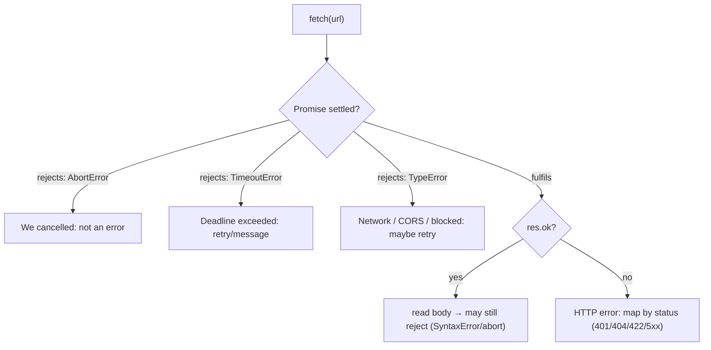
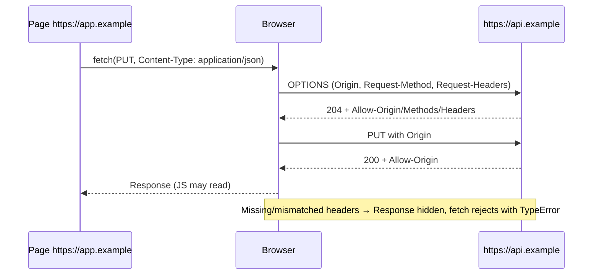

# 00 / 14 — Web APIs and Network Requests: `fetch`, `AbortController`, and Friends

## 1. Lesson metadata

| | |
|---|---|
| **Level** | Intermediate |
| **Study time** | 5 hours (reading 2 h, experiments 1.5 h, exercises 1.5 h) |
| **Prerequisites** | [12 — Promises and async/await](./12-promises-and-async-await.md). Strongly helpful: [11 — Event loop](./11-event-loop-tasks-microtasks.md), [13 — Browser events](./13-browser-events-and-propagation.md) |
| **Next** | [15 — HTTP, caching, navigation](./15-http-caching-and-navigation.md) |
| **Related later** | [Phase 6 / 01 — Fetch lifecycle](../06-data-fetching-and-state-ecosystems/01-fetch-lifecycle.md), [Phase 6 / 02 — Cancellation and race conditions](../06-data-fetching-and-state-ecosystems/02-cancellation-and-race-conditions.md), [Phase 6 / 03 — Loading and error states](../06-data-fetching-and-state-ecosystems/03-loading-and-error-states.md), [Phase 10 / 06 — Security: XSS, CSRF, CSP](../10-production-engineering/06-security-xss-csrf-csp.md) |

**Learning objectives.** After this lesson you can:
1. Explain what a "Web API" is (host-provided, not JavaScript) and name the ones React apps depend on most.
2. Use `fetch` correctly: when it resolves vs rejects, how request/response bodies and headers work, credentials, `Request`/`Response`/`Headers`, JSON, `FormData`, streaming basics.
3. Explain CORS well enough to diagnose errors: same-origin policy, simple vs preflighted requests, credentials, and what CORS does *not* protect.
4. Use `AbortController`/`AbortSignal` for cancellation, timeouts, and composing signals; distinguish `AbortError` from `TimeoutError` and from real failures.
5. Explain, precisely, how out-of-order responses create race conditions in React components and three ways to prevent them.
6. Use observers (`IntersectionObserver`, `ResizeObserver`), storage, `BroadcastChannel`, and online/visibility signals in React-friendly ways (including `useSyncExternalStore`).

**Concepts covered:** Web APIs vs ECMAScript, `fetch`, `Request`, `Response`, `Headers`, body consumption, `res.ok`, network errors vs HTTP errors, credentials and cookies, CORS (same-origin policy, preflight, `Access-Control-*`), `AbortController`, `AbortSignal.timeout`/`any`/`throwIfAborted`, race conditions, request deduplication, `URL`/`URLSearchParams`, `FormData`, streams and `TextDecoder`, Web Storage, IndexedDB overview, cookies overview, `BroadcastChannel`, `IntersectionObserver`, `ResizeObserver`, `MutationObserver`, `navigator.onLine`, Page Visibility, Web Workers overview, WebSocket/SSE overview.

---

## 2. Deep conceptual explanation

### 2.1 What problem is this lesson solving?

JavaScript the language can compute but cannot talk to the outside world: no network, no clock beyond `Date`, no DOM, no storage. Everything an application does that is *visible* — loading data, saving a form, noticing that the tab was hidden, lazy-loading an image — is done through **Web APIs**: interfaces the browser exposes to JavaScript ([Lesson 01 §2.2](./01-how-the-browser-works.md)). React itself has no network layer, no storage, no timers: it only calls your functions and mutates the DOM. So every real React application is, in large part, *glue between React's render cycle and Web APIs*.

The recurring pitfalls are all about **asynchrony meeting a render cycle that can repeat, restart, and unmount**:
- A component asks for data. Before the response arrives the component re-renders with new inputs, or unmounts. When the response arrives, what should happen?
- The same component mounts twice in development (StrictMode) and sends two requests. Is that a bug?
- The user types fast; responses return in a different order than requests were sent. Which wins?
- A request fails. Was it the network (retry might help), the server (5xx, retry carefully), the client (4xx, don't retry), or *us* (we aborted it deliberately)?
- A server and a page live on different origins. Why does the browser block the response although the server returned data?

This lesson builds the primitives for answering all of those. Phase 6 builds production patterns on them.

### 2.2 Web APIs are host features

| API group | Examples | Typical React use |
|---|---|---|
| Network | `fetch`, `XMLHttpRequest` (legacy), `WebSocket`, `EventSource` (SSE), `navigator.sendBeacon` | data loading, realtime, analytics |
| DOM & events | `document`, `Element`, `addEventListener` | React DOM host config ([Phase 1](../01-react-fundamentals/10-event-handling.md)) |
| Timers & frames | `setTimeout`, `setInterval`, `requestAnimationFrame`, `requestIdleCallback` | debounce, animations |
| Storage | `localStorage`, `sessionStorage`, cookies, IndexedDB, Cache API | preferences, drafts, offline |
| Observers | `IntersectionObserver`, `ResizeObserver`, `MutationObserver`, `PerformanceObserver` | lazy-load, layout measurement, metrics |
| Messaging / concurrency | `Worker`, `SharedWorker`, `BroadcastChannel`, `MessageChannel`, `postMessage` | CPU offload, cross-tab sync |
| Platform state | `navigator.onLine`, `document.visibilityState`, `matchMedia`, `navigator.clipboard`, `Geolocation` | online banner, pause polling, theme |
| URLs & data | `URL`, `URLSearchParams`, `FormData`, `Blob`, `File`, `TextEncoder/Decoder`, `structuredClone` | URL state, uploads |

All are available in browsers but differ in other hosts: Node 18+ has `fetch`, `AbortController`, `URL`, `structuredClone`, and `BroadcastChannel`, but **no** DOM, no `localStorage` by default (in Node 24 `typeof localStorage` is `"undefined"`; Web Storage has been experimental/flag-gated in recent Node versions, so check your Node version's docs), no observers. This matters for **SSR and tests** (jsdom/happy-dom polyfill some APIs imperfectly; for example `IntersectionObserver` and `ResizeObserver` are typically missing in jsdom and need mocks).

### 2.3 `fetch` in one page

```ts
const res = await fetch(input, init);   // input: string | URL | Request; init: RequestInit
```

**It returns a promise of a `Response`.** The promise:
- **fulfils** as soon as the **response headers** arrive, *regardless of HTTP status*. A 404 or 500 is a fulfilled promise.
- **rejects** only when no HTTP response could be obtained or it's disallowed: network failure (offline, DNS, TLS, connection reset), a CORS failure, a blocked mixed-content/CSP request, or an abort. A network/CORS failure rejects with a **`TypeError`** (`"Failed to fetch"` in Chrome, `"NetworkError when attempting to fetch resource"` in Firefox; messages are engine-specific and deliberately uninformative). An abort rejects with the signal's *reason* (by default a `DOMException` named `AbortError`).

Hence the canonical four-step handling:

```ts
async function getJson<T>(url: string, init?: RequestInit): Promise<T> {
  const res = await fetch(url, init);                       // (1) network-level failure rejects here
  if (!res.ok) throw new HttpError(res.status, res.statusText); // (2) HTTP-level failure: YOU decide it's an error
  if (res.status === 204) return undefined as T;            // (3) no body: res.json() would throw
  return res.json() as Promise<T>;                           // (4) body read/parse can reject (SyntaxError, abort mid-body)
}
```

**Response body.** `res.body` is a `ReadableStream`. `res.json()`, `res.text()`, `res.blob()`, `res.arrayBuffer()`, `res.formData()` each **consume** the stream; a second call rejects with a `TypeError` ("body stream already read"). Use `res.clone()` **before** reading if you need two consumers. Reading the body is also async and can fail or be aborted *after* the headers arrived: the abort signal covers the body read too.

**Request options that matter:**

| Option | Meaning |
|---|---|
| `method` | `GET` default; `POST`, `PUT`, `PATCH`, `DELETE`. |
| `headers` | `Headers`/object. Some are forbidden (`Cookie`, `Host`) and set by the browser. |
| `body` | `string`, `FormData`, `URLSearchParams`, `Blob`, `ArrayBuffer`, `ReadableStream`. A `GET` cannot have a body. |
| `credentials` | `"same-origin"` (default: send cookies/HTTP auth to same-origin only), `"include"` (also cross-origin; needs CORS opt-in from the server), `"omit"`. |
| `mode` | `"cors"` (default for cross-origin), `"same-origin"`, `"no-cors"` (opaque response, mostly useless for data). |
| `cache` | How this request interacts with the **HTTP cache**: `"default"`, `"no-store"`, `"reload"`, `"no-cache"`, `"force-cache"`, `"only-if-cached"` ([Lesson 15](./15-http-caching-and-navigation.md)). |
| `signal` | An `AbortSignal` that cancels the request/body read. |
| `keepalive` | Lets the request outlive the page (analytics on unload; small bodies, limits apply). |
| `redirect`, `referrerPolicy`, `integrity`, `priority` | Less common. `priority` (Fetch Priority) support varies ⚠. |

**JSON requests.** `fetch` does not serialise for you and does not set JSON headers:

```ts
await fetch("/api/orders", {
  method: "POST",
  headers: { "Content-Type": "application/json", Accept: "application/json" },
  body: JSON.stringify(order),
});
```
For `FormData` bodies do **not** set `Content-Type` manually; the browser must add the multipart boundary.

### 2.4 The same-origin policy and CORS

An **origin** is the tuple (scheme, host, port): `https://shop.example:443`. The **same-origin policy** (SOP) restricts how a document from one origin can interact with resources from another. In particular, a script on `https://app.example` may *send* a request to `https://api.example` (this is not forbidden by SOP; it's how images and forms always worked) but **cannot read the response** unless the server opts in via **CORS** (Cross-Origin Resource Sharing) headers.

Key mechanics:
- The browser sends `Origin: https://app.example` on cross-origin requests.
- The server replies with `Access-Control-Allow-Origin: https://app.example` (or `*` for non-credentialed requests). If the header is missing/mismatched, the browser **blocks JS from seeing the response** and the `fetch` promise rejects with a `TypeError`. DevTools' Console shows a *CORS* message; the Network tab usually shows the response status (the request did happen!). *The server received and processed it.* CORS is not a server-side access control.
- **Simple requests** (GET/HEAD/POST with only "safe" headers and content types `application/x-www-form-urlencoded`, `multipart/form-data`, `text/plain`) go straight through.
- Anything else triggers a **preflight**: before the real request, the browser sends an `OPTIONS` request with `Access-Control-Request-Method` and `Access-Control-Request-Headers`. The server must answer with `Access-Control-Allow-Methods`, `Access-Control-Allow-Headers` (and `Access-Control-Allow-Origin`), usually with status 2xx. Triggers: methods `PUT`/`PATCH`/`DELETE`, any custom header such as `Authorization` or `X-Request-Id`, `Content-Type: application/json`. Preflight results can be cached for `Access-Control-Max-Age` seconds (browser caps apply).
- **Credentials:** to send/receive cookies cross-origin, the client sets `credentials: "include"` and the server must respond with `Access-Control-Allow-Credentials: true` **and** a specific (non-`*`) `Access-Control-Allow-Origin`.
- **Response headers** readable by JS are limited to a safelist unless `Access-Control-Expose-Headers` lists more.

What CORS **is not**: it does not stop `curl`, servers, or malicious pages from *sending* requests; it protects *reading* responses. It is not authentication. Cross-site request forgery (CSRF) is about *sending* credentialed requests and is mitigated separately (SameSite cookies, CSRF tokens; [Phase 10 / 06](../10-production-engineering/06-security-xss-csrf-csp.md)).

Practical development setups: use the same origin in production (reverse proxy / BFF) or enable explicit CORS; in dev use the dev-server proxy (Vite `server.proxy`) so the browser sees same-origin requests.

### 2.5 `AbortController` and `AbortSignal`

Promises are not cancellable ([Lesson 12](./12-promises-and-async-await.md) §2.7). The platform's cancellation primitive is separate:

```ts
const controller = new AbortController();
const { signal } = controller;

const p = fetch(url, { signal });     // pass the signal to cancellable APIs
controller.abort();                   // or controller.abort(new Error("superseded")) to set a reason
await p;                              // rejects with signal.reason (default: DOMException "AbortError")
```

- `signal.aborted` (boolean), `signal.reason` (any), `signal.addEventListener("abort", …)`, `signal.throwIfAborted()` (throws `signal.reason` if aborted; useful between async steps in your own code).
- A signal can only abort **once**; create a new controller per operation.
- `AbortSignal.timeout(ms)` returns a signal that aborts after `ms` with a `TimeoutError` `DOMException` (note the *name* differs from `AbortError`). Timing is based on active-time semantics; in some engines the timer doesn't run while a page is frozen/bfcache ⚠ minor.
- `AbortSignal.any([s1, s2])` returns a signal that aborts when any input aborts (e.g. component unmount **or** user cancel **or** timeout). Newer API (Baseline 2024; present in Node 24); feature-detect or write a tiny polyfill (§5.5).
- `AbortSignal.abort(reason)` returns an already-aborted signal.
- Many APIs accept `signal`: `fetch`, `addEventListener` (to remove a listener), streams, `Response` body reading, Node timers and streams, TanStack Query's query function context (`signal`), etc.

**The three kinds of "failure" you must distinguish:**

| What happened | Rejection value | What the UI should do |
|---|---|---|
| We aborted on purpose (unmount, superseded, user cancelled) | `AbortError` `DOMException` (or custom `reason`) | *Nothing.* It's not an error. Don't set error state, don't log as failure. |
| Timeout via `AbortSignal.timeout` | `TimeoutError` `DOMException` | Show a timeout/retry message. |
| Network/CORS failure | `TypeError` | Offline/retry UI; may be retryable. |
| HTTP error (4xx/5xx) | none: fulfilled response with `ok === false` | Map by status: 401 → login; 404 → not found; 409/422 → validation; 5xx → server problem, retry with backoff. |

### 2.6 How this meets React: the lifecycle mismatch

A component function is called many times; an effect is a *synchronisation with an external system* that must be set up and **torn down** ([Phase 3 / 04](../03-react-state-and-hooks/04-useeffect-synchronization.md)). A fetch started in an effect is one such "external operation": its natural teardown is `controller.abort()` in the cleanup. The cleanup runs when dependencies change and on unmount, which is exactly the "this response is no longer wanted" condition. This single pattern solves: (1) stale responses (race conditions), (2) updates after unmount, (3) wasted network and server work, (4) StrictMode's mount → unmount → mount in development.

**StrictMode (development only).** React mounts, unmounts, and remounts every component once on first mount to surface missing cleanup. A fetch effect therefore sends the request, aborts it, and sends it again. In the Network panel the first request shows `(canceled)`. This is *expected and desirable*; it is not a bug to "fix" by removing StrictMode or adding a `useRef` guard ([Phase 2 / 28](../02-react-rendering-and-internals/28-strict-mode-behavior.md)). In production the effect runs once. If duplicate requests in *production* are a problem (two components requesting the same URL), deduplicate with a cache layer ([Phase 6 / 07](../06-data-fetching-and-state-ecosystems/07-server-state-management.md)).

### 2.7 Race conditions, precisely

A **race condition** here: the final UI state depends on the *order in which asynchronous operations complete*, which the code did not control. With requests for `id=1` then `id=2`, nothing guarantees `id=1` returns first (different server instances, cache hits, retries, TCP loss). The rule you want: **the UI must reflect the latest *intent*, not the latest *arrival*.**

Three robust strategies (details in [Phase 6 / 02](../06-data-fetching-and-state-ecosystems/02-cancellation-and-race-conditions.md)):
1. **Abort the superseded request** (best: saves work).
2. **Ignore stale results** with a token/flag (when you can't abort).
3. **Key results by input** (cache/store keyed by `id`; render the entry for the *current* `id`), which is what data libraries do; late arrivals fill the cache for their own key and never corrupt the view for another.

Also not a "race" but related: **waterfalls** (sequential dependent requests) and **duplicate requests** (the same data requested by several components).

### 2.8 Common misconceptions

| Misconception | Reality |
|---|---|
| "`fetch` rejects on 404/500." | It rejects only on network/CORS/abort. Check `res.ok`. |
| "`try { fetch(...) } catch {}` catches errors." | Needs `await`. Even then HTTP errors aren't thrown. |
| "CORS errors mean the server didn't receive my request." | For simple requests and after a successful preflight the server did handle it; the browser just hides the response. (For failed preflights the actual request is not sent.) |
| "CORS protects my API." | It only restricts browser JS from *reading* cross-origin responses. Servers must still authenticate/authorise. |
| "`AbortController.abort()` stops the server from working." | It cancels the client-side request; the server may continue (and a non-idempotent POST may still have been applied). |
| "Aborting is an error." | It is a normal control-flow event; treat `AbortError` as non-error. |
| "StrictMode's double fetch is a bug." | It's a dev-only check that your cleanup is correct. |
| "`localStorage` is async/safe for big data." | It's synchronous (blocks the main thread), string-only, ~5 MB per origin, shared by all tabs, and readable by any script on the origin (XSS exposure). |
| "`navigator.onLine === true` means I have internet." | It indicates a network interface is up, not that the server is reachable. |

---

## 3. Internal mechanics

### 3.1 Where `fetch` runs

`fetch(...)` called on the main thread creates a `Request` and hands it to the **network service** (Chromium: a separate process/service; [Lesson 01](./01-how-the-browser-works.md)). DNS, connection setup (TCP+TLS or QUIC), HTTP/1.1/2/3 framing, HTTP cache lookup, cookie attachment, and service-worker interception happen outside your JS. The main thread only sees: promise resolution when headers arrive; body chunks delivered to the stream as they arrive; each resolution/continuation is queued as a **task** (network task source) → then promise reactions run as **microtasks** ([Lesson 11](./11-event-loop-tasks-microtasks.md)). This is why a hung request does not block your UI, and why a *huge JSON parse* (`res.json()`) does: parsing runs on the main thread (for large payloads, consider streaming/NDJSON, pagination, or parsing in a worker).

*Public guarantee (Fetch Standard):* promise settles per the rules above; body is a stream consumed once; the `signal` abort rejects pending promises with the signal's reason.
*Implementation detail:* connection pooling, per-host connection limits (~6 on HTTP/1.1; HTTP/2 and HTTP/3 multiplex over one connection), request priorities, and memory vs disk caching.

### 3.2 Anatomy of cancellation

`abort()` → the signal sets `aborted`/`reason`, fires `abort` event listeners **synchronously** (in the same call), and `fetch` (registered as a listener internally) cancels the network request and rejects its promise. If you await `fetch(...)`, the rejection is delivered through the normal microtask path, *after* `abort()` returns. Consequently:

```ts
controller.abort();
console.log(controller.signal.aborted); // true immediately
// the awaiting code sees the rejection a microtask later
```

An abort **after** the response headers arrived still rejects an in-progress `res.json()`; an abort after the body is fully read does nothing.

### 3.3 Preflight sequence

```text
Browser                                   Server
  | OPTIONS /api/items                        |
  | Origin, Access-Control-Request-Method,    |
  | Access-Control-Request-Headers  --------> |
  | <------- 204 + Access-Control-Allow-*     |
  | (cache preflight for Max-Age)             |
  | PUT /api/items  (+ Origin, Authorization) |
  | <------- 200 + Access-Control-Allow-Origin|
JS receives Response only if the headers on the actual response also pass.
```

Preflights add a round trip for the first request (per URL/method/header combination until cached) — a performance reason to prefer same-origin APIs or to keep requests "simple" where possible.

### 3.4 Cookies and credentials, briefly

Cookies are attached by the browser according to domain/path/`SameSite`/`Secure` rules ([Lesson 15](./15-http-caching-and-navigation.md) and Phase 10). `fetch` with default `credentials: "same-origin"` includes cookies for same-origin requests only. `HttpOnly` cookies are invisible to JS (a defence against XSS token theft), which is why token-in-cookie sessions are commonly preferred over tokens in `localStorage`; the trade-offs are discussed in Phase 10.

### 3.5 Streams and incremental processing

`res.body` is a `ReadableStream<Uint8Array>`. `getReader()` + `read()` loops let you process chunks as they arrive (progress bars, NDJSON, server-sent LLM tokens). Decoding bytes to text across chunk boundaries requires `TextDecoder` with `{ stream: true }` (multi-byte characters can be split between chunks). Async iteration over `ReadableStream` (`for await`) is available in Node (24: `ReadableStream.prototype[Symbol.asyncIterator]` is a function) but has historically lagged in some browsers (check MDN's compatibility table); the reader loop is portable.

### 3.6 Observers and their timing

- `IntersectionObserver` callbacks are delivered asynchronously, in the **"update the rendering" step**, not synchronously with scroll; they are the standard tool for lazy loading, infinite scroll sentinels, and "is visible" analytics (instead of scroll listeners).
- `ResizeObserver` callbacks run after layout, before paint, in the rendering step; changing layout inside the callback can trigger another observation loop ("ResizeObserver loop completed with undelivered notifications" is a warning, not necessarily a bug).
- `MutationObserver` callbacks are **microtasks**, delivered after the mutation-causing script finishes.
- `PerformanceObserver` is how you read Web Vitals and long tasks.

React use: attach observers in effects (or callback refs), disconnect in cleanup, and keep observed *elements* in refs ([Phase 3 / 10](../03-react-state-and-hooks/10-useref-and-mutable-references.md)).

### 3.7 Storage characteristics

| API | Sync/async | Capacity (order of magnitude) | Persistence | Scope | Notes |
|---|---|---|---|---|---|
| Cookies | sync | ~4 KB each | per `Expires`/`Max-Age` | sent with requests | `HttpOnly`, `Secure`, `SameSite` |
| `localStorage` | **sync** | ~5 MB | until cleared | origin, all tabs | strings only; `storage` event in *other* tabs |
| `sessionStorage` | **sync** | ~5 MB | tab session | origin + tab | |
| IndexedDB | async | large (quota-based) | persistent (unless evicted) | origin | structured data, transactions; use a wrapper (idb, Dexie) |
| Cache API | async | quota-based | persistent | origin | request/response pairs; Service Workers |

All can throw (`QuotaExceededError`, `SecurityError` in privacy modes), and *must be wrapped in try/catch* when used from components. They are unavailable during SSR. Treat them as **external stores** (read with `useSyncExternalStore` or in an effect/initialiser, not directly during render on the server).

---

## 4. Step-by-step execution walkthrough

### 4.1 `fetch` in a click handler, step by step

```ts
button.onclick = async () => {
  setStatus("loading");
  try {
    const res = await fetch("/api/profile", { signal });
    if (!res.ok) throw new HttpError(res.status, res.statusText);
    const profile = await res.json();
    setProfile(profile);
    setStatus("ready");
  } catch (e) {
    setStatus(isAbort(e) ? "idle" : "error");
  }
};
```

1. **Click task:** the handler runs synchronously until the first `await`. `setStatus("loading")` queues a React update; `fetch` creates a Request, hands it to the network service, returns a pending promise; the handler suspends at `await` and returns to the event loop. React then processes the update (before paint, [Lesson 11 §4.2](./11-event-loop-tasks-microtasks.md)): the UI shows loading.
2. **Network (off the main thread):** DNS/TLS/HTTP request. The main thread is free; the user can interact.
3. **Headers arrive:** a network task resolves the promise; its continuation is a microtask: `res.ok` is checked.
4. **Body:** `await res.json()` reads and parses the stream. Chunks arrive as tasks; the parse itself is main-thread CPU work.
5. **State updates:** after the `await`, `setProfile` and `setStatus("ready")` run in a **later microtask**, *outside* React's event batching context but within React 18+'s **automatic batching** (updates in promises/timeouts are batched too), so one render happens ([Phase 2 / 22](../02-react-rendering-and-internals/22-automatic-batching.md)).
6. **Render/commit/paint** as usual.

### 4.2 The race, with an effect and cleanup (timeline)

```tsx
useEffect(() => {
  const controller = new AbortController();
  fetch(`/api/search?q=${encodeURIComponent(q)}`, { signal: controller.signal })
    .then((r) => r.json())
    .then(setResults)
    .catch((e) => { if (!controller.signal.aborted) setError(e); });
  return () => controller.abort();
}, [q]);
```

User types "a", then "ab" quickly:

| t | Event | Effect |
|---|---|---|
| 0 | render with q="a" | after commit, effect #1 runs: controller #1, request R1 started |
| 150 | user types "b" → render with q="ab" | **before** running effect #2, React runs **cleanup #1**: `controller1.abort()` → R1 canceled; its `.catch` runs with `AbortError` but `controller1.signal.aborted` is true → ignored |
| 150 | effect #2 runs | controller #2, R2 started |
| 400 | R2 resolves | `setResults(results for "ab")` ✔ |
| (never) | R1's data | never applied |

If R1's response had already arrived at the moment of the abort, the guard on the `.then` side matters: after `abort()` the in-flight `res.json()` rejects; a `.then(setResults)` already queued might still run. Hence the robust version checks `controller.signal.aborted` *before every state update after an await*.

---

## 5. Code examples

### 5.1 Minimal: what `fetch` resolves and rejects with

```ts
const bad = await fetch("/definitely-missing");                   // server replies 404
console.log(bad.ok, bad.status);                                   // ?

try {
  await fetch("http://localhost:1/unreachable");                   // nothing listening
} catch (e) {
  console.log(e instanceof TypeError, (e as Error).name);          // ?
}

const c = new AbortController();
const p = fetch("/slow", { signal: c.signal });
c.abort();
try { await p; } catch (e) { console.log((e as DOMException).name, c.signal.aborted); }  // ?
```

**Predict** all three. **Result:** `false 404`; `true TypeError`; `AbortError true`. A 404 *resolves*; an unreachable server *rejects with `TypeError`*; an abort rejects with an `AbortError`.

### 5.2 Practical: a production-grade `request` function

```ts
export class HttpError extends Error {
  constructor(readonly status: number, readonly body: unknown, message = `HTTP ${status}`) {
    super(message);
    this.name = "HttpError";
  }
}
export class NetworkError extends Error {
  constructor(options?: ErrorOptions) { super("Network request failed", options); this.name = "NetworkError"; }
}
export const isAbortError = (e: unknown): e is DOMException =>
  e instanceof DOMException && (e.name === "AbortError" || e.name === "TimeoutError");

type RequestOptions = Omit<RequestInit, "body"> & { json?: unknown; timeoutMs?: number };

export async function request<T>(url: string, { json, timeoutMs = 10_000, signal, headers, ...init }: RequestOptions = {}): Promise<T> {
  const timeout = AbortSignal.timeout(timeoutMs);
  const combined = signal ? anySignal([signal, timeout]) : timeout;

  let res: Response;
  try {
    res = await fetch(url, {
      ...init,
      signal: combined,
      headers: { Accept: "application/json", ...(json !== undefined && { "Content-Type": "application/json" }), ...headers },
      body: json !== undefined ? JSON.stringify(json) : undefined,
    });
  } catch (cause) {
    if (isAbortError(cause)) throw cause;                 // caller decides: abort vs timeout
    throw new NetworkError({ cause });                    // TypeError from offline/CORS/DNS
  }

  if (res.status === 204) return undefined as T;
  const text = await res.text();                           // read once; parse manually for good errors
  const body: unknown = text ? safeJson(text) : undefined;
  if (!res.ok) throw new HttpError(res.status, body);
  return body as T;
}

function safeJson(text: string): unknown {
  try { return JSON.parse(text); } catch { return text; }
}
```

Line notes:
- The `timeout` signal is always applied; an external `signal` (e.g. from an effect) is combined with it.
- Aborts are re-thrown unchanged so callers can distinguish them (`isAbortError`); `TypeError` becomes `NetworkError` with `cause` preserved.
- Reading `text()` first and parsing ourselves yields informative errors for HTML error pages (proxies and gateways return HTML for 502/504).
- `body as T` is an *assertion*. At trust boundaries validate (Zod/Valibot/io-ts) ([Phase 4 / 14](../04-react-architecture/14-api-boundaries-and-data-access.md)).
- Retries, auth refresh, tracing headers, and caching belong in layers *above* or in a data library; keep this primitive small.

### 5.3 Incorrect: a typeahead with three bugs

```tsx
function Search() {
  const [q, setQ] = useState("");
  const [results, setResults] = useState<Item[]>([]);

  useEffect(() => {
    fetch(`/api/search?q=${q}`)
      .then((r) => r.json())
      .then((data) => setResults(data));
  }, [q]);

  return (
    <>
      <input value={q} onChange={(e) => setQ(e.target.value)} />
      <ul>{results.map((r) => <li key={r.id}>{r.name}</li>)}</ul>
    </>
  );
}
```

**Defects:** (1) **Race**: out-of-order responses overwrite newer results. (2) **No error handling**: network failures are unhandled rejections; 500s are `r.json()`-ed and set as `results` (crash on `.map`). (3) **Unencoded query** (`q` containing `&` or `#` corrupts the URL: encode with `encodeURIComponent` or `URLSearchParams`). (4) **Requests fire on every keystroke** (including empty `q`): debounce/min length. (5) **Updates after unmount**. (6) No loading/empty states.

### 5.4 Corrected

```tsx
function useDebounced<T>(value: T, ms: number): T {
  const [v, setV] = useState(value);
  useEffect(() => {
    const id = setTimeout(() => setV(value), ms);
    return () => clearTimeout(id);
  }, [value, ms]);
  return v;
}

type SearchState =
  | { status: "idle" }
  | { status: "loading"; previous: Item[] }
  | { status: "success"; items: Item[] }
  | { status: "error"; error: Error; previous: Item[] };

function Search() {
  const [q, setQ] = useState("");
  const query = useDebounced(q.trim(), 250);
  const [state, setState] = useState<SearchState>({ status: "idle" });

  useEffect(() => {
    if (query.length < 2) { setState({ status: "idle" }); return; }
    const controller = new AbortController();
    setState((s) => ({ status: "loading", previous: s.status === "success" ? s.items : [] }));

    const url = `/api/search?${new URLSearchParams({ q: query })}`;
    request<Item[]>(url, { signal: controller.signal })
      .then((items) => setState({ status: "success", items }))
      .catch((error: unknown) => {
        if (controller.signal.aborted) return;               // superseded or unmounted: not an error
        setState((s) => ({
          status: "error",
          error: error instanceof Error ? error : new Error(String(error)),
          previous: s.status === "loading" ? s.previous : [],
        }));
      });

    return () => controller.abort();
  }, [query]);

  const items = state.status === "success" ? state.items : state.status === "idle" ? [] : state.previous;
  return (
    <>
      <input value={q} onChange={(e) => setQ(e.target.value)} aria-label="Search" />
      {state.status === "loading" && <p role="status">Searching…</p>}
      {state.status === "error" && <p role="alert">Search failed. Try again.</p>}
      <ul aria-busy={state.status === "loading"}>{items.map((r) => <li key={r.id}>{r.name}</li>)}</ul>
    </>
  );
}
```

Notes: the input stays **urgent and controlled** (every keystroke renders only this small component); the debounced value drives the effect; `URLSearchParams` encodes; previous results remain visible while loading (avoids flicker); aborts are ignored; state is a discriminated union. **Trade-offs:** debounce adds ≥250 ms latency; in many apps `useDeferredValue` + a data library with `placeholderData`/`keepPreviousData` is simpler ([Phase 6 / 08](../06-data-fetching-and-state-ecosystems/08-tanstack-query.md)). Hand-rolled is acceptable for isolated widgets.

### 5.5 Practical: `anySignal` fallback and a cancellable `sleep`-friendly helper

```ts
export function anySignal(signals: readonly AbortSignal[]): AbortSignal {
  if ("any" in AbortSignal && typeof AbortSignal.any === "function") return AbortSignal.any(signals as AbortSignal[]);
  const controller = new AbortController();
  const onAbort = (e: Event) => {
    cleanup();
    controller.abort((e.target as AbortSignal).reason);
  };
  const cleanup = () => signals.forEach((s) => s.removeEventListener("abort", onAbort));
  for (const s of signals) {
    if (s.aborted) { controller.abort(s.reason); return controller.signal; }
    s.addEventListener("abort", onAbort, { once: true });
  }
  return controller.signal;
}
```

The fallback forwards the first abort and removes the other listeners to avoid leaks. (`AbortSignal.any` is built to avoid that leak risk natively; the polyfill is for older browsers.)

### 5.6 Practical: online status as an external store

```tsx
import { useSyncExternalStore } from "react";

function subscribe(onChange: () => void) {
  window.addEventListener("online", onChange);
  window.addEventListener("offline", onChange);
  return () => {
    window.removeEventListener("online", onChange);
    window.removeEventListener("offline", onChange);
  };
}

export function useOnlineStatus(): boolean {
  return useSyncExternalStore(
    subscribe,
    () => navigator.onLine,     // client snapshot
    () => true,                 // server snapshot (SSR): assume online
  );
}
```

`useSyncExternalStore` is the correct bridge for browser state that changes outside React ([Phase 3 / 20](../03-react-state-and-hooks/20-usesyncexternalstore-and-external-stores.md)): no tearing, SSR-safe via the server snapshot, and cleanup symmetrical. Caveat: `navigator.onLine === true` doesn't prove reachability; treat it as a hint and rely on request failures for truth.

### 5.7 Practical: `IntersectionObserver` for infinite scroll

```tsx
function useInView<T extends Element>(onEnter: () => void, options?: IntersectionObserverInit) {
  const ref = useRef<T | null>(null);
  const latest = useRef(onEnter);
  useEffect(() => { latest.current = onEnter; });

  useEffect(() => {
    const el = ref.current;
    if (!el) return;
    const io = new IntersectionObserver((entries) => {
      if (entries.some((e) => e.isIntersecting)) latest.current();
    }, options);
    io.observe(el);
    return () => io.disconnect();
  }, [options?.root, options?.rootMargin, options?.threshold]);
  return ref;
}

function Feed() {
  const { items, fetchMore, hasMore, isFetching } = useFeed();
  const sentinel = useInView<HTMLDivElement>(() => { if (hasMore && !isFetching) fetchMore(); }, { rootMargin: "400px" });
  return (<>{items.map(/* … */)}<div ref={sentinel} aria-hidden /></>);
}
```

Notes: no scroll listener; the observer fires when the sentinel is within 400 px of the viewport; a guard prevents duplicate requests; disconnect on cleanup; the callback reads the latest `hasMore`/`isFetching` via a ref. A11y: infinite scroll harms keyboard users and footers; provide "Load more" or pagination as an alternative where appropriate.

### 5.8 Advanced: streaming NDJSON with abort and correct decoding

```ts
export async function* streamNdjson<T>(url: string, signal?: AbortSignal): AsyncGenerator<T> {
  const res = await fetch(url, { signal, headers: { Accept: "application/x-ndjson" } });
  if (!res.ok || !res.body) throw new HttpError(res.status, undefined);
  const reader = res.body.getReader();
  const decoder = new TextDecoder();
  let buffer = "";
  try {
    while (true) {
      const { done, value } = await reader.read();
      if (done) break;
      buffer += decoder.decode(value, { stream: true });   // stream: true keeps split multi-byte chars intact
      let nl: number;
      while ((nl = buffer.indexOf("\n")) >= 0) {
        const line = buffer.slice(0, nl).trim();
        buffer = buffer.slice(nl + 1);
        if (line) yield JSON.parse(line) as T;
      }
    }
    buffer += decoder.decode();                              // flush
    if (buffer.trim()) yield JSON.parse(buffer) as T;
  } finally {
    reader.releaseLock();                                    // abort already cancels the underlying stream
  }
}

// React: append rows as they arrive (batched), abortable
useEffect(() => {
  const c = new AbortController();
  (async () => {
    const batch: Row[] = [];
    let last = performance.now();
    try {
      for await (const row of streamNdjson<Row>("/api/export", c.signal)) {
        batch.push(row);
        if (performance.now() - last > 100) {                // flush at most ~10×/s to avoid a render per row
          const chunk = batch.splice(0);
          setRows((prev) => prev.concat(chunk));
          last = performance.now();
        }
      }
      if (batch.length) setRows((prev) => prev.concat(batch));
    } catch (e) { if (!c.signal.aborted) setError(e); }
  })();
  return () => c.abort();
}, []);
```

Trade-offs: streaming improves time-to-first-row and memory, but needs server support (NDJSON or SSE), complicates error handling (partial results + failure), and each flush triggers a render. Batching by time ([Lesson 11 §9](./11-event-loop-tasks-microtasks.md)) keeps the main thread responsive. `for await` over an *async generator* is universally supported (distinct from async-iterating a `ReadableStream`).

### 5.9 Practical: cross-tab logout with `BroadcastChannel`

```ts
const channel = typeof BroadcastChannel !== "undefined" ? new BroadcastChannel("auth") : null;

export function logoutEverywhere() {
  channel?.postMessage({ type: "logout" });
  clearSessionLocally();
}
channel?.addEventListener("message", (e: MessageEvent<{ type: string }>) => {
  if (e.data.type === "logout") clearSessionLocally();
});
```

Notes: messages are delivered to *other* browsing contexts of the same origin, not the sender. The `storage` event on `localStorage` is an older alternative (fires in other tabs on change). In React, wrap the subscription in `useSyncExternalStore` or an effect with cleanup (`channel.close()`).

---

## 6. Visual explanations

### What `fetch` hands off and gets back

```mermaid
sequenceDiagram
  participant JS as Main thread (JS)
  participant NET as Network service
  participant SRV as Server
  JS->>NET: fetch(url, {signal}) → pending Promise
  Note over JS: returns to event loop; UI stays responsive
  NET->>SRV: HTTP request (cache/cookies/CORS checks)
  SRV-->>NET: status + headers
  NET-->>JS: task: resolve Promise<Response> (any status)
  JS->>JS: microtask: check res.ok
  NET-->>JS: body chunks (tasks)
  JS->>JS: res.json() parses on main thread
  JS->>JS: setState → React render
```

### Failure taxonomy



### Preflighted CORS request



---

## 7. Alternative approaches and trade-offs

**How to load server data in a React app:**

| Approach | Readability | Correctness out of the box | Complexity | Testability | When to prefer |
|---|---|---|---|---|---|
| `fetch` in `useEffect` (+ abort) | Medium | Manual: race, cache, retry, dedupe | Low initially, grows | Medium (MSW) | One-off widgets, libraries without a data dependency |
| Data library (TanStack Query, SWR, RTK Query) | High | Cancellation, dedupe, caching, retries, invalidation | Dependency, concepts | High | Default for client-fetched server state |
| Router loaders (React Router / framework) | High | Parallel route data, cancels on navigation | Framework coupling | Medium | Route-level data in framework-driven apps |
| Server Components / server data fetching | High | No client waterfalls for server data; secrets stay server-side | Framework/RSC knowledge | Medium | ⚠ Verify current framework docs; best for initial render data |
| `use(promise)` + Suspense with a cache | High | Needs a stable, cached promise | Needs cache layer | Medium | Advanced/library authors, loader-provided promises |
| Axios / ky / ofetch wrappers | Medium–High | Interceptors, retries, timeouts | Dependency | High | Teams wanting interceptors; `fetch` + small wrapper often suffices |
| WebSocket / SSE | Medium | Push; you handle reconnection, ordering, backpressure | High | Medium–Low | Live data ([Phase 6 / 17](../06-data-fetching-and-state-ecosystems/17-real-time-websockets-subscriptions.md)) |

**When the recommended approach (a data library) is not best:** a published component library or a tiny widget embedded in other apps should not force TanStack Query on consumers: accept a `fetcher` prop or use plain `fetch` with abort. A static marketing page with one request at load time gains nothing from a cache layer. A write-only analytics call (`sendBeacon`) is not "server state".

**`fetch` vs `XMLHttpRequest`:** XHR remains for upload progress events (`xhr.upload.onprogress`), which `fetch` lacked (request-stream upload progress is not broadly supported ⚠). For plain data, prefer `fetch`.

---

## 8. Best practices and anti-patterns

**Do**
- Centralise request logic in a small module (headers, error mapping, JSON parsing, timeouts).
- Check `res.ok`; map statuses to typed errors; preserve `cause`.
- Tie every in-flight request in an effect to an `AbortController` and abort in cleanup.
- Treat `AbortError` as control flow.
- Encode URLs with `URL`/`URLSearchParams`.
- Validate response data at the boundary; don't trust `as T`.
- Use `AbortSignal.timeout` for deadlines; combine signals with `AbortSignal.any` (or the fallback).
- Keep tokens out of `localStorage` where XSS is a concern; prefer `HttpOnly`, `Secure`, `SameSite` cookies (Phase 10).
- Wrap Web Storage in try/catch and a tiny abstraction; consider `useSyncExternalStore` for reactive access.

**Beginner mistakes**
- Assuming `fetch` throws on 404/500.
- Forgetting `Content-Type` for JSON bodies or setting it for `FormData`.
- Not encoding user input in URLs.
- Reading a body twice.
- Calling `res.json()` on `204` or HTML error pages.
- `fetch` in the component body (runs on every render!).
- Silencing StrictMode's double invocation instead of fixing cleanup.

**Experienced-developer mistakes**
- Treating "(canceled)" requests as server-side cancellations (the server may still process them; make writes idempotent).
- Retrying non-idempotent `POST`s without idempotency keys.
- Unbounded parallelism (`Promise.all` of hundreds of requests).
- Relying on `navigator.onLine` for correctness.
- Sending large JSON where pagination, projection, or streaming is appropriate (a 5 MB `res.json()` is a long task).
- Disabling CORS in production by wildcarding with credentials (not allowed by spec) or reflecting any `Origin` header (a vulnerability).
- Using `no-cors` and then wondering why the response is opaque.

**Smells:** `fetch` inside render; `useEffect(async …)`; `.catch(() => {})`; `then` chains without `return`; duplicated `fetch(...).then(r => r.json())` across components; parallel `useEffect`s each fetching dependent data (waterfall).

**Justified exceptions:** `fetch(..., { keepalive: true })` or `sendBeacon` without awaiting for analytics on page hide; using `no-cors` for fire-and-forget pings to third-party endpoints where you don't need the response.

---

## 9. Real-world application

*E-commerce search and product pages.* Product detail pages load: product, price, inventory, recommendations. The first three are independent and must be fetched in parallel (or by one server-composed endpoint); recommendations are lower priority and can be fetched after first paint. Constraints: LCP on 4G, correctness of stock info (don't cache inventory long), cancellation when navigating between products (aborts prevent stale content), CORS configuration between storefront and API domains, cookies for cart (SameSite). Data library with a stale-while-revalidate cache gives instant back-navigation; checkout uses idempotency keys.

*Financial dashboards.* Many widgets; each polls every 5–30 s. Constraints: pause polling when the tab is hidden (`visibilitychange`), back off on failure, deduplicate identical requests across widgets, limit concurrent requests to avoid saturating the browser connection pool (HTTP/1.1) or the server, show "stale since 12:03:11" indicators. Avoid refetching when the user is offline (use the `online` event as a hint; resume with a fresh fetch).

*Forms (account settings).* PUT with optimistic UI and rollback ([Phase 6 / 05](../06-data-fetching-and-state-ecosystems/05-optimistic-updates.md)); server validation errors (422) mapped to field errors; double-submit prevention; unsaved-changes guard using `beforeunload` and `sendBeacon` for drafts; large file uploads via `fetch` with `FormData` or presigned URLs to object storage (CORS config required on the bucket).

*Auth.* Access token in memory + refresh token in `HttpOnly` cookie; single-flight refresh ([Lesson 12 §9](./12-promises-and-async-await.md)); on 401 retry once after refresh; on cross-tab logout broadcast; CORS with credentials requires exact origins.

*Multi-team platform.* A shared `@org/http` package standardises timeouts, error classes, request IDs (`X-Request-Id` propagated to logs), and instrumentation; ESLint forbids bare `fetch` in app code (`no-restricted-globals`) so telemetry and error handling are uniform, with an escape hatch for tests.

---

## 10. Debugging and troubleshooting

**Symptom 1: Console shows "blocked by CORS policy" / `TypeError: Failed to fetch`.**
*Investigation:* Network panel: find the request; is there an `OPTIONS` preflight? What status? Compare **Request headers** (`Origin`, `Access-Control-Request-*`) with **Response headers** (`Access-Control-Allow-*`). Check the *actual* response (did the server process it?). Use `curl -i -X OPTIONS` with the same headers to test the server in isolation (curl doesn't enforce CORS but shows what headers the server sends). *Typical root causes:* missing `Allow-Origin`; `Allow-Origin: *` with `credentials: "include"`; preflight returns 401/404 (auth middleware runs before CORS middleware); missing `Allow-Headers` for `Authorization`/`Content-Type`; redirects on preflight (not allowed); the error is actually a 500 without CORS headers (error responses must also carry CORS headers). *Fix:* server-side CORS config, or same-origin proxy. *Validate:* preflight 2xx with correct headers; actual response readable.

**Symptom 2: Request appears twice in dev.**
*Investigation:* is StrictMode on (`<StrictMode>` in `main.tsx`)? Is the first request marked `(canceled)`? *Conclusion:* expected. Confirm that cleanup aborts and the final UI is correct. In production build (`vite build && vite preview`) there should be one. If there are two non-canceled requests in production: two components request the same data → dedupe via data library; or a dependency changes identity each render (`options` object in deps) → effect reruns.

**Symptom 3: UI shows data for a previous selection.** Race; see §4.2; reproduce with DevTools throttling (Slow 3G) and quick input; inspect request ordering; fix with abort/guard.

**Symptom 4: `Unexpected token '<', "<!DOCTYPE "... is not valid JSON`.** The server (or proxy/SPA fallback) returned HTML (often `index.html` for an unknown API route, or a gateway error page); `res.json()` threw `SyntaxError`. *Investigation:* Response tab and `Content-Type`. *Fix:* check the URL and proxy config; read `text()` and include a snippet in the error in development; check `Content-Type` before parsing.

**Symptom 5: Cookies not sent/received cross-origin.** Check `credentials: "include"`, server `Allow-Credentials: true` and explicit origin, cookie attributes (`SameSite=None; Secure` for cross-site), and browser third-party cookie restrictions. Application → Cookies shows blocked cookies with reasons.

**Symptom 6: Slow "download" but fast network.** Timing tab breakdown (queueing, stalled, DNS, SSL, TTFB, content download); large JSON parse in the Performance panel (long task after the request ends) means CPU, not network.

**Symptom 7: Test fails with "fetch is not defined" / observers missing.** Node/jsdom environment: polyfill or mock (MSW for fetch; stub `IntersectionObserver`/`ResizeObserver`) ([Phase 8](../08-testing-and-quality/)).

DevTools: Network (filter Fetch/XHR, throttling, "Disable cache", initiator), Application (storage, cookies), Console `copy(await (await fetch(url)).json())`, Performance (Network track + tasks), "Preserve log" across navigation.

---

## 11. Exercises

### Level A — Knowledge
A1. When does the promise from `fetch` reject? When does it fulfil?
A2. Why can `res.json()` be called only once? How do you read a body twice?
A3. What exactly is an origin? Which of these are same-origin as `https://app.example/a`: `https://app.example:443/b`, `http://app.example/a`, `https://api.app.example/a`, `https://app.example:8443/a`?
A4. Which requests trigger a CORS preflight? Give three triggers.
A5. What does `AbortSignal.timeout(500)` abort with, and how does that differ from `controller.abort()`?
A6. Name two things `AbortController` does *not* do.
A7. Why should `localStorage` access be wrapped in `try/catch`?

### Level B — Code comprehension
B1. What is logged?
```ts
const res = await fetch("/api/not-found");          // server replies 404 with an HTML page
console.log(res.ok, res.status);
try { await res.json(); } catch (e) { console.log((e as Error).name); }
try { await res.text(); } catch (e) { console.log((e as Error).name); }
```
B2. What is logged and why?
```ts
const c = new AbortController();
const p = fetch("/slow", { signal: c.signal });
c.abort(new Error("superseded"));
try { await p; } catch (e) { console.log((e as Error).name, (e as Error).message); }
console.log(c.signal.aborted, c.signal.reason instanceof Error);
```
B3. For each request, preflight or not (cross-origin)? (a) `GET` no custom headers; (b) `POST` with `Content-Type: application/x-www-form-urlencoded`; (c) `POST` with `Content-Type: application/json`; (d) `GET` with `Authorization: Bearer …`; (e) `DELETE`.
B4. In the corrected search (§5.4), the user types "re", waits for results, then types "rea" and immediately clears the field. Describe the sequence of requests, aborts, and states, and the final UI.
B5. What does this render in React 19 development with StrictMode, and how many requests appear in the Network panel (and what are their statuses)?
```tsx
function User({ id }: { id: string }) {
  const [u, setU] = useState<UserDto | null>(null);
  useEffect(() => {
    const c = new AbortController();
    fetch(`/api/u/${id}`, { signal: c.signal }).then((r) => r.json()).then(setU).catch(() => {});
    return () => c.abort();
  }, [id]);
  return <p>{u?.name ?? "…"}</p>;
}
```

### Level C — Implementation
C1. Write `fetchJsonWithRetry(url, { retries, signal })` that retries network errors and 502/503/504 with exponential backoff and jitter, never retries 4xx, and stops immediately on abort.
C2. Write `useFetch<T>(url: string | null)` returning a discriminated-union state, aborting on change/unmount, ignoring aborts, and using `request()` from §5.2.
C3. Write `dedupeFetch(url)` that shares in-flight GETs (same URL → same promise) and removes entries on settle; explain what it does to *aborts*.
C4. Write a `useMediaQuery(query)` hook using `matchMedia` and `useSyncExternalStore`.
C5. Write an `uploadWithProgress(file, url, onProgress, signal)` using XHR with abort support, returning a promise.

### Level D — Debugging
D1. `fetch("https://api.other.com/items", { headers: { Authorization: token } })` fails with a CORS error, but the same call without the header works. Explain, and say what the server must do.
D2. After deploying behind a reverse proxy, the app logs `SyntaxError: Unexpected token '<'` for some API calls only in production. Find likely causes and verification steps.
D3. This hook sometimes sets stale data. Find the bugs.
```tsx
function useUser(id: string) {
  const [user, setUser] = useState<User>();
  useEffect(() => {
    let cancelled = false;
    async function load() {
      const res = await fetch(`/api/users/${id}`);
      const data = await res.json();
      if (!cancelled) setUser(data);
    }
    load();
    return () => { cancelled = true; };
  }, []);
  return user;
}
```
D4. Users report that after pressing "Save" and navigating quickly, the change is sometimes saved and sometimes not. The code aborts in-flight requests on route change. Explain and propose a fix.

### Level E — Architecture and engineering decisions
E1. Your organisation has 30 front-end teams calling 15 backend services from the browser on various domains. Choose among: direct calls with CORS everywhere, an API gateway on the same origin, or a backend-for-frontend (BFF). Evaluate criteria and recommend.
E2. Decide where to place retry, timeout, auth refresh, and error normalisation (fetch wrapper vs data library vs server). Justify with failure modes.

### Level F — Expert challenge
F1. Design a request layer that supports: per-request priority, global concurrency limit, cancellation by "intent groups" (cancel everything for the old route), de-duplication, and tracing. Provide the API, the data structures, and the failure/edge cases (abort while queued, retries counting against the limit, memory leaks).
F2. A page streams LLM tokens via `fetch` + `ReadableStream`. Users complain the UI janks and the stop button is slow to respond. Diagnose using the event-loop and abort model, and propose changes (batching, abort, backpressure, rendering strategy).

---

## 12. Detailed answers and explanations

> Attempt the exercises first.

**A1.** It **fulfils** when response headers are received (any HTTP status). It **rejects** for network failure, DNS/TLS failure, CORS failure (`TypeError`), blocked requests, or abort (`AbortError`/signal reason). It does not reject for 404/500.

**A2.** The body is a stream; reading consumes it. A second read rejects with a `TypeError` ("body stream already read" or similar). Use `res.clone()` *before* reading, which tees the stream (buffering costs memory), or read once (e.g. `text()`) and parse yourself.

**A3.** Origin = scheme + host + port. Same-origin: `https://app.example:443/b` (443 is the default for https) = yes. `http://app.example/a` = no (scheme). `https://api.app.example/a` = no (host differs, subdomains are different origins). `https://app.example:8443/a` = no (port).

**A4.** Non-simple methods (`PUT`, `PATCH`, `DELETE`), custom or non-safelisted headers (`Authorization`, `X-Requested-With`, `X-Request-Id`), content types other than the three simple ones (`application/json`), and certain streaming bodies or event listeners on the upload object. Any three.

**A5.** It aborts the signal after 500 ms with a `DOMException` whose `name` is `TimeoutError`. `controller.abort()` aborts with `AbortError` (by default) at the time you call it, or any reason you pass. Distinguishing them lets UI treat timeouts as failures (message/retry) while treating abort as control flow.

**A6.** It doesn't stop server-side work or roll back side effects of a request the server already processed; it doesn't cancel arbitrary promises or CPU work; it doesn't un-send a request already transmitted. (Also not: cancel something that ignores the signal.)

**A7.** Access can throw: `SecurityError` (blocked storage, some privacy modes/iframes), `QuotaExceededError` on `setItem`, `localStorage` undefined during SSR, JSON parse errors on corrupted values. A throw during render crashes the tree.

**B1.** `false 404`, then `SyntaxError` (HTML isn't JSON), then `TypeError` (the body was already consumed by the first read attempt; a failed parse still consumes the stream). Common wrong answer for the third line: it prints the HTML. It rejects because the body is used.

**B2.** `Error superseded`, then `true true`. `abort(reason)` rejects the fetch with *that reason*, not an `AbortError`. This means code checking `e.name === "AbortError"` would miss custom reasons: prefer checking `signal.aborted` as in §5.4.

**B3.** (a) no (simple); (b) no (simple content type); (c) yes (`application/json` isn't safelisted); (d) yes (`Authorization` custom header); (e) yes (`DELETE`). Remember all assume cross-origin; same-origin requests never preflight.

**B4.** Typing "re" → debounce 250 ms → request R1 for `re` → results (state success). Typing "rea": the input updates immediately (`q`), `query` is debounced; after 250 ms effect cleanup aborts nothing (R1 completed), effect starts R2 (`rea`), state becomes loading with `previous` = R1's items. If the user clears the field before R2 returns: `q = ""`, after 250 ms `query = ""` → cleanup aborts R2 (still in flight) → the new effect sees `query.length < 2` and sets `idle` → items shown = `[]`. The aborted R2's `.catch` sees `signal.aborted` and returns without touching state. Final UI: empty list, no loading. One subtle point: for up to 250 ms after clearing, R2 can still arrive and render `rea` results (because abort happens when `query` changes, not `q`) — acceptable; to reduce, also abort when `q` is cleared, or debounce less.

**B5.** Renders `…` until data arrives, then the name. In dev StrictMode: mount (request #1 starts), simulated unmount (cleanup aborts #1), remount (request #2 starts). Network panel: two requests to `/api/u/<id>`: the first `(canceled)`, the second `200`. In production: one request. The `.catch(() => {})` silently swallows *all* errors including real failures: poor practice; only ignore aborts.

**C1.**
```ts
const RETRYABLE = new Set([502, 503, 504]);
const sleep = (ms: number, signal?: AbortSignal) =>
  new Promise<void>((resolve, reject) => {
    if (signal?.aborted) return reject(signal.reason);
    const id = setTimeout(() => { signal?.removeEventListener("abort", onAbort); resolve(); }, ms);
    const onAbort = () => { clearTimeout(id); reject(signal!.reason); };
    signal?.addEventListener("abort", onAbort, { once: true });
  });

export async function fetchJsonWithRetry<T>(url: string, { retries = 3, signal, baseMs = 300 }: { retries?: number; signal?: AbortSignal; baseMs?: number } = {}): Promise<T> {
  for (let attempt = 0; ; attempt++) {
    try {
      return await request<T>(url, { signal });
    } catch (e) {
      if (signal?.aborted || isAbortError(e)) throw e;                       // never retry an abort
      const retryable = e instanceof NetworkError || (e instanceof HttpError && RETRYABLE.has(e.status));
      if (!retryable || attempt >= retries) throw e;
      await sleep(baseMs * 2 ** attempt * (0.5 + Math.random() / 2), signal);  // exponential backoff with jitter
    }
  }
}
```
Notes: only idempotent methods (GET) should be retried by default; honour `Retry-After` on 503/429; TimeoutError from the per-attempt timeout *is* retryable but the *overall* deadline must be enforced separately; `isAbortError` includes `TimeoutError` in §5.2: here we pass only the user signal, so a per-attempt timeout would be treated as an abort-type and not retried: adjust by distinguishing names if you want timeouts retried.

**C2.**
```tsx
type FetchState<T> =
  | { status: "idle" }
  | { status: "loading" }
  | { status: "success"; data: T }
  | { status: "error"; error: Error };

export function useFetch<T>(url: string | null): FetchState<T> {
  const [state, setState] = useState<FetchState<T>>({ status: "idle" });
  useEffect(() => {
    if (!url) { setState({ status: "idle" }); return; }
    const c = new AbortController();
    setState({ status: "loading" });
    request<T>(url, { signal: c.signal }).then(
      (data) => { if (!c.signal.aborted) setState({ status: "success", data }); },
      (e: unknown) => { if (!c.signal.aborted) setState({ status: "error", error: e instanceof Error ? e : new Error(String(e)) }); },
    );
    return () => c.abort();
  }, [url]);
  return state;
}
```
Evaluation: depends only on `url`; cleanup aborts; both `then` branches guard; union type; no async effect callback. Limitations to state: no caching, dedupe, or retry.

**C3.**
```ts
const inflight = new Map<string, Promise<Response>>();
export function dedupeFetch(url: string): Promise<Response> {
  let p = inflight.get(url);
  if (!p) {
    p = fetch(url).finally(() => inflight.delete(url));
    inflight.set(url, p);
  }
  return p.then((r) => r.clone());     // each consumer needs its own readable body
}
```
Aborts: this shares a single underlying request, so passing an individual `signal` per caller would cancel it for *everyone*; the proper design reference-counts consumers and aborts the shared request only when the last consumer aborts. Without that, don't pass signals to the shared fetch (and accept wasted work), or key by `(url, signal-group)`. Also: module-level Map = shared across SSR requests; don't dedupe user-specific URLs there.

**C4.**
```tsx
export function useMediaQuery(query: string): boolean {
  const subscribe = useCallback((onChange: () => void) => {
    const mql = window.matchMedia(query);
    mql.addEventListener("change", onChange);
    return () => mql.removeEventListener("change", onChange);
  }, [query]);
  return useSyncExternalStore(subscribe, () => window.matchMedia(query).matches, () => false);
}
```
`subscribe` identity changes only with `query`; the server snapshot returns `false`: a hydration mismatch risk if the client's true value differs (consider rendering both via CSS instead of JS when possible, [Phase 2 / 25](../02-react-rendering-and-internals/25-hydration-and-selective-hydration.md)).

**C5.**
```ts
export function uploadWithProgress(file: File, url: string, onProgress: (ratio: number) => void, signal?: AbortSignal): Promise<void> {
  return new Promise((resolve, reject) => {
    const xhr = new XMLHttpRequest();
    xhr.open("PUT", url);
    xhr.upload.onprogress = (e) => { if (e.lengthComputable) onProgress(e.loaded / e.total); };
    xhr.onload = () => (xhr.status >= 200 && xhr.status < 300 ? resolve() : reject(new HttpError(xhr.status, xhr.responseText)));
    xhr.onerror = () => reject(new NetworkError());
    xhr.onabort = () => reject(signal?.reason ?? new DOMException("Aborted", "AbortError"));
    if (signal?.aborted) return reject(signal.reason);        // already aborted: never send
    signal?.addEventListener("abort", () => xhr.abort(), { once: true });
    xhr.send(file);
  });
}
```
Evaluation: progress via `xhr.upload`; abort integration (`xhr.abort()` fires `onabort`, which rejects); error mapping; edge: throttle `onProgress` updates to avoid render storms (rAF), and remove the abort listener on completion.

**D1.** `Authorization` is not a CORS-safelisted header, so the browser sends a **preflight** `OPTIONS` including `Access-Control-Request-Headers: authorization`. If the server doesn't answer with `Access-Control-Allow-Headers: Authorization` (and allow-origin, 2xx status), the browser blocks the actual request. Without the header, the request is "simple" and needs no preflight. Server must handle `OPTIONS` *before* auth middleware, return the allow headers, and set `Allow-Origin`. If credentials are used, also `Allow-Credentials: true` and a non-wildcard origin.

**D2.** Candidates: (1) the proxy's SPA fallback returns `index.html` for unmatched `/api/*` routes (misconfigured routing); (2) base path/rewrite differences; (3) gateway error pages (502/504 HTML); (4) CDN caching an HTML response for an API URL; (5) login redirect pages (302 → HTML sign-in) for expired sessions, since `fetch` follows redirects silently by default. Verification: log `res.status`, `res.url` (shows final URL after redirect), `res.redirected`, `Content-Type`, and first 200 chars of text; reproduce with `curl -i` through the proxy; check proxy logs. Fix routing/proxy; handle `401/302` explicitly; check `Content-Type` before `json()`.

**D3.** (1) `[]` dependency array: ignores `id` changes (stale user for a new `id`; the lint rule `react-hooks/exhaustive-deps` flags it). (2) With the fix to `[id]`, the `cancelled` flag prevents stale state updates but doesn't abort the request (wasted work); use `AbortController`. (3) No `res.ok` check, no error handling (unhandled rejection; HTML error body fails `json()`). (4) While loading a new `id` the old user stays displayed (decide whether that's desired). (5) `useState<User>()` has `User | undefined` type; fine, but there's no error/loading state.

**D4.** Aborting a request cancels the client side only. For a `PUT/POST` that already reached the server, the write may complete even if the response is discarded; if the request hadn't been sent/flushed yet, it won't happen at all. Result: nondeterministic save. Fixes: don't tie *mutations* to route-lifetime abort; let them complete (`keepalive: true` for small payloads during page unload, or a mutation manager that outlives components, e.g. TanStack Query's `useMutation` at an app-level or a queue); make writes idempotent with an idempotency key so retries are safe; show "Saving…" status persisted outside the unmounting route; abort only *reads*.

**E1.** Criteria: latency (preflights, extra hops), security (token handling, cookie scope), operational ownership, consistency (timeouts, auth, rate limits), evolvability, team autonomy, cost. *Direct+CORS:* simple and fast for few services; becomes a configuration and security-review burden across 15 services; credentialed cross-site cookies are increasingly restricted; each team re-implements auth. *Same-origin gateway:* single origin removes CORS and preflight, centralises auth/rate limit/logging; requires gateway ownership and may be a bottleneck. *BFF:* a server layer per front-end tailors/aggregates calls (fewer round trips, secrets and tokens stay server-side, HttpOnly session cookie), but it's another service to run and can duplicate logic. *Recommendation for 30 teams:* gateway for cross-cutting concerns + BFFs where a front-end needs aggregation; direct CORS only for third-party or public APIs. State what would change it: tiny scale, public API only, or an existing mature gateway.

**E2.** *Fetch wrapper:* timeouts, error normalisation, auth header attach, request ID, JSON handling: uniform and framework-agnostic. *Data library:* retries (with policy per query), dedupe, cache, background refetch, cancellation tied to component lifecycles; retry policies depend on UI semantics (a background refetch vs a user-submitted mutation). *Auth refresh:* in the wrapper with single-flight (so every caller benefits), coordinated with cross-tab logout. *Server/gateway:* rate limiting, circuit breaking, idempotency enforcement. Failure modes: double retries (wrapper and library both retry, so N×M attempts: assign retry to one layer), refresh storms, retrying non-idempotent writes, swallowed aborts. Document the layering and test with fault injection (MSW returning 503/timeouts).

**F1.** Sketch: `class RequestScheduler { constructor({ maxConcurrent, now }) }` with `schedule<T>(task: (signal) => Promise<T>, { priority, group, key }): Promise<T>`. Data: priority queues (min-heap per priority; FIFO within), `running: Set<Job>`, `groups: Map<string, Set<Job>>` for intent groups with a per-group `AbortController`, `inflightByKey: Map<string, Job>` for dedupe with a subscriber ref-count. Behaviour: a job runs when `running.size < maxConcurrent`; each job gets `AbortSignal.any([groupSignal, callerSignal, timeoutSignal])`; `cancelGroup(name)` aborts the group's controller (queued jobs reject immediately and are removed; running jobs get the signal). Dedupe: second subscriber attaches to the same job; the job aborts only when all subscribers abort. Retries: re-enqueue with backoff **without** holding a slot during backoff sleep. Tracing: attach `traceparent`/request ID header and measure queue time vs network time. Edge cases: abort while queued (must free resources and reject), abort race right as it starts, a job that never settles (timeouts), starvation of low priority (aging), error classification, memory leaks (remove from maps in `finally`), SSR (per-request instance), tests with fake timers.

**F2.** Diagnosis: token events arrive at high rate; each `setState` triggers a render of a growing markdown tree, which is a long task growing with length (render cost O(n) per token → O(n²) overall). The stop button's click waits behind those tasks (input delay), and `abort()` can't take effect until the click handler runs. Fixes: (1) **batch** tokens: accumulate in a ref/buffer and flush at most once per frame or every ~50–100 ms ([Lesson 11](./11-event-loop-tasks-microtasks.md)); (2) render incrementally: split the transcript into stable blocks, memoise completed blocks (`memo`), and re-render only the last (growing) block; avoid re-parsing the whole markdown each time; (3) mark streaming updates as non-urgent (`startTransition`/`useDeferredValue`) so the stop click is urgent; (4) wire the stop button to `controller.abort()` and make the loop's `reader.read()` reject; cancel the reader (`reader.cancel()`) to apply backpressure; (5) move parsing (markdown/syntax highlighting) to a worker or debounce it; (6) verify with the Performance panel: long tasks, INP of the stop click, and CPU throttling.

---

## 13. Senior engineer interview questions

**Q1. "Does `fetch` reject on a 500? How do you structure error handling?"**
*Strong answer:* No: it rejects only on network-level failures, CORS blocks, or aborts; HTTP error statuses resolve. I wrap `fetch` in a function that checks `res.ok`, parses the body defensively (error responses may be HTML), maps statuses to typed errors, preserves `cause`, and re-throws aborts untouched so UI code can ignore them. At trust boundaries I validate the payload shape rather than casting.

**Q2. "Explain CORS to a backend engineer who thinks it's a security feature of the API."**
*Strong answer:* CORS relaxes the browser's same-origin policy; it governs whether browser JS on origin A may read a response from origin B. It doesn't stop non-browser clients or stop requests from being *sent* (simple requests are sent regardless; preflights guard non-simple ones). So it protects users' browser sessions from cross-site *reads*, not your API from abuse; authentication, authorisation, CSRF protection, and rate limiting are still required. Practical issues: preflight triggers, credentials needing explicit origin, and error responses needing CORS headers.

**Q3. "How would you make sure a React component doesn't show stale data when inputs change quickly?"**
*Strong answer:* Make the response's right to update state conditional on it matching the current input: abort the previous request in effect cleanup (also saves work), guard state updates with `signal.aborted`, or key results by input/cache. Mention StrictMode double invocation as a test of cleanup, and prefer a data library to avoid hand-rolling. Mention mutations are different: don't abort them with route lifetime.

**Q4. "Why do you see two requests in development? Should you fix it?"**
*Strong answer:* StrictMode intentionally mounts, unmounts, and remounts components in development to reveal missing cleanup; the first request is aborted. It doesn't happen in production. Fix the underlying cleanliness (abort, idempotency), not the double invocation; if duplicates persist in production, dedupe via a cache or hoist the fetch.

**Q5. "What's `AbortSignal.any` for, and what are the pitfalls of aborting requests?"**
*Strong answer:* It combines signals (unmount, user cancel, timeout) into one. Pitfalls: abort is client-side; server work may continue; non-idempotent writes may or may not apply; treat `AbortError` as non-error; abort reasons may be custom; avoid sharing one signal across independent operations; always create one controller per operation; remove listeners to avoid leaks when polyfilling.

---

## 14. Further learning resources

| Resource | URL | Covers / why | Level | Study |
|---|---|---|---|---|
| MDN — Fetch API | <https://developer.mozilla.org/en-US/docs/Web/API/Fetch_API> | Overview, concepts | Beginner–Int. | Whole page, "Using Fetch" |
| MDN — Using the Fetch API | <https://developer.mozilla.org/en-US/docs/Web/API/Fetch_API/Using_Fetch> | Practical usage, errors, `Request`/`Response` | Beginner | Whole page |
| MDN — `AbortController` | <https://developer.mozilla.org/en-US/docs/Web/API/AbortController> | Cancellation | Int. | Whole page |
| MDN — `AbortSignal` | <https://developer.mozilla.org/en-US/docs/Web/API/AbortSignal> | `timeout`, `any`, `throwIfAborted`, `reason` | Int. | Static methods |
| MDN — CORS | <https://developer.mozilla.org/en-US/docs/Web/HTTP/CORS> | Simple vs preflighted, credentials, headers | Int. | Whole page |
| MDN — Same-origin policy | <https://developer.mozilla.org/en-US/docs/Web/Security/Same-origin_policy> | Origin definition, restrictions | Int. | Whole page |
| Fetch Standard | <https://fetch.spec.whatwg.org/> | Normative semantics | Advanced | Fetch API, CORS protocol sections |
| MDN — `IntersectionObserver` | <https://developer.mozilla.org/en-US/docs/Web/API/Intersection_Observer_API> | Lazy-load / infinite scroll | Int. | Whole page |
| MDN — Web Storage API | <https://developer.mozilla.org/en-US/docs/Web/API/Web_Storage_API> | `localStorage`, limits, events | Beginner | Concepts |
| MDN — `BroadcastChannel` | <https://developer.mozilla.org/en-US/docs/Web/API/BroadcastChannel> | Cross-tab messaging | Int. | Whole page |
| React — Synchronizing with Effects | <https://react.dev/learn/synchronizing-with-effects> | Fetch in effects, cleanup, StrictMode double run | Int. | "Fetching data" |
| React — `useSyncExternalStore` | <https://react.dev/reference/react/useSyncExternalStore> | Subscribing to browser state | Int. | Usage |
| TanStack Query — Query Cancellation | <https://tanstack.com/query/latest/docs/framework/react/guides/query-cancellation> | Signals in data libraries | Int. | Whole page |
| MSW — Mock Service Worker | <https://mswjs.io/> | Network-level mocking for tests | Int. | Getting started |

URLs in this table were checked for HTTP 200 on 2026-10-22; any still marked *(unverified)* could not be checked automatically (blocked or unreachable). A 200 response does not guarantee the page content still matches the description; if a link has moved, search the site for the quoted title.

---

## 15. Knowledge checkpoint

**You should now understand**
- Web APIs are host features; React orchestrates them, and every real app is mostly glue.
- `fetch` fulfils on any HTTP response, rejects on network/CORS/abort; bodies are single-use streams.
- CORS is browser-enforced read protection with simple/preflight rules and credential constraints.
- `AbortController` is cancellation by convention: client-side only, one-shot, with distinct `AbortError`/`TimeoutError`.
- Races arise when arrival order ≠ intent order; abort, ignore, or key by input.
- StrictMode's double effect is a cleanup test, not a bug.

**You should be able to explain without notes**
- How to classify a failure (abort, timeout, network, HTTP) and what UI each deserves.
- Why a CORS error appears in the console while the server logs a request.
- Why mutations shouldn't be aborted by navigation.

**You should be able to implement**
- A typed `request` wrapper, an abort-safe `useFetch`, retry with backoff, signal composition, and observer/online hooks with `useSyncExternalStore`.

**You should be able to debug**
- CORS/preflight failures, HTML-instead-of-JSON errors, duplicate requests, stale UI, cookie issues.

**Before moving on:** read [15 — HTTP, caching, navigation](./15-http-caching-and-navigation.md) for what happens *below* `fetch` (HTTP semantics, caches, and navigation), then Phase 6's [01 — Fetch lifecycle](../06-data-fetching-and-state-ecosystems/01-fetch-lifecycle.md) and [02 — Cancellation and race conditions](../06-data-fetching-and-state-ecosystems/02-cancellation-and-race-conditions.md) for the production patterns.
