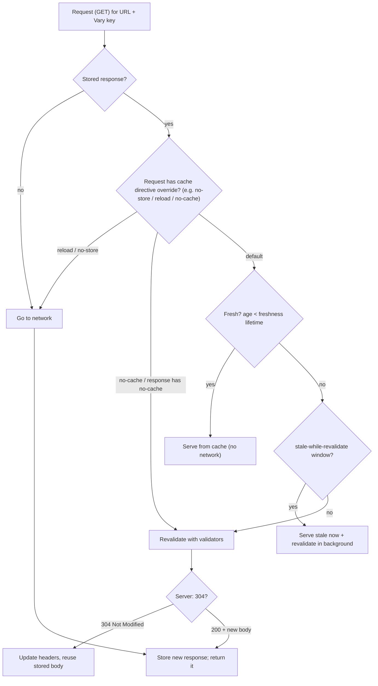
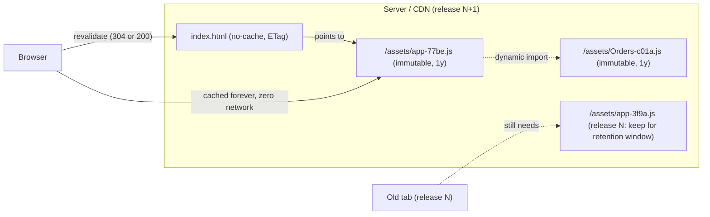
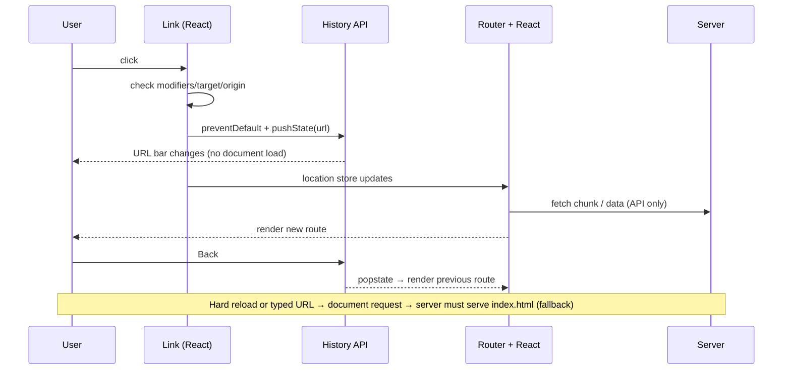

# 00 / 15 — HTTP, Caching, and Navigation

## 1. Lesson metadata

| | |
|---|---|
| **Level** | Intermediate |
| **Study time** | 5 hours (reading 2 h, experiments 1.5 h, exercises 1.5 h) |
| **Prerequisites** | [14 — Web APIs and network requests](./14-web-apis-and-network-requests.md); recap [01 — How the browser works](./01-how-the-browser-works.md) (navigation section) and [10 — Modules and dependency graphs](./10-modules-and-dependency-graphs.md) (chunks) |
| **Next** | [16 — Memory management and GC](./16-memory-management-and-gc.md) |
| **Related later** | [20 — Tooling, transpilation, bundling](./20-tooling-transpilation-and-bundling.md), [Phase 4 / 18 — Routing architecture](../04-react-architecture/18-routing-architecture.md), [Phase 6 / 06 — Cache consistency and invalidation](../06-data-fetching-and-state-ecosystems/06-cache-consistency-and-invalidation.md), [Phase 6 / 18 — URL state management](../06-data-fetching-and-state-ecosystems/18-url-state-management.md), [Phase 2 / 26 — SSR vs client rendering](../02-react-rendering-and-internals/26-ssr-and-client-rendering.md) |

**Learning objectives.** After this lesson you can:
1. Read an HTTP exchange: methods, status codes, key headers; explain safe/idempotent semantics and why they matter to retries and caching.
2. Explain HTTP/1.1 vs HTTP/2 vs HTTP/3 at the level that affects front-end performance decisions.
3. Predict browser HTTP cache behaviour from `Cache-Control`, `ETag`, `Last-Modified`, and `Vary`; design headers for a Vite/React deployment (hashed assets, `index.html`, API responses).
4. Explain why a deployment can break old tabs (chunk 404s) and how caching strategy interacts.
5. Explain how an SPA router works on top of the History API; implement a minimal one with `useSyncExternalStore`; explain what links, back/forward, and reloads do.
6. Describe the back/forward cache (bfcache), scroll/focus restoration, and navigation-related performance hints (`preload`, `modulepreload`, `prefetch`).
7. Connect HTTP caching to client-side server-state caches (stale-while-revalidate) and React's own per-request caching.

**Concepts covered:** request/response anatomy, methods and idempotency, status classes, redirects, content negotiation, compression, TLS, HTTP/1.1 keep-alive and head-of-line blocking, HTTP/2 multiplexing, HTTP/3/QUIC, `Cache-Control`, freshness, validation, `ETag`, `If-None-Match`, `304`, `Vary`, shared vs private caches, CDN, content hashing, immutable assets, `stale-while-revalidate`, memory/disk cache, Service Worker and Cache API (overview), URL anatomy, MPA vs SPA navigation, History API (`pushState`, `replaceState`, `popstate`), hash routing, Navigation API (⚠), link interception, scroll restoration, bfcache (`pageshow`/`pagehide`), `beforeunload`, resource hints, SPA fallback, soft 404.

---

## 2. Deep conceptual explanation

### 2.1 What problem is this lesson solving?

[Lesson 14](./14-web-apis-and-network-requests.md) taught you to *call* the network. This lesson explains what the network and the browser's caches *do* with those calls, and how navigation (moving between "pages") works when a React SPA pretends there's only one document. Many production incidents in React apps are really HTTP or navigation incidents:

- "We deployed a fix but users still see the old UI for days." *(`index.html` cached too long.)*
- "After deploy, clicking a link shows a blank screen / 'Loading chunk 17 failed'." *(old HTML references chunk files that the new deploy deleted.)*
- "The API shows stale data after saving." *(a GET was served from cache; or a CDN cached a personalised response.)*
- "Refreshing `/orders/42` gives a 404 from the server although the app works when I click." *(no SPA fallback.)*
- "The back button leaves my app / needs two clicks." *(wrong `push` vs `replace`, or redirect loops.)*
- "Coming back with Back shows a stale or frozen page." *(bfcache.)*
- "The page is slow despite small JS." *(a request waterfall: HTML → JS → chunk → data.)*

React has no opinion about any of these, yet React's design (client-rendered SPAs, code splitting, client data caches) creates them. Understanding the HTTP layer lets you reason about them instead of cargo-culting headers.

### 2.2 HTTP in one page

HTTP is a request/response protocol. A **request** has: method, target (path + query), version, headers, optional body. A **response** has: status code (+ reason), headers, optional body.

```http
GET /api/products?limit=20 HTTP/1.1
Host: shop.example
Accept: application/json
Accept-Encoding: br, gzip
Cookie: session=…
If-None-Match: "v42"

HTTP/1.1 200 OK
Content-Type: application/json; charset=utf-8
Content-Encoding: br
Cache-Control: private, max-age=30
ETag: "v43"
Vary: Accept-Encoding, Cookie
```

**Methods and their semantics** (RFC 9110):

| Method | Safe (no state change intended) | Idempotent (N identical requests = 1) | Body | Typical use |
|---|---|---|---|---|
| `GET` | yes | yes | no | read; cacheable |
| `HEAD` | yes | yes | no | headers only |
| `OPTIONS` | yes | yes | no | CORS preflight, capabilities |
| `PUT` | no | yes | yes | replace a resource |
| `DELETE` | no | yes | optional | remove |
| `POST` | no | **no** | yes | create, commands |
| `PATCH` | no | **not guaranteed** | yes | partial update |

Why this matters to front-end engineers: **retry safety** (retry idempotent requests; for `POST` use idempotency keys, [Lesson 12](./12-promises-and-async-await.md)), **caching** (only `GET`/`HEAD` responses are normally cacheable), **prefetching** (only safe methods; never prefetch a link that mutates), and **CORS** (non-simple methods trigger preflights).

**Status code classes:** `1xx` informational (`103 Early Hints`), `2xx` success (`200`, `201 Created`, `204 No Content`), `3xx` redirects/caching (`301/308` permanent, `302/307` temporary, `303 See Other`, `304 Not Modified`), `4xx` client errors (`400`, `401 Unauthorized` (actually unauthenticated), `403 Forbidden`, `404`, `409 Conflict`, `422 Unprocessable`, `429 Too Many Requests`), `5xx` server errors (`500`, `502`, `503`, `504`). **Redirect details:** `307/308` preserve method and body; `301/302` historically changed `POST` to `GET`; `303` explicitly means "now GET this". `fetch` follows redirects by default (`redirect: "follow"`), which can silently turn an expired-session API call into a login HTML page ([Lesson 14 §12 D2](./14-web-apis-and-network-requests.md)).

**Content negotiation and compression.** `Accept`, `Accept-Language`, `Accept-Encoding` request headers express preferences; the response states the choice (`Content-Type`, `Content-Encoding`). Text assets (JS/CSS/JSON/HTML) should be compressed (Brotli `br` preferred where supported, `gzip` fallback), which commonly reduces transfer size by 70–90% for text; already-compressed formats (JPEG, WebP, AVIF, WOFF2) should not be re-compressed. Compression is why *transfer size* ≠ *parse/execute cost*: a 100 kB gzipped bundle can be ~400 kB of JavaScript the main thread must parse and run.

### 2.3 HTTP versions (what changes for you)

| Version | Transport | Key characteristics | Front-end consequences |
|---|---|---|---|
| HTTP/1.1 | TCP (+TLS) | Text protocol; persistent connections; **one in-flight request per connection**; browsers open ~6 connections per origin; **head-of-line blocking** at the request level | Historically bundling/sprites/domain sharding to work around connection limits. Many small requests are slow. |
| HTTP/2 | TCP + TLS (in browsers) | Binary framing, **multiplexing** many streams over one connection, header compression (HPACK), prioritisation | Many small files are fine; bundling less critical (but too many tiny chunks still costs); TCP-level head-of-line blocking remains on packet loss. |
| HTTP/3 | **QUIC over UDP** + TLS 1.3 | Streams independent at transport level (no TCP HoL), faster connection setup, connection migration | Better on lossy/mobile networks. Servers/CDNs enable it; the browser negotiates via `Alt-Svc`. |

Do not design around a specific version in application code; *do* know that "number of requests" costs differ by protocol, and that **TLS and connection setup** (DNS + TCP + TLS ≈ 2–3 round trips on a fresh HTTP/1.1/2 connection; fewer with QUIC and resumption) are why `preconnect` hints help third-party origins ([§2.9](#29-resource-hints-and-the-spa-waterfall)).

### 2.4 The HTTP cache: the idea

The browser keeps a private **HTTP cache** (memory + disk) of responses, keyed essentially by URL (+ method and any headers named in `Vary`, plus partitioning by top-level site in modern browsers to prevent cross-site tracking). On a request, the cache decides whether it can answer **without the network**, must **revalidate**, or must **fetch**.

Two concepts:

1. **Freshness** — "may I use this stored response without asking the server?" Determined by `Cache-Control: max-age=N` (or `s-maxage` for shared caches, or `Expires`), measured from when the response was generated (using the `Date`/`Age` headers).
2. **Validation** — "is my stale copy still good?" The cache sends a **conditional request** with `If-None-Match: <ETag>` and/or `If-Modified-Since: <Last-Modified>`. If unchanged, the server answers `304 Not Modified` with no body (saving bytes and often time); the cache refreshes freshness metadata and reuses the stored body. If changed: `200` with a new body.

Two kinds of caches: **private** (the browser; may hold per-user content) and **shared** (CDNs, reverse proxies; must not hold per-user content unless keyed correctly). `Cache-Control: private` forbids shared caches; `public` allows them; `s-maxage` applies only to shared caches.

### 2.5 `Cache-Control` directives you must know

| Directive | Meaning | Common misreading |
|---|---|---|
| `max-age=N` | Fresh for N seconds from generation | "Cache for N seconds *from the request*" (it's from the response's `Date`, minus `Age`). |
| `no-cache` | **May store**, but must **revalidate** before every reuse | "Don't cache." No: that is `no-store`. |
| `no-store` | Don't store at all (any cache) | Often used for sensitive responses; it also can disqualify pages from bfcache in some browsers ⚠. |
| `must-revalidate` | Once stale, must not be served without successful revalidation (no stale-on-error) | |
| `public` / `private` | Shared caches allowed / only the end user's cache | `private` is not a security control for transport. |
| `immutable` | Won't change during its freshness lifetime; don't revalidate on reload | Only appropriate for content-hashed URLs. |
| `s-maxage=N` | Freshness for shared caches (overrides `max-age` there) | |
| `stale-while-revalidate=N` | May serve stale for N seconds **while** revalidating in the background (RFC 5861) | Support is uneven across caches; ⚠ verify browser/CDN behaviour. |
| `stale-if-error=N` | May serve stale if origin errors | ⚠ same |

**If there are no explicit freshness headers**, caches may apply **heuristic freshness** (e.g. 10% of the time since `Last-Modified`), so *responses without any `Cache-Control` can be reused for a surprisingly long time*. Always send explicit `Cache-Control`.

**`Vary`** lists request headers that affect the response (`Vary: Accept-Encoding`, `Vary: Accept-Language`, `Vary: Cookie`, `Vary: Origin`). The cache stores separate variants, keyed by those header values. A missing `Vary: Origin` on CORS responses that reflect the origin can cause a CDN to serve a response with the wrong `Access-Control-Allow-Origin` to another site. `Vary: *` effectively disables caching.

### 2.6 The deployment recipe for a React SPA

Build tools (Vite, webpack, etc.) emit assets with **content hashes** in file names: `assets/index-3f9a1c.js`. The hash changes iff the content changes. This enables the standard strategy:

| Resource | Example | `Cache-Control` | Why |
|---|---|---|---|
| Hashed JS/CSS/fonts/images | `/assets/index-3f9a1c.js` | `public, max-age=31536000, immutable` | URL is a content address; cache "forever"; new content = new URL |
| `index.html` (the entry document) | `/` , `/index.html` | `no-cache` (or `max-age=0, must-revalidate`) | Must always point at the *current* hashes; revalidate cheaply with ETag (304) |
| Unhashed static (`/favicon.ico`, `/robots.txt`) | | short `max-age` (e.g. 1 day) or `no-cache` | Can't be content-addressed |
| API `GET` for user data | `/api/me` | `private, no-cache` or `private, max-age=0` (+ client cache via data library) | Per-user; freshness policy is usually managed in the client cache ([Phase 6](../06-data-fetching-and-state-ecosystems/)) |
| API `GET` for public reference data | `/api/countries` | `public, max-age=3600, stale-while-revalidate=86400` | Shared caches/CDN help; acceptable staleness defined by the product |
| Authenticated HTML (SSR) | | `private, no-store` or `private, no-cache` | Never let a CDN cache personalised HTML |

The logic: **the entry point is a pointer; the assets are values.** Cache values forever; revalidate the pointer. This is why a "hard-to-bust cache" problem disappears if `index.html` is correctly uncached while assets are immutable.

### 2.7 The deployment gotcha: old tabs and deleted chunks

The pointer/values model has one operational sharp edge: a user has `index.html` (from release N) open. You deploy release N+1 and the host deletes release N's files. The user navigates to a lazy route; the old runtime requests `/assets/Settings-ab12.js`; the server returns 404 (or the SPA fallback `index.html` with `200` and `text/html`!). The dynamic `import()` rejects (a 404) or fails to parse; `React.lazy` throws to the nearest error boundary ([Lesson 10](./10-modules-and-dependency-graphs.md) §10).

Mitigations (combine):
- **Keep old assets** available for a retention window (hours/days) in the CDN/object store; deploy assets before `index.html`.
- Serve a **real 404** for missing `/assets/*` (don't use the SPA fallback for asset paths) so failures are explicit and detectable.
- In the error boundary, detect chunk-load errors and **reload once** (guard against loops with `sessionStorage`), or show "A new version is available — Refresh".
- Optionally include a version endpoint/header and a poller (or `visibilitychange` check) to prompt reload proactively.
- Use `vite:preloadError` event handling (Vite-specific; event name confirmed in the Vite build guide, "Load Error Handling") or equivalent.

### 2.8 Browser caches beyond the HTTP cache

- **Memory cache** (per page, short-lived): preloaded or just-used resources can be reused within a document load without consulting the HTTP cache rules strictly.
- **Service Worker + Cache API**: JS-controlled network proxy and storage; enables offline and custom strategies (cache-first, stale-while-revalidate). Powerful and dangerous: a buggy service worker can serve stale HTML indefinitely; updates have their own lifecycle (install/waiting/activate). ⚠ Treat as an advanced topic; use Workbox *(verify)* rather than hand-rolling.
- **bfcache** (§2.11) is a whole-page snapshot, not a resource cache.
- **Client-side caches** (TanStack Query, SWR, Apollo, Redux): in-memory, per tab, *above* the network layer; they decide *whether to call `fetch` at all*. The HTTP cache sits below `fetch`. Both can apply to the same request. Misalignment is a classic bug: the client cache says "stale, refetch", `fetch` is served from the HTTP cache (also stale) → the UI doesn't change. Use `cache: "no-cache"`/`"reload"` on revalidation requests when you truly need origin freshness, or set API `Cache-Control` so the HTTP layer doesn't interfere.
- **React's own caches:** `React.cache` (server) memoises per render pass/request; Next.js and other frameworks add data/route caches ⚠ whose defaults changed across versions: verify against current docs and be explicit about caching in each `fetch`/route.

### 2.9 Resource hints and the SPA waterfall

A browser discovers resources through the **preload scanner**, which looks ahead in the HTML for `<script src>`, `<link rel=stylesheet>`, ``. For a client-rendered React SPA, the HTML is nearly empty:

```text
t0     GET /                 → index.html (tiny)
t1     GET /assets/index-3f9a1c.js          ← discovered by preload scanner
t2     parse+execute JS → React mounts → router reads URL
t3     GET /assets/Orders-9b21.js           ← discovered only after t2 (dynamic import)
t4     fetch /api/orders                    ← issued only after Orders mounted (fetch-on-render)
t5     render list
```

Each step waits for the previous: a **waterfall**. Mitigations, in rough order of leverage:

1. Don't make the user wait for JS to *discover* the data: **SSR/streaming** or a server-provided preload of data ([Phase 2 / 26](../02-react-rendering-and-internals/26-ssr-and-client-rendering.md)).
2. **Route-level data loading** (loaders) that starts the data fetch **in parallel** with the chunk fetch, at navigation time rather than at component mount.
3. **Hints:** `<link rel="preload" as="script|style|font|fetch">` (fetch now, high priority; must be used soon), `<link rel="modulepreload" href="/assets/Orders-9b21.js">` (preload an ES module and its dependencies), `<link rel="prefetch">` (low priority for *next* navigation), `<link rel="preconnect" href="https://api.example">` (do DNS/TCP/TLS early), `dns-prefetch`. Build tools inject `modulepreload` for entry dependencies automatically.
4. Preload on **intent** (hover/focus/viewport) ([Lesson 10 §5.3](./10-modules-and-dependency-graphs.md)).
5. `103 Early Hints` from the server/CDN (⚠ support varies) to start preloads before the HTML is ready.

### 2.10 Navigation: documents vs routes

**Classic (MPA) navigation:** clicking a link → browser requests a new document (§[Lesson 01 §2.6](./01-how-the-browser-works.md)), tears down the old page (all JS state lost), builds a new one. URL, history, scroll restoration, and focus are handled by the browser.

**SPA navigation:** the app intercepts navigation, changes the URL **without** a document load, and re-renders. The platform pieces:

**URL anatomy.** `https://user@shop.example:8443/orders/42?tab=items&sort=asc#reviews` → `protocol`, `host/hostname/port`, `pathname`, `search` (query string), `hash` (fragment). The **fragment is never sent to the server**. Use `URL` and `URLSearchParams` to build/parse.

**History API.**
- `history.pushState(state, "", url)` — add an entry and change the URL (same origin only). **Does not** load anything and **does not fire `popstate`**.
- `history.replaceState(state, "", url)` — replace the current entry.
- `popstate` event — fires when the user (or `history.back()/forward()/go()`) navigates between entries *of the same document*. `event.state` is the entry's state object.
- `hashchange` — fires when only the fragment changes (hash routing: `/#/orders/42`; works without server config; poor URLs for SEO, but zero-config hosting).
- `history.scrollRestoration = "auto" | "manual"` controls whether the browser restores scroll on back/forward; SPAs usually need `"manual"` plus custom handling because content renders asynchronously.

A client router (React Router, TanStack Router, Next.js's client router) is: **(1)** a link component that intercepts clicks, **(2)** `pushState`/`replaceState` calls, **(3)** a `popstate` listener, **(4)** a mapping from URL → route tree (React elements), and **(5)** data loading, transitions, scroll/focus management layered on top. Frameworks add SSR so the first load isn't blank.

**Link interception rules** (what a correct `<Link>` must check before calling `preventDefault` and `pushState`): left button (`e.button === 0`), no modifier keys (`ctrl/meta/shift/alt`: users expect new tab/window), `target` is empty or `_self`, no `download` attribute, same origin, event not already `defaultPrevented`. Otherwise let the browser do its job (this is why you should render real `<a href>` elements: right-click → "Open in new tab", crawlers, and accessibility all work).

**Navigation API** (`window.navigation`): a newer, more complete model (single `navigate` event interception, `navigation.entries()`, better async handling). ⚠ Support is Chromium-first at the time of writing and was still rolling out elsewhere: verify on MDN before use; routers abstract over it.

**React integration points.** Router state changes are React state updates; because route changes may render heavy trees or suspend (lazy chunks/data), routers commonly wrap them in **transitions** so the previous screen stays visible (and interactive) while the next is prepared ([Phase 2 / 23](../02-react-rendering-and-internals/23-transitions-and-deferred-rendering.md)) ⚠ implementation varies by router. Since URL is *external* state that changes outside React, it is consumed with `useSyncExternalStore` or router internals ([§5.5](#55-practical-a-minimal-router-core-with-usesyncexternalstore)).

### 2.11 bfcache, reloads, and lifecycle events

The **back/forward cache (bfcache)** keeps a *frozen snapshot of a whole page* (DOM, JS heap) when the user navigates away, and restores it instantly on Back/Forward, with no network and no re-execution. React state, scroll position, and form values reappear exactly as they were.

Consequences:
- Your page is **frozen, not destroyed**: timers pause; no `unload`. Use **`pagehide`**/**`pageshow`** (check `event.persisted`) and **`visibilitychange`**; avoid `unload` and be careful with `beforeunload` (both can make pages ineligible in some browsers ⚠). `Cache-Control: no-store` also made pages ineligible in some browsers historically ⚠.
- Data may be **stale** upon restore: on `pageshow` with `persisted === true`, revalidate time-sensitive data (balances, carts, auth state). Open WebSocket/IndexedDB connections may be closed when entering bfcache; reconnect on restore.
- Log-out must clear sensitive pages from bfcache/history (or use `no-store` and `pageshow` checks).

**Reload types:** normal reload revalidates the main resource and typically revalidates subresources; **hard reload** (Ctrl/Cmd+Shift+R) bypasses the cache; "Empty cache and hard reload" in DevTools clears it. Back/forward navigations prefer cached copies even if stale (they use `max-stale`-like behaviour), which is part of why Back "feels instant" and why stale pages appear.

### 2.12 SPA hosting: the fallback rule

On a hard load of `/orders/42` the browser asks the **server** for that path. A static host that only knows `index.html` returns 404 unless configured to **fall back** to `index.html` for unknown *navigation* requests (but not for asset paths). Typical rules:

```text
if request path matches a real file → serve it
else if request is for /assets/* or has a file extension → 404
else → serve index.html with 200 (the client router renders the route; unknown routes render a client-side NotFound UI)
```

⚠ **Soft 404s:** the fallback returns `200` for URLs that don't exist, which confuses crawlers; SSR frameworks return real `404` status when the route/data is missing. For SPAs without SSR, consider rendering a `<meta name="robots" content="noindex">` on the NotFound view.

### 2.13 Common misconceptions

| Misconception | Reality |
|---|---|
| "`no-cache` means don't cache." | It means *store, but revalidate every time*. `no-store` means don't store. |
| "Setting `max-age` on `index.html` is fine; we version assets." | If `index.html` is cached, users keep the old pointer; deploys appear to "not work". |
| "304 means the server did the work for nothing." | It avoids transferring the body; the server may skip expensive rendering by checking the validator. |
| "CDN caching is free speed." | Personalised or auth-dependent responses cached publicly leak data; `Vary` mistakes cause wrong variants. |
| "HTTP caching and TanStack Query caching are the same thing." | Different layers, different keys and lifetimes; they can conflict. |
| "`pushState` triggers `popstate`." | It doesn't. Only history *traversal* does. |
| "Hash routing is obsolete." | Still valid where server fallback can't be configured (static file shares, some embedded contexts). |
| "SPAs don't need server routing config." | A hard load of a deep link needs the fallback rule. |
| "`beforeunload` is a safe place to save data." | Unreliable, may be throttled, can disable bfcache. Prefer `pagehide`/`visibilitychange` + `sendBeacon`/`keepalive`. |
| "Bigger bundles are only a download problem." | Parse/compile/execute cost dominates on slow devices (Lesson 17). |

---

## 3. Internal mechanics

### 3.1 How the HTTP cache decides (simplified RFC 9111 model)



*Public guarantee:* the semantics in RFC 9111 and the browser Fetch/HTTP-cache integration (`cache` modes on `fetch`). *Implementation detail:* storage layout, eviction (LRU, quota), memory vs disk cache, "double-keyed" (partitioned) caches, heuristics, speculative revalidation, cache state during reloads and back/forward. Don't depend on specifics.

### 3.2 Freshness arithmetic

```text
freshness_lifetime = max-age  (or s-maxage in shared caches, else Expires − Date, else heuristic)
current_age        = (now − Date) + Age (+ response delays)
fresh              = current_age < freshness_lifetime
```

Example: response `Date: 12:00:00`, `Cache-Control: max-age=60`, `ETag: "a1"`. At 12:00:30 request → fresh → served from cache with no network. At 12:01:30 request → stale → conditional `If-None-Match: "a1"` → server `304` → reused; its freshness restarts (using the new `Date`/`max-age` from the 304). Hence the "revalidate" path costs a **round trip but no body**.

### 3.3 The `fetch` `cache` option modes

| Mode | Behaviour |
|---|---|
| `default` | Standard HTTP cache semantics. |
| `no-store` | Bypass cache for reading; don't update it with the response. |
| `reload` | Bypass cache for reading; go to the network, then update the cache. |
| `no-cache` | Revalidate with the server even if fresh (conditional request). |
| `force-cache` | Use any cached response (even stale); network only if none. |
| `only-if-cached` | Cached only; fail (network error) if absent (with `mode: "same-origin"`). |

These affect the **browser HTTP cache** only, not your client data library's cache.

### 3.4 Navigation timeline for a link click in an SPA

1. `click` event dispatched; React root listener runs the router's `<Link onClick>` ([Lesson 13](./13-browser-events-and-propagation.md)).
2. Link handler checks interception conditions; if OK: `e.preventDefault()` (stops the browser's native navigation).
3. Router calls `history.pushState(state, "", "/orders/42")`: the URL bar updates synchronously; a history entry is added.
4. Router updates its location store → React re-renders (often in a transition), mapping `/orders/42` to elements; lazy chunks and loaders start; Suspense fallback or old UI shown.
5. Commit: new DOM; router restores/sets scroll, moves focus (a11y), updates `document.title`.
6. User presses Back: browser changes the URL to the previous entry and fires `popstate` (asynchronously, as a task). Router handles it like step 4 with the entry's `state`.
7. Hard reload or typing the URL: a *document* navigation: server must answer with `index.html` (fallback), JS re-runs from scratch.

### 3.5 What the server sees

SPA navigation produces **no document requests** (only API/chunk requests). Analytics that rely on page loads must hook into route changes; server logs show no "page views" for in-app navigation; HTTP cache headers don't apply to route changes themselves but do apply to the chunks and API calls they trigger.

---

## 4. Step-by-step execution walkthrough

### 4.1 First visit and a revisit (cache behaviour)

Setup: `index.html` served with `Cache-Control: no-cache` + `ETag: "h1"`; `/assets/app-3f9a.js` with `public, max-age=31536000, immutable`; `/api/products` with `private, max-age=0, must-revalidate`, `ETag: "p7"`.

**Visit 1 (cold):**
1. `GET /` → `200`, body, ETag `"h1"` stored.
2. Parse HTML → `GET /assets/app-3f9a.js` → `200`; stored with 1-year freshness.
3. JS runs; React mounts; `fetch("/api/products")` → `200`, ETag `"p7"`, stored but always stale.

**Visit 2 (same day, tab reopened):**
1. `GET /` with `If-None-Match: "h1"` → server `304` (tiny response; no body).
2. Preload scanner finds `app-3f9a.js` → **served from cache, zero network**.
3. App runs; `fetch("/api/products")` → conditional request `If-None-Match: "p7"` → `304` if unchanged → body from cache; JSON parsed.

**Deploy happens** (new hash `app-77be.js`, new `index.html` ETag `"h2"`):
4. Visit 3: `GET /` conditional → server `200` (new HTML pointing to `app-77be.js`) → new asset fetched; old asset remains in cache until evicted (harmless).

Network cost summary: visit 2 sends 2 small requests (HTML, API) and loads JS from disk: that's the payoff of the recipe.

### 4.2 Back/forward in an SPA with pushState

Start at `/` (1 entry). Code:

```js
history.pushState({ n: 1 }, "", "/a");   // entries: [/, /a]        index 1
history.pushState({ n: 2 }, "", "/b");   // entries: [/, /a, /b]    index 2
history.replaceState({ n: 3 }, "", "/c");// entries: [/, /a, /c]    index 2 (replaced /b)
history.back();                           // async; moves to index 1
```

**Predict** the entries, the current URL, the `popstate` events and their `state`.

**Result:** entries `[/, /a, /c]`; after `back()` the URL is `/a`; one `popstate` event fires (asynchronously, as a task), with `event.state` = `{ n: 1 }`. No `popstate` for the three `pushState/replaceState` calls. Forward would then go to `/c` with `{ n: 3 }`. The entry that held `/b` no longer exists.

### 4.3 A deploy while a tab is open (timeline)

```text
t0  User loads release N: index.html → entry chunk app-N.js (cached immutable)
t1  Deploy: release N+1 published; host deletes app-N.js and chunk Settings-N.js (no retention)
t2  User clicks "Settings" in the already-loaded app
t3  Router calls import("./Settings") → runtime requests /assets/Settings-N.js
t4  Server: 404 (or SPA fallback returns index.html as 200 text/html)
t5  import() rejects (404) or fails with "Failed to fetch dynamically imported module" / MIME type error
t6  React.lazy throws → nearest error boundary renders "Something went wrong" (or white screen if none)
```

Fix paths: retain old assets (t1), real 404s for assets (t4), boundary with one-time reload/refresh prompt (t6).

---

## 5. Code examples

### 5.1 Minimal: inspect caching in the console

```js
const r = await fetch("/assets/app-3f9a.js", { method: "HEAD" });
console.log(r.headers.get("cache-control"), r.headers.get("etag"));
performance.getEntriesByType("resource").forEach((e) => {
  console.log(e.name, e.transferSize, e.encodedBodySize, e.decodedBodySize);
});
```

**Predict:** for a resource served from the HTTP cache, `transferSize` is `0`; a `304` revalidation shows a small non-zero `transferSize` (headers only) with `encodedBodySize > 0`; a full fetch shows `transferSize ≈ encodedBodySize + headers`. (Cross-origin entries report zeros unless the server sends `Timing-Allow-Origin`.) Useful for verifying your cache headers without DevTools.

### 5.2 Practical: header policy as code (Node/Express-style, simplified)

```ts
import express from "express";
import path from "node:path";

const app = express();
const dist = path.resolve("dist");

// Hashed assets: Vite emits /assets/<name>-<hash>.<ext>
app.use("/assets", express.static(path.join(dist, "assets"), {
  immutable: true,
  maxAge: "1y",
  fallthrough: false,               // missing asset → real 404, NOT the SPA fallback
}));

// Other static files (favicon, robots): short-lived
app.use(express.static(dist, { index: false, maxAge: "1d" }));

// API: set per-route; here an example of private, always-revalidate JSON
app.get("/api/me", (req, res) => {
  res.set("Cache-Control", "private, no-cache");
  res.set("Vary", "Cookie");
  res.json({ id: 1 });
});

// SPA fallback: navigation requests only
app.get("*", (req, res, next) => {
  if (path.extname(req.path)) return next();      // looks like a file request → 404
  res.set("Cache-Control", "no-cache");           // revalidate the pointer on every load
  res.sendFile(path.join(dist, "index.html"));
});
```

Line notes: (1) `fallthrough: false` for `/assets` yields 404s on missing chunks, making failures detectable. (2) `index.html` is `no-cache` (not `no-store`): it is stored and cheaply revalidated by ETag, giving fast repeat loads *and* immediate deploy propagation. (3) The same policy is expressed as host config in nginx, Cloudflare, S3/CloudFront, Netlify `_headers`, Vercel `vercel.json` *(syntax varies; verify per platform)*. (4) For real apps, compression (Brotli/gzip) and HTTP/2/3 are typically done at the CDN/reverse proxy.

### 5.3 Incorrect: client cache vs HTTP cache collision

```ts
// API returns:  Cache-Control: max-age=300   (someone added "to reduce load")
async function saveSettings(s: Settings) {
  await fetch("/api/settings", { method: "PUT", body: JSON.stringify(s), headers: { "Content-Type": "application/json" } });
  queryClient.invalidateQueries({ queryKey: ["settings"] });   // client cache: refetch now
}
```

**Predict:** after saving, the UI refetches `GET /api/settings`. Does the user see the new values?

**Result:** Possibly **not**. The refetch's `fetch` is satisfied from the browser HTTP cache (still fresh for 300 s), returning the *old* body; the client cache dutifully stores stale data again. (A successful unsafe request such as `PUT` to the same URL *invalidates* the stored GET response for that URL per HTTP caching rules, and browsers implement that, but you shouldn't depend on it across different URLs, query variations, CDNs, and service workers.) **Why wrong:** two caching layers with conflicting freshness policies.

### 5.4 Corrected

Preferred: let **one layer own freshness**. For user-specific, mutable API data, serve `Cache-Control: private, no-cache` (or `max-age=0, must-revalidate`) and let the client data library decide when to refetch (`staleTime`), using ETag revalidation for cheap `304`s.

```ts
// Server
res.set("Cache-Control", "private, no-cache");
res.set("ETag", etagOf(settings));

// Client (TanStack Query v5 style, illustrative)
const settings = useQuery({ queryKey: ["settings"], queryFn: ({ signal }) => request<Settings>("/api/settings", { signal }), staleTime: 30_000 });
```

If you cannot control the server, bypass the HTTP cache for the refetch: `fetch(url, { cache: "no-cache" })` (conditional) or `"reload"`.

### 5.5 Practical: a minimal router core with `useSyncExternalStore`

```tsx
import { useSyncExternalStore, useCallback, type AnchorHTMLAttributes, type MouseEvent } from "react";

const NAV_EVENT = "app:navigate";

function subscribe(onChange: () => void) {
  window.addEventListener("popstate", onChange);          // back/forward
  window.addEventListener(NAV_EVENT, onChange);           // our own pushState/replaceState calls
  return () => {
    window.removeEventListener("popstate", onChange);
    window.removeEventListener(NAV_EVENT, onChange);
  };
}

// A string snapshot is a primitive: referentially stable when unchanged (important for useSyncExternalStore).
const getSnapshot = () => window.location.pathname + window.location.search + window.location.hash;
const getServerSnapshot = () => "/";                       // SSR: the server should pass the real URL in a real router

export function useLocation() {
  return useSyncExternalStore(subscribe, getSnapshot, getServerSnapshot);
}

export function navigate(to: string, { replace = false }: { replace?: boolean } = {}) {
  const url = new URL(to, window.location.href);
  if (url.origin !== window.location.origin) { window.location.assign(url.href); return; }  // cross-origin: real navigation
  const method = replace ? "replaceState" : "pushState";
  window.history[method](null, "", url.pathname + url.search + url.hash);
  window.dispatchEvent(new Event(NAV_EVENT));              // pushState doesn't fire popstate
}

export function Link({ to, replace, onClick, target, ...rest }: AnchorHTMLAttributes<HTMLAnchorElement> & { to: string; replace?: boolean }) {
  const handle = useCallback((e: MouseEvent<HTMLAnchorElement>) => {
    onClick?.(e);
    if (
      e.defaultPrevented ||
      e.button !== 0 ||                                    // only primary button
      e.metaKey || e.ctrlKey || e.shiftKey || e.altKey ||  // let the browser open new tab/window
      (target && target !== "_self") ||
      rest.download !== undefined
    ) return;
    const url = new URL(to, window.location.href);
    if (url.origin !== window.location.origin) return;     // external: let the browser navigate
    e.preventDefault();
    navigate(to, { replace });
  }, [to, replace, onClick, target, rest.download]);

  return <a href={to} target={target} onClick={handle} {...rest} />;     // real <a href>: new-tab, crawlers, a11y
}

export function App() {
  const location = useLocation();
  const path = location.split(/[?#]/)[0];
  return (
    <>
      <nav><Link to="/">Home</Link> <Link to="/orders">Orders</Link></nav>
      {path === "/" ? <Home /> : path === "/orders" ? <Orders /> : <NotFound />}
    </>
  );
}
```

Line notes and design points:
- This is what React Router et al. do at their core: **history events → external store → React state**. We use `useSyncExternalStore` ([Phase 3 / 20](../03-react-state-and-hooks/20-usesyncexternalstore-and-external-stores.md)) to avoid tearing and to subscribe safely.
- `pushState` doesn't emit an event, so `navigate` dispatches a custom event.
- `<a href>` preserved: progressive enhancement, middle-click, SEO.
- Missing for production: route matching with params, nested layouts, loaders + data/chunk parallelism, scroll restoration, focus management, blockers ("unsaved changes"), transitions, base paths, SSR location injection, `404` status. **Use a real router.** The point is to demystify.
- Mixed `replaceState` when redirecting prevents the "back button trap" (see §10).

### 5.6 Practical: chunk-load error recovery in an error boundary

```tsx
import { Component, type ReactNode } from "react";

const RELOAD_KEY = "chunk-reload-at";

function isChunkError(e: unknown): boolean {
  const msg = e instanceof Error ? e.message : String(e);
  return /Loading chunk|Failed to fetch dynamically imported module|Importing a module script failed|error loading dynamically imported module/i.test(msg);
}

export class RouteErrorBoundary extends Component<{ children: ReactNode }, { error: unknown }> {
  state = { error: null as unknown };
  static getDerivedStateFromError(error: unknown) { return { error }; }

  componentDidCatch(error: unknown) {
    if (!isChunkError(error)) return;                       // report others to telemetry
    try {
      const last = Number(sessionStorage.getItem(RELOAD_KEY) ?? 0);
      if (Date.now() - last > 60_000) {                     // reload at most once per minute: avoid loops
        sessionStorage.setItem(RELOAD_KEY, String(Date.now()));
        window.location.reload();
      }
    } catch { /* storage blocked: fall through to UI */ }
  }

  render() {
    if (this.state.error == null) return this.props.children;
    return isChunkError(this.state.error)
      ? <p role="alert">A new version is available. <button onClick={() => window.location.reload()}>Refresh</button></p>
      : <p role="alert">Something went wrong.</p>;
  }
}
```

Notes: error message texts differ by browser (Chrome: "Failed to fetch dynamically imported module"; Firefox: "error loading dynamically imported module"; Safari: "Importing a module script failed"; webpack: "Loading chunk N failed") ⚠ keep the patterns up to date; this is a class component because error boundaries still require one ([Lesson 09](./09-prototypes-and-object-model.md)). Also consider the loop guard (a reload that still fails would loop forever without it), and prefer retaining old assets server-side so the reload is rarely needed.

### 5.7 Advanced: revalidate on bfcache restore and on visibility

```tsx
import { useEffect } from "react";
import { useQueryClient } from "@tanstack/react-query";   // illustrative

export function useRevalidateOnReturn() {
  const qc = useQueryClient();
  useEffect(() => {
    const onPageShow = (e: PageTransitionEvent) => {
      if (e.persisted) qc.invalidateQueries();             // restored from bfcache: state may be stale
    };
    const onVisible = () => {
      if (document.visibilityState === "visible") qc.invalidateQueries({ stale: true });
    };
    window.addEventListener("pageshow", onPageShow);
    document.addEventListener("visibilitychange", onVisible);
    return () => {
      window.removeEventListener("pageshow", onPageShow);
      document.removeEventListener("visibilitychange", onVisible);
    };
  }, [qc]);
}
```

TanStack Query already refetches on window focus by default (configurable) — verify current defaults — so you might need only the bfcache piece. The generic lesson: **a page can be frozen and resurrected**; treat `pageshow(persisted)` as "re-sync with the world". Also reconnect WebSockets there.

### 5.8 Advanced: `103`-friendly hints and `modulepreload` in HTML

```html
<head>
  <link rel="preconnect" href="https://api.shop.example" crossorigin>
  <link rel="modulepreload" href="/assets/index-3f9a1c.js">
  <link rel="preload" as="font" type="font/woff2" href="/fonts/inter-var.woff2" crossorigin>
  <link rel="preload" as="fetch" href="/api/bootstrap" crossorigin>   <!-- first-screen data, if the app WILL fetch it on load -->
</head>
```

Notes: `preload` of fonts requires `crossorigin` even for same-origin (fonts are fetched in CORS mode); a preload that isn't used within a few seconds triggers a console warning and wastes bandwidth; preloading `fetch` data is only worthwhile when the request is made with matching options (same credentials mode and headers) so it's reused. Build tools (Vite) inject `modulepreload` for entry imports. Over-preloading competes with critical resources: measure LCP before/after.

---

## 6. Visual explanations

### The pointer/values deployment model



### SPA vs MPA navigation



### Request waterfall for a client-rendered route

```text
HTML ──► main.js ──► (React mounts) ──► route chunk ──► (component mounts) ──► API data ──► render
 |         |                                |                                   |
 t0        t1                               t3                                  t4
Fixes: SSR/streaming, route loaders in parallel with chunk, modulepreload/prefetch on intent, preconnect.
```

---

## 7. Alternative approaches and trade-offs

**Cache strategy for API reads:**

| Strategy | Freshness | Speed | Complexity | Risk | Best for |
|---|---|---|---|---|---|
| No HTTP caching (`no-store`) + client cache | Fully controlled by client | Every revalidation hits origin | Low | Higher origin load; no CDN help | Highly sensitive data |
| `private, no-cache` + ETag | Always correct | Round trip, small body (`304`) | Low | Round-trip latency | Per-user mutable data (default) |
| `public, max-age=N` + CDN | Stale up to N | Fastest | Low | Staleness; leaks if personalised | Public reference data |
| `max-age=N, stale-while-revalidate=M` | Stale ≤ N (+M while revalidating) | Fast + eventually fresh | Medium | Support variance; staleness semantics must be product-approved | Content feeds, catalogues |
| Service worker cache (cache-first/SWR) | Custom | Offline-capable | High | Stale HTML/JS bugs, update lifecycle | PWAs, offline-first |
| Client data cache (TanStack Query) with `staleTime` | Product-defined | Instant UI | Medium | Layer conflicts (§5.3) | Interactive apps |

**Routing approaches:**

| Approach | SEO / first paint | Hosting needs | Complexity | Notes |
|---|---|---|---|---|
| Client-side (History API) SPA | Weak without SSR | Fallback rule | Low–Medium | Default for internal tools/dashboards |
| Hash routing | Weak | None (static host) | Low | Works from file/CDN without rewrites; ugly URLs; anchors conflict |
| Framework with SSR/SSG | Strong | Node/edge runtime or static export | Medium–High | ⚠ verify framework docs; best for public sites |
| MPA with progressive enhancement | Strong | Server | Medium | Robust; fewer JS concerns; less app-like transitions |

**When the recommended "immutable hashed assets + no-cache HTML" is not best:** (1) A **multi-version, multi-tenant micro-frontend** where assets are loaded by stable URLs (e.g. `remoteEntry.js`) can't use immutable on those entry URLs; use short TTLs and versioned paths for the rest. (2) An **embedded widget** loaded via a third-party `<script src="/widget.js">` used on thousands of sites can't force customers to change the URL on each release; it needs short `max-age` + `stale-while-revalidate` and careful backward compatibility. (3) **Offline-first PWAs** deliberately manage updates through a service worker instead of the HTTP cache.

---

## 8. Best practices and anti-patterns

**Do**
- Always send explicit `Cache-Control` (avoid heuristic freshness).
- Content-hash static assets; `immutable` + 1 year; `no-cache` for the HTML entry.
- Deploy assets before HTML; retain old assets for a window; return real 404s for missing assets.
- Use `private` for anything per-user; `Vary` correctly (`Accept-Encoding`, `Cookie`/`Authorization` if cacheable at all, `Origin` for reflected CORS).
- Use ETags (or `Last-Modified`) on revalidated resources so `304`s are possible.
- Keep client data-cache policy and HTTP policy aligned; avoid two layers both guessing.
- Render real `<a href>` for navigation; intercept only primary unmodified same-origin clicks.
- Manage focus and announce route changes for accessibility (move focus to the new page heading or a skip target; update `document.title`; use a live region) ([Phase 4 / 18](../04-react-architecture/18-routing-architecture.md)).
- Use `pagehide`/`visibilitychange` (+ `sendBeacon`/`keepalive`) instead of `unload`/`beforeunload` for persistence.
- Make the SPA fallback skip asset paths; consider SSR for public/SEO routes.

**Beginner mistakes**
- Confusing `no-cache` with `no-store`.
- Caching `index.html` for a long time.
- `window.location.href = …` for in-app navigation (full reload, loses state) or the reverse: `pushState` for external URLs.
- Forgetting the server fallback; deploying SPA to a static host without rewrites.
- Using `<a>` without `href` (not focusable, not crawlable) or `<div onClick>` navigation.
- `history.pushState` in a render or effect without guarding duplicates (history spam).

**Experienced-developer mistakes**
- Caching authenticated responses at a CDN (no `private`, missing `Vary: Cookie`/`Authorization` handling).
- Deleting old build assets immediately after deploy.
- Letting an SPA fallback return `200 index.html` for `/assets/missing.js` (MIME-type error masks the real 404).
- `Vary: *` or unbounded `Vary: Cookie` that shatters cache hit ratio.
- Chasing hashed-asset invalidation through query-string cache busting (`?v=123`) that some CDNs ignore.
- Using `beforeunload` prompts everywhere (user annoyance, bfcache loss).
- Treating `navigator.onLine` or bfcache restore as "data is current".
- Writing a service worker without an update/escape-hatch plan.

**Smells:** manual cache busting via `Date.now()` query params on every request; global `fetch` wrapper that sets `cache: "no-store"` for everything "to be safe" (kills the CDN and ETag savings); redirect logic using `push` in effects (back-button traps); a router that doesn't use real links.

**Justified exceptions:** `no-store` for highly sensitive pages (banking statements) accepting the bfcache and speed cost; hash routing for an app shipped as static files to an environment where rewrites are impossible; short `max-age` on `index.html` (e.g. 60 s) when the CDN can't revalidate efficiently and rapid rollouts aren't needed.

---

## 9. Real-world application

*E-commerce platform.* Static assets on a CDN with immutable hashed names; `index.html`/SSR HTML `no-cache` or short TTL with `stale-while-revalidate` at the CDN edge (after the product team approves ≤ 60 s of staleness for catalogue pages); price and stock APIs `private, no-cache` or tiny `max-age`; personalised blocks fetched client-side after first paint so the HTML stays cacheable. Flash sales: avoid thundering herds through CDN request collapsing and `stale-while-revalidate`. Deployment: blue-green with retained assets for 7 days; client "new version" banner using a version header. Constraints: SEO (SSR/SSG for product pages), LCP (preload hero image/font, `preconnect` to image CDN), cart consistency (cart API `private, no-store`).

*Banking/finance app.* Everything authenticated is `private, no-store`; accept slower back navigation (and bfcache ineligibility) as a security trade-off, or use a more nuanced `pageshow` check that re-validates the session and clears sensitive views on restore. CSP and cookie flags (`HttpOnly; Secure; SameSite=Strict/Lax`) matter more than speed here (Phase 10). Single-page navigation with route guards; `replaceState` after login so Back doesn't return to the login form.

*Multi-team portal.* Shell app + independently deployed feature bundles with stable entry names (`/features/billing/entry.js`) → short-TTL + SWR for entries, immutable hashed chunks beneath; version skew policy between shell and features; a central error boundary handling chunk failures; telemetry on 404s for `/assets/*` to catch retention gaps; cache purge runbooks.

*Dashboards.* Heavy API aggregates cached at a shared cache for 30–60 s (`public, s-maxage=30, stale-while-revalidate=60` on non-personalised aggregates) to protect the backend; per-user filters appended as query params so cache keys differ; client uses TanStack Query with `staleTime` aligned to the HTTP TTL.

---

## 10. Debugging and troubleshooting

**Symptom 1: "Users see the old version after deploy."**
*Investigation:* DevTools → Network: reload; check the **document** request's `Cache-Control`/`Age`/`Via`/`X-Cache` (CDN headers), the status (`200 (from disk cache)` vs `304` vs `200`). Check `curl -I https://site/` from outside. *Root cause candidates:* HTML with `max-age`; CDN caching HTML; a service worker serving a cached shell; intermediate proxy. *Fix:* `no-cache` for HTML; purge CDN; fix service worker update flow (`skipWaiting`/prompt, versioned caches). *Validate:* simulate returning user (normal reload, not hard) after a deploy.

**Symptom 2: Blank screen/`Loading chunk … failed` after deploy.** §4.3, §5.6. *Investigation:* Network: filter JS; failed chunk shows `404` or `text/html` content type; console message. *Fix:* retention, 404 for assets, boundary reload. *Validate:* deploy twice with an open tab; navigate to a lazy route.

**Symptom 3: API shows stale data after mutation.** §5.3. *Investigation:* check response headers on the GET (`Cache-Control`, `Age`), whether the Network row says "(from disk cache)" or "(from ServiceWorker)", whether the client cache layer refetched. *Fix:* one owner of freshness; correct headers; targeted `cache: "no-cache"`; invalidate server/CDN caches on writes.

**Symptom 4: Hard-refresh on `/orders/42` returns 404 / "Cannot GET /orders/42".** SPA fallback missing. *Fix:* host rewrite rules (§2.12); verify that asset paths still 404. *Validate:* `curl -I` deep links (expect `200 text/html`) and a missing asset (expect `404`).

**Symptom 5: Back button doesn't leave the page / goes through the same page twice.** *Cause:* redirect implemented with `push` (e.g. `/login` → push `/dashboard` → app redirects to `/login` again…), or effect pushing the same URL repeatedly (history spam). *Investigation:* log `history.length` and entries; use the Navigation API's `navigation.entries()` where available (Chrome DevTools console) or log `popstate`. *Fix:* use `replace` for redirects; guard against pushing identical URLs; avoid navigation in render.

**Symptom 6: After Back, the page shows stale balance or a dead WebSocket.** bfcache restore. *Investigation:* Application → Back/forward cache panel in Chrome DevTools ("Test back/forward cache") shows eligibility reasons; log `pageshow.persisted`. *Fix:* revalidate on `pageshow`, reconnect sockets, avoid `unload` handlers and `no-store` where bfcache is wanted.

**Symptom 7: CORS preflight on every request.** Missing `Access-Control-Max-Age` or `Vary`-related variance, or credentialed requests with varying headers. *Fix:* set `Max-Age` (browsers cap it: e.g. 2 hours in Chromium; verify), reduce custom headers, same-origin proxy.

**Symptom 8: Good Lighthouse score but real users slow.** Check RUM (field) vs lab; real users may have cold caches and slower networks. Test with "Disable cache" + throttling and *also* with warm caches.

DevTools: **Network** (Size column: `(disk cache)`, `(memory cache)`, `(ServiceWorker)`; Timing tab; Protocol column shows `h2`/`h3`; "Disable cache"); **Application** (Cache storage, Service Workers, Back/forward cache, Storage → Clear site data); **Lighthouse** "Serve static assets with an efficient cache policy"; `curl -I`, `curl -H 'If-None-Match: "x"'` to test revalidation.

---

## 11. Exercises

### Level A — Knowledge
A1. Define "safe" and "idempotent" HTTP methods. Classify `GET`, `PUT`, `POST`, `DELETE`, `PATCH`.
A2. What is the difference between `Cache-Control: no-cache` and `no-store`?
A3. What does a `304` response mean, and what does the browser send to get one?
A4. Why can an HTTP/2 site tolerate more small requests than an HTTP/1.1 site?
A5. Does `history.pushState` fire `popstate`? What does fire it?
A6. What is the bfcache and which lifecycle events should you use instead of `unload`?
A7. Why must a SPA host rewrite unknown URLs to `index.html`, but not asset URLs?

### Level B — Code comprehension
B1. Given `Cache-Control: max-age=60` and `ETag: "v1"`, describe network activity for requests at t=0, t=30 s, t=90 s, assuming the resource hasn't changed on the server.
B2. For each, say whether the response can be reused without contacting the server (assuming it was just fetched and 10 minutes have passed): (a) `no-cache`; (b) `no-store`; (c) `max-age=3600`; (d) `max-age=300`; (e) `max-age=300, stale-while-revalidate=3600`; (f) no `Cache-Control`, `Last-Modified` 30 days ago.
B3. Entries and events? Starting at `/`:
```js
history.pushState(null, "", "/a");
history.pushState(null, "", "/b");
history.back();
history.pushState(null, "", "/c");
```
List the final history entries and the current index. Which entries become unreachable via Forward?
B4. What does each `fetch` do with the HTTP cache?
```js
fetch(u, { cache: "no-store" });
fetch(u, { cache: "reload" });
fetch(u, { cache: "no-cache" });
fetch(u, { cache: "force-cache" });
```
B5. A page loads `/assets/app-3f9a.js` (immutable, 1 year). After a deploy, `index.html` points to `app-77be.js`. What happens to `app-3f9a.js` in the user's cache, and should that worry you?
B6. In `<Link to="/orders">` with `onClick` intercept, what happens on Ctrl+Click and on middle-click if the component does *not* check modifier keys?

### Level C — Implementation
C1. Write nginx (or equivalent platform) config that implements the §2.6 table for a Vite build with SPA fallback and 404 for missing assets.
C2. Implement `useLocation`-based `useSearchParam(name)` with `useSyncExternalStore` and a setter using `replaceState`/`pushState`.
C3. Implement a `useBlocker`-like hook that warns on `beforeunload` *only while a form is dirty*, with minimal side effects (and explain bfcache implications).
C4. Implement scroll restoration for the minimal router: save `scrollY` per history entry key, restore on `popstate`, scroll to top on push, and honour hash anchors.
C5. Write a script (Node) that fetches a URL twice and reports cacheability (`Cache-Control`, `ETag`, `Age`, whether revalidation yields `304`).

### Level D — Debugging
D1. After a deploy, 5% of users report a blank screen when clicking "Reports". Others are fine. Investigate: give hypotheses, evidence you'd gather, and fixes.
D2. The team added `Cache-Control: public, max-age=600` to `/api/me` "for performance". Support gets tickets of users seeing someone else's name. Explain and fix, including what to do about already cached responses.
D3. A login flow: `/login` → on success `navigate("/dashboard")` (push). Back button returns to the login form, which immediately redirects to `/dashboard`, trapping the user. Explain and fix with the History API semantics.
D4. After switching to hash routing, an in-page anchor link `<a href="#section">` breaks the router. Explain and propose alternatives.

### Level E — Architecture and engineering decisions
E1. Choose a caching and deployment strategy for a React SPA served from a CDN with weekly releases, 20 lazy routes, and a regulatory requirement that authenticated pages never be stored on shared caches. Specify headers per resource class and the deploy order.
E2. Decide between SPA-only, SSR framework, or static generation for (a) an internal admin tool, (b) a public marketing + product catalogue site, (c) a logged-in analytics dashboard. Use criteria: SEO, first paint, complexity, hosting, caching, team skills.

### Level F — Expert challenge
F1. Design a client "version skew" system: detect that the running bundle is older than the deployed one, decide when to prompt vs auto-reload, avoid loops, protect unsaved work, handle API contract changes, and test it end-to-end.
F2. Explain the interaction between HTTP cache, service worker cache, and TanStack Query cache for a `GET /api/items` request, including who answers on revalidation and where staleness can hide. Propose a policy and debugging checklist.

---

## 12. Detailed answers and explanations

> Attempt the exercises first.

**A1.** *Safe*: not intended to change server state (`GET`, `HEAD`, `OPTIONS`). *Idempotent*: repeating the identical request has the same effect as once. `GET`: safe + idempotent; `PUT`: idempotent (replace), not safe; `DELETE`: idempotent, not safe; `POST`: neither; `PATCH`: neither guaranteed (depends on the patch semantics: "set x=5" is idempotent, "increment x" isn't). Relevance: retry/prefetch/caching rules.

**A2.** `no-cache`: response may be stored, but must be revalidated with the origin before each reuse (so `304`s are possible). `no-store`: do not store the response at all (no reuse). Wrong answer: "`no-cache` disables caching".

**A3.** `304 Not Modified`: the stored copy is still valid; no body sent. The browser sends a conditional request with `If-None-Match: <ETag>` and/or `If-Modified-Since: <Last-Modified>`.

**A4.** HTTP/2 multiplexes many streams over one connection (no per-request connection limit, header compression), so request count matters less; HTTP/1.1 limits parallel requests per origin (~6) and has request-level head-of-line blocking. Caveat: too many tiny chunks still adds scheduling/parse overhead and caching trade-offs.

**A5.** No. `pushState`/`replaceState` don't fire `popstate`. It fires on history traversal (Back/Forward/`history.go()`), within the same document. Routers dispatch their own event or update their store directly after `pushState`.

**A6.** bfcache is a snapshot of the entire frozen page restored instantly on Back/Forward. Use `pagehide` (and `visibilitychange`) to persist/flush and `pageshow` (with `event.persisted`) to re-sync. Avoid `unload`; limit `beforeunload`.

**A7.** A hard load of `/orders/42` is a *server* request; the server has no such file, so it must return `index.html` for the client router to handle. Asset URLs like `/assets/x.js` should 404 when missing: returning HTML with `200` turns a missing chunk into a confusing MIME/parse error and defeats retry/monitoring.

**B1.** t=0: full `200` response (body + ETag). t=30: *fresh* (age 30 < 60): served from cache; **no network**. t=90: *stale*: conditional `GET` with `If-None-Match: "v1"` → `304` (no body) → cached body reused and freshness restarts for another 60 s from the 304's `Date`. Wrong answer: "at t=90 it downloads the file again".

**B2.** (a) **No**: must revalidate first. (b) **No**: not stored. (c) **Yes** (age 600 s < 3600). (d) **No**: stale (600 > 300) → must revalidate. (e) **Yes** in the sense of "can serve stale immediately while revalidating in the background" (age 600 is within 300 + 3600) *if the cache supports `stale-while-revalidate`*; semantics vary ⚠. (f) Heuristic freshness (e.g. 10% of 30 days ≈ 3 days) → **likely yes**, which is why you must set explicit headers.

**B3.** *Intended reading (assume the traversal from `back()` has completed before the next line):* after the first two pushes: `[/, /a, /b]`, index 2. `back()` → index 1 (`/a`; `popstate` fires). `pushState("/c")` **truncates forward entries**: entries `[/, /a, /c]`, index 2. `/b` is lost: Forward goes nowhere. *Caveat:* `history.back()` is asynchronous. In the code as written the `pushState("/c")` line runs synchronously right after `back()`, before the traversal happens, so the real outcome is engine/spec-timing dependent and surprising (the push can land at the end and the queued traversal then moves relative to it). Never call `back()` and then immediately push; wait for `popstate` or restructure the flow. That is the point of the question: the "clean" answer only holds if you serialise the steps.

**B4.** `no-store`: bypass the cache, don't store the response. `reload`: bypass reading from cache, fetch from network, update cache with the result. `no-cache`: go to the network with a conditional request if a cached copy exists (revalidate even when fresh); update cache. `force-cache`: use the cached response regardless of staleness; network only if absent.

**B5.** It remains in the HTTP cache until evicted (disk quota/LRU); no one requests it again after the new HTML loads. Harmless: a small amount of disk. Content hashing means stale assets are never *used*, only wasted until evicted. The *server-side* concern is the opposite: deleting old files too early breaks old tabs (§2.7).

**B6.** Without checks, `preventDefault()` + `pushState` would hijack the click: Ctrl+Click/Cmd+Click would navigate in the same tab instead of opening a new tab; middle-click fires `auxclick` rather than `click` in modern browsers (so it usually isn't intercepted by `onClick`), but older/other paths or `mousedown` handlers might. The `button`/modifier checks restore expected browser behaviour: this is a usability and accessibility regression people notice.

**C1.** nginx example:
```nginx
server {
  listen 443 ssl http2;
  root /var/www/app;

  gzip on; gzip_types text/css application/javascript application/json image/svg+xml;
  # (Brotli via ngx_brotli or at the CDN)

  location /assets/ {
    add_header Cache-Control "public, max-age=31536000, immutable" always;
    try_files $uri =404;                      # missing asset: real 404, no SPA fallback
  }

  location = /index.html {
    add_header Cache-Control "no-cache" always;
  }

  location ~* \.(?:ico|png|svg|txt|webmanifest)$ {
    add_header Cache-Control "public, max-age=86400" always;
    try_files $uri =404;
  }

  location / {
    add_header Cache-Control "no-cache" always;
    try_files $uri /index.html;               # SPA fallback for navigation URLs
  }
}
```
Notes: `add_header ... always` applies on error statuses too; nginx drops inherited `add_header` in nested blocks that define their own: check inheritance; the exact platform syntax differs (Netlify `_headers`, Vercel `headers`, CloudFront response policies) *(verify)*; also set security headers (CSP, HSTS) separately.

**C2.**
```tsx
export function useSearchParam(name: string): [string | null, (v: string | null, opts?: { replace?: boolean }) => void] {
  const search = useSyncExternalStore(subscribe, () => window.location.search, () => "");
  const value = new URLSearchParams(search).get(name);
  const set = useCallback((v: string | null, { replace = true }: { replace?: boolean } = {}) => {
    const url = new URL(window.location.href);
    if (v === null) url.searchParams.delete(name); else url.searchParams.set(name, v);
    navigate(url.pathname + url.search + url.hash, { replace });
  }, [name]);
  return [value, set];
}
```
Why `replace` default: typing into a filter shouldn't create a history entry per keystroke; use `push` for discrete navigations (changing tabs). The snapshot is the `search` string (a primitive), keeping `useSyncExternalStore` stable; parse in render. See [Phase 6 / 18](../06-data-fetching-and-state-ecosystems/18-url-state-management.md) for URL-as-state design.

**C3.**
```tsx
export function useUnsavedChangesWarning(dirty: boolean) {
  useEffect(() => {
    if (!dirty) return;                               // only register while needed (preserves bfcache eligibility otherwise)
    const onBeforeUnload = (e: BeforeUnloadEvent) => {
      e.preventDefault();
      e.returnValue = "";                            // legacy requirement in some browsers; browsers show a generic message
    };
    window.addEventListener("beforeunload", onBeforeUnload);
    return () => window.removeEventListener("beforeunload", onBeforeUnload);
  }, [dirty]);
}
```
Notes: browsers ignore custom text; this guards only document unloads (reload/close/external navigation), **not** in-app route changes (a router blocker is needed for those); registering the listener only when dirty reduces bfcache ineligibility ⚠ (verify browser behaviour); also autosave drafts via `visibilitychange` + `sendBeacon`.

**C4.** Outline: set `history.scrollRestoration = "manual"` once. Store `scrollY` keyed by an entry key (put `{ key: crypto.randomUUID() }` into `history.state` on push; on replace keep the key). Before navigating away (in `navigate` and on `pagehide`), save `scrollPositions[currentKey] = window.scrollY` (persist to `sessionStorage` to survive reload). After each location change *and after the new route's content has committed* (use `useLayoutEffect` keyed on location, or after Suspense resolves), if `popstate` → restore saved position (retry briefly if content height isn't yet available); if push/replace to a new path → `window.scrollTo(0, 0)`; if the URL has a hash → `document.getElementById(hash)?.scrollIntoView()`. Edge cases: async content (restore after data arrives), nested scroll containers, and focus management. This is why production routers implement it for you.

**C5.**
```ts
// check-cache.ts (Node 18+)
async function probe(url: string, headers: Record<string, string> = {}) {
  const res = await fetch(url, { headers, redirect: "manual" });
  return { status: res.status, cc: res.headers.get("cache-control"), etag: res.headers.get("etag"), age: res.headers.get("age"), lm: res.headers.get("last-modified"), vary: res.headers.get("vary") };
}
const url = process.argv[2];
const first = await probe(url);
console.log("first", first);
if (first.etag) console.log("revalidate", await probe(url, { "If-None-Match": first.etag }));   // expect 304
else if (first.lm) console.log("revalidate", await probe(url, { "If-Modified-Since": first.lm }));
else console.log("no validators: every stale reuse is a full re-download");
```
Evaluation: reports explicit freshness presence; flags missing `Cache-Control`; checks that `304` works; notes that Node's `fetch` has no HTTP cache of its own, so it is a clean origin probe.

**D1.** Hypotheses: (1) *Version skew:* those users have old tabs/old `index.html` cached and the Reports chunk was deleted/renamed. (2) *CDN inconsistency:* some edges still serve old HTML (staggered purge) pointing to chunks not yet propagated or already removed. (3) *Service worker* with a stale precache manifest. (4) A *single chunk failing* (a code error only in that chunk) or a third-party blocker (ad-blocker blocks `/reports-*.js` due to name "reports"/"analytics" patterns!). Evidence: error telemetry (chunk-load error rate by release/user agent), CDN logs (404s for `/assets/Reports-*.js` and the referring HTML version), reproduce with an old tab, check Network for the failing request's status and `Content-Type`, Application → Service Workers. Fixes: retain old assets, real 404s, chunk error boundary reload (§5.6), rename chunk (manualChunks/chunk names avoiding blocklisted words), purge order (assets before HTML), SW update prompt.

**D2.** `public` + `max-age=600` on a personalised endpoint lets shared caches (CDN) store and serve one user's response to others (cache key is just the URL if `Vary` doesn't include `Cookie`/`Authorization`; many CDNs don't cache requests with cookies by default, but configuration varies: some do). Incident response: immediately set `Cache-Control: private, no-store` (or `no-cache` + `Vary: Cookie`), **purge the CDN** for `/api/*`, check logs for impact, notify security/privacy as per policy, add automated tests asserting `private` on authenticated endpoints, and add a CDN rule bypassing cache for requests with auth headers/cookies. Browsers' private caches already hold copies for ≤ 600 s: harmless to the same user but, after fixing, rotate cache-busting (change the URL/version) if necessary.

**D3.** Flow: history = `[/login]`; login success → `push("/dashboard")` → `[/login, /dashboard]`; Back → `/login`; the login page sees the user is authenticated and redirects (push) forward again → trap. Fix: after login use `replace("/dashboard")` so the login entry is replaced (`[/dashboard]`), and make the "already authenticated" redirect on `/login` also use `replace`; or guard `/login` from authenticated users at the route level using `replace`. Redirects should virtually always `replace` ([Phase 4 / 18](../04-react-architecture/18-routing-architecture.md)).

**D4.** Hash routing uses the fragment for the route (`#/orders`), so an in-page anchor `#section` replaces the route and the router sees an unknown route. Alternatives: use history-mode routing with a server fallback (then `#section` works normally); use scroll-to-element via JS (`element.scrollIntoView`) instead of anchors; or encode anchors in the route (`#/orders?section=reviews`). Hash routing sacrifices fragment semantics: be explicit about this trade-off.

**E1.** *Assets* `/assets/*`: `public, max-age=31536000, immutable`; real 404s; retained ≥ 2 releases (≥ 2 weeks if weekly releases and long-lived tabs). *`index.html`*: `no-cache` (+ ETag), served from the CDN with revalidation to origin or a short edge TTL (≤ 60 s) where `Cache-Control` for browsers stays `no-cache`; fallback rule for non-file routes. *Authenticated API & any authenticated HTML*: `private, no-store` (or `private, no-cache`) to satisfy "never in shared caches"; `Vary: Cookie/Authorization` as defence in depth; CDN configured to bypass cache for authenticated paths. *Deploy order:* upload assets → verify → publish `index.html` → keep old assets; purge only HTML. Add chunk-error recovery + version banner. *Risks:* long-lived tabs (retention), CDN purge propagation, service worker (avoid unless needed). *What would change:* if authenticated HTML is SSR'd, ensure `private, no-store` and avoid edge caching it; if bfcache matters, review `no-store` impact vs regulation.

**E2.** (a) Internal admin: SPA with History API, no SEO need, simplest hosting, client data cache, fallback rule; SSR adds complexity without payoff. (b) Public marketing + catalogue: SSR/SSG framework: SEO, fast LCP, CDN-cacheable HTML, real 404s; accept framework coupling ⚠ verify docs/versions; hydrate interactive islands only. (c) Logged-in analytics dashboard: SPA (or SSR shell) with client data fetching; SSR gives limited benefit because content is personalised and not indexed; consider streaming a shell with Suspense and route-level loaders to avoid waterfalls. Criteria table: SEO, first paint, complexity, hosting, caching, team skills. What would change: needing link previews (OpenGraph) for dashboards → SSR for those routes.

**F1.** *Detection:* embed a build id in the bundle and expose `GET /version.json` (`no-store`, tiny) or a response header `X-App-Version` on API calls; client compares (on `visibilitychange`, after API errors, and every N minutes with jitter). *Policy:* on mismatch set `updateAvailable`; **prompt** (banner) when the user has unsaved changes or is mid-flow; **auto-reload** at a safe boundary (route change to a different page or when idle) for non-sensitive states; **force** reload only for breaking API contract changes signalled by server (`426`/custom code). *Loop protection:* record reload timestamp/version in `sessionStorage`; never reload twice for the same target version within a window. *Unsaved work:* integrate with dirty-form registry; draft autosave; `beforeunload` only if dirty. *API compat:* servers support N−1 client versions; negotiate with a `X-Client-Version` header; deprecation windows. *Chunk errors:* treat as an immediate signal. *Testing:* Playwright script: load v1 build, deploy v2 (swap assets), trigger navigation to a lazy route, assert banner/reload; test with deleted v1 assets and with retained assets; test loop protection with a broken v2; test dirty-form guard.

**F2.** *Layers:* (1) TanStack Query decides whether to call the `queryFn` (stale per `staleTime`; refetch triggers on mount/focus/invalidate). (2) `fetch` goes through the **service worker** if one controls the page (it may answer from the Cache API or network by its strategy: cache-first would hide server changes). (3) Otherwise the **browser HTTP cache** (fresh → no network; stale → conditional revalidation; `no-cache` → conditional). (4) A **CDN** (shared cache) then origin. *Who answers revalidation:* the client cache never asks the HTTP cache about freshness; it just calls `fetch`; the HTTP cache/SW/CDN apply their own rules to that call. *Staleness hiding places:* HTTP cache freshness (max-age), SW cache-first, CDN edge TTL, query `staleTime`/`gcTime`, `keepPreviousData`/placeholder. *Policy:* API data `private, no-cache` + ETag; SW caches only static assets (precache manifest versioned), not API; TanStack `staleTime` encodes product freshness; CDN bypass for private paths. *Debug checklist:* Network row (source label), response `Age`/`X-Cache`, DevTools Application → Service Workers "Bypass for network", test with "Disable cache", query devtools' fetch status, `curl` from outside, and verify invalidation after mutations (client invalidate + server purge + `no-cache` refetch).

---

## 13. Senior engineer interview questions

**Q1. "What cache headers do you put on a Vite-built React app's assets and index.html, and why?"**
*Strong answer:* Hashed assets get `public, max-age=31536000, immutable` because the filename is a content address: a new build produces new URLs, so caching forever is safe and removes network cost on repeat visits. `index.html` gets `no-cache` (revalidate each load, cheap via ETag/`304`) because it's the pointer to current hashes; caching it would delay deploys. Add real 404s for missing assets, an SPA fallback only for navigation URLs, retention of old assets for open tabs, and chunk-error recovery. API data headers depend on privacy and the client cache policy.

**Q2. "A user reports the app is broken after a deploy until they hard refresh. Walk me through it."**
*Strong answer:* Check what's cached: if `index.html` is cached (browser, CDN, or service worker) it points at old assets that may be gone, or new HTML points at assets not yet propagated. Inspect response headers and statuses for the document and failing chunk; look for `404` or HTML-as-JS MIME errors. Fix by making HTML revalidate, deploying assets first, retaining old assets, returning true 404s, and handling chunk-load errors with a one-time reload/refresh prompt. Hard refresh works because it bypasses caches.

**Q3. "How does client-side routing work without page loads? What breaks if you build it naively?"**
*Strong answer:* A router intercepts link clicks, calls `history.pushState`, and re-renders based on the URL; it listens for `popstate` to handle Back/Forward. Naively you forget: modifier-key/new-tab behaviour, `pushState` not emitting events, scroll and focus restoration, `replace` for redirects, hard-load server fallback, async data/chunk loading and transitions, SEO/SSR, and cleanup of history spam. That's why you use a mature router and consider a framework for SSR.

**Q4. "What's the interaction between React Query's cache and the browser HTTP cache?"**
*Strong answer:* They're separate layers: the query cache decides *whether to call fetch* (staleTime, invalidation); the HTTP cache decides *whether that fetch hits the network* (freshness/validators). Misaligned policies produce 'invalidated but still stale' bugs. I'd let the data library own freshness for user-specific data (`private, no-cache` + ETag so revalidation is cheap) and reserve HTTP caching/CDN TTLs for public data, using `cache: 'no-cache'` or `reload` when I need to bypass.

**Q5. "What is bfcache and why do React developers care?"**
*Strong answer:* It's an instant, whole-page snapshot restore for Back/Forward. It makes navigation feel instant, but your JS state, timers, and sockets are frozen/restored rather than recreated, so you must re-sync on `pageshow(persisted)`, avoid `unload` handlers that disable it, and decide for sensitive pages whether to forgo it (`no-store`) or clear data on restore.

---

## 14. Further learning resources

| Resource | URL | Covers / why | Level | Study |
|---|---|---|---|---|
| MDN — HTTP overview | <https://developer.mozilla.org/en-US/docs/Web/HTTP/Overview> | Requests, responses, headers basics | Beginner | Whole page |
| MDN — HTTP caching | <https://developer.mozilla.org/en-US/docs/Web/HTTP/Caching> | Freshness, validation, `Cache-Control`, heuristics | Int. | Whole page |
| MDN — `Cache-Control` | <https://developer.mozilla.org/en-US/docs/Web/HTTP/Headers/Cache-Control> | Directive reference | Int. | Directives |
| MDN — HTTP conditional requests | <https://developer.mozilla.org/en-US/docs/Web/HTTP/Conditional_requests> | ETag, `If-None-Match`, `304` | Int. | Whole page |
| MDN — HTTP response status codes | <https://developer.mozilla.org/en-US/docs/Web/HTTP/Status> | Status reference | Beginner | Redirects, client/server errors |
| MDN — History API | <https://developer.mozilla.org/en-US/docs/Web/API/History_API> | `pushState`, `popstate`, `scrollRestoration` | Int. | Whole page |
| MDN — Navigation API | <https://developer.mozilla.org/en-US/docs/Web/API/Navigation_API> | Modern navigation model; check compatibility | Int. | Overview + compat table |
| RFC 9111 — HTTP Caching | <https://www.rfc-editor.org/rfc/rfc9111> | Normative cache semantics | Advanced | Freshness, validation sections |
| RFC 9110 — HTTP Semantics | <https://www.rfc-editor.org/rfc/rfc9110> | Methods, status codes, idempotency | Advanced | Methods, safe/idempotent |
| web.dev — HTTP cache (Prevent unnecessary network requests) | <https://web.dev/articles/http-cache> | Practical caching recipes, immutable assets | Int. | Whole article |
| web.dev — Back/forward cache | <https://web.dev/articles/bfcache> | bfcache eligibility and events | Int. | Whole article |
| web.dev — Preload / modulepreload hints | <https://web.dev/articles/preload-critical-assets> | Resource hints | Int. | Whole article |
| React Router docs | <https://reactrouter.com/> | A production router built on these primitives | Int. | Main concepts, data loading (verify current version docs) |
| Vite — Building for production / Static deploy | <https://vite.dev/guide/static-deploy.html> | Asset hashing, SPA deploy notes | Beginner | Whole page |

URLs in this table were checked for HTTP 200 on 2026-10-22; any still marked *(unverified)* could not be checked automatically (blocked or unreachable). A 200 response does not guarantee the page content still matches the description; if a link has moved, search the site for the quoted title.

---

## 15. Knowledge checkpoint

**You should now understand**
- HTTP method semantics (safe/idempotent), status classes, redirects, and why they govern retries, caching, and prefetching.
- How freshness and validation work, what each `Cache-Control` directive means, and why `no-cache` ≠ `no-store`.
- The pointer/values deployment model: immutable hashed assets, revalidated HTML, retained old assets, real 404s.
- How SPA navigation works: History API, `popstate`, link interception, fallback rule, scroll/focus, and why redirects use `replace`.
- bfcache semantics and the lifecycle events to use.
- That client caches, service workers, HTTP caches, and CDNs are separate layers that can hide staleness from one another.

**You should be able to explain without notes**
- What happens at t=0, 30, 90 s for `max-age=60` + ETag.
- Why users see a blank screen after a deploy and how to prevent it.
- Why a hard reload of `/orders/42` needs server cooperation.

**You should be able to implement**
- Cache headers for a Vite SPA, an interception-correct `Link` with `pushState`, a `useSyncExternalStore` location store, chunk-error recovery, and `pageshow` revalidation.

**You should be able to debug**
- Stale deploys, chunk 404s, stale API data after mutations, back-button traps, bfcache staleness, and CORS preflight overhead.

**Before moving on:** read [16 — Memory management and GC](./16-memory-management-and-gc.md). When you reach Phase 1, [01 — What is React](../01-react-fundamentals/01-what-is-react.md) will assume everything in this phase's browser/JS/HTTP foundations; Phase 6 ([06 — Cache consistency and invalidation](../06-data-fetching-and-state-ecosystems/06-cache-consistency-and-invalidation.md)) extends the caching ideas in §2.8 and §5.3 to full server-state management.
