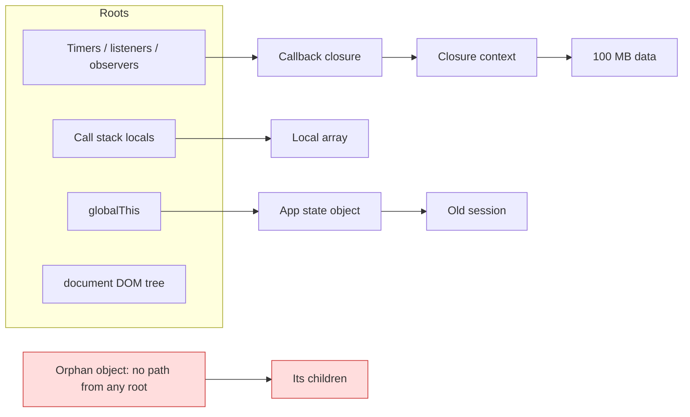
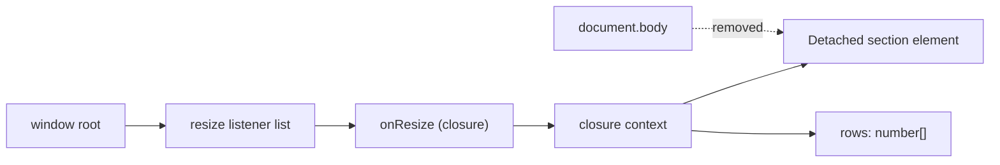
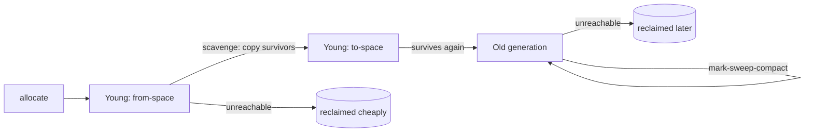

# 00 / 16 — Memory, Garbage Collection, and Leaks

## 1. Lesson metadata

| | |
|---|---|
| **Level** | Advanced |
| **Study time** | 4–5 hours (reading 2 h, DevTools experiments 1.5 h, exercises 1.5 h) |
| **Prerequisites** | [06 — Lexical scope and closures](./06-lexical-scope-and-closures.md), [08 — Objects, references, and immutable updates](./08-objects-references-immutability.md). Helpful: [04 — DOM structure and mutation](./04-dom-structure-and-mutation.md), [13 — Browser events and propagation](./13-browser-events-and-propagation.md), [14 — Web APIs and network requests](./14-web-apis-and-network-requests.md) |
| **Next** | [17 — JavaScript performance fundamentals](./17-javascript-performance-fundamentals.md) |
| **Related later** | [Phase 3 — Effect cleanup](../03-react-state-and-hooks/06-effect-cleanup.md), [Phase 7 — Memory leaks in React apps](../07-performance/19-memory-leaks.md) |

**Learning objectives.** After this lesson you can:
1. Explain what "garbage" means for a JavaScript engine (reachability, not "no longer needed").
2. Describe, at teaching-model level, how a generational mark-and-sweep collector works and why GC causes pauses.
3. Enumerate the six common leak shapes in browser apps and explain, for each, which reference chain keeps the object alive.
4. Use the DevTools Memory panel (heap snapshots, retainers, detached DOM) to find a leak.
5. Use `WeakMap`, `WeakSet`, `AbortController` and explicit disposal correctly, and explain why `WeakRef`/`FinalizationRegistry` are not for program logic.
6. Explain how React code leaks (missing effect cleanup, long-lived subscriptions, closures over large data) and why Strict Mode helps surface it.

**Concepts covered:** stack vs heap, values vs references, reachability and roots, mark-and-sweep, reference counting (and why engines do not rely on it), generational GC, scavenge vs major GC, incremental/concurrent marking, GC pauses and allocation rate, shallow vs retained size, retainer chains, detached DOM nodes, closure context retention, timer/listener/observer/subscription leaks, unbounded caches, `WeakMap`/`WeakSet`/`WeakRef`/`FinalizationRegistry`, `AbortController`-based listener removal.

---

## 2. Deep conceptual explanation

### 2.1 What problem is this lesson solving?

JavaScript hides manual memory management: you never call `free`. That convenience creates a false belief — "memory is handled for me" — that produces two kinds of production incidents:

- **Leaks.** A dashboard left open for eight hours grows from 150 MB to 2 GB, then the tab crashes ("Aw, Snap" / out-of-memory) or the OS starts swapping.
- **GC jank.** A render loop that allocates millions of short-lived objects per second forces frequent collections that steal main-thread time ([Lesson 01](./01-how-the-browser-works.md): there is one main thread, and GC work competes for it, although modern engines move much of it off-thread).

Neither is a React problem, but React apps are particularly prone to the first: components mount and unmount constantly, each mount may register a subscription, and one forgotten `removeEventListener` per mount compounds across thousands of navigations.

### 2.2 Values, references, and where memory lives

Recall from [Lesson 08](./08-objects-references-immutability.md) that variables hold either a **primitive value** or a **reference** to an object. For memory purposes:

- **Primitives** (`number`, `boolean`, `undefined`, `null`, `bigint`, `symbol`) are small and are stored in the variable's slot (or in the engine's compact representation of it).
- **Objects** — plain objects, arrays, functions (and their closure contexts), Maps, DOM wrappers, promises — live on the **heap**. Variables hold references to them.
- **Strings** are immutable values but can be large; engines may share or "rope" them. Treat a large string as a heap object for budgeting.
- **Typed arrays / `ArrayBuffer`** data lives in a backing store typically *outside* the JS heap (external memory) but is owned by a small heap object. A leaked `ArrayBuffer` wrapper leaks the bytes too, and heap-size charts may under-report it.

*Teaching model.* "Stack holds locals, heap holds objects" is a useful simplification; engines are free to keep locals in registers, optimize objects away (escape analysis), or move things between spaces. *Public guarantee:* an object reachable through the language's rules is never collected out from under you. Everything else (when, how, how fast) is implementation-defined.

### 2.3 What "garbage" means: reachability

The ECMAScript specification does not mandate a collection algorithm; it only implies that unreachable memory *may* be reclaimed. Engines implement this with **reachability**:

1. Define **roots**: the global object, the current call stack's locals and temporaries, values held by active host machinery (pending timers, registered event listeners, in-flight `fetch` callbacks, open WebSockets, observers), and, in browsers, the document's DOM tree.
2. An object is **live** if it is reachable from a root by following references.
3. Everything else is **garbage** and its memory can be reused.



The critical consequence: **a leak in a garbage-collected language is an unintended reachable path**. You did not forget to free the object; you forgot to cut the last reference to it. This reframes debugging: you do not ask "who allocated this?" but "**who still holds this?**" (the *retainer chain*).

### 2.4 Why not reference counting?

Reference counting (free an object when its count hits zero) is simple, but a cycle — `a.b = b; b.a = a` — keeps both counts at 1 forever even when nothing else can reach them. Old Internet Explorer's DOM/JS cycle leaks are the classic example. Modern JavaScript engines use **tracing** (mark-and-sweep family) collectors that handle cycles naturally: an unreachable cycle is simply never marked. (Some host objects, e.g. in other runtimes or native bindings, use reference counting internally. That is a host detail.)

### 2.5 Generational collection (teaching model: V8)

Empirically, most objects die young (temporary arrays, intermediate strings, event objects) while some live for the whole session (app state, caches). Engines exploit this "generational hypothesis". V8's design, described publicly on the V8 blog (the Orinoco project), is a useful reference:

| Space | Contents | Collector | Cost profile |
|---|---|---|---|
| **Young generation** ("new space", split into semi-spaces) | Newly allocated objects | **Scavenger**: copies surviving objects to the other semi-space; survivors that live through a couple of scavenges are **promoted** | Cost proportional to *live* young objects, not garbage. Frequent, short. |
| **Old generation** | Promoted long-lived objects, large objects | **Mark-Sweep-Compact**: mark reachable objects (incrementally and concurrently with the JS thread where possible), sweep dead ones (lazily/concurrently), occasionally compact to fight fragmentation | Cost proportional to live heap. Rarer, but can include short main-thread pauses. |

⚠ *Implementation detail.* Space layout, promotion policy, which phases run in parallel/concurrently, heap limits, and pause lengths differ across V8 versions, between Chrome and Node, and across SpiderMonkey and JavaScriptCore. Do not write code that depends on them. The portable lessons are:

1. **Short-lived garbage is cheap** (copying collectors pay only for survivors) but **not free**: a high allocation *rate* triggers frequent young collections.
2. **Long-lived retained data is what makes major GCs expensive** and raises the memory floor.
3. **GC can pause the main thread.** Modern collectors do most work incrementally or concurrently, leaving short stop-the-world slices; a huge or rapidly growing heap makes them longer.
4. **You cannot force or schedule GC from page code.** (DevTools' trash-can button forces one for debugging; `gc()` exists only behind engine flags.)

### 2.6 What a leak looks like

```text
Healthy:   heap  ╱╲╱╲╱╲╱╲╱╲╱╲   (sawtooth: allocate, collect, return to a stable floor)
Leaking:   heap  ╱╲╱╲╱╲╱╲╱╲╱╲   (sawtooth whose floor keeps rising after each action)
                       ↗ floor rises each time the user repeats an action
```

A sawtooth is normal. **A rising floor after garbage collection** is the signal. A growing peak alone is not (GC may simply not have run).

### 2.7 The six common leak shapes

| Shape | Reference chain that keeps it alive | Typical trigger |
|---|---|---|
| **1. Accidental globals / module state** | `globalThis` or a module-level variable → object | Assigning to an undeclared variable in sloppy code; module-level arrays that only grow |
| **2. Timers** | Timer table → callback → closure context → big data | `setInterval` never cleared; recursive `setTimeout` never stopped |
| **3. Event listeners / observers** | Target (`window`, `document`, long-lived element) → listener → closure → component data | `addEventListener` without matching remove; `ResizeObserver`/`IntersectionObserver`/`MutationObserver` never disconnected |
| **4. Subscriptions and connections** | Emitter/socket/store → subscriber callback → closure | WebSocket, `EventSource`, `BroadcastChannel`, RxJS or store subscriptions never closed |
| **5. Detached DOM** | JS variable/closure/Map → removed element → its subtree (+ listeners, + framework wrappers) | Keeping element references after `remove()`; caching nodes |
| **6. Unbounded caches and logs** | Map/array/object → entries | Memoization with unbounded keys; accumulating history; "recent actions" arrays; undo stacks with no cap |

A seventh, subtler shape is **closure over more than you meant**, covered next.

### 2.8 Closures and what they retain

A closure retains its **lexical environment** ([Lesson 06](./06-lexical-scope-and-closures.md)). Engines optimize by only keeping variables that some inner function actually references — but V8, like other engines, typically allocates **one shared context per scope** for variables captured by *any* closure created in that scope. The documented-in-practice consequence: if two closures are created in the same function and one references `bigData` while the other references only `id`, the second closure may still keep `bigData` alive because the captured variables share a context. This is an **implementation detail** — correct in current V8 behavior as widely reported, but it varies across engines and versions, so treat it as a hazard, not a rule. The defensive habit: *do not keep large data in variables that long-lived callbacks can see; null them or restructure.*

### 2.9 Common misconceptions

| Misconception | Reality |
|---|---|
| "Setting a variable to `null` frees memory." | It removes one reference. The object is freed only when *no* path from a root remains, and only when the GC next runs. |
| "`delete obj.key` frees memory." | It removes a property (and may deoptimize the object's shape). The value is freed only if nothing else references it. |
| "Components that unmount are garbage." | Only if nothing retains their closures. A listener on `window` that closes over a component's props keeps that data alive after unmount. |
| "A growing heap means a leak." | Heap grows until GC runs. Look at the *post-GC floor* over repeated identical actions. |
| "`WeakRef` solves leaks." | It lets you hold an object without keeping it alive, but you must handle it disappearing at any time, and the spec makes no promise about *when* (or whether) collection happens. It is a last resort. |
| "React memory leaks are rare because React cleans up." | React cleans up *what it owns* (fibers, DOM nodes, refs). It cannot know about the listener *you* registered in an effect; that is your cleanup function's job. |
| "`setState` after unmount is the leak." | In React 18+, that no longer warns; it is a no-op on an unmounted component. The real leak is whatever kept the callback alive. |

---

## 3. Internal mechanics

### 3.1 Mark-and-sweep, step by step (teaching model)

1. **Roots enumerated.** The collector gathers root pointers: stack slots, globals, handles held by the host.
2. **Mark.** Starting from roots, it traverses the object graph and marks each reached object. Engines use a *tri-color* abstraction (white = unvisited, grey = discovered but children not scanned, black = fully scanned) so marking can be paused and resumed.
3. **Write barriers.** If JavaScript runs *between* marking slices (incremental/concurrent marking) and stores a reference into an already-black object, the engine's **write barrier** records it so the new target is not missed. *Implementation detail*, but it is why heavy mutation of old objects has a small tax.
4. **Sweep.** Unmarked objects' memory is returned to free lists (often lazily).
5. **Compact (sometimes).** Live objects may be moved to defragment memory; references are updated. Objects are therefore **not at stable addresses** — another reason you can never observe identity by address.

### 3.2 Public guarantee vs implementation detail

| Aspect | Status |
|---|---|
| Reachable objects are never reclaimed | **Public guarantee** (semantics) |
| Unreachable objects *may* be reclaimed | **Public guarantee** (allowed, not required) |
| `WeakMap` entries do not keep their key alive | **Public guarantee** (ES spec) |
| `WeakRef.deref()` stability within one synchronous job | **Public guarantee**: once you deref, the target is kept alive until the end of the current job |
| `FinalizationRegistry` callback timing, or whether it runs at all | **Explicitly not guaranteed** |
| Generational layout, scavenger, concurrent marking | **Implementation detail** (V8-specific) |
| Heap size limits, GC trigger thresholds | **Implementation detail**, varies by browser, device memory, flags |

### 3.3 Weak collections

- `WeakMap<K extends WeakKey, V>`: keys must be objects (and, since ES2023, non-registered symbols). If a key is otherwise unreachable, the *entry* (including the value, unless the value reaches the key) becomes collectible. Not iterable, no `size`, precisely because contents may vanish at any time. Use cases: attaching private metadata to objects you do not own (DOM nodes, third-party objects) without preventing their collection.
- `WeakSet`: same, membership only. Use: "have I already processed this object?"
- `WeakRef`: `new WeakRef(obj).deref()` returns the object or `undefined`.
- `FinalizationRegistry`: requests a callback *after* an object is collected. The spec and MDN both warn that callbacks may be delayed or never called (e.g., at page unload). Never use it for correctness-critical cleanup (closing sockets, releasing locks). Use explicit `dispose`/`close`/`abort`.

A `WeakMap` entry is kept only while its *key* is reachable by some path *other than through the entry's own value*. A value that references its own key therefore does not keep the entry alive by itself (this is "ephemeron" semantics, which the specification requires), but any external strong path to the key, or to the value from a root, keeps the pair alive. Teaching rule: a value that points back at its key is fine; a value that is also stored in a strong structure is not.

### 3.4 DevTools measurement model

| Concept | Meaning |
|---|---|
| **Shallow size** | Bytes held by the object itself, not what it references. |
| **Retained size** | Bytes that would be freed if this object were collected — itself plus everything *only* it keeps alive. The number that finds leaks. |
| **Distance** | Shortest path length from a GC root. Large distances are deep in the graph. |
| **Retainers pane** | Reference chain(s) from roots to the selected object — the "who still holds this?" answer. |
| **Detached** | A DOM node no longer in the document but still referenced by JS. DevTools labels these `Detached <div>`; you can filter the snapshot by "Detached". |

---

## 4. Step-by-step execution walkthrough: a listener leak across five "page visits"

Scenario: a single-page app registers a window listener when a "Report" screen mounts, but forgets to remove it when the screen unmounts.

```ts
// Called on each mount of the Report screen.
function mountReport(rows: readonly number[]): () => void {
  const panel = document.createElement("section");
  document.body.append(panel);
  const onResize = () => { panel.textContent = `rows: ${rows.length}`; };
  window.addEventListener("resize", onResize);
  return () => panel.remove();           // BUG: listener not removed
}
```

1. **Visit 1.** `mountReport(bigRows)` allocates `panel`, creates the closure `onResize` capturing `panel` and `rows`, and registers it on `window` (a root).
2. **Unmount 1.** The returned function removes `panel` from the DOM. The DOM tree no longer references it, but `window → listener list → onResize → closure context → panel, rows` still does.
3. **GC runs.** Mark phase reaches `panel` and `rows` through the `window` root. They are live. Nothing is freed.
4. **Visits 2–5.** Each adds another `panel`, closure, and listener. After five visits there are five detached `<section>` nodes and five `rows` arrays.
5. **Observable symptoms.** The heap floor rises by (`rows` + node) each visit. Each `resize` event runs five handlers, five detached panels get text updates, wasted work that also shows in the Performance panel.
6. **Diagnosis.** A heap snapshot filtered by `Detached` shows `Detached <section>` ×5; the retainers pane shows `onResize in Array in EventListener … in Window`. Following the chain leads directly to the source line.

---

## 5. Code examples

### 5.1 Minimal example — reachability in action

```ts
let user: { name: string; photo: Uint8Array } | null = {
  name: "Ada",
  photo: new Uint8Array(10_000_000), // ~10 MB external backing store
};

const summary = () => user?.name;     // closure references the *variable* `user`

user = null;                          // drops the object; photo becomes collectable
console.log(summary());               // undefined
```

**Predict:** is the 10 MB buffer eligible for collection after `user = null`?
**Result:** Yes. `summary` captured the *binding* `user`, not the object, and the binding now holds `null`. No path to the object remains. (When it is actually reclaimed is up to the engine.)
**Why it matters:** closures capture variables, not values ([Lesson 06](./06-lexical-scope-and-closures.md)); reassigning the variable cuts the chain for every closure at once.

### 5.2 Practical example — listener and timer lifecycle with a disposer

```ts
export interface Disposable { dispose(): void }

export function startClock(el: HTMLElement): Disposable {
  const ac = new AbortController();
  const tick = () => { el.textContent = new Date().toLocaleTimeString(); };

  const id = window.setInterval(tick, 1000);
  window.addEventListener("visibilitychange", tick, { signal: ac.signal });

  return {
    dispose() {
      window.clearInterval(id);
      ac.abort();                      // removes every listener registered with this signal
    },
  };
}
```

Line notes:
- `{ signal }` is supported by `addEventListener` in modern browsers: aborting the signal removes the listener. This avoids the classic bug of `removeEventListener` with a *different* function reference ([Lesson 07](./07-functions-and-referential-identity.md)).
- The disposer pattern returns one object that owns all resources: easy to call from a React effect cleanup.
- `window.setInterval` returns a `number` in the DOM typings; plain `setInterval` can resolve to Node's `Timeout` type if `@types/node` is present, a common TS annoyance.

### 5.3 Incorrect example — a cache that is also a leak

```ts
const metaCache = new Map<HTMLElement, { rect: DOMRect; lastSeen: number }>();

export function measure(el: HTMLElement) {
  let m = metaCache.get(el);
  if (!m) {
    m = { rect: el.getBoundingClientRect(), lastSeen: Date.now() };
    metaCache.set(el, m);
  }
  return m;
}
```

**Why wrong:** the module-level `Map` is reachable from a module (a root-ish reference for the app's lifetime) and holds **strong** references to every element ever measured. Elements removed from the DOM remain alive with their entire subtree. A list that virtualizes and recycles thousands of nodes turns this into a steady leak.

### 5.4 Corrected implementation

```ts
const metaCache = new WeakMap<HTMLElement, { rect: DOMRect; lastSeen: number }>();
// Same code. Only the container changed.
```

When an element is removed and nothing else references it, the entry becomes collectible. **Trade-offs:** a `WeakMap` cannot be enumerated or sized, and entries can vanish between operations; the value must be re-derivable. For caches keyed by *strings or numbers* (not objects), `WeakMap` is impossible; use a bounded cache (LRU: evict least recently used beyond N entries) instead.

### 5.5 Practical React example — effect cleanup (usage level)

Phase 3 explains `useEffect` in depth ([04](../03-react-state-and-hooks/04-useeffect-synchronization.md), [06](../03-react-state-and-hooks/06-effect-cleanup.md)). At the usage level it is enough to know: the function returned from an effect is its **cleanup**, run before the effect re-runs and when the component unmounts.

```tsx
import { useEffect, useState } from "react";

export function useWindowWidth(): number {
  const [width, setWidth] = useState<number>(() => window.innerWidth);

  useEffect(() => {
    const ac = new AbortController();
    window.addEventListener("resize", () => setWidth(window.innerWidth), {
      signal: ac.signal,
    });
    return () => ac.abort();           // cleanup: cut the window → listener → closure chain
  }, []);

  return width;
}
```

Line notes:
- The listener closure captures `setWidth`, which is stable; but it also keeps the hook's fiber-related closure data reachable. Without cleanup the chain `window → listener → setWidth → component's state queue` outlives the component.
- In development, React Strict Mode intentionally mounts, unmounts, and re-mounts each component once (⚠ dev-only; see [Phase 2/28](../02-react-rendering-and-internals/28-strict-mode-behavior.md)). With *no* cleanup, you would see two listeners registered after the first mount, a visible sign (for example in DevTools' event-listener inspection) that cleanup is missing. This is a feature, not noise.

### 5.6 Advanced example — a bounded LRU with `Map` insertion order

```ts
export class LruCache<K, V> {
  readonly #map = new Map<K, V>();
  constructor(private readonly max: number) {
    if (max < 1) throw new RangeError("max must be >= 1");
  }
  get(key: K): V | undefined {
    if (!this.#map.has(key)) return undefined;
    const v = this.#map.get(key) as V;
    this.#map.delete(key);          // re-insert to mark as most recently used
    this.#map.set(key, v);
    return v;
  }
  set(key: K, value: V): void {
    this.#map.delete(key);
    this.#map.set(key, value);
    if (this.#map.size > this.max) {
      const oldest = this.#map.keys().next().value as K; // Map iterates in insertion order (spec guarantee)
      this.#map.delete(oldest);
    }
  }
}
```

Notes: `Map` iteration order is insertion order — a specified guarantee, which is what makes this idiom correct. A `value` of `undefined` is handled because `get` uses `has`. The `as K` cast is safe because `size > max >= 1` implies a first key exists.

---

## 6. Visual explanations

### Retention chain for the leak in §4



The dashed edge is the one the developer thought was the only reference. The solid chain from `window` is the real one.

### Generational flow (teaching model)



---

## 7. Alternative approaches and trade-offs

Ways to prevent a given retention:

| Approach | Correctness | Complexity | Debuggability | Fits when |
|---|---|---|---|---|
| Explicit cleanup (remove listener, clear timer, close socket) | Deterministic | Low | High | Always, the default |
| `AbortController` signal shared by many registrations | Deterministic | Low | High | Many listeners/fetches with one lifetime |
| `WeakMap`/`WeakSet` keyed by objects you do not own | Automatic, non-deterministic timing | Low | Medium (cannot enumerate) | Metadata/caches keyed by DOM nodes or foreign objects |
| Bounded cache (LRU, TTL) | Deterministic bound | Medium | High | Keys are strings/numbers or must be enumerable |
| `WeakRef` + `FinalizationRegistry` | Not guaranteed | High | Low | Almost never: advanced caches in libraries where explicit disposal is impossible |
| Restructure to avoid retaining (pass IDs, not objects) | Deterministic | Medium | High | Closures that capture heavy objects |
| Reload/restart the page periodically (kiosk) | Papers over leaks | Low | N/A | Digital signage where fixing the leak is not feasible |

**When the "recommended" approach is not best:** explicit cleanup is the default, but for a *library* that attaches data to arbitrary caller-owned objects (say, a memoization helper), forcing callers to dispose is unreasonable and a `WeakMap` is the correct design. Conversely, for a cache keyed by user-supplied strings, a `WeakMap` cannot work at all; use a bounded structure.

---

## 8. Best practices and anti-patterns

**Do**
- Pair every registration with a de-registration at the same abstraction level (constructor/destructor, effect/cleanup, `start`/`stop`).
- Prefer `AbortController` for groups of listeners and fetches.
- Bound every cache and history array. Decide the maximum *before* writing the code.
- Keep long-lived callbacks small and give them IDs rather than whole objects when possible.
- Verify leaks by measurement: repeat an action 10–20 times, force GC, compare post-GC heap.

**Beginner mistakes**
- Assuming unmounted components are freed automatically.
- Using an anonymous inline function in `addEventListener` and then trying to `removeEventListener` with a new inline function (a different reference, so nothing is removed).
- Forgetting the `capture` flag must match on removal.

**Experienced-developer mistakes**
- Using a module-level `Map` as a "simple cache" without eviction.
- Storing DOM nodes in state or in long-lived maps.
- Believing `WeakRef` is a cure; building logic on `FinalizationRegistry`.
- Chasing allocation counts when the real issue is retained size, or vice versa.
- "Fixing" a leak report by calling `array.length = 0` in one place while another path still appends.

**Smells:** a `Set`/`Map`/array at module scope that only has `add`/`push`; `setInterval` without a stored ID; observers constructed inside render or effects with no `disconnect`; event listeners registered inside other event handlers.

**Justified exceptions:** an app-lifetime singleton listener (e.g., a global keyboard shortcut manager registered once at startup) does not need removal. Document that it is intentionally immortal and ensure it is registered exactly once (beware hot module reloading in development, which can re-run module code and register duplicates).

---

## 9. Real-world application

**Trading/monitoring dashboard (long-lived session).** Operators keep the tab open for a full shift, ~10 hours. Every symbol widget subscribes to a WebSocket channel when added and the user adds/removes widgets frequently. Constraints: sessions cannot be restarted (state loss), memory budget on a shared trading-floor machine is limited, messages arrive at hundreds per second. Leak surface: per-widget subscription callbacks, per-widget `ResizeObserver`s, price history arrays that grow unboundedly. Mitigations: one multiplexed socket with ref-counted channel subscriptions; ring buffers of fixed size (e.g., last 5,000 ticks) for history; `disconnect()` on unmount; a synthetic soak test that adds/removes widgets 500 times and asserts the post-GC heap stays within a tolerance.

**E-commerce SPA.** Route changes between product pages are frequent. Typical leak: a product-gallery component registers `scroll` and `keydown` listeners on `document`. Every product view adds another pair; after 200 views, each key press runs 200 stale handlers (CPU cost, visible lag) and 200 detached galleries with image data stay in memory. Multi-hundred-view sessions are normal on mobile Safari where memory limits are strict and tabs are killed silently.

**Auth/session.** Keeping decoded user objects, tokens, or PII in module-level caches beyond logout is both a memory and a security issue; clear them on sign-out.

**Multi-team shells (micro-frontends).** A host app mounts and unmounts remote apps. If a remote does not expose and honor an `unmount` contract, its listeners and timers survive. Engineering constraint: the host cannot inspect remote internals, so it must enforce lifecycle (and test with repeated mount/unmount).

---

## 10. Debugging and troubleshooting

**Symptom:** "The app gets slower and slower over a session; the task manager shows the tab's memory climbing."

**Repro and investigation in Chrome DevTools (Memory panel):**

1. **Establish a repeatable action** (navigate to screen X and back). Note that a leak is only visible when the action is repeated.
2. **Warm up** by doing the action once or twice (lazy-loaded modules and caches allocate once; that is not a leak).
3. Click the **trash can (collect garbage)**, then take **Snapshot 1**.
4. Repeat the action *N* times (e.g., 10). Collect garbage again. Take **Snapshot 2**.
5. In Snapshot 2, switch the view to **"Objects allocated between Snapshot 1 and Snapshot 2"** (or use *Comparison*) and sort by **Retained size / # New**. Look for counts that are multiples of *N* (10 detached `HTMLSectionElement`, 10 `Array`). Multiples of N are the fingerprint of per-visit leakage.
6. Type `Detached` in the class filter to isolate detached DOM nodes.
7. Select an instance; read the **Retainers** pane. Follow the chain upward until you reach something *you own* (a listener on `window`, a module variable, a timer). That frame names the source of the missing cleanup.
8. Optionally use **Allocation instrumentation on timeline** (blue bars that remain after GC are allocations that survived) or **Allocation sampling** (lower overhead, attributed to call stacks).
9. Use the **Performance** panel with the *Memory* checkbox to see JS heap, DOM node count, and **listener count** graphs over time; a listener count that staircases up on each navigation is conclusive.

**Root-cause classes:** (a) registration without cleanup; (b) module-level collection that only grows; (c) closure retention of heavy data; (d) detached DOM kept by a variable; (e) third-party library instances never destroyed (maps, charts, editors usually expose a `destroy()`/`remove()`).

**Validate the fix:** repeat the same scenario with the same N. The post-GC floor should return to within noise of Snapshot 1; counts of detached nodes should be zero; the listener-count graph should be flat. Add the scenario to a soak test where possible.

⚠ Tool notes: `performance.memory` is non-standard and Chromium-only; `performance.measureUserAgentSpecificMemory()` is gated behind cross-origin isolation. For production monitoring, treat them as optional signals and verify availability on MDN before relying on them. Panel names and UI layout change between Chrome versions.

---

## 11. Exercises

### Level A — Knowledge
A1. Define "garbage" for a JavaScript engine in one sentence. Why is "no longer used by my code" an incorrect definition?
A2. Name four kinds of GC roots in a browser page.
A3. Why do modern engines use tracing collection instead of reference counting?
A4. What is the difference between shallow size and retained size?
A5. Why can `FinalizationRegistry` not be used to close a WebSocket?

### Level B — Code comprehension
B1. After running, which objects are eligible for collection?
```ts
const strong = new Map<string, object>();
const weak = new WeakMap<object, string>();
function run() {
  const a = { id: 1 };
  const b = { id: 2 };
  const c = { id: 3 };
  strong.set("a", a);
  weak.set(b, "meta");
  void c;
}
run();
```
B2. Does this code remove the listener? Explain.
```ts
window.addEventListener("scroll", () => console.log("s"));
window.removeEventListener("scroll", () => console.log("s"));
```
B3. Why might `smallHandler` keep `huge` alive?
```ts
function make() {
  const huge = new Array(1_000_000).fill(0);
  const bigUser = () => huge.length;
  const smallHandler = () => 42;
  document.addEventListener("click", smallHandler);
  return bigUser;
}
```
(Answer carefully about what is guaranteed vs engine-dependent.)

### Level C — Implementation
C1. Write `createDisposer()` returning `{ add(fn), disposeAll() }` that runs registered cleanup functions in reverse order and tolerates one cleanup throwing (still running the rest, then rethrowing an `AggregateError`).
C2. Implement `memoizeByObject<K extends object, V>(fn: (k: K) => V): (k: K) => V` that does not prevent keys from being collected.
C3. Write `useInterval(callback, delayMs)` as a React hook with proper cleanup, pausing when `delayMs` is `null`. (Prefer storing the latest callback in a ref so the interval need not be re-created; see [Phase 3/10](../03-react-state-and-hooks/10-useref-and-mutable-references.md) for refs.)

### Level D — Debugging
D1. A heap snapshot comparison shows 50 `Detached HTMLDivElement` after 50 modal open/close cycles. The retainer chain ends in `Window → listeners → closure → context → modalRoot`. What is the bug class, and what two changes would you make?
D2. A teammate fixed a leak with `items = null` inside a loop callback, but the heap still grows. List three other places that might still retain the data.
D3. In development (Strict Mode), the console shows "subscribed" twice on first mount and nothing else. What does that tell you about the effect below, and what would a correct effect log in the same situation?
```tsx
useEffect(() => {
  console.log("subscribed");
  store.subscribe(onChange);
}, []);
```

### Level E — Architecture and engineering decisions
E1. Design a price-history store for a chart that must show the last hour of ticks at up to 20 ticks/s per symbol for 50 symbols in a session that can last 12 hours. Compare unbounded array, fixed ring buffer, and downsampling. Pick one.
E2. You own a shared `useSubscription` utility used by 40 teams. How do you design the API and tests so that leaks are hard to introduce?

### Level F — Expert challenge
F1. Production telemetry shows a long tail: p99 sessions reach 1.8 GB of JS heap on desktop Chrome; median is 180 MB. You cannot reproduce locally. Describe a plan to find the cause (what to instrument, how to sample, how to reproduce, how to confirm and guard against regression).

---

## 12. Detailed answers and explanations

> Attempt the exercises first.

**A1.** Garbage is memory occupied by objects that are **not reachable** from any root by following references. "No longer used by my code" is the *intent*, but the engine cannot read intent; it can only follow references. An object you will never use again but that is still referenced from a live listener is not garbage. Common wrong answer: "objects with no variable pointing at them", which is close but ignores indirect paths and cycles.

**A2.** Any four of: the global object (`window`/`globalThis`); the active call stack (locals, temporaries); pending timers' callbacks; registered event listeners; in-flight network callbacks/promise reactions; the DOM tree attached to the document; module-level bindings; live observers; open sockets/streams.

**A3.** Reference counting cannot reclaim cycles (A→B→A with zero outside references still has counts of 1), requires bookkeeping on every pointer assignment, and complicates concurrent execution. Tracing collectors compute reachability from roots, so cycles die naturally, and they can be made incremental/concurrent/generational.

**A4.** Shallow: bytes of the object itself. Retained: bytes freed if this object were removed, including everything that *only* it keeps alive. A tiny listener closure can have a retained size of hundreds of MB if it is the sole path to a big structure. Wrong answer: "retained size is memory still in use after GC" (that is the whole heap's live size).

**A5.** The registry callback may run late or never (for example, the page is torn down first, or the engine never needs to collect). Closing a socket must happen deterministically when you are done with it. Also, a registered closure must not strongly reference the target or it prevents collection. Use explicit `close()`, an `AbortSignal`, or a disposer.

**B1.** `b` and `c` are collectable. `a` is strongly held by the module-level `Map`. `b` is only a `WeakMap` key; once `run()` returns, no strong path exists, so the entry is collectable. `c` was only a local. Wrong answers: "`a` is freed because `run` returned" (the Map retains it); "`b` is retained because it is in a map" (weak keys do not retain).

**B2.** No. Each arrow function expression creates a *new function object*; `removeEventListener` matches by function identity (and capture flag). The listener stays registered. Fix: store the function in a variable (`const onScroll = …`) and pass that to both calls, or use `{ signal }` with an `AbortController`. See [Lesson 07](./07-functions-and-referential-identity.md).

**B3.** *Guaranteed:* `bigUser` references `huge`, so as long as `bigUser` is reachable, `huge` is. `make()` returns `bigUser`, so the caller decides. *Engine-dependent:* V8 typically creates a single context object for variables captured by any closure in `make`'s scope. `smallHandler` does not reference `huge`, but if that context also contains `huge` (because `bigUser` captures it), `smallHandler` — which stays alive because it is registered on `document` — retains the context, and therefore `huge`, even after the caller discards `bigUser`. Not every engine/version behaves this way, and optimizers may differ. Defensive fix: split into separate functions so the long-lived handler is created in a scope that does not contain `huge`, or null out `huge` when finished.

**C1. Reference solution**
```ts
export function createDisposer() {
  const fns: Array<() => void> = [];
  let disposed = false;
  return {
    add(fn: () => void): void {
      if (disposed) { fn(); return; }       // late registration: clean up immediately
      fns.push(fn);
    },
    disposeAll(): void {
      disposed = true;
      const errors: unknown[] = [];
      while (fns.length > 0) {
        const fn = fns.pop()!;              // reverse order of registration
        try { fn(); } catch (e) { errors.push(e); }
      }
      if (errors.length > 0) throw new AggregateError(errors, "cleanup failed");
    },
  };
}
```
Notes: reverse order mirrors stack unwinding (later resources may depend on earlier ones). The late-registration branch avoids a leak when something registers after disposal. `AggregateError` is ES2021; check your `lib`/target.

**C2.**
```ts
export function memoizeByObject<K extends object, V>(fn: (k: K) => V): (k: K) => V {
  const cache = new WeakMap<K, V>();
  return (k) => {
    if (cache.has(k)) return cache.get(k) as V;
    const v = fn(k);
    cache.set(k, v);
    return v;
  };
}
```
Edge cases: if `V` references `K` it still works (ephemeron semantics), but if something *else* holds `V` strongly and `V` references `K`, `K` stays alive. Functions are objects, so functions work as keys. Primitive keys are a type error, as intended.

**C3.**
```tsx
import { useEffect, useRef } from "react";

export function useInterval(callback: () => void, delayMs: number | null): void {
  const saved = useRef(callback);
  useEffect(() => { saved.current = callback; });      // always call the latest callback

  useEffect(() => {
    if (delayMs === null) return;
    const id = window.setInterval(() => saved.current(), delayMs);
    return () => window.clearInterval(id);
  }, [delayMs]);
}
```
Notes: `saved.current` avoids re-creating the interval each render *and* avoids a stale closure. Strict Mode mounts → cleans → remounts; the cleanup guarantees only one interval is live. Writing a ref in an effect (not during render) respects purity (Phase 2/12).

**D1.** Bug class: listener (or other registration) on a long-lived root (`window`) closing over a per-modal DOM node, never removed. Changes: (1) register the listener with `{ signal }` from an `AbortController` created per modal-open and abort on close (or `removeEventListener` with the same reference); (2) drop the module/variable reference to `modalRoot` on close (`modalRoot = null`) and avoid caching node references. Validate: 50 cycles → 0 `Detached` nodes after GC.

**D2.** Candidates: a module-level cache/Map keyed by id; other closures sharing the same context; event listeners/timers/observers; devtools `console.log` references (the open console retains logged objects); a store/history array (undo stack); a promise chain whose pending reactions capture it; a framework-level cache (e.g., a query cache that has not yet garbage-collected inactive entries); an ``/Blob URL not revoked (`URL.revokeObjectURL`). The lesson: use retainers rather than guessing.

**D3.** The effect returns no cleanup, so it is leaking. In Strict Mode (dev), React runs mount, then a simulated unmount (cleanup), then mount again. A correct effect (with cleanup that logs "unsubscribed") shows subscribed, unsubscribed, subscribed. Two "subscribed" lines with nothing between them mean the first subscription from the simulated mount is still registered: a leak and duplicate `onChange` calls (in production the leak happens on real unmount instead). Fix: `const unsubscribe = store.subscribe(onChange); return unsubscribe;` (if `subscribe` returns an unsubscribe function, as most stores do). ⚠ Strict Mode double-invocation is dev-only.

**E1. Evaluation criteria and sample answer.** Criteria: memory bound, CPU cost per tick, chart fidelity, implementation complexity, correctness at edges. 20 ticks/s × 50 symbols × 3,600 s = 3.6 M points per hour; at ~16–24 bytes per point as objects, that is ~100+ MB with objects, much worse with per-tick object allocation. *Unbounded array*: fails the 12 h session (43 M points). *Fixed ring buffer* of typed arrays (`Float64Array` for time and price): O(1) writes, no allocation per tick, fixed memory (3.6 M × 2 × 8 B ≈ 58 MB per hour of *all* symbols, roughly 1.2 MB per symbol-hour); simple but needs wrap-around logic for rendering. *Downsampling*: store full-resolution for the last N minutes and aggregated (OHLC buckets) for older data; best for longer windows, more complex. For a one-hour view, pick **typed-array ring buffers per symbol**; add bucketed aggregates only if the requirement expands. State the number that would change your mind: if the chart needs more than one hour, move to tiered resolution.

**E2.** Good answer: make the safe path the only path. Return an unsubscribe function from every subscribe; accept an `AbortSignal` so one lifetime governs many subscriptions; wrap in a React hook that performs cleanup in `useEffect`'s return; document ownership. Tests: a utility `expectNoLeaks` that mounts/unmounts N times and asserts internal subscriber counts return to zero (expose a test-only `subscriberCount()`); lint rule or review checklist for effects without cleanup; a dev-mode warning when a subscription outlives its owner (e.g., via a counter and `console.warn` in development). Evaluate against criteria: ease of correct use, ability to detect misuse, backward compatibility, cost to 40 teams.

**F1. Evaluation criteria and sample answer.** Criteria: signal quality, overhead, reproducibility, safety. Plan: (1) *Segment* telemetry by route, session length, feature flags, browser, extensions; correlate heap growth with session duration and user actions (navigation count, widget add/remove counts) — leaks scale with actions. (2) *Instrument* sampled counters: DOM node count, listener-registration counts (wrapped `addEventListener` in non-prod builds), active subscription counts per feature, cache sizes. Where permitted, use `performance.measureUserAgentSpecificMemory()` (needs cross-origin isolation) or `performance.memory` (Chromium) sparingly. (3) *Reproduce* with an automated soak test (Playwright) that loops the suspicious flows 200× with `--js-flags=--expose-gc` or CDP `HeapProfiler.collectGarbage`, sampling post-GC heap; bisect flows until the slope appears. (4) *Diagnose* with heap snapshot comparison and retainers. (5) *Fix and guard:* add the soak scenario to CI with a slope threshold; add counters as alerts. Also consider non-leak explanations (legitimately large data, image decode caches, extensions, huge result sets) before concluding.

---

## 13. Senior engineer interview questions

**Q1. "How would you determine whether a growing memory chart is a leak?"**
*Strong answer:* A growing peak is not enough; collectors run lazily. Force GC, repeat a defined action N times, and watch the post-GC floor. If it rises roughly linearly with N, it is retention. Confirm with snapshot comparison: objects whose counts scale with N, then read retainers to find the root path. I validate the fix by repeating the same experiment. I also check whether the growth is a bounded cache warming up (it should plateau) versus unbounded (it will not).

**Q2. "Why can a React component leak after it unmounts?"**
*Strong answer:* React releases what it owns: fibers, DOM nodes it created, refs. It cannot release what *you* registered with long-lived hosts (window listeners, timers, sockets, store subscriptions, observers). Those hosts are roots; the callbacks they hold close over props/state/DOM from the unmounted component, keeping that graph alive. The fix is symmetrical cleanup in the effect's returned function or a shared `AbortSignal`. Strict Mode's extra mount/unmount cycle in development surfaces missing cleanup early.

**Q3. "When would you use a `WeakMap` and when not?"**
*Strong answer:* When associating data with objects whose lifetime I do not control and the association should not extend it: DOM-node metadata, memoization keyed by object identity, private data in libraries. Not when keys are primitives, when I need enumeration/size, or when losing entries unpredictably would break correctness (without a re-derivation path). For string-keyed caches use bounded LRU/TTL.

**Q4. "Is `FinalizationRegistry` a good way to release native resources?"**
*Strong answer:* No. Callbacks are not guaranteed to run, may run long after collection, and may never run before page unload. Resources need deterministic release: `close()`, `AbortController`, `dispose` patterns (and, in newer runtimes, the explicit resource management proposal with `using`; ⚠ verify support before depending on it). Registry is acceptable only as a best-effort safety net on top of explicit disposal.

**Q5. "How does allocation rate relate to performance even without a leak?"**
*Strong answer:* High allocation rates cause frequent young-generation collections; each is cheap but nonzero and can introduce small pauses, plus cache pressure. In hot paths (per-frame, per-message) prefer reusing buffers, avoiding intermediate arrays (`map().filter().map()` chains over large lists), and avoiding closures/objects created per item when a loop suffices. But measure first; premature allocation-avoidance harms readability ([Lesson 17](./17-javascript-performance-fundamentals.md)).

---

## 14. Further learning resources

| Resource | URL | Covers / why | Level | Study |
|---|---|---|---|---|
| MDN — Memory management | <https://developer.mozilla.org/en-US/docs/Web/JavaScript/Memory_management> | Lifecycle, GC algorithms, `WeakMap`/`WeakRef` guidance | Beginner–Int. | Whole page |
| MDN — `WeakMap` | <https://developer.mozilla.org/en-US/docs/Web/JavaScript/Reference/Global_Objects/WeakMap> | Semantics, use cases | Intermediate | "Description" |
| MDN — `WeakRef` | <https://developer.mozilla.org/en-US/docs/Web/JavaScript/Reference/Global_Objects/WeakRef> | The "avoid where possible" guidance | Advanced | "Avoid where possible" |
| MDN — `FinalizationRegistry` | <https://developer.mozilla.org/en-US/docs/Web/JavaScript/Reference/Global_Objects/FinalizationRegistry> | Why callbacks are unreliable | Advanced | Notes on callback timing |
| Chrome DevTools — Memory panel docs | <https://developer.chrome.com/docs/devtools/memory-problems> | Heap snapshots, allocation timeline, detached nodes | Intermediate | Heap snapshot, "Detached" |
| V8 blog — "Trash talk: the Orinoco garbage collector" | <https://v8.dev/blog/trash-talk> | Generational, parallel, concurrent GC in V8 | Advanced | Whole post |
| ECMAScript specification | <https://tc39.es/ecma262/> | Normative semantics of `WeakRef`, `WeakMap`, jobs | Advanced | Search "WeakRef Objects" |
| React docs — Synchronizing with Effects | <https://react.dev/learn/synchronizing-with-effects> | Cleanup functions, Strict Mode re-mounting | Beginner–Int. | "Subscribing to events", "How to handle the Effect firing twice in development" |

URLs in this table were checked for HTTP 200 on 2026-10-22; any still marked *(unverified)* could not be checked automatically (blocked or unreachable). A 200 response does not guarantee the page content still matches the description; if a link has moved, search the site for the quoted title.

---

## 15. Knowledge checkpoint

**You should now understand**
- Garbage = unreachable from roots; leaks = unintended reachable paths.
- Generational mark-sweep at a teaching-model level, and which details are implementation-specific.
- The six leak shapes plus closure-context retention.
- That weak references are tools for specific problems, not a general fix.

**You should be able to explain without notes**
- Why unmounted components can stay in memory.
- Why `removeEventListener` with a fresh arrow function does nothing.
- Why the post-GC floor, not the peak, is the leak signal.

**You should be able to implement**
- A disposer/`AbortController` lifecycle, a `WeakMap`-based memoizer, a bounded LRU cache, an interval hook with cleanup.

**You should be able to debug**
- A leak using snapshot comparison, the Detached filter, and the retainers pane, then validate the fix with the same repetition count.

**Before moving on:** read [17 — JavaScript performance fundamentals](./17-javascript-performance-fundamentals.md), which uses the same DevTools workflow for CPU rather than memory. Later, revisit this lesson alongside [Phase 3 — Effect cleanup](../03-react-state-and-hooks/06-effect-cleanup.md) and [Phase 7 — Memory leaks](../07-performance/19-memory-leaks.md).
