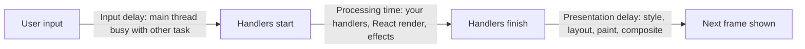
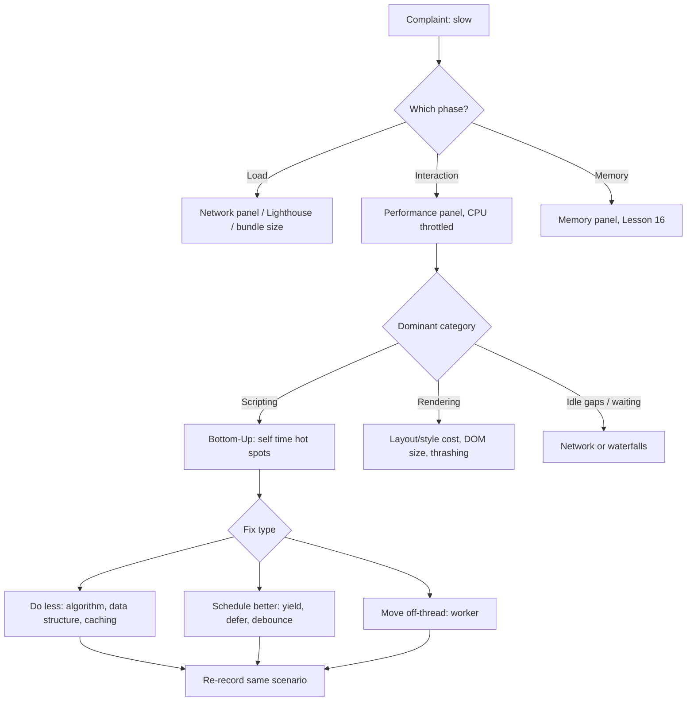

# 00 / 17 — JavaScript Performance Fundamentals: Long Tasks and Profiling

## 1. Lesson metadata

| | |
|---|---|
| **Level** | Advanced |
| **Study time** | 4–5 hours (reading 2 h, profiling labs 1.5 h, exercises 1.5 h) |
| **Prerequisites** | [03 — Browser rendering pipeline](./03-browser-rendering-pipeline.md), [11 — Event loop, tasks, microtasks](./11-event-loop-tasks-microtasks.md), [16 — Memory, garbage collection, and leaks](./16-memory-management-and-gc.md). Builds on [01 — How the browser works](./01-how-the-browser-works.md). |
| **Next** | [18 — TypeScript fundamentals and narrowing](./18-typescript-fundamentals-and-narrowing.md) |
| **Related later** | [Phase 2 — DevTools Profiler](../02-react-rendering-and-internals/30-react-devtools-profiler.md), [Phase 7 — Measure before optimizing](../07-performance/01-measure-before-optimizing.md), [Phase 7 — Long tasks and the main thread](../07-performance/20-long-tasks-and-main-thread.md) |

**Learning objectives.** After this lesson you can:
1. State what "performance" means for a UI (latency of interactions, smoothness, load time, memory) and map each to a metric.
2. Use the Chrome DevTools Performance panel to find a long task and attribute it to a function, a rendering phase, or a third-party script.
3. Use `performance.now()`, `performance.mark()`/`measure()`, and `console.time` appropriately, and explain why naive microbenchmarks lie.
4. Choose a better algorithm or data structure by reasoning about complexity, then verify with measurement.
5. Explain what a JIT compiler does at teaching-model level and which coding habits help or hinder it, without cargo-culting.
6. Select among yielding, workers, batching, debouncing, and doing less work, with trade-offs.
7. Recognize layout thrashing and fix it.

**Concepts covered:** latency vs throughput, frame budget and long tasks, INP (interaction to next paint) and its three phases, profiling vs benchmarking, sampling profiler, flame chart (call tree, bottom-up, self vs total time), User Timing API, algorithmic complexity in practice, `Array` vs `Map`/`Set` lookups, JIT tiers, hidden classes/shapes and inline caches (teaching model), deoptimization, allocation pressure, yielding strategies, Web Workers and structured clone, forced synchronous layout, debounce/throttle, measuring in production (RUM).

---

## 2. Deep conceptual explanation

### 2.1 What problem is this lesson solving?

"Make it faster" is the least actionable sentence in engineering. Without a model you will optimize the wrong thing: rewrite a `for` loop that takes 0.2 ms while a 600 ms layout caused by a 20,000-node DOM goes untouched. This lesson supplies:

1. **What to measure** (user-perceived latency, not raw CPU time).
2. **How to measure** (profilers, User Timing, representative conditions).
3. **What usually matters** (algorithmic complexity, work on the main thread, DOM/layout, allocation, network) and what rarely does (micro-syntax choices).
4. **How to respond** (do less, schedule better, move off-thread).

Phases 2 and 7 apply the same mindset to React-specific costs ([Phase 7/01 — Measure before optimizing](../07-performance/01-measure-before-optimizing.md)). If you skip this lesson you will later conflate "React re-rendered" with "the app is slow".

### 2.2 What "fast" means: user-perceived metrics

| Concern | Question | Typical metric |
|---|---|---|
| **Load** | How soon is useful content visible? | First Contentful Paint (FCP), Largest Contentful Paint (LCP) |
| **Responsiveness** | How soon after a click/keypress does the screen reflect it? | Interaction to Next Paint (INP); input delay + processing + presentation delay |
| **Smoothness** | Are animations and scrolling steady? | Dropped frames, long animation frames |
| **Stability** | Does content jump? | Cumulative Layout Shift (CLS) |
| **Resource use** | Does it drain battery/memory? | CPU time, heap size ([Lesson 16](./16-memory-management-and-gc.md)) |

⚠ Metric definitions and thresholds (for example, INP replaced First Input Delay as a Core Web Vital in 2024) evolve; confirm current definitions on web.dev before building dashboards on them.

*Latency vs throughput.* Throughput is how much work per second a loop completes; latency is how long one interaction takes to produce a visible result. Front-end performance is mostly a **latency** discipline: a handler that processes 1,000 items/ms but must process 5,000,000 items before the UI can update is still a 5-second freeze.

### 2.3 The main-thread budget, revisited

From [Lesson 01](./01-how-the-browser-works.md): scripting, style, layout, and paint recording share one thread, and tasks run to completion. Practical guidelines (guidance, not law):

- **≤ ~50 ms per task** is the long-task threshold used by the Long Tasks API. Work above it is "long" because input arriving during it waits.
- **~16.7 ms per frame** at 60 Hz for animation-critical work (including style/layout/paint), and less at 120 Hz.
- INP "good" is commonly cited as ≤ 200 ms at the 75th percentile of real users (verify current thresholds).

INP decomposes into three phases you can attribute separately:



Each phase has a different fix: input delay → find the *other* task blocking the thread; processing → reduce or split your work; presentation → shrink the DOM/layout cost.

### 2.4 Profiling vs benchmarking vs monitoring

| Activity | Question it answers | Tool | Where it lies |
|---|---|---|---|
| **Profiling** | Where does time go in *this* scenario? | DevTools Performance panel, Node `--cpu-prof` | Profiler overhead, unrepresentative device |
| **Benchmarking** | Is implementation A faster than B for *this isolated operation*? | `performance.now()` harness, benchmark libraries | JIT warm-up, dead-code elimination, unrealistic data, GC timing |
| **Monitoring (RUM)** | What do real users experience? | `PerformanceObserver`, web-vitals, vendor RUM | Sampling bias, noisy |

Rule: **profile to find the problem, benchmark only to choose between known candidates, monitor to confirm the effect on real users.** The first fix is almost always found by profiling a realistic scenario with CPU throttling enabled.

### 2.5 Where JavaScript time actually goes (in order of frequency)

1. **Doing too much work**: O(n²) algorithms, re-computing the same derived value, processing the whole dataset when the UI shows 20 rows.
2. **Doing work at the wrong time**: in an event handler on the critical path, in a scroll handler, during initial load.
3. **DOM and layout cost**: huge trees, forced synchronous layout, expensive CSS selectors/styles ([Lesson 03](./03-browser-rendering-pipeline.md), [Lesson 04](./04-dom-structure-and-mutation.md)).
4. **Allocation pressure and GC** ([Lesson 16](./16-memory-management-and-gc.md)).
5. **Serialization**: `JSON.parse/stringify` of large payloads, `structuredClone`, `postMessage`.
6. **Third-party scripts** you do not control.
7. **Engine-level inefficiency** (megamorphic call sites, deopt loops): real, but a distant last for typical app code.

### 2.6 How the JIT works (teaching model)

Modern engines run code in tiers. In V8 (⚠ implementation detail; tier names have changed across versions): source is parsed to bytecode and run by an interpreter (Ignition); frequently run code is compiled by progressively more optimizing compilers (Sparkplug baseline, Maglev mid-tier, TurboFan top-tier in recent versions). The optimizer makes **speculative assumptions** from observed behavior (this addition always sees numbers; this property access always sees objects of one shape) and emits fast machine code guarded by checks. If a guard fails, the engine **deoptimizes** back to slower code.

Two ideas matter to application developers:

- **Shapes (hidden classes) and inline caches.** Objects created with the same properties in the same order share a shape; a property access site that has only ever seen one shape (**monomorphic**) is fast; a few shapes (**polymorphic**) is OK; many (**megamorphic**) falls to slow generic lookup. Practical habit: construct objects of the same logical type consistently (same fields, same order, initialize all fields up front), do not `delete` properties in hot paths, and avoid holey/mixed-type arrays *in hot loops over very large data*.
- **Warm-up.** Code is slow on first runs and speeds up. This is why one-shot benchmarks mislead and why startup-critical code runs unoptimized by definition (reduce the amount of code executed at startup rather than micro-optimizing it).

*What you should not do:* sprinkle "JIT-friendly" tricks across ordinary code. The cost of ordinary property access is rarely your bottleneck. Apply these habits only where a profile shows a hot loop.

### 2.7 Complexity in practice

Big-O is not an academic exercise in UI work. With lists of 10,000 items:

| Pattern | Operations | Verdict |
|---|---|---|
| `array.includes(x)` inside a loop over n items | O(n²) = 10⁸ comparisons | Likely tens to hundreds of ms or worse |
| Same with a `Set` built once | O(n) = 10⁴ lookups | Negligible |
| Sorting inside a render/handler repeatedly | O(n log n) each time | Cache or sort once |
| Nested `.filter().map().reduce()` over large lists on every keystroke | Multiple O(n) passes + allocations | Acceptable until n is large; then measure |

Real-world heuristics: constants matter below ~1,000 elements and complexity matters above ~10,000. Anything per-keystroke over a large list deserves a profile.

### 2.8 Common misconceptions

| Misconception | Reality |
|---|---|
| "`for` loops are faster than `map`/`forEach`." | Differences are usually small and engine-dependent; algorithmic and DOM costs dominate. Choose for clarity; switch only when a profile shows a hot loop. |
| "Use `const`/`let`/`var` for speed." | Not a meaningful performance factor in modern engines. |
| "Avoid closures, they are slow." | Closure creation has a small cost; it rarely matters. The memory-retention risk ([Lesson 16](./16-memory-management-and-gc.md)) matters more. |
| "`async` code is faster/non-blocking." | It changes scheduling, not CPU cost ([Lesson 01](./01-how-the-browser-works.md), [Lesson 12](./12-promises-and-async-await.md)). |
| "My benchmark shows A is 3× faster than B, so use A." | Only if the benchmark matches realistic data, runs long enough after warm-up, and its result is used (not optimized away). |
| "Performance work means making code complicated." | The best optimizations delete work (less data, less DOM, earlier exit, caching) and *simplify* code. |
| "Debounce fixes slow handlers." | It reduces how often it runs. A 500 ms handler that runs once is still a 500 ms freeze. |

---

## 3. Internal mechanics

### 3.1 What a sampling profiler does

Chrome's JavaScript profiler is a **sampling profiler**: at a regular interval (on the order of 100 µs–1 ms, ⚠ varies) it records the call stack of the main thread. Time attribution is statistical:

- **Self time** of a function = samples where it was the top frame.
- **Total time** = samples where it appeared anywhere in the stack (includes callees).
- Very short functions can be missed; a function that takes 20 samples out of 1,000 is "2%".

Consequences: sampling profilers cannot give exact call counts; they are excellent for finding *where the time is*. They cannot attribute time inside native engine code except by category (e.g., "Parse", "GC", "Layout").

### 3.2 The Performance panel's model

A recording contains tracks: **Main** (flame chart of tasks and call stacks), **Frames**, **Interactions**, **Network**, **Timings** (User Timing marks/measures, LCP, etc.), optional **Memory** graphs and screenshots. Color families: scripting (yellow), rendering/style/layout (purple), painting (green), system/GC (grey).

Views for the selected range:
- **Summary**: pie by category. Immediately tells you "scripting-bound" vs "rendering-bound".
- **Bottom-Up**: functions sorted by self time. Best for "what is hot?"
- **Call Tree**: top-down by total time. Best for "which of my entry points is slow?"
- **Event Log**: chronological.

Tasks over 50 ms get a red flag in the Main track. Enable **CPU throttling (4×–6×)** to approximate a mid-range phone; enable **Network throttling** for load investigations. ⚠ Panel layout and names change between Chrome versions.

### 3.3 `performance.now()` and User Timing

`performance.now()` returns a high-resolution timestamp (milliseconds, fractional) relative to the time origin. ⚠ Browsers deliberately coarsen its resolution (and may add jitter) for security reasons (side-channel attacks); do not expect nanosecond accuracy, and do not measure sub-microsecond operations in one call. Measure a loop of many iterations and divide.

User Timing:

```ts
performance.mark("filter:start");
const result = filterRows(rows, query);
performance.mark("filter:end");
performance.measure("filter", "filter:start", "filter:end");
```

`measure` entries appear in the **Timings** track of the Performance panel and can be read through `performance.getEntriesByName("filter")` or a `PerformanceObserver`. This is how you label *your* work inside a recording and how RUM libraries collect custom timings.

### 3.4 Public guarantee vs implementation detail

| Item | Status |
|---|---|
| Tasks run to completion; main thread shared between script and rendering | **Public guarantee** (HTML event loop model) |
| Long Tasks API reports tasks > 50 ms | Specified behavior of the API (⚠ Chromium-oriented support) |
| `performance.now()` is monotonic | Specified |
| Resolution/jitter of `performance.now()` | Browser-defined, security-motivated |
| JIT tiers, inline caches, deopt triggers | **Implementation detail** |
| Sampling interval, flame chart layout | **Tooling detail** |
| Cost of `Array.prototype.map` vs `for` | **Implementation detail**, varies by engine version and data |

---

## 4. Step-by-step execution walkthrough: diagnosing a slow filter-as-you-type

Scenario: a table with 20,000 rows; typing in a search box feels laggy.

1. **Define the interaction and the target.** "From keypress to updated table < 100 ms on a 4× throttled CPU."
2. **Record.** Performance panel → CPU 4× slowdown → Record → type three characters → Stop.
3. **Locate.** The Interactions track shows a `keydown` with 380 ms. In Main, one long task contains `onChange → filterRows → …` followed by a purple block (layout) of 90 ms.
4. **Classify.** Summary: scripting ≈ 70%, rendering ≈ 25%. So both script and DOM matter; start with the larger.
5. **Drill down.** Bottom-Up sorted by self time: `String.prototype.toLowerCase` called 20,000×, `Array.prototype.includes` on a 5,000-element `selectedIds` array inside the filter.
6. **Form hypotheses.** (a) O(n·m) membership test; (b) repeated lowercase conversion of unchanging data; (c) the table renders all 20,000 rows to DOM (layout cost).
7. **Fix one at a time, re-record the same scenario.** Replace `selectedIds.includes` with a `Set` built once → scripting drops. Precompute lowercased search keys once per dataset → scripting drops further. Limit rendered rows with windowing (Phase 7/09) → layout drops.
8. **Validate.** Same recording protocol: keydown now 70 ms. Check that behavior is identical (tests) and no new long task appeared elsewhere.
9. **Guard.** Record the scenario's measurement in a perf test or RUM segment so regression is detectable.

*Why order matters:* changing three things at once leaves you not knowing which helped, and optimizations that do not move the number are pure complexity cost.

---

## 5. Code examples

### 5.1 Minimal example — the cost of the wrong data structure

```ts
// Remove duplicates. Two implementations.
function dedupeSlow(ids: readonly number[]): number[] {
  const out: number[] = [];
  for (const id of ids) {
    if (!out.includes(id)) out.push(id);   // O(n) scan per element → O(n²)
  }
  return out;
}

function dedupeFast(ids: readonly number[]): number[] {
  return [...new Set(ids)];                // O(n); Set preserves insertion order
}
```

**Predict:** for 100,000 ids with many duplicates, roughly how do the two compare? (Do not guess exact times.)
**Result:** `dedupeSlow` does up to ~n²/2 comparisons in the worst case (all unique: 5×10⁹), taking seconds or more; `dedupeFast` does ~10⁵ hash operations, taking milliseconds. With *few unique values* `dedupeSlow` scans short `out` arrays and can be competitive, which is why you test with realistic data.
**Why:** `includes` is a linear scan; `Set` membership is (amortized) constant time.
**Both return identical output order** (first occurrence order), a property you must verify when swapping implementations.

### 5.2 Practical example — measuring honestly

```ts
export function bench(label: string, fn: () => unknown, iterations = 200, warmup = 20): number {
  for (let i = 0; i < warmup; i++) fn();               // let the JIT stabilize
  const samples: number[] = [];
  for (let i = 0; i < iterations; i++) {
    const t0 = performance.now();
    const result = fn();
    const t1 = performance.now();
    sink = result;                                      // keep the result observable
    samples.push(t1 - t0);
  }
  samples.sort((a, b) => a - b);
  const median = samples[Math.floor(samples.length / 2)];
  const p95 = samples[Math.floor(samples.length * 0.95)];
  console.log(`${label}: median ${median.toFixed(2)} ms, p95 ${p95.toFixed(2)} ms`);
  return median;
}
let sink: unknown;                                      // module-level so the optimizer cannot drop the call
```

Line notes:
- **Warm-up** runs let the engine optimize before measurement.
- **Median and p95**, not mean: GC pauses create outliers.
- `sink` prevents *dead-code elimination*: an optimizer may delete a computation whose result is never used.
- Running in the DevTools console or a dev server with HMR overlays adds noise. Benchmark in a production build where it matters.

### 5.3 Incorrect example — a microbenchmark that measures nothing

```ts
console.time("A");
for (let i = 0; i < 1e6; i++) { Math.sqrt(i); }   // result unused
console.timeEnd("A");
```

**Why wrong:** the result is discarded, so the optimizer may remove the loop; the first (cold) execution includes interpreter/compile time; a single sample cannot show variance; the operation is unrepresentative of app work. The number you get is meaningless as a decision input.

### 5.4 Corrected implementation — measure the real scenario, many times, labeled

```ts
performance.mark("search:start");
const matches = searchIndex.query(text);             // the real function with realistic data
performance.mark("search:end");
performance.measure("search", "search:start", "search:end");
```

Then record in the Performance panel (Timings track) over several interactions. Where an isolated benchmark is warranted, use `bench` above or a proper benchmark library, and still confirm with a profile of the whole interaction.

### 5.5 Practical example — yielding with a fallback

```ts
type SchedulerLike = { yield?: () => Promise<void> };

const yieldToMain = (): Promise<void> => {
  const s = (globalThis as { scheduler?: SchedulerLike }).scheduler;
  if (s?.yield) return s.yield();                    // ⚠ not available in all browsers; verify on MDN
  return new Promise((resolve) => setTimeout(resolve, 0));
};

export async function mapChunked<T, R>(
  items: readonly T[],
  fn: (item: T, index: number) => R,
  budgetMs = 8,
): Promise<R[]> {
  const out: R[] = new Array(items.length);
  let start = performance.now();
  for (let i = 0; i < items.length; i++) {
    out[i] = fn(items[i], i);
    if (performance.now() - start > budgetMs) {
      await yieldToMain();
      start = performance.now();
    }
  }
  return out;
}
```

Notes:
- Preallocating `new Array(items.length)` creates a holey array in V8 terms; for very large hot arrays you might prefer `push`. Measure if it matters (usually it does not).
- Checking the clock on every item costs a few hundred nanoseconds; for ultra-cheap `fn`, check every N items.
- A yield means other tasks may change application state mid-computation. If the input can change while you are chunking, you need cancellation (a token or `AbortSignal`) — a design obligation, not an afterthought.
- Compare with [Lesson 01's chunking examples](./01-how-the-browser-works.md): same idea, generalized.

### 5.6 Advanced example — avoiding layout thrashing

```ts
// BAD: write, read, write, read ... forces layout each iteration.
function resizeAllBad(cards: HTMLElement[]) {
  for (const card of cards) {
    card.style.width = "50%";
    const h = card.offsetHeight;          // read forces style+layout to be up to date
    card.style.height = `${h * 2}px`;
  }
}

// GOOD: batch reads, then writes.
function resizeAll(cards: HTMLElement[]) {
  const heights = cards.map((c) => c.offsetHeight);            // reads first (note: reads pre-change layout)
  cards.forEach((c, i) => {
    c.style.width = "50%";
    c.style.height = `${heights[i] * 2}px`;
  });
}
```

**Predict:** do both functions produce the same final heights?
**Result:** *Not necessarily.* In the bad version the height is read **after** the width change (which may reflow text and change height); in the good version it is read **before**. The batching refactor changed semantics. If you need post-width heights, do all width writes first, then read all heights, then write heights (a *write-read-write* batch, two layouts total instead of n). This is a real hazard of mechanical "batch reads before writes" refactors: verify equivalence.

```ts
function resizeAllCorrect(cards: HTMLElement[]) {
  for (const c of cards) c.style.width = "50%";                 // writes
  const heights = cards.map((c) => c.offsetHeight);             // one forced layout, then reads
  cards.forEach((c, i) => { c.style.height = `${heights[i] * 2}px`; }); // writes
}
```

---

## 6. Visual explanations

### Decision flow for a performance complaint



### Flame chart reading

```text
Time →
Task ─────────────────────────────────────────────────────────── 380 ms  (red flag)
  onChange ───────────────────────────────────────────────────── 300 ms
    filterRows ───────────────────────────────────────────────── 280 ms
      Array.includes ████████████████████████████████████████ 190 ms   ← self time: the hot spot
      toLowerCase    ██████████                                 50 ms
  Recalculate style / Layout ▒▒▒▒▒▒▒▒                            80 ms
```

Width = duration; depth = call nesting. Search for the **widest frames at the bottom** (self time).

---

## 7. Alternative approaches and trade-offs

Options when an interaction's processing time is too high:

| Approach | Readability | Latency effect | Complexity | Testability | Prefer when |
|---|---|---|---|---|---|
| Better algorithm / data structure | High | Large, permanent | Low | High | Profile shows O(n²) or repeated recomputation |
| Reduce data (pagination, windowing, server filtering) | High | Large | Medium | High | UI shows far less than it computes |
| Cache/memoize | Medium | Large for repeated inputs | Medium (invalidation) | Medium | Same inputs recur; pure functions |
| Yield/chunk on main thread | Medium | Keeps UI responsive; total time rises | Medium (cancellation) | Medium | Work needs main-thread data or DOM |
| Web Worker | Medium | Removes work from main thread | High (messaging, clone cost) | Medium | CPU-bound pure computation on large data |
| Debounce/throttle | High | Fewer runs, not faster runs | Low | High | Many events, each expensive |
| Defer to idle (`requestIdleCallback`) | Medium | Not guaranteed to run soon | Medium | Low | Non-urgent background work (⚠ not in all browsers) |
| Precompute at build/server time | High | Zero at runtime | Pipeline cost | High | Static or slowly changing data |

**When the "do less work" default is not best:** a one-time 40 ms initialization that runs once per session is not worth any structural change. Conversely, for a CPU-bound task that cannot shrink (parsing an uploaded 80 MB file), no algorithm tweak substitutes for a worker plus progress reporting.

---

## 8. Best practices and anti-patterns

**Do**
- Define a target (metric, device profile, scenario) before touching code.
- Change one thing at a time; re-measure the same scenario.
- Look at self time first, then at how often something is called.
- Keep CPU throttling on while profiling UI interactions.
- Prefer deleting work to speeding it up.
- Label your own code with `performance.measure` so it is visible in traces.

**Beginner mistakes**
- Optimizing without profiling (usually the wrong thing).
- Trusting `console.time` of a single cold run.
- Debouncing instead of fixing an expensive handler.
- Profiling in development mode with source maps and extension noise and generalizing from it. React's dev build is intentionally slower and does extra checks (⚠ see [Lesson 20](./20-tooling-transpilation-and-bundling.md)).

**Experienced-developer mistakes**
- Micro-optimizing hot-looking code that is only 1% of the profile.
- Introducing a worker without measuring clone/serialization cost.
- "Fixing" with memoization that adds invalidation bugs.
- Mechanical read/write batching that changes semantics (§5.6).
- Ignoring p75/p95 and device spread (the median desktop is not your user).

**Smells:** O(n²) loops over user-sized data; `JSON.parse(JSON.stringify(x))` for cloning large objects in hot paths (prefer `structuredClone` when semantics fit, or avoid cloning); synchronous work in `scroll`/`mousemove`/`input` handlers; reading layout properties (`offsetWidth`, `getBoundingClientRect`) inside write loops.

**Justified exceptions:** a hot numeric inner loop (image processing, parsing, physics) *is* where JIT-friendly code (monomorphic shapes, typed arrays, no per-iteration allocation) pays off — after a profile proves it.

---

## 9. Real-world application

**E-commerce product listing with client-side filters.** 5,000 SKUs, six facets, search-as-you-type. Constraints: mid-range Android, INP target ≤ 200 ms. Typical profile: facet counting is O(n × facets) on each keystroke, string normalization repeated per row. Remedy ladder: precompute normalized search keys and facet indexes once (Map/Set), debounce *only* the network part, apply `startTransition`/deferred rendering for the list (Phase 7/12–13), window the list. Verify with CPU 4× throttling and RUM on the p75 Android segment.

**Finance dashboard.** A streaming price grid receives hundreds of messages per second. Per-message `setState` + sorting 10,000 rows is a throughput failure. Remedy: coalesce messages in a buffer, flush once per animation frame, update only changed rows, keep parsing/aggregation in a worker. Performance budget: ≤ 8 ms scripting per frame for the grid update, leaving headroom for layout/paint.

**Forms.** Validation on every keystroke over 200 fields: measure; validate only the changed field synchronously and the cross-field rules on blur or debounced, and keep the input's own state update cheap (urgent) while derived validation is deferred.

**Realtime collaboration.** Cursor positions arrive at 30–60 Hz per participant: throttle to display refresh using `requestAnimationFrame`, not timers, and avoid layout reads in the update path.

**Multi-team apps.** Third-party tags (analytics, chat widgets) often dominate main-thread time. Constraint: you may not control their code. Options: load after interaction/idle, isolate via iframes or workers (partytown-style tools; ⚠ evaluate trade-offs), contractually budget script cost, and monitor via Long Animation Frames / long tasks attributed to script URLs (⚠ API availability varies).

---

## 10. Debugging and troubleshooting

**Symptom:** "Clicking 'Apply filters' freezes the page for a second on laptops; unusable on phones."

1. **Reproduce deterministically**: same data size, same steps, production-like build if possible, CPU throttled 4×–6×.
2. **Record** only the interaction (start recording → click → wait → stop). Disable unrelated extensions or use an incognito profile.
3. **Find the long task**: red-flagged block in Main after the click event. Click it; note the duration and the breakdown in Summary.
4. **Attribute**: in Call Tree, expand from the event handler downward until the time splits among children; in Bottom-Up, sort by self time and expand the top entry to see its callers.
5. **Check non-script causes**: purple (style/layout) after the script means DOM/style cost — look for "Layout" events with a large "Nodes that need layout"/"Layout root" count; repeated Layout events inside one task indicate thrashing. A long "Parse HTML"/"Evaluate script" at load points to bundle size ([Lesson 20](./20-tooling-transpilation-and-bundling.md)).
6. **Check GC**: grey "GC" slices in the task suggest allocation pressure; compare allocation volume with the Memory panel's allocation sampling ([Lesson 16](./16-memory-management-and-gc.md)).
7. **Hypothesis → single change → re-record.** Keep a table of before/after numbers.
8. **Validate across conditions**: the fix holds at 4× and 6× throttling, with larger data sets, and on a real low-end device if you have one; confirm no regressions in correctness tests.
9. **Production validation**: watch the relevant RUM metric segment (p75 INP for that route) for a week.

Common root causes: quadratic loops; per-item DOM reads; JSON/clone of huge objects; synchronous `localStorage` in hot paths; recomputing derived data each render; third-party script bursts.

---

## 11. Exercises

### Level A — Knowledge
A1. Name the three phases of an interaction's latency (as used by INP) and give one fix for each.
A2. What is the difference between self time and total time in a flame chart?
A3. Why are `performance.now()` values deliberately coarse in browsers?
A4. Why is debouncing not a fix for a slow handler?
A5. What is a "megamorphic" call site, and when should an app developer care?

### Level B — Code comprehension
B1. What is the complexity of this, and what would you change?
```ts
function commonIds(a: number[], b: number[]): number[] {
  return a.filter((x) => b.includes(x));
}
```
B2. In this loop, how many forced layouts are likely, and why?
```ts
for (const el of items) {
  el.style.marginLeft = `${el.parentElement!.clientWidth / 10}px`;
}
```
B3. Why can this benchmark produce a misleading result?
```ts
const t0 = performance.now();
JSON.stringify(data);
console.log(performance.now() - t0);
```

### Level C — Implementation
C1. Write `debounce` and `throttle` in TypeScript with correct `this`-agnostic typing (generic over argument tuple) and a `cancel()` method. State the semantics (leading/trailing) you implement.
C2. Write a `PerformanceObserver` that logs `longtask` entries over 100 ms and also records a custom `performance.measure` around a function `wrap<T extends unknown[], R>(name, fn)`.
C3. Rewrite §5.6's `resizeAllBad` so that it reads post-width-change heights with exactly two layouts.

### Level D — Debugging
D1. A profile shows `Array.prototype.map` with 40% total time but only 1% self time. How do you interpret that, and what is the next step?
D2. After you add `useMemo` to a 3 ms computation, INP is unchanged. Explain, and list what you would check instead.
D3. A scroll handler computes `getBoundingClientRect()` for 300 elements and writes `style.transform` for each, and scroll is janky. Diagnose and propose two different fixes.

### Level E — Architecture and engineering decisions
E1. A table of 50,000 records is sorted and filtered client-side. Compare: (a) keep doing it on the main thread with memoization, (b) worker-based indexing, (c) server-side query. Choose with criteria.
E2. Your team wants a "performance budget". Propose three budgets (one load, one interaction, one memory), how to measure them in CI and in production, and what happens when a budget is exceeded.

### Level F — Expert challenge
F1. INP p75 for the checkout route regressed from 180 ms to 320 ms after a release, only on Android. Lab tests on desktop show no change. Outline an investigation including attribution data, device-class reproduction, bisecting the release, and how you decide between "revert", "forward fix", and "feature flag off".

---

## 12. Detailed answers and explanations

> Attempt the exercises first.

**A1.** *Input delay*: main thread busy with another task when the input arrives; fix: find and split/defer the blocking task (third-party scripts, hydration, timers). *Processing time*: handlers plus framework work; fix: do less, yield, defer non-urgent work (e.g., React transitions). *Presentation delay*: style/layout/paint after handlers; fix: smaller DOM, avoid layout thrashing, simpler CSS, `content-visibility`/virtualization. Wrong answer: treating INP as a single blob and optimizing script when the delay is presentation.

**A2.** *Self time* is time spent in a function's own code (top-of-stack samples). *Total time* includes everything it called. A function with high total and low self time is a coordinator (e.g., `map`) whose callback is the real cost; a function with high self time is the hot spot itself.

**A3.** High-resolution timers enable side-channel attacks (timing attacks like Spectre-class exploits). Browsers reduce resolution and may add jitter and require cross-origin isolation for finer timers. Practical effect: measure many iterations and use medians; do not rely on sub-0.1 ms single measurements.

**A4.** Debouncing reduces *how often* the handler runs, not *how long* each run takes. When the debounced handler finally fires, it still blocks the main thread for its full duration. It is a useful complement (fewer runs) but the cost per run needs the other techniques.

**A5.** A call site or property access that has seen many different object shapes, so the engine abandons the specialized fast path in favor of a generic lookup. App developers should care only inside proven hot loops (e.g., per-row processing of hundreds of thousands of records), where creating same-shaped objects consistently and avoiding mixing shapes can help. Elsewhere, it is noise.

**B1.** O(n·m): for each element in `a`, `includes` scans `b`. For 10,000 × 10,000 that is up to 10⁸ comparisons. Fix: `const bs = new Set(b); return a.filter((x) => bs.has(x));` O(n + m). Caveat: `Set` uses SameValueZero (so `NaN` matches `NaN`, same as `includes`), keeping behavior equal. Duplicates in `a` are preserved by both.

**B2.** Likely up to one forced layout per iteration after the first: each write to `marginLeft` marks layout dirty, and the next iteration's read of `clientWidth` must flush pending style/layout work to return a correct value. Engines can skip work for subtrees that are provably unaffected, so the real cost varies, and a profile showing repeated "Layout" events inside one task is the confirmation. Fix: read all parent widths first (`const widths = items.map(...)`), then write. Here the semantics are the same in typical block layouts because a child's margin does not change its parent's `clientWidth`, but verify for your CSS (shrink-wrapped, flex, or inline contexts can differ), which is exactly the hazard §5.6 warns about.

**B3.** Cold single run (JIT not warmed), a result that is not used (the call may be optimized away if side-effect-free and inlined, although engines are conservative with built-ins), single sample (GC noise), coarse timer, and the shape/size of `data` is unrepresentative. Use warm-up, multiple iterations, keep the result, and prefer profiling the real call site.

**C1. Reference solution**
```ts
export interface Cancelable { cancel(): void }

export function debounce<A extends unknown[]>(
  fn: (...args: A) => void,
  waitMs: number,
): ((...args: A) => void) & Cancelable {
  let timer: ReturnType<typeof setTimeout> | undefined;
  const debounced = (...args: A) => {
    if (timer !== undefined) clearTimeout(timer);
    timer = setTimeout(() => { timer = undefined; fn(...args); }, waitMs);   // trailing edge
  };
  debounced.cancel = () => { if (timer !== undefined) clearTimeout(timer); timer = undefined; };
  return debounced;
}

export function throttle<A extends unknown[]>(
  fn: (...args: A) => void,
  intervalMs: number,
): ((...args: A) => void) & Cancelable {
  let last = -Infinity;
  let timer: ReturnType<typeof setTimeout> | undefined;
  let pending: A | undefined;
  const run = () => {
    timer = undefined;
    last = performance.now();
    if (pending) { const a = pending; pending = undefined; fn(...a); }
  };
  const throttled = (...args: A) => {
    pending = args;                                      // always keep the latest arguments
    const remaining = intervalMs - (performance.now() - last);
    if (remaining <= 0) { if (timer !== undefined) clearTimeout(timer); run(); }  // leading edge
    else if (timer === undefined) timer = setTimeout(run, remaining);           // trailing edge
  };
  throttled.cancel = () => { if (timer !== undefined) clearTimeout(timer); timer = undefined; pending = undefined; };
  return throttled;
}
```
Semantics: debounce = trailing edge only; throttle = leading edge plus a trailing call with the latest arguments. Notes: `ReturnType<typeof setTimeout>` works in both DOM and Node typings. Assigning `.cancel` onto an arrow function is allowed in TS via expando property assignment on `const` function declarations. Edge cases: calling after `cancel()` works; `waitMs` of 0 still defers to a task. In React, create these once (not per render), see [Phase 7/14](../07-performance/14-debounce-and-throttle.md).

**C2.**
```ts
new PerformanceObserver((list) => {
  for (const e of list.getEntries()) if (e.duration > 100) console.warn("long task", e.duration, e);
}).observe({ type: "longtask", buffered: true });

export function wrap<A extends unknown[], R>(name: string, fn: (...a: A) => R): (...a: A) => R {
  return (...a) => {
    const start = `${name}:start`, end = `${name}:end`;
    performance.mark(start);
    try { return fn(...a); }
    finally { performance.mark(end); performance.measure(name, start, end); }
  };
}
```
`finally` ensures the measure is recorded even if `fn` throws. Caveat: for async functions `wrap` would measure only until the promise is returned; write an async variant that awaits inside `try`. `longtask` support is Chromium-centric.

**C3.** See `resizeAllCorrect` in §5.6: all width writes, then one batch of height reads (one forced layout), then height writes (the final layout happens at the next frame). Total ≈ 2 layouts regardless of n.

**D1.** `map` is the caller; its callback (or functions it calls) holds the time. 1% self time means the loop mechanics are cheap. Next: in Bottom-Up sort by self time, or expand the `map` node in Call Tree and find the child with the largest total. Optimize that callback or reduce the number of iterations.

**D2.** If the computation is 3 ms of a 300 ms interaction, removing it cannot move the metric noticeably. Check instead: which phase dominates (input delay vs processing vs presentation); what else runs in the same task (React renders of large subtrees, effects, third-party code); DOM size and layout cost; whether memoization even prevents the work (new dependency identity each render). Lesson: optimize the largest bar first ([Phase 7/03–04](../07-performance/04-memoization-trade-offs.md)).

**D3.** Diagnosis: interleaved layout reads and style writes cause forced layout per element in a scroll handler (which also fires at high frequency). Fixes: (1) batch: read all rects first, then write all transforms; and throttle to one run per frame via `requestAnimationFrame`. (2) Avoid JS entirely: `position: sticky`, CSS scroll-driven animations (⚠ browser support varies), or `IntersectionObserver` to only process visible elements. Also use passive listeners for `scroll`/`touch` events so they do not block scrolling.

**E1. Evaluation criteria and sample answer.** Criteria: latency per interaction at target devices, data sensitivity/size, engineering cost, offline needs, consistency. (a) *Main thread + memoization*: simplest; 50,000 records × several comparisons is tens of ms on desktop but can reach hundreds of ms on phones; keep as baseline if profiles pass the budget. (b) *Worker indexing* (pre-sorted index arrays, typed arrays): keeps interactions under budget independent of device speed; costs messaging, serialization (transfer typed arrays to avoid cloning), complexity, and test effort. (c) *Server-side*: best for very large or changing data and removes the payload from the client; costs network latency per interaction (mitigate with optimistic UI/caching) and requires an API. A good answer chooses (c) if the dataset is irreducibly large or needs authorization on rows; (b) if data must be local/offline and low-end devices miss the budget; (a) otherwise, with a stated threshold (e.g., > 100 ms p75 on 4× throttle) that triggers migration.

**E2.** Example: *Load*: LCP ≤ 2.5 s p75 on mobile and initial JS ≤ 170 KB gzip (team-chosen; measure with Lighthouse CI and bundle analyzer). *Interaction*: INP ≤ 200 ms p75 for key routes; CI proxy: Playwright traces with CPU throttling and a scripted interaction budget (e.g., total blocking time per scenario). *Memory*: post-GC heap growth < X MB over a 200-iteration soak test. In production use RUM (web-vitals) segmented by route/device. Policy: a budget breach blocks merge in CI (for deterministic lab metrics) or opens an alert/issue (for RUM). Trade-offs: lab budgets are noisy (use medians of runs, tolerance bands) and do not replace field data.

**F1. Evaluation criteria and sample answer.** Criteria: speed of mitigation, evidence quality, risk. (1) *Attribution*: use RUM INP attribution (target element, interaction type, input delay/processing/presentation) segmented by release and device class to see which phase regressed. (2) *Reproduce*: mid-range Android profile via remote debugging or 6× CPU throttle; same scripted interaction; compare traces from the previous and current release builds. (3) *Bisect*: diff the release (dependencies, feature flags, new third-party tags, bundle size/hydration), bisect by build or flag. (4) *Decide*: if the cause is a clearly attributable flagged feature, turn the flag off (fastest, lowest risk); if a dependency bump, revert it; if the root cause is architectural (e.g., a new component re-rendering a huge list on keystroke), ship a forward fix only after verification, with the regression mitigated meanwhile by a flag or partial rollback. (5) *Guard*: add the scenario to CI with throttled traces and an alert on the RUM segment.

---

## 13. Senior engineer interview questions

**Q1. "A page feels slow. What do you do first?"**
*Strong answer:* Clarify "slow": load, interaction, scrolling, memory. Get a reproducible scenario and a target on a representative device profile. Profile (Performance panel with CPU throttling) rather than guess; classify by category (scripting/rendering/network); find the largest contributor; hypothesize, change one thing, re-measure; then confirm in field data. I refuse to optimize without a number because most intuitive targets are not the bottleneck.

**Q2. "Is `forEach` slower than `for`? Should we ban `reduce`?"**
*Strong answer:* Differences are small and engine-dependent; they only matter in proven hot loops over very large data. Readability and algorithmic complexity dominate. I would not ban constructs; I would review quadratic patterns (`reduce` that spreads the accumulator each iteration is O(n²)) and measure when a profile flags a loop.

**Q3. "What does it mean that a microbenchmark can be 'optimized away', and how do you defend against it?"**
*Strong answer:* Optimizers remove computations whose results are unused or constant-fold work, so the measured loop may do nothing. Defenses: use the result (store in a module-level sink), vary inputs, warm up, run many iterations, report medians/percentiles, and sanity-check with a profile of the real workload. Even then a microbenchmark answers a narrow question.

**Q4. "When is a Web Worker the wrong choice?"**
*Strong answer:* When the work is small (messaging overhead and complexity exceed savings), needs DOM access, depends on large shared mutable state (clone cost or race hazards; `SharedArrayBuffer` requires cross-origin isolation), or when reducing the data/work would eliminate the need. Also when latency matters more than main-thread freedom and the round trip is slow. Measure clone + compute + return versus doing it inline.

**Q5. "Explain INP to a product manager and to an engineer."**
*Strong answer:* PM: "How long after you tap does the screen visibly respond, measured for the worst typical interaction, on real users' devices." Engineer: the time from input to the next frame presenting the result, decomposed into input delay, processing, and presentation delay, reported at p75 per page load; fixes depend on which phase dominates, and lab tools approximate it while RUM is authoritative.

---

## 14. Further learning resources

| Resource | URL | Covers / why | Level | Study |
|---|---|---|---|---|
| Chrome DevTools — Performance panel reference | <https://developer.chrome.com/docs/devtools/performance> | Recording, flame chart, summary tabs | Beginner–Int. | Analyze runtime performance, reference |
| web.dev — Interaction to Next Paint | <https://web.dev/articles/inp> | Definition, thresholds | Intermediate | What is INP; phases |
| web.dev — Optimize long tasks | <https://web.dev/articles/optimize-long-tasks> | Yielding strategies | Intermediate | Whole article |
| MDN — Performance API | <https://developer.mozilla.org/en-US/docs/Web/API/Performance_API> | `mark`/`measure`, `now`, observers | Intermediate | User Timing, `PerformanceObserver` |
| MDN — `PerformanceObserver` | <https://developer.mozilla.org/en-US/docs/Web/API/PerformanceObserver> | Observing entry types incl. `longtask` | Intermediate | Browser compatibility table |
| MDN — Web Workers API | <https://developer.mozilla.org/en-US/docs/Web/API/Web_Workers_API> | Dedicated workers, structured clone, transferables | Intermediate | "Transferring data to and from workers" |
| V8 blog | <https://v8.dev/blog> | Engine internals (Ignition/TurboFan/Maglev, shapes) | Advanced | Search posts on hidden classes and tiering (titles not verified) |
| React docs — Profiler / DevTools | <https://react.dev/reference/react/Profiler> | React-specific measurement (later phases) | Intermediate | Reference |
| GoogleChrome/web-vitals | <https://github.com/GoogleChrome/web-vitals> | RUM library for Core Web Vitals | Intermediate | README |

URLs in this table were checked for HTTP 200 on 2026-10-22; any still marked *(unverified)* could not be checked automatically (blocked or unreachable). A 200 response does not guarantee the page content still matches the description; if a link has moved, search the site for the quoted title.

---

## 15. Knowledge checkpoint

**You should now understand**
- Performance is latency as perceived by users; INP's three phases; the ~50 ms long-task convention.
- Profiling finds the problem, benchmarking chooses between candidates, RUM confirms impact.
- Complexity usually beats micro-optimization; JIT habits matter only in proven hot loops.
- Yielding, workers, batching, debouncing, and doing less work each solve different problems.

**You should be able to explain without notes**
- Self vs total time; why microbenchmarks mislead; why debounce does not speed up work.
- How forced synchronous layout arises and why mechanical batching can change semantics.

**You should be able to implement**
- A measured `bench`, chunked processing with cancellation in mind, `debounce`/`throttle` with `cancel`, a `Set`-based rewrite of quadratic code, and User Timing instrumentation.

**You should be able to debug**
- A slow interaction end to end: reproduce, record throttled, classify, attribute to a function or rendering phase, change one thing, validate.

**Before moving on:** read [18 — TypeScript fundamentals and narrowing](./18-typescript-fundamentals-and-narrowing.md). Return to this lesson's workflow when you reach [Phase 2/30 — DevTools Profiler](../02-react-rendering-and-internals/30-react-devtools-profiler.md) and [Phase 7](../07-performance/01-measure-before-optimizing.md).
