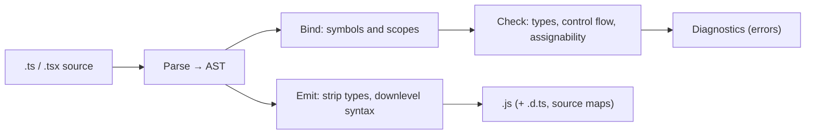
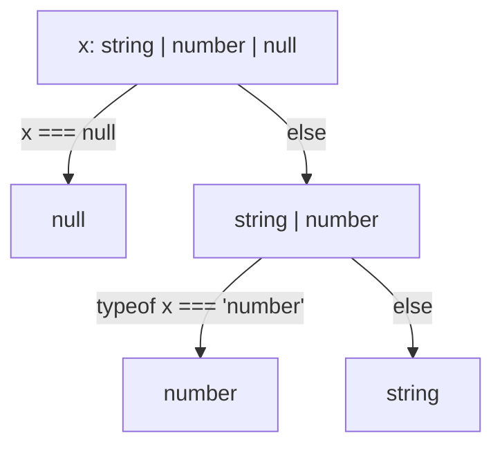

# 00 / 18 — TypeScript Fundamentals and Narrowing

## 1. Lesson metadata

| | |
|---|---|
| **Level** | Intermediate |
| **Study time** | 4–5 hours (reading 2 h, playground experiments 1 h, exercises 1.5 h) |
| **Prerequisites** | [08 — Objects, references, and immutable updates](./08-objects-references-immutability.md). Helpful: [07 — Functions as values; referential identity](./07-functions-and-referential-identity.md), [10 — ES modules](./10-modules-and-dependency-graphs.md) |
| **Next** | [19 — Generics, utility types, and TypeScript for React](./19-typescript-generics-and-utility-types.md) |
| **Related later** | [20 — Tooling and transpilation](./20-tooling-transpilation-and-bundling.md), [Phase 1 — Project setup: Vite, TS, ESLint](../01-react-fundamentals/19-project-setup-vite-typescript.md), [Phase 8 — TypeScript correctness](../08-testing-and-quality/13-typescript-correctness.md) |

**Learning objectives.** After this lesson you can:
1. Explain that TypeScript is a compile-time analysis layer that is **erased** before runtime, and what that implies for data crossing trust boundaries.
2. Predict inferred types, including widening and literal types, and use `as const` and `satisfies` deliberately.
3. Distinguish `any`, `unknown`, `never`, and `void` and choose the right one.
4. Use every major narrowing mechanism (typeof, truthiness, equality, `in`, `instanceof`, user-defined guards, assertion functions, discriminated unions) and know when narrowing fails.
5. Write exhaustive `switch` statements checked by `never`.
6. Configure the `strict` family of compiler options sensibly and explain what each prevents.
7. Distinguish structural typing from nominal typing and predict excess-property-check behavior.

**Concepts covered:** type erasure, structural typing, type inference and widening, literal types, unions and intersections, tuples, `readonly`, optional properties, index signatures, `any`/`unknown`/`never`/`void`, type annotations vs assertions, `typeof`/`in`/`instanceof` narrowing, truthiness narrowing, type predicates, assertion functions, discriminated unions, exhaustiveness checking, control-flow analysis, `strictNullChecks`, `noImplicitAny`, `noUncheckedIndexedAccess`, `type` vs `interface`, enum alternatives, runtime validation at boundaries.

---

## 2. Deep conceptual explanation

### 2.1 What problem is this lesson solving?

JavaScript will happily run `user.profile.avatar.url` when `profile` is `undefined`, throwing `TypeError: Cannot read properties of undefined` in front of a customer. React codebases amplify this: components receive props from many callers, state evolves through many transitions, and data arrives from APIs of uncertain shape. TypeScript's job is to move a large class of such mistakes from **runtime** (production) to **edit time** (your editor, CI).

It does this by adding a **static type system** on top of JavaScript:

- You (or the compiler's inference) describe what shapes of values flow where.
- The checker verifies, without running code, that operations are consistent with those shapes.
- The types are then **removed**, leaving ordinary JavaScript.

### 2.2 Types are erased: the most important fact

```ts
function double(n: number): number { return n * 2; }
```

compiles to (conceptually):

```js
function double(n) { return n * 2; }
```

Everything after the colon disappears. Consequences:

| Consequence | Example |
|---|---|
| **No runtime type checks** | `double("21" as unknown as number)` returns `42` (string coerced) at runtime; TS does not intervene. |
| **Types cannot be inspected at runtime** | You cannot write `if (x instanceof SomeInterface)`; interfaces do not exist at runtime. |
| **Data from outside is untyped** | `JSON.parse`, `fetch().json()`, `localStorage`, URL params, `postMessage`, form values: TypeScript can only *trust* your claim. Wrong claims become runtime bugs. |
| **A type error does not stop emit by default** | Build tools like esbuild/SWC/Babel strip types **without checking them**; checking is a separate step (`tsc --noEmit`). See [Lesson 20](./20-tooling-transpilation-and-bundling.md). |

*Public guarantee:* with `strict` enabled and no unsafe escapes (`any`, `as`, `!`), code that type-checks is guaranteed free of a defined class of errors (calling a non-function, reading a property of `null`/`undefined`, passing the wrong argument type). It is **not** a guarantee of runtime correctness, and TypeScript's type system is intentionally not fully sound (it prioritizes usability: arrays are covariant, method parameters are bivariant, index access is unchecked by default).

### 2.3 Structural typing

TypeScript compares types by **shape**, not by name:

```ts
interface Point { x: number; y: number }
const p3 = { x: 1, y: 2, z: 3 };
const a: Point = p3;               // OK: p3 has at least x and y
```

Any value with the required members is assignable. This matches JavaScript's duck typing and is why TypeScript can describe existing JS libraries. The exception is **excess property checking**, applied only to *fresh object literals* assigned directly to a typed target:

```ts
const b: Point = { x: 1, y: 2, z: 3 };   // Error: 'z' does not exist in type 'Point'
```

The rule exists to catch typos in object literals (e.g., `colour` vs `color`), not because extra properties are unsafe. `p3` is a variable (not fresh), so no excess check.

Contrast: **nominal** typing (Java, C#) compares declared names. To simulate it (e.g., `UserId` vs `OrderId`, both strings) TypeScript uses *branding* (§5.6).

### 2.4 Inference, widening, and literal types

You rarely need to annotate everything. The compiler infers:

```ts
let n = 1;            // number    (let → widened)
const c = 1;          // 1         (const → literal type)
let s = "a";          // string
const o = { k: "a" }; // { k: string }     (properties are mutable → widened)
const t = [1, "a"];   // (string | number)[]
```

`as const` freezes inference to the narrowest literal, readonly form:

```ts
const o2 = { k: "a" } as const;        // { readonly k: "a" }
const dirs = ["up", "down"] as const;  // readonly ["up", "down"]
type Dir = (typeof dirs)[number];      // "up" | "down"
```

**Guideline:** annotate *boundaries* (exported function parameters/returns, public props, API response types) and let inference handle locals. Over-annotating locals adds noise and can *hide* narrower inferred types.

### 2.5 The core type constructs

| Construct | Syntax | Meaning |
|---|---|---|
| Union | `string \| number` | Value is one of several types |
| Intersection | `A & B` | Value has all members of both |
| Literal | `"on" \| "off"`, `42`, `true` | Exactly that value |
| Tuple | `[string, number]` | Fixed-length, positional types |
| Array | `T[]` / `Array<T>` / `readonly T[]` | Homogeneous sequence |
| Optional prop | `{ a?: number }` | Property may be missing; type is `number \| undefined` |
| Readonly | `readonly a: number` | Compile-time-only immutability |
| Index signature | `{ [key: string]: number }` | Any string key maps to number |
| Function | `(a: number, b?: string) => boolean` | Parameter and return types |

`readonly` is **erased** and shallow: it prevents assignment through that reference in the type system, not at runtime. For runtime immutability see `Object.freeze` ([Lesson 08](./08-objects-references-immutability.md)).

### 2.6 `any`, `unknown`, `never`, `void`

| Type | Meaning | Assignability | Use |
|---|---|---|---|
| `any` | "Turn the checker off for this value" | Assignable to/from everything; all operations allowed | Last resort; gradual migration. It is *contagious*: values derived from `any` are often `any`. |
| `unknown` | "Some value; I must check before use" | Anything assignable *to* it; nothing usable *from* it without narrowing | Data at boundaries: `JSON.parse` result, `catch` variable, `postMessage` data |
| `never` | "No value" | Assignable to everything; nothing assignable to it (except `never`) | Functions that never return; exhaustiveness checks; impossible branches |
| `void` | "Return value not used" | Function returning `void` | Callbacks whose results are ignored |

Rule of thumb: **if you would write `any`, write `unknown` and narrow.** (`JSON.parse` returns `any` in the standard library typings; assign it to `unknown` yourself.)

### 2.7 Narrowing: how TypeScript refines types

A declared type is the *widest* a variable may be; **control-flow analysis** tracks the *narrower* type at each program point based on checks you perform.

```ts
function f(x: string | number) {
  // here: string | number
  if (typeof x === "string") {
    x;            // string
  } else {
    x;            // number
  }
}
```

Mechanisms:

| Mechanism | Example | Narrows to |
|---|---|---|
| `typeof` | `typeof x === "string"` | primitive types (`"string"`, `"number"`, `"boolean"`, `"bigint"`, `"symbol"`, `"undefined"`, `"function"`, `"object"`) — note `typeof null === "object"` |
| Truthiness | `if (x)` | removes `null`/`undefined`/`0`/`""`/`false`/`NaN` — **also removes legitimate `0` and `""`** |
| Equality | `x === y`, `x !== null`, `x == null` (matches both `null` and `undefined`) | the overlap of both operands' types |
| `in` | `"swim" in animal` | union members that (may) have that property |
| `instanceof` | `e instanceof Error` | the class instance type |
| Array check | `Array.isArray(x)` | array types |
| Discriminant | `shape.kind === "circle"` | the union member whose `kind` is `"circle"` |
| Type predicate | `function isUser(x: unknown): x is User` | `User` in the true branch |
| Assertion fn | `function assertUser(x: unknown): asserts x is User` | `User` after the call |
| Optional chain | `a?.b` | `b` is `T \| undefined` unless `a` provably non-nullish |

Narrowing is a compile-time operation; the actual checks are ordinary JavaScript that executes at runtime. The checker merely *understands* them.

### 2.8 Discriminated unions: the workhorse

A **discriminated union** (tagged union) is a union of object types each carrying a literal-typed property (the discriminant) that identifies the variant:

```ts
type Shape =
  | { kind: "circle"; radius: number }
  | { kind: "rect"; width: number; height: number };
```

Checking the discriminant narrows the whole object. This pattern models "exactly one of several states", which is precisely what UI state is (loading/success/error; Lesson 19 builds React state machines on it). Compare with the common anti-pattern:

```ts
// Allows impossible states: loading AND error AND data simultaneously.
type BadState = { loading: boolean; error?: Error; data?: Data };
```

### 2.9 Exhaustiveness checking

```ts
function area(s: Shape): number {
  switch (s.kind) {
    case "circle": return Math.PI * s.radius ** 2;
    case "rect":   return s.width * s.height;
    default: {
      const _exhaustive: never = s;   // compile error if a variant is unhandled
      return _exhaustive;
    }
  }
}
```

If someone adds `{ kind: "triangle"; … }` to `Shape`, `s` in `default` is no longer `never`, and the assignment fails at compile time, pointing at every `switch` that needs updating. This turns "forgot to handle a case" from a production bug into a build failure.

### 2.10 Common misconceptions

| Misconception | Reality |
|---|---|
| "TypeScript makes my app type-safe at runtime." | It checks code against *declared* shapes. Untrusted data needs runtime validation (schema validators or manual guards). |
| "`as User` converts the value." | A type assertion changes only what the compiler believes; it does nothing at runtime and can lie. |
| "`interface` vs `type` is a big deal." | For object shapes they are mostly interchangeable. Interfaces support declaration merging and `extends` error messages; type aliases express unions, mapped and conditional types. Pick one convention per codebase. |
| "`readonly` makes data immutable." | Compile-time only; erased; shallow. |
| "Optional (`a?: T`) means `T \| null`." | It means the property may be absent / `undefined`. `null` is a different value. |
| "`enum` is the way to model constants." | Regular enums emit runtime code and have surprising behaviors (numeric enums are bidirectional and accept any number in older TS versions); most modern code prefers string-literal unions or `as const` objects. |
| "Narrowing works everywhere." | It does not survive many boundaries: function calls that may mutate, callbacks over `let` variables, and property accesses through aliases (see §3.4). |
| "Turning on `strict` is too noisy." | Without `strictNullChecks`, `null`/`undefined` are assignable to every type, which removes most of TypeScript's value. |

---

## 3. Internal mechanics

### 3.1 The compiler pipeline (teaching model)



`tsc` does both check and emit; most application builds use a *separate* fast transformer (esbuild, SWC, Babel) for emit and run `tsc --noEmit` (or the editor/CI) for checking. Hence "it builds" does not imply "it type-checks" ([Lesson 20](./20-tooling-transpilation-and-bundling.md)).

*Teaching model:* the checker is a constraint-solver over a graph of types; *implementation detail:* its internals (caching, relation checks, inference) change between releases, which is why occasionally a TypeScript upgrade surfaces new errors in previously accepted code. Read release notes when upgrading. ⚠ Target TypeScript 5.x; examples below avoid features newer than 5.0 unless flagged.

### 3.2 Assignability

`S` is assignable to `T` if every value of type `S` can be used where `T` is expected. Key rules you will apply daily:

- A union source must be assignable member-by-member: `string | number` → `string` fails.
- An object source must have all of the target's required properties with assignable types.
- Function parameter types are checked contravariantly under `strictFunctionTypes` for function-type properties declared with property syntax, but **method syntax remains bivariant** for compatibility (a deliberate unsoundness).
- Literal `"a"` is assignable to `string`; the reverse is not.

### 3.3 Control-flow analysis

At each point the checker computes the *narrowed type* from the flow graph: branches (`if`, `switch`, `?:`, `&&`, `||`, `??`), early returns/throws (which remove cases from later code), and assignments (which reset narrowing to the assigned type).

```ts
function g(x: string | undefined) {
  if (!x) return;   // x: string after this line (also excludes "")
  x.toUpperCase();  // OK
}
```

### 3.4 When narrowing is lost (important)

1. **After a function call that might change it**, if it is a mutable property:

```ts
function h(o: { v: string | undefined }) {
  if (o.v !== undefined) {
    mutate(o);          // TS assumes o.v is still narrowed (it does not model side effects)
    o.v.length;         // compiles; may crash at runtime
  }
}
```
TypeScript trades soundness for convenience here: it generally does **not** invalidate property narrowing on function calls.

2. **Inside callbacks, for `let` variables or mutable properties** that are reassigned somewhere:

```ts
let id: string | undefined = getId();
if (id !== undefined) {
  setTimeout(() => id.length, 0);   // error on older versions: id may be undefined in the callback
}
```
Version-sensitive: TypeScript 5.4+ preserves narrowing in closures created *after the last assignment* to a `let`/parameter (verified with tsc 5.9.3: a later reassignment of the variable still makes the closure see the un-narrowed type); earlier versions did not. A `const` always worked. Habit: prefer `const`.

3. **Through aliases** (`const isStr = typeof x === "string"; if (isStr) …`): modern TypeScript (since 4.4) supports aliased conditions for `const` conditions on `readonly`/const references, but not through arbitrary functions. Use type predicates for reusable checks.

4. **`Object.keys(obj)`** returns `string[]`, not `(keyof typeof obj)[]`, because objects may carry extra properties at runtime (a consequence of structural typing).

5. **`array.filter(Boolean)`** does not narrow out `undefined`/`null` (TS 5.5 added inferred type predicates for simple arrow functions like `x => x !== undefined`, but `Boolean` as the callback is still not understood; verified with tsc 5.9.3). Use an explicit predicate.

### 3.5 The `strict` family

`"strict": true` enables a group of flags. The most consequential (verify the exact list against the TSConfig reference):

| Flag | Prevents |
|---|---|
| `strictNullChecks` | `null`/`undefined` flowing into types that do not include them |
| `noImplicitAny` | Silent `any` for unannotated parameters/inferred-unknowable values |
| `strictFunctionTypes` | Unsound parameter bivariance for function-type properties |
| `strictBindCallApply` | Wrongly typed `bind`/`call`/`apply` |
| `strictPropertyInitialization` | Class fields not assigned in the constructor |
| `useUnknownInCatchVariables` | `catch (e)` typed as `any` (becomes `unknown`) |
| `noImplicitThis` | `this` of unknown type inside functions |

Often-recommended extras **not** included in `strict`:

| Flag | Effect |
|---|---|
| `noUncheckedIndexedAccess` | `arr[i]` and index-signature access include `undefined` — closes the "array element exists" lie. Noisy but honest. |
| `exactOptionalPropertyTypes` | `a?: number` forbids explicitly assigning `undefined`. Powerful, frequently disruptive with libraries. |
| `noImplicitReturns`, `noFallthroughCasesInSwitch`, `noUnusedLocals/Parameters` | Hygiene |
| `verbatimModuleSyntax` / `isolatedModules` | Needed for single-file transpilers (see [Lesson 20](./20-tooling-transpilation-and-bundling.md)): forces `import type` where appropriate |

---

## 4. Step-by-step execution walkthrough: how the checker analyzes a function

```ts
type Result =
  | { ok: true; value: number }
  | { ok: false; error: string };

function show(r: Result | undefined): string {
  if (!r) return "none";
  if (r.ok) return `value=${r.value.toFixed(1)}`;
  return `error=${r.error}`;
}
```

1. **Parameter type** `r: Result | undefined`, expanded to three alternatives: `{ok: true; …}`, `{ok: false; …}`, `undefined`.
2. **`if (!r) return "none";`** In the true branch `r` could be `undefined` (objects are always truthy; `undefined` is falsy). The branch returns, so after it `r` is narrowed to `Result` (the two object variants).
3. **`if (r.ok)`** `ok` is a *discriminant* (its types are the literals `true` and `false` across members). The true branch narrows to `{ ok: true; value: number }`; `r.value` is accessible and is a `number`, so `.toFixed(1)` type-checks.
4. After that branch returns, `r` is `{ ok: false; error: string }`.
5. **Last return**: `r.error` is a `string`. All code paths return a string, so the declared return type is satisfied.
6. **Emit**: types are removed; only the `if` statements and template strings remain. At runtime, `show({ ok: true, value: "oops" as any })` would throw `toFixed is not a function`. The guarantees come from callers following the types.

---

## 5. Code examples

### 5.1 Minimal example — narrowing a union

```ts
function format(input: string | number | null): string {
  if (input === null) return "n/a";
  if (typeof input === "number") return input.toFixed(2);
  return input.trim();
}
```

**Predict:** what are the types of `input` at each `return`, and what happens for `format(0)`?
**Result:** after the `null` check, `string | number`; inside the `typeof` branch, `number`; after it, `string`. `format(0)` returns `"0.00"`. If you had written `if (!input) return "n/a"`, `0` and `""` would incorrectly return `"n/a"`: truthiness narrowing treats legitimate falsy values as absent.
**Trade-off:** explicit `=== null` is longer but precise.

### 5.2 Practical example — validating untrusted data with `unknown`

```ts
interface User { id: number; name: string; email?: string }

function isRecord(v: unknown): v is Record<string, unknown> {
  return typeof v === "object" && v !== null && !Array.isArray(v);
}

function isUser(v: unknown): v is User {
  return (
    isRecord(v) &&
    typeof v.id === "number" &&
    typeof v.name === "string" &&
    (v.email === undefined || typeof v.email === "string")
  );
}

async function fetchUser(id: number): Promise<User> {
  const res = await fetch(`/api/users/${id}`);
  if (!res.ok) throw new Error(`HTTP ${res.status}`);
  const data: unknown = await res.json();    // res.json() returns Promise<any>; we re-type as unknown
  if (!isUser(data)) throw new Error("Unexpected user shape");
  return data;                                // narrowed to User
}
```

Line notes:
- `typeof v === "object" && v !== null`: `typeof null` is `"object"`, so the null check is required.
- `v is Record<string, unknown>` is a **type predicate**: TypeScript *trusts* the function's body. If your check is wrong, the type is wrong; write predicates carefully.
- This is the manual form of runtime validation. At scale use a schema library (Zod, Valibot, ArkType, io-ts, etc.) that derives the TypeScript type *from* the validator so the two cannot drift ⚠ *(library APIs change; consult their docs)*.
- Using `fetch` is covered in [Lesson 14](./14-web-apis-and-network-requests.md); note `res.ok` check because `fetch` does not reject on HTTP error statuses.

### 5.3 Incorrect example — assertions and `any` that lie

```ts
const user = JSON.parse(localStorage.getItem("user")!) as User;
console.log(user.name.toUpperCase());
```

**Why wrong:** `!` asserts non-null (`getItem` returns `string | null`), `JSON.parse` returns `any`, and `as User` asserts a shape. Three unchecked claims in one line. If storage is empty, malformed, or from an older app version (`{ fullName: … }`), this throws at runtime with a type-correct-looking line. The compiler cannot help, because you instructed it not to.

### 5.4 Corrected implementation

```ts
function loadUser(): User | null {
  const raw = localStorage.getItem("user");
  if (raw === null) return null;
  try {
    const parsed: unknown = JSON.parse(raw);
    return isUser(parsed) ? parsed : null;
  } catch {
    return null;                       // malformed JSON
  }
}
```

**Trade-offs:** more code, but every failure mode is explicit and the return type tells the caller to handle `null`. Remember `localStorage` can also throw in private/blocked-storage modes.

### 5.5 Advanced example — discriminated unions, predicates, and assertion functions

```ts
type Loading = { status: "loading" };
type Failure = { status: "error"; error: Error };
type Success<T> = { status: "success"; data: T };
type Remote<T> = Loading | Failure | Success<T>;

function isSuccess<T>(r: Remote<T>): r is Success<T> {
  return r.status === "success";
}

function assertNever(x: never): never {
  throw new Error(`Unhandled variant: ${JSON.stringify(x)}`);
}

function render(r: Remote<string[]>): string {
  switch (r.status) {
    case "loading": return "Loading…";
    case "error":   return `Failed: ${r.error.message}`;
    case "success": return r.data.join(", ");
    default:        return assertNever(r);   // compile-time exhaustiveness + runtime safety net
  }
}

function assertDefined<T>(v: T | null | undefined, msg: string): asserts v is T {
  if (v == null) throw new Error(msg);       // == null matches null and undefined
}
```

Notes:
- `assertNever` gives *both* compile-time checking and a runtime failure if data from outside violates the type (e.g., a server returns a new `status`).
- Assertion functions (`asserts v is T`) narrow the variable for the rest of the scope after the call. Their call target must be explicitly typed (e.g., a function declaration or a `const` with annotation) for the checker to apply the assertion — a known restriction.
- `status: "success"` is the discriminant; because it is a literal type in each member, `switch` narrows `r` in each `case`.

### 5.6 Advanced example — branded types and `satisfies`

```ts
// Branding: distinguish structurally identical primitives.
type Brand<T, B extends string> = T & { readonly __brand: B };
type UserId = Brand<string, "UserId">;
type OrderId = Brand<string, "OrderId">;

const asUserId = (s: string): UserId => s as UserId;   // the only "cast" lives in one place

declare function getOrder(id: OrderId): void;
// getOrder(asUserId("u1"));    // error: UserId is not assignable to OrderId

// satisfies (TS 4.9+): check against a type without widening the inferred type.
const routes = {
  home: "/",
  user: "/users/:id",
} satisfies Record<string, string>;

routes.home;           // type: string (still precise keys: "home" | "user"), unlike annotating as Record<string,string>
```

`satisfies` validates the shape while preserving the specific inferred type, so `routes.nonexistent` is an error (with `: Record<string, string>` it would be allowed and typed `string`). The brand exists only in the type system; at runtime the value is a plain string.

---

## 6. Visual explanations

### Narrowing as a funnel



### What TypeScript guarantees and where trust begins

```text
 [Your typed code]  ←—— checked by tsc ——→  [Your typed code]
        ▲                                         │
        │ unchecked boundary                      ▼ unchecked boundary
 JSON.parse / fetch / localStorage / URL        DOM, third-party JS, `as`, `any`, `!`
 → must be narrowed from `unknown`              → trust, or validate
```

---

## 7. Alternative approaches and trade-offs

Modeling "one of several states" or constants:

| Approach | Safety | Runtime cost | Readability | Interop | Prefer when |
|---|---|---|---|---|---|
| Discriminated union (`status` tag) | Highest; exhaustive switch | None (types erased) | High | Great | State machines, API results, UI state |
| Optional fields (`{ data?: T; error?: Error; loading: boolean }`) | Low: impossible states representable | None | Medium | Common | Quick prototypes only |
| String-literal union (`"a" \| "b"`) | High | None | High | Great | Enumerations without behavior |
| `as const` object + derived union | High | Small object | High | Great | When you need runtime values too (iterating options) |
| `enum` | Medium (numeric enums are loose) | Emits code (IIFE) | Medium | Poor with `isolatedModules` for `const enum` | Rarely; legacy code, reverse mapping needs |
| Classes + `instanceof` | Medium | Runtime classes | Medium | Fine | Real runtime polymorphism |
| Runtime schema validators (Zod etc.) | Highest at boundaries | Validation cost | High | Library dependency | External data |

**When the recommended approach (discriminated union) is not best:** performance-critical numeric code with millions of records, where struct-of-arrays layouts matter more than tidy variants; or when variant data is huge and you only need a flag (a boolean may suffice). Also, if the only consumer is a `JSON` API with an evolving, loosely versioned shape, a validator at the boundary matters more than the internal union.

---

## 8. Best practices and anti-patterns

**Do**
- Enable `strict`; consider `noUncheckedIndexedAccess`.
- Type the *boundaries* (exports, props, API results) and let locals infer.
- Prefer `unknown` + narrowing over `any`; confine unavoidable assertions to one small, named function.
- Model states with discriminated unions; make `switch`es exhaustive.
- Prefer `const`; use `as const` for literal tables; use `satisfies` to validate config objects.
- Validate external data at the edge; keep the validated type internal.
- Use `import type` for type-only imports (bundler safety under isolated transpilation).

**Beginner mistakes**
- Sprinkling `any` to silence errors.
- `as SomeType` to "convert" values.
- Believing the type annotation validates API data.
- Truthiness checks on numbers/strings (`if (count)` drops `0`).

**Experienced-developer mistakes**
- Over-engineered generic types that nobody can read (next lesson).
- Non-null assertions `!` as a habit, hiding real undefined cases.
- Predicates (`x is T`) with sloppy bodies. The compiler trusts them completely.
- Disabling a rule project-wide instead of fixing the root typing.
- Using `{}` or `Object` as a type ("any non-nullish value"/"any object"), usually meaning `Record<string, unknown>` or `object`.

**Smells:** `as unknown as T`; `// @ts-ignore` without justification (`@ts-expect-error` with a reason is better: it fails when the error disappears); `Function` type; optional-bag state types with several booleans; non-exhaustive `switch` on union tags.

**Justified exceptions:** a deliberately narrow cast at a documented boundary (wrapping an untyped third-party library once, with tests); `any` in test doubles; `@ts-expect-error` in a test asserting that wrong usage fails to compile.

---

## 9. Real-world application

**Payments/finance.** `Money` values with currency: modeled `type Money = { amount: bigint; currency: "USD" | "EUR" }` or branded integers of minor units. Branded types stop passing a `CustomerId` to an `invoiceId` parameter, and exhaustive unions over payment states (`pending | authorized | captured | refunded | failed`) force every consumer to handle new states when added. Constraint: API responses must be validated at the edge because wire data does not obey your types.

**Forms.** Validation results as `{ valid: true; value: T } | { valid: false; errors: Record<keyof T, string> }`: callers cannot access `value` without checking `valid`.

**Auth.** `type Session = { status: "anonymous" } | { status: "authenticated"; user: User; expiresAt: number }`. Components that need the user must narrow first; there is no `user: User | null` plus separate `isLoggedIn` flag that can drift out of sync.

**Realtime.** WebSocket messages as a discriminated union on `type`, with an exhaustive handler map; unknown message types arriving from a newer server must be handled at runtime (default branch logs and ignores) even though the compile-time union says it cannot happen. Forward-compatibility is a runtime concern.

**Multi-team codebases.** Shared packages publish `.d.ts` types as their contract; breaking a type is a breaking change. Strictness settings should be consistent across packages (a loose consumer erodes a strict producer).

---

## 10. Debugging and troubleshooting

**Symptom A:** "Property 'x' does not exist on type 'A | B'."
Investigation: hover the variable at the error; the tooltip shows the *current narrowed* type. Add a discriminant check or `in` narrowing; if the types should have a common property, add it to the declaration.

**Symptom B:** "Object is possibly 'undefined'" after a check that looks right.
Check whether the check applied to a different expression (`a.b` vs `a.b.c`), whether the value is a mutable property mutated in between, whether the access happens inside a callback over a `let` (⚠ TS version-dependent), or whether the check was a truthiness check that does not apply (e.g., `0` allowed). Fix by copying to a `const` before the callback.

**Symptom C:** "Type 'X' is not assignable to type 'Y'" with a long message.
Read from the **bottom**: the last line usually states the real mismatch; upper lines describe the path. Use the TypeScript Playground's "Show errors" and hover types; reduce to a minimal repro.

**Symptom D:** Build passes in CI but the editor shows errors (or vice versa).
Likely the build only transpiles (esbuild/SWC strips types) while the editor uses a different TypeScript version or config. Run `tsc --noEmit -p .` in CI and ensure the editor uses the workspace's TypeScript version.

**Symptom E:** Runtime `TypeError` in code that type-checks.
Locate the first `any`, `as`, `!`, or untrusted-boundary value in the data's path ("where did this value come from?"). Add a runtime guard there. Search for `as ` casts and `any` in the data-loading layer. Validate the fix by adding a test with the malformed payload.

---

## 11. Exercises

### Level A — Knowledge
A1. What does "types are erased" imply for code that reads `JSON.parse(...)`?
A2. Explain structural typing and when excess property checking applies.
A3. Compare `any` and `unknown` and give one use case for each.
A4. What is a discriminated union, and what makes a property a valid discriminant?
A5. Why does `if (x)` incorrectly narrow `number | undefined` for a counter that can be `0`?

### Level B — Code comprehension
B1. For each call, say whether it compiles under `strict`, and why.
```ts
interface Point { x: number; y: number }
const pt = { x: 1, y: 2, z: 3 };
const a: Point = pt;
const b: Point = { x: 1, y: 2, z: 3 };
const c: Point = { x: 1 };
```
B2. What are the inferred types of `a`, `b`, `c`, `d`?
```ts
const a = "hi";
let b = "hi";
const c = { mode: "dark" };
const d = { mode: "dark" } as const;
```
B3. What does this print, and what will the type of `v` be inside each branch?
```ts
function f(v: string | number | undefined) {
  if (typeof v === "string") return `s:${v.length}`;
  if (v) return `n:${v.toFixed(0)}`;
  return `other:${String(v)}`;
}
console.log(f("ab"), f(5), f(0), f(undefined), f(""));
```
B4. `const xs = [1, 2, 3]; const y = xs[10];` What is the type of `y` with and without `noUncheckedIndexedAccess`, and what is its runtime value?

### Level C — Implementation
C1. Write `type Shape` with `circle`, `rect`, and `triangle` (base, height) variants and an exhaustive `area(s: Shape): number`.
C2. Write a type predicate `isNonEmptyArray<T>(x: readonly T[]): x is [T, ...T[]]` and use it to safely read `x[0]` as `T`.
C3. Write `parseJsonSafely(text: string): unknown` returning `undefined` on failure, plus a `getString(obj: unknown, key: string): string | undefined` that reads a string property safely.
C4. Write a branded `Cents` type with `toCents(dollars: number)` and `addCents(a: Cents, b: Cents): Cents`.

### Level D — Debugging
D1. The compiler complains here. Explain why and give two fixes.
```ts
type Animal = { kind: "cat"; meow(): void } | { kind: "dog"; bark(): void };
function speak(a: Animal) {
  a.meow();
}
```
D2. A teammate wrote the following and says "it's type-safe". Find at least three problems.
```ts
async function getConfig(): Promise<Config> {
  const res = await fetch("/config.json");
  return (await res.json()) as Config;
}
```
D3. Why does this fail under strict TS < 5.4 but not with `const`?
```ts
function run(items: string[]) {
  let first: string | undefined = items[0];
  if (first !== undefined) {
    items.forEach(() => console.log(first.length));
  }
}
```
(Hint: reason about reassignment. Answer for both pre- and post-5.4 behavior.)

### Level E — Architecture and engineering decisions
E1. You are migrating a 200k-line JavaScript codebase to TypeScript. Propose a strategy (config flags, file ordering, `allowJs`/`checkJs`, handling of `any`, CI gates) and the order of strictness flags to enable.
E2. Choose how to type API responses for a large app: hand-written interfaces, generated types from OpenAPI/GraphQL, or schema-first validators. Compare on drift risk, runtime safety, bundle cost, developer experience.

### Level F — Expert challenge
F1. Design a type for a multi-step wizard where each step has distinct data, steps must be completed in order, and the final submission type contains all step data. Use discriminated unions and make illegal transitions unrepresentable. Discuss the readability limit of your encoding.

---

## 12. Detailed answers and explanations

> Attempt the exercises first.

**A1.** `JSON.parse` returns `any` in the standard typings and the compiler does not examine the string at runtime; anything you claim about its shape (`as User`) is unverified. Treat the result as `unknown`, then validate with guards or a schema. Wrong: "the annotation validates the data".

**A2.** Structural typing: assignability depends on members, not declared names. A value with extra properties can be used where fewer are required. Excess property checking is an extra rule applied only to **fresh object literals** assigned or passed to a typed target, to catch typos. The same object stored in a variable first is not checked.

**A3.** `any` disables checking for a value and is assignable both ways; use only for gradual migration or hard interop (and prefer a narrow `@ts-expect-error`). `unknown` is the safe top type: you may assign anything to it but must narrow before use; use for parsed JSON, `catch` variables, message payloads.

**A4.** A union of object types sharing a property whose type in each variant is a distinct **literal** (or `null`/`undefined`/unit type). The checker narrows by comparing the discriminant. The property must be literal-typed (a `string`-typed `kind` is not a discriminant). Non-example: `{ kind: string }` for all variants.

**A5.** `if (x)` removes all falsy values, including the valid number `0`. After `if (!x) return;` the code treats `0` as missing. Use `x !== undefined` (or `x == null` to cover `null` too) when `0` or `""` are meaningful.

**B1.** `a`: compiles. `pt` is not a fresh literal, so no excess check; `pt` has `x`, `y`. `b`: **error** (excess property `z`) because the literal is fresh. `c`: **error**, property `y` is missing.

**B2.** `a`: `"hi"` (const → literal). `b`: `string` (let widens). `c`: `{ mode: string }` (property of a mutable object widens). `d`: `{ readonly mode: "dark" }`.

**B3.** `console.log` prints its arguments separated by spaces: `s:2 n:5 other:0 other:undefined s:0`. Reasoning per call: `f("ab")` takes the string branch (`s:2`); `f(5)` is not a string and is truthy (`n:5`); `f(0)` is not a string and `0` is falsy, so it falls through to `other:0`; `f(undefined)` falls through to `other:undefined`; `f("")` is tested by `typeof` first, and the empty string *is* a string, so it returns `s:0` (a truthiness check would have misclassified it). Types: in the first branch `v` is `string`; after it, `number | undefined`; inside `if (v)`, `number`; at the last return, `number | undefined` (TypeScript does not narrow the falsy part of `number` to the literal `0`, which is one reason truthiness narrowing is imprecise).

**B4.** Without the flag, `y: number` (the compiler trusts indexing); with it, `number | undefined`. Runtime value: `undefined` in both cases. The flag makes the type honest.

**C1. Reference solution**
```ts
type Shape =
  | { kind: "circle"; radius: number }
  | { kind: "rect"; width: number; height: number }
  | { kind: "triangle"; base: number; height: number };

function area(s: Shape): number {
  switch (s.kind) {
    case "circle":   return Math.PI * s.radius ** 2;
    case "rect":     return s.width * s.height;
    case "triangle": return (s.base * s.height) / 2;
    default: { const _x: never = s; return _x; }
  }
}
```
Evaluation: adding a fourth variant should break compilation of `area`. Edge cases: negative dimensions are a runtime-validation concern, not a typing one.

**C2.**
```ts
function isNonEmptyArray<T>(x: readonly T[]): x is [T, ...T[]] {
  return x.length > 0;
}
const xs: string[] = getNames();
if (isNonEmptyArray(xs)) {
  const first: string = xs[0];     // no `| undefined` even with noUncheckedIndexedAccess
}
```
Notes: a predicate's true branch narrows `xs` to the tuple type. The `readonly T[]` parameter accepts both mutable and readonly arrays; the predicate type `[T, ...T[]]` must be assignable to the parameter type (it is).

**C3.**
```ts
function parseJsonSafely(text: string): unknown {
  try { return JSON.parse(text); } catch { return undefined; }
}
function getString(obj: unknown, key: string): string | undefined {
  if (typeof obj !== "object" || obj === null) return undefined;
  const v = (obj as Record<string, unknown>)[key];   // contained cast: obj is a non-null object here
  return typeof v === "string" ? v : undefined;
}
```
Edge cases: `JSON.parse("null")` returns `null` (valid JSON) which `parseJsonSafely` returns as `null`, distinct from `undefined` for failure; consider returning a `Result` type instead to avoid ambiguity.

**C4.**
```ts
type Cents = number & { readonly __brand: "Cents" };
const toCents = (dollars: number): Cents => Math.round(dollars * 100) as Cents;
const addCents = (a: Cents, b: Cents): Cents => (a + b) as Cents;
```
Notes: floating-point: `Math.round(19.99 * 100)` gives `1999`; `1.005 * 100` is `100.49999999999999` → rounds to `100`, a known float pitfall. For money prefer integer minor units from the start, or decimal libraries/bigint. The brand cannot prevent `as Cents` casts elsewhere; centralize them.

**D1.** `a` is `Animal`, a union; `meow` exists only on the `cat` variant, so access fails. Fixes: narrow first (`if (a.kind === "cat") a.meow(); else a.bark();`) or use a `switch` with exhaustiveness; or `if ("meow" in a)`. Not good: casting `(a as any).meow()`; it would crash for dogs.

**D2.** (1) `as Config` is an unchecked claim about wire data. (2) No `res.ok` check: a 404 HTML page throws a JSON parse error (opaque failure) or, worse, returns a JSON error body typed as `Config`. (3) No handling of network failure/abort/timeouts; no `AbortSignal`. (4) Config schema drift between deployments is invisible. Fix: check `res.ok`, parse as `unknown`, validate with a schema, return a typed result or throw a descriptive error.

**D3.** Pre-5.4: `first` is a `let` that could be reassigned elsewhere; inside the arrow function, TypeScript conservatively resets narrowing for captured `let` variables, so `first` is `string | undefined` and `.length` errors. With `const first = items[0]` (type `string` or `string | undefined` under `noUncheckedIndexedAccess`) the narrowing persists because it cannot change. From 5.4: narrowing is preserved in closures created after the last assignment, so the original code compiles. (Verified with tsc 5.9.3.) A runtime caveat in both versions: nothing stops other code from mutating a `let` between the check and callback execution in code that *does* reassign later; the checker is applying a rule, not proving it.

**E1. Evaluation criteria and sample answer.** Criteria: risk, incremental delivery, developer throughput, long-term strictness. Sample strategy: (1) Add `tsconfig` with `allowJs: true`, `checkJs: false`, `noEmit`, run in CI as informational. (2) Convert leaf modules first (utilities, constants, types), then data layers, then components; rename `.js` → `.ts(x)` in small PRs. (3) Start with `strict: false` plus `noImplicitAny: true` per-directory (via `extends` configs/project references) and ratchet: new files must be strict (lint rule or a "strict-files" list), existing files migrate over time. (4) Track `any` count and `@ts-expect-error` count as metrics with a CI no-increase rule. (5) Enable `strictNullChecks` next (largest payoff, largest effort), then remaining strict flags, then `noUncheckedIndexedAccess`. (6) Introduce boundary validation (schemas) at API clients early, since this is where types are most likely to lie. Rejected alternative: big-bang rewrite (long-lived branch, merge conflicts, no value until finished).

**E2.** Good answers compare: *hand-written interfaces* (fast, drift risk high, zero runtime cost, no runtime safety); *generated types* from OpenAPI/GraphQL schema (drift detected at generation, still no runtime validation unless a validator is generated, build-step complexity); *schema-first validators* (single source of truth, runtime safety, runtime and bundle cost, great for untrusted/public APIs). Recommendation depends on trust: first-party typed backend with contract tests → generated types; third-party or loosely versioned APIs → validators at the boundary; hand-written only for small stable internals.

**F1. Evaluation criteria and sample answer.** Criteria: illegal states unrepresentable, readability, extensibility. Sketch:
```ts
type Step1 = { step: 1; email: string };
type Step2 = { step: 2; email: string; address: Address };
type Step3 = { step: 3; email: string; address: Address; payment: Payment };
type Wizard = Step1 | Step2 | Step3;

function next(w: Wizard, input: unknown): Wizard { /* switch on w.step; each case accepts only its input type */ }
type Submittable = Extract<Wizard, { step: 3 }>;
```
Each step carries all prior data, so a `Step3` cannot exist without `address`. Transition functions have precise signatures (`toStep2(w: Step1, address: Address): Step2`). Limit: with many steps the cumulative shape is verbose; derive with intersections or generics (`WithStep<N, Prev, Data>`), but heavy type-level programming reduces readability and compile speed. A pragmatic limit is ~5–6 steps; beyond that use a data-driven state machine (XState, [Phase 6/12](../06-data-fetching-and-state-ecosystems/12-state-machines-and-xstate.md)) and accept less type precision.

---

## 13. Senior engineer interview questions

**Q1. "TypeScript passes but production throws `Cannot read properties of undefined`. How is that possible?"**
*Strong answer:* Types are erased and unverified at boundaries. Likely sources: `as` or `any` on external data, `!` assertions, `noUncheckedIndexedAccess` off (array/record access typed as defined), stale/mismatched API versions, mutation breaking narrowing (properties narrowed then changed), or a library with inaccurate typings. I would trace the value's origin, add boundary validation, tighten the offending flag, and add a test using the malformed payload.

**Q2. "Why prefer `unknown` over `any`, and where do you use `any` anyway?"**
*Strong answer:* `unknown` forces narrowing before use, so errors surface at compile time; `any` silently disables checking and spreads. Legit `any`: generic constraints where variance would otherwise block valid code (e.g., `(...args: any[]) => any` as a function constraint), test stubs, or temporary migration scaffolding with an owner and issue link. I'd encapsulate it in a typed wrapper so callers see safe types.

**Q3. "Interface or type alias?"**
*Strong answer:* Mostly stylistic for object shapes; choose one convention. Interfaces: declaration merging (augmenting library types), `extends` with clearer errors, potentially better compiler performance for deep hierarchies. Type aliases: unions, tuples, mapped/conditional types, primitives. I'd use `interface` for public object contracts that may be extended and `type` for everything else, but the key is consistency, enforced by lint.

**Q4. "How does a discriminated union improve a UI codebase?"**
*Strong answer:* It makes impossible states unrepresentable (no `loading && error` simultaneously), forces handling of each variant via narrowing, and with `never`-based exhaustiveness gives compile-time notice when a new state is added. It also documents the state machine in the type. The remaining runtime risk is data from outside the type system, handled with validation and a defensive default branch.

**Q5. "Explain why `Object.keys(obj)` returns `string[]`."**
*Strong answer:* Structural typing allows a value to have more properties than its static type says, so the compiler cannot claim the runtime keys are exactly `keyof T`. Returning `(keyof T)[]` would be unsound for subtype values. Developers cast locally (`as (keyof T)[]`) when they know the object is exact, accepting the responsibility.

---

## 14. Further learning resources

| Resource | URL | Covers / why | Level | Study |
|---|---|---|---|---|
| TypeScript Handbook | <https://www.typescriptlang.org/docs/handbook/intro.html> | Official language guide | Beginner–Int. | Everyday Types, Narrowing, More on Functions |
| TypeScript Handbook — Narrowing | <https://www.typescriptlang.org/docs/handbook/2/narrowing.html> | Every narrowing mechanism, predicates, `never` exhaustiveness | Intermediate | Whole page |
| TypeScript Handbook — Object Types | <https://www.typescriptlang.org/docs/handbook/2/objects.html> | Optional/readonly/index signatures; excess property checks | Beginner–Int. | "Excess Property Checks" |
| TSConfig Reference | <https://www.typescriptlang.org/tsconfig> | Every compiler flag, including `strict` family | Intermediate | `strict`, `noUncheckedIndexedAccess`, `isolatedModules` |
| TypeScript Playground | <https://www.typescriptlang.org/play> | Interactive checking; hover to see narrowed types | All | Experiment with §5 examples |
| TypeScript release notes | <https://www.typescriptlang.org/docs/handbook/release-notes/overview.html> | Behavior changes (e.g., 5.4 closure narrowing, 5.5 inferred predicates) | Advanced | 5.x notes |
| MDN — JavaScript `typeof` | <https://developer.mozilla.org/en-US/docs/Web/JavaScript/Reference/Operators/typeof> | Runtime semantics behind `typeof` narrowing | Beginner | Whole page |
| React docs — Using TypeScript | <https://react.dev/learn/typescript> | Official React + TS guide (continued in Lesson 19) | Beginner–Int. | Whole page |

All URLs above are well-known documentation pages; if any has moved, search the site for the quoted title.

---

## 15. Knowledge checkpoint

**You should now understand**
- TypeScript is a checker over JavaScript; types are erased; external data is unverified.
- Structural typing, inference/widening, literal types, `as const`, `satisfies`.
- `any` vs `unknown` vs `never` vs `void`.
- All the narrowing mechanisms and the cases where narrowing is lost.
- Discriminated unions and `never` exhaustiveness.

**You should be able to explain without notes**
- Why `as User` does not validate and what to do instead.
- Why truthiness narrowing is dangerous for `0` and `""`.
- Why a build can succeed while `tsc` fails.

**You should be able to implement**
- Type guards and assertion functions, an exhaustive `switch`, branded types, safe JSON reading.

**You should be able to debug**
- "possibly undefined" errors from lost narrowing; runtime TypeErrors in type-correct code by locating the unchecked boundary.

**Before moving on:** read [19 — Generics, utility types, and TypeScript for React](./19-typescript-generics-and-utility-types.md), which builds reusable components and state models on these foundations.
