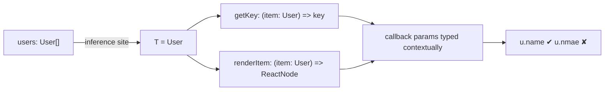

# 00 / 19 — Generics, Utility Types, and TypeScript for React

## 1. Lesson metadata

| | |
|---|---|
| **Level** | Advanced |
| **Study time** | 5–6 hours (reading 2.5 h, playground/editor practice 1.5 h, exercises 2 h) |
| **Prerequisites** | [18 — TypeScript fundamentals and narrowing](./18-typescript-fundamentals-and-narrowing.md) (unions, `unknown`, narrowing, discriminated unions, `never` exhaustiveness are assumed). Light React usage-level knowledge (components, props, `useState`) helps; Phase 1 teaches it formally. |
| **Next** | [20 — Tooling, transpilation, and bundling](./20-tooling-transpilation-and-bundling.md) |
| **Related later** | [Phase 1 — Props and one-way data flow](../01-react-fundamentals/06-props-and-one-way-data-flow.md), [Phase 3 — useReducer and reducer architecture](../03-react-state-and-hooks/03-usereducer-and-reducer-architecture.md), [Phase 5 — Polymorphic components](../05-design-patterns/19-polymorphic-components.md), [Phase 8 — TypeScript correctness](../08-testing-and-quality/13-typescript-correctness.md) |

**Learning objectives.** After this lesson you can:
1. Write generic functions, interfaces, and constrained generics; predict how TypeScript infers type arguments.
2. Use `keyof`, `typeof`, indexed access, mapped types, conditional types, and `infer` at a working level.
3. Use the standard utility types (`Partial`, `Required`, `Readonly`, `Pick`, `Omit`, `Record`, `Exclude`, `Extract`, `NonNullable`, `ReturnType`, `Parameters`, `Awaited`) and know their traps (for example, `Omit` on unions).
4. Type React props correctly: required/optional, `children`, event handlers, native-element props, refs (React 19: `ref` as a prop), context.
5. Write **generic components** (lists, selects, tables) whose type parameters are inferred from props.
6. Model component state and props with **discriminated unions** so impossible states are unrepresentable, and type `useReducer` actions with exhaustiveness checking.
7. Recognize when types have become too clever and choose readability.

**Concepts covered:** type parameters, constraints (`extends`), defaults, inference sites, `keyof`/`typeof`/indexed access, mapped types and modifiers, key remapping, conditional types and distribution, `infer`, template literal types, `const` type parameters, utility types, `React.ReactNode`/`ReactElement`, `ComponentProps`/`ComponentPropsWithoutRef`, React event types, `useState`/`useRef`/`useReducer`/`useContext` typing, `ref` as a prop (React 19), generic components, discriminated-union props, typed context, typed custom hooks, `.tsx` generic syntax.

---

## 2. Deep conceptual explanation

### 2.1 What problem is this lesson solving?

Lesson 18 gave you types for *specific* shapes. Real code is full of "works for any X, but keeps the relationship intact":

- `first(items)` returns *the same element type* as the array it was given.
- `<Select options={…} onChange={…} />` calls `onChange` with the same type as the option values.
- `<List items={users} renderItem={(u) => …} />` passes a `User` (not `any`) to `renderItem`.
- A `fetchJson<T>` helper returns `Promise<T>`; a `useLocalStorage<T>` hook returns `[T, setter]`.

Without generics you pick between **duplicating code per type** (unmaintainable) and **`any`/`unknown` plus casts** (unsafe). Generics let a declaration carry a *type variable* so the relationship between inputs and outputs is checked.

The second half of the problem is React-specific: components are functions of props and state, which are exactly the things TypeScript describes. Done well, types make impossible UI states unrepresentable, make refactors safe across hundreds of components, and give callers autocomplete. Done badly (overly clever types, `any` props, casts everywhere), they slow people down and lie. This lesson teaches the working subset you need and where to stop.

### 2.2 Generics from first principles

A **type parameter** is a placeholder filled in per use.

```ts
function first<T>(items: readonly T[]): T | undefined {
  return items[0];
}

const n = first([1, 2, 3]);       // T inferred as number → n: number | undefined
const s = first(["a", "b"]);      // T inferred as string
const e = first([]);              // T inferred as never → e: undefined (empty literal array is never[])
```

Key facts:

1. **Inference.** The compiler infers `T` from the arguments. You rarely write `first<number>(…)` explicitly.
2. **Type parameters are erased.** Generics exist only at compile time; there is no runtime `T` ([Lesson 18](./18-typescript-fundamentals-and-narrowing.md)). You cannot write `new T()` or `typeof T`.
3. **Constraints** restrict what `T` may be, and in exchange grant you access to members:

```ts
function longest<T extends { length: number }>(a: T, b: T): T {
  return a.length >= b.length ? a : b;
}
longest("ab", "abc");        // string
longest([1], [1, 2]);        // number[]
// longest(1, 2);            // error: number has no 'length'
```

4. **Defaults** give a fallback when inference has nothing: `interface Box<T = string> { value: T }`.
5. **Multiple parameters** and relationships between them: `function pick<T, K extends keyof T>(obj: T, key: K): T[K]`. Here `K` is constrained *by `T`*, so passing a wrong key is a compile error and the return type is precisely the property's type.

```ts
const user = { id: 1, name: "Ada" };
const id = pick(user, "id");     // number
// pick(user, "email");          // error: not assignable to "id" | "name"
```

### 2.3 Where inference happens and where it fails

TypeScript infers `T` from **inference sites**: argument types, return-contextual types, default values. Failure modes you will meet:

| Situation | Behavior | Fix |
|---|---|---|
| **No inference site** (e.g., `function make<T>(): T[]`) | `T` becomes `unknown` | Provide explicit `make<string>()`; or add a parameter that carries `T` |
| **Conflicting candidates** (`function same<T>(a: T, b: T)`; `same(1, "a")`) | Error, or union if the parameter allows | Use two type parameters, or annotate the union |
| **Widening** (`same("a", "b")` infers `string`) | Literal types widen unless constrained | Constrain: `T extends string`, or use a `const` type parameter (TS 5.0+: `function f<const T>(x: T)`) to preserve literal/readonly tuple shapes |
| **Inference from a callback's return** | Works left-to-right; context flows into later arguments | Put the "source of truth" argument first |

Rule of thumb: *a type parameter should appear in at least two places* (e.g., a parameter and the return type, or two parameters). A type parameter used once is usually unnecessary (`function log<T>(x: T): void` is just `function log(x: unknown): void`).

### 2.4 Type-level tools you actually need

| Tool | Syntax | Example result |
|---|---|---|
| `keyof T` | union of property names | `keyof {a: 1; b: 2}` = `"a" \| "b"` |
| `typeof value` (type position) | the static type of a value | `type Cfg = typeof defaultConfig` |
| Indexed access | `T[K]` | `User["id"]` = `number`; `(typeof arr)[number]` = element type |
| Mapped type | `{ [K in keyof T]: … }` | transform each property |
| Mapped modifiers | `readonly`, `?`, with `+`/`-` | `{ [K in keyof T]-?: T[K] }` removes optionality |
| Key remapping | `[K in keyof T as \`get${Capitalize<K & string>}\`]` | rename keys |
| Conditional type | `A extends B ? X : Y` | type-level `if` |
| `infer` | `T extends Promise<infer U> ? U : T` | extract a type from a pattern |
| Template literal type | `` `${A}-${B}` `` | string combinations: `"on" + Capitalize<"click">` → `"onClick"` |

Mapped type example:

```ts
type Nullable<T> = { [K in keyof T]: T[K] | null };
type Draft<T> = { -readonly [K in keyof T]?: T[K] };   // writable and optional

interface User { readonly id: number; name: string }
type N = Nullable<User>;     // { readonly id: number | null; name: string | null }
type D = Draft<User>;        // { id?: number; name?: string }
```

Conditional types **distribute** over a naked type parameter when instantiated with a union:

```ts
type ToArray<T> = T extends unknown ? T[] : never;
type A = ToArray<string | number>;      // string[] | number[]      (distributed)

type ToArrayND<T> = [T] extends [unknown] ? T[] : never;
type B = ToArrayND<string | number>;    // (string | number)[]      (wrapped: not distributed)
```

Distribution is the source of many surprising results; wrap in a tuple `[T]` to prevent it.

### 2.5 The utility types

All are declared in TypeScript's standard library using the constructs above.

| Utility | Meaning | Example (`User = {id: number; name: string; email?: string}`) |
|---|---|---|
| `Partial<T>` | all props optional | `Partial<User>` → all optional |
| `Required<T>` | all props required (removes `?`) | `Required<User>` → `email: string` |
| `Readonly<T>` | all props `readonly` (shallow) | |
| `Pick<T, K>` | keep only `K` | `Pick<User, "id" \| "name">` |
| `Omit<T, K>` | drop `K` | `Omit<User, "email">` |
| `Record<K, V>` | object with keys `K`, values `V` | `Record<"a" \| "b", number>` |
| `Exclude<U, E>` | remove members of union `U` assignable to `E` | `Exclude<"a" \| "b" \| "c", "a">` = `"b" \| "c"` |
| `Extract<U, E>` | keep members assignable to `E` | `Extract<string \| number, number>` = `number` |
| `NonNullable<T>` | remove `null`/`undefined` | `NonNullable<string \| null>` = `string` |
| `ReturnType<F>` | function return type | `ReturnType<typeof setTimeout>` |
| `Parameters<F>` | parameter tuple | `Parameters<(a: number, b: string) => void>` = `[a: number, b: string]` |
| `Awaited<T>` | unwrap promises (recursively) | `Awaited<Promise<Promise<number>>>` = `number` |

Traps:
- **`Omit`/`Pick` on a union do not distribute.** `Omit<A | B, "x">` computes `keyof (A | B)`, which is only the *common* keys, collapsing variants. Use a distributive helper: `type DistributiveOmit<T, K extends PropertyKey> = T extends unknown ? Omit<T, K> : never;`.
- **`Partial<T>` for "update" inputs** can permit nonsense (`{}`) and accepts explicit `undefined` unless `exactOptionalPropertyTypes` is on.
- **`Readonly` is shallow and compile-time only.**
- **`Record<string, T>`** claims every key exists (unless `noUncheckedIndexedAccess`); prefer `Map` or `Partial<Record<K, T>>` when keys may be missing.

### 2.6 TypeScript for React: the working model

A function component is, in types, `(props: Props) => ReactNode`. In the React 19 typings, components may return any `ReactNode` (including `string`, `null`, arrays, and—for async server components—promises in frameworks that support them ⚠ framework-specific). Therefore you rarely need `React.FC`:

```tsx
// Recommended: plain function with typed props.
interface GreetingProps { name: string; excited?: boolean }
export function Greeting({ name, excited = false }: GreetingProps) {
  return <p>Hello, {name}{excited ? "!" : "."}</p>;
}
```

`React.FC<Props>` (a `FunctionComponent` type annotation) is not wrong, but is optional: older versions implicitly added `children`; modern ones do not, and annotating `const X: React.FC<P> = …` complicates generic components and default props. Many style guides prefer plain functions. This is a convention, not a rule; follow your codebase's.

⚠ **Version note (React 19 typings).** Several type changes shipped with React 19 (see the React 19 upgrade guide): `useRef` requires an argument, `RefObject.current` is mutable, the global `JSX` namespace is accessed as `React.JSX`, `ReactElement["props"]` defaults to `unknown` instead of `any`, and `useReducer` infers from the reducer (explicit generic arguments are discouraged). When reading older tutorials, expect differences. Verified against `@types/react` 19.3.0 and tsc 5.9.3: `useRef()` with no argument is an error, the global `JSX` namespace is gone (use `React.JSX`), and `ReactElement`'s props default to `unknown`.

### 2.7 Common misconceptions

| Misconception | Reality |
|---|---|
| "Generics are for library authors only." | Any reusable component or hook that relates input and output types needs them. |
| "More precise types are always better." | Past a point, types become harder to read than the code. Prefer simple, correct types; reserve type-level programming for libraries. |
| "`children: JSX.Element` is right." | That rejects strings, numbers, `null`, arrays, fragments. Use `React.ReactNode`. |
| "`React.FC` is required to type components." | It is optional and not recommended by most current guides. |
| "`useState<User>(null as any)` is an acceptable way to start empty." | It lies: the state really is `null` first. Write `useState<User | null>(null)` and narrow before use; the compiler error you get is the point. |
| "Event handlers take `Event`." | React uses its own event types (`React.MouseEvent<HTMLButtonElement>`), with `currentTarget` typed to the element. |
| "`as` is acceptable to make props line up." | Casting props at call sites hides the mismatch you wanted the compiler to report. |

---

## 3. Internal mechanics

### 3.1 How TypeScript instantiates generics

When you call `first([1, 2, 3])`, the checker:

1. Creates a fresh **inference context** with `T` unresolved.
2. Collects **candidates** from each argument: `number[]` against `readonly T[]` yields candidate `number`.
3. Picks the best common candidate (union or widest; widened if not constrained to literals).
4. **Instantiates** the signature: `(items: readonly number[]) => number | undefined`.
5. Checks arguments against the instantiated signature.

For callbacks (`renderItem: (item: T) => ReactNode`), contextually typed arrow parameters are inferred **after** `T` is fixed from non-callback arguments (`items`). That is why argument *order and structure* of props matters for inference quality: `items` must give the compiler a sound source for `T`.

*Teaching model:* this is a simplification of unification-with-heuristics; the exact algorithm (priority of inference candidates, how return types contribute) has changed across versions. Public guarantee: explicit type arguments always override inference.

### 3.2 JSX type-checking (teaching model)

For `<Greeting name="Ada" />`, the checker resolves the tag to a function (or class) type and checks the attributes object against its first parameter type (props). Missing required props, extra unknown props (on non-spread attributes), and wrongly typed values are errors. `children` between tags are checked against the `children` prop. With the automatic JSX transform ([Lesson 20](./20-tooling-transpilation-and-bundling.md)) there is no `React` identifier requirement in scope for typing, only for the `jsx` compiler option (`"jsx": "react-jsx"`).

For a generic component `<List items={users} … />`, the checker infers `T` from `items`, exactly as for a generic function call. You can pass explicit arguments in JSX as well: `<List<User> items={…} />`.

### 3.3 Where React types come from

`@types/react` and `@types/react-dom` (DefinitelyTyped) provide declarations; React itself is JavaScript. The type declarations are separate from the runtime version, so mismatches occur (e.g., React 19 runtime with React 18 types). Keep them aligned. ⚠ Verify the current `@types/react` major corresponds to the React major you use.

### 3.4 Public guarantee vs implementation detail

| Item | Status |
|---|---|
| Generic type parameters are erased | **Public guarantee** |
| Constraint checking rules (`extends`) | **Language semantics** |
| Which `T` is inferred when candidates conflict, display names in tooltips | **Implementation detail**; can change across releases |
| Exact definitions of `React.ReactNode`, `ComponentProps`, event types | **Library typings**; stable in spirit, but members change across `@types/react` majors |
| Compile-time cost of deeply recursive conditional/mapped types | **Implementation limits** (instantiation depth ~ hundreds; "Type instantiation is excessively deep" errors) |

---

## 4. Step-by-step execution walkthrough: how `<List items={users} …>` is type-checked

```tsx
interface ListProps<T> {
  items: readonly T[];
  getKey: (item: T) => string | number;
  renderItem: (item: T) => React.ReactNode;
}
function List<T>(props: ListProps<T>) { /* … */ }

<List
  items={users}                         // users: User[]
  getKey={(u) => u.id}
  renderItem={(u) => <b>{u.name}</b>}
/>
```

1. The checker resolves `List` as a generic function with signature `<T>(props: ListProps<T>) => ReactNode`.
2. It builds the props object type from the attributes: `{ items: User[]; getKey: …; renderItem: … }`.
3. **First pass (non-contextual):** `items: User[]` against `readonly T[]` gives candidate `T = User`.
4. Arrow functions `(u) => u.id` have unannotated parameters ("context-sensitive"), so they are **deferred**. `T` is fixed as `User`.
5. **Second pass:** `u` receives type `User` from the instantiated `getKey: (item: User) => …`; the body type-checks (`u.id` is `number`, assignable to `string | number`). Same for `renderItem`: `u.name` is `string`.
6. Result: the whole usage type-checks; a typo like `u.nmae` is an error with autocomplete on `u.`.
7. At runtime: types are erased; `List` is an ordinary function.

If instead you wrote `items={[]}`, `T` would be inferred as `never`, and `renderItem`'s `u` would be `never`. A common beginner puzzle; fix by typing the array (`const empty: User[] = []`) or giving the explicit argument `<List<User> … />`.

---

## 5. Code examples

All examples use TypeScript with React 19 typing conventions (`"jsx": "react-jsx"`).

### 5.1 Minimal example — typed props, children, and events

```tsx
import type { ReactNode, ChangeEvent, MouseEvent } from "react";

interface CardProps {
  title: string;
  children: ReactNode;          // strings, numbers, elements, arrays, null: anything renderable
  onClose?: (e: MouseEvent<HTMLButtonElement>) => void;
}

export function Card({ title, children, onClose }: CardProps) {
  return (
    <section>
      <h2>{title}</h2>
      {children}
      {onClose && <button onClick={onClose}>Close</button>}
    </section>
  );
}

export function SearchBox({ value, onChange }: {
  value: string;
  onChange: (next: string) => void;
}) {
  const handle = (e: ChangeEvent<HTMLInputElement>) => onChange(e.currentTarget.value);
  return <input value={value} onChange={handle} />;
}
```

Line notes:
- `ReactNode` is the right type for "anything React can render". `ReactElement` means *an element object only*; `JSX.Element` is essentially `ReactElement` with `any` props (and in React 19 typings lives at `React.JSX.Element`).
- `e.currentTarget` is typed as `HTMLInputElement` (the element the handler is attached to), whereas `e.target` is typed as `EventTarget & HTMLInputElement` for `ChangeEvent` but is a more general `EventTarget` for other events. Prefer `currentTarget` for typed access.
- An inline handler `onChange={(e) => …}` needs no annotation: the prop type contextually types `e`. Annotate only when extracting handlers to named functions.
- `onClose && …`: if `onClose` were a number like `0`, `&&` would render `0`; for a function type that is not an issue ([Phase 1/08 — Conditional rendering](../01-react-fundamentals/08-conditional-rendering.md)).

### 5.2 Practical example — typing a wrapper around a native element, with `ref` as a prop (React 19)

```tsx
import { useId, type ComponentPropsWithoutRef, type Ref } from "react";

interface TextFieldProps extends ComponentPropsWithoutRef<"input"> {
  label: string;
  error?: string;
  ref?: Ref<HTMLInputElement>;      // React 19: ref is an ordinary prop on function components
}

export function TextField({ label, error, id, ref, ...rest }: TextFieldProps) {
  const autoId = useId();
  const inputId = id ?? autoId;
  const errorId = error ? `${inputId}-error` : undefined;
  return (
    <div>
      <label htmlFor={inputId}>{label}</label>
      <input
        id={inputId}
        ref={ref}
        aria-invalid={error ? true : undefined}
        aria-describedby={errorId}
        {...rest}
      />
      {error && <p id={errorId} role="alert">{error}</p>}
    </div>
  );
}
```

Line notes:
- `ComponentPropsWithoutRef<"input">` brings all native input attributes (`value`, `onChange`, `disabled`, `aria-*`, `type`, …) so callers get the native API for free and your wrapper never re-declares them.
- We take `ref` in our own prop list. In React 19 function components receive `ref` as a normal prop; **no `forwardRef` needed**. ⚠ `forwardRef` remains for React 18 and earlier and is deprecated going forward; you will still meet it in existing code ([Phase 5/19](../05-design-patterns/19-polymorphic-components.md) and Phase 3/10 cover refs).
- Spreading `{...rest}` *after* explicit props lets callers override `aria-*`; reorder if your component must win.
- Accessibility types: `aria-invalid` accepts `boolean | "true" | "false" | "grammar" | "spelling"`.

### 5.3 Incorrect example — props typed too loosely

```tsx
// ❌
function Button(props: any) {
  return <button onClick={props.onClick}>{props.children}</button>;
}
<Button onclick={handleClick}>Save</Button>;     // typo accepted silently
```

**Why wrong:** `any` disables prop checking; the misspelled `onclick` is silently ignored, and the button does nothing. Refactors (renaming a prop) will not find usages. Related smells: `children: JSX.Element` (rejects strings), `style?: object` (use `React.CSSProperties`), `onChange: Function` (no parameter/return checking), `props: Props & { [key: string]: any }`.

### 5.4 Corrected implementation

```tsx
import type { ComponentPropsWithoutRef } from "react";

type ButtonProps = ComponentPropsWithoutRef<"button"> & {
  variant?: "primary" | "secondary" | "danger";
};

export function Button({ variant = "primary", className, type = "button", ...rest }: ButtonProps) {
  return <button type={type} className={`btn btn-${variant} ${className ?? ""}`} {...rest} />;
}
// <Button onclick={…} />   → error: 'onclick' does not exist (did you mean 'onClick'?)
```

Note `type = "button"` default: HTML buttons default to `type="submit"` inside a form, a frequent accidental form submission. The *type* system cannot catch it; the *default value* does.

### 5.5 Generic component with inference — a list and a select

```tsx
import type { ReactNode } from "react";

interface ListProps<T> {
  items: readonly T[];
  getKey: (item: T) => string | number;
  renderItem: (item: T, index: number) => ReactNode;
  empty?: ReactNode;
}

export function List<T>({ items, getKey, renderItem, empty = <p>No items.</p> }: ListProps<T>) {
  if (items.length === 0) return <>{empty}</>;
  return (
    <ul>
      {items.map((item, i) => (
        <li key={getKey(item)}>{renderItem(item, i)}</li>
      ))}
    </ul>
  );
}

interface Option<V extends string | number> { value: V; label: string }
interface SelectProps<V extends string | number> {
  value: V;
  options: readonly Option<V>[];
  onChange: (value: V) => void;
}

export function Select<V extends string | number>({ value, options, onChange }: SelectProps<V>) {
  return (
    <select
      value={value}
      onChange={(e) => {
        const chosen = options.find((o) => String(o.value) === e.currentTarget.value);
        if (chosen) onChange(chosen.value);        // value returned with its original type, not a string
      }}
    >
      {options.map((o) => (
        <option key={o.value} value={o.value}>{o.label}</option>
      ))}
    </select>
  );
}
```

Usage and **prediction**:

```tsx
type Status = "draft" | "published";
const opts = [
  { value: "draft", label: "Draft" },
  { value: "published", label: "Published" },
] as const;                                   // literals preserved

const [status, setStatus] = useState<Status>("draft");
<Select value={status} options={opts} onChange={setStatus} />
```

**Predict:** what is `V`, and does `onChange={setStatus}` type-check?
**Result:** `V` is inferred as `"draft" | "published"` (from `value: Status` and the option literals); `setStatus` has type `Dispatch<SetStateAction<Status>>`, accepting `Status`, so it satisfies `(value: Status) => void` (parameter contravariance: a function accepting `SetStateAction<Status>` — `Status | ((prev: Status) => Status)` — accepts any `Status`). Without `as const`, `opts` would be `{ value: string; label: string }[]`, so the candidates for `V` are `Status` (from `value`) and `string` (from `options`); the widest wins, `V` becomes `string`, and `onChange={setStatus}` is then an error because `setStatus` does not accept arbitrary strings (exact diagnostics vary by TypeScript version). That is why literal tables use `as const` (or `satisfies`).

Why the `find` instead of `e.currentTarget.value as V`: DOM `<select>` values are always strings, so a numeric `V` would be wrongly typed by a cast. Mapping back through the options keeps the original type and removes the cast (an example of avoiding an `as` by restructuring).

Line notes on `.tsx` syntax: arrow generics need a trailing comma or `extends` to disambiguate from JSX: `const f = <T,>(x: T) => x;` or `<T extends unknown>`. Function declarations (used here) avoid the problem.

### 5.6 Discriminated unions for props: variants with different required data

```tsx
type AlertProps =
  | { variant: "info"; message: string }
  | { variant: "error"; message: string; onRetry: () => void }
  | { variant: "confirm"; message: string; onConfirm: () => void; onCancel: () => void };

export function Alert(props: AlertProps) {
  switch (props.variant) {
    case "info":
      return <p role="status">{props.message}</p>;
    case "error":
      return (
        <div role="alert">
          {props.message} <button onClick={props.onRetry}>Retry</button>
        </div>
      );
    case "confirm":
      return (
        <div role="alertdialog" aria-label={props.message}>
          {props.message}
          <button onClick={props.onConfirm}>OK</button>
          <button onClick={props.onCancel}>Cancel</button>
        </div>
      );
    default: {
      const _never: never = props;
      return _never;
    }
  }
}
// <Alert variant="error" message="Oops" />               → error: onRetry is missing
// <Alert variant="info" message="Hi" onRetry={retry} />   → error: onRetry does not exist on the info variant
```

Notes:
- The type requires `onRetry` *exactly when* `variant="error"`. Without a union, you would declare `onRetry?: () => void` for all variants, and forget it in some uses.
- Keep `props` undestructured for the `switch` (destructured discriminants are supported by TypeScript ≥ 4.6 when destructured from a parameter, but undestructured code is clearer for teaching).
- The `default` branch gives exhaustiveness: adding `variant: "warning"` to the union fails to compile here until handled.
- Trade-off: callers that build props dynamically (spreading an object whose `variant` is a `string`) will fail to type-check; type the object as `AlertProps` at its creation.

### 5.7 Discriminated unions for **state** and `useReducer` (the most valuable React pattern)

```tsx
import { useEffect, useReducer } from "react";

interface User { id: number; name: string }

type State =
  | { status: "idle" }
  | { status: "loading" }
  | { status: "success"; users: User[] }
  | { status: "error"; message: string };

type Action =
  | { type: "fetch" }
  | { type: "resolve"; users: User[] }
  | { type: "reject"; message: string };

function assertNever(x: never): never {
  throw new Error(`Unexpected: ${JSON.stringify(x)}`);
}

function reducer(state: State, action: Action): State {
  switch (action.type) {
    case "fetch":   return { status: "loading" };
    case "resolve": return { status: "success", users: action.users };
    case "reject":  return { status: "error", message: action.message };
    default:        return assertNever(action);
  }
}

export function UserList() {
  const [state, dispatch] = useReducer(reducer, { status: "idle" });   // State and Action inferred from reducer

  useEffect(() => {
    const ac = new AbortController();
    dispatch({ type: "fetch" });
    fetch("/api/users", { signal: ac.signal })
      .then((r) => {
        if (!r.ok) throw new Error(`HTTP ${r.status}`);
        return r.json() as Promise<User[]>;          // ⚠ unvalidated: see Lesson 18 for validation at the boundary
      })
      .then((users) => dispatch({ type: "resolve", users }))
      .catch((e: unknown) => {
        if (e instanceof DOMException && e.name === "AbortError") return;   // cleanup abort: ignore
        dispatch({ type: "reject", message: e instanceof Error ? e.message : "Unknown error" });
      });
    return () => ac.abort();
  }, []);

  switch (state.status) {
    case "idle":
    case "loading": return <p>Loading…</p>;
    case "error":   return <p role="alert">{state.message}</p>;
    case "success": return <ul>{state.users.map((u) => <li key={u.id}>{u.name}</li>)}</ul>;
    default:        return assertNever(state);
  }
}
```

**Predict:** in React 19 with Strict Mode in development, how many `/api/users` requests start and how many complete into state?
**Result:** Strict Mode mounts, cleans up (aborting the first request), and remounts, so two requests *start* (the first is aborted) and only the second resolves into state. The `AbortError` is swallowed so no `reject` is dispatched. ⚠ Dev-only behavior; production mounts once. Data fetching in effects is discussed critically in Phase 6 (libraries such as TanStack Query handle caching, races, and retries); this example exists to show the *typing* pattern.

Why the typing is valuable:
- `state.users` is accessible only in the `success` branch; there is no `users?: User[]` to forget to null-check.
- `useReducer(reducer, initial)`: React 19 typings infer `State` and `Action` from the reducer; avoid supplying generic arguments manually.
- Adding a state variant forces updates in both `reducer` and the render `switch`.
- `r.json() as Promise<User[]>` is an unchecked claim (see Lesson 18 §5.2); a validator is the safe replacement.

### 5.8 Typed context with a safe consumer hook

```tsx
import { createContext, useContext, useMemo, useState, type ReactNode } from "react";

type Theme = "light" | "dark";
interface ThemeContextValue { theme: Theme; toggle: () => void }

const ThemeContext = createContext<ThemeContextValue | null>(null);   // null = "no provider"

export function ThemeProvider({ children }: { children: ReactNode }) {
  const [theme, setTheme] = useState<Theme>("light");
  const value = useMemo<ThemeContextValue>(
    () => ({ theme, toggle: () => setTheme((t) => (t === "light" ? "dark" : "light")) }),
    [theme],
  );
  return <ThemeContext value={value}>{children}</ThemeContext>;   // React 19: context object is itself the provider (typechecked)
}

export function useTheme(): ThemeContextValue {
  const ctx = useContext(ThemeContext);
  if (ctx === null) throw new Error("useTheme must be used inside <ThemeProvider>");
  return ctx;                       // narrowed: non-null for all callers
}
```

Notes: In React 18 and earlier, write `<ThemeContext.Provider value={value}>` (`Context.Provider` remains valid in 19, typechecked, but the shorthand is the direction of travel). The `null` default plus a throwing hook means consumers never handle `null`, and a missing provider fails loudly at the first render rather than silently using a wrong default. `useMemo` stabilizes the context value identity so consumers do not re-render on unrelated provider re-renders ([Phase 3/14](../03-react-state-and-hooks/14-context-performance.md)).

### 5.9 Advanced example — a generic hook with a validator, and `ComponentProps`

```tsx
import { useCallback, useState, type Dispatch, type SetStateAction } from "react";

export function useLocalStorage<T>(
  key: string,
  initial: T,
  isValid: (value: unknown) => value is T,
): [T, Dispatch<SetStateAction<T>>] {
  const [state, setState] = useState<T>(() => {
    try {
      const raw = window.localStorage.getItem(key);
      if (raw === null) return initial;
      const parsed: unknown = JSON.parse(raw);
      return isValid(parsed) ? parsed : initial;      // untrusted data validated before use
    } catch {
      return initial;                                  // malformed JSON or storage unavailable
    }
  });

  const set: Dispatch<SetStateAction<T>> = useCallback(
    (next) => {
      setState((prev) => {
        const value = typeof next === "function" ? (next as (p: T) => T)(prev) : next;
        try { window.localStorage.setItem(key, JSON.stringify(value)); } catch { /* quota or blocked */ }
        return value;
      });
    },
    [key],
  );
  return [state, set];
}
```

Notes: (1) The validator parameter is a type predicate `value is T`, so `T` flows from the validator and `initial`: the hook cannot lie about stored data. (2) The `typeof next === "function"` cast is necessary because `T` itself might be a function type; the standard `SetStateAction<T>` typing has the same ambiguity. For function-valued state use a wrapper object. (3) Side effects (`localStorage.setItem`) inside a state updater function violate the purity expectation that updaters can be invoked twice in Strict Mode (⚠ dev: updaters run twice); the write is idempotent here, but a cleaner design performs the write in an effect or event handler ([Phase 3](../03-react-state-and-hooks/02-functional-state-updates.md)). This is a deliberate imperfection to examine in Exercise D3.

`ComponentProps` for deriving types from existing components:

```tsx
import type { ComponentProps } from "react";
type ButtonProps = ComponentProps<typeof Button>;   // props of your own Button, including variant
type NativeInput = ComponentProps<"input">;          // includes `ref` in React 19 typings
```

Use `ComponentPropsWithoutRef` when you spread onto an element and handle `ref` yourself.

---

## 6. Visual explanations

### How type information flows through a generic component



### Utility types as set operations

```text
Union U = "a" | "b" | "c"          Object O = { a; b; c }
Exclude<U,"a">  → "b" | "c"        Omit<O,"a">    → { b; c }
Extract<U,"a">  → "a"              Pick<O,"a">    → { a }
keyof O         → "a" | "b" | "c"  Partial<O>     → { a?; b?; c? }
```

### Illegal states: bag-of-optionals vs discriminated union

```text
Bag:  { loading: boolean; error?: Error; data?: T }     → 2 × 2 × 2 = 8 combos, most meaningless
Union: idle | loading | success(data) | error(error)    → exactly 4 states
```

---

## 7. Alternative approaches and trade-offs

Typing a component that renders one of several variants:

| Approach | Type safety | Readability | Autocomplete | Caller ergonomics | Prefer when |
|---|---|---|---|---|---|
| Discriminated union props | Highest (variant-specific required props) | High for ≤ ~5 variants | Good after discriminant is set | Must set discriminant first | Variants with different required props |
| One props interface with optional fields | Low (invalid combos allowed) | High | Shows all props always | Easiest | Truly optional, orthogonal props |
| Separate components (`<ErrorAlert/>`, `<InfoAlert/>`) | High | High | Excellent | Different import names | Variants diverge enough to deserve distinct behavior |
| Generic component + render callbacks | High, flexible | Medium | Good | Most flexible | Containers (lists, tables, selects) |
| Polymorphic `as` prop | Medium–high, complex types | Low (type gymnastics) | Fair | Flexible tag switching | Design-system primitives ([Phase 5/19](../05-design-patterns/19-polymorphic-components.md)) |
| `any`/loose props | None | High (superficially) | None | Easy until it breaks | Never in shared code |

Typing a hook's return: tuple `[value, setValue]` (callers rename freely; needs `as const` or an explicit return type to avoid inferring `(T | Dispatch)[]`) vs object `{ value, setValue }` (self-documenting, better for >2 values).

**When the recommended approach (strict discriminated unions) is not best:** a public design-system component consumed by hundreds of teams where some call sites must build props dynamically; an over-strict union produces cryptic errors and blocks adoption. A looser props type plus runtime dev-warnings (or separate components) can serve users better. Likewise, deeply recursive generic types can slow the editor for the whole team; choose a simpler type and a unit test if compile time suffers.

---

## 8. Best practices and anti-patterns

**Do**
- Type props with `interface`/`type` next to the component; export them if consumers need them.
- Use `ReactNode` for children and slots; `ComponentPropsWithoutRef<"tag">` for wrappers.
- Model state and variant props as discriminated unions; end `switch`es with `never` checks.
- Let generics be inferred; ensure each type parameter appears in ≥ 2 places.
- Prefer `unknown` in catch clauses and external data; validate before assigning to domain types.
- Derive types from a single source of truth: `typeof config`, `(typeof OPTIONS)[number]`, schema inference.
- Keep type helper names intention-revealing and document non-obvious ones.

**Beginner mistakes**
- `props: any`, `children: JSX.Element`, `useState<any>`.
- `useState<User | null>(null)` then accessing `user.name` without a null check (a good error: obey it).
- Handlers typed as `Function`; or typed with DOM events instead of React events (`MouseEvent` from lib.dom vs `React.MouseEvent`).
- Casting `e.target as HTMLInputElement` everywhere instead of using `currentTarget`.

**Experienced-developer mistakes**
- Over-generic components (`<Table<T, K extends keyof T, R extends …>>`) nobody can use.
- Conditional-type puzzles in application code where an overload or a union would do.
- Using `Omit` on unions; forgetting that `Partial` makes everything optional including things that must exist.
- Forcing `React.FC` generics with `as` casts to make generic components work.
- Duplicating API types by hand instead of generating or inferring them.
- Putting all variants in one props type guarded by runtime `if`s instead of a union.

**Smells:** `as unknown as X`; `// @ts-ignore` in component code; props named `data: any`; ten-line generic constraints in a component signature; type assertion on every event handler.

**Justified exceptions:** framework adapters and design-system polymorphic primitives legitimately use advanced generics; localize the complexity in one well-tested file with `tsd`/`expect-type`-style type tests ([Phase 8/13](../08-testing-and-quality/13-typescript-correctness.md)) and expose a simple surface.

---

## 9. Real-world application

**Forms.** A typed form field registry: `Field<T>` carries `value: T`, `validate: (v: T) => string | undefined`. A generic `<FormField<T>>` ensures the validator and input agree. Discriminated union for submission state: `idle | submitting | submitted(result) | failed(errors)`. Constraint: form libraries have their own generic APIs ([Phase 3/21](../03-react-state-and-hooks/21-forms-and-complex-state.md)); wrap them with a thin typed layer rather than leaking their generics across the app.

**Data tables (dashboards).** `Table<Row>` with `columns: readonly Column<Row>[]` where `Column<Row>` has `header: string; cell: (row: Row) => ReactNode; sortKey?: keyof Row`. `keyof Row` ties column sort keys to actual fields: renaming a field breaks the column definition at compile time, not in production. Constraint: virtualization libraries add their own types.

**E-commerce.** Cart line items as `{ kind: "product"; sku: string; qty: number } | { kind: "gift-card"; amount: number; recipient: string }`; checkout totals functions use exhaustive switches so adding "subscription" items cannot silently compute a wrong total.

**Auth.** `AuthState = { status: "anonymous" } | { status: "authenticated"; user: User }` exposed via a typed context and a `useAuth()` hook; a `useRequiredUser()` hook returns `User` or throws, giving protected screens a non-nullable user.

**Realtime.** WebSocket message union with a handler registry typed by `Extract<Message, { type: K }>`: `on<K extends Message["type"]>(type: K, handler: (m: Extract<Message, { type: K }>) => void)`. Constraint: servers evolve independently; unknown message types must be tolerated at runtime.

**Multi-team design systems.** Publish props types as part of the contract; breaking a props type is a semver-major change. Use `ComponentPropsWithoutRef` so native attributes pass through; document the escape hatch for new HTML attributes.

---

## 10. Debugging and troubleshooting

**Symptom 1:** "Type 'string' is not assignable to type '"draft" | "published"'" when passing an option array.
Cause: the array literal widened. Fix: `as const`, `satisfies readonly Option<Status>[]`, or annotate the declaration.

**Symptom 2:** "Type instantiation is excessively deep and possibly infinite."
Cause: recursive conditional/mapped type. Investigation: bisect by simplifying the type (replace parts with `unknown`), use the TypeScript Playground. Fix: reduce recursion, add a depth counter, or choose a less clever API.

**Symptom 3:** A generic component's callback parameter is `unknown` or `never`.
Cause: no inference site for `T` (empty literal, missing `items`) or `T` inferred from the wrong argument. Fix: provide an explicit type argument (`<List<User> … />`), type the source, or reorder props so the source of truth is a non-callback.

**Symptom 4:** "Property 'onRetry' does not exist on type 'AlertProps'."
You accessed a variant-specific property without narrowing. Narrow via the discriminant (`props.variant === "error"`) or destructure after a `switch`.

**Symptom 5:** `Omit<A | B, "x">` lost properties.
Because `Omit` does not distribute over unions. Use a distributive helper.

**Symptom 6:** After upgrading to React 19 typings: "Expected 1 arguments, but got 0" on `useRef()`, or `JSX` namespace not found.
Use `useRef<T | null>(null)` / `useRef<T>(initial)`; reference `React.JSX.Element`/`ReactElement`; run the official types codemod mentioned in the React 19 upgrade guide ⚠ (verify tool names in the guide).

**Symptom 7:** The editor is slow on one file.
Open the TypeScript server log / run `tsc --extendedDiagnostics`; check for huge unions, deeply nested mapped types, or an accidentally enormous inferred type in a props interface. Fix by naming intermediate types or annotating exported boundaries explicitly (annotated return types reduce re-inference work).

**Validating a fix:** add a negative type test (`// @ts-expect-error` on a call that must fail) so the guarantee is protected from regression.

---

## 11. Exercises

### Level A — Knowledge
A1. Why must a generic type parameter generally appear in at least two places in a signature?
A2. What does `K extends keyof T` express in `function pick<T, K extends keyof T>(o: T, k: K): T[K]`?
A3. State the type of each: `Exclude<"a" | "b" | "c", "a" | "c">`, `Extract<string | number | boolean, string | number>`, `NonNullable<string | null | undefined>`.
A4. Why is `children: React.ReactNode` preferable to `JSX.Element`?
A5. In React 19, how does a function component receive a `ref`, and how do you type it?

### Level B — Code comprehension
B1. What is `R`?
```ts
async function load() { return { id: 1, tags: ["a"] }; }
type R = Awaited<ReturnType<typeof load>>;
```
B2. What are `A` and `B`?
```ts
type Wrap<T> = T extends unknown ? { v: T } : never;
type A = Wrap<string | number>;
type B = [string | number] extends [unknown] ? { v: string | number } : never;
```
B3. Which of these compile?
```tsx
interface Props { items: readonly string[]; render: (s: string) => React.ReactNode }
declare function Foo(props: Props): React.ReactNode;
<Foo items={["a"]} render={(s) => s.toUpperCase()} />;
<Foo items={["a"]} render={(n: number) => n} />;
<Foo items={[1]} render={(s) => s} />;
```
B4. In §5.5, what happens if you call `<List items={[]} getKey={(x) => x.id} renderItem={(x) => x.name} />`? Why?

### Level C — Implementation
C1. Write `groupBy<T, K extends PropertyKey>(items: readonly T[], key: (t: T) => K): Record<K, T[]>`—then identify why the return type is slightly dishonest and propose `Partial<Record<K, T[]>>` or a `Map`.
C2. Write a `DistributiveOmit<T, K>` and demonstrate that it preserves union variants of `AlertProps` (§5.6).
C3. Type a `useToggle` hook returning `[boolean, () => void]` with `as const` or an explicit return type.
C4. Write a generic `DataTable<Row>` props type with `columns`, `rows`, `getRowId`, and a column `sortKey?: keyof Row`, plus the component skeleton.
C5. Write the state/action types and reducer for a checkout wizard with `cart | shipping | payment | confirmation` steps where each later step carries the earlier data.

### Level D — Debugging
D1. Fix the type error without a cast:
```tsx
function Select<V extends string | number>({ value, onChange, options }: SelectProps<V>) {
  return <select onChange={(e) => onChange(e.currentTarget.value)} /* … */ />;
}
```
D2. Why does `useState<string | undefined>()` + `value={text}` on an `<input>` produce a React warning about controlled/uncontrolled inputs even though TypeScript is satisfied? Propose a type-level and a runtime fix.
D3. In `useLocalStorage` (§5.9), identify two design weaknesses and refactor.
D4. This union component fails to narrow. Why, and how do you fix it?
```tsx
type P = { kind: "a"; x: number } | { kind: "b"; y: string };
function C({ kind, ...rest }: P) {
  return kind === "a" ? rest.x : rest.y;
}
```

### Level E — Architecture and engineering decisions
E1. Your design system exposes `<Button>`, `<IconButton>`, `<LinkButton>`. Decide between a single polymorphic `Button` with `as`, separate components sharing a base, or a props union with `href`. Evaluate on type safety, compile-time cost, a11y correctness, and API clarity.
E2. A 300-component app uses hand-typed API responses that drift from the backend. Propose a typing pipeline (generation, validation at the boundary, shared types, CI gates) and discuss costs.

### Level F — Expert challenge
F1. Design the types for a typed event bus used across micro-frontends: `bus.emit(type, payload)` and `bus.on(type, handler)` where payload types are keyed by event name, new events can be added by each team without editing a central file (declaration merging or a registry interface), and unknown events from other teams are handled safely at runtime. Discuss limits (versioning, runtime validation, tree-shaking).

---

## 12. Detailed answers and explanations

> Attempt the exercises first.

**A1.** A type parameter that appears once cannot relate anything: `function log<T>(x: T): void` equals `(x: unknown) => void`. Its value is expressing *relationships* (argument→return, argument↔argument, prop↔callback). If `T` appears only once, drop it; the exception is when you want a caller to supply an explicit argument for a return type (`fetchJson<User>(url)`), which is really an unchecked cast in disguise.

**A2.** `K` must be one of the property names of `T`. Because `K` is a literal type when inferred from `"id"`, the return `T[K]` is the exact property type. Passing a non-key is a compile error; renaming the property surfaces all call sites.

**A3.** `Exclude<"a"|"b"|"c","a"|"c">` = `"b"`. `Extract<string|number|boolean, string|number>` = `string | number`. `NonNullable<string|null|undefined>` = `string`.

**A4.** `JSX.Element` (≈ `ReactElement`) is a single element object. It rejects `"text"`, numbers, `null`, `false`, arrays, and fragments-as-arrays—all valid children. `ReactNode` is the union of everything renderable. Wrong answer: "`ReactNode` is looser so worse"; it is *accurate* for children.

**A5.** As an ordinary prop named `ref` (⚠ React 19+; earlier versions require `forwardRef`). Type: declare `ref?: React.Ref<HTMLInputElement>` (for the element you forward to) in your props, or inherit it by using `ComponentProps<"input">` instead of `ComponentPropsWithoutRef`.

**B1.** `R` = `{ id: number; tags: string[] }`. `ReturnType<typeof load>` is `Promise<{ id: number; tags: string[] }>`; `Awaited` unwraps it.

**B2.** `A` = `{ v: string } | { v: number }` (distributed over the union). `B` = `{ v: string | number }` (the bracketed check is not distributive). Interview-worthy distinction.

**B3.** (1) Compiles: `s` is `string`; `s.toUpperCase()` is `string`, a `ReactNode`. (2) Does **not** compile: `(n: number) => number` is not assignable to `(s: string) => ReactNode` because parameters are checked contravariantly for function-typed *properties* under `strictFunctionTypes` (a `string` could be passed to a function expecting `number`). (3) Does **not** compile: `[1]` is `number[]`, not assignable to `readonly string[]`. Note for (2): with method-shorthand declarations (`render(s: string): ReactNode`) bivariance would let it through, a deliberate unsoundness, so prefer property syntax for callbacks.

**B4.** `items={[]}` has type `never[]`, so `T` is inferred as `never` and `x` in the callbacks is `never`; accessing `x.id` on `never` is an error ("Property 'id' does not exist on type 'never'"). Fix: type the source (`const none: User[] = []`) or `<List<User> items={[]} … />`.

**C1.**
```ts
export function groupBy<T, K extends PropertyKey>(
  items: readonly T[],
  key: (t: T) => K,
): Partial<Record<K, T[]>> {
  const out: Partial<Record<K, T[]>> = {};
  for (const item of items) {
    const k = key(item);
    (out[k] ??= []).push(item);
  }
  return out;
}
```
`Record<K, T[]>` claims every possible key `K` is present (for `K = "a" | "b" | "c"` you might only produce `"a"`), so `result.b.length` would type-check and crash. `Partial<Record<K, T[]>>` forces a check. Alternatively return `Map<K, T[]>` (also correct for non-string keys). Note: `Object.groupBy` exists in newer runtimes (⚠ verify availability and lib typings before relying on it; typing in older TS libs is absent).

**C2.**
```ts
type DistributiveOmit<T, K extends PropertyKey> = T extends unknown ? Omit<T, K> : never;

type NoMessage = DistributiveOmit<AlertProps, "message">;
// { variant: "info" } | { variant: "error"; onRetry: () => void } | { variant: "confirm"; onConfirm…; onCancel… }
type Broken = Omit<AlertProps, "message">;
// { variant: "info" | "error" | "confirm" }   — only common keys survive; variant-specific props are lost
```
Explanation: `Omit<T,K>` is `Pick<T, Exclude<keyof T, K>>`; `keyof (A | B)` is the intersection of keys, so union members' unique keys vanish. The conditional `T extends unknown ? … : never` distributes over each member.

**C3.**
```ts
import { useCallback, useState } from "react";
export function useToggle(initial = false): readonly [boolean, () => void] {
  const [on, setOn] = useState(initial);
  const toggle = useCallback(() => setOn((v) => !v), []);
  return [on, toggle] as const;
}
```
Without `as const` or an annotation the return would be inferred as `(boolean | (() => void))[]`, unusable for destructuring. `readonly` tuple prevents callers from mutating; some prefer a mutable tuple `[boolean, () => void]` for compatibility with APIs expecting that.

**C4.**
```tsx
interface Column<Row> {
  header: string;
  cell: (row: Row) => React.ReactNode;
  sortKey?: keyof Row;
}
interface DataTableProps<Row> {
  columns: readonly Column<Row>[];
  rows: readonly Row[];
  getRowId: (row: Row) => string | number;
}
export function DataTable<Row>({ columns, rows, getRowId }: DataTableProps<Row>) {
  return (
    <table>
      <thead><tr>{columns.map((c) => <th key={c.header} scope="col">{c.header}</th>)}</tr></thead>
      <tbody>
        {rows.map((r) => (
          <tr key={getRowId(r)}>{columns.map((c) => <td key={c.header}>{c.cell(r)}</td>)}</tr>
        ))}
      </tbody>
    </table>
  );
}
```
Notes: inference of `Row` comes from `rows`; `columns` literals are contextually typed (`cell: (row) => …`) after `Row` is fixed. Using `header` as a key assumes unique headers; use an `id` field in real tables. Accessibility: semantic table markup with `scope="col"`.

**C5.** Sketch:
```ts
type Cart = { items: readonly CartItem[] };
type State =
  | { step: "cart"; cart: Cart }
  | { step: "shipping"; cart: Cart; address: Address | null }
  | { step: "payment"; cart: Cart; address: Address; method: Method | null }
  | { step: "confirmation"; cart: Cart; address: Address; method: Method; orderId: string };
type Action =
  | { type: "toShipping" }
  | { type: "setAddress"; address: Address }
  | { type: "toPayment" }
  | { type: "setMethod"; method: Method }
  | { type: "place"; orderId: string }
  | { type: "back" };
```
Evaluation criteria: each later step *requires* earlier data (so `payment` cannot exist without an `address`), reducer returns the existing state for invalid transitions (e.g., `toPayment` when `address` is `null`), `switch (state.step)` nested with `switch (action.type)` or per-step reducers, an exhaustive `never` check, and no optional fields for required data. Discuss: nested switches become verbose; consider per-step reducer functions or a state machine library.

**D1.** `e.currentTarget.value` is a `string`, but `onChange` expects `V` (maybe `number`). The error is accurate: DOM values are strings. Fix without a cast: map back through the options (as in §5.5), or constrain to string-only (`V extends string`), or parse explicitly for numeric `V` with a separate numeric `Select`. Do not write `as V`: with `V = number` it lies.

**D2.** `useState<string | undefined>()` starts as `undefined`, so `value={text}` is `undefined` on the first render (React treats the input as uncontrolled), then becomes a string (controlled): React warns. TypeScript permits it because `value?: string | readonly string[] | number | undefined`. Type-level fix: `useState<string>("")`; runtime fix: `value={text ?? ""}`. Lesson: types accepted by the DOM props are broader than what React semantics want ([Phase 1/11](../01-react-fundamentals/11-controlled-and-uncontrolled-inputs.md)).

**D3.** Weaknesses: (1) writing to storage inside a state updater function (side effect in something React may call twice in Strict Mode, and which should be pure); (2) the function-valued-state ambiguity cast; (3) no cross-tab sync (`storage` event); (4) `useCallback` key dependency means identity changes if `key` changes while state remains from the old key. Refactor sketch: keep `useState` for state; write to storage in an effect `useEffect(() => { try { localStorage.setItem(key, JSON.stringify(state)) } catch {} }, [key, state])`; return the plain `setState`. Trade-off: the effect write happens after paint and after each change (acceptable; it is a synchronization, see Phase 3/04). For multi-tab sync use `useSyncExternalStore` ([Phase 3/20](../03-react-state-and-hooks/20-usesyncexternalstore-and-external-stores.md)).

**D4.** Destructuring `kind` and `...rest` from a union separates the discriminant from the rest: `rest` is typed as a union of the remaining members' properties, and checking `kind` does not narrow `rest` (TypeScript's destructured-discriminant narrowing, available since 4.6, applies to individually destructured properties, not to a rest element). So `rest.x` is an error because `x` is not on every member. Fix: keep `props` intact and narrow `props.kind`, or destructure each variant's properties individually in each branch (`if (props.kind === "a") { const { x } = props; }`).

**E1. Evaluation criteria and sample answer.** Criteria: type safety (prevent invalid prop combos like `href` with `disabled`), accessibility (links vs buttons have different semantics: disabled links need `aria-disabled` and no `href`), compile cost, API clarity, documentation. Sample: separate `Button` and `LinkButton` components sharing a styled base and a small `ButtonBaseProps` type. Rationale: links and buttons differ in semantics and valid attributes; a polymorphic `as` type requires intricate generics (slower type-checking, cryptic errors) and still can't prevent invalid combinations perfectly. A union keyed by `href` (`{ href: string } & AnchorProps | { href?: never } & ButtonProps`) is acceptable if a single import name is a hard requirement. Choose polymorphic `as` only if consumers must render framework-specific link components (router `Link`), and ship tested types. State the evidence that would change the decision (compile-time measurements, error-message usability in user testing).

**E2.** Sample pipeline: backend publishes an OpenAPI/GraphQL schema; CI generates TypeScript types and (optionally) validators; the API client layer validates untrusted responses at runtime (or at least in non-prod/with sampling) and returns domain types; components consume only domain types; contract tests detect schema drift; a CI job fails when generated types change without a version bump. Costs: generation tooling and build time; validation adds runtime cost (measure; sample in production if heavy); generated code shape may need adapters. Alternatives: schema-first validators (Zod etc.) defining the type once; or tRPC-style end-to-end types when the same team owns both ends ⚠ (tooling-specific). Decision factors: team ownership of the backend, API stability, trust level.

**F1. Evaluation criteria and sample answer.** Criteria: extensibility without a central file, compile-time safety, runtime safety against foreign events, versioning. Sketch:
```ts
// core package
export interface EventMap {}                         // empty registry; teams augment it
type Key = keyof EventMap & string;
export interface Bus {
  emit<K extends Key>(type: K, payload: EventMap[K]): void;
  on<K extends Key>(type: K, handler: (payload: EventMap[K]) => void): () => void; // returns unsubscribe
}
// team A package
declare module "@org/bus" { interface EventMap { "cart:updated": { count: number } } }
```
Declaration merging lets each team register events; `emit`/`on` are checked against the merged map. Runtime: payloads cross team boundaries and versions, so validate at the `on` boundary for events from other teams (schemas per event), tolerate unknown `type` strings (the static types do not cover events from newer remotes), and namespace names (`team:event`). Limits: type augmentation affects the whole TS program (collisions, load-order issues), versioned payloads need explicit version fields, and tree-shaking cannot remove unused event declarations (types only, so no runtime cost). Return an unsubscribe function to avoid the leaks from [Lesson 16](./16-memory-management-and-gc.md).

---

## 13. Senior engineer interview questions

**Q1. "How do you type a reusable `Select` component so `onChange` gets the same type as the option values?"**
*Strong answer:* Make the component generic in the value type `V extends string | number`; type `value: V`, `options: readonly { value: V; label: string }[]`, and `onChange: (v: V) => void`. Inference takes `V` from `options`/`value`. Avoid casting `e.currentTarget.value as V` because DOM values are strings; look the option up by comparing stringified values and return its original `value`. Literal option tables need `as const`/`satisfies` to preserve literal types.

**Q2. "Why model UI state as a discriminated union instead of booleans?"**
*Strong answer:* Booleans plus optionals admit impossible combinations (loading with error) and force defensive checks. A tagged union has exactly the valid states, each carrying only the data valid for it; narrowing gives type-safe access; exhaustive switches give compile-time notification when a state is added. It also doubles as documentation of the state machine and maps directly onto reducers.

**Q3. "`Omit` on a union type returns something weird. Why?"**
*Strong answer:* `Omit<T,K>` is `Pick<T, Exclude<keyof T, K>>`; `keyof (A | B)` is only the keys common to all members, so variant-specific properties vanish. Use a distributive conditional type (`T extends unknown ? Omit<T,K> : never`) to apply it per member.

**Q4. "What changed for TypeScript users in React 19?"**
*Strong answer:* (verify against the upgrade guide) `ref` as a prop on function components, so `forwardRef` is no longer necessary for new code; `useRef` requires an initial argument and refs are mutable; the global `JSX` namespace moved under `React.JSX`; `useReducer` infers from the reducer; context can be rendered directly as provider; plus new hooks/APIs (`use`, `useActionState`, `useOptimistic`, `useFormStatus`) with their own typings. I'd run the codemods and upgrade `@types/react` in lockstep.

**Q5. "When would you avoid advanced generics in application code?"**
*Strong answer:* When the types are harder to read than the code they protect, slow editor feedback, or produce errors that mislead teammates. I use generics where inference yields real call-site safety (lists, selects, hooks relating inputs to outputs) and keep recursive/conditional type machinery in a small, tested library module. The measure is whether a new teammate can use and debug the API without reading the type definition.

---

## 14. Further learning resources

| Resource | URL | Covers / why | Level | Study |
|---|---|---|---|---|
| TypeScript Handbook — Generics | <https://www.typescriptlang.org/docs/handbook/2/generics.html> | Type parameters, constraints, defaults | Intermediate | Whole page |
| TypeScript Handbook — Keyof, Typeof, Indexed Access | <https://www.typescriptlang.org/docs/handbook/2/keyof-types.html> | Type-level operators | Intermediate | Each operator page |
| TypeScript Handbook — Mapped Types | <https://www.typescriptlang.org/docs/handbook/2/mapped-types.html> | Mapped types, modifiers, key remapping | Intermediate | Whole page |
| TypeScript Handbook — Conditional Types | <https://www.typescriptlang.org/docs/handbook/2/conditional-types.html> | `infer`, distribution | Advanced | "Distributive Conditional Types" |
| TypeScript Handbook — Utility Types | <https://www.typescriptlang.org/docs/handbook/utility-types.html> | All standard utilities | Beginner–Int. | Whole page |
| React docs — Using TypeScript | <https://react.dev/learn/typescript> | Official props/hooks/events typing | Beginner–Int. | Whole page |
| React 19 upgrade guide | <https://react.dev/blog/2024/04/25/react-19-upgrade-guide> | TypeScript-related changes (refs, `useRef`, JSX namespace) | Intermediate | "TypeScript changes" |
| React TypeScript Cheatsheet | <https://react-typescript-cheatsheet.netlify.app/> *(community resource; verify currency)* | Practical patterns for hooks, generics, props | Intermediate | Basic and Advanced cheatsheets |
| DefinitelyTyped — `@types/react` | <https://github.com/DefinitelyTyped/DefinitelyTyped/tree/master/types/react> | Source of truth for React typings | Advanced | `index.d.ts` |
| TypeScript Playground | <https://www.typescriptlang.org/play> | Experiment with types and see inferred results | All | Try §5 examples |

URLs in this table were checked for HTTP 200 on 2026-10-22; any still marked *(unverified)* could not be checked automatically (blocked or unreachable). A 200 response does not guarantee the page content still matches the description; if a link has moved, search the site for the quoted title.

---

## 15. Knowledge checkpoint

**You should now understand**
- Generics relate types across a signature; they are inferred, constrained, and erased.
- The core type-level tools (`keyof`, indexed access, mapped and conditional types) and the standard utility types, including their traps (`Omit` on unions, distribution).
- How to type props, children, events, refs (React 19), context, hooks, and reducers.
- How generic components get their type arguments from props, and how discriminated unions make illegal UI states unrepresentable.

**You should be able to explain without notes**
- Why `children: ReactNode`; why not `any`; why `as` is a smell in components.
- How `<List items={users} renderItem={u => …}>` infers `u: User`.
- Why discriminated unions beat bags of optional booleans for state and variant props.

**You should be able to implement**
- A generic `List`/`Select`/`DataTable`, a discriminated-union reducer with exhaustiveness, a typed context hook, a typed `useLocalStorage`-style hook with validation.

**You should be able to debug**
- Failed inference (`never`/`unknown` parameters), lost union variants in `Omit`, widened literal tables, and React-19 typing migration errors.

**Before moving on:** read [20 — Tooling, transpilation, and bundling](./20-tooling-transpilation-and-bundling.md) to see how `.ts`/`.tsx` becomes running JavaScript and why type-checking is a separate step. This lesson is reinforced in [Phase 5/19 — Polymorphic components](../05-design-patterns/19-polymorphic-components.md) and [Phase 8/13 — TypeScript correctness](../08-testing-and-quality/13-typescript-correctness.md).
