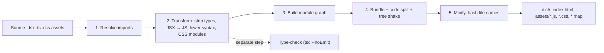
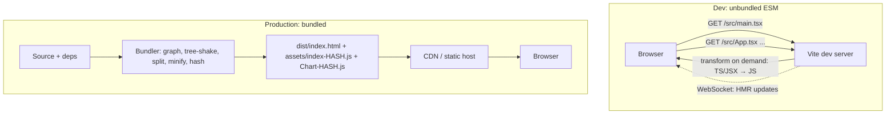

# 00 / 20 — Tooling: Transpilation, Bundling, Dev Servers, and Source Maps

## 1. Lesson metadata

| | |
|---|---|
| **Level** | Intermediate |
| **Study time** | 4 hours (reading 1.5 h, hands-on with a Vite project 1.5 h, exercises 1 h) |
| **Prerequisites** | [10 — ES modules, dependency graphs, tree shaking](./10-modules-and-dependency-graphs.md). Helpful: [15 — HTTP, caching, navigation](./15-http-caching-and-navigation.md) (content-hashed assets), [18 — TypeScript fundamentals](./18-typescript-fundamentals-and-narrowing.md) (type erasure). |
| **Next** | [21 — Phase 0 assessment](./21-phase-assessment.md) |
| **Related later** | [Phase 1 — JSX and its transformation](../01-react-fundamentals/05-jsx-explained.md), [Phase 1 — Project setup: Vite, TS, ESLint](../01-react-fundamentals/19-project-setup-vite-typescript.md), [Phase 7 — Bundle analysis](../07-performance/16-bundle-analysis.md), [Phase 7 — Code splitting and lazy loading](../07-performance/15-code-splitting-and-lazy-loading.md) |

**Learning objectives.** After this lesson you can:
1. Explain why browsers cannot run a typical React + TypeScript source tree directly, and name the transformation stages between source and running page.
2. Distinguish **transpiling**, **type-checking**, **bundling**, **minifying**, and **polyfilling**, and say which tool does which.
3. Show what JSX compiles to under the classic and automatic transforms.
4. Explain how a modern dev server (Vite) differs from a bundle-everything dev server, and what HMR and React Fast Refresh preserve and reset.
5. Explain what a source map is, how DevTools uses it, and the security/operational trade-offs of shipping one.
6. Configure the essentials of a Vite + React + TypeScript project (tsconfig flags, environment variables, base path) and avoid the common misconfigurations.
7. Diagnose build-only and deploy-only failures (dev/prod differences, missing env variables, chunk 404s after deploy).

**Concepts covered:** module resolution (bare specifiers, `package.json` `exports`), transpilers (Babel, SWC, esbuild, `tsc`), type-stripping vs type-checking, `isolatedModules`, `import type`, JSX transforms (classic vs automatic runtime), build targets and polyfills, bundlers (Rollup, webpack, esbuild, Rspack), dev servers with native ESM, dependency pre-bundling, HMR and React Fast Refresh, code splitting, content hashing, minification and dead-code elimination, `NODE_ENV`, environment variables, source maps, `base` path, ESLint/Prettier roles, lockfiles and semver.

---

## 2. Deep conceptual explanation

### 2.1 What problem is this lesson solving?

You write:

```tsx
import { useState } from "react";
import type { User } from "./types";
import styles from "./Card.module.css";

export function Card({ user }: { user: User }) {
  const [open, setOpen] = useState(false);
  return <section className={styles.card} onClick={() => setOpen(!open)}>{user.name}</section>;
}
```

A browser cannot run that file. At least five things in it are not understood natively:

1. **TypeScript syntax** (`: { user: User }`, `import type`).
2. **JSX** (`<section>…</section>` is not JavaScript).
3. **Bare module specifiers** (`"react"`): browsers resolve import URLs, not package names ([Lesson 10](./10-modules-and-dependency-graphs.md)). Without an import map, `import "react"` fails.
4. **Non-JS imports** (`./Card.module.css`): browsers only import CSS through different mechanisms; "CSS Modules" is a build-time convention that generates class names and exports a mapping object.
5. **Hundreds of modules** in `node_modules` and your source: loading each as a separate HTTP request would be slow in production (although HTTP/2 and 3 reduce the penalty, deep dependency chains still create waterfalls, see [Lesson 15](./15-http-caching-and-navigation.md)).

Build tooling closes this gap. Understanding it matters for React specifically because: **JSX is syntax sugar resolved by the build tool, not by React**; "works in dev, breaks in prod" bugs live here; environment variables and source maps affect security; and bundle shape determines load performance.

### 2.2 The pipeline: stages and who performs them



| Stage | What happens | Typical tool |
|---|---|---|
| **Resolve** | Map `"react"` → a file in `node_modules`, honoring `package.json` `exports`/`module`/`main`, aliases, extensions | Bundler/dev server resolver (esbuild, Rollup plugins, webpack's enhanced-resolve) |
| **Transform** | Remove TypeScript types; convert JSX to function calls; optionally lower new syntax to what target browsers understand (e.g., optional chaining for old browsers); CSS preprocessing | **Transpilers**: Babel, SWC, esbuild, `tsc` |
| **Type-check** | Verify type correctness. *Not* part of transform in most setups | `tsc --noEmit`, editor language service, CI |
| **Bundle** | Merge the module graph into a few files; split into chunks at dynamic `import()` boundaries; remove unused exports | Rollup, webpack, esbuild, Rspack, Parcel |
| **Minify** | Shorten identifiers, remove whitespace/dead branches | esbuild, terser, SWC |
| **Hash + emit** | Content-hash file names for long-term caching; write HTML | Bundler |
| **Lint/format** | Style and bug-pattern checks; not a build step per se | ESLint, Prettier |

**Critical distinction: transpiling is not type-checking.** esbuild, SWC, and Babel remove TypeScript syntax *without validating types*. A project with type errors can still build and run. That is why CI must run `tsc --noEmit` (or an equivalent) separately, and why `"build": "tsc -b && vite build"` is common in templates ([Lesson 18](./18-typescript-fundamentals-and-narrowing.md) §3.1).

### 2.3 Transpiler vs compiler vs bundler vs polyfill

| Term | Definition | Example |
|---|---|---|
| **Transpiler** (source-to-source compiler) | Rewrites code in one language/version into another at a similar abstraction level | TS → JS, JSX → JS, ES2022 → ES2015 |
| **Bundler** | Combines modules into output files and handles chunking/assets | Rollup, webpack, esbuild |
| **Minifier** | Reduces size while preserving behavior | Terser, esbuild minify |
| **Polyfill** | Runtime *implementation of a missing API* (e.g., `Promise.allSettled`) added to the page | core-js |
| **Syntax lowering** | Rewrites newer *syntax* for older engines (cannot be polyfilled) | Optional chaining `a?.b` → conditional code |

A transpiler **cannot** add missing runtime APIs; syntax can be rewritten, APIs must be polyfilled. If you target browsers that lack `Array.prototype.at`, no transpiler fixes that: you need a polyfill or a smaller target matrix. Modern React 19 apps typically target evergreen browsers and ship little or no lowering ⚠ confirm your supported-browsers policy (Browserslist/Vite `build.target`).

### 2.4 JSX is a build-time transform

`<Greeting name="Ada" />` is not valid JavaScript. A transform rewrites it into function calls. Two modes exist:

**Classic runtime** (historical; React ≤ 16/17 default):

```js
React.createElement(Greeting, { name: "Ada" })
React.createElement("div", { className: "box" }, "Hi ", React.createElement("b", null, name))
```
Requires `React` in scope in every file with JSX.

**Automatic runtime** (React 17+; current default for React 19 setups):

```js
import { jsx as _jsx, jsxs as _jsxs } from "react/jsx-runtime";

_jsx(Greeting, { name: "Ada" });
_jsxs("div", { className: "box", children: ["Hi ", _jsx("b", { children: name })] });
```

Observations:
- The compiler **auto-imports** the JSX functions from `react/jsx-runtime` (or `react/jsx-dev-runtime`, with `jsxDEV`, in development builds for extra debugging info). You never import `React` just for JSX.
- **`children` is just a prop** in the compiled output (`children: [...]`), which is why `props.children` works.
- `jsxs` is used when there are multiple static children (an optimization hint); `key` is passed separately (third argument to `_jsx`) rather than inside props.
- The transform is configured in the tool: TypeScript `"jsx": "react-jsx"` (typing and emit), Vite's React plugin (Babel/SWC/esbuild settings).

*Public guarantee:* the semantic meaning (an element describing type, props, key). *Implementation detail:* the exact helper names and argument shapes of the compiled output, which have changed (classic → automatic → dev runtime) and are not an API you call by hand. Details: [Phase 1/05](../01-react-fundamentals/05-jsx-explained.md).

### 2.5 Dev server vs production build: two different jobs

| | Dev server | Production build |
|---|---|---|
| **Goal** | Instant start, fast feedback, debuggability | Small, fast, cache-friendly, stable output |
| **Approach (Vite)** | Serve source modules as **native ES modules**; transform each file on request; pre-bundle dependencies | Full bundle with code splitting, minification, hashing |
| **React build** | Development build: extra warnings, validations, slower | Production build: warnings and checks stripped |
| **Source maps** | Inline/on-demand, accurate | Optional, usually external/hidden |
| **Typical differences that bite** | Strict Mode double-invocation, HMR state, relaxed errors, unminified names | Minification-dependent bugs, tree-shaking removing "unused" side effects, different chunk loading, env variable replacement |

*Version-sensitive (checked 2026-10-22):* Vite's internals change across majors. In Vite 5–7, dev used esbuild for transforms and dependency pre-bundling and production used Rollup. **Vite 8 (current: 8.3.x) ships Rolldown, a Rust-based bundler, as the single unified bundler** (per the official Vite 8 announcement, https://vite.dev/blog/announcing-vite8), with plugin compatibility kept; it requires Node `^20.19.0 || >=22.12.0`. Where this lesson says "esbuild pre-bundles" or "Rollup builds", read that as the Vite 5–7 description; the pipeline stages (pre-bundle, transform on demand, bundle/split/minify for production) are the same conceptually in Vite 8, and `build.rollupOptions` is retained for compatibility (check the Vite 8 migration guide for the current option names).

### 2.6 Why Vite's dev server starts fast

Traditional bundler dev servers (webpack's `webpack-dev-server`) build the *entire graph* before serving, so start time grows with app size. Vite's approach:

1. **Dependencies** (`node_modules`) rarely change and are often CommonJS or have hundreds of internal files. Vite **pre-bundles** them with esbuild into a few ESM files, cached on disk (`node_modules/.vite`), and serves them with long-lived caching headers.
2. **Your source** is not bundled in dev. The browser requests `/src/main.tsx` via `<script type="module">`; Vite transforms it on demand (TS/JSX → JS), rewrites bare imports (`"react"` → `/node_modules/.vite/deps/react.js?v=…`), and responds. Each `import` the browser encounters triggers another request. Only modules on the route you load are transformed.
3. **HMR**: when a file changes, Vite invalidates that module and sends a WebSocket message; the browser re-imports the changed module and the framework plugin decides how to apply the update.

Trade-offs: many small requests in dev (fine on localhost); behavioral differences between dev (unbundled) and prod (bundled) become possible, which is why you must **test the production build** (`vite build && vite preview`) before release.

### 2.7 HMR and React Fast Refresh

**HMR** (hot module replacement) is the general mechanism: swap a module in the running page without a full reload. **React Fast Refresh** is React's integration: when you edit a component file, React re-renders the affected components with the new code **while preserving state** of function components whenever safe.

Teaching model of the rules (verify details in the Vite plugin/React docs):
- Edits to a file that exports **only React components** are hot-applied; component state (`useState`) is preserved; effects are re-run on update.
- If the file also exports non-component values (constants, helpers) consumed elsewhere, or edits change a module's exports in ways Fast Refresh cannot isolate, it falls back to a **full reload** of dependents. This is why linting rules such as "only export components" (`react-refresh/only-export-components`) exist.
- Changing the **hook signature** (order/number of hooks) resets that component's state.
- Class components are re-mounted (state reset). *(Class components are legacy for new code.)*
- It is a **dev-only** tool and not part of production output.

Practical consequence: if state is "mysteriously reset" after saving, or reloads are full-page, check export shape and hook changes rather than blaming the framework.

### 2.8 Source maps

Minified, transformed code (`a.b(c)` in `index-9f3a.js`, line 1, column 48,201) is undebuggable. A **source map** is a JSON file that maps positions in generated code back to original files, lines, columns, and (optionally) original identifier names. The generated file ends with a comment:

```js
//# sourceMappingURL=index-9f3a.js.map
```

DevTools (and error-tracking services) fetch the map and show original TypeScript in stack traces and the Sources panel. Key points:

- A map contains a `mappings` field (compact VLQ-encoded segments), `sources` (original file paths), optionally `sourcesContent` (the full original text), and `names`.
- **Production options** (Vite `build.sourcemap`): `false` (none), `true` (separate `.map` files referenced by the comment), `"inline"` (embedded; bloats), `"hidden"` (map files generated but *without* the `sourceMappingURL` comment, so you can upload them to an error tracker without exposing them to browsers).
- **Security/operations:** public maps expose your original source (including comments and, with `sourcesContent`, everything). Often acceptable for open code; for proprietary code use hidden maps uploaded to your error-monitoring service, restrict access, or accept the exposure knowingly. Source maps are not secrets protection; minification is not obfuscation either.
- Maps only affect debugging, not runtime behavior or bundle size sent to normal users (browsers fetch maps only when DevTools is open).

### 2.9 Environment variables and build-time replacement

Bundlers perform **static replacement** of certain expressions at build time. In Vite:

- `import.meta.env.MODE`, `.DEV`, `.PROD`, `.BASE_URL`, `.SSR` are built in.
- Only variables prefixed with `VITE_` from `.env*` files are exposed to client code: `import.meta.env.VITE_API_URL`. (Configurable via `envPrefix`.)
- Values are **inlined into the bundle** as literals. Therefore **anything in `VITE_*` is public** to every visitor. Never put secrets (API secret keys, database credentials) in client env variables.
- `process.env.NODE_ENV` is a Node convention that many libraries (React, historically) check; bundlers replace it at build time (`"production"`/`"development"`) so dead branches (dev-only warnings) are **eliminated** from production bundles.

A frequent bug: reading `import.meta.env.API_URL` (no `VITE_` prefix) yields `undefined`, and `process.env.X` is undefined in the browser (there is no `process`).

### 2.10 Common misconceptions

| Misconception | Reality |
|---|---|
| "TypeScript compiles my React app, so the build catches type errors." | Most pipelines only *strip* types. Type-checking is a separate step you must run. |
| "Babel/SWC polyfills missing features." | Transpilers lower syntax. APIs need polyfills (core-js) or a modern target. |
| "JSX needs `import React from 'react'`." | Not with the automatic runtime (React 17+). |
| "Minification protects my code." | It only shortens it; with source maps public or deobfuscation, logic is readable. |
| "Dev behavior equals prod behavior." | Dev uses unbundled modules and React's development build; always test the production build. |
| "Tree shaking removes everything unused." | It removes unused *exports it can prove side-effect-free*. CommonJS, side-effectful modules, and dynamic access defeat it ([Lesson 10](./10-modules-and-dependency-graphs.md)). |
| "`.env` variables are private." | Client-exposed variables are embedded in public JS. |
| "Create React App is the default way to start." | The React team deprecated CRA in 2025 and recommends frameworks or build tools like Vite (react.dev blog "Sunsetting Create React App", 2025-02-14, verified). |
| "Bundlers are only for performance." | They also solve resolution, format interop (CJS→ESM), asset handling, and environment replacement. |

---

## 3. Internal mechanics

### 3.1 Module resolution

When a module imports `"react"`:

1. **Bare specifier** (no `./`, `/`, URL): look up `node_modules/react` walking up directories.
2. Read that package's `package.json`. Modern packages declare `"exports"` (conditional entry points by environment: `"import"`, `"require"`, `"browser"`, `"development"`, `"production"`, `"types"`). Older ones use `"module"` (ESM entry, a bundler convention) and `"main"` (CommonJS).
3. Pick the entry using **conditions** the tool supplies; resolve to a file.
4. For relative imports, apply extension rules (does `./Card` mean `Card.tsx`, `Card/index.tsx`?). TypeScript's `"moduleResolution": "bundler"` models this bundler behavior for type resolution.

Why you care: "Cannot find module", "does not provide an export named" (ESM/CJS interop), duplicate React copies (two `react` packages in the tree cause "Invalid hook call" errors), and different builds of the same package in dev vs prod all originate here.

### 3.2 Transform: what stripping TypeScript means

Single-file transpilers process **one file at a time without type information**. Consequences:

- They cannot know whether an imported name is a type or a value, so `import { User } from "./types"` may be preserved and then fail at runtime if `User` is only a type (the export does not exist). Hence `import type { User }` and the compiler flags `isolatedModules` / `verbatimModuleSyntax`, which make TypeScript flag code a single-file transpiler cannot handle correctly.
- Features requiring cross-file knowledge are problematic: `const enum` (inlining needs the declaration), re-exporting types with `export { T }` without `type`. Prefer string unions and `export type`.
- Newer TypeScript offers `erasableSyntaxOnly` (TypeScript 5.8+; verified with tsc 5.9.3) to forbid syntax that cannot simply be erased (enums, namespaces with runtime code, constructor parameter properties) for runtimes that strip types natively.
- Type-only changes do not change emitted JS, so builds can be extremely fast (esbuild/SWC transform orders of magnitude faster than `tsc` emit).

### 3.3 Bundling mechanics (teaching model)

1. **Entry** (`index.html` → `src/main.tsx`).
2. **Graph construction**: parse each module's `import`/`export`; static `import` edges are followed; `import()` marks a *split point*.
3. **Scope hoisting / concatenation** (Rollup-style): modules in the same chunk are merged into one scope to avoid per-module wrapper overhead and to enable better dead-code elimination.
4. **Tree shaking**: mark exports reachable from entries; drop unreachable code unless it may have side effects (`"sideEffects": false` in `package.json` tells the bundler a package's modules are safe to drop if unused; `/*#__PURE__*/` annotations mark calls as side-effect-free).
5. **Chunking**: entry chunk(s), dynamic-import chunks, shared chunks for modules used by several chunks (the heuristics differ per bundler; Vite exposes `build.rollupOptions.output.manualChunks`).
6. **Hash naming**: `assets/index-<hash>.js` derived from content so unchanged files keep URLs and remain cached ([Lesson 15](./15-http-caching-and-navigation.md)).
7. **HTML rewriting**: `index.html` is processed to reference the output chunks and preload hints (`<link rel="modulepreload">`).

### 3.4 Public guarantee vs implementation detail

| Item | Status |
|---|---|
| ES module semantics (static imports, live bindings) | **Public guarantee** (language) |
| `package.json` `exports` resolution rules | **Node-defined spec**, widely adopted by bundlers with minor variations |
| JSX → `jsx()` calls and `react/jsx-runtime` module path | **Documented contract between React and tools** (stable since 17) |
| Exact compiled helper shapes (`jsxDEV` params) | **Implementation detail** |
| Vite's internal pipeline, pre-bundle cache dir, chunking heuristics | **Tool implementation**, changes between majors |
| Source map v3 format | **Specified format** (ECMA-426 / community spec) |
| Hashing algorithm, chunk names | **Implementation detail**, never depend on them |

---

## 4. Step-by-step execution walkthrough: `npm run dev`, then `npm run build`

Project: Vite + React + TypeScript template.

**Dev (`vite`)**
1. Vite starts a Node HTTP server and WebSocket. It reads `vite.config.ts`, `.env*`, and scans entry points to discover dependencies.
2. **Dependency pre-bundling**: it finds `import "react"`, `"react-dom/client"`, etc., bundles each dependency (with its internal modules) into ESM files in `node_modules/.vite/deps` using esbuild (first run only; cached).
3. You open `http://localhost:5173`. The server returns `index.html` (with `<script type="module" src="/src/main.tsx">` and the HMR client injected).
4. The browser requests `/src/main.tsx`. Vite transforms TSX → JS (types stripped, JSX → `jsxDEV` calls via the React plugin), rewrites `import "react"` → `/node_modules/.vite/deps/react.js?v=hash`, and serves it.
5. The browser requests each imported module (`/src/App.tsx`, CSS, etc.) similarly. Total work is proportional to modules actually imported.
6. `main.tsx` calls `createRoot(...).render(<App />)` (Phase 1). The page renders using React's **development** build.
7. You edit `Card.tsx`. The file watcher notices; Vite re-transforms *that file only*, sends an HMR update; React Fast Refresh re-renders `Card` instances keeping state.
8. The editor's TypeScript service (separate from Vite) shows type errors; the dev server does **not** block on them.

**Build (`vite build`, typically preceded by `tsc -b` in the template script)**
1. `tsc -b` type-checks (and writes nothing in templates with `noEmit`); a type error fails the script before Vite runs.
2. Vite loads config, resolves `index.html`, and starts the production bundling pipeline (Rollup in Vite ≤ 7, Rolldown in Vite 8+).
3. Each module is transformed (types stripped, JSX → `jsx()` production calls), `import.meta.env.*` and `process.env.NODE_ENV` are replaced with literals.
4. The bundler (Rollup/Rolldown) builds the graph, tree-shakes, splits chunks (dynamic imports), minifies, hashes file names, and emits `dist/index.html` plus `dist/assets/*`.
5. Optional source maps are emitted per `build.sourcemap`.
6. `vite preview` serves `dist/` statically so you can verify prod behavior locally. Deploy `dist/` to a static host/CDN with caching rules: `index.html` revalidated (`no-cache`), hashed assets `immutable` long max-age.

---

## 5. Code examples

### 5.1 Minimal example — what JSX compiles to

Input (`Hello.tsx`):

```tsx
export function Hello({ name }: { name: string }) {
  return <h1 className="title">Hello, {name}!</h1>;
}
```

Output, automatic runtime, production mode (illustrative):

```js
import { jsxs as _jsxs } from "react/jsx-runtime";
export function Hello({ name }) {
  return _jsxs("h1", { className: "title", children: ["Hello, ", name, "!"] });
}
```

**Predict:** what is the third child, and why is the output `jsxs` rather than `jsx`?
**Result:** the three children are `"Hello, "`, `name`, `"!"` (JSX text and expressions become separate array entries). `jsxs` signals "multiple static children" to React's runtime; with a single child, `jsx` and a non-array `children` would be used. Both produce an element object ([Phase 2/05](../02-react-rendering-and-internals/05-elements-vs-dom-nodes.md)). Do not rely on `jsx` vs `jsxs` semantics beyond that; they are tool/runtime details.

### 5.2 Practical example — tsconfig for a Vite + React + TypeScript app

```jsonc
// tsconfig.app.json (illustrative; current Vite templates split config into tsconfig.app.json / tsconfig.node.json)
{
  "compilerOptions": {
    "target": "ES2022",
    "lib": ["ES2022", "DOM", "DOM.Iterable"],
    "module": "ESNext",
    "moduleResolution": "bundler",
    "jsx": "react-jsx",              // automatic runtime: no `import React` needed
    "strict": true,
    "noUncheckedIndexedAccess": true,
    "noEmit": true,                  // tsc only type-checks; Vite does the transform
    "isolatedModules": true,         // flag code single-file transpilers can't handle
    "verbatimModuleSyntax": true,    // preserve imports exactly; forces `import type` for types
    "skipLibCheck": true,            // don't type-check node_modules .d.ts (speed; trades some safety)
    "resolveJsonModule": true,
    "allowImportingTsExtensions": true,
    "types": ["vite/client"]         // import.meta.env, asset imports
  },
  "include": ["src"]
}
```

Line notes:
- `moduleResolution: "bundler"` models bundler behavior (extensionless relative imports, `exports` conditions).
- `noEmit` + a separate transform tool is the dominant pattern: `tsc` is the *linter for types*.
- `verbatimModuleSyntax` makes `import { User } from "./types"` an error if `User` is a type; write `import type { User }`. This prevents the runtime "does not provide an export named" error described in §3.2.
- `skipLibCheck` is a pragmatic speed/safety trade-off: errors in third-party declaration files are not reported.
- Template names and flag sets evolve; compare with the current `create-vite` React-TS template when setting up ([Phase 1/19](../01-react-fundamentals/19-project-setup-vite-typescript.md)).

### 5.3 Practical example — Vite config and environment variables

```ts
// vite.config.ts
import { defineConfig } from "vite";
import react from "@vitejs/plugin-react";

export default defineConfig(({ mode }) => ({
  plugins: [react()],
  base: "/",                                   // set to "/my-app/" if deployed under a sub-path
  build: {
    sourcemap: mode === "production" ? "hidden" : true,   // hidden: emit maps, omit the sourceMappingURL comment
  },
  server: {
    proxy: { "/api": "http://localhost:8080" }, // dev-only: avoids CORS during development
  },
}));
```

```ts
// src/env.ts: validate and expose client config once
const raw = import.meta.env.VITE_API_URL;       // string | undefined at runtime, even if typings say string
if (typeof raw !== "string" || raw.length === 0) {
  throw new Error("VITE_API_URL is not set. Add it to .env or the deployment environment.");
}
export const API_URL: string = raw;
```

```bash
# .env.production  (committed only if non-secret)
VITE_API_URL=https://api.example.com
# NEVER: VITE_STRIPE_SECRET_KEY=sk_live_...   (would be embedded in the public bundle)
```

Notes: `.env` file loading order and mode-specific files (`.env.development`, `.env.production`, `.env.local`) are documented by Vite. Build-time variables are baked in; changing them requires rebuilding. For "build once, deploy many" setups, load runtime configuration from a `/config.json` fetched at startup (with validation, see [Lesson 18](./18-typescript-fundamentals-and-narrowing.md)).

### 5.4 Incorrect example — assuming Node globals and unprefixed env vars

```ts
const url = process.env.API_URL;            // ❌ `process` is not defined in the browser (and no VITE_ prefix)
const flag = import.meta.env.FEATURE_X;     // ❌ undefined: only VITE_-prefixed variables are exposed
```

**Why wrong:** the browser has no `process`; some tools polyfill or replace parts of `process.env` (e.g., `NODE_ENV`) but not arbitrary keys. Unprefixed variables are deliberately hidden from client code to reduce accidental secret exposure.

### 5.5 Corrected implementation

```ts
const url = import.meta.env.VITE_API_URL;
const flag = import.meta.env.VITE_FEATURE_X === "true";   // env values are strings, not booleans
```

Also declare types for IntelliSense in `src/vite-env.d.ts`:

```ts
interface ImportMetaEnv {
  readonly VITE_API_URL: string;
  readonly VITE_FEATURE_X?: string;
}
interface ImportMeta { readonly env: ImportMetaEnv }
```

**Trade-offs:** typing `VITE_API_URL: string` asserts presence; a missing variable still yields `undefined` at runtime, hence the runtime check in §5.3.

### 5.6 Advanced example — dynamic import, chunks, and cache-busting failures

```tsx
import { lazy, Suspense } from "react";

const Chart = lazy(() => import("./Chart"));      // separate chunk, fetched on first render

export function Dashboard() {
  return (
    <Suspense fallback={<p>Loading chart…</p>}>
      <Chart />
    </Suspense>
  );
}
```

How it builds: `import("./Chart")` is a split point; the bundler emits `assets/Chart-<hash>.js` and the entry chunk contains a loader referencing it. `lazy` and `Suspense` semantics are covered in [Phase 7/15](../07-performance/15-code-splitting-and-lazy-loading.md); here the point is *what the tool produces*.

**Deploy hazard (very common):** a user has the old `index.html`/entry chunk open. You deploy a new version and your host deletes old hashed files. The user navigates, the app requests `assets/Chart-OLDHASH.js`, gets a 404 (or the SPA fallback `index.html` with the wrong MIME type) and `import()` rejects: "Failed to fetch dynamically imported module" / "ChunkLoadError". Mitigations: keep previous build assets on the CDN for a window; catch `import()` failures and reload once; version the app and prompt users to refresh; use an error boundary that offers reload ([Phase 4/19](../04-react-architecture/19-error-boundaries.md)).

```ts
// Retry-once wrapper for lazy chunks (pattern; adapt to your needs)
import { lazy, type ComponentType } from "react";

// `any` is deliberate: ComponentType<unknown> would reject components with specific props
// (parameter contravariance, Lesson 18). Confined to this one generic helper.
// eslint-disable-next-line @typescript-eslint/no-explicit-any
export function lazyWithReload<T extends ComponentType<any>>(
  load: () => Promise<{ default: T }>,
) {
  return lazy(async () => {
    try {
      return await load();
    } catch (err) {
      const key = "chunk-reload-attempted";
      if (!sessionStorage.getItem(key)) {
        sessionStorage.setItem(key, "1");
        window.location.reload();               // fetch the new index.html and entry
        return new Promise<never>(() => {});     // never resolves: page is reloading
      }
      throw err;                                  // second failure: let the error boundary handle it
    }
  });
}
```

Caveats: reloading discards unsaved in-memory state; guard against reload loops (the session flag); clear the flag after a successful load; `sessionStorage` can throw in restricted contexts (wrap in try/catch in production). Treat as a pattern to adapt, not a drop-in.

---

## 6. Visual explanations

### Dev vs production



### Where each error is caught

```text
Syntax / resolve error ...... transform / bundler (build fails)
Type error .................. tsc / editor / CI (build may still succeed!)
Lint rule ................... ESLint (CI)
Runtime exception ........... browser (tests, monitoring, error boundaries)
```

### Source map lookup

```text
Error stack:   index-9f3a.js:1:48201
   │  fetch index-9f3a.js.map
   ▼
mappings (VLQ) ──► original: src/features/cart/CartTotals.tsx:42:17  (name: "applyDiscount")
```

---

## 7. Alternative approaches and trade-offs

| Tool/approach | Dev speed | Prod output | Ecosystem/plugins | Complexity | Prefer when |
|---|---|---|---|---|---|
| **Vite** (esbuild dev + Rollup prod in ≤ 7; Rolldown in 8+) | Excellent | Good, highly configurable | Large (Rollup-compatible) | Low | SPAs, libraries, most React apps |
| **webpack** | Slower on large apps | Very configurable | Largest, mature | High | Legacy apps, exotic loaders, module federation (older setups) |
| **Rspack** (webpack-compatible, Rust) | Fast | webpack-like | webpack plugin compatibility | Medium | Migrating large webpack apps for speed |
| **Parcel** | Fast, zero-config | Good | Moderate | Low | Quick projects |
| **esbuild** (standalone) | Fastest | Basic (limited code-splitting/features) | Smaller | Low–Medium | Tooling, simple bundles, libraries |
| **Framework toolchains** (Next.js, React Router framework mode, TanStack Start, Remix lineage) | Varies | Includes SSR/RSC integration | Framework-specific | Medium | Need routing, SSR, data loading, RSC ([Phase 9](../09-advanced-rendering-and-ecosystem/)) |
| **No bundler** (native ESM + import maps) | No build step | Many requests unless CDN/HTTP/3 | Minimal | Low | Tiny apps, prototypes, learning |
| **Create React App** | — | — | — | — | Deprecated by the React team (Feb 2025, react.dev/blog/2025/02/14/sunsetting-create-react-app); do not start new projects with it |

**When the recommended approach (Vite) is not best:** if you need SSR/streaming/RSC with integrated routing and data loading, a framework (with its own toolchain) is the better starting point than assembling those pieces on a bare Vite SPA. If a large legacy webpack config with custom loaders works and is not a bottleneck, migrating is cost without benefit; adopt Rspack if build time is the pain.

---

## 8. Best practices and anti-patterns

**Do**
- Run type-checking (`tsc --noEmit`), linting, and tests in CI; do not treat a successful build as proof of correctness.
- Test the **production build** locally (`vite preview`) and in staging; investigate dev/prod differences immediately.
- Use `import type` and `verbatimModuleSyntax`/`isolatedModules`.
- Serve hashed assets with long-lived immutable caching, and `index.html` with revalidation.
- Commit lockfiles; use the same package manager and Node version in CI and locally (`engines`, `.nvmrc`/Volta).
- Keep secrets out of client env variables; treat all `VITE_*` as public.
- Analyze bundles periodically ([Phase 7/16](../07-performance/16-bundle-analysis.md)).
- Pin tool versions via the lockfile and upgrade deliberately (read release notes).

**Beginner mistakes**
- Expecting TS type errors to fail the dev server.
- Importing everything from large libraries via barrel files without checking tree shaking.
- Hard-coding `http://localhost:3000` in code instead of env/proxy.
- Importing the same package in two versions (duplicate React → "Invalid hook call").

**Experienced-developer mistakes**
- Over-customizing the bundler config until nobody understands it.
- Shipping source maps publicly without realizing proprietary code is exposed (or never uploading maps, leaving production errors unreadable).
- Depending on chunk names/hashes.
- Marking packages `sideEffects: false` incorrectly, causing CSS or polyfill imports to be dropped.
- Transpiling `node_modules` for old browsers unnecessarily, inflating the bundle.

**Smells:** a `.babelrc` plus SWC plus esbuild all in play; `// @ts-ignore` to get the build green; `process.env` shims added to "fix" runtime errors; a `postinstall` script that mutates dependencies; code that behaves differently if `import.meta.env.DEV` is toggled beyond logging.

**Justified exceptions:** exposing `VITE_*` public keys (analytics write keys, public map tokens) is normal when they are designed for client use and restricted server-side by domain/scope. Disabling `skipLibCheck: false`-level strictness is fine in app code; libraries publishing `.d.ts` should leave it `false` for their own checks.

---

## 9. Real-world application

**Enterprise multi-app platform.** Many teams, shared packages. Tooling constraints: consistent TypeScript/ESLint configs via a shared package, a monorepo with workspace dependencies ([Phase 4/22](../04-react-architecture/22-monorepos-and-shared-packages.md)), caching of builds in CI, deterministic installs (lockfile + `npm ci`/`pnpm install --frozen-lockfile`). Build times affect developer throughput: measure cold start, HMR latency, CI duration, and set budgets.

**E-commerce storefront.** Constraint: mobile performance. Tooling decisions: route-level code splitting, preloading likely next routes, long-lived caching with hashed assets, differential or modern-only targets, bundle-size CI check. Deploy hazard: promotions deployed during peak traffic: keep old assets for in-flight sessions to avoid chunk 404s.

**Dashboards / finance.** Heavy chart libraries (hundreds of KB). Strategy: lazy-load chart modules, avoid importing entire utility libraries, use bundle analysis to find accidental inclusion (e.g., importing a locale bundle). Source maps uploaded to an error tracker (hidden maps) so production traces map to code without public exposure.

**Auth/security.** Env variables in client builds are public; OAuth client IDs are public but client secrets must never appear. Build-time injection of config means one build per environment; consider runtime config for "promote the same artifact" pipelines.

**Realtime.** WebSocket endpoints differ per environment; the dev proxy must also proxy WebSockets (`ws: true` option in Vite's proxy config) ⚠ verify option names in current docs.

---

## 10. Debugging and troubleshooting

| Symptom | Likely cause | Investigation | Fix / validation |
|---|---|---|---|
| `Failed to resolve import "x"` | Package not installed; wrong path/extension/case (macOS is case-insensitive, Linux CI is not); missing alias | Check `package.json`/lockfile; check exact file name casing | Install or fix path; validate with a clean install and CI build on Linux |
| `The requested module ... does not provide an export named 'X'` | CJS/ESM interop; importing a *type* as a value; wrong named vs default import | See §3.2; inspect package `exports`; use `import type` | Switch import style or add `optimizeDeps` config ⚠ per Vite docs |
| `process is not defined` / `X is not defined` in browser | Node-only code or env access | Search for `process.env`; check the dependency | Use `import.meta.env`; replace dependency; Vite `define` for specific constants |
| `import.meta.env.MY_VAR` is `undefined` | Missing `VITE_` prefix; var absent at build time; wrong `.env` mode file | Print `import.meta.env`; check CI environment | Rename; set in CI; rebuild (values are baked at build time) |
| Works in `vite dev`, breaks in `vite build`/prod | Dev/prod differences: minification, tree shaking of side effects, strict mode removal, different chunking, env replacement | `vite preview`; compare console; disable minify to bisect (`build.minify: false`) | Fix side-effect declarations; avoid relying on function names (minified) |
| `Invalid hook call` | Two copies of React; mismatched `react`/`react-dom` versions; hooks called outside components | `npm ls react react-dom`; look for duplicate in linked packages | Dedupe; `resolve.dedupe: ["react", "react-dom"]` for linked packages; align versions |
| Stack traces show minified names | No source maps uploaded/available | Check `build.sourcemap`, error-tracker upload step | Generate hidden maps; upload per release; verify with a forced error |
| HMR does full reload or resets state | File exports non-components; anonymous default export component; hook order changed | Check console `[vite] hmr invalidate` messages; ESLint `react-refresh` rule | Split non-component exports into separate files; name components |
| 404 for assets after deploy under a sub-path | `base` not set | Network panel: URLs start with `/assets/` instead of `/app/assets/` | Set `base`, rebuild; validate on the real path |
| `Failed to fetch dynamically imported module` after deploy | Old chunks removed (§5.6) | Network panel: 404/HTML for chunk URL | Keep old assets; reload-on-failure; error boundary |
| Build passes but types are wrong in editor | Editor uses a different TypeScript version | Editor "Select TypeScript version" → workspace | Align versions; CI `tsc --noEmit` |
| CI build fails, local passes | Case-sensitive FS; Node/pm version mismatch; lockfile drift; missing env | Compare Node version, reinstall with frozen lockfile | Pin versions; `npm ci`; Linux dev container |

General method: **bisect the pipeline**. Does the error occur at install, resolve, transform, bundle, runtime? Disable minification, source maps on, compare dev and preview, and read the first error, not the last.

---

## 11. Exercises

### Level A — Knowledge
A1. List the stages between `.tsx` source and running page and say which stages can detect a type error.
A2. What is the difference between a transpiler and a polyfill? Give an example where only a polyfill can help.
A3. Why does Vite pre-bundle dependencies in dev?
A4. What does `import.meta.env.VITE_API_URL` become in a production bundle, and what are the security implications?
A5. What is a source map, and what does a `hidden` source map mean in Vite?

### Level B — Code comprehension
B1. Convert (by hand) this JSX to automatic-runtime output (use `_jsx`/`_jsxs`):
```tsx
<ul className="list">{items.map((i) => <li key={i.id}>{i.name}</li>)}</ul>
```
B2. Why does this fail at runtime in a single-file-transpiled project even though `tsc` accepted it under non-`verbatimModuleSyntax` settings? Fix it.
```ts
// types.ts
export interface User { id: number }
// app.ts
import { User } from "./types";
export const u: User = { id: 1 };
```
B3. What does this print in the production build, and in dev?
```ts
if (import.meta.env.DEV) console.log("dev only");
console.log(import.meta.env.MODE);
```
(Assume `vite build` with default mode, and `vite` dev with default mode.)
B4. A package declares `"sideEffects": false` but its entry does `import "./polyfill"`. What can go wrong?

### Level C — Implementation
C1. Write a `src/env.ts` module that validates three required variables (`VITE_API_URL`, `VITE_ENV_NAME`, `VITE_ANALYTICS_ID` optional), parses `VITE_FEATURE_FLAGS` (comma-separated) into a `ReadonlySet<string>`, and exports a frozen typed config.
C2. Write a `vite.config.ts` that: sets `base` from an env variable, emits hidden source maps in production, proxies `/api` and `/ws` (WebSocket) to `localhost:8080`, and splits `react`/`react-dom` into a `vendor` chunk (use `manualChunks`).
C3. Write a CI script (shell or `package.json` scripts) that runs: install with lockfile, type-check, lint, unit tests, build, and bundle-size check, in the right order with fail-fast semantics.

### Level D — Debugging
D1. Production users report a white screen after yesterday's deploy; the console shows `Failed to fetch dynamically imported module: …/assets/Settings-3fa91c.js`. Diagnose and propose a short-term and long-term fix.
D2. After adding a util export to `Button.tsx` (`export const sizes = [...]`), editing the component now reloads the page instead of hot-updating. Why, and what do you change?
D3. Your error tracker shows `at t (index-4d2a.js:1:20931)`. How do you get readable traces for past and future releases?
D4. `npm ls react` shows two versions of React in the tree because a linked local package declares `react` as a dependency (not a peer). Explain the runtime error and fix.

### Level E — Architecture and engineering decisions
E1. Your team must choose a toolchain for a new product: SPA dashboard, 40 developers, strict performance budgets, later maybe SSR. Compare Vite SPA, Next.js, and a custom webpack setup. Pick and justify with criteria.
E2. Design the deployment and caching strategy for a Vite SPA behind a CDN so that: users never get a broken chunk load, rollbacks are instant, and `index.html` changes propagate within a minute.

### Level F — Expert challenge
F1. You must support an enterprise customer's locked-down browsers (an older Chromium-based embedded runtime) while shipping modern builds to everyone else. Design the build/deploy strategy (targets, polyfills, differential serving, testing), including how you detect which bundle to serve and how you validate that the legacy build works.

---

## 12. Detailed answers and explanations

> Attempt the exercises first.

**A1.** Resolve → transform (strip types, JSX → JS, lower syntax) → graph → bundle (split, tree-shake) → minify → hash/emit. Only **type-check** (a separate `tsc`/editor/CI step) detects type errors; transform/bundle stages detect *syntax* and *resolution* errors. Wrong answer: "the build" (build tools like esbuild/SWC do not check types).

**A2.** A transpiler rewrites *syntax* (TS/JSX/new syntax → older syntax). A polyfill supplies a missing *runtime API* (`Array.prototype.at`, `structuredClone`, `Promise.withResolvers`) by defining it at runtime if absent. A transpiler cannot conjure an API; e.g., targeting a browser without `Intl.Segmenter` needs a polyfill (or feature detection with fallback).

**A3.** Dependencies are often CommonJS (not loadable as native ESM) and may consist of hundreds of internal files (e.g., `lodash-es`), which would cause hundreds of requests in dev. Pre-bundling with esbuild converts CJS→ESM and collapses each package into one or a few files, cached on disk, and lets Vite serve them with strong caching. Source files stay unbundled for fast incremental updates.

**A4.** It is replaced by a string literal at build time (e.g., `"https://api.example.com"`), visible in the shipped JavaScript. Anything prefixed `VITE_` is public: never place secrets in it. Also: values are fixed at build time; changing them requires a rebuild.

**A5.** A JSON file mapping generated positions to original source positions, used by DevTools and error trackers. In Vite, `build.sourcemap: "hidden"` generates the `.map` files but omits the `//# sourceMappingURL=` comment, so browsers do not fetch them, while you can upload them to a monitoring service for symbolication. Hidden is not secret: if the files are served publicly at predictable URLs, anyone can still fetch them.

**B1.**
```js
_jsx("ul", {
  className: "list",
  children: items.map((i) => _jsx("li", { children: i.name }, i.id)),
});
```
The `key` becomes the third argument of `_jsx`. `ul` has a single child expression, so `_jsx` (not `_jsxs`) is used; the child is an array produced dynamically (dynamic children do not use `jsxs`, which signals *static* multi-child lists). Import: `import { jsx as _jsx } from "react/jsx-runtime";`.

**B2.** A single-file transpiler sees `import { User } from "./types"` and cannot know `User` is a type, so it keeps the import (or removes it only if unused as a value, depending on settings); at runtime the browser reports that `./types` does not provide an export named `User`, because `types.ts` compiles to an empty module. Fix: `import type { User } from "./types"` (and enable `verbatimModuleSyntax`/`isolatedModules` so the compiler flags this). Plausible wrong fix: renaming the file or exporting a dummy value.

**B3.** Dev server: prints `dev only` and `development`. `vite build` default mode is `production`, so `import.meta.env.DEV` is replaced with `false`, the `if` block is eliminated as dead code, and `import.meta.env.MODE` is replaced with `"production"`: it prints `production` only. Edge: `vite build --mode staging` changes `MODE`, but `DEV`/`PROD` follow `NODE_ENV`-style production/dev, not the mode string ⚠ verify in Vite docs.

**B4.** With `sideEffects: false` the bundler may drop the `import "./polyfill"` statement (or any import whose bindings are unused) because it believes the module has no side effects, removing the polyfill/CSS registration silently in production while dev works. Fix: list side-effectful files in `"sideEffects": ["./src/polyfill.js", "*.css"]` or remove the flag.

**C1. Reference solution**
```ts
function required(name: keyof ImportMetaEnv & string): string {
  const v = import.meta.env[name] as string | undefined;
  if (typeof v !== "string" || v.trim() === "") throw new Error(`Missing required env var ${name}`);
  return v;
}

const flags: ReadonlySet<string> = new Set(
  (import.meta.env.VITE_FEATURE_FLAGS ?? "")
    .split(",")
    .map((s: string) => s.trim())
    .filter((s: string) => s.length > 0),
);

export const config = Object.freeze({
  apiUrl: required("VITE_API_URL"),
  envName: required("VITE_ENV_NAME"),
  analyticsId: (import.meta.env.VITE_ANALYTICS_ID as string | undefined) || undefined,
  hasFlag: (name: string) => flags.has(name),
} as const);
```
Notes: requires `ImportMetaEnv` augmentation declaring these keys (§5.5). The module throws at import time, failing fast in dev and preventing a half-configured production app; consider rendering a friendly error screen instead in production. `Object.freeze` is shallow; `Set` itself stays mutable but is not exported directly. Validate URLs with `new URL(...)` for stricter checks.

**C2.**
```ts
import { defineConfig, loadEnv } from "vite";
import react from "@vitejs/plugin-react";

export default defineConfig(({ mode }) => {
  const env = loadEnv(mode, process.cwd(), "");      // "" prefix: load all vars for config use only (not client exposure)
  return {
    plugins: [react()],
    base: env.APP_BASE_PATH || "/",
    build: {
      sourcemap: mode === "production" ? "hidden" : true,
      rollupOptions: {
        output: {
          manualChunks: { vendor: ["react", "react-dom"] },
        },
      },
    },
    server: {
      proxy: {
        "/api": "http://localhost:8080",
        "/ws": { target: "ws://localhost:8080", ws: true },
      },
    },
  };
});
```
Notes: config-file environment access (`process.cwd()`, `loadEnv`) is Node code, not browser code, and does not leak variables unless exposed through `define` or `VITE_` prefix. `manualChunks` object form is a Rollup feature; ⚠ verify against your Vite version (a Rolldown-based future may change options). A `vendor` chunk helps caching if React rarely changes but may hurt if it forces unused code into the entry; measure with the bundle analyzer.

**C3.** Example `package.json` scripts and CI:
```json
{
  "scripts": {
    "typecheck": "tsc -b --noEmit",
    "lint": "eslint . --max-warnings=0",
    "test": "vitest run",
    "build": "vite build",
    "size": "node scripts/check-bundle-size.mjs"
  }
}
```
```bash
set -euo pipefail
npm ci
npm run typecheck
npm run lint
npm run test
npm run build
npm run size
```
Order: cheapest, most-likely-to-fail checks first; `npm ci` uses the lockfile exactly; `set -e` fails fast. Some run typecheck/lint/test in parallel for speed. `tsc -b --noEmit` support for build mode is version-dependent; use whichever your template uses (`tsc -b`).

**D1.** Cause: the browser holds the old entry chunk (or cached `index.html`) referencing `Settings-3fa91c.js`, which the deploy removed (old hash). The server returns 404 or the SPA fallback HTML (wrong MIME), so `import()` rejects. Short term: restore the previous assets on the CDN (assets are immutable per hash, so keeping old files is safe); communicate/refresh. Long term: retain N previous builds' assets; ensure `index.html` has `no-cache`; implement reload-once on chunk failure and an error boundary with a reload button; consider version polling to prompt refresh.

**D2.** React Fast Refresh requires a module to export only components to hot-update it safely; exporting a non-component (`sizes`) means importers of that value may be affected, so Fast Refresh falls back to a full reload of the dependents/page. Fix: move `sizes` into a separate module (`button-sizes.ts`) and import it in both places; ESLint's `react-refresh/only-export-components` rule flags this. ⚠ Behavior details live in the Vite React plugin docs.

**D3.** Generate source maps in the production build (`hidden` to avoid public exposure), upload them to the error tracker tagged with the release/commit identifier on each deploy, and configure the tracker's SDK with the same release. For past releases, rebuild from the tagged commit with identical dependencies and config (lockfile) to regenerate maps, though hash/content equality must match the deployed files; if it does not, mappings will be wrong. Validate by throwing a test error in staging and checking the trace.

**D4.** The linked package resolves its own `node_modules/react`, so the app and the package use *different React instances*; hooks from one React run under the renderer of another: "Invalid hook call" or `null` dispatcher errors. Fix: make `react` and `react-dom` **peerDependencies** of the library; in the app's Vite config set `resolve.dedupe: ["react", "react-dom"]` and ensure a single copy (`npm ls react`, symlink issues with `npm link`; prefer workspaces/pnpm workspace protocol).

**E1. Evaluation criteria and sample answer.** Criteria: product needs (SSR/SEO, auth, data loading), team skills, build performance, deployment target, flexibility, lock-in, upgrade burden. *Vite SPA:* simple, fast, highly flexible; you assemble routing/data/SSR yourself; best for authenticated dashboards where SEO and first-paint SSR are not requirements. *Next.js:* integrated routing, SSR/RSC, data patterns, image optimization; more conventions, framework upgrade cadence, deployment coupling (self-hosting vs managed), learning curve for RSC. *Custom webpack:* maximum control, highest maintenance; justified only by constraints neither covers. A good answer picks Vite SPA for a login-gated dashboard with potential SSR *later only if* measured needs arise (and notes that migration to a framework is feasible since routes/components are portable), or Next.js if SSR/SEO and a unified data layer are day-one needs. It states the signal that would change the decision (public marketing pages, LCP requirements, need for edge rendering).

**E2.** Sample design: build outputs content-hashed assets; upload assets first, `index.html` last (atomic switch); `Cache-Control: public, max-age=31536000, immutable` for hashed assets; `Cache-Control: no-cache` (revalidate with ETag) for `index.html` (propagation within seconds, bounded by CDN invalidation of that one file); retain the last N releases' assets (lifecycle policy deletes after 30 days) so in-flight sessions still find their chunks; rollbacks = re-point/restore the previous `index.html` (assets still exist); SPA fallback rewrites unknown paths to `index.html` but returns real 404s for `/assets/*` so missing chunks fail clearly rather than returning HTML; client reload-once on chunk errors; version pings to prompt refresh. Trade-offs: storage cost; coordination with service workers (if used, stale SW caches complicate propagation).

**F1. Evaluation criteria and sample answer.** Criteria: correctness on legacy runtime, bundle size for modern users, testing cost, operational complexity. Approach: define the support matrix explicitly (Browserslist queries). Build two targets: modern (`build.target` evergreen; no polyfills; `<script type="module">`) and legacy (Vite's legacy plugin, `@vitejs/plugin-legacy`, ⚠ verify current status and options; it uses SystemJS-style fallback with `nomodule` and polyfills via core-js/regenerator). Use the module/nomodule split only if the legacy runtime lacks ES module support; otherwise a single lower target plus targeted polyfills may suffice, trading size for simplicity. Serve by feature detection (`type="module"` support) rather than UA sniffing, or by route/host if the enterprise runtime is a known client. Test: run the legacy bundle in the real/embedded runtime in CI (BrowserStack or an actual device image), include smoke e2e tests on it, and track its bundle size separately. Decision: if the legacy audience is tiny, consider a separate, minimal, server-rendered or reduced-feature surface instead of burdening all users with polyfills. Detect regressions with a syntax-level check of the built output (e.g., `es-check` against the target ES version) ⚠ tool choice illustrative.

---

## 13. Senior engineer interview questions

**Q1. "The build is green but the app crashes with a type-looking error. How is that possible?"**
*Strong answer:* Build tools usually strip types without checking them, so type errors do not fail the build unless `tsc` runs. Even with `tsc`, types are erased and external data can violate them. I'd verify CI includes `tsc --noEmit`, find unchecked boundaries (`any`, `as`, JSON), and add validation and tests ([Lesson 18](./18-typescript-fundamentals-and-narrowing.md)).

**Q2. "Why does Vite start faster than webpack-based dev servers, and what is the catch?"**
*Strong answer:* Vite serves source as native ESM and transforms files on demand, bundling only dependencies once via esbuild, so startup is independent of app size. The catch: dev differs from production (unbundled vs bundled, different transforms/plugins), many requests in dev for huge graphs, and some libraries need pre-bundle configuration. So always test `vite preview` or staging with a production build.

**Q3. "What does JSX compile to and who is responsible?"**
*Strong answer:* A build-time transform (Babel, SWC, esbuild, or TypeScript with `jsx: react-jsx`) rewrites JSX to calls into `react/jsx-runtime` (`jsx`/`jsxs`; `jsxDEV` in dev), producing element objects with `type`, `props` (including `children`) and `key`. React does not parse JSX. The automatic runtime removed the need to import `React`. The exact helper shape is an implementation contract between React and tools.

**Q4. "Are `VITE_` variables secret?"**
*Strong answer:* No. They are inlined into client JS at build time, visible to everyone. Secrets belong on the server; the client gets short-lived tokens or public identifiers. Also, because they're build-time, changing them requires a rebuild; for "build once, deploy many" I'd fetch validated runtime config.

**Q5. "You deploy and some users get white screens until they refresh. Why, and how do you prevent it?"**
*Strong answer:* Stale clients reference old hashed chunks that no longer exist, so dynamic imports fail. Prevent by retaining previous assets for a retention window, uploading assets before `index.html`, `no-cache` on HTML and immutable caching for hashed assets, handling `import()` failures with a one-time reload and error boundary, and optionally version-checking to prompt refresh.

**Q6. "What are source maps' security implications?"**
*Strong answer:* Public maps expose original source, comments, and structure, easing reverse-engineering and vulnerability discovery, though minified code is already inspectable. Options: don't ship maps, ship hidden maps uploaded only to the error tracker, restrict map hosting by auth/IP. Never put secrets in source; maps don't change that risk. Balance debuggability against exposure and document the policy.

---

## 14. Further learning resources

| Resource | URL | Covers / why | Level | Study |
|---|---|---|---|---|
| Vite — Getting Started | <https://vite.dev/guide/> | Official guide: dev server, build, config | Beginner | Why Vite, Getting Started, Features |
| Vite — Env Variables and Modes | <https://vite.dev/guide/env-and-mode> | `import.meta.env`, `VITE_` prefix, `.env` loading | Beginner–Int. | Whole page |
| Vite — Building for Production | <https://vite.dev/guide/build> | Targets, `base`, source maps, chunking | Intermediate | Browser compatibility, public base path |
| Vite — Dependency Pre-Bundling | <https://vite.dev/guide/dep-pre-bundling> | Why dev pre-bundles | Intermediate | Whole page |
| React docs — Build a React app from scratch / Start a New React Project | <https://react.dev/learn/build-a-react-app-from-scratch> | Official guidance on toolchains and frameworks | Beginner | Whole page |
| React blog — Introducing the New JSX Transform | <https://legacy.reactjs.org/blog/2020/09/22/introducing-the-new-jsx-transform.html> | What changed with the automatic runtime | Intermediate | Whole post |
| TypeScript — TSConfig reference | <https://www.typescriptlang.org/tsconfig> | `jsx`, `moduleResolution`, `isolatedModules`, `verbatimModuleSyntax` | Intermediate | Each named option |
| MDN — JavaScript modules | <https://developer.mozilla.org/en-US/docs/Web/JavaScript/Guide/Modules> | Native ESM, import maps, dynamic `import()` | Beginner–Int. | Whole guide |
| esbuild docs | <https://esbuild.github.io/> | What a fast bundler/transpiler does and doesn't | Intermediate | "Content Types", "TypeScript" notes on limitations |
| Rollup docs | <https://rollupjs.org/> | Tree shaking, code splitting concepts (production bundler for Vite ≤ 7; Vite 8 uses Rolldown, which follows Rollup's model) | Intermediate | Introduction, Tree-shaking |
| Source Map spec / tooling overview | <https://tc39.es/ecma426/> | Source map format specification | Advanced | Overview |
| web.dev — Code splitting / bundle guidance | <https://web.dev/> *(search "code splitting")* | Performance rationale | Intermediate | Search-based |

URLs in this table were checked for HTTP 200 on 2026-10-22; any still marked *(unverified)* could not be checked automatically (blocked or unreachable). A 200 response does not guarantee the page content still matches the description; if a link has moved, search the site for the quoted title.

---

## 15. Knowledge checkpoint

**You should now understand**
- The stages from source to running page and which tool is responsible for each.
- That transpiling, type-checking, bundling, minifying, and polyfilling are different jobs.
- JSX as a build-time transform to `jsx()` calls via `react/jsx-runtime`.
- Why Vite's dev server is fast, how HMR/Fast Refresh behave, and why dev ≠ prod.
- What source maps are and the trade-offs of shipping them.
- Env variables are build-time and (for `VITE_*`) public.

**You should be able to explain without notes**
- Why a green build does not mean type-correct code.
- Why `import type` and `verbatimModuleSyntax` exist.
- Why deploys can cause chunk-load failures and how to prevent them.

**You should be able to implement**
- A correct `tsconfig`/`vite.config.ts` for a React + TS app, typed/validated env access, a CI pipeline order, a lazy-load reload strategy.

**You should be able to debug**
- Resolution errors, env-variable `undefined`, dev-only vs prod-only failures, duplicate React, unreadable production stack traces, base-path 404s.

**Before moving on:** take the [Phase 0 assessment](./21-phase-assessment.md). Then continue to [Phase 1 — React's purpose and philosophy](../01-react-fundamentals/01-what-is-react.md).
