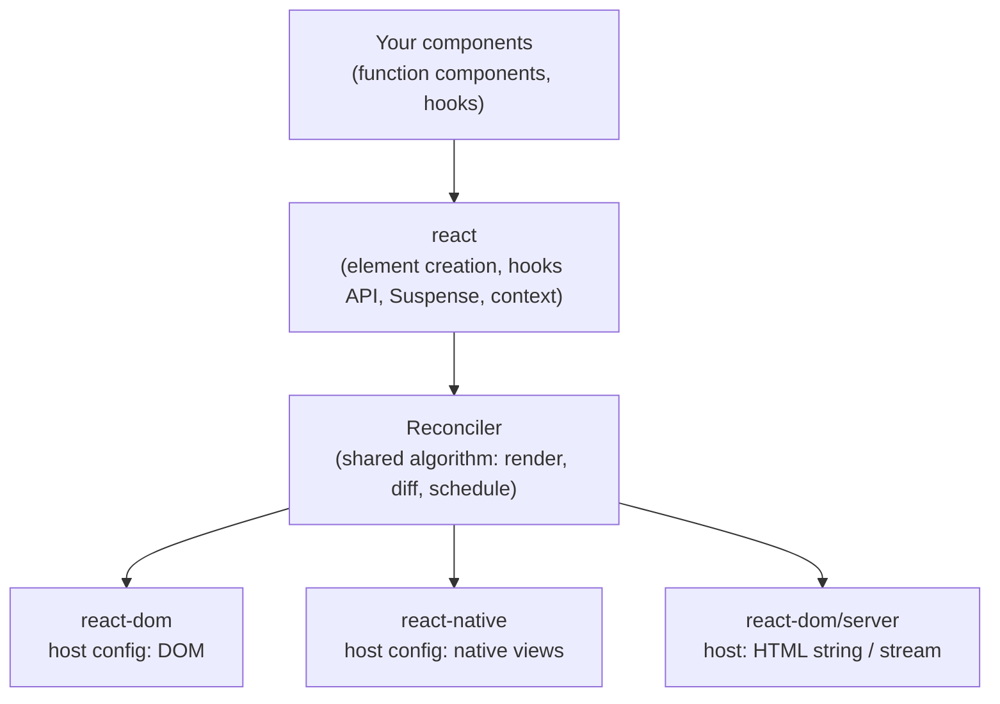
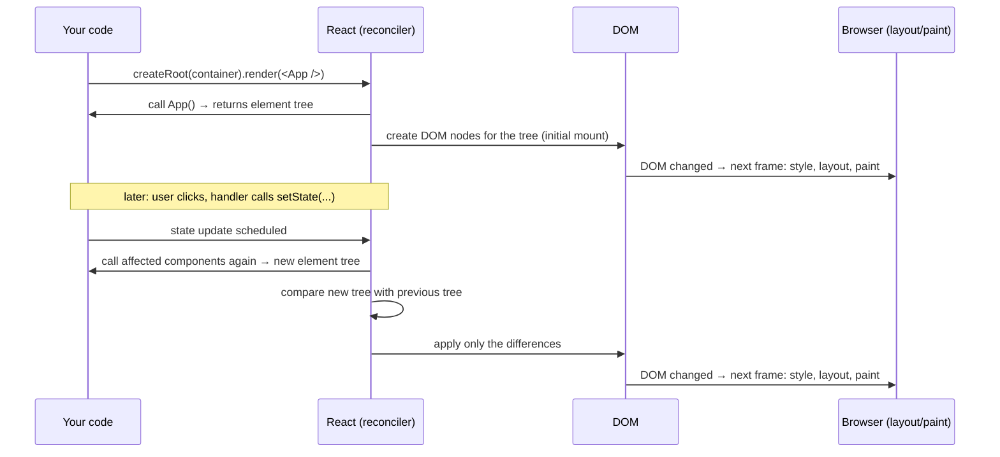
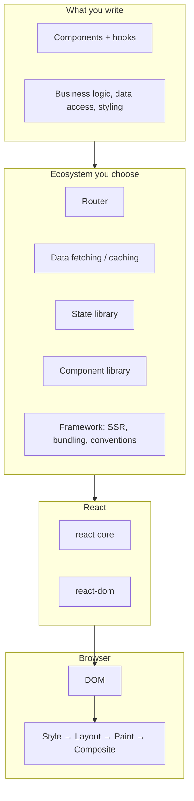

# 01 / 01 — React's Purpose and Philosophy

## 1. Lesson metadata

| | |
|---|---|
| **Level** | Beginner |
| **Study time** | 3–4 hours (reading 1.5 h, experiments 1 h, exercises 1 h) |
| **Prerequisites** | Phase 0, especially [00/01 — How the browser works](../00-web-and-javascript-foundations/01-how-the-browser-works.md) and [00/04 — DOM structure, mutation, and the cost of touching it](../00-web-and-javascript-foundations/04-dom-structure-and-mutation.md). Comfort with ES modules, functions, and objects. |
| **Next** | [02 — Declarative vs imperative UI](./02-declarative-vs-imperative-ui.md) |
| **Related later** | [Phase 2 / 04 — The "virtual DOM"](../02-react-rendering-and-internals/04-virtual-dom-what-it-means.md), [Phase 9 / 09 — Framework architecture](../09-advanced-rendering-and-ecosystem/09-framework-architecture.md) |

**Learning objectives.** After this lesson you can:
1. State, in one paragraph, what problem React solves and what it deliberately does not solve.
2. Distinguish a *library* from a *framework* and place React, `react-dom`, a bundler, a router, and a meta-framework on a map.
3. Explain the packages `react` and `react-dom` and why they are separate.
4. Describe React's core design commitments: declarative UI, components, unidirectional data flow, "learn once, write anywhere".
5. Mount a minimal React 19 application with `createRoot` and explain every line.
6. Recognize common misconceptions ("React is a framework", "React is the virtual DOM", "React is fast because of the virtual DOM").
7. Decide when React is a reasonable choice and when it is not.

**Concepts covered:** UI library vs framework, component model, renderer (host) abstraction, `react` vs `react-dom` vs `react-dom/client`, root, mounting, React's scope (what it owns vs what the ecosystem supplies), React versions timeline at a conceptual level, "learn once, write anywhere", the cost of abstraction.

---

## 2. Deep conceptual explanation

### 2.1 What problem is React solving?

Start from the browser, as established in [00/01](../00-web-and-javascript-foundations/01-how-the-browser-works.md) and [00/04](../00-web-and-javascript-foundations/04-dom-structure-and-mutation.md): the platform gives you a **DOM**, a tree of mutable nodes, and a set of imperative APIs (`createElement`, `appendChild`, `setAttribute`, `addEventListener`, `textContent`). Everything you see on screen is a consequence of what that tree looks like at paint time.

A non-trivial application has *data that changes over time*: a list of orders, whether a menu is open, the text in a search box, a loading flag, a validation error. Each time any of that data changes, the DOM must be brought into agreement with it. Doing that by hand has a well-known failure mode:

> **The synchronization problem.** The truth about the application lives in several places at once (JavaScript variables, the DOM, the URL, the server). Every code path that changes one place must remember to update every other place that depends on it. As features multiply, the number of (change → required DOM updates) pairs grows faster than the number of features, and eventually somebody forgets one. The UI shows stale or contradictory information.

React's answer is not "a faster DOM". It is a **different division of labour**:

- *You* describe, for a given set of data, **what the UI should look like** (a tree of elements).
- *React* is responsible for **making the DOM match** that description, including figuring out the minimal set of DOM operations when the description changes.

The one-line summary used in the React documentation is that React is "the library for web and native user interfaces". The more useful mental summary for this curriculum:

> React is a runtime that repeatedly calls your component functions to obtain a description of the UI, compares successive descriptions, and tells a *host* (the browser DOM, a native view hierarchy, a string builder for HTML...) what to change.

We will unpack each clause over the next 19 lessons. In this lesson we build the map.

### 2.2 Library, framework, and platform

These terms are used loosely. For this curriculum:

| Term | Working definition | Who calls whom | Examples |
|---|---|---|---|
| **Library** | A set of functions/objects you *call* when you need them. | Your code calls the library. | `react`, `lodash`, `date-fns`, TanStack Query |
| **Framework** | Provides the application skeleton and *calls your code* at defined extension points (inversion of control); often prescribes structure, routing, build, data loading. | The framework calls your code. | Next.js, Remix/React Router framework mode, Angular, Nuxt |
| **Platform** | The runtime environment code runs in. | — | The browser, Node.js, React Native's runtime |

React sits in an interesting spot. Its API is small and you call it as a library (`createRoot(...).render(...)`). But once you hand React a component, **React calls your component functions** at times of its choosing; you do not call `Greeting()` yourself. That is a (small) form of inversion of control. The React team's own documentation describes React as a library and recommends using it **with a framework** for production applications ("full-stack" frameworks such as Next.js, and others listed on react.dev) because React alone does not provide routing, data fetching conventions, code splitting, or server rendering infrastructure.

⚠ *Positioning on react.dev has shifted over time.* Earlier docs described building with a build tool like Vite or Create React App as the default; Create React App has been deprecated by the React team. Recommendations for "how to start a new project" change between releases; check <https://react.dev/learn/start-a-new-react-project> for the current stance. This curriculum uses **Vite + TypeScript** for SPA exercises (Phase 1 lesson 19) because it keeps the moving parts visible, and uses a framework (Next.js App Router) in Phase 9 where server features are the topic.

### 2.3 What React owns, and what it does not

This is the most useful table in the lesson, because most "React problems" are really "I assumed React did X" problems.

| Concern | Owned by React core? | Typically supplied by |
|---|---|---|
| Describing UI as a tree (elements, components) | **Yes** | `react` |
| Re-rendering when state changes; deciding what changed | **Yes** | `react` + the renderer |
| Component-local state, context, effects, refs | **Yes** | `react` (hooks) |
| Writing DOM nodes, attributes, event wiring | **Yes (for the web)** | `react-dom` |
| Server-side rendering to HTML / streaming | **Yes (API)** | `react-dom/server`, frameworks wire it up |
| Routing (URL ↔ screens) | No | React Router, TanStack Router, Next.js |
| Data fetching and caching | Partially (Suspense, `use`, Server Components are *primitives*) | TanStack Query, framework loaders |
| Global/client state management | No (only primitives like context, `useReducer`, `useSyncExternalStore`) | Redux Toolkit, Zustand, etc. |
| Styling | No | CSS, CSS Modules, Tailwind, CSS-in-JS |
| Form libraries, validation | Partially (Actions, `useActionState`) | React Hook Form, Zod, native validation |
| Bundling, transpiling JSX/TS, dev server | No | Vite, webpack, Turbopack, esbuild/SWC/Babel ([00/20](../00-web-and-javascript-foundations/20-tooling-transpilation-and-bundling.md)) |
| Layout/paint/compositing | **No** — the browser | Browser ([00/03](../00-web-and-javascript-foundations/03-browser-rendering-pipeline.md)) |

The consequence for a senior engineer: "using React" is really *choosing an ecosystem stack around a small core*. Much of the curriculum after Phase 3 is about the decisions *around* that core.

### 2.4 The design commitments

These are the ideas that make React React. Each gets its own lesson, so here we state them and move on.

1. **Declarative rendering.** You write a function from data to UI description; you do not write step-by-step DOM instructions. ([Lesson 02](./02-declarative-vs-imperative-ui.md), [Lesson 03](./03-ui-as-a-function-of-state.md))
2. **Component-based composition.** The UI is built from small, reusable, composable units, each of which is a function (in modern React) returning UI. ([Lesson 04](./04-elements-components-instances.md), [Lesson 07](./07-composition-and-children.md))
3. **Unidirectional data flow.** Data goes *down* the tree through props; changes are requested *up* through callbacks. ([Lesson 06](./06-props-and-one-way-data-flow.md))
4. **Render as a (mostly) pure calculation.** Rendering computes the description; it does not change the outside world. Side effects are pushed to well-defined places (event handlers, effects). ([Lesson 12](./12-component-purity.md))
5. **Learn once, write anywhere.** The core is host-agnostic. The same component model drives the DOM (`react-dom`), native mobile UI (React Native), and other targets via custom *renderers*. React does not promise "write once, run anywhere": UI primitives differ per host.
6. **Escape hatches.** React provides explicit ways out (refs, effects) for the things that are not declarative: focus, scroll position, third-party widgets, subscriptions. The design intent is that escape hatches are visible and bounded.

### 2.5 The package split: `react`, `react-dom`, and friends

Open `package.json` of any web React project and you see (at least) two dependencies:

| Package | What it is | Imports you will use |
|---|---|---|
| `react` | The **core**: element creation, component model, hooks, `Suspense`, `use`, `memo`, `lazy`, context. Host-independent. | `import { useState } from "react"` |
| `react-dom` | The **web renderer**: knows how to turn React's output into DOM nodes (client) or HTML strings/streams (server). | `import { createRoot } from "react-dom/client"`, `import { createPortal } from "react-dom"`, `react-dom/server` |
| `react/jsx-runtime` | The module the JSX compiler output imports (details in [Lesson 05](./05-jsx-explained.md)). You rarely import it yourself. | (generated by tooling) |
| `@types/react`, `@types/react-dom` | TypeScript definitions (maintained by DefinitelyTyped, not by the React team). | types only |

Why split? Because the *same* component and hook code must run against *different hosts*. A conceptual diagram:



⚠ *Teaching model.* The diagram shows the conceptual layering. In practice the reconciler code is bundled *into* each renderer package (for instance, `react-dom` ships with a copy of the reconciler built for the DOM host), not a separately installed runtime. That is an implementation detail of how React is packaged and may change; the portable idea is "one component model, pluggable hosts". You will see why this matters in [Phase 2 / 04](../02-react-rendering-and-internals/04-virtual-dom-what-it-means.md).

### 2.6 A short conceptual timeline

You do not need dates for engineering decisions, but the *sequence of ideas* explains why legacy code looks the way it does. Statements below are conceptual; verify exact release numbers in the official changelog (<https://github.com/facebook/react/blob/main/CHANGELOG.md>).

| Era | Conceptual change | Why you still care |
|---|---|---|
| Early (open-sourced by Facebook in 2013) | Components as classes with `render()`, JSX, a diffing algorithm, one-way data flow | Old tutorials, class components in legacy codebases |
| Middle | Function components + **Hooks** (React 16.8) become the primary style | Almost all modern code; classes are legacy |
| React 16 | **Fiber** rewrite (new reconciler architecture) enabling incremental rendering | Foundation for concurrency ([Phase 2/08](../02-react-rendering-and-internals/08-why-fiber.md)) |
| React 18 | **Concurrent rendering** opt-in via `createRoot`; automatic batching; transitions; streaming SSR + Suspense | `ReactDOM.render` became legacy; many "why did this change" questions |
| React 19 | **Actions** and form-related hooks, `use`, `ref` as a prop, Server Components stable in the API surface, improved hydration errors, document metadata support | This curriculum's baseline |

⚠ *Version-sensitive.* The details of what shipped in each version change how you write code (e.g. `forwardRef` becoming unnecessary in 19). The lessons flag these as they come up.

### 2.7 "Learn once, write anywhere" vs "write once, run anywhere"

React Native uses the same *component model* and hooks but its host primitives are `View`, `Text`, `Pressable`, not `div`, `span`, `button`. A React web component library does not run unchanged in React Native. What transfers is **the mental model** (state, props, effects, composition) and often business logic and hooks. Do not claim cross-platform component reuse unless a library such as react-native-web or a design system explicitly provides it.

### 2.8 Common misconceptions

| Misconception | Reality |
|---|---|
| "React is a framework." | React's core is a UI library. Routing, data layer, bundling, SSR plumbing come from elsewhere. Frameworks built on React (Next.js etc.) add those. |
| "React *is* the virtual DOM." | The "virtual DOM" is a popular name for a *technique* (describe UI as plain data, then diff). React's real design is broader: components, hooks, a scheduler, Suspense, Server Components. The React team itself de-emphasizes the term. See [Phase 2/04](../02-react-rendering-and-internals/04-virtual-dom-what-it-means.md). |
| "React is fast because it avoids touching the real DOM." | React must do *extra* work (calling components, diffing) beyond what hand-written DOM code does. It is fast *enough* and keeps update cost proportional to what changed, while keeping code maintainable. Hand-tuned vanilla JS can be faster for a *specific* known update. |
| "React re-renders the whole page on every change." | A state change re-renders the *component that owns the state and its descendants* (unless bailed out); it then commits only the DOM differences. The distinction between "render" and "touch the DOM" is central ([Phase 2/02](../02-react-rendering-and-internals/02-render-reconcile-commit-paint.md)). |
| "JSX is HTML in JavaScript." | JSX is syntax that compiles to JavaScript function calls producing plain objects. Similar to HTML, but different rules ([Lesson 05](./05-jsx-explained.md)). |
| "Components are objects/instances I create with `new`." | Function components are functions React calls. There is no instance you hold ([Lesson 04](./04-elements-components-instances.md)). |
| "React manages the browser's screen." | React mutates the DOM; the browser lays out and paints afterward ([00/01](../00-web-and-javascript-foundations/01-how-the-browser-works.md)). |

---

## 3. Internal mechanics

At this level we introduce a **teaching model** of how a React web app turns your code into pixels. The deep version is Phase 2.

### 3.1 The three actors

1. **Your code**: component functions, event handlers.
2. **React (core + reconciler)**: calls your functions, holds per-component state and bookkeeping, compares the new output to the previous, schedules work.
3. **The host (DOM)**: receives imperative instructions (create node, set attribute, remove node) from the renderer and, later, the browser paints.

### 3.2 The lifecycle of a React web app in one pass

*Teaching model:*



*Public guarantee:* when you call a state setter, React will (eventually, and batched) re-run the affected component functions and make the DOM reflect the result. *Teaching model:* "compare the new tree with the previous tree" is the reconciliation step. *Implementation detail:* the data structures that hold the previous tree (Fiber nodes), the scheduling priorities, and whether a render is interrupted are internal and have changed across versions.

### 3.3 What "mount" means

**Mounting** is the first time a React tree is turned into DOM under a container. `createRoot(container)` creates a *root*, an object that React uses to track the tree rendered into that DOM element. `root.render(<App />)` schedules the initial render. After that, updates are triggered by state changes, not by calling `render` again (calling `root.render` again with a new element is legal, but is rarely what you want in an app).

⚠ *Version-sensitive.* Before React 18 the entry point was `ReactDOM.render(<App />, container)`. In 18 it was deprecated in favour of `createRoot` (which enables concurrent features); in React 19 `ReactDOM.render` and `ReactDOM.hydrate` were removed from `react-dom`. Treat any tutorial using `ReactDOM.render` as legacy. (Verify against the React 19 upgrade guide linked in §14.)

---

## 4. Step-by-step execution walkthrough

We trace a complete, tiny app: a page with a counter. We will write the code in §5.1; here we reason about *time*.

**Setup phase (once).**

1. The browser requests `index.html`. It contains `<div id="root"></div>` and `<script type="module" src="/src/main.tsx">`. ([00/01 §2.6](../00-web-and-javascript-foundations/01-how-the-browser-works.md))
2. The script (already transpiled from TSX by the build tool/dev server) is downloaded and executed.
3. `main.tsx` imports `react`, `react-dom/client`, and `App`. Module evaluation runs; no component has been called yet.
4. `createRoot(document.getElementById("root")!)` returns a root bound to that DOM element.
5. `root.render(<App />)`: first the JSX expression is evaluated, producing a plain object (an *element*) describing "an `App`". Then `render` hands it to React, which schedules rendering.

**Initial render (mount).**

6. React calls `App()`. Inside, `useState(0)` returns `[0, setCount]` for this component. `App` returns an element tree, e.g. a `div` containing a heading and a button.
7. React creates DOM nodes for the tree (`div`, `h1`, `button`, text nodes), sets attributes and wires event handling, then inserts the finished subtree into `#root` as one operation.
8. The browser notices the DOM changed and, on its next rendering opportunity, performs style, layout, paint, and composite. The user sees the counter.

**Interaction (update).**

9. The user clicks the button. The browser queues a click task; the handler React attached runs (React's event handling is the subject of [Lesson 10](./10-event-handling.md)).
10. The handler calls `setCount(c => c + 1)`. This does **not** change `count` immediately and does **not** touch the DOM. It tells React "this component has a pending update".
11. After the handler finishes, React processes the update: calls `App()` again. `useState` now returns `[1, setCount]`. `App` returns a new element tree identical in shape, but with text `"Count: 1"`.
12. React compares the new tree to the previous one, finds exactly one difference (a text node), and performs the corresponding DOM write (`textContent`/text node data update).
13. The browser paints at the next frame.

*Prediction checkpoint:* In step 11, was the `<div>` DOM node destroyed and recreated? *No.* React compared the new description to the previous one, saw the same element type in the same position, and *reused* the existing DOM node, updating only what differed. This reuse is what makes identity and `key` matter later ([Lesson 09](./09-lists-keys-and-identity.md)).

---

## 5. Code examples

### 5.1 Minimal example — mounting a React 19 app

```tsx
// src/main.tsx
import { StrictMode, useState } from "react";
import { createRoot } from "react-dom/client";

function App() {
  const [count, setCount] = useState(0);

  return (
    <main>
      <h1>Count: {count}</h1>
      <button type="button" onClick={() => setCount((c) => c + 1)}>
        Increment
      </button>
    </main>
  );
}

const container = document.getElementById("root");
if (!container) throw new Error("Missing #root element");

createRoot(container).render(
  <StrictMode>
    <App />
  </StrictMode>,
);
```

Line notes:

- `import { StrictMode, useState } from "react"`: the core package. Nothing here touches the DOM.
- `import { createRoot } from "react-dom/client"`: the web renderer's client entry. Server rendering APIs live elsewhere (`react-dom/server`).
- `function App()`: a **component** is just a function whose name starts with an uppercase letter and which returns something React can render (JSX, strings, numbers, `null`, arrays...). Details in [Lesson 04](./04-elements-components-instances.md).
- `useState(0)`: a **hook**. It returns the current state value and a setter. React associates this state with *this component's position in the tree*, not with the function itself. Details: [Lesson 03](./03-ui-as-a-function-of-state.md), [Phase 3/01](../03-react-state-and-hooks/01-usestate-internals-and-update-semantics.md).
- `<button type="button" ...>`: always specify `type` for buttons not meant to submit a form. This is plain HTML semantics, not React.
- `onClick={() => setCount((c) => c + 1)}`: the handler receives no state directly; it asks React to schedule an update. The functional form `(c) => c + 1` is safest when the next value depends on the previous (explained in [Phase 3/02](../03-react-state-and-hooks/02-functional-state-updates.md)).
- `if (!container) throw ...`: `getElementById` returns `HTMLElement | null`; failing loudly is better than a non-null assertion that crashes later with a confusing message.
- `StrictMode`: a development-only wrapper that makes certain bugs visible (double-invoking component functions, re-running effects). It has no effect on production behavior. ([Phase 2/28](../02-react-rendering-and-internals/28-strict-mode-behavior.md).)

**Predict:** With `StrictMode`, how many times is `App` *called* on initial mount in development, and how many times is the `<h1>` DOM node *created*?

**Result:** In development, React deliberately calls the component function **twice** on mount (the second call's result is discarded for rendering purposes) to help surface impure rendering; the DOM node is created **once**. In production, `App` is called once. *Why:* StrictMode's double invocation checks that your component is a pure calculation, i.e., that calling it twice with the same inputs is harmless. ⚠ *Implementation detail:* the exact double-invocation behaviors (components, state initializers, reducers, effects re-run on mount) are documented behavior of StrictMode in development, but their precise details have evolved between versions; see Phase 2 lesson 28 and the React reference for `StrictMode`.

### 5.2 Practical example — the same idea compared with vanilla DOM code

A "like" button with a counter, written imperatively and with React. We do not judge them yet ([Lesson 02](./02-declarative-vs-imperative-ui.md) does); we observe *where the truth lives*.

```ts
// Vanilla
const btn = document.querySelector<HTMLButtonElement>("#like")!;
const label = document.querySelector<HTMLSpanElement>("#label")!;
let likes = 0;
let liked = false;

btn.addEventListener("click", () => {
  liked = !liked;
  likes += liked ? 1 : -1;
  btn.textContent = liked ? "Unlike" : "Like";
  label.textContent = `${likes} likes`;
  btn.setAttribute("aria-pressed", String(liked));
});
```

```tsx
// React
import { useState } from "react";

export function LikeButton({ initialLikes = 0 }: { initialLikes?: number }) {
  const [liked, setLiked] = useState(false);
  const likes = initialLikes + (liked ? 1 : 0);

  return (
    <>
      <button type="button" aria-pressed={liked} onClick={() => setLiked((l) => !l)}>
        {liked ? "Unlike" : "Like"}
      </button>
      <span>{likes} likes</span>
    </>
  );
}
```

Observations:

- In the vanilla version, three things (`btn.textContent`, `label.textContent`, `aria-pressed`) must be updated by hand in the handler, and a *second* handler (say, "reset") would have to remember all three too.
- In the React version the handler changes one fact (`liked`). The button text, the label, and `aria-pressed` are *computed* from it every render, so they cannot disagree.
- Note that `likes` is **derived** (`initialLikes + ...`), not separate state. Redundant state is a classic source of bugs ([Lesson 03](./03-ui-as-a-function-of-state.md)).
- The React version also adds accessibility information (`aria-pressed`) as part of the same description, which makes it easier to keep the accessible state and the visual state aligned.

**Trade-off:** the vanilla version has no library cost and, for this single widget, runs faster. The React version pays for the library but scales its *cognitive* cost sub-linearly as the UI grows.

### 5.3 Incorrect example — thinking of components as things you call

```tsx
// ❌ Incorrect
function Counter() {
  const [count, setCount] = useState(0);
  return <button onClick={() => setCount(count + 1)}>{count}</button>;
}

function App() {
  // Calling the component directly instead of rendering it as an element
  return <div>{Counter()}</div>;
}
```

**Predict:** What happens, and does it fail immediately?

**Result:** In this particular snippet, it *appears to work* initially, but the hook `useState` inside `Counter` is now being called as part of **`App`'s** render, so the state belongs to `App`, not to a `Counter` component. If `App` later conditionally calls `Counter()`, the order of hook calls changes between renders and React throws errors about hooks ("Rendered more hooks than during the previous render" or a related message). Even when it does not crash, you lose the `Counter` boundary: DevTools shows no `Counter` component, you cannot give it a `key`, and it cannot be skipped or wrapped independently.

**Why wrong:** React must be the one that *calls* your component, because it needs to know which component's state/effect slots a hook call belongs to. Always write `<Counter />`.

### 5.4 Corrected implementation

```tsx
// ✅ Correct
function App() {
  return (
    <div>
      <Counter />
    </div>
  );
}
```

`<Counter />` creates an *element* of type `Counter`. React decides when and how to call `Counter()`, and attaches `Counter`'s hook state to its own position in the tree. (The exact mechanism, "how hooks attach to Fiber", is Phase 2 lesson 17.)

### 5.5 Advanced example — a minimal custom "renderer" idea (conceptual)

You will not write a renderer in this curriculum, but the *concept* is powerful: "React = reconciler + host". The following is **not** the actual React Reconciler API, only a conceptual sketch of the contract a host must fulfill:

```ts
// Conceptual only: not the real react-reconciler host config interface.
interface Host<Node, Props> {
  createNode(type: string, props: Props): Node;
  appendChild(parent: Node, child: Node): void;
  removeChild(parent: Node, child: Node): void;
  setProps(node: Node, prev: Props, next: Props): void;
  setText(node: Node, text: string): void;
}
```

The real package for building custom renderers is `react-reconciler`; its API is intentionally low-level and changes between versions *(verify against the package README and source before attempting)*. The takeaway: the DOM is just *one* host. This is why `react` itself never mentions `document`.

---

## 6. Visual explanations

### 6.1 The React application stack



### 6.2 Who does what when state changes

```text
setCount(...)                  ← you ask for an update (event handler)
     │
     ▼
React schedules a render       ← React (scheduler)
     │
     ▼
Component functions re-run     ← your code, called BY React (render phase)
     │
     ▼
New element tree compared      ← React (reconciliation)
with previous tree
     │
     ▼
Minimal DOM writes             ← react-dom (commit phase)
     │
     ▼
Style → layout → paint         ← browser (later, at a rendering opportunity)
```

---

## 7. Alternative approaches and trade-offs

How to build an interactive web UI:

| Approach | Readability at scale | Runtime performance (typical) | Learning/ecosystem | Testability | When to prefer |
|---|---|---|---|---|---|
| **Server-rendered HTML + a little JS** (htmx, Hotwire, plain forms) | High for content sites | Excellent first load | Small; tied to server stack | Server-side tests | Content-heavy sites, CRUD with low interactivity |
| **Vanilla JS / Web Components** | Degrades as state grows | Excellent when small | No dependency; platform standard | Moderate | Small widgets; embeddable components; no-framework constraints |
| **React** | High (declarative components) | Good; extra work per update is bounded and optimizable | Largest ecosystem and hiring pool | Strong tooling (RTL, Vitest) | Complex, interactive UIs with lots of state; teams sharing component libraries; React Native reuse of knowledge |
| **Other UI libraries** (Vue, Svelte, Solid, Angular) | High | Svelte/Solid often lower runtime overhead (compile-time or fine-grained reactivity) | Smaller or different ecosystems | Good | Teams with existing expertise; performance-critical fine-grained updates; opinionated full frameworks (Angular) |
| **React + framework** (Next.js, React Router framework mode...) | High | Good with SSR/streaming | Large, but framework lock-in | Mixed | Public-facing apps needing SEO, server data loading, routing conventions |

**When React is *not* the best choice:** a marketing site with two interactive widgets (server-rendered HTML with islands, or no JavaScript framework at all, is simpler and faster); a widget that must be embedded into arbitrary third-party pages with a tiny payload budget (Web Components or a tiny library); a team of experienced Angular developers delivering an internal tool on a deadline (switching costs outweigh React's advantages). The point of this curriculum is to make you able to argue that decision, not to assume it.

---

## 8. Best practices and anti-patterns

**Do**
- Treat React as a rendering library and pick the rest of the stack deliberately; record decisions (see Phase 10 lesson 16 on ADRs).
- Use function components and hooks for new code.
- Use `createRoot` (client) / `hydrateRoot` (hydrating server HTML), never `ReactDOM.render`.
- Keep `<StrictMode>` on in development.
- Render semantic HTML. React does not make `<div onClick>` accessible; use `<button>`, `<a>`, `<label>`, headings and landmarks. Accessibility is a property of the DOM React produces.

**Beginner mistakes**
- Calling components as functions (`Counter()`), §5.3.
- Treating React as responsible for things it is not (routing, data caching, auth).
- Querying and mutating the DOM directly (`document.querySelector(...).textContent = ...`) inside components: React will not know, may overwrite, and your change will be inconsistent with React's model. (Refs are the sanctioned escape hatch.)
- Believing hooks are "magic" and can be called anywhere; they have rules ([Phase 3/16](../03-react-state-and-hooks/16-rules-of-hooks-and-composition.md)).

**Experienced-developer mistakes**
- Importing patterns from class-based or MVC frameworks (instance fields as state, lifecycle thinking everywhere).
- Over-adopting libraries before understanding what React already provides.
- Assuming that "React re-rendering" means "slow"; renders are cheap *calls*; commits are the visible cost. Premature memoization is a common failure ([Phase 7/04](../07-performance/04-memoization-trade-offs.md)).

**Smells:** a `useEffect` that sets state purely to mirror other state; DOM queries in components; a "Utils" folder that is secretly a global store.

**Justified exceptions:** direct DOM access via refs for focus management, measurement, or integrating a non-React widget (map, rich text editor); legacy class components in a stable codebase where a rewrite has no business value.

---

## 9. Real-world application

*E-commerce storefront.* Product listings, filters, a cart drawer, checkout. The state graph is dense: selected filters affect the list, the cart affects the header badge and the checkout button, stock affects availability messaging. Hand-managed DOM updates are exactly the "synchronization problem" of §2.1. Engineering constraints: SEO on product pages (needs server rendering, hence a framework), performance budget on mobile (bundle size matters; React core is a fixed cost, so be judicious with dependencies), accessibility (focus management in the cart drawer, announcements for cart updates), and team scale (a shared component library).

*Internal admin dashboard.* No SEO, authenticated, heavy forms and tables, many teams contributing. A client-rendered SPA (Vite) is often perfectly reasonable; the constraints that dominate are testability, consistent UX via a design system, and the data layer.

*Counter-example.* A static documentation site with search. Interactivity is small; content must be fast and indexable; shipping React to render mostly static text costs bundle size for little benefit. Many such sites ship little or no client JS, or use React only on interactive islands.

The skill being trained: look at the product's constraints (SEO, interactivity, team size, device profile) before reaching for a tool.

---

## 10. Debugging and troubleshooting

**Symptom 1:** "I see a blank page and the console says `Target container is not a DOM element`."
- *Repro:* `createRoot(document.getElementById("rooot")!)` (typo) or the script runs before the element exists.
- *Investigate:* Elements panel: does `#root` exist at script execution time? Module scripts (`type="module"`) are deferred by default, so placing the script in `<body>` after the element, or using a module script, works; a classic script in `<head>` runs before the body is parsed ([00/02](../00-web-and-javascript-foundations/02-html-parsing-dom-cssom-render-tree.md)).
- *Root cause:* container is `null` or not an element.
- *Validate:* the app mounts; add the explicit `if (!container) throw` guard so the failure is readable.

**Symptom 2:** "My tutorial's `ReactDOM.render` call throws / is undefined in React 19."
- *Root cause:* removed API (§3.3). Replace with `createRoot(container).render(...)`.

**Symptom 3:** "JSX syntax error: unexpected token `<`."
- *Root cause:* the file is not being processed by a JSX-aware transform (a `.js` file in a toolchain configured to treat only `.jsx/.tsx` as JSX, or no transform at all). See [00/20](../00-web-and-javascript-foundations/20-tooling-transpilation-and-bundling.md) and [Lesson 05](./05-jsx-explained.md).

**Symptom 4:** "Two copies of React" (`Invalid hook call` appears when using a linked package).
- *Investigate:* the browser loads two instances of `react` (a library bundled its own, or a monorepo link resolved a second copy). In DevTools Sources/Network, search for duplicate `react` bundles; check the lockfile with your package manager's `why`/`ls` command for multiple versions.
- *Root cause:* hooks rely on shared internal state in a single `react` instance.
- *Fix:* make libraries list `react` as a **peer dependency**, dedupe in the bundler, and ensure one copy.

**Tooling:** install **React Developer Tools** (browser extension); the Components tab shows your component tree, which is *different* from the DOM tree. ([Lesson 18](./18-react-devtools.md).)

---

## 11. Exercises

### Level A — Knowledge
A1. In your own words, what problem does React solve, and what *division of labour* does it propose?
A2. What is the difference between `react` and `react-dom`? Why are they separate?
A3. Name four things React does *not* provide that a typical production app needs.
A4. What replaced `ReactDOM.render`, and what capability did the replacement enable?
A5. True or false: "React's job is to repaint the page efficiently." Justify.

### Level B — Code comprehension
B1. What does this program log, and in what order? Assume it runs in a browser with an empty `<div id="root">`.
```tsx
import { createRoot } from "react-dom/client";

function Hello() {
  console.log("render Hello");
  return <p>Hello</p>;
}

console.log("before");
const root = createRoot(document.getElementById("root")!);
console.log("created root");
root.render(<Hello />);
console.log("after render call");
```
B2. In §5.1, a user clicks "Increment" three times quickly. How many times is the DOM text node for the heading *updated*, at minimum and at maximum? Is it guaranteed?
B3. What is wrong with this component, and what error class results?
```tsx
function Page({ admin }: { admin: boolean }) {
  if (admin) {
    const [open, setOpen] = useState(false);
    return <Panel open={open} onToggle={() => setOpen(!open)} />;
  }
  return <p>No access</p>;
}
```

### Level C — Implementation
C1. Create a `Greeting` component taking a `name: string` prop and rendering `<h1>Hello, {name}</h1>`. Mount it with `createRoot` with a runtime guard on the container.
C2. Convert the vanilla "like" example (§5.2) so that a second button, "Reset", sets likes back to the initial value and un-likes. Do it in React; then describe how many places in the vanilla version you would have had to edit.

### Level D — Debugging
D1. A teammate's app renders fine in dev but a library component throws "Invalid hook call" only after they `npm link` the library. List two likely root causes and how to confirm each.
D2. The page is blank. Console: `Uncaught TypeError: Cannot read properties of null (reading 'render')`. The code is `const root = createRoot(el); root.render(<App />)`, where `el = document.querySelector("#app")`, but the HTML has `<div id="root">`. Explain precisely which line fails *and which one error message you would expect to see first*.

### Level E — Architecture and engineering decisions
E1. A company has a 12-page marketing site (mostly static, SEO critical), one interactive pricing calculator, and a logged-in dashboard. Propose where React should and should not be used and justify.
E2. Your team is debating "plain Vite SPA vs Next.js" for a new customer portal behind login. List the criteria you would use, and state which facts about the product would flip the decision.

### Level F — Expert challenge
F1. Explain, using the actors in §3.1, why the claim "React updates the DOM when state changes" is imprecise in at least three ways. Then restate it accurately.

---

## 12. Detailed answers and explanations

> Attempt the exercises first.

**A1.** React lets you *describe* the UI for a given set of data and takes responsibility for *updating the DOM* to match, instead of you issuing step-by-step DOM mutations for every possible change. It solves the synchronization problem between changing data and a changing DOM tree. A common incomplete answer: "it's faster than the DOM". Faster is not the primary claim; manageability at scale is.

**A2.** `react` is the host-independent core (components, hooks, element creation, Suspense, context). `react-dom` is the web renderer (DOM mounting, hydration, portals, server rendering entry points). They are separate so the same core can drive other hosts (React Native, test renderers, custom renderers). Wrong answer: "`react-dom` is the virtual DOM". Wrong because "virtual DOM" is not a package; the reconciliation machinery is shared infrastructure that is packaged inside each renderer.

**A3.** Any four: routing, data fetching/caching conventions, global state management library, bundling/transpiling, SSR server infrastructure, styling system, form validation libraries, auth, internationalization. (React provides *primitives* for several, such as Suspense and Actions.)

**A4.** `createRoot` (from `react-dom/client`). It opted the app into the concurrent renderer in 18 (features such as transitions and automatic batching of updates in more contexts). `ReactDOM.render` was removed in 19. Also `hydrateRoot` replaced `ReactDOM.hydrate`.

**A5.** False. The browser repaints. React computes what the DOM should look like and mutates the DOM; paint happens later in the browser's rendering pipeline. React can influence *when* DOM changes happen and how much main-thread time rendering consumes, but it never paints.

**B1.** Output order: `before`, `created root`, `after render call`, then `render Hello` (in StrictMode-less code, once; and this snippet has no StrictMode). Reasoning: `createRoot` only creates a root; `root.render(...)` **schedules** the render; it does not synchronously call `Hello`. (React 18+/19 `root.render` is asynchronous with respect to the caller.) A common wrong answer is `before, created root, render Hello, after render call`. That would be true of a synchronous legacy mode in older versions, not of `createRoot`. Edge case: in dev with `StrictMode` wrapping `<Hello/>`, `render Hello` would be logged twice, and React DevTools may dim the second log in the console by default.

**B2.** Not guaranteed, but React batches updates inside the same event: each click is a separate event, so three clicks typically produce up to three renders and three text updates. If clicks are queued behind a long task and processed back-to-back, each click handler is still its own event; React may render between them or batch depending on timing/priority. Minimum is 1 only if all three updates are batched into a single render (which can happen when they are queued before React gets to process them); maximum 3. The robust statement: "one DOM text update per rendered change, never more than one per click; you must not depend on the exact number". Wrong assumption: "React writes the DOM synchronously in `setCount`". It does not.

**B3.** The hook `useState` is called conditionally, violating the Rules of Hooks. When `admin` changes between renders, React sees a different number/order of hook calls and throws a "Rendered more hooks than during the previous render" (or "fewer") error; the lint rule `react-hooks/rules-of-hooks` catches it statically. Fix: call `useState` unconditionally at the top, or split into two components (`AdminPanel` with its own state, rendered conditionally).
```tsx
function Page({ admin }: { admin: boolean }) {
  return admin ? <AdminPanel /> : <p>No access</p>;
}
function AdminPanel() {
  const [open, setOpen] = useState(false);
  return <Panel open={open} onToggle={() => setOpen((o) => !o)} />;
}
```

**C1. Sample solution**
```tsx
import { createRoot } from "react-dom/client";

function Greeting({ name }: { name: string }) {
  return <h1>Hello, {name}</h1>;
}

const container = document.getElementById("root");
if (!container) throw new Error("#root not found");
createRoot(container).render(<Greeting name="Ada" />);
```
Evaluation criteria: component name capitalized; prop typed; JSX expression `{name}`; guard on container; `createRoot` imported from `react-dom/client`. Edge case: `name` containing `<script>` is rendered as text, not as HTML (React escapes text children, [Lesson 05](./05-jsx-explained.md)).

**C2. Sample solution**
```tsx
export function LikeButton({ initialLikes = 0 }: { initialLikes?: number }) {
  const [liked, setLiked] = useState(false);
  const likes = initialLikes + (liked ? 1 : 0);
  return (
    <>
      <button type="button" aria-pressed={liked} onClick={() => setLiked((l) => !l)}>
        {liked ? "Unlike" : "Like"}
      </button>
      <span>{likes} likes</span>
      <button type="button" onClick={() => setLiked(false)}>Reset</button>
    </>
  );
}
```
In the vanilla version, "Reset" must replicate: `liked = false`, `likes = initial`, `btn.textContent`, `label.textContent`, `aria-pressed`: five edits, all of which must stay in sync with the click handler. In React: one line, because the rest is derived. Evaluation: did you avoid storing `likes` as separate state? If you did, "Reset" needs two setters and a risk of inconsistency.

**D1.** (1) Two copies of `react` loaded (the linked library resolved its own `node_modules/react`). Confirm: Network/Sources panel shows two React bundles, or in the console `window.React1 === window.React2` style checks via a temporary export; package manager `ls react`. (2) Version mismatch between `react` and `react-dom` copies, or the linked library calls hooks outside a component (violating rules). Confirm by reading the full error text, which lists three common causes (mismatched versions, breaking the rules of hooks, more than one copy of React). Fix: peer dependency declaration, bundler `resolve.dedupe`/alias, or `npm link` of `react` from the app into the library.

**D2.** `document.querySelector("#app")` returns `null`. The next line `createRoot(el)` is where React complains first: it throws an error that the target container is not a DOM element (*not* "reading 'render'"), because `createRoot(null)` validates its argument. The message "Cannot read properties of null (reading 'render')" would only occur if `createRoot` returned null, which it never does. So the premise in the report is wrong: either the quoted error is from different code, or `el` was non-null but something else was null. Lesson: read stack traces; the first failing line is the diagnosis, and the reported message must match the code. (If your memory of the exact message differs by version, the principle holds: the failure occurs at `createRoot`.)

**E1.** A good answer: marketing pages are static and SEO-critical, so they should be server-rendered/static HTML with minimal or no client JS; the calculator is an *island* of interactivity where React (or any small library) is reasonable; the dashboard is behind login, highly interactive, and benefits from React's component model, so a React SPA or framework route is appropriate. Criteria: SEO, interactivity density, bundle budget, team skills, deployment complexity. Pitfall to call out: forcing everything into a single client-rendered React app because "we're a React shop" harms the marketing pages. A framework that supports mixed rendering (static + client) can unify the approach, at the cost of framework coupling.

**E2.** Criteria: need for server rendering/SEO (portal behind login usually not), data loading complexity and caching needs, team familiarity, deployment targets (static hosting vs Node server), routing needs, long-term maintenance and upgrade burden, bundle/performance budget, API ownership (BFF needs). Facts that flip toward a framework: public pages in the portal, need for server-side auth/session handling near the data, streaming/SSR for slow networks, multiple teams needing conventions. Facts that favor Vite SPA: purely authenticated app, existing API, static hosting preference, wish to avoid framework upgrade churn. A defensible answer chooses one and states the trigger that would change the choice.

**F1.** Imprecise because: (1) React doesn't update the DOM *when* state changes: it *schedules* a render; the setter returns immediately and the DOM changes later at commit. (2) React updates the DOM only for *differences* between the previous and next descriptions, not "re-creating" it. (3) The user does not see the change when React finishes; the browser must still run style/layout/paint. (4) State changes do not themselves modify the DOM: *your component functions are re-run*, producing a new description. Accurate restatement: "A state update schedules a re-render of the owning component subtree; React calls the affected components to get a new element tree, reconciles it with the previous one, applies the minimal necessary DOM mutations in a commit, and the browser later paints the result." Evaluation criteria: names scheduling, render vs commit, diffing, and browser paint.

---

## 13. Senior engineer interview questions

**Q1. "Is React a framework? Why does it matter?"**
*Strong answer:* Core React is a UI library: it does rendering and a component model but not routing, data fetching conventions, or build tooling. It matters for architecture and hiring: "we use React" under-specifies the stack; the real decisions are the router, data layer, rendering strategy (CSR/SSR/RSC), and build chain. It also matters for risk: a framework (Next.js etc.) adds upgrade paths and lock-in that a plain React + Vite SPA does not.

**Q2. "Why not just manipulate the DOM directly? When would you?"**
*Strong answer:* Direct manipulation is fine and often best for small, bounded widgets, performance-critical hot paths where you know exactly what changes, or embedded contexts with no framework budget. It breaks down when many pieces of state affect many parts of the UI because each change path must remember every dependent update (the synchronization problem). React trades some runtime overhead for a model where the UI is a pure-ish function of state, which is easier to reason about and test. I'd use direct DOM (via refs) *inside* React for focus, measurements, or third-party widgets.

**Q3. "What does `react-dom` do that `react` doesn't, and why does it matter?"**
*Strong answer:* `react` defines what a component is and how state/effects attach; `react-dom` is the host binding that creates and updates DOM nodes, attaches events, supports portals, and provides server rendering and hydration. The split lets the same model target native, test, or custom hosts. It matters when debugging "two Reacts" problems, for understanding why hooks run in tests via a test renderer, and for understanding that anything involving DOM (e.g., `flushSync`, `createPortal`) lives in `react-dom`.

**Q4. "Is the virtual DOM the reason React is fast?"**
*Strong answer:* No, not as a blanket claim. Producing a tree description and diffing it is *extra* work compared with a perfectly targeted manual DOM update. What the approach buys is a *programming model* (declarative) with acceptable and bounded cost, and the ability to batch and schedule work. Performance comes from rendering less, committing less, and scheduling well; and many of React's recent advances (concurrent rendering, compiler-based memoization, Server Components) are about reducing or prioritizing work rather than about the diff. (Detailed in Phase 2/04.)

**Q5. "A junior asks why `root.render()` didn't synchronously call their component. How do you explain it?"**
*Strong answer:* `render` schedules work on the root; React decides when to run it (batching, priorities). The contract: your component may be called later, more than once, and (in StrictMode) twice, so components must be pure calculations and must not rely on call timing. That's the first appearance of the purity requirement in Lesson 12.

---

## 14. Further learning resources

| Resource | URL | Covers / why | Level | Study |
|---|---|---|---|---|
| React docs — Quick Start | <https://react.dev/learn> | Official introduction to components, JSX, state | Beginner | Read the whole page |
| React docs — Start a New React Project | <https://react.dev/learn/start-a-new-react-project> | The team's current recommendations for frameworks vs build tools | Beginner | Whole page; compare with your own decision |
| React docs — Thinking in React | <https://react.dev/learn/thinking-in-react> | Decomposing a UI into components and state | Beginner | Whole page |
| React docs — `createRoot` reference | <https://react.dev/reference/react-dom/client/createRoot> | Exact semantics of roots and rendering | Beginner–Int. | Usage, Caveats |
| React docs — React 19 release/upgrade guide | <https://react.dev/blog/2024/04/25/react-19-upgrade-guide> | Removed APIs (`ReactDOM.render` etc.) and migration steps | Intermediate | Breaking changes |
| React versions page | <https://react.dev/versions> | Current versions and release links | All | Check before upgrading |
| React source repository | <https://github.com/facebook/react> | Source, changelog, issues | Advanced | `CHANGELOG.md`, `packages/` directory layout *(verify current structure)* |
| MDN — Document Object Model | <https://developer.mozilla.org/en-US/docs/Web/API/Document_Object_Model> | The platform API React drives | Beginner | Introduction |

URLs in this table were checked for HTTP 200 on 2026-10-22; any still marked *(unverified)* could not be checked automatically (blocked or unreachable). A 200 response does not guarantee the page content still matches the description; if a link has moved, search the site for the quoted title.

---

## 15. Knowledge checkpoint

**You should now understand**
- React as a UI library built around describing UI as a function of data, with the host (DOM) updated by a renderer.
- The split between `react` (core) and `react-dom` (web host), and the ecosystem pieces React does not provide.
- That `root.render` schedules work and that components are called *by React*, not by you.
- Why the DOM, not React, is what the browser paints.

**You should be able to explain without notes**
- The synchronization problem and why declarative rendering addresses it.
- Why "React is the virtual DOM" and "React is fast because of the virtual DOM" are misleading.
- The sequence: update request → render (call components) → reconcile → commit → browser paint.

**You should be able to implement**
- A minimal `createRoot` mount with a guard and `StrictMode`.
- A small stateful component (like button with reset) deriving values rather than duplicating state.

**You should be able to debug**
- Container-not-found errors, removed-API (`ReactDOM.render`) errors, and basic "two copies of React" symptoms.

**Before moving on:** read [02 — Declarative vs imperative UI](./02-declarative-vs-imperative-ui.md), which turns the intuition of §5.2 into a precise comparison.
