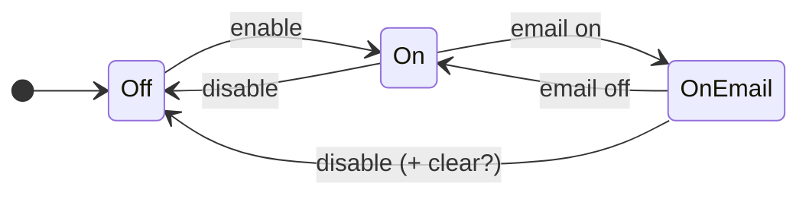
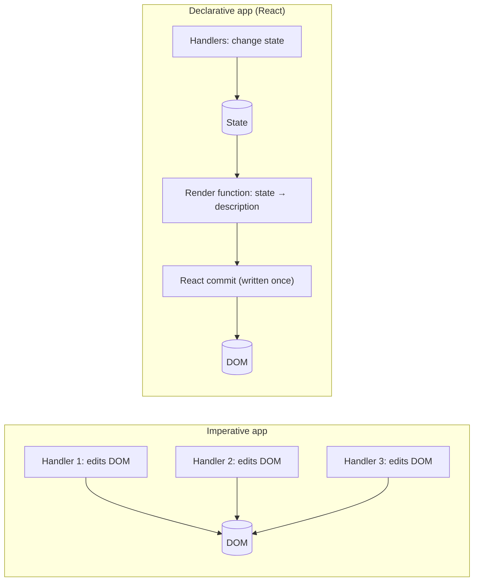

# 01 / 02 — Declarative vs Imperative UI

## 1. Lesson metadata

| | |
|---|---|
| **Level** | Beginner |
| **Study time** | 3–4 hours (reading 1.5 h, experiments 1 h, exercises 1 h) |
| **Prerequisites** | [01 — React's purpose and philosophy](./01-what-is-react.md); [00/04 — DOM structure, mutation, and the cost of touching it](../00-web-and-javascript-foundations/04-dom-structure-and-mutation.md); [00/13 — Browser events and propagation](../00-web-and-javascript-foundations/13-browser-events-and-propagation.md) (helpful) |
| **Next** | [03 — UI as a function of state](./03-ui-as-a-function-of-state.md) |
| **Related later** | [Phase 2 / 06 — Reconciliation fundamentals](../02-react-rendering-and-internals/06-reconciliation-fundamentals.md), [Phase 3 / 17 — Derived state](../03-react-state-and-hooks/17-derived-state.md) |

**Learning objectives.** After this lesson you can:
1. Define *imperative* and *declarative* precisely, and explain why "declarative" is a property of an *interface*, not of a language.
2. Identify, in a UI feature, the set of *states* it can be in and the transitions between them, and why imperative code must handle transitions while declarative code handles states.
3. Convert a stateful DOM script into a React component and explain what moved where.
4. Explain what React does *imperatively* underneath a declarative surface.
5. Recognize the places where React still requires imperative code (escape hatches) and use them correctly.
6. Argue the trade-offs honestly, including where imperative code is the better choice.

**Concepts covered:** imperative vs declarative, transitions vs states, "UI state combinatorics", single source of truth, idempotent description, the diff/commit layer as imperative implementation, escape hatches (refs, effects), "how" vs "what".

---

## 2. Deep conceptual explanation

### 2.1 What problem is this lesson solving?

[Lesson 01](./01-what-is-react.md) said React replaces hand-written DOM updates with *descriptions*. That sentence is easy to say and hard to feel. This lesson makes it concrete with a worked example in which imperative code accumulates bugs and the declarative version does not, and then pins down the vocabulary so you can reason about it rather than just prefer it.

### 2.2 Definitions

> **Imperative:** you specify *how* to reach a result, as an ordered sequence of commands that mutate state.
> **Declarative:** you specify *what* the result should be for given inputs; something else works out how to reach it.

Standard analogies: giving a taxi driver turn-by-turn directions (imperative) vs giving them an address (declarative); a `for` loop with an accumulator vs `reduce`; `SELECT ... WHERE` (declarative) vs a hand-written loop over rows; CSS (declarative: "buttons inside `.nav` are blue") vs `el.style.color = ...` in a loop.

Two clarifications prevent a lot of confusion:

1. **Declarative is relative to a level of abstraction.** SQL is declarative at the query level; the database engine executing it is thoroughly imperative. React's component code is declarative at the *UI description* level; `react-dom`'s commit step calls `appendChild` and `setAttribute`, which are imperative. Declarative interfaces are built *on top of* imperative implementations; the benefit is that the imperative part is written once, centrally, and tested to death, instead of re-invented per feature.
2. **JSX does not make code declarative.** `<div>` syntax is just notation. Code is declarative here because *the function describes output as a pure mapping from inputs*, not because it looks like HTML. An imperative program can be written with JSX too (`ref.current.appendChild(...)` inside a render function), and it would be wrong in precisely the ways this lesson describes.

### 2.3 The real difference: *transitions* vs *states*

Take any UI widget and list the **states** it can be in. For a dropdown menu: *closed*, *open*. For a form submit button: *idle*, *submitting*, *disabled because invalid*, *error shown*. States are the stable pictures of the screen.

Now list the **transitions**: every ordered pair (state A → state B) that can happen. With *n* states there can be up to *n × (n − 1)* transitions; with independent boolean-ish parts the number of *combined* states multiplies.

- **Imperative code is written in terms of transitions.** Every event handler says: "from whatever state we were in, do these specific DOM edits to reach the new state." To be correct, the handler must know *which state it is leaving* (or must undo/overwrite everything that might differ).
- **Declarative code is written in terms of states.** You write one function: "given this state, the screen looks like this." The transitions are *not coded at all*; they emerge from running the function on the new state and letting React compute the difference.

That is the core of the lesson: **the declarative approach replaces N² transition handlers with N state descriptions** (or, with independent parts, a product of states with a sum of descriptions).

### 2.4 Why imperative UI code breaks as it grows

Concretely, imperative UI code tends to fail in these ways:

| Failure | Mechanism |
|---|---|
| **Stale view** | Data changed, but one dependent DOM node was not updated (the handler forgot, or a new feature added a dependent node). |
| **Contradictory view** | Two DOM nodes derived from the same fact disagree (button says "Unlike", counter says 0). |
| **Leftover state** | A previous transition's DOM edits are not undone by the next (error message still visible after success). |
| **Order dependence** | Two handlers touch the same node; the result depends on which ran last. |
| **Coupling by selectors** | Code finds nodes via `querySelector`, so renaming a class silently breaks behavior. |
| **Listener leaks** | Elements are removed but listeners/timers remain referencing them ([00/16](../00-web-and-javascript-foundations/16-memory-management-and-gc.md)). |

None of these are caused by stupid programmers; they are caused by the structure: *the DOM is long-lived mutable state that the program must keep consistent by manual effort*.

### 2.5 The declarative contract in React

React's contract, stated carefully:

- You provide components, which, for the same props, state, and context, **return the same description**. ([Lesson 12](./12-component-purity.md) makes "the same" precise.)
- React guarantees that **after a commit, the DOM it manages matches the most recently committed description** (barring your own out-of-band mutations).
- You do not specify *how* the DOM gets from old to new; React may reuse nodes, update attributes, or recreate subtrees. As an application developer you should not depend on *which* operations it performs, with the exception of rules React documents about identity (`key`, position and type; [Lesson 09](./09-lists-keys-and-identity.md)).

*Public guarantee:* the end state of the DOM it manages matches your description. *Teaching model:* "React diffs and applies minimal changes." *Implementation detail:* *how* minimal, in what order, with what batching, and on which tick are internal and change across versions.

### 2.6 What stays imperative

Some things have no declarative equivalent in the platform, or React deliberately leaves imperative:

| Thing | Why it is imperative | React's sanctioned tool |
|---|---|---|
| Moving focus (`el.focus()`) | Focus is a transient side effect of the document, not a property you set in a description | `ref` + event handler or effect |
| Measuring layout (`getBoundingClientRect`) | Read from the rendered result *after* layout | `ref` + `useLayoutEffect` |
| Playing/pausing `<video>` | Media element has imperative methods | `ref` |
| Third-party widgets (maps, charts, editors) | They own their own DOM and API | `ref` + effect with cleanup |
| Starting a network request, subscribing | They are interactions with the outside world | Event handlers; effects ([Phase 3/04](../03-react-state-and-hooks/04-useeffect-synchronization.md)) |
| Scrolling to an element | Instruction, not state | `ref` + `scrollIntoView` |

The pattern: describe **what** declaratively wherever possible; when you must say **do**, put it in an event handler or an effect, not in render.

### 2.7 Common misconceptions

| Misconception | Reality |
|---|---|
| "Declarative means no side effects anywhere." | Declarative describes the *rendering* layer. Programs still have effects; React gives them defined homes. |
| "Declarative code is shorter." | Often, but not always; it is *more predictable*. For one trivial toggle, vanilla code can be shorter. |
| "React re-creates the whole DOM each time because it's declarative." | The *description* is recomputed; the DOM is patched. |
| "If it's declarative I never need to think about the DOM." | You must still understand DOM semantics (focus, form controls, layout). React renders DOM; it doesn't replace understanding it. |
| "`useEffect` is how I do things declaratively, e.g. set the title." | `useEffect` is an *imperative synchronization* hook: it runs code after render to bring the outside world into line. Reach for it when there is no declarative path. (React 19 can also render `<title>` in components, see Phase 9.) |
| "Imperative is old-fashioned." | Imperative is the right tool for performance-critical, tightly bounded code, animation loops, and library internals. |

---

## 3. Internal mechanics

### 3.1 The imperative core under the declarative surface

When you write:

```tsx
<ul>{items.map((i) => <li key={i.id}>{i.text}</li>)}</ul>
```

React's *teaching model* turns the old and new descriptions into a list of host operations. Here is what a **commit** conceptually emits when `items` goes from `[A, B]` to `[A, B, C]`:

```text
createElement("li") → set text "C" → appendChild(ul, li)
```

and, if the new list were `[B]`:

```text
remove li(A)       (B is retained and reused)
```

You never wrote these operations. The *shape* of such operations is the host interface in [Lesson 01 §5.5](./01-what-is-react.md#55-advanced-example--a-minimal-custom-renderer-idea-conceptual).

*Public guarantee:* the DOM matches your description after commit. *Teaching model:* the list above. *Implementation detail:* the real reconciler may order operations differently, use `insertBefore` or text node updates, batch effects, or reuse nodes in ways not shown; never write code that depends on these exact calls.

### 3.2 Why the imperative core is correct more often than your handlers

The reconciler is *one* algorithm applied to every UI in every React app; it is exercised by an enormous test suite and by production usage across millions of apps. The per-feature imperative code you write is exercised only by *your* tests. Centralizing the "make the DOM match" logic changes the *error surface* from "every handler of every feature" to "one library".

### 3.3 Idempotence as the design property

A declarative render is **idempotent in effect**: running it again with the same inputs gives the same description, and applying the same description again results in no DOM changes. That is why React can re-render freely, retry a render, or (in StrictMode development) render twice. Imperative handlers are not idempotent: calling `likes += 1` twice gives a different result than once. We will see in Phase 2 that React's concurrent features *rely* on this property to pause, discard, and restart renders ([Phase 2/12](../02-react-rendering-and-internals/12-why-rendering-must-be-pure.md)).

---

## 4. Step-by-step execution walkthrough

We trace a feature through *both* implementations: a **notification settings panel** with a master toggle and a dependent checkbox. Requirements:

- A checkbox "Enable notifications".
- A checkbox "Email me too", enabled only when notifications are enabled.
- A line of text: "Notifications are off" / "Notifications are on" / "Notifications are on (email too)".
- The second checkbox is also *unchecked and disabled* when notifications are turned off.

### 4.1 Imperative trace

State is in the DOM (checkbox `.checked`, `.disabled`, text node) and partly in variables.

1. User checks "Enable". Handler runs:
   - set `email.disabled = false`
   - set `status.textContent = "Notifications are on"`
2. User checks "Email me too". Handler:
   - set `status.textContent = "Notifications are on (email too)"`
3. User unchecks "Enable". Handler must now:
   - set `email.disabled = true`
   - set `email.checked = false` (otherwise leftover state: the box says "email" while disabled and off)
   - set `status.textContent = "Notifications are off"` (and must *not* print the "(email too)" variant)

Notice that step 3's correctness depends on the *prior* state (email might have been checked). If the author forgets `email.checked = false`, the UI is now contradictory, but only after the sequence enable → email → disable. This bug will not appear in a casual click-through.

### 4.2 Declarative trace

State lives in two variables; the DOM is derived.

1. Initial render: `enabled=false`, `email=false` → description: first box unchecked, second box disabled+unchecked, text "off".
2. User checks "Enable": handler calls `setEnabled(true)`. React re-runs the component with `enabled=true` → description: second box enabled; text "on". React diffs: `disabled` attribute and one text node changed.
3. User checks "Email": `setEmail(true)` → text "on (email too)"; second box checked.
4. User unchecks "Enable": handler calls `setEnabled(false)` **and** `setEmail(false)` (we will choose this to keep the state valid, see §5.2). Render runs once (the two updates are batched) with both false → description identical to the initial render. DOM diff: undo exactly the three differences.

No transition code exists. "Disable after email was on" is handled by the same description function as everything else.

---

## 5. Code examples

### 5.1 Minimal example — the imperative version

```ts
// settings.ts (vanilla)
const enable = document.querySelector<HTMLInputElement>("#enable")!;
const email = document.querySelector<HTMLInputElement>("#email")!;
const status = document.querySelector<HTMLParagraphElement>("#status")!;

enable.addEventListener("change", () => {
  email.disabled = !enable.checked;
  status.textContent = enable.checked ? "Notifications are on" : "Notifications are off";
  // BUG: forgot  if (!enable.checked) email.checked = false;
});

email.addEventListener("change", () => {
  status.textContent = email.checked
    ? "Notifications are on (email too)"
    : "Notifications are on";
});
```

**Predict:** The user checks Enable, checks Email, then unchecks Enable. What does the page show: the status text, and the checked/disabled state of Email?

**Result:** Status text: "Notifications are off". Email checkbox: **disabled but still checked**. *Why:* the `enable` handler only updates `disabled` and the status; it never touches `email.checked`. The state "email is on while notifications are off" is *representable* in the DOM and nothing prevents it. If a later "Save" handler reads `email.checked`, it will submit `email: true` for a user who turned notifications off.

### 5.2 Practical example — the declarative (React) version

```tsx
import { useState } from "react";

export function NotificationSettings() {
  const [enabled, setEnabled] = useState(false);
  const [email, setEmail] = useState(false);

  // Derived, never stored separately:
  const emailEffective = enabled && email;
  const status = !enabled
    ? "Notifications are off"
    : emailEffective
      ? "Notifications are on (email too)"
      : "Notifications are on";

  return (
    <fieldset>
      <legend>Notifications</legend>

      <label>
        <input
          type="checkbox"
          checked={enabled}
          onChange={(e) => setEnabled(e.target.checked)}
        />
        Enable notifications
      </label>

      <label>
        <input
          type="checkbox"
          checked={emailEffective}
          disabled={!enabled}
          onChange={(e) => setEmail(e.target.checked)}
        />
        Email me too
      </label>

      <p role="status">{status}</p>
    </fieldset>
  );
}
```

Line notes:

- `useState(false)` ×2: the *facts* of the system. Everything else is computed. (The mechanics of `useState` are in [Lesson 03](./03-ui-as-a-function-of-state.md); here just read it as "remembered values".)
- `emailEffective = enabled && email`: a **derived value**. Even if `email` is `true` while `enabled` becomes `false`, the UI shows the email box unchecked, so the contradictory state of §5.1 cannot appear. (We chose derivation over a second `setEmail(false)` call. Which is better is a design decision: derivation keeps the user's earlier choice if they re-enable; resetting forgets it. *Product requirement decides.*)
- `checked={enabled}` + `onChange`: a **controlled** input; React sets `checked` from state each render, and the handler requests a change ([Lesson 11](./11-controlled-and-uncontrolled-inputs.md)).
- `disabled={!enabled}`: an attribute is a function of state, not a mutation in a handler.
- `role="status"`: marks the paragraph as a live region so assistive technology announces changes. Imperative code would need to remember to do this on each text change; here it is part of the description.
- `<label>` wrapping the input: associates the text with the control (accessibility and larger click target) without ids.

**Predict:** The user checks Enable, checks Email, unchecks Enable, then checks Enable again. What do the Email checkbox and the status show?

**Result:** Email checkbox: **checked** (user's earlier choice preserved because we stored `email` and only *derived* the effective value). Status: "Notifications are on (email too)". *Why:* `email` remained `true` in state the entire time; `emailEffective` was `false` only while `enabled` was `false`. If the requirement is instead "turning it off resets the sub-choice", handle that in the `onChange` of the master toggle (see Level C exercise).

### 5.3 Incorrect example — imperative code inside a React component

```tsx
// ❌ Incorrect
export function Status({ online }: { online: boolean }) {
  const el = document.getElementById("status-text");
  if (el) el.textContent = online ? "Online" : "Offline";

  return <p id="status-text">…</p>;
}
```

**Predict:** What does the user see on first render? On later updates?

**Result:** On the *first* render, `getElementById` returns `null` (the `<p>` is not in the document yet; React has not committed), so nothing is set and the user sees "…". On later renders the element exists, so the text is updated, but then React's own commit may overwrite the same text node or not, depending on whether React considers the child text changed; the DOM text and React's model can diverge. Also the code does DOM mutation **during render**, which violates purity: StrictMode's double render, a discarded concurrent render, or a server render (where there is no `document`) breaks it.

**Why wrong:** two systems write the same DOM node, and the write happens in the wrong phase. The render function must return a description; it must not reach out and change the world.

### 5.4 Corrected implementation

```tsx
export function Status({ online }: { online: boolean }) {
  return <p id="status-text" role="status">{online ? "Online" : "Offline"}</p>;
}
```

If something truly needs the element (say, announcing to a legacy widget outside React), do that in an effect with a ref, which runs **after commit**, with the DOM present:

```tsx
import { useEffect, useRef } from "react";

export function Status({ online }: { online: boolean }) {
  const ref = useRef<HTMLParagraphElement>(null);
  useEffect(() => {
    // Imperative sync with something React doesn't manage
    legacyWidget.setOnline(online);
  }, [online]);
  return <p ref={ref} role="status">{online ? "Online" : "Offline"}</p>;
}
```
(`legacyWidget` is a hypothetical external object. The `ref` is shown only to illustrate the escape hatch; remove it if unused. Effects are covered in Phase 3.)

### 5.5 Advanced example — an imperative integration done correctly

Wrapping a non-React widget (a chart library) so the *outside* of the component stays declarative:

```tsx
import { useEffect, useRef } from "react";

// Hypothetical imperative library
declare class Chart {
  constructor(el: HTMLElement, options: { data: number[] });
  update(data: number[]): void;
  destroy(): void;
}

export function BarChart({ data }: { data: number[] }) {
  const containerRef = useRef<HTMLDivElement>(null);
  const chartRef = useRef<Chart | null>(null);

  // Create once, destroy on unmount.
  useEffect(() => {
    const el = containerRef.current;
    if (!el) return;
    const chart = new Chart(el, { data });
    chartRef.current = chart;
    return () => {
      chart.destroy();
      chartRef.current = null;
    };
    // eslint-disable-next-line react-hooks/exhaustive-deps -- data handled in the next effect
  }, []);

  // Push new data when the prop changes.
  useEffect(() => {
    chartRef.current?.update(data);
  }, [data]);

  return <div ref={containerRef} role="img" aria-label={`Bar chart with ${data.length} values`} />;
}
```

Notes:
- The *callers* of `<BarChart data={...} />` are declarative: they supply `data`, never call `update`. The imperative protocol is hidden behind the component boundary. This is the general technique for adopting imperative libraries.
- ⚠ In development StrictMode, effects are run, cleaned up, and run again on mount to verify cleanup correctness. This component survives because `destroy()` is the cleanup. (Phase 2/28.)
- The suppressed lint warning is a real trade-off: it works here because the two effects partition responsibilities; many teams prefer a single effect keyed on `data` that recreates the chart (simpler, but costs more). A senior reviewer would ask which cost matters.
- An `aria-label` on a plain `div` with `role="img"` provides a text alternative; for real charts, supply data tables or richer descriptions.

---

## 6. Visual explanations

### 6.1 Transitions vs states



*Imperative code* implements each arrow (five handlers' worth of edits, each needing to know the origin state). *Declarative code* implements three boxes (`Off`, `On`, `OnEmail`) as one function of `(enabled, email)`.

### 6.2 Where the "how" lives



### 6.3 Combinatorics

Three independent booleans (`loading`, `error`, `empty`) permit 8 combinations; the UI might only *mean* 4 of them (loading / error / empty / content). Imperative code can drift into the 4 meaningless ones; modeling the state as a single `status: "loading" | "error" | "empty" | "ready"` removes them. This idea (making impossible states unrepresentable) returns in [Phase 3/21](../03-react-state-and-hooks/21-forms-and-complex-state.md) and [Phase 5/13](../05-design-patterns/13-state-machine-pattern.md).

---

## 7. Alternative approaches and trade-offs

| Approach | Predictability as UI grows | Performance for a known tiny update | Code volume | Testability | Accessibility consistency | When to prefer |
|---|---|---|---|---|---|---|
| **Imperative DOM scripting** | Degrades | **Best** (direct) | Low for tiny, high for large | Needs DOM; handlers entangled with markup | Easy to forget to update ARIA | Single small widget; animation loop; library internals |
| **Declarative via React** | High | Good; extra work per render | Moderate | Pure render functions are trivially testable | ARIA tied to state in one place | Interactive apps with shared state |
| **Declarative via templating + manual refresh** (re-render `innerHTML` strings) | High-ish for small | Poor (destroys DOM, loses focus/selection/scroll) | Low | Medium | Loses focus and selection | Almost never in interactive UIs; fine for static output |
| **Fine-grained reactive libs** (signals, Svelte/Solid) | High | Often better than React for tiny updates | Low–moderate | Good | Good | When per-update cost dominates; different mental model (no re-run of component functions in some of these) |
| **Declarative CSS/HTML first** (`<details>`, `:has`, `dialog`) | Highest (browser does it) | Best | Lowest | n/a | Built-in semantics | Whenever the platform already has the behavior |

**When the recommended approach (React declarative) is *not* best:** a 60 fps canvas animation or a drag interaction where every pointer move updates positions. Re-rendering components per `pointermove` is expensive; the right design is imperative updates in a `requestAnimationFrame` loop (or CSS transforms driven by a ref), with React only *starting and stopping* the animation. Likewise `<details>`/`<summary>` for a simple disclosure gives keyboard and screen reader behavior for free; wrapping it in React state is extra code with more ways to be wrong.

---

## 8. Best practices and anti-patterns

**Do**
- Model *facts* as state and compute everything else (labels, disabled flags, counts) during render.
- Prefer one `status`-style union over several booleans when only some combinations are valid.
- Keep imperative code at the *edges*: event handlers, effects, small wrapper components.
- Use platform declarative features (`disabled`, `hidden`, `<details>`, `<dialog>`) before building custom state.

**Beginner mistakes**
- Mirroring the same fact in two state variables (`count` and `isZero`).
- Using `document.querySelector` inside components.
- Doing the mutation in render (§5.3).
- Writing handlers that "update the screen" instead of updating state.

**Experienced-developer mistakes**
- Fighting the model: syncing state to the DOM via effects because "that's how I'd do it in jQuery".
- Over-abstracting a trivial widget into a state machine library.
- Treating `useEffect` as the default place for logic; many things belong in event handlers or derivation ([Phase 3/07](../03-react-state-and-hooks/07-you-might-not-need-an-effect.md)).

**Smells:** `useEffect(() => setX(f(y)), [y])` (derived state stored); refs used to read values the component could keep in state; handlers that call `ref.current.style...` for visual state that could be a class.

**Accessibility notes:** declarative description makes it natural to keep ARIA attributes (`aria-expanded`, `aria-pressed`, `aria-busy`, `role="status"`) computed from the same state as the visuals. Still verify with a screen reader and keyboard: React won't warn you that a clickable `div` has no role.

**Justified exceptions:** imperative animation loops; focus management; integrating canvas/WebGL; measuring layout.

---

## 9. Real-world application

*Checkout form (finance/e-commerce).* The submit button must be disabled while the form is invalid *or* a request is in flight; an inline error shows after a failed attempt; a spinner replaces the label while submitting; on success the form is replaced by a confirmation. Count states: `idle | validating | submitting | error | success`, crossed with field validity. An imperative implementation tends to leave a disabled button after an error (the *submitting* → *error* transition forgot to re-enable). The declarative version expresses `disabled={status === "submitting" || !valid}` once.

*Real-time dashboard.* Widgets update as WebSocket messages arrive. The declarative approach: messages update state; widgets are pure renderings of state; React batches. But a *high-frequency* chart (hundreds of updates per second) may need the imperative escape hatch (§5.5; canvas draws via `requestAnimationFrame`) to stay inside the frame budget ([00/01 §2.5](../00-web-and-javascript-foundations/01-how-the-browser-works.md)).

*Auth flows.* "Logged in / logged out / session expiring / refreshing" are states; the navbar, route guards, and banners are all descriptions of the same fact. Imperative show/hide calls scattered across files are the classic source of "logged-out user still sees the Admin link".

*Multi-team product.* Shared components with props-as-state descriptions are easier to integrate than components that expose methods ("call `menu.open()`"); a declarative `open` prop composes with other components, while imperative handles require wiring (refs). Constraint: public component APIs should be declarative first; offer imperative handles (via `ref`) only where necessary (focus, scroll).

---

## 10. Debugging and troubleshooting

**Symptom:** "The UI shows something that contradicts the data (e.g., a disabled button that should be enabled)."

1. Ask: *is the displayed value derived from state, or stored separately?* Search the component for state variables whose values can be computed from others.
2. In React DevTools → Components, select the component and inspect `hooks`: compare the state values with what is on screen. If state is correct and DOM is wrong, suspect out-of-band DOM mutation (something other than React wrote to the node) or a *stale render* (a memoized child receiving old props). If state is wrong, the bug is in a transition (handler) that left state inconsistent: reproduce the exact sequence.
3. In the Elements panel, DevTools highlights attributes that change (flashing). Watch whether the *attribute is rewritten by React* or by other code. Break on DOM mutation: right-click the node → *Break on* → *attribute modifications* to find who changes it.
4. Check whether any third-party script or your own `document.querySelector` code is touching React-managed nodes.
5. **Fix** by deriving, not by adding another handler that patches the symptom. **Validate** by replaying the full sequence (enable → email → disable → enable) and, for regression, writing a test that asserts the visible output for each state (Phase 8).

**Symptom:** "Typing in my input loses characters / jumps the caret."
- Likely cause: re-creating the DOM node each render (e.g., component defined inside another component; [Lesson 04 §5.3](./04-elements-components-instances.md)) or mixing a stored `value` with imperative `el.value = ...`.

---

## 11. Exercises

### Level A — Knowledge
A1. Define imperative and declarative in one sentence each, without using the word "how" or "what" in the second (hint: use "function of").
A2. Why is "declarative" relative to a layer? Give one example where the same system is declarative at one layer and imperative at another.
A3. List three UI problems that imperative code is prone to and the mechanism behind each.
A4. Name two things in a React app that remain imperative, and where React expects them to live.
A5. What does "idempotent render" mean and why does React rely on it?

### Level B — Code comprehension
B1. In the §5.2 component, what are the rendered `checked` values of both boxes after the sequence: check Enable → check Email → uncheck Enable → uncheck Email (the box is disabled; assume the user cannot click it)?
B2. What does this print, and why is the *first* line surprising to people who think of `setState` as an assignment?
```tsx
function C() {
  const [n, setN] = useState(0);
  return (
    <button
      type="button"
      onClick={() => {
        setN(n + 1);
        console.log(n);
      }}
    >
      {n}
    </button>
  );
}
```
(Assume one click.)
B3. Identify three declarative/imperative mismatches in this component:
```tsx
function Cart({ items }: { items: string[] }) {
  const [count, setCount] = useState(items.length);
  const badge = document.querySelector(".badge");
  if (badge) badge.textContent = String(count);
  return <span className="badge">{items.length}</span>;
}
```

### Level C — Implementation
C1. Modify §5.2 so that turning Enable *off* also forgets the Email choice (back to unchecked on re-enable). Show two valid implementations and say which you'd choose and why.
C2. Implement `<Accordion>` as a *declarative* component with props `{ title: string; open: boolean; onToggle: () => void; children: ReactNode }`. Include correct ARIA (`aria-expanded`, `aria-controls`, region labelling) and use a real `<button>`.
C3. Rewrite this imperative snippet as a React component: a search box that shows "No results" when the filtered list is empty, otherwise the list, and shows a count "N results".
```js
input.addEventListener("input", () => {
  const q = input.value.toLowerCase();
  list.innerHTML = "";
  let n = 0;
  for (const name of names) {
    if (name.toLowerCase().includes(q)) {
      const li = document.createElement("li"); li.textContent = name; list.appendChild(li); n++;
    }
  }
  empty.hidden = n !== 0;
  count.textContent = n + " results";
});
```

### Level D — Debugging
D1. A user reports that after submitting a form with an error and then successfully resubmitting, the red error text remains while the success message also shows. The code (vanilla) sets `errorEl.textContent = msg` on failure and `successEl.hidden = false` on success. Explain the root cause in terms of this lesson's vocabulary and give a declarative restructuring.
D2. A React component receives `items` from props and does `const [filtered, setFiltered] = useState(items.filter(...))`. When the parent passes new `items` the list doesn't update. Why does it fail, and what is the declarative fix?
D3. An engineer calls `document.getElementById("x").classList.add("active")` in a click handler of a React component whose `<div id="x">` is rendered by React with `className={cls}`. Next time the component re-renders for another reason, the class `active` disappears. Explain.

### Level E — Architecture and engineering decisions
E1. You are asked to implement a drag-to-reorder dashboard. Which parts do you make declarative (React state/props) and which imperative? Defend your boundary with the frame budget in mind.
E2. A teammate proposes an `<Modal>` with an imperative API (`modalRef.current.open()`) because "it's easier for callers". Evaluate against a declarative `open` prop. List at least four criteria.

### Level F — Expert challenge
F1. Design a small reproduction showing that an imperative "toggle all" over *N* checkboxes can end in a contradictory state, and then prove (by argument) that the declarative version cannot. Your argument should reference invariants: what must be true, and why the code structure enforces it.

---

## 12. Detailed answers and explanations

> Attempt the exercises first.

**A1.** Imperative: a program written as a sequence of commands that change state step by step to reach a result. Declarative: a program written as a description of the result as a function of its inputs; the system works out the steps. Evaluation: answer must contain "function of (inputs)" for declarative and "sequence/mutation" for imperative. Wrong: "declarative means fewer lines".

**A2.** The same system looks different at different layers. Example: SQL is declarative to its user ("rows matching X"), but the query executor is imperative code (scans, hash joins). Likewise React components are declarative; the commit phase calling `appendChild` is imperative. The benefit: write imperative logic once and centrally.

**A3.** Any three of: stale view (a dependent node isn't updated), contradictory view (two nodes derived from one fact disagree), leftover state (previous transition's edits not undone), order dependence, coupling by selectors, listener leaks. Each mechanism: the DOM is mutable state that must be manually synchronized.

**A4.** Focus management, measuring layout, media playback, third-party widget integration, subscriptions/network. They belong in event handlers or effects, with refs for DOM access, never in render.

**A5.** Rendering the same inputs twice yields the same description and applying it again changes nothing. React relies on it to re-render freely, double-render in StrictMode dev, and (in concurrent rendering) pause, abandon, or restart render work without corrupting anything because render has no side effects.

**B1.** Sequence: check Enable (`enabled=true`) → check Email (`email=true`) → uncheck Enable (`enabled=false`, `email` still `true`) → "uncheck Email" is impossible (disabled; and its displayed `checked` is `emailEffective = false`, so there's nothing to uncheck). Final: Enable `false`; Email `false` (derived), disabled. Stored state: `enabled=false, email=true`. The trap is to answer "Email is true" because the stored variable is true. The *rendered* checked value is the derived one.

**B2.** It logs `0`. `setN(n + 1)` does not change the `n` variable in the currently executing closure; `n` is a constant for this render ("state is a snapshot", Lesson 14). The re-render happens afterward, with a new `n = 1` in a new call to `C`. People expecting assignment semantics predict `1`. The button then shows `1`. (Edge: in StrictMode dev, the render function runs twice, but the click handler logs once.)

**B3.** (1) `count` is initialized from `items.length` and never updated: derived value stored as state (and stale on prop changes). (2) DOM mutation (`querySelector` + `textContent`) during render. (3) On first render the badge doesn't exist yet; later it writes `count`, while JSX renders `items.length`, so two sources disagree. Fix:
```tsx
function Cart({ items }: { items: string[] }) {
  return <span className="badge" aria-label={`${items.length} items in cart`}>{items.length}</span>;
}
```

**C1.** Option 1 (reset in the handler):
```tsx
onChange={(e) => {
  const next = e.target.checked;
  setEnabled(next);
  if (!next) setEmail(false);
}}
```
Option 2 (derive with a reset by key): keep derivation and keep the sub-component's state inside a child that unmounts when disabled:
```tsx
{enabled && <EmailOption />}  // EmailOption owns its own useState(false); unmounting resets it
```
Choice: Option 1 is explicit and keeps the invariant in one handler; option 2 leverages React's state-reset-on-unmount but changes layout (the checkbox disappears rather than being disabled), so it only fits if the UX permits. Both batch correctly (two `set` calls in one handler produce one render). Edge: do not write `useEffect(() => { if (!enabled) setEmail(false) }, [enabled])`; it causes an extra render with a visible intermediate frame and hides the rule from the handler.

**C2. Sample**
```tsx
import { useId, type ReactNode } from "react";

interface AccordionProps {
  title: string;
  open: boolean;
  onToggle: () => void;
  children: ReactNode;
}

export function Accordion({ title, open, onToggle, children }: AccordionProps) {
  const panelId = useId();
  return (
    <section>
      <h3>
        <button type="button" aria-expanded={open} aria-controls={panelId} onClick={onToggle}>
          {title}
        </button>
      </h3>
      <div id={panelId} role="region" aria-label={title} hidden={!open}>
        {children}
      </div>
    </section>
  );
}
```
Criteria: real `<button>` inside a heading; `aria-expanded` bound to state; `hidden` attribute rather than conditional render *if* you want content to stay mounted (preserve state) — conditional render (`{open && ...}`) is also valid but unmounts children and loses their state ([Lesson 16](./16-state-preservation-and-reset.md)). `useId` gives a stable unique id for SSR-safe linking. Controlled (`open` from parent) is a design decision; an uncontrolled variant would own `useState` internally (see Phase 5/11).

**C3. Sample**
```tsx
import { useState } from "react";

export function Search({ names }: { names: readonly string[] }) {
  const [query, setQuery] = useState("");
  const q = query.trim().toLowerCase();
  const results = names.filter((n) => n.toLowerCase().includes(q));

  return (
    <div>
      <label>
        Search <input value={query} onChange={(e) => setQuery(e.target.value)} />
      </label>
      <p role="status">{results.length} results</p>
      {results.length === 0 ? (
        <p>No results</p>
      ) : (
        <ul>{results.map((n) => <li key={n}>{n}</li>)}</ul>
      )}
    </div>
  );
}
```
Notes: `results` is derived each render (not state). `key={n}` assumes unique names; use ids in real data ([Lesson 09](./09-lists-keys-and-identity.md)). For very large lists, memoization/virtualization is a later concern, not a first reflex.

**D1.** Root cause: transitions weren't paired. The failure → success transition doesn't clear the error; the DOM retained leftover state. Declarative restructure:
```tsx
type Status = { kind: "idle" } | { kind: "error"; message: string } | { kind: "success" };
const [status, setStatus] = useState<Status>({ kind: "idle" });
// render:
{status.kind === "error" && <p role="alert">{status.message}</p>}
{status.kind === "success" && <p role="status">Saved!</p>}
```
A single `status` cannot be both error and success, so the contradiction is unrepresentable. Edge: `role="alert"` makes screen readers announce errors immediately.

**D2.** `useState(initial)` uses the initial value **only on the first render**. Later prop changes don't reset it. `filtered` is derived data stored as state. Fix: compute during render: `const filtered = items.filter(...)`. If filtering is expensive and you've *measured* a problem, `useMemo` (Phase 7/04). If you truly need to reset state when a prop identity changes, use a `key` ([Lesson 16](./16-state-preservation-and-reset.md)).

**D3.** React considers `className={cls}` to be the source of truth for that node; `classList.add("active")` changed the DOM behind React's back. When a re-render changes `cls`, React sets `className` to the new string, overwriting the manual class. (If `cls` is unchanged between renders, React may not touch it, so the manual class survives, and behavior is inconsistent.) Fix: represent "active" as state/prop: `className={active ? "box active" : "box"}`.

**E1.** Good answer: the *drop result* (new order) is state → declarative. The *drag in flight* is per-frame imperative: use pointer events and a `transform: translate(...)` written through a ref (or CSS variable) in `requestAnimationFrame`, which skips React renders on every `pointermove`. Commit the final order via a state update on `pointerup`. Justification: 60 Hz gives ~16 ms; React rendering a large board per move risks blowing the budget ([00/01](../00-web-and-javascript-foundations/01-how-the-browser-works.md)). Also mention keyboard-accessible reordering (buttons or arrow keys with announcements) as a required non-pointer path, and that libraries (e.g. dnd-kit) implement this split. Criteria for evaluation: names the boundary; avoids per-pointermove state updates for large trees; preserves keyboard access; mentions measurement.

**E2.** Criteria: (1) Composability: `open` props compose with parents' state (URL-driven modals, "close on route change"); imperative handles require refs and timing. (2) Predictability: with a prop, the visible state is always a function of data; imperative calls can desynchronize (open called twice, called before mount). (3) Testing: prop-driven is trivial to test; imperative needs refs and act wrappers. (4) SSR/hydration: `open` can render on the server; imperative handles can't. (5) Accessibility: focus return, scroll lock, `aria-modal` are easier to centralize in a controlled component. (6) Caller ergonomics: imperative is easier for *fire-and-forget* messages (toasts), where a provider with an API (`toast.show`) is justified. Verdict: declarative default; imperative facade only for event-like things.

**F1. Evaluation criteria and example.** A good answer: Reproduction — a "Select all" checkbox and N item checkboxes. Imperative handlers: "select all" sets each item's `checked`; each item handler recomputes "select all" state only if it remembers to. Bug: user checks all, unchecks one item → "select all" remains checked (forgotten update) or, with a "last-write wins" handler, an async load adds new items that are not selected, leaving "select all" stale. Invariant: *selectAll ⇔ every item selected*. Declarative proof: store only `selectedIds: Set<string>`. Render `allSelected = items.length > 0 && items.every(i => selectedIds.has(i.id))` and `checked={allSelected}`, with `indeterminate` computed when `selectedIds.size > 0 && !allSelected` (set through a ref, since `indeterminate` is a DOM property with no HTML attribute: a legitimate imperative escape hatch). Because `allSelected` has no storage of its own, no sequence of events can make it disagree with the items; the invariant holds *by construction*, not by discipline. Caveat: the invariant holds for what React rendered; direct DOM mutation can still break it.

---

## 13. Senior engineer interview questions

**Q1. "Explain declarative UI to someone who knows jQuery."**
*Strong answer:* With jQuery you write handlers that mutate the DOM: transitions. With React you maintain state and write a function that says what the DOM should be for that state; React computes the diff. The win is that you don't have to enumerate transitions: any state → any other state works because the render function handles every state the same way. The cost: some indirection, and you must think about where side effects belong.

**Q2. "Is React really declarative? It calls `appendChild`."**
*Strong answer:* Declarative is a statement about the interface you program against. Your components describe results; the imperative mutation lives in the renderer. It's a layered abstraction like SQL over a query executor. The abstraction leaks in known places, such as focus, measurement, and third-party DOM, and React gives escape hatches for those.

**Q3. "When would you deliberately avoid putting something in React state?"**
*Strong answer:* When it changes at a frequency that makes re-rendering the wrong tool (pointer position during drag, scroll position for parallax), when it doesn't affect rendered output (timer ids, previous values, instance handles → refs), or when it can be derived. Test: "does the screen need to change when this changes?" If no, ref or plain variable; if it is computable from other state, derive.

**Q4. "Your colleague stores `fullName` in state alongside `firstName` and `lastName`. What's the review comment?"**
*Strong answer:* It's redundant state, so any code path that updates one and forgets the other yields a contradiction. Compute `fullName` in render. If computing is expensive (measure first), memoize. The general rule is to store minimal facts and derive the rest.

---

## 14. Further learning resources

| Resource | URL | Covers / why | Level | Study |
|---|---|---|---|---|
| React docs — Reacting to Input with State | <https://react.dev/learn/reacting-to-input-with-state> | The official declarative-vs-imperative walkthrough with a form example | Beginner | Whole page |
| React docs — Choosing the State Structure | <https://react.dev/learn/choosing-the-state-structure> | Avoiding redundant/contradictory state | Beginner–Int. | Principles list |
| React docs — Thinking in React | <https://react.dev/learn/thinking-in-react> | Decomposing a UI; state minimalism | Beginner | Steps 1–5 |
| React docs — Manipulating the DOM with Refs | <https://react.dev/learn/manipulating-the-dom-with-refs> | The sanctioned imperative escape hatch | Intermediate | Whole page |
| React docs — Escape Hatches (overview) | <https://react.dev/learn/escape-hatches> | Where imperative code lives (refs, effects) | Intermediate | Intro |
| MDN — Document Object Model | <https://developer.mozilla.org/en-US/docs/Web/API/Document_Object_Model> | The imperative API React drives | Beginner | Whole intro |
| MDN — `<details>` element | <https://developer.mozilla.org/en-US/docs/Web/HTML/Element/details> | Platform-declarative disclosure widget | Beginner | Usage, accessibility |

All links above are official documentation pages that are expected to exist; if one has moved, use the site search with the quoted title.

---

## 15. Knowledge checkpoint

**You should now understand**
- Declarative vs imperative as a statement about the interface layer, and the transitions-vs-states framing.
- Why imperative UI code accumulates stale, contradictory, and leftover state.
- That React's commit step is imperative and centralized; your components are descriptions.
- Where imperative code still belongs (handlers, effects, refs).

**You should be able to explain without notes**
- Why a derived value is safer than a stored one.
- Why DOM mutation during render is wrong.
- Why `setState` doesn't immediately change the variable you hold.

**You should be able to implement**
- A small stateful component where all visible values derive from minimal state.
- A wrapper that hides an imperative library behind a declarative props API.

**You should be able to debug**
- Contradictory UI by locating redundant state or out-of-band DOM writes.

**Before moving on:** read [03 — UI as a function of state](./03-ui-as-a-function-of-state.md), which formalizes `UI = f(state)`, introduces `useState` more carefully, and covers how to shape state.
