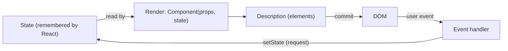
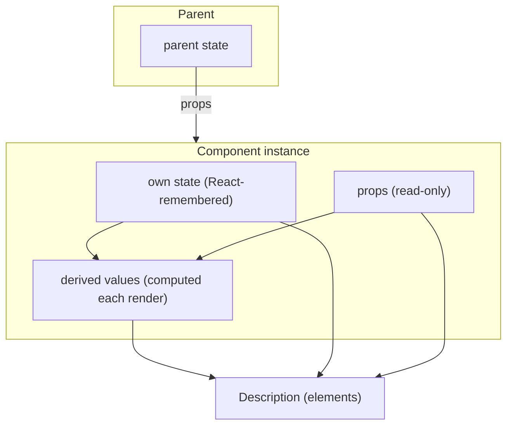
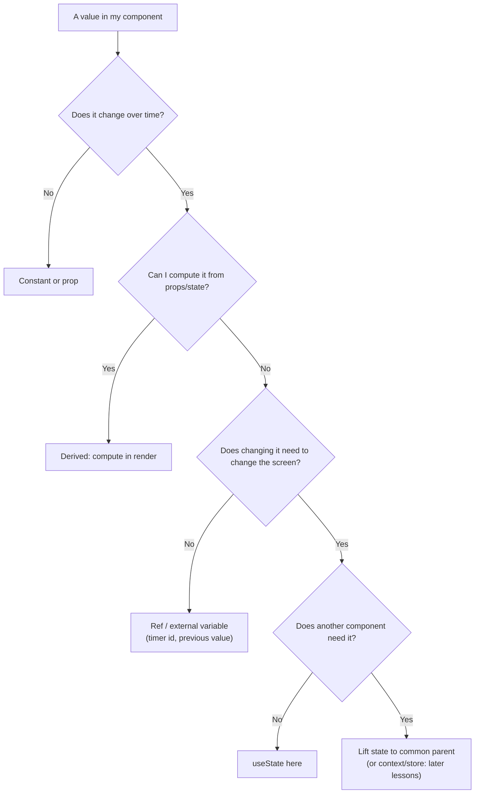

# 01 / 03 — UI as a Function of State

## 1. Lesson metadata

| | |
|---|---|
| **Level** | Beginner |
| **Study time** | 4 hours (reading 1.5 h, experiments 1 h, exercises 1.5 h) |
| **Prerequisites** | [02 — Declarative vs imperative UI](./02-declarative-vs-imperative-ui.md); [00/06 — Lexical scope and closures](../00-web-and-javascript-foundations/06-lexical-scope-and-closures.md); [00/08 — Objects, references, and immutable updates](../00-web-and-javascript-foundations/08-objects-references-immutability.md) |
| **Next** | [04 — Elements, components, instances](./04-elements-components-instances.md) |
| **Related later** | [14 — State as a snapshot](./14-state-as-a-snapshot.md), [Phase 3 / 01 — `useState` internals](../03-react-state-and-hooks/01-usestate-internals-and-update-semantics.md), [Phase 3 / 17 — Derived state](../03-react-state-and-hooks/17-derived-state.md) |

**Learning objectives.** After this lesson you can:
1. State `UI = f(state)` (more fully `UI = f(props, state, context)`) and explain what each part means in React.
2. Use `useState` at a usage level: initial value, setter, re-render trigger.
3. Explain the event → state update → render → commit loop and why handlers do not "update the screen".
4. Distinguish *state* from *props*, *derived values*, *refs*, and *constants*, and decide which a piece of data is.
5. Shape state: minimal, non-redundant, non-contradictory, serializable where it matters.
6. Predict what renders for a sequence of events, including the "stale value in the same handler" case.
7. Recognize when something is *not* a function of state (time, randomness, the outside world) and where it enters.

**Concepts covered:** `UI = f(state)`, state vs props, minimal state, derived data, state shape principles, the render loop, re-render triggers (first look), state as component memory, state updates as requests, snapshot intuition (first look), `useState` initializer, immutable updates for objects/arrays.

---

## 2. Deep conceptual explanation

### 2.1 What problem is this lesson solving?

[Lesson 02](./02-declarative-vs-imperative-ui.md) argued that describing *states* beats scripting *transitions*. This lesson answers the follow-up questions:

- **What is "state"?** Exactly which data counts, and what does not?
- **Where does it live, and how does the UI see it?**
- **How do I structure it** so the description function stays simple and the contradictions of the imperative world cannot appear?

Most real React bugs for beginners and a surprising number for experienced engineers come from answering these questions loosely.

### 2.2 The formula

```text
UI = f(state)
```

This is the slogan; the full statement is:

```text
description = Component(props, state, context)
```

- **props**: inputs passed by the parent ([Lesson 06](./06-props-and-one-way-data-flow.md)).
- **state**: memory *owned by this component* that React keeps between renders.
- **context**: inputs from an ancestor not passed via props ([Phase 3/13](../03-react-state-and-hooks/13-usecontext-and-propagation.md)).
- The result is a **description** (a tree of React elements, [Lesson 04](./04-elements-components-instances.md)). It is *not* DOM nodes and it is not yet on screen.

The function must be a **calculation**: same inputs, same output, no side effects ([Lesson 12](./12-component-purity.md)). Rendering the same state twice must give the same description. This is what makes the whole model work.

### 2.3 What "state" is

> **State** is data that (a) changes over time due to user interaction or other events, (b) *must be remembered* between renders, and (c) *when it changes, the screen must change*.

All three conditions matter:

| Test | If "no" it is probably... |
|---|---|
| Does it change over time? | A constant or a prop |
| Must it persist across renders? (A local `let` is recreated every render.) | Something you compute on each render |
| Does the *rendered output* depend on it? | A **ref** or an external variable (timer ids, previous values, instance handles) |
| Can it be computed from other state/props? | **Derived data**; compute in render, do not store |

In React, state is *attached to a component instance's position in the tree* (not to the function and not to a variable of yours). When React calls your function again, `useState` hands back the remembered value for that slot. Conceptually: React keeps the values; your function is stateless. The slot-matching mechanism is the subject of [Phase 2/17](../02-react-rendering-and-internals/17-hooks-and-fiber-state.md).

### 2.4 `useState` at usage level

```tsx
const [value, setValue] = useState(initialValue);
```

- Returns a pair: the **current value** for this render and a **setter**.
- `initialValue` is used **only on the first render** (mount). Afterwards it is ignored (a common bug source, see §8).
- The setter does **not** modify `value`. It *requests* an update: "next render, use this value". React then re-runs the component.
- The setter has stable identity across renders (React documents this for `useState` setters), so it need not be listed as a dependency in effect arrays; the lint rule knows it.
- You may pass a function to the setter (`setValue(prev => next)`) when the next value depends on the previous. We use that form for counters; the full reason is in [Phase 3/02](../03-react-state-and-hooks/02-functional-state-updates.md).
- You may pass a function as the *initial* value (`useState(() => expensive())`) to run it only on mount ("lazy initializer").

### 2.5 The loop



Read it as: *Handlers change state; state determines the render; the render determines the DOM.* Handlers never write to the DOM. The loop is the entire "dynamic" half of React for now; later lessons refine each arrow (batching, snapshots, effects).

### 2.6 Shaping state: the principles

The React docs distill these principles (react.dev "Choosing the State Structure"); we restate and justify them:

1. **Group related state.** If two values always change together, they are one fact (e.g. `{x, y}` position). Use one variable or a reducer.
2. **Avoid contradictions.** `isLoading` and `isError` booleans can both be `true`. Prefer a `status` union.
3. **Avoid redundancy.** If you can compute it, don't store it (`fullName`, `visibleItems`, `total`).
4. **Avoid duplication.** Don't store an object in two places (selected item copy vs `selectedId`): the copy goes stale. Store the *id*, look up the object.
5. **Avoid deeply nested state.** Prefer flat or normalized structures when you must update parts.
6. **Store the minimum that makes every UI state reachable.** Every extra variable is another invariant to keep.

Each is one instance of the same rule: **every piece of state is an invariant you must maintain by hand; each derived value is one you get for free.** So minimize stored state.

### 2.7 What is *not* a function of state

Real UIs also depend on:

- **Time** (`Date.now()`, "5 minutes ago")
- **Randomness** (`Math.random()`)
- **The outside world** (network responses, `localStorage`, `window.innerWidth`, the URL)

A render function that reads these directly is not a pure function of its inputs: two renders can produce different output with identical props/state. The discipline: bring such things *into* state (or props, or a store) at defined points (an effect, a subscription, an event handler, a router), so that during any given render they are plain values. This is why you will see `useEffect` + `useState` for `window.innerWidth`, or `useSyncExternalStore` for external stores ([Phase 3/20](../03-react-state-and-hooks/20-usesyncexternalstore-and-external-stores.md)). It is also why `Math.random()` in render breaks StrictMode's double-render check and server/client hydration.

### 2.8 Common misconceptions

| Misconception | Reality |
|---|---|
| "State is a variable that React watches." | State is a value React stores *for you*. React does not observe assignments; it responds to setter calls. |
| "`setX(1); console.log(x)` prints 1." | `x` is a constant in this render. It prints the *old* value. ([Lesson 14](./14-state-as-a-snapshot.md).) |
| "`useState` runs the initializer on every render." | The *initial value argument* is ignored after mount (the expression is still evaluated each render unless you pass a function). |
| "Changing `state.items.push(x)` is fine if I call the setter after." | Mutating the existing object/array breaks change detection (setter sees the same reference, may bail out) and breaks snapshots held by other closures. Use new copies ([00/08](../00-web-and-javascript-foundations/08-objects-references-immutability.md)). |
| "Each component *function* has one state." | Each component *instance* (a position in the tree) has its own state. Two `<Counter />` elements have independent counts. |
| "A re-render resets state." | Re-render keeps state. *Unmounting* (or identity change) resets it ([Lesson 16](./16-state-preservation-and-reset.md)). |
| "State must go in the top component." | State belongs as low as possible while still being shared by everything that needs it ("colocation"; [Phase 3/18](../03-react-state-and-hooks/18-state-colocation-and-lifting.md)). |

---

## 3. Internal mechanics

### 3.1 What the setter does (teaching model)

*Teaching model:* each component instance has a hidden list of "state cells" in call order. `useState(init)` is "give me cell *k*; if it doesn't exist yet, create it from `init`". The setter for cell *k* enqueues an update on that instance and tells React the instance needs re-rendering. The next time React renders the component, it processes the queued updates to compute cell *k*'s new value and returns it from `useState`.

*Public guarantees:*
- Calling a state setter with a new value (by `Object.is` comparison) causes React to re-render the component (eventually; batched).
- If the new value is identical (`Object.is`) to the current one, React may skip rendering the component's children and may or may not call the component function one more time before bailing out. ⚠ This "may call once more" behavior is documented in the `useState` reference as an optimization caveat; don't rely on either outcome.
- State is preserved across re-renders as long as the component stays at the same position with the same type.

*Implementation detail:* the cells are stored on an internal structure for the component instance (a Fiber, conceptually a linked list of hook records), update objects are queued, and the render processes the queue. Don't depend on that structure; see [Phase 2/17](../02-react-rendering-and-internals/17-hooks-and-fiber-state.md).

### 3.2 Why hook order matters (preview)

Because cells are matched by **call order**, hooks must be called in the same order each render (no conditionals, no loops with varying counts, no early returns *before* hooks). React has no names for your `useState` calls; it only has "first call, second call". This is the root of the Rules of Hooks ([Phase 3/16](../03-react-state-and-hooks/16-rules-of-hooks-and-composition.md)).

### 3.3 Equality for bail-out

`Object.is(prev, next)`: `Object.is(1, 1) === true`, `Object.is({}, {}) === false`, `Object.is(NaN, NaN) === true`, `Object.is(0, -0) === false`. So `setUser(user)` after mutating `user` in place (same reference) is a no-op from React's viewpoint, a classic bug ([00/07](../00-web-and-javascript-foundations/07-functions-and-referential-identity.md), [00/08](../00-web-and-javascript-foundations/08-objects-references-immutability.md)).

---

## 4. Step-by-step execution walkthrough

Component:

```tsx
function Todo() {
  const [items, setItems] = useState<string[]>([]);
  const [draft, setDraft] = useState("");

  const addItem = () => {
    if (!draft.trim()) return;
    setItems([...items, draft.trim()]);
    setDraft("");
  };

  return (
    <section>
      <input value={draft} onChange={(e) => setDraft(e.target.value)} aria-label="New item" />
      <button type="button" onClick={addItem}>Add</button>
      <p>{items.length} item(s)</p>
      <ul>{items.map((t, i) => <li key={i}>{t}</li>)}</ul>
    </section>
  );
}
```

**Trace: the user types "milk", presses Add.**

1. **Mount.** React calls `Todo()`. Cell 0: `items = []`. Cell 1: `draft = ""`. Returns elements. React creates DOM: `section`, `input` (value `""`), `button`, `p` ("0 item(s)"), empty `ul`.
2. **User types "m".** Browser fires an input event. React's `onChange` handler runs: `setDraft("m")`. The handler returns. React schedules a render.
3. **Render #2.** `Todo()` is called. Cell 1 now returns `"m"`. Output differs in one place: `input.value`. React compares trees; patches `input.value` (the DOM node itself already shows "m" because the user typed it; React ensures it matches state). Repeated for "mi", "mil", "milk" (one render per input event).
4. **User clicks Add.** `addItem` runs in the click handler. In this closure `items` is `[]` and `draft` is `"milk"`. `setItems(["milk"])` and `setDraft("")` are two requests in the same event; React **batches** them.
5. **Render #6 (a single render for both updates).** `Todo()` is called with `items = ["milk"]`, `draft = ""`. Output: the input's value `""`, the paragraph text "1 item(s)", and a new `<li>milk</li>`. React diffs and applies three DOM changes: set input value, update text, append `li`.
6. The browser paints the result in the next frame.

**Prediction checkpoint:** how many times did `Todo()` run between step 4's click and the end of step 5? *Once* (batching), plus a second call in development StrictMode (discarded). If the two setters had been in a `setTimeout` in React 17, they'd have rendered twice; since React 18, automatic batching applies broadly ([Phase 2/22](../02-react-rendering-and-internals/22-automatic-batching.md)). ⚠ *Version-sensitive.*

---

## 5. Code examples

### 5.1 Minimal example — a toggle

```tsx
import { useState } from "react";

export function Disclosure({ summary, children }: { summary: string; children: React.ReactNode }) {
  const [open, setOpen] = useState(false);
  return (
    <div>
      <button type="button" aria-expanded={open} onClick={() => setOpen((o) => !o)}>
        {summary}
      </button>
      {open && <div>{children}</div>}
    </div>
  );
}
```

Line notes:
- `useState(false)`: TypeScript infers `boolean`. For unions or objects, annotate: `useState<Status>("idle")`.
- `setOpen((o) => !o)`: functional form, safe even if called twice in one event.
- `{open && <div>…</div>}`: conditional rendering; when `open` is `false`, `false` renders nothing ([Lesson 05](./05-jsx-explained.md), [Lesson 08](./08-conditional-rendering.md)).
- `React.ReactNode`: in modern TS configurations with the automatic JSX runtime you can use the global `React` namespace types after `@types/react`, but importing `type ReactNode` from `"react"` is clearer and avoids relying on a global namespace.

**Predict:** user clicks the button twice. What is the DOM after the second click? **Result:** back to just the button: the `div` with children was added on the first click and removed on the second. Note the children's own state would be **lost** on collapse because they unmount ([Lesson 16](./16-state-preservation-and-reset.md)); use `hidden` if state must survive.

### 5.2 Practical example — filtered, sorted list with derived data

```tsx
import { useState } from "react";

interface Product { id: string; name: string; price: number; category: "book" | "tool" }

type SortKey = "name" | "price";

export function ProductList({ products }: { products: readonly Product[] }) {
  const [query, setQuery] = useState("");
  const [category, setCategory] = useState<"all" | Product["category"]>("all");
  const [sortKey, setSortKey] = useState<SortKey>("name");

  // Derived: recalculated every render. Not state.
  const q = query.trim().toLowerCase();
  const visible = products
    .filter((p) => category === "all" || p.category === category)
    .filter((p) => p.name.toLowerCase().includes(q))
    .toSorted((a, b) =>
      sortKey === "name" ? a.name.localeCompare(b.name) : a.price - b.price,
    );
  const total = visible.reduce((sum, p) => sum + p.price, 0);

  return (
    <section aria-labelledby="products-h">
      <h2 id="products-h">Products</h2>
      <input value={query} onChange={(e) => setQuery(e.target.value)} aria-label="Filter by name" />
      <select value={category} onChange={(e) => setCategory(e.target.value as typeof category)} aria-label="Category">
        <option value="all">All</option>
        <option value="book">Books</option>
        <option value="tool">Tools</option>
      </select>
      <select value={sortKey} onChange={(e) => setSortKey(e.target.value as SortKey)} aria-label="Sort by">
        <option value="name">Name</option>
        <option value="price">Price</option>
      </select>
      <p role="status">{visible.length} shown, total ${total.toFixed(2)}</p>
      <ul>
        {visible.map((p) => (
          <li key={p.id}>{p.name}: ${p.price.toFixed(2)}</li>
        ))}
      </ul>
    </section>
  );
}
```

Line notes:
- Three pieces of **state** (the user's choices). `visible` and `total` are **derived**.
- `.toSorted` returns a *new* array (ES2023; Node ≥ 20 and current evergreen browsers). If your target is older, use `[...arr].sort(...)`. Calling `.sort` directly on `products` would **mutate a prop**, which is a bug (the parent's array is reordered) and breaks purity.
- `as typeof category`: the DOM gives `string`; the cast documents that `<option>` values are constrained to the union. A runtime check or a parse function is safer when the values come from untrusted input.
- Accessibility: every control has a label (`aria-label` here, `<label>` is better when visible text exists); the status paragraph announces the result count politely to assistive technology.

**Predict:** the user types `"b"` in the filter, then changes category to "book". How many renders happen, and is `visible` ever stored? **Result:** one render per event (two renders in total after mount), `visible` is recomputed each time and never stored; there is no moment when `visible` can disagree with `query`/`category`. *Trade-off:* with 50,000 products the per-render filter/sort may be too slow. The fix is measuring first, then `useMemo`/virtualization, not storing `visible` in state ([Phase 7/10](../07-performance/10-expensive-computations.md)).

### 5.3 Incorrect example — redundant, mutating, snapshot-confused state

```tsx
// ❌ Incorrect
function Cart({ initialItems }: { initialItems: { id: string; price: number }[] }) {
  const [items, setItems] = useState(initialItems);
  const [total, setTotal] = useState(0);            // redundant
  const [selected, setSelected] = useState(items[0]); // duplicate object

  function remove(id: string) {
    const target = items.find((i) => i.id === id)!;
    items.splice(items.indexOf(target), 1);         // mutation
    setItems(items);                                 // same reference
    setTotal(total - target.price);                  // may drift
    console.log(items.length);                       // "shows new length"?
  }

  return /* ... */ null;
}
```

**Predict:** user removes an item. What goes wrong (list three problems)?

**Result:**
1. `items.splice(...)` mutates the array held in state, and `setItems(items)` passes the *same reference*. `Object.is` says "unchanged", so React may bail out and not re-render. The DOM may remain stale, even though the data changed. (If another state change causes a re-render later, the removal "suddenly appears". That intermittent behavior is the signature of mutation bugs.)
2. `total` is derived from `items`; stored separately, it can drift (initial `0` is already wrong, as it never accounts for `initialItems`).
3. `selected` copies an element object; after removal or later edits it refers to an item that is no longer in the list.
4. (Bonus) `items.length` in the `console.log` shows the mutated length *only because of mutation*; with proper immutable updates it would print the *old* length, since `items` is the render's snapshot.

### 5.4 Corrected implementation

```tsx
interface CartItem { id: string; price: number }

function Cart({ initialItems }: { initialItems: readonly CartItem[] }) {
  const [items, setItems] = useState<readonly CartItem[]>(initialItems);
  const [selectedId, setSelectedId] = useState<string | null>(null);

  const total = items.reduce((sum, i) => sum + i.price, 0);          // derived
  const selected = items.find((i) => i.id === selectedId) ?? null;    // derived lookup

  function remove(id: string) {
    setItems((prev) => prev.filter((i) => i.id !== id));              // new array
    setSelectedId((cur) => (cur === id ? null : cur));                // keep the invariant
  }

  return (
    <section>
      <ul>
        {items.map((i) => (
          <li key={i.id}>
            <button type="button" aria-pressed={i.id === selectedId} onClick={() => setSelectedId(i.id)}>
              {i.id}: {i.price}
            </button>
            <button type="button" onClick={() => remove(i.id)} aria-label={`Remove ${i.id}`}>×</button>
          </li>
        ))}
      </ul>
      <p>Total: {total}</p>
      <p>{selected ? `Selected: ${selected.id}` : "Nothing selected"}</p>
    </section>
  );
}
```

Why it works: `filter` returns a new array (new identity → React sees a change); `total` and `selected` are computed; the only stored facts are the item list and the selected *id*; removal also clears a selection that refers to a removed item (derivation via `find(...) ?? null` would already hide it; clearing makes the stored state tidy too).

Note: `useState(initialItems)` seeds state from a prop **once**. If the parent later passes a different `initialItems`, the cart does **not** update, hence the name `initialItems`. That naming convention signals the intent. If you instead want the component to reflect a prop, don't copy it into state at all (§8).

### 5.5 Advanced example — a discriminated union for async-ish UI state

```tsx
import { useState } from "react";

type LoadState<T> =
  | { status: "idle" }
  | { status: "loading" }
  | { status: "error"; message: string }
  | { status: "success"; data: T };

interface User { id: string; name: string }

export function UserLoader({ loadUser }: { loadUser: (id: string) => Promise<User> }) {
  const [state, setState] = useState<LoadState<User>>({ status: "idle" });

  async function onClick() {
    setState({ status: "loading" });
    try {
      const user = await loadUser("42");
      setState({ status: "success", data: user });
    } catch (e) {
      setState({ status: "error", message: e instanceof Error ? e.message : "Unknown error" });
    }
  }

  return (
    <div>
      <button type="button" onClick={onClick} disabled={state.status === "loading"}>
        Load user
      </button>
      {state.status === "loading" && <p role="status">Loading…</p>}
      {state.status === "error" && <p role="alert">{state.message}</p>}
      {state.status === "success" && <p>Hello, {state.data.name}</p>}
    </div>
  );
}
```

Why this shape: `status` is a single source of truth; TypeScript narrows `state.data` to exist only when `status === "success"`; there is no way to represent "error and success" simultaneously. ([00/19](../00-web-and-javascript-foundations/19-typescript-generics-and-utility-types.md) covers discriminated unions.)

Known limitations (intentionally deferred): no cancellation, so a slow earlier request could overwrite a later one ([Phase 6/02](../06-data-fetching-and-state-ecosystems/02-cancellation-and-race-conditions.md)); no cleanup if the component unmounts mid-request (React 18+ no longer warns about setting state on an unmounted component, but wasted work and logic races remain); a real app would normally use a data-fetching library ([Phase 6/08](../06-data-fetching-and-state-ecosystems/08-tanstack-query.md)) rather than hand-rolling this.

---

## 6. Visual explanations

### 6.1 State, props, derived values



### 6.2 Sequence over time: two renders, one snapshot each

```text
Render #1  (count = 0)              Render #2  (count = 1)
─────────────────────────           ─────────────────────────
count      = 0   (constant here)    count      = 1   (constant here)
onClick    = () => setCount(0 + 1)  onClick    = () => setCount(1 + 1)
description: "Count: 0"             description: "Count: 1"
```
Each render has its **own** `count` and **own** handler closures; the setter doesn't mutate the first render's `count`. ([00/06](../00-web-and-javascript-foundations/06-lexical-scope-and-closures.md) closures explain why.)

### 6.3 The decision tree for "is this state?"



---

## 7. Alternative approaches and trade-offs

Where should a piece of "state" live?

| Option | Predictability | Performance | Complexity | Testability | When to prefer |
|---|---|---|---|---|---|
| **Local `useState`** | High; scoped | Re-renders only the owner + descendants | Lowest | Easy | UI-only state: open/closed, draft text, hover |
| **Lifted to a common parent** | High; explicit flow | Parent and its subtree re-render | Low–moderate (prop passing) | Easy | Two siblings must agree |
| **`useReducer`** | Very high for complex transitions | Same as `useState` | Moderate | Reducers are pure and trivially unit-testable | Many related fields, validated transitions ([Phase 3/03](../03-react-state-and-hooks/03-usereducer-and-reducer-architecture.md)) |
| **Context** | Moderate | Consumers re-render on any value change | Moderate | Moderate | Rarely changing, widely-shared values (theme, user) |
| **URL (search params)** | High; shareable/bookmarkable | Router-dependent | Moderate | Moderate | Filters, sort, pagination, selected tab |
| **External store / server-state cache** | Depends | Fine-grained subscriptions possible | Higher | Good with discipline | Cross-cutting or server-owned data ([Phase 6](../06-data-fetching-and-state-ecosystems/07-server-state-management.md)) |
| **`ref` / plain variable** | Low (invisible to React) | No re-render | Low | Awkward | Values the UI doesn't display |
| **DOM (uncontrolled input)** | Low; truth is in the DOM | No re-render per keystroke | Low | Moderate | Large forms where per-keystroke render is unnecessary ([Lesson 11](./11-controlled-and-uncontrolled-inputs.md)) |

**When the recommended approach (minimal local state + derivation) is not best:** the list filters here live in `useState`, but for a user-facing search page they belong in the **URL** so that the back button, links, and refresh preserve them. Likewise a 30-field form may be better *uncontrolled* (the DOM holds values; read on submit) than 30 `useState`s re-rendering per keystroke. There is no "one right place"; the criteria are: who needs it, how long must it live, should it be shareable, and what does it cost to update.

---

## 8. Best practices and anti-patterns

**Do**
- Store the *minimum*: ids not objects, facts not summaries.
- Compute derived values in the render body; use `useMemo` only after measuring.
- Update objects/arrays immutably: spread, `map`, `filter`, `toSorted`, `toSpliced`, `structuredClone` for deep copies.
- Use the functional updater form when the next value depends on the previous.
- Name seeded props `initialX`/`defaultX` if they only seed state.
- Put state as low as possible, lift only when needed.

**Beginner mistakes**
- Mutating state (`push`, `splice`, `obj.x = ...`) then calling the setter.
- Expecting `setX` to change `x` immediately.
- Storing derived values (`isEmpty`, `fullName`, `filteredList`).
- Copying props into state and expecting updates ("props-in-state").
- `useState` in a loop/condition.

**Experienced-developer mistakes**
- Syncing state to state with `useEffect` (a chain of renders; [Phase 3/07](../03-react-state-and-hooks/07-you-might-not-need-an-effect.md)).
- Over-centralizing: putting every field of local UI into a global store, making unrelated screens rerender and coupling features.
- Mixing server cache data with UI state in one store.
- Hiding invalid combinations only by convention instead of making them unrepresentable.

**Smells:** more than ~5 `useState` calls that are always updated together; booleans named `isX` and `isNotX`; `useEffect` whose only job is `setSomething(compute(other))`; a state variable that is only ever set from a prop change.

**Accessibility:** state that controls visibility (`open`) should be mirrored by ARIA (`aria-expanded`), focus should move sensibly when UI appears (dialogs, menus), and status updates should use live regions (`role="status"`/`aria-live`). React doesn't do this for you.

**Justified exceptions:** storing a derived value is sometimes right when the derivation is genuinely expensive *and measured*, or when you need *stability over time* (e.g., "snapshot the filtered result when the user pressed Search", not live). In that case the stored value is a different fact: "the results as of that search".

---

## 9. Real-world application

*Admin data table (SaaS).* State: `page`, `pageSize`, `sort`, `filters` (should live in the URL), and `selectedIds`. Derived: the current page slice (when data is client-side), "all rows on page selected", the toolbar's enabled actions. Server data is **not** local state; it is a cache keyed by those parameters. Constraint: when `filters` change, `page` must reset to 1, a transition rule that's easy to forget; better modeled by changing the filter and page in *one* handler (or one reducer action) so the invariant holds.

*Multi-step checkout (e-commerce, finance).* State: current step, per-step form data, validation errors, submission status. Models: a `step` union and a reducer prevent skipping steps; derived values (progress, which steps are complete) come from the data. Constraint: the draft may need to survive a refresh (`sessionStorage`/URL/server draft), i.e., *state that outlives the component*, handled by an external persistence layer.

*Realtime trading blotter.* High-frequency updates: React state per tick risks too many renders; keep the latest snapshot in an external store, subscribe selectively ([Phase 3/20](../03-react-state-and-hooks/20-usesyncexternalstore-and-external-stores.md)), and throttle visible updates. The "UI = f(state)" principle holds; the question is *how often* you recompute f and for *how much* UI.

---

## 10. Debugging and troubleshooting

**Symptom 1:** "I call the setter but the UI doesn't change."
1. Add a log at the top of the component body: is it re-rendering? (If not, the setter received the same reference or the same primitive. Check for mutation.)
2. In React DevTools Components tab, select the component and read `hooks > State`; DevTools shows the current value. Is the stored value what you expect?
3. Search for `.push(`, `.splice(`, `.sort(` (in-place), `obj.field =` on anything that came from state or props.
4. **Root cause:** same reference passed to the setter. **Fix:** create a new array/object. **Validate:** the log fires; the DOM updates.

**Symptom 2:** "The value I log right after `setX` is old."
- Not a bug; see §2.8. Log in render or in an effect keyed on the value, or compute the next value in a variable and use it in both places:
```tsx
const next = count + 1;
setCount(next);
console.log(next);
```

**Symptom 3:** "State resets when something unrelated changes."
- Probably the component's *identity* changed: defined inside another component, a changing `key`, or conditionally rendered in a different tree position. DevTools shows the component re-mounting (state values reset). Fix identity ([Lesson 04](./04-elements-components-instances.md), [Lesson 16](./16-state-preservation-and-reset.md)).

**Symptom 4:** "State is stale inside a `setTimeout`/interval."
- The callback captured an earlier render's snapshot. Use functional updates or restructure; see [Phase 3/05](../03-react-state-and-hooks/05-effect-dependencies-and-stale-closures.md).

**Symptom 5:** "Infinite re-render."
- Calling a setter *during render* (`setX(1)` in the component body without a guard). Setting state in render unconditionally loops. Move to a handler/effect or restructure as derived data. (React does have a documented pattern of conditionally setting state for the *same component* during render to adjust state to props; use it rarely, and see [Phase 3/17](../03-react-state-and-hooks/17-derived-state.md).)

---

## 11. Exercises

### Level A — Knowledge
A1. Write `UI = f(…)` with all three inputs React gives a component, and say which of them the component *owns*.
A2. Give the three-part definition of state from §2.3 and one example for each way a value fails the definition.
A3. What does `useState` return? What is the setter's job?
A4. Why can't `useState` calls be conditional?
A5. Which of these is *derived*, not state: `isEmpty` for `items`; `selectedId`; `query`; `visibleItems`?

### Level B — Code comprehension
B1. Predict the displayed number after **one click**, and explain:
```tsx
function C() {
  const [n, setN] = useState(0);
  return (
    <button type="button" onClick={() => { setN(n + 1); setN(n + 1); setN(n + 1); }}>
      {n}
    </button>
  );
}
```
B2. Same, but with `setN((x) => x + 1)` three times.
B3. What will the user see, and why?
```tsx
function Profile() {
  const [user, setUser] = useState({ name: "Ada", visits: 0 });
  return (
    <button type="button" onClick={() => { user.visits += 1; setUser(user); }}>
      {user.visits}
    </button>
  );
}
```
B4. Which of `a`, `b`, `c` are legal to compute in the render body, which should be state?
```tsx
const [price, setPrice] = useState(10);
const [qty, setQty] = useState(2);
const a = price * qty;
const b = Date.now();
const c = Math.random();
```

### Level C — Implementation
C1. Build `TemperatureConverter` with one state value (`celsius: number`) and derived Fahrenheit, including a Fahrenheit input that updates the single state value. Handle empty/invalid input without NaN being displayed.
C2. Implement a `Tabs` component (props: `tabs: {id; label; content: ReactNode}[]`) with `selectedId` state, ARIA roles (`tablist`, `tab`, `tabpanel`, `aria-selected`, `aria-controls`), and arrow-key navigation (left/right) between tabs.
C3. Model a "pizza order" with `size`, `toppings: string[]`, `extraCheese: boolean`. Write handlers (`toggleTopping`, `setSize`) using immutable updates, and display the derived price from a lookup table.

### Level D — Debugging
D1. Bug report: "After I delete a todo, the count still says the old number until I type something." Code:
```tsx
const [todos, setTodos] = useState(["a", "b", "c"]);
const [count, setCount] = useState(todos.length);
function del(i: number) {
  todos.splice(i, 1);
  setTodos(todos);
}
```
Find *all* the defects, and fix.
D2. This component never updates when `userId` changes. Why? Fix it in two different ways.
```tsx
function Profile({ userId }: { userId: string }) {
  const [id] = useState(userId);
  return <Fetcher id={id} />;
}
```
D3. A component renders `<p>{new Date().toLocaleTimeString()}</p>` and the team says "it's fine, it shows the time". Describe three ways this fails.

### Level E — Architecture and engineering decisions
E1. You have a product search page with `query`, `category`, `sort`, `page`. Decide where each lives (local state, URL, server cache, derived) and defend with criteria (shareability, back-button, SSR, reset rules).
E2. A form has 40 fields. Argue for or against one `useState` per field vs a single `useState<FormValues>` vs `useReducer` vs uncontrolled inputs. State the concrete constraints that would sway you.

### Level F — Expert challenge
F1. Prove to a skeptical colleague (with a small experiment you can run in the browser and a short written argument) that the state setter does not mutate the current render's variable, and then explain how that guarantee makes concurrent rendering (which can discard renders) safe.

---

## 12. Detailed answers and explanations

> Attempt the exercises first.

**A1.** `UI = f(props, state, context)`. The component owns **state**; props are owned by the parent (read-only to the child); context is owned by a provider above.

**A2.** State = changes over time, must persist across renders, and the screen depends on it. Fails: a *constant* (doesn't change); a local `let` inside the function (doesn't persist; recreated); a timer id (screen doesn't depend on it → ref); `fullName` from `first`/`last` (computable → derived).

**A3.** A pair: current value for this render and a setter. The setter *requests* that React re-render with a new value; it does not change the current render's variable and does not touch the DOM.

**A4.** React matches `useState` calls to remembered cells by call order. If a call is skipped in one render, every later hook is misaligned: state moves to the wrong variable. React detects some violations and throws; the lint rule catches most statically.

**A5.** `isEmpty` and `visibleItems` are derived. `selectedId` and `query` are state (user choices).

**B1.** Displays **1**. All three calls use the render's snapshot `n = 0`: `setN(1)` ×3. The result is the same as one call. Wrong answer: 3 (assumes `n` updates between calls). With the batch, a single re-render occurs with `n = 1`.

**B2.** Displays **3**. The updater function receives the latest *pending* value: 0→1→2→3. Use the functional form when the next value depends on the previous.

**B3.** Visually **nothing changes** (stays `0`) on the first click (and probably later ones too). The handler mutates `user` in place (`visits` becomes 1 inside the object) and calls `setUser(user)` with the *same reference*; `Object.is` says no change, so React bails out and does not re-render. The data changed but the screen didn't. If something else triggers a re-render, the displayed number suddenly jumps (it reads the mutated object). Fix: `setUser((u) => ({ ...u, visits: u.visits + 1 }))`. Edge: StrictMode doesn't fix this; mutation of state is a bug in any mode.

**B4.** `a` is derived and fine to compute in render. `b` (`Date.now()`) and `c` (`Math.random()`) read the outside world and make render impure: allowed to *call*, but results differ per render and across StrictMode's double render, causing display flicker and hydration mismatches. If you need a random/time value that stays stable, create it once (`useState(() => crypto.randomUUID())`, or an effect/handler for time that updates state/refs) rather than in the render body. (`price`, `qty` are state.)

**C1. Sample**
```tsx
import { useState } from "react";

export function TemperatureConverter() {
  const [celsius, setCelsius] = useState<number | null>(0);

  const fahrenheit = celsius === null ? "" : String(Math.round((celsius * 9) / 5 + 32));

  function parse(text: string): number | null {
    if (text.trim() === "") return null;
    const n = Number(text);
    return Number.isFinite(n) ? n : null;
  }

  return (
    <div>
      <label>
        °C
        <input
          inputMode="decimal"
          value={celsius === null ? "" : String(celsius)}
          onChange={(e) => setCelsius(parse(e.target.value))}
        />
      </label>
      <label>
        °F
        <input
          inputMode="decimal"
          value={fahrenheit}
          onChange={(e) => {
            const f = parse(e.target.value);
            setCelsius(f === null ? null : ((f - 32) * 5) / 9);
          }}
        />
      </label>
    </div>
  );
}
```
Evaluation: exactly one stored value; Fahrenheit derived; no `NaN` shown. Known imperfection (worth discussing): parsing on every keystroke makes it hard to type `-` or `1.` (intermediate text is not a valid number and gets reset to empty). A production version stores the *raw text* of the field being edited as state and derives the other field. That's a good illustration that "the single source of truth" must include the *user's in-progress text*, a distinction between *value* and *input text* ([Lesson 11](./11-controlled-and-uncontrolled-inputs.md)).

**C2. Sample**
```tsx
import { useId, useState, type KeyboardEvent, type ReactNode } from "react";

interface Tab { id: string; label: string; content: ReactNode }

export function Tabs({ tabs }: { tabs: readonly Tab[] }) {
  const base = useId();
  const [selectedId, setSelectedId] = useState(tabs[0]?.id);

  function onKeyDown(e: KeyboardEvent<HTMLDivElement>) {
    const i = tabs.findIndex((t) => t.id === selectedId);
    if (i < 0) return;
    let next = i;
    if (e.key === "ArrowRight") next = (i + 1) % tabs.length;
    else if (e.key === "ArrowLeft") next = (i - 1 + tabs.length) % tabs.length;
    else return;
    e.preventDefault();
    setSelectedId(tabs[next].id);
    document.getElementById(`${base}-tab-${tabs[next].id}`)?.focus();
  }

  return (
    <div>
      <div role="tablist" aria-label="Sections" onKeyDown={onKeyDown}>
        {tabs.map((t) => (
          <button
            key={t.id}
            id={`${base}-tab-${t.id}`}
            role="tab"
            type="button"
            aria-selected={t.id === selectedId}
            aria-controls={`${base}-panel-${t.id}`}
            tabIndex={t.id === selectedId ? 0 : -1}
            onClick={() => setSelectedId(t.id)}
          >
            {t.label}
          </button>
        ))}
      </div>
      {tabs.map((t) => (
        <div
          key={t.id}
          id={`${base}-panel-${t.id}`}
          role="tabpanel"
          aria-labelledby={`${base}-tab-${t.id}`}
          hidden={t.id !== selectedId}
        >
          {t.content}
        </div>
      ))}
    </div>
  );
}
```
Notes: `selectedId` is the only state; the focus call is a legitimate imperative step in an event handler (the DOM node exists already; if you prefer refs, keep a map of refs). The roving `tabIndex` pattern follows the WAI-ARIA Authoring Practices tabs pattern (verify details against the APG). Edge cases: empty `tabs` (state undefined, nothing selected); if the selected tab is removed by the parent, derive a fallback (`tabs.find(...) ?? tabs[0]`) rather than keeping a dangling id. Uses `hidden` so panel state persists. (`useId` output contains colons, which is valid in an `id` attribute, but avoid using it in CSS selectors.)

**C3. Sample**
```tsx
const PRICES = { small: 8, medium: 10, large: 12 } as const;
const TOPPING_PRICE = 1.5;
const CHEESE_PRICE = 1;
type Size = keyof typeof PRICES;

export function PizzaOrder() {
  const [size, setSize] = useState<Size>("medium");
  const [toppings, setToppings] = useState<readonly string[]>([]);
  const [extraCheese, setExtraCheese] = useState(false);

  const toggleTopping = (t: string) =>
    setToppings((prev) => (prev.includes(t) ? prev.filter((x) => x !== t) : [...prev, t]));

  const price = PRICES[size] + toppings.length * TOPPING_PRICE + (extraCheese ? CHEESE_PRICE : 0);
  return <p>Total: ${price.toFixed(2)}</p>; // controls omitted for brevity
}
```
Evaluation: no stored `price`; immutable updates; types narrow `size`; floating-point money is a known pitfall: real systems use integer minor units (cents) to avoid rounding errors.

**D1.** Defects: (1) `todos.splice` mutates state; (2) `setTodos(todos)` passes the same reference, so React may bail out (no re-render); (3) `count` is redundant state initialized once, and never updated: stale. When the user types in some other controlled input, a re-render finally happens and `todos` appears changed; `count` remains wrong forever. Fix:
```tsx
const [todos, setTodos] = useState(["a", "b", "c"]);
const count = todos.length;
function del(i: number) { setTodos((prev) => prev.filter((_, idx) => idx !== i)); }
```

**D2.** `useState(userId)` uses `userId` only for the first render, so `id` stays at the first value. Fix A (derive): `return <Fetcher id={userId} />` (no state at all; the right answer unless the child needs to *own* an editable copy). Fix B (reset-on-identity): keep local state but reset it by changing the component's identity when `userId` changes: render `<Profile key={userId} userId={userId} />` in the parent, which makes React discard the old instance's state and create a fresh one ([Lesson 16](./16-state-preservation-and-reset.md)). Wrong fix: an effect that calls `setId(userId)` (extra render, flicker, and an anti-pattern).

**D3.** (1) It's computed at render time and **never re-renders** unless something else triggers it: the displayed time freezes. (2) In StrictMode dev double-render and with concurrent renders, two renders show different values; on the server vs client hydration, the strings differ, causing a hydration mismatch ([Phase 2/37](../02-react-rendering-and-internals/37-scenario-f-hydration-mismatch.md)). (3) Locale/timezone differences between server and browser. Correct: keep `now` in state updated by an interval inside an effect with cleanup, or use `useSyncExternalStore` against a clock store, and render from that state.

**E1.** A strong answer: `query`, `category`, `sort`, `page` → **URL search params** (shareable, back/forward works, SSR can read them, refresh preserves them). Server results → **server-state cache** keyed by those params (not local state). Local `useState` only for the *draft* text in the search input if you debounce updating the URL. Derived: result count label, "has next page" (from server metadata). Reset rule: changing `query`/`category`/`sort` sets `page=1` in the same URL update. Criteria in the answer: shareability, back-button semantics (replace vs push for keystrokes), SSR/SEO, persistence, coupling to router API. A counter-case: a modal's open/closed state does *not* belong in the URL unless deep-linking is required.

**E2.** Good answers weigh: *per-field `useState`*: simple, many handlers, rerender on every keystroke of the whole form component; *single object state*: one handler pattern (`setValues(v => ({...v, [name]: value}))`), still rerenders everything; *reducer*: best when fields interact (dependent validation, resets) and when transitions should be testable; *uncontrolled + `FormData` on submit* (or a library): least rendering, simplest for forms with no live cross-field UI, harder for live validation/formatting. Constraints that sway: live validation needs, dependent fields, per-keystroke cost (measure), need to persist drafts, accessibility of error messaging, library standardization across teams. Phase 3/21 and Project 4 return here.

**F1. Example answer.** Experiment:
```tsx
function Demo() {
  const [n, setN] = useState(0);
  return (
    <button type="button" onClick={() => {
      setN(n + 1);
      console.log("after setN, n is", n);     // logs the old value
      setTimeout(() => console.log("1s later, same closure n is", n), 1000); // still the old value
    }}>
      {n}
    </button>
  );
}
```
Click once: both logs show `0` even though the screen shows `1`. The `1s later` log still shows `0`: the closure captured *that render's* `n`, which is a `const`; JavaScript has no way to rebind it ([00/06](../00-web-and-javascript-foundations/06-lexical-scope-and-closures.md)). Argument for concurrency: if state were mutated in place during an update, a render that React later discards (superseded by a higher-priority update) would have already changed the data other code still sees. Because each render is a function of a *snapshot* of state and renders don't mutate that snapshot, React can start rendering from the snapshot, throw the work away, or restart it later with newer updates without leaving partially applied changes behind. The setter only records a request in a queue; the new value is materialized into a *new* render. Evaluation criteria: demonstrates the stale log; ties it to closures and `const`; explains purity + snapshot → safe to abandon/restart renders ([Phase 2/15](../02-react-rendering-and-internals/15-interruptible-restartable-abandoned-rendering.md)); doesn't claim React's internal algorithm beyond what's documented.

---

## 13. Senior engineer interview questions

**Q1. "What is the difference between state, props, and derived data, and how do you decide?"**
*Strong answer:* Props are inputs owned by a parent; state is memory this component owns; derived data is computed from the first two during render. Decide with: does it change, can it be computed, does the screen depend on it, who else needs it. Over-storing creates invariants to maintain, so default to derive, then colocate state, then lift.

**Q2. "Why immutable updates in React? It's just JavaScript."**
*Strong answer:* Bail-out and change detection rely on reference/`Object.is` equality; in-place mutation yields the same reference, so React (and `memo`, `useMemo`, effect dependency arrays) can't detect the change. Also, closures from earlier renders hold references to the same object, so mutation makes "snapshots" retroactively change, breaking consistency and, in concurrent rendering, discarded renders could leak mutations. Immutable updates make change detection cheap and renders predictable.

**Q3. "A teammate puts server data into `useState` and refreshes it with `useEffect`. Review."**
*Strong answer:* Server data is a cache of remote truth with staleness, deduplication, retries, and invalidation concerns; hand-rolled `useState`+`useEffect` re-implements these poorly (race conditions, no cancellation, loading/error booleans that contradict). Prefer a server-state library or framework data loading; keep `useState` for UI state. For a tiny one-off fetch with cancellation handled, it's acceptable.

**Q4. "Why can `useState(props.x)` be a bug?"**
*Strong answer:* The initial value is read once; later prop changes are ignored, so the component displays stale data. Either derive from the prop, make the component controlled, or intentionally "seed" and signal that by naming (`initialX`) and resetting via `key`.

**Q5. "How would you model a request lifecycle in component state?"**
*Strong answer:* A discriminated union (`idle | loading | success | error`) so illegal combos are unrepresentable and TypeScript narrows; in real apps defer to a data library. Mention race conditions and cancellation as the real complexity.

---

## 14. Further learning resources

| Resource | URL | Covers / why | Level | Study |
|---|---|---|---|---|
| React docs — State: A Component's Memory | <https://react.dev/learn/state-a-components-memory> | `useState` mechanics and why locals don't work | Beginner | Whole page |
| React docs — Choosing the State Structure | <https://react.dev/learn/choosing-the-state-structure> | The shaping principles | Beginner–Int. | Principles list, examples |
| React docs — Sharing State Between Components | <https://react.dev/learn/sharing-state-between-components> | Lifting state up | Beginner | Whole page |
| React docs — Updating Objects/Arrays in State | <https://react.dev/learn/updating-objects-in-state>, <https://react.dev/learn/updating-arrays-in-state> | Immutable update patterns | Beginner | Both pages |
| React docs — `useState` reference | <https://react.dev/reference/react/useState> | Exact semantics, caveats (lazy init, bail-out, Strict Mode) | Intermediate | Reference + Caveats |
| React docs — You Might Not Need an Effect | <https://react.dev/learn/you-might-not-need-an-effect> | Derived state and effect misuse | Intermediate | Whole page |
| MDN — `Object.is` | <https://developer.mozilla.org/en-US/docs/Web/JavaScript/Reference/Global_Objects/Object/is> | The equality React uses for state | Beginner | Whole page |
| WAI-ARIA Authoring Practices — Tabs pattern | <https://www.w3.org/WAI/ARIA/apg/patterns/tabs/> | Keyboard/ARIA behavior for exercise C2 | Intermediate | Keyboard interaction |

URLs in this table were checked for HTTP 200 on 2026-10-22; any still marked *(unverified)* could not be checked automatically (blocked or unreachable). A 200 response does not guarantee the page content still matches the description; if a link has moved, search the site for the quoted title.

---

## 15. Knowledge checkpoint

**You should now understand**
- `UI = f(props, state, context)` and why render must be a pure calculation.
- State as component memory: persistent across renders, requested via setters, with snapshot semantics per render.
- How to classify a value as state, derived, ref, or constant, and how to shape state minimally and without contradictions.

**You should be able to explain without notes**
- Why `setX(x + 1)` three times adds 1, not 3, while the updater form adds 3.
- Why mutation + same-reference setter produces "the UI didn't update".
- Why `useState(props.x)` ignores later prop changes.

**You should be able to implement**
- A filtered/sorted list with all visible values derived from minimal state.
- Immutable add/remove/toggle updates for arrays and objects.
- A status union for a request lifecycle.

**You should be able to debug**
- No-update bugs (mutation), stale logs after setters, state resets from identity changes, and infinite loops from setting state in render.

**Before moving on:** read [04 — Elements, components, instances](./04-elements-components-instances.md), which clarifies exactly what the "description" in `UI = f(state)` *is*.
