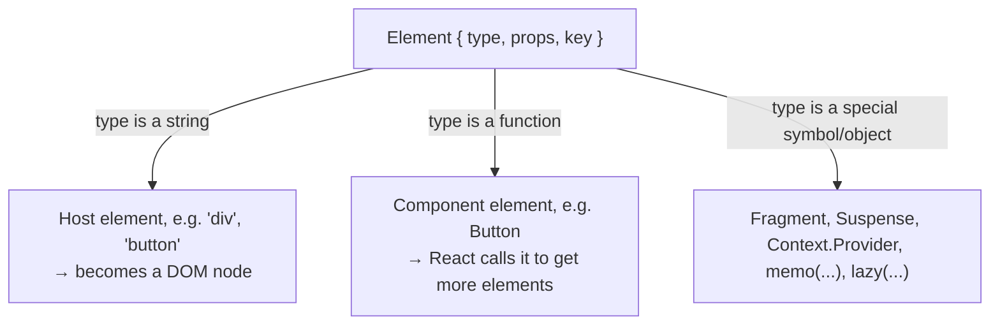
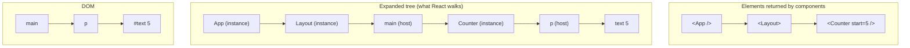
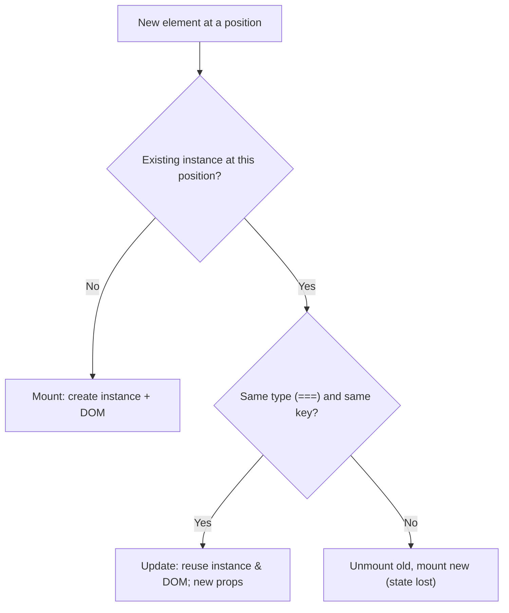

# 01 / 04 — Elements, Components, Instances

## 1. Lesson metadata

| | |
|---|---|
| **Level** | Beginner |
| **Study time** | 3–4 hours (reading 1.5 h, experiments 1 h, exercises 1 h) |
| **Prerequisites** | [03 — UI as a function of state](./03-ui-as-a-function-of-state.md); [00/07 — Functions as values; referential identity](../00-web-and-javascript-foundations/07-functions-and-referential-identity.md); [00/08 — Objects, references, immutability](../00-web-and-javascript-foundations/08-objects-references-immutability.md) |
| **Next** | [05 — JSX and its transformation](./05-jsx-explained.md) |
| **Related later** | [Phase 2 / 05 — React elements vs DOM nodes](../02-react-rendering-and-internals/05-elements-vs-dom-nodes.md), [Phase 2 / 09 — Fiber nodes](../02-react-rendering-and-internals/09-fiber-nodes-and-units-of-work.md) |

**Learning objectives.** After this lesson you can:
1. Define **element**, **component**, **component instance**, and **host (DOM) node**, and say which is which in any snippet.
2. Describe what an element object contains and why elements are cheap, immutable descriptions.
3. Explain why function components have no instance you can hold, yet each *use* of a component has its own state.
4. Trace `<App />` → element → React calls `App` → child elements → DOM nodes.
5. Explain component *identity* (type + position + key) and why defining a component inside another component is a bug.
6. Distinguish `ReactElement`, `ReactNode`, `JSX.Element`, and component types in TypeScript.
7. Relate the vocabulary to what DevTools shows.

**Concepts covered:** element as plain object, `type`, `props`, `key`, `ref` (as a prop in 19), `createElement`, element trees, host vs composite elements, component functions, component instances (conceptual; class history), the internal record React keeps per instance (Fiber, introduced only as a name), identity and the type check, element immutability, `isValidElement`, TypeScript types for elements.

---

## 2. Deep conceptual explanation

### 2.1 What problem is this lesson solving?

Four words — *component*, *element*, *instance*, *node* — are used interchangeably in blog posts, interviews and Slack threads. They name four different things, and mixing them up produces real misunderstandings: believing a component "is rendered into the DOM", believing that `<Foo />` *calls* `Foo`, believing that re-rendering means re-creating DOM nodes, or believing that two `<Counter />` elements share state because they share a function.

This lesson fixes the vocabulary, with a mental model small enough to hold in your head. Everything later (reconciliation, keys, memoization, hooks) is stated in these terms.

### 2.2 The four things

| Term | What it is | Created by | Lives | Example |
|---|---|---|---|---|
| **Component** (definition) | A function (or class, legacy) that takes props and returns a description of UI | You write it | In your source code | `function Button(props) { ... }` |
| **Element** | A small **plain JavaScript object** describing *what you want on screen*: a `type` and `props` (plus a `key`) | JSX / `createElement` / `jsx()` | For one render pass; immutable; garbage-collected afterwards | The value of `<Button label="Save" />` |
| **Component instance** | The thing React maintains for each *use* of a component in the tree: it remembers state, effects, and identity between renders | **React**, when it first renders an element of that type at a position | Until the component unmounts | "This particular `<Counter />` on the settings page, with `count = 3`" |
| **Host (DOM) node** | The actual `HTMLElement`/`Text` in the browser (for react-dom) | `react-dom` in commit | In the DOM | The `<button>` in the page |

In one sentence: **you write components, which return elements; React turns elements into instances and DOM nodes.**

The official docs and Dan Abramov's classic post "React Components, Elements, and Instances" use this vocabulary; a link is in §14.

### 2.3 Elements are descriptions, not things

```tsx
const el = <button className="primary" onClick={save}>Save</button>;
```

After compilation ([Lesson 05](./05-jsx-explained.md)), `el` is an object roughly like:

```js
{
  $$typeof: Symbol.for("react.transitional.element"), // brand: "this is a React element"
  type: "button",
  key: null,
  props: { className: "primary", onClick: save, children: "Save" },
  // ... development-only extra fields
}
```

**Public guarantees** (documented, safe to rely on conceptually):
- An element has a **`type`** (a string for host elements like `"button"`, or a function/class/special symbol for components, fragments, Suspense, etc.), **`props`**, and an optional **`key`**.
- Elements are **immutable**: you create new elements, you never modify old ones.
- Creating an element does **not** render anything, run your component, or touch the DOM.

**Implementation details** (inspect, but never depend on them):
- The exact brand symbol (`$$typeof`) and its string (it changed between versions; verified in React 19.3.1: `Symbol(react.transitional.element)`), extra fields such as `_owner`, `_store`, `_debugInfo`.
- Whether `ref` appears as a top-level field or inside `props`. **Version-sensitive:** in React 19, `ref` is an ordinary prop for function components (`element.props.ref`), and top-level `element.ref` access was removed (in 19.3.1 dev builds reading it logs "Accessing element.ref was removed in React 19. ref is now a regular prop" and still returns the value; verified in the sandbox). In React ≤ 18, `ref` and `key` were stripped from `props` and stored on the element. Only `key` remains special: it is never visible to the component as a prop.
- Elements may be frozen in development (`Object.freeze`) to catch mutation. Assigning to a frozen object's property throws in strict mode (ES modules are strict).

Why design elements as plain objects?
1. **Cheap to create.** Allocating a small object per element per render is far cheaper than creating DOM nodes (which are heavy host objects with many properties and layout implications; [00/04](../00-web-and-javascript-foundations/04-dom-structure-and-mutation.md)).
2. **Comparable.** Two descriptions can be diffed by structure ([Phase 2/06](../02-react-rendering-and-internals/06-reconciliation-fundamentals.md)).
3. **Host-independent.** The same element can drive the DOM, a string renderer, or native views.
4. **Serializable in principle.** Descriptions are data. (Server Components rely on streaming a *serialized* element-like tree, with strict limits; [Phase 9/03](../09-advanced-rendering-and-ecosystem/03-server-components-in-depth.md).)

### 2.4 Two kinds of element type



- `<div />` → `type: "div"` (a string). **Host element.** Becomes a DOM node.
- `<Button />` → `type: Button` (the function **reference**). **Composite (component) element.** React will call `Button(props)`.
- This is exactly why component names **must be capitalized** in JSX: the compiler uses the capitalization to decide between the string `"button"` and the identifier `Button` ([Lesson 05](./05-jsx-explained.md)).

### 2.5 Components: functions from props to elements

In modern React a component is a plain function:

```tsx
function Greeting({ name }: { name: string }) {
  return <h1>Hello, {name}</h1>;
}
```

- Input: a **props object** (one parameter).
- Output: a **description** (an element, string, number, array, `null`, etc.).
- It is **not** an object you instantiate, and `this` plays no role.
- React calls it **during rendering**; you should not call it yourself ([Lesson 01 §5.3](./01-what-is-react.md)).

### 2.6 "Instance": the thing you cannot hold

A **class component** (legacy, still supported) has a real JavaScript instance: `new Counter(props)` creates an object with `this.state`, `this.props`, and lifecycle methods. In old React, "component instance" meant exactly that object, and refs to class components gave you that object.

**Function components have no such object you can access.** Yet the concept of an instance survives because React still keeps, per *use* of the component in the tree, a *record*: the current state cells, effect list, props from last render, and links to parent/children. React's internal name for that record is a **Fiber** (conceptually; [Phase 2/09](../02-react-rendering-and-internals/09-fiber-nodes-and-units-of-work.md)). So:

- Two `<Counter />` elements in the tree → two instances → two independent `count` values, even though they share one function `Counter`.
- Re-rendering calls `Counter(props)` again, but the *instance* (the Fiber record, with its state) persists.
- *Unmounting* destroys the instance, state is gone.
- You cannot `ref` a function component's instance (there's no object); a `ref` on a component, in React 19, is just a prop the component may forward to a DOM node or expose via `useImperativeHandle`.

A good teaching sentence: **a component is the *recipe*; an element is a *note saying "make this recipe with these arguments"*; an instance is *the dish React is keeping warm*; the DOM node is *what ends up on the table*.**

### 2.7 Identity: when is it "the same" instance?

On each render React produces a new element tree and must decide, for each position, whether it is *the same component instance as before* (keep state, update) or *a different one* (destroy old, create new). The rule (details in [Phase 2/06–07](../02-react-rendering-and-internals/07-identity-keys-and-reconciliation.md); the *observable* behavior in [Lesson 16](./16-state-preservation-and-reset.md)):

> At a given position in the tree, if the new element has the **same `type`** (compared by `===`) and the same `key`, React **reuses** the existing instance and updates its props. Otherwise it **unmounts** the old and **mounts** a new one.

`type` equality is by reference for components. So *the function itself must be the same function object across renders.* Defining a component **inside** another component creates a new function each render, so its type changes every time:

```tsx
function Parent() {
  const [n, setN] = useState(0);
  function Child() {            // ❌ a NEW function object on every Parent render
    const [text, setText] = useState("");
    return <input value={text} onChange={(e) => setText(e.target.value)} />;
  }
  return <><button type="button" onClick={() => setN(n + 1)}>{n}</button><Child /></>;
}
```

Each time `Parent` re-renders, `Child` is a different function, so React sees a different `type` at that position: it unmounts the old `Child` (destroying its DOM node and state) and mounts a new one. Typing in the input works for one character (no `Parent` render), but clicking the button resets the input and drops focus.

### 2.8 Common misconceptions

| Misconception | Reality |
|---|---|
| "`<Foo />` calls `Foo`." | It *creates an element* whose `type` is `Foo`. React calls `Foo` later, if/when it renders that element. |
| "An element is a DOM node." | An element is a plain object; DOM nodes are created by `react-dom` from elements, in commit ([Phase 2/05](../02-react-rendering-and-internals/05-elements-vs-dom-nodes.md)). |
| "Components are objects with state." | Function components are stateless functions; React stores their state outside, per instance (Fiber). |
| "A component 'renders itself' into the DOM." | A render only produces elements; DOM changes are applied in commit. |
| "Re-render = remount." | Re-render calls the function again (instance persists, DOM nodes reused). Remount = new instance, new DOM nodes, state lost. |
| "Elements are expensive, so avoid creating them." | They're small objects; creating thousands is normal. The cost people experience comes from *rendering* the component functions they point to and from committing DOM changes. |
| "`element.props` can be edited." | Immutable by contract; mutation is a bug (and fails in dev when frozen). |
| "`key` is a prop I can read in the child." | `key` is consumed by React and not passed to the component; pass another prop if the child needs the value. |

---

## 3. Internal mechanics

### 3.1 How an element tree is expanded (teaching model)

Given

```tsx
function App() { return <Layout><Counter start={5} /></Layout>; }
function Layout({ children }: { children: React.ReactNode }) { return <main>{children}</main>; }
function Counter({ start }: { start: number }) {
  const [n] = useState(start);
  return <p>{n}</p>;
}
```

React starts from the element `<App />` (type `App`). Conceptually:

1. `type` is a function → call `App({})` → returns element `E1 = { type: Layout, props: { children: E2 } }` where `E2 = { type: Counter, props: { start: 5 } }`.
2. `E1.type` is a function → call `Layout(E1.props)` → returns `{ type: "main", props: { children: E2 } }`.
3. `"main"` is a string → a host element: create (or reuse) a DOM `main`; then process its child `E2`.
4. `E2.type` is a function → call `Counter({start: 5})` → `useState(5)` creates a state cell on *this instance* → returns `{ type: "p", props: { children: 5 } }`.
5. `"p"` → host; its child is the number 5 → a text node.

The tree of *elements* you wrote is only a **partial** picture: `App`'s output mentions `Layout` and `Counter` but not `main` or `p`. The *full* tree is the expansion produced by calling components down to host elements. React DevTools shows the component tree (with host nodes shown for DOM elements); the Elements panel shows the DOM tree (no `App`, `Layout`, or `Counter`).



*Public guarantee:* components are called with props; host elements map to DOM elements; the DOM contains only host nodes. *Teaching model:* the expansion above. *Implementation detail:* the actual algorithm is iterative over Fibers (to allow pausing), not recursive function calls.

### 3.2 `children` is just a prop containing elements

`<Layout><Counter /></Layout>` creates `{ type: Layout, props: { children: <Counter element> } }`. `Layout` decides where (or whether) to place `children`. [Lesson 07](./07-composition-and-children.md) builds on this.

An important consequence: the `Counter` element was created by `App`, **not** by `Layout`. When `Layout` re-renders because of its *own* state, the `children` prop it receives is the **same element object** as before (since `App` didn't re-run). React can notice that identical element reference and skip re-rendering that subtree ([Lesson 07 §3](./07-composition-and-children.md)).

### 3.3 Element creation does not run components

```tsx
const el = <Expensive />;        // creates {type: Expensive, props: {}}; Expensive() NOT called
const arr = [el, el, el];        // same element object used three times: fine
```

`Expensive` runs only if the element ends up in the tree React renders. If you create an element and discard it, nothing runs. Conversely, putting the same element object in multiple places is legal (they are descriptions), and each *position* gets its own instance.

### 3.4 What is `ref` and `key`?

- `key` — a hint for **identity among siblings** ([Lesson 09](./09-lists-keys-and-identity.md)). Stored on the element, not delivered to the component via props.
- `ref` — React 19: passed like any prop; function components can receive `ref` and attach it to a DOM node. ⚠ **Version-sensitive:** React ≤ 18 required `forwardRef` to receive `ref`; `forwardRef` is now legacy-but-supported and `ref` as a prop is the recommended path. Details in Phase 3/10.

---

## 4. Step-by-step execution walkthrough

Scenario: two counters under one parent; the user clicks the first.

```tsx
function Counter({ label }: { label: string }) {
  const [n, setN] = useState(0);
  return (
    <button type="button" onClick={() => setN((x) => x + 1)}>
      {label}: {n}
    </button>
  );
}

function App() {
  return (
    <div>
      <Counter label="A" />
      <Counter label="B" />
    </div>
  );
}
```

**Mount**

1. `root.render(<App />)` receives element `{type: App, props: {}}`.
2. React calls `App()`. It returns the element tree `div > [Counter(A), Counter(B)]` (three elements; two of them with the same `type`, `Counter`).
3. For `div` (host): create DOM `div`. For each `Counter` element: React creates a **new instance** (a Fiber record) at that position. Position 0 and position 1 are different instances.
4. React calls `Counter({label:"A"})`. `useState(0)` → instance A's state cell: `0`. Returns `button` element with children `["A", ": ", 0]` (JSX text and expressions become separate children).
5. React calls `Counter({label:"B"})` → instance B's own cell: `0`.
6. Commit: create DOM `button` ×2, set text, append to `div`, append `div` to `#root`.

**Update (click on A)**

7. The handler of instance A runs `setN(x => x + 1)`: enqueued **on instance A only**.
8. React re-renders the part of the tree starting at A (B's props/state didn't change; whether `Counter B` is *re-called* depends on rendering rules: since the update originates at A, React starts from A, and does not call `App` or B; [Phase 2/01](../02-react-rendering-and-internals/01-what-triggers-a-render.md)).
9. `Counter({label:"A"})` is called; `useState` returns `1` for instance A. New element `button` with `A: 1`.
10. React compares the new `button` element with the previous one at that position: same `type` (`"button"`), so the **DOM node is reused**; the child text differs → update the text content. Instance A's identity persisted; instance B was untouched.

**Prediction checkpoint:** after step 10, how many `Counter` *functions* exist, how many instances, how many DOM `button` nodes? **One** function, **two** instances, **two** DOM nodes. The function is shared; state lives with instances.

---

## 5. Code examples

### 5.1 Minimal example — inspecting an element

```tsx
import { createElement, isValidElement } from "react";

function Hello({ name }: { name: string }) {
  return <p>Hello, {name}</p>;
}

const a = <Hello name="Ada" />;
const b = createElement(Hello, { name: "Ada" });

console.log(a.type === Hello);               // true
console.log(a.props);                        // { name: "Ada" }
console.log(isValidElement(a));              // true
console.log(isValidElement(Hello));          // false  (a component is not an element)
console.log(isValidElement(Hello({ name: "Ada" }))); // true  (calling it returns an element)
```

(Calling `Hello(...)` directly here is only to show that components are functions returning elements; do not do this in an app when the component uses hooks.)

**Predict:** is `a === b`? **Result:** `false`. Two separate elements are created; they are structurally equal but distinct objects. Elements are cheap descriptions; identity comparison between separately created elements is not meaningful (see the memoization caveat in [Lesson 07](./07-composition-and-children.md) and Phase 7).

**Line notes:** `createElement(type, props, ...children)` is the classic API that JSX used to compile to; with the modern JSX runtime, compiled code calls `jsx`/`jsxs` instead ([Lesson 05](./05-jsx-explained.md)); you can still call `createElement` manually. Logging the whole element in the console shows development-only fields; don't build features on those.

### 5.2 Practical example — instances are per use, not per function

```tsx
import { useState } from "react";

function Votes({ topic }: { topic: string }) {
  const [votes, setVotes] = useState(0);
  return (
    <button type="button" onClick={() => setVotes((v) => v + 1)}>
      {topic}: {votes}
    </button>
  );
}

export function Poll() {
  return (
    <fieldset>
      <legend>Vote</legend>
      <Votes topic="Tabs" />
      <Votes topic="Spaces" />
    </fieldset>
  );
}
```

**Predict:** click "Tabs" three times, then "Spaces" once. What do the buttons show? **Result:** `Tabs: 3`, `Spaces: 1`. Two instances, two state cells, one component function. If state were attached to the function, both would read 4.

**Why it matters in the real world:** reusable components (row, card, accordion) *must* be able to hold independent local state per use; this is exactly the instance model.

### 5.3 Incorrect example — component defined inside a component

```tsx
// ❌ Incorrect
export function Form() {
  const [submitted, setSubmitted] = useState(false);

  const NameField = () => {                           // new function every render
    const [name, setName] = useState("");
    return <input aria-label="Name" value={name} onChange={(e) => setName(e.target.value)} />;
  };

  return (
    <form onSubmit={(e) => { e.preventDefault(); setSubmitted(true); }}>
      <NameField />
      <button type="submit">Send</button>
      {submitted && <p role="status">Thanks!</p>}
    </form>
  );
}
```

**Predict:** the user types "Ada" into the field and clicks Send. What do they see?

**Result:** typing works (each keystroke updates `NameField`'s own state; `Form` is not re-rendered, so `NameField`'s identity is stable *between keystrokes*). On Send, `setSubmitted(true)` re-renders `Form`. That creates a **new** `NameField` function; React compares `type` at that position, finds a different function, **unmounts** the old instance (state `"Ada"` lost, DOM input removed) and **mounts** a fresh one. The user sees "Thanks!" and an **empty** field. Had the field been focused it would lose focus on every parent re-render. If the parent re-rendered per keystroke, typing would break after every character.

**Why wrong:** the component type is created during render, so identity is unstable.

### 5.4 Corrected implementation

```tsx
function NameField() {
  const [name, setName] = useState("");
  return <input aria-label="Name" value={name} onChange={(e) => setName(e.target.value)} />;
}

export function Form() {
  const [submitted, setSubmitted] = useState(false);
  return (
    <form onSubmit={(e) => { e.preventDefault(); setSubmitted(true); }}>
      <NameField />
      <button type="submit">Send</button>
      {submitted && <p role="status">Thanks!</p>}
    </form>
  );
}
```

Define components at **module level**. If the inner component needs data from the parent, pass **props**. If you need to *render* a helper that closes over parent variables, call it as a **render helper function returning elements** (`renderRow(item)`, called as a plain function, with no hooks inside), or better, extract a component and pass the data. (A helper function that is *called* inside render—not used as `<Helper />`—does not create a component type, so there's no identity churn; but it also can't hold hooks safely, since hooks would then belong to the *caller's* hook list.)

### 5.5 Advanced example — types for elements in TypeScript

```tsx
import type { ComponentType, ReactElement, ReactNode, JSX } from "react";

// ReactNode: anything renderable (element, string, number, boolean, null, undefined, array of ReactNode, portal...)
function Box({ children }: { children?: ReactNode }) {
  return <div className="box">{children}</div>;
}

// ReactElement: specifically an element object (not a string or null)
function Single({ child }: { child: ReactElement }) {
  return <section>{child}</section>;
}

// A component type: something JSX can use as <X />
function Wrap<P extends object>(Comp: ComponentType<P>, props: P): ReactElement {
  return <Comp {...props} />;
}

// JSX.Element: the (global) return type TypeScript assigns to a JSX expression.
// Prefer ReactElement / ReactNode in signatures; the JSX namespace location has varied with @types/react versions.
const x: JSX.Element = <Box>hi</Box>;
```

Guidance:
- **Props that accept "anything renderable"** → `ReactNode` (the right default for `children`, slots).
- **Props that must be an element** (you will `cloneElement`/inspect it) → `ReactElement`; this is rarely a good API (it restricts callers); prefer render props or composition.
- **Function return type** for components: let TypeScript infer, or use `ReactNode` (React 19 types allow components to return any `ReactNode`, including `string`, `null`, `undefined`, async components in RSC contexts) ⚠ *depends on your `@types/react` version; verify*. Avoid annotating components as `React.FC` by default: it adds nothing in modern types and obscures generics/defaults; plain function signatures are clearer.
- **`ComponentType<P>`** for "a component that takes P" (for HOC-like utilities, a table's custom cell renderer, etc.).
- **`JSX.Element`** is what TS infers for a JSX expression; older code uses it as a return type. It's narrower than `ReactNode` (a component returning `"text"` doesn't type as `JSX.Element`). ⚠ In recent `@types/react` versions the global `JSX` namespace is deprecated in favor of `React.JSX`; importing `JSX` from `"react"` as above might require a recent version; verify against your installed types, or use `ReactElement` to be safe.

---

## 6. Visual explanations

### 6.1 The pipeline of things

```mermaid
flowchart LR
  SRC["Component definition<br/>(function Counter)"]
  JSX["JSX: &lt;Counter label='A' /&gt;"]
  EL["Element object<br/>{type: Counter, props}"]
  INS["Instance (Fiber record)<br/>state, effects, links"]
  OUT["Elements returned by Counter<br/>{type: 'button', ...}"]
  DOM["DOM node &lt;button&gt;"]
  SRC -->|"you reference it in"| JSX
  JSX -->|"evaluates to"| EL
  EL -->|"React creates/finds at a position"| INS
  INS -->|"React calls Counter(props)"| OUT
  OUT -->|"commit (react-dom)"| DOM
```



### 6.2 Same function, two instances

```text
Counter (function, 1 object in memory)
   ├─ instance @ App › div › [0]   state: {n: 3}   →  DOM <button> #1
   └─ instance @ App › div › [1]   state: {n: 0}   →  DOM <button> #2
```

### 6.3 Identity decision at a position



---

## 7. Alternative approaches and trade-offs

How to reuse UI logic and structure, and how the element/component/instance model shapes the choice:

| Approach | Identity stability | State isolation | Readability | Testability | When to prefer |
|---|---|---|---|---|---|
| **Module-level component** (`<Row />`) | Stable | Per instance | High | Easy: render in isolation | Default |
| **Inline component defined in render** | **Unstable (bug)** | Broken | Low | Hard | Never for stateful/DOM-holding components |
| **Render helper function** (`renderRow(x)` returns elements) | Not a component (no type) | Belongs to caller | Medium | Easy (pure function) | Small private pieces *without hooks*, hot loops where an extra component boundary is unwanted |
| **Elements stored in variables/props** (`const header = <Header />`) | Same as inline JSX | n/a | High | Easy | Slots/composition ([Lesson 07](./07-composition-and-children.md)) |
| **Higher-order component / render props / hooks** | Component identity depends on how HOC is applied (apply at module level, not in render) | Per instance | Varies | Varies | Cross-cutting behavior (Phase 5) |
| **Class component** (legacy) | Stable | Per class instance (`this`) | Verbose | Moderate | Existing code; error boundaries (until a function API exists) ⚠ *verify current status*|

**When the "extract a module-level component" rule is not best:** a tiny, hook-free piece used once (an icon wrapper, a formatting snippet) can stay inline as JSX or a helper function; extracting adds files and indirection with no state-isolation benefit. Conversely, extracting a component *does* create a new instance boundary, which matters when you need per-row state, memoization, or DevTools labeling.

---

## 8. Best practices and anti-patterns

**Do**
- Define components at module scope; use PascalCase names.
- Pass data via props rather than closing over parent variables in inline components.
- Treat elements as immutable values; create new ones instead of mutating.
- Use meaningful component names (they appear in DevTools and error stacks); avoid anonymous default exports in components when possible.

**Beginner mistakes**
- Calling components as functions (`{Counter()}`), [Lesson 01](./01-what-is-react.md).
- Defining components inside components (§5.3).
- Believing an element "is" the component output on screen.
- Mutating `props` or an element's `props`.
- Lowercase component names (`<counter />` becomes the host element `"counter"`).

**Experienced-developer mistakes**
- Comparing elements by reference to decide whether something "changed".
- Using `cloneElement` to inject props into arbitrary children (fragile; breaks with wrappers). Prefer explicit props, context, or render props.
- Creating components dynamically in render via factories (`const Comp = makeComp(config)` inside render) which yields unstable types; memoize at module level or via `useMemo` only with care.
- Assuming a component function is called exactly once per instance per update (StrictMode, concurrent rendering, and bail-outs change call counts; [Phase 2/12](../02-react-rendering-and-internals/12-why-rendering-must-be-pure.md)).

**Smells:** a component containing another component's definition; `const X = () => ...` nested in JSX-returning functions; `key` used to force re-creation without a comment explaining intent; type annotations that force callers to pass `ReactElement` when `ReactNode` would do.

**Accessibility notes:** the element/instance model doesn't change DOM semantics. Make sure host elements chosen in the leaf (`button`, `a`, `label`, headings) are semantic; custom components should forward the props that matter for accessibility (`aria-*`, `id`, `className`, `ref`) to the underlying host element, or expose explicit props for them.

**Justified exceptions:** a dynamically chosen component type (`const Tag = as ?? "div"`) stored in a variable created **from props**, not from a new function each render, is fine (polymorphic components, [Phase 5/19](../05-design-patterns/19-polymorphic-components.md)): the *type value* is stable as long as the same reference is produced.

---

## 9. Real-world application

*Design-system `Button` used 500 times on a page.* One function, 500 instances. Each instance has its own props (and possibly state like "pressed ripple"). Cost scales with the number of *instances rendered per update*, not with the number of component definitions; that is why Phase 7 asks "which instances re-render, and why?" rather than "which components exist?".

*Dashboards with a generic `<Widget type="chart" />`.* A registry maps strings to component types: `const registry = { chart: Chart, table: Table }`, then `const Comp = registry[type]; return <Comp {...props} />`. Since `registry` is module-level, the `type` is stable; if instead the registry were rebuilt on every render (`useMemo`-less factory), every update would remount all widgets, losing scroll positions, chart zoom state, and flashing the UI. Engineering constraint: registry stability and lazy loading (`React.lazy` components must also be created at module level).

*Multi-team shared components.* Teams publish components; consumers pass `children` or `ReactNode` slots. Public API types should be `ReactNode` for slots; passing elements across package boundaries requires a single copy of `react` (otherwise elements created by one copy may be treated as invalid by another in rare cases: *verify behavior in your React version*; the more common failure is hooks breaking due to duplicate React copies, [Lesson 01 §10](./01-what-is-react.md)).

*Server-rendered pages.* On the server React turns the same elements into an HTML string/stream; no DOM nodes exist at all. This works because elements and components are host-independent; only the final "host" differs.

---

## 10. Debugging and troubleshooting

**Symptom:** "My input loses focus and its text after each parent update."
1. Open React DevTools → Components. Trigger the parent update. Watch whether the child component *flashes as newly mounted* (use "Highlight updates when components render" in settings) and whether its state resets.
2. In the Elements panel, select the input; trigger the update; if the DOM node was *replaced*, the element in the panel is a new node (the old node's reference is detached). A quick check: `$0` in the console refers to the selected node; after the update, `$0.isConnected` becomes `false`, which proves the node was removed and recreated.
3. Search the parent for component definitions inside render and for unstable `key` props (`key={Math.random()}`).
4. **Root cause:** type or key changes between renders. **Fix:** hoist the component, stabilize the key. **Validate:** after the fix, `$0.isConnected` stays `true` and typed text persists.

**Symptom:** "Objects are not valid as a React child (found: object with keys {$$typeof, type, key, props...})" or "Functions are not valid as a React child."
- You rendered an element's *object form* in a context where it isn't valid, such as using `{Component}` (the function) instead of `<Component />`, or rendering a plain object. The message "Functions are not valid as a React child" almost always means `{Foo}` instead of `<Foo />` (or `{foo}` where `foo` is a function you meant to call). Fix by creating an element.

**Symptom:** "Element type is invalid: expected a string (for built-in components) or a class/function (for composite components) but got: undefined."
- A wrong import: a default vs named import mismatch (`import Button from ...` when the module exports `{ Button }`), a circular import yielding `undefined` at evaluation time, or a lowercase/typo'd name. Check the import line and the exporting module ([00/10](../00-web-and-javascript-foundations/10-modules-and-dependency-graphs.md) on circular dependencies). The message includes "Check the render method of `X`" which names the *component whose render produced the bad element*.

**Symptom:** "Component count in DevTools doesn't match my JSX."
- DevTools shows *instances* (including memo wrappers, context providers, and host nodes), not your file structure. That's expected.

---

## 11. Exercises

### Level A — Knowledge
A1. Define component, element, instance, and host node in one sentence each.
A2. What are the three fields every element has (conceptually)? Which one is *not* visible to the component as a prop?
A3. Why must component names be capitalized in JSX?
A4. Can a function component hold an instance reference? Where does its state live?
A5. Does creating an element call the component function? Justify.

### Level B — Code comprehension
B1. How many elements, component instances, and DOM nodes exist after mount for the code below? (Count `<App />` itself as a rendered element; ignore text nodes.)
```tsx
function Item({ label }: { label: string }) { return <li>{label}</li>; }
function List() {
  return <ul><Item label="a" /><Item label="b" /><Item label="c" /></ul>;
}
function App() { return <List />; }
```
B2. In each case, will React preserve or reset the state of `<Counter />` when `flag` flips? Explain each.
```tsx
// (i)
{flag ? <Counter /> : <Counter />}
// (ii)
{flag ? <Counter /> : <p>other</p>}
// (iii)
{flag ? <Counter key="a" /> : <Counter key="b" />}
// (iv)
{flag && <Counter />}
```
B3. What does the console print and why?
```tsx
const a = <b>x</b>;
const b = <b>x</b>;
console.log(a === b, a.type === b.type, a.props === b.props);
```
B4. A teammate writes `const Hello = () => <p>Hi</p>; const el = Hello;` and renders `{el}`. What error, and what's the fix?

### Level C — Implementation
C1. Write `Repeat` with props `{ times: number; children: ReactNode }` that renders its children `times` times. Must it create new elements? Why/why not? Consider keys.
C2. Write a function `countHostElements(node: ReactNode): number` that counts host elements (string `type`) in an element tree produced by *already-created* elements (no calling components; just walk `props.children`). Use `Children.toArray`/`isValidElement` carefully, and state its limitation.
C3. Implement a small `Registry` component: `<Widget kind="chart" data={...} />` that chooses from a module-level map of components, with a safe fallback for unknown kinds and correct TypeScript typing (discriminated by `kind`).

### Level D — Debugging
D1. "My list item's local expanded/collapsed state resets whenever the filter changes." The code:
```tsx
function Filtered({ items, filter }: Props) {
  const Row = ({ item }: { item: Item }) => {
    const [open, setOpen] = useState(false);
    return <li onClick={() => setOpen(!open)}>{item.name}{open && <Details item={item} />}</li>;
  };
  return <ul>{items.filter(filter).map((i) => <Row key={i.id} item={i} />)}</ul>;
}
```
Diagnose and fix.
D2. After wrapping a component with a HOC, it remounts on every parent render. The code:
```tsx
function Page() {
  const Enhanced = withAnalytics(Dashboard);
  return <Enhanced />;
}
```
Diagnose and fix. Also fix it for the case where `withAnalytics` needs a runtime argument from props.

### Level E — Architecture and engineering decisions
E1. Your design system has a `Table` that accepts custom cell renderers. Compare three API shapes: `cell: ReactElement`, `renderCell: (row) => ReactNode`, `CellComponent: ComponentType<{row: Row}>`. Evaluate on identity/state, performance, typing, and ergonomics, and recommend one.
E2. A page uses a registry of 40 widget types, some of which should be lazy-loaded. Describe how element/type identity influences registry design and how you would prevent remounts when widgets are reordered.

### Level F — Expert challenge
F1. Without running code, predict how many times `Child` is *called* and how many times its DOM `p` node is *created* when the button is clicked once. Then explain what changes if `Parent` receives `children` from outside instead of creating `<Child />` itself.
```tsx
function Child() { console.log("Child"); return <p>child</p>; }
function Parent() {
  const [n, setN] = useState(0);
  return (
    <div>
      <button type="button" onClick={() => setN(n + 1)}>{n}</button>
      <Child />
    </div>
  );
}
```
(Assume production mode: no StrictMode.)

---

## 12. Detailed answers and explanations

> Attempt the exercises first.

**A1.** Component: a function (or class) from props to a UI description. Element: a plain immutable object `{type, props, key...}` describing what to render. Instance: React's per-use record of a component in the tree, holding state/effects between renders. Host node: the real DOM node created by `react-dom` for a host element.

**A2.** `type`, `props`, `key` (plus `ref`, which in React 19 is a normal prop for function components). `key` is not visible to the component as a prop.

**A3.** The JSX compiler treats lowercase names as host element names (strings: `"div"`) and capitalized names (or member expressions like `Foo.Bar`) as identifiers referencing a variable (the component). `<counter />` would create a host element `<counter>` in the DOM (an unknown element, with a console warning in development), not your component.

**A4.** No. Function components have no instance object you can reference. React stores their state in an internal per-instance record (a Fiber, conceptually), associating hook calls with state cells by call order.

**A5.** No. Creating an element only creates the object `{type, props, ...}`. The function is called later by React if the element is rendered. Evidence: an element that's created but never placed in the tree never runs its component (no logs).

**B1.** Elements: React creates elements when functions run: `<App />` (1, the root element), `<List />` (1, returned by App), `<ul>` (1) and three `<Item />` (3) from List, then each `Item` returns `<li>` (3). Total 9 elements created during the mount render. Instances (composite): `App`, `List`, 3×`Item` = **5**. DOM nodes (excluding text): `ul` + 3×`li` = **4**. (Host elements like `ul` and `li` also have internal records in React, but you don't call them instances.) Evaluation: the key insight is the three different counts and that `App`/`List` produce no DOM nodes themselves. (If your count of elements differs because you excluded the root or counted text children, justify the convention.)

**B2.**
(i) **Preserved.** Both branches produce an element of type `Counter` at the same position with no key; React reuses the instance. Common wrong answer: "reset, because the JSX is in different branches". React looks at *position and type*, not JSX source location.
(ii) **Reset.** Type changes (`Counter` vs `"p"`); unmount/mount.
(iii) **Reset.** Same type, different `key` ⇒ different identity. This is the sanctioned way to force a reset ([Lesson 16](./16-state-preservation-and-reset.md)).
(iv) **Reset when it goes false→true.** `false` renders nothing, so the Counter unmounts when `flag` is false and mounts anew when true. State doesn't survive being hidden.

**B3.** `false true false`. Two separate calls produce two element objects (`a !== b`); `type` is the same string `"b"`; `props` objects are distinct (`{children: "x"}` each time). Never compare elements/props by reference to detect "sameness".

**B4.** `{el}` where `el` is the function `Hello`: "Functions are not valid as a React child. This may happen if you return a Component instead of `<Component />`..." Fix: `const el = <Hello />` or render `<Hello />`.

**C1. Sample**
```tsx
import { Fragment, type ReactNode } from "react";

export function Repeat({ times, children }: { times: number; children: ReactNode }) {
  const n = Math.max(0, Math.floor(times));
  return (
    <>
      {Array.from({ length: n }, (_, i) => (
        <Fragment key={i}>{children}</Fragment>
      ))}
    </>
  );
}
```
Discussion: no new elements are required for `children` itself; the *same* element object can appear at several positions, each becoming its own instance. A `key` is needed on each repeated wrapper because it's an array of siblings; index keys are acceptable here because the list is purely positional and never reordered ([Lesson 09](./09-lists-keys-and-identity.md)). Edge: `NaN`/negative `times`; the guard handles negatives; `Math.floor(NaN)` is `NaN`, and `Math.max(0, NaN)` is `NaN`, so `Array.from({length: NaN})` yields an empty array (length coerces to 0). Evaluation: handles non-integer/negative input; uses keys; does not mutate `children`.

**C2. Sample**
```tsx
import { Children, isValidElement, type ReactNode } from "react";

export function countHostElements(node: ReactNode): number {
  let count = 0;
  Children.forEach(node, (child) => {
    if (!isValidElement(child)) return;
    if (typeof child.type === "string") count += 1;
    const props = child.props as { children?: ReactNode };
    count += countHostElements(props.children);
  });
  return count;
}
```
Limitation: it sees only the elements *already created*; a composite element like `<Card />` hides its own output (host elements inside `Card` are produced only when React calls `Card`), so the count is a lower bound for the final DOM. This demonstrates §3.1: the tree you wrote is not the expanded tree. `Children.forEach` flattens nested arrays but does **not** traverse into a `Fragment`'s children by itself; the explicit recursion through `props.children` handles that, because a Fragment is an element whose `type` is not a string (so it is not counted, but its children are visited). Mention that `React.Children` utilities are considered legacy-ish and are discouraged in new designs ([Lesson 07](./07-composition-and-children.md)).

**C3. Sample**
```tsx
import type { ComponentType } from "react";

interface ChartProps { data: number[] }
interface TableProps { rows: string[][] }

function Chart({ data }: ChartProps) { return <p>Chart of {data.length} points</p>; }
function Table({ rows }: TableProps) { return <p>Table with {rows.length} rows</p>; }

type WidgetSpec =
  | { kind: "chart"; props: ChartProps }
  | { kind: "table"; props: TableProps };

const registry: { [K in WidgetSpec["kind"]]: ComponentType<Extract<WidgetSpec, { kind: K }>["props"]> } = {
  chart: Chart,
  table: Table,
};

export function Widget(spec: WidgetSpec) {
  // TypeScript can't correlate the union across the indexed lookup; one localized cast is the pragmatic choice.
  const Comp = registry[spec.kind] as ComponentType<unknown>;
  if (!Comp) return <p role="alert">Unknown widget: {String((spec as { kind: string }).kind)}</p>;
  return <Comp {...(spec.props as object)} />;
}
```
Points: `registry` is module-level (stable types); the cast is a *documented* escape from TS's correlated-union limitation (an alternative is a `switch (spec.kind)` that returns a typed element for each case, which is more verbose but fully type-checked: arguably better for 2–5 kinds); runtime fallback for unknown kinds handles data that doesn't match types (e.g., JSON from a server). Evaluation criteria: registry at module scope; no component creation in render; safe fallback; typing explained honestly.

**D1.** `Row` is defined inside `Filtered`, so it is a new type on every `Filtered` render. When `filter` (or any prop) changes, `Filtered` re-renders, every `Row` instance is unmounted and re-mounted and local `open` state resets. Fix: hoist `Row` to module level and pass `item` as a prop; keep `key={i.id}` on the element in the `.map`.
```tsx
function Row({ item }: { item: Item }) {
  const [open, setOpen] = useState(false);
  return (
    <li>
      <button type="button" aria-expanded={open} onClick={() => setOpen((o) => !o)}>{item.name}</button>
      {open && <Details item={item} />}
    </li>
  );
}
```
(Also an accessibility fix: a clickable `li` isn't keyboard accessible; use a `button`.) Validation: toggle open on a row, change the filter, confirm the row stays open (DevTools shows no remount).

**D2.** `withAnalytics(Dashboard)` runs during every `Page` render and returns a *new* component function, so `<Enhanced />` has a new type each time and remounts. Fix: create the enhanced component at module level: `const EnhancedDashboard = withAnalytics(Dashboard);`. If the HOC needs a runtime value from props, don't parameterize the *component type*; pass the value as a prop (`<EnhancedDashboard section={section} />`) or use context/hook instead of HOC. If you truly must create types dynamically, memoize by the input so that the same input gives the same type (module-level `Map` cache), accepting that the cache can leak memory without bounds. Better answer: replace the HOC with a hook (`useAnalytics`) so there is no dynamic type creation at all.

**E1.** Criteria and analysis. `cell: ReactElement`: the element is created by the caller before the table knows the row, so it can't depend on the row without `cloneElement` (fragile) and can't be created per row efficiently; bad. `renderCell: (row) => ReactNode`: flexible and idiomatic; the caller closes over its own variables; cells can't hold hooks in the render function *itself* (it is called by the Table, so hooks would attach to Table's hook list; if used inconsistently, bugs), but they can return components that hold state. Identity: no component type is created, so no remount churn. `CellComponent: ComponentType<{row}>`: each cell is a real component instance, can use hooks, has its own DevTools entry, is memoizable; but type identity matters: it must be a stable reference (module-level), and inline arrow functions passed from the caller's render would remount all cells every render (an easy-to-make mistake that the API invites). Recommendation: `renderCell` for simple formatting; `CellComponent` when cells need state/hooks; document the "must be stable" requirement or offer both. Evaluation criteria: addresses identity/hook rules, performance (per-row instances), typing (`ComponentType<P>` generics), and misuse risk.

**E2.** Registry map at module scope; `React.lazy(() => import(...))` calls also at module scope (calling `lazy` in render creates a new type each time and would remount and re-suspend). Wrap lazy widgets in `Suspense` boundaries *per widget* so one slow widget doesn't blank the dashboard. To keep widget state when reordering, render the list with stable `key={widget.id}` (not index), and keep the registry lookup stable. If the layout engine moves widgets between *different parents*, state is lost regardless of keys (the position/parent changes), so either lift state out of widgets into a store keyed by widget id or keep the DOM structure flat and reposition with CSS ([Phase 2/07](../02-react-rendering-and-internals/07-identity-keys-and-reconciliation.md)). Evaluate: names stable type references, `key`, per-widget Suspense/error boundaries, and the parent-change caveat.

**F1.** On click: `setN` → `Parent` re-renders. The new element tree includes a *new* `<Child />` element (created again as part of `Parent`'s output), so `Child` has the same type at the same position → instance reused → **`Child()` is called once** (it logs `Child` once), and returns a new `p` element equal in structure; the diff finds no change, so **no DOM node is created** for it (0 creations; the `p` is reused untouched). The button text node is updated. If `Parent` received `<Child />` via `children` from *its* parent (`App` creates `<Parent><Child /></Parent>`), then `Parent`'s own state update doesn't re-run `App`, so `props.children` is the *same element object*; React can bail out on the `Child` subtree without calling `Child()` at all (0 calls). Public vs implementation: the first part (`Child` re-called on parent re-render) is documented default behavior; the bailout when an element prop is referentially identical is an optimization React performs, widely described in docs and talks as "the children prop trick"; treat it as a *may* not a *must* in your reasoning ([Phase 2/29](../02-react-rendering-and-internals/29-reasoning-about-unnecessary-renders.md), [Phase 7/03](../07-performance/03-why-components-rerender.md)).

---

## 13. Senior engineer interview questions

**Q1. "What's the difference between a React element and a component?"**
*Strong answer:* A component is a function from props to a description; an element is the description object `{type, props, key}` that references a component (or host tag) and its arguments. JSX creates elements; React calls components when rendering elements. An element is cheap, immutable, short-lived; a component definition is long-lived code; the per-use state holder is the instance.

**Q2. "What does it mean that two `<Counter />` have independent state when they share one function?"**
*Strong answer:* State is stored per instance (React's per-position record), not in the function. Hooks are matched to state cells by call order within an instance. That's also why hooks require stable call order, and why state resets when an instance unmounts or its identity (type/key/position) changes.

**Q3. "Why does defining a component inside another component cause bugs?"**
*Strong answer:* Component identity is `type` equality; a new function per render is a new type, so React unmounts and remounts the subtree each time: lost state and focus, extra DOM churn, effects re-running, memoization defeated. Fix by hoisting and passing props; use render functions when you need closure access without hooks.

**Q4. "Is `ReactNode` the same as `ReactElement`?"**
*Strong answer:* No. `ReactElement` is the element object; `ReactNode` is everything React can render: elements, strings, numbers, booleans, `null`/`undefined`, iterables (arrays), portals, etc. Use `ReactNode` for slot/children props; `ReactElement` only when you must inspect/clone it, which is rarely a good API.

**Q5. "When does React call my component?"**
*Strong answer:* During the render phase when the component's element is reached in the tree being rendered: on mount, on re-render triggered by its own state/context update or by its parent re-rendering with a new element (unless React can bail out), possibly more than once (StrictMode double invocation in dev, concurrent re-tries). Components therefore must be pure with respect to render count and timing.

---

## 14. Further learning resources

| Resource | URL | Covers / why | Level | Study |
|---|---|---|---|---|
| React docs — Your First Component | <https://react.dev/learn/your-first-component> | Components as functions returning markup; naming rules | Beginner | Whole page |
| React docs — Importing and Exporting Components | <https://react.dev/learn/importing-and-exporting-components> | Module-level components; default vs named exports | Beginner | Whole page |
| React docs — Preserving and Resetting State | <https://react.dev/learn/preserving-and-resetting-state> | Identity by position/type/key (observable behavior) | Intermediate | Whole page; "Different components at the same position reset state" |
| React docs — `createElement` | <https://react.dev/reference/react/createElement> | Element creation API and the returned object | Beginner–Int. | Usage, Returns |
| React docs — `isValidElement` | <https://react.dev/reference/react/isValidElement> | Detecting elements | Beginner | Whole page |
| React docs — `Children` | <https://react.dev/reference/react/Children> | Children utilities, and the page's caveats about fragility | Intermediate | "Alternatives" notes |
| Dan Abramov — React Components, Elements, and Instances | <https://legacy.reactjs.org/blog/2015/12/18/react-components-elements-and-instances.html> | The origin of this lesson's vocabulary | Intermediate | Whole post (mentally substitute hooks for class details) |
| TypeScript — JSX | <https://www.typescriptlang.org/docs/handbook/jsx.html> | How TS type-checks JSX, `JSX.Element` | Intermediate | "The JSX result type" |
| React source repository | <https://github.com/facebook/react> | Look for the JSX runtime / element creation code under `packages/react/` *(verify current layout)* | Advanced | Optional: read element creation code to see the object shape |

URLs in this table were checked for HTTP 200 on 2026-10-22; any still marked *(unverified)* could not be checked automatically (blocked or unreachable). A 200 response does not guarantee the page content still matches the description; if a link has moved, search the site for the quoted title.

---

## 15. Knowledge checkpoint

**You should now understand**
- The four-way distinction: component (recipe), element (description), instance (React's per-use record), host node (DOM).
- That elements are immutable plain objects and that `<Foo />` creates one without calling `Foo`.
- That identity = type (by reference) + key + position, and that state belongs to the instance.

**You should be able to explain without notes**
- Why the same function can power independent counters.
- Why a component defined inside a component remounts every render.
- Why the DOM tree and the component tree differ.

**You should be able to implement**
- Module-level components that take data via props.
- A registry-based dynamic component with stable types and a safe fallback.
- Correct TypeScript signatures with `ReactNode`, `ReactElement`, `ComponentType`.

**You should be able to debug**
- Remount-on-update bugs (identity), "functions are not valid as a React child", and "element type is invalid" import errors.

**Before moving on:** read [05 — JSX and its transformation](./05-jsx-explained.md), which shows exactly how the syntax you've been writing becomes the element-creating calls described here.
