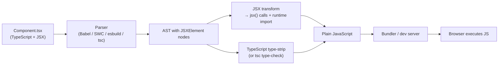
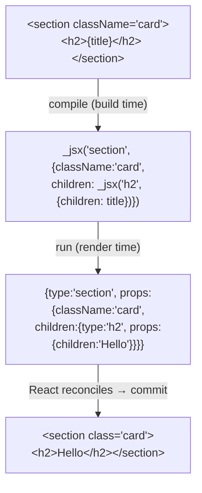
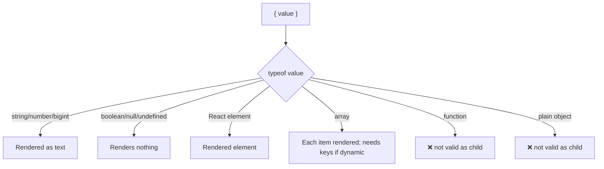

# 01 / 05 — JSX and Its Transformation

## 1. Lesson metadata

| | |
|---|---|
| **Level** | Beginner |
| **Study time** | 3–4 hours (reading 1.5 h, experiments 1 h, exercises 1 h) |
| **Prerequisites** | [04 — Elements, components, instances](./04-elements-components-instances.md); [00/20 — Transpilers, bundlers, dev server, source maps](../00-web-and-javascript-foundations/20-tooling-transpilation-and-bundling.md); [00/18 — TypeScript fundamentals and narrowing](../00-web-and-javascript-foundations/18-typescript-fundamentals-and-narrowing.md) (for the TSX parts) |
| **Next** | [06 — Props and one-way data flow](./06-props-and-one-way-data-flow.md) |
| **Related later** | [08 — Conditional rendering](./08-conditional-rendering.md), [09 — Lists, keys, identity](./09-lists-keys-and-identity.md), [Phase 4 / 20 — Design systems](../04-react-architecture/20-design-systems.md) |

**Learning objectives.** After this lesson you can:
1. Explain that JSX is syntax sugar that a compiler rewrites into JavaScript function calls returning element objects, and that browsers cannot run it directly.
2. Hand-compile a JSX snippet into both the classic (`createElement`) and the automatic (`jsx`/`jsxs`) forms.
3. Configure the JSX transform for a TypeScript/Vite project (`jsx: "react-jsx"`) and explain what it does.
4. Apply JSX's rules: one root, closing tags, `className`/`htmlFor`, `style` objects, expression slots, whitespace handling, comments, fragments.
5. Predict what renders for `{0}`, `{false}`, `{null}`, `{[]}`, `{{}}`, and strings with HTML characters.
6. Explain how JSX avoids most XSS by default and where it does not (`dangerouslySetInnerHTML`, URLs).
7. Differentiate host vs component tags by capitalization and member expressions, and type JSX in TypeScript.

**Concepts covered:** JSX as syntax extension, compiler transforms (classic vs automatic runtime), `react/jsx-runtime`, `jsx`/`jsxs`/`jsxDEV`, Fragment, props spread, `key` handling, children normalization, expression slots, text and whitespace rules, attribute naming, event props, `style`, escaping, `dangerouslySetInnerHTML`, TSX typing, source maps.

---

## 2. Deep conceptual explanation

### 2.1 What problem is this lesson solving?

You have been reading JSX for four lessons as if it were part of JavaScript. It is not. A browser given `const el = <h1>Hi</h1>;` throws a `SyntaxError`. JSX is a **separate syntax** that a build step translates into plain JavaScript. If you don't know what it translates *to*, you will be confused by things that are obvious once you do:

- why component names must be capitalized ([Lesson 04](./04-elements-components-instances.md)),
- why you can't write `if` or `for` inside the braces,
- why `{0 && <X />}` shows a `0`,
- why `key` isn't in `props`,
- why every file used to need `import React from "react"` and now does not,
- why adjacent elements need a parent or Fragment.

### 2.2 JSX is an expression that becomes a function call

JSX is a syntax extension for JavaScript (not a template language, and not HTML). Every JSX element is an **expression** and compiles to a call that returns an element object ([Lesson 04](./04-elements-components-instances.md)):

```jsx
const el = <a href="/docs" className="link">Docs</a>;
```

**Classic transform** (React ≤ 16 era default; still available):

```js
const el = React.createElement("a", { href: "/docs", className: "link" }, "Docs");
```

**Automatic transform** (the default since React 17's new JSX transform; used by modern tooling):

```js
import { jsx as _jsx } from "react/jsx-runtime";
const el = _jsx("a", { href: "/docs", className: "link", children: "Docs" });
```

Both produce an element object `{ $$typeof, type: "a", props: { href, className, children: "Docs" }, key: null }` (shape is an implementation detail, [Lesson 04 §2.3](./04-elements-components-instances.md)).

Because JSX compiles to expressions, **JSX can appear anywhere an expression can**: assigned to variables, returned from functions, passed as arguments, stored in arrays and objects, used in ternaries. It cannot contain *statements* in its `{ }` slots (`if`, `for`, `switch`, `const`); only expressions.

### 2.3 The two transforms in detail

| | Classic | Automatic |
|---|---|---|
| Compiled call | `React.createElement(type, props, ...children)` | `jsx(type, props, key?)` / `jsxs(...)` for static multi-child, from `react/jsx-runtime` |
| Needs `React` in scope? | **Yes** (that's why old files began with `import React from "react"`) | **No**; the compiler injects the import of the runtime |
| Children | Passed as extra arguments, then folded into `props.children` | Placed in `props.children` directly (array for multiple) |
| `key` | Extracted from props config | Passed as a **third argument** |
| Dev vs prod | Same function; dev adds warnings | Dev build uses `react/jsx-dev-runtime` (`jsxDEV`) which carries source location and extra validation |
| Where configured | Babel preset option `runtime: "classic"`; TS `jsx: "react"` | Babel `runtime: "automatic"`; TS `jsx: "react-jsx"` (prod) or `"react-jsxdev"` (dev) |

Why the change? (1) Removes the need to import `React` just for JSX; (2) enables small runtime optimizations (`jsxs` signals that children are a static array, avoiding some key warnings); (3) decouples JSX from `createElement` so the runtime can evolve; (4) allows alternative runtimes via `jsxImportSource` (Preact, Emotion, etc.).

⚠ *Version-sensitive.* The automatic transform requires React ≥ 17 (or 16.14 / 15.7 backports) and tooling that supports it. In React 19 the new transform is *required* (the React 19 upgrade guide lists "New JSX Transform is now required"; [Lesson 01 §14](./01-what-is-react.md)).

### 2.4 Anatomy of JSX

```jsx
<Tag attr="string" other={expression} {...spread} flag>
  text
  {expression}
  <Child />
</Tag>
```

| Piece | Rule | Compiles to |
|---|---|---|
| **Tag name** lowercase (`div`, `my-element`) | Host element | String `"div"` |
| **Tag name** capitalized (`Button`) or member (`UI.Button`) | Component reference | Identifier (variable) `Button` / `UI.Button` |
| **`attr="..."`** | String literal attribute (HTML-style string; no JS escapes processing) | `attr: "..."` |
| **`attr={...}`** | JS expression | `attr: <expression>` |
| **`{...obj}`** | Spread props | Merged into the props object |
| **bare `flag`** | Shorthand for `flag={true}` | `flag: true` |
| **Children** | Text, `{expressions}`, nested elements | `children` |
| **`<></>`** | Fragment | `Fragment` type from React |
| **`<Tag />`** | Self-closing (required for void elements: ``, `<input />`, `<br />`) | No children |
| **`{/* comment */}`** | JS comment in a child slot | Nothing |

#### Worked compilation

```jsx
function Card({ title, items, onSelect }) {
  return (
    <section className="card" aria-labelledby="t">
      <h2 id="t">{title}</h2>
      <ul>
        {items.map((it) => (
          <li key={it.id} onClick={() => onSelect(it.id)}>{it.name}</li>
        ))}
      </ul>
    </section>
  );
}
```

Automatic runtime output (cleaned for readability):

```js
import { jsx as _jsx, jsxs as _jsxs } from "react/jsx-runtime";

function Card({ title, items, onSelect }) {
  return _jsxs("section", {
    className: "card",
    "aria-labelledby": "t",
    children: [
      _jsx("h2", { id: "t", children: title }),
      _jsx("ul", {
        children: items.map((it) =>
          _jsx("li", { onClick: () => onSelect(it.id), children: it.name }, it.id)
        ),
      }),
    ],
  });
}
```

Observations you should be able to make *without reading the compiler*:
- `section` has two children, so it uses `jsxs` and `children` is an **array** `[h2Element, ulElement]`. `h2` and `ul` have a single child → `jsx` with `children` as a single value (not an array).
- The `.map(...)` is an ordinary JS expression returning an **array of elements**, which becomes the single child of `ul`.
- `key` is the **third argument** of `jsx`; it is *not* in `props`.
- `aria-labelledby` becomes a quoted property name because it is not a valid identifier.
- Nothing was "rendered". Calling `Card(...)` produces a nested structure of plain objects.

### 2.5 JSX is not HTML

| HTML | JSX | Why |
|---|---|---|
| `class="x"` | `className="x"` | `class` is a reserved word; JSX props map to DOM property names (`el.className`) |
| `for="id"` | `htmlFor="id"` | `for` is reserved (`label.htmlFor`) |
| `tabindex="0"` | `tabIndex={0}` | camelCase DOM properties |
| `onclick="fn()"` | `onClick={fn}` | event props take **functions**, not strings, and are camelCase |
| `style="color: red"` | `style={{ color: "red" }}` | `style` takes an **object** with camelCase keys (`backgroundColor`) |
| `<br>` / `<input>` | `<br />` / `<input />` | All tags must be closed |
| `disabled` (boolean attr) | `disabled` or `disabled={cond}` | Booleans: `false` omits the attribute |
| `aria-label`, `data-id` | **unchanged** (kebab-case) | `aria-*` / `data-*` keep their names |
| `stroke-width` (SVG) | `strokeWidth` | SVG attributes are camelCased (`viewBox` already is) |
| `<!-- c -->` | `{/* c */}` | HTML comments are not JSX |
| `value` (input) | `value`/`defaultValue` | Controlled vs uncontrolled semantics ([Lesson 11](./11-controlled-and-uncontrolled-inputs.md)) |

React DOM warns in development about unknown or wrongly cased DOM properties, which is how many of these are discovered. ⚠ *Custom elements (Web Components):* React 19 added full support for custom elements: props are assigned as properties when the element defines them, otherwise as attributes (verify details on react.dev, "Custom Elements").

### 2.6 What renders for each kind of child?

The *value* of an expression slot `{x}` is the child. React renders:

| Value of `x` | Rendered |
|---|---|
| string / number | Text (numbers via `String(n)`; `0` renders as `"0"`) |
| `null`, `undefined`, `true`, `false` | **Nothing** (not an error; this enables `cond && <X />`) |
| array / iterable of renderable values | Each item, in order (needs keys for dynamic lists) |
| React element | That element |
| `bigint` | Text (supported; verify in your version) |
| plain object `{}` | ❌ Error: "Objects are not valid as a React child" |
| function | ❌ Error/warning: "Functions are not valid as a React child" |
| Promise | In React 19, **Server Components** can render async components; passing a promise as a child on the client is not supported in the general case ⚠ *verify; use `use(promise)` instead* |
| `Symbol` | ❌ |

Classic trap: `{items.length && <List items={items} />}` renders the number `0` when the list is empty. Use `{items.length > 0 && ...}` or a ternary ([Lesson 08](./08-conditional-rendering.md)).

### 2.7 Whitespace and text rules

JSX text is not HTML whitespace and not JS strings. The rule (as implemented by common compilers; consistent with the spec-like behavior used by Babel/TypeScript):

- Lines are trimmed; **lines containing only whitespace are removed**; leading/trailing whitespace *on lines that touch a newline* is removed; remaining internal whitespace is kept, and lines are joined with a single space.
- To keep a space between an element and text at line boundaries, use `{" "}`.

```jsx
<p>
  Hello,
  <b>Ada</b>
</p>
// children: "Hello," and <b>Ada</b>  → renders "Hello,Ada" (no space!)
<p>
  Hello,{" "}
  <b>Ada</b>
</p>
// → "Hello, Ada"
```

HTML entities in JSX *text* are decoded (`&nbsp;`, `&copy;`), but inside `{"..."}` string literals they are not: use the actual character or `" "`.

### 2.8 Escaping and security

Text children and attribute values written through JSX are **escaped/inserted as text** by React DOM: a string containing `<script>alert(1)</script>` shows as visible text; it is not parsed as markup. This removes the most common XSS vector (naïve string concatenation into `innerHTML`).

Where the protection stops:

| Risk | Why | Mitigation |
|---|---|---|
| `dangerouslySetInnerHTML={{ __html: s }}` | The name is the warning: `s` is parsed as HTML | Sanitize with a vetted sanitizer (e.g. DOMPurify) at the trust boundary; avoid when possible |
| `href={userUrl}` / `src={userUrl}` with `javascript:` | URL schemes are not sanitized by escaping; React 19 replaces `javascript:` URLs with a throwing stub (`javascript:throw new Error('React has blocked a javascript: URL as a security precaution.')`; observed on 19.3.1 server rendering), but don't rely on it as your only defence | Validate scheme allow-list (`https:`, `mailto:`) before rendering |
| Rendering untrusted data into `<style>` or event-handler strings | Bypasses text-node semantics | Don't; use props/CSS variables with validated values |
| Server-rendering with inlined JSON (`<script>` state) | Needs escaping of `<` in JSON | Use framework-provided serialization |

See [Phase 10 / 06](../10-production-engineering/06-security-xss-csrf-csp.md).

### 2.9 Common misconceptions

| Misconception | Reality |
|---|---|
| "JSX is a template language / HTML in JS." | It's syntax for function calls producing objects. No loops, conditionals or directives of its own. |
| "JSX runs in the browser." | Browsers can't parse it; a transform runs at build time (or in-browser with Babel standalone, dev-only). |
| "You must `import React` to use JSX." | Only with the classic transform. |
| "JSX is required to use React." | No: `createElement`/`jsx` work, as do alternatives like tagged templates (`htm`). JSX is the overwhelmingly common ergonomic choice. |
| "`class` works because browsers accept it." | React warns and the property mapping is `className`; stick to JSX names. |
| "JSX attribute strings are JS strings." | `title="a\nb"` keeps a literal backslash-n; JSX attribute strings don't process JS escapes (HTML entities are decoded). Use `{"a\nb"}`. |
| "Fragments add DOM nodes." | They add none; they group children without a wrapper. |
| "JSX makes my app slower." | Compilation is build-time; runtime cost is creating small objects. |

---

## 3. Internal mechanics

### 3.1 Where the transform happens



Key points (cross-reference [00/20](../00-web-and-javascript-foundations/20-tooling-transpilation-and-bundling.md)):
- **Type-checking and transforming are separate jobs.** In Vite, esbuild/SWC/Babel *strip types and transform JSX* without checking types; `tsc --noEmit` (or your IDE) does the checking. A TypeScript error does not stop the dev server by default.
- **Source maps** map compiled output back to your TSX so the browser debugger and error stacks show your original lines.
- **Fast Refresh** (dev) is a related tooling feature: the React plugin instruments components so edits hot-swap while preserving state where possible. It relies on conventions (components exported with capitalized names; files exporting only components). It is tooling, not React core ⚠ *verify behavior in your bundler plugin's docs.*

### 3.2 TypeScript configuration

```jsonc
// tsconfig.json (excerpt, typical Vite React-TS)
{
  "compilerOptions": {
    "jsx": "react-jsx",        // automatic runtime, production-style call (jsx/jsxs)
    "strict": true,
    "module": "ESNext",
    "moduleResolution": "Bundler"
  }
}
```

`"jsx"` options (TypeScript docs): `"preserve"` (keep JSX, let another tool transform), `"react"` (classic `createElement`), `"react-jsx"` (automatic, `jsx`/`jsxs`), `"react-jsxdev"` (automatic, `jsxDEV`), `"react-native"`. With `react-jsx`, you don't import React for JSX; with `react`, you must have `React` in scope. Alternative runtime: `"jsxImportSource": "preact"` etc.

*Public guarantee:* the semantics "JSX → element-creating calls" and the `react/jsx-runtime` module contract (consumed by tooling). *Implementation detail:* the exact helper function names beyond `jsx`, `jsxs`, `jsxDEV`, `Fragment`, argument ordering details and dev-only metadata.

### 3.3 Children normalization

- A single child → `props.children` is that child (not wrapped in an array).
- Multiple children → `props.children` is an **array** (in the compiled output, a *static* array; for `jsxs`, React knows it's not a dynamic list, so it doesn't warn about missing keys on it).
- No children → `props.children` is `undefined` (classic transform: absent).
- A dynamic list (`items.map(...)`) as a child is a *nested array* under `children`. React flattens nested arrays when rendering, but the **key warning** applies to dynamic arrays (not to static arrays from `jsxs`).
- Because `children` can be a single element, an array, a string, or undefined, **never assume its shape**; use `Children.*` helpers only when needed, or avoid inspecting `children` ([Lesson 07](./07-composition-and-children.md)).

### 3.4 `key` and spread: special cases

With the automatic transform, `key` is passed as the third argument. There is one documented-by-design wrinkle: if `key` appears **after** a props spread (`<div {...props} key="x" />`), the compiler can't safely hoist `key` out and falls back to `createElement` for that element. Practically: write `key` **before** the spread, and don't smuggle `key` through spread objects (React 19 dev builds warn: "A props object containing a \"key\" prop is being spread into JSX"; verified on 19.3.1). Verified with TypeScript 5.9 `jsx: react-jsx`: `<div {...p} key="x"/>` compiles to `createElement("div", {...p, key: "x"})`, while `<div key="y" {...p}/>` compiles to `_jsx("div", {...p}, "y")`.

### 3.5 Spread and prop precedence

Props are merged left to right; later wins:

```jsx
<Button {...defaults} {...overrides} disabled />   // disabled always true; overrides beat defaults
<Button disabled {...props} />                      // props.disabled (if present) beats the literal
```

Order is a design decision: for components that want to *enforce* something (like `type="button"`), place enforced props **after** the spread; for ones that want caller overrides, place defaults **before**.

### 3.6 Component vs host decision at compile time

```jsx
<div />       // "div"       (string)
<Div />       // Div         (variable; must be in scope)
<ui.Div />    // ui.Div      (member expression)
<this.Div />  // this.Div    (rare)
const Tag = "h" + level; <Tag />   // Tag is a *variable* (capitalized) holding the string "h2" → host element
```

The rule is purely lexical: a name beginning with a lowercase letter is a string literal tag; otherwise it's an expression. That is why a dynamic tag must be assigned to a capitalized variable.

---

## 4. Step-by-step execution walkthrough

Following one line from *typing* to *pixels*, in a Vite + React + TS project.

Source (`Greeting.tsx`):

```tsx
export function Greeting({ name }: { name: string }) {
  return <h1 className="title">Hello, {name}!</h1>;
}
```

1. **Dev server request.** The browser asks `GET /src/Greeting.tsx`. The dev server transforms on demand ([00/20](../00-web-and-javascript-foundations/20-tooling-transpilation-and-bundling.md)).
2. **Parse.** The parser produces an AST containing a `JSXElement` with opening name `h1`, attribute `className="title"`, and three children: JSXText `"Hello, "`, JSXExpressionContainer `{name}`, JSXText `"!"`.
3. **Type erasure.** `{ name }: { name: string }` becomes `{ name }`.
4. **JSX transform (automatic).** Output:
   ```js
   import { jsxs as _jsxs } from "react/jsx-runtime";
   export function Greeting({ name }) {
     return _jsxs("h1", { className: "title", children: ["Hello, ", name, "!"] });
   }
   ```
   (In dev mode the call is `jsxDEV(...)` with extra arguments for source location.)
5. **Import rewriting.** The dev server rewrites the bare specifier `react/jsx-runtime` to a path it can serve (pre-bundled dependency).
6. **Browser executes the module.** `Greeting` is defined. Nothing rendered yet.
7. **React renders.** When `<Greeting name="Ada" />` is reached, React calls `Greeting({name: "Ada"})`; `_jsxs` creates the element `{ type: "h1", props: { className: "title", children: ["Hello, ", "Ada", "!"] } }`.
8. **Commit.** `react-dom` creates `<h1 class="title">`, sets its `className`, and creates text. It may create a single text node for adjacent strings; whether it merges them is an implementation detail (DevTools Elements shows how it looks in your version).
9. **Browser paints.**

**Prediction checkpoint:** what are the `children` in step 7 *if the source had been written on three lines with no `{" "}`*?

```tsx
<h1>
  Hello,
  {name}
</h1>
```
Children would be `["Hello,", name]` (the text is trimmed because the line is followed by a newline). Rendered text: `"Hello,Ada"` (no space). To get a space: `Hello, {name}` on one line, or `Hello,{" "}`.

---

## 5. Code examples

### 5.1 Minimal example — hand-compile three snippets

Predict each compiled form before reading the answer (automatic runtime, simplified).

(a) `<br />`
(b) `<p>{count} items</p>`
(c) `<Item id={7} />`

**Answers.**
(a) `_jsx("br", {})`
(b) `_jsxs("p", { children: [count, " items"] })`
(c) `_jsx(Item, { id: 7 })`: note `Item` is an identifier, `7` is a number (an expression), not the string `"7"`.

Why (b) is `jsxs`: two children (an expression and a text) → static array of children.

### 5.2 Practical example — a realistic component using JSX rules

```tsx
import type { ReactNode } from "react";

interface Notification {
  id: string;
  title: string;
  body?: string;
  unread: boolean;
  href?: string;
}

interface Props {
  items: readonly Notification[];
  emptyMessage?: ReactNode;
}

export function NotificationList({ items, emptyMessage = "You're all caught up." }: Props) {
  if (items.length === 0) {
    return <p role="status">{emptyMessage}</p>;
  }

  const unreadCount = items.filter((n) => n.unread).length;

  return (
    <section aria-labelledby="notif-heading">
      <h2 id="notif-heading">
        Notifications{" "}
        {unreadCount > 0 && <span className="badge">{unreadCount} new</span>}
      </h2>
      <ul>
        {items.map((n) => (
          <li key={n.id} style={{ fontWeight: n.unread ? 700 : 400 }} data-unread={n.unread}>
            <strong>{n.title}</strong>
            {n.body && <p>{n.body}</p>}
            {n.href ? <a href={n.href}>Open</a> : null}
          </li>
        ))}
      </ul>
    </section>
  );
}
```

Line notes:
- Early `return` for the empty state keeps the main JSX flat. Components can return different JSX from different branches; hooks (if any) must come *before* such returns.
- `Notifications{" "}` keeps a space before the badge across a line break (§2.7).
- `{unreadCount > 0 && <span>}` uses a **boolean** left operand: never `0 && ...` which renders `0`.
- `style={{ fontWeight: ... }}`: the outer braces are the JSX expression slot, the inner braces are an object literal. Numbers like `700` are unitless for properties where unitless numbers are valid; for lengths React appends `px` (`{{ width: 20 }}` → `20px`), except for unitless properties such as `lineHeight`, `opacity`, `fontWeight`, `zIndex`, `flex`.
- `data-unread={n.unread}`: `data-*` attributes with booleans become strings `"true"`/`"false"` (unlike HTML boolean attributes, `data-*` receives the string form). Note this subtlety; for custom `data-` attributes React stringifies booleans.
- `{n.body && <p>…}`: if `body` is an empty string `""`, `"" && ...` evaluates to `""`, which renders nothing (empty text), so safe; but for numbers it's not. Know *which falsy values* your operand can have.
- `key={n.id}` belongs on the outermost element returned by the `map` callback.
- `<p>` inside `<li>` is valid; `<p>` inside `<p>` is not (HTML parsing rules; React warns about invalid nesting in dev, [00/02](../00-web-and-javascript-foundations/02-html-parsing-dom-cssom-render-tree.md)).
- Accessibility: `aria-labelledby` ties the section to its heading; `role="status"` announces the empty state; the badge text "N new" is readable by screen readers (no icon-only meaning).

**Predict:** `items = []` and `emptyMessage` omitted: what is in the DOM? **Result:** `<p role="status">You're all caught up.</p>`. Note the apostrophe in the string default is a *JS string*, so no JSX escaping issue. In JSX *text*, `'` and `"` are fine; `{`, `}`, `<`, `>` are the characters that need escaping (`{"{"}` or `&#123;`; ESLint's `react/no-unescaped-entities` flags `>`, `"`, `'`, `}` in text to catch typos).

### 5.3 Incorrect example — typical JSX errors

```tsx
// ❌ Incorrect
function Bad({ items, user }: { items: string[]; user: { name: string } }) {
  return (
    <h1 class="title">Hi</h1>
    <ul>
      {for (const i of items) { <li>{i}</li> }}
      {items.length && <li>count</li>}
      {user}
    </ul>
    <button onclick="save()">Save</button>
  );
}
```

**Predict:** list every problem (there are at least six).

**Result:**
1. **Two adjacent root elements** (`<h1>` and `<ul>` and `<button>`) in one `return`: a function returns one expression; syntax error ("Adjacent JSX elements must be wrapped in an enclosing tag"). Fix: wrap in `<>…</>` or a real container.
2. `class` instead of `className` (warning; also a TS error in strict JSX typing: `Property 'class' does not exist`; recent `@types/react` don't declare it).
3. `{for (...) {...}}`: **statement** inside an expression slot: syntax error. Use `items.map(...)`.
4. `{items.length && <li>}`: renders `0` when empty (a stray "0" in the list).
5. `{user}`: an object as a child: runtime error "Objects are not valid as a React child". Render a field: `{user.name}`.
6. `onclick="save()"`: wrong casing and a string handler; React expects `onClick={save}` (a function). TS rejects the string.
7. `<li>` elements missing `key` in the intended `map` (would warn).
8. `<li>` inside `<ul>` is right, but the `button` after `</ul>` belongs inside a root; compare (1).

### 5.4 Corrected implementation

```tsx
function Good({ items, user }: { items: string[]; user: { name: string } }) {
  const save = () => { /* ... */ };
  return (
    <>
      <h1 className="title">Hi, {user.name}</h1>
      <ul>
        {items.map((i) => (
          <li key={i}>{i}</li>
        ))}
        {items.length > 0 && <li>{items.length} items</li>}
      </ul>
      <button type="button" onClick={save}>Save</button>
    </>
  );
}
```

`key={i}` assumes unique strings; real data should use stable ids ([Lesson 09](./09-lists-keys-and-identity.md)).

### 5.5 Advanced example — dynamic tags, spreads, generics, and a manual `jsx` call

```tsx
import type { ComponentPropsWithoutRef, ElementType, ReactNode } from "react";

// 1. A polymorphic "Heading" with a dynamic host tag
interface HeadingProps extends ComponentPropsWithoutRef<"h1"> {
  level: 1 | 2 | 3 | 4 | 5 | 6;
  children: ReactNode;
}

export function Heading({ level, children, ...rest }: HeadingProps) {
  const Tag = `h${level}` as ElementType;   // capitalized variable → host element via string
  return <Tag {...rest}>{children}</Tag>;
}

// 2. A generic list component in TSX
interface ListProps<T> {
  items: readonly T[];
  getKey: (item: T) => string;
  renderItem: (item: T) => ReactNode;
}

export function List<T>({ items, getKey, renderItem }: ListProps<T>) {
  return (
    <ul>
      {items.map((item) => (
        <li key={getKey(item)}>{renderItem(item)}</li>
      ))}
    </ul>
  );
}

// Usage with explicit type argument in TSX
// <List<string> items={["a", "b"]} getKey={(s) => s} renderItem={(s) => s.toUpperCase()} />
```

Notes:
- `const Tag = ... as ElementType`: the cast is needed because the template string type is `string`; a safer version restricts `level` and maps with a lookup table (`const tags = {1: "h1", ...} as const`) to avoid casting.
- `...rest` carries `id`, `className`, `aria-*` through: good for accessibility and design-system ergonomics. Place `{...rest}` where it is intended to win or lose against defaults (§3.5).
- Generic function components work in TSX; arrow-function generics need `<T,>` (or `<T extends unknown>`) to disambiguate from JSX: `const List = <T,>(props: ListProps<T>) => ...`.
- Writing the compiled form by hand (to show there is nothing magic):
  ```js
  import { jsx } from "react/jsx-runtime";
  const el = jsx("button", { type: "button", children: "Save" });
  ```
  Don't hand-write this in app code; tools rely on conventions (dev metadata, Fast Refresh).

---

## 6. Visual explanations

### 6.1 From source to element objects



### 6.2 Expression slot decision chart



### 6.3 Classic vs automatic

```text
Classic:    <A x="1">hi</A>   →  React.createElement(A, {x:"1"}, "hi")
                                  ^ requires `React` in scope

Automatic:  <A x="1">hi</A>   →  import {jsx as _jsx} from "react/jsx-runtime";
                                  _jsx(A, {x:"1", children:"hi"})
                                  ^ compiler adds the import; you add nothing
```

---

## 7. Alternative approaches and trade-offs

How to produce elements:

| Approach | Readability | Tooling | Type safety | Build step | When to prefer |
|---|---|---|---|---|---|
| **JSX/TSX** | High | Excellent (IDE, lint, formatters, Fast Refresh) | Excellent with TS | Required | Default for nearly all React apps |
| **`createElement` / `jsx` calls by hand** | Low for nested trees | OK | Good | None | No-build demos, generated UI, tiny embeds |
| **Tagged template libraries (`htm`)** | Medium | Limited | Weak | None (runtime parsing) | Prototypes, no-build pages; avoid for large apps |
| **Hyperscript helpers** (`h("div", ...)`) | Medium | Moderate | Good | None | Teams that dislike JSX syntax; rare |
| **Template-based frameworks** (Vue SFC, Svelte, Angular templates) | High for designers | Strong | Varies | Required | Different ecosystem choices, not a React alternative per se |
| **Config-driven UI** (JSON → components) | Low for humans, high for tools | Medium | Weak unless schema-typed | Optional | CMS/page builders, server-driven UI |

**When JSX is *not* best:** UI generated from a schema at runtime (forms from JSON, CMS blocks) is clearer as a data → `createElement`/registry mapping than as hand-written JSX; and a script embedded on a third-party page with no build step may use `htm` or plain DOM. JSX's advantage (a visual resemblance to output markup) disappears when nobody hand-writes the markup.

---

## 8. Best practices and anti-patterns

**Do**
- Keep JSX returns shallow and readable: extract components or named subtrees when nesting exceeds ~3–4 levels or when a branch has its own meaning.
- Use semantic HTML tags and labels; remember JSX does not warn that `<div onClick>` is inaccessible (the `eslint-plugin-jsx-a11y` rules do).
- Use `<>` fragments to avoid wrapper `div` noise (but remember keyed fragments need `<Fragment key>`).
- Use boolean left operands for `&&`, or ternaries.
- Prefer `className` composition helpers (`clsx`-style) over string concatenation sprawl.
- Spread props deliberately, document precedence.

**Beginner mistakes**
- `class`/`for`, string `style`, string `onclick`.
- Statements inside `{}`.
- Forgetting to close void elements.
- Rendering objects/functions.
- `0 &&` rendering `0`.
- Forgetting `key` on mapped lists.

**Experienced-developer mistakes**
- Overusing spread (`{...props}`) so unknown props land on DOM nodes (React warns about unknown props on DOM elements) or accidentally override essential props.
- Deep ternary chains in JSX that obscure structure; extract variables or components.
- Hiding side effects inside inline IIFEs in JSX.
- Unescaped `dangerouslySetInnerHTML` of CMS/user content.
- Creating new inline object/function props on hot paths and assuming it matters (premature) or never matters (sometimes it does): decide with measurements ([Phase 7/05](../07-performance/05-referential-equality.md)).

**Smells:** JSX lines > 100–120 chars needing horizontal scroll; nested `map` inside `map` inside a ternary; five `&&` guards in a row (consider a component or early return); comments inside attribute lists that fight formatters.

**Justified exceptions:** a deliberately flat, repetitive JSX table where abstraction would reduce clarity; an inline arrow handler in a one-off element.

---

## 9. Real-world application

*Design-system components.* A `Button` wraps a native `<button>` and forwards `...rest` to keep `aria-*`, `disabled`, `type`, `form`, `onClick` and `ref` (a prop in React 19) working. The JSX rules decide ergonomics: `className` merging, enforced `type="button"` after the spread, `asChild`-style polymorphism. Engineering constraint: the public props type should extend `ComponentPropsWithoutRef<"button">` so consumers get autocompletion and a11y attributes without redefinition.

*CMS-driven marketing pages.* Content from a CMS contains rich text. Rendering it with `dangerouslySetInnerHTML` is fast but a security risk (stored XSS) and bypasses the component model. Safer: parse rich-text JSON to React elements with an allow-list mapping (heading → `<Heading>`), sanitize any raw HTML, and set a CSP ([Phase 10/06](../10-production-engineering/06-security-xss-csrf-csp.md)).

*Internationalization.* JSX text is a poor place for user-visible strings in multi-language apps; translation systems need message ids and interpolation (`<Trans>` components in libraries). Whitespace and `{" "}` tricks become fragile when sentences are split across elements, so keep full sentences in translation messages with placeholders ([Phase 10/09](../10-production-engineering/09-internationalization.md)).

*Build/migration at scale.* A large codebase moving from the classic to automatic runtime uses a codemod (React publishes one) to remove `import React` lines; teams must coordinate with ESLint (`react/react-in-jsx-scope` off), TS `jsx` setting, and any third-party libraries built with the classic transform (they generally still work because they ship compiled output).

---

## 10. Debugging and troubleshooting

**Symptom:** `SyntaxError: Unexpected token '<'` in the browser console.
- *Investigate:* Network panel: is the served file raw JSX? Is the file extension `.js` in a pipeline configured to transform only `.jsx/.tsx`? Is a library shipping untranspiled JSX?
- *Root cause:* no JSX transform applied to that file.
- *Fix:* rename to `.tsx/.jsx` or adjust loader config; for libraries, include them in transpilation or use a compiled build ([00/20](../00-web-and-javascript-foundations/20-tooling-transpilation-and-bundling.md)).

**Symptom:** `ReferenceError: React is not defined`.
- *Root cause:* classic transform active (tsconfig `jsx: "react"` or Babel runtime classic) but `React` isn't imported.
- *Fix:* switch to the automatic runtime (`"jsx": "react-jsx"`, and the bundler plugin's equivalent) or import React.
- *Validate:* inspect transformed output in DevTools Sources (look for `react/jsx-runtime` imports) or in the dev server's transform view.

**Symptom:** "Warning: Each child in a list should have a unique `key` prop."
- *Investigate:* the warning names the component and shows a component stack; find the `.map` returning un-keyed elements; remember keys go on the element returned by `map` (not on a nested child), and fragments need `<Fragment key>`.

**Symptom:** A stray `0` (or `NaN`) appears on the page.
- *Root cause:* `{number && <X />}`. Search for `&&` with numeric left operands.
- *Fix:* `{count > 0 && ...}` or ternary.

**Symptom:** "Objects are not valid as a React child (found: object with keys {...})."
- *Investigate:* the keys listed hint at the object (`{id, name}` = a user record). Locate the `{variable}` that holds it. A Date object also triggers this (`{new Date()}`), as does a Promise or a Map.
- *Fix:* render a primitive (`date.toLocaleDateString()`).

**Symptom:** Types: "JSX element implicitly has type 'any' because no interface 'JSX.IntrinsicElements' exists."
- *Root cause:* `@types/react` missing or `jsx` option not set / wrong `types`. *Fix:* install `@types/react`, set `"jsx": "react-jsx"`, ensure the file is included by tsconfig.

**Tooling tip:** the Babel REPL (babeljs.io/repl) shows compiled output for any snippet with automatic/classic runtime options *(unverified URL path; search "Babel REPL")*; TypeScript Playground's JS output with `jsx` options does the same. When confused, **look at the compiled code**.

---

## 11. Exercises

### Level A — Knowledge
A1. Why can't a browser execute JSX? What executes it at build time?
A2. What are the two JSX transforms, and what does each compile `<A b="c">d</A>` into?
A3. Name four JSX attribute names that differ from HTML and give the JSX spelling.
A4. List the values that render as *nothing* when used as `{value}`.
A5. How does React decide whether `<foo />` or `<Foo />` is a host element or a component?

### Level B — Code comprehension
B1. Write the automatic-runtime compiled form of:
```tsx
<ul className="list">
  {items.map((i) => <li key={i.id}>{i.label}</li>)}
</ul>
```
B2. What exactly is rendered (text content, ignoring markup) for each? Assume `n = 0`, `s = ""`, `list = []`.
```tsx
(a) <p>{n && "has"}</p>
(b) <p>{s && "has"}</p>
(c) <p>{list.length && "has"}</p>
(d) <p>{n > 0 && "has"}</p>
(e) <p>{[1, 2, 3]}</p>
(f) <p>{true}{false}{null}{undefined}</p>
```
B3. How many text nodes/child values does `<p>  Hello  {name}  !  </p>` produce, and what is the rendered string for `name = "Ada"`?
B4. Why does `<div {...props} key="a" />` deserve a comment in code review?
B5. Will this compile? If not, why, and what is the minimal fix?
```tsx
const Row = <T>(props: { item: T }) => <li>{String(props.item)}</li>;
```
(Assume the file is `.tsx`.)

### Level C — Implementation
C1. Implement `Truncate({ text, max }: ...)` that renders the text truncated with an ellipsis and a `title` attribute with the full text when truncated. Avoid `dangerouslySetInnerHTML`; handle `max <= 0`.
C2. Write a `Highlight({ text, query })` component that wraps matches of `query` in `<mark>` without using `dangerouslySetInnerHTML` (escape regex special characters; case-insensitive). Return an array of strings and elements with keys.
C3. Write the tsconfig `jsx` setting and explain what the compiled output of `<Foo />` looks like under (i) `"react"`, (ii) `"react-jsx"`. Which requires `import React`?

### Level D — Debugging
D1. The page shows `[object Object]` where a date should be. Code: `<p>Created: {String(order.createdAt)}</p>` with `createdAt` being a *JSON-parsed* value. Explain what might be happening (it isn't the JSX), and fix it.
D2. A component receives user bio HTML from an API and renders `<div dangerouslySetInnerHTML={{__html: bio}} />`. A security review flags it. Describe the attack, how you'd confirm it, and two mitigations with their trade-offs.
D3. After enabling `"jsx": "react-jsx"`, a legacy file still fails with "React is not defined" while others work. What are three possible causes?

### Level E — Architecture and engineering decisions
E1. Your design system must let consumers choose the rendered tag (`as="a"`/`"button"`) while keeping typing correct and accessibility intact. Compare three designs: (1) `as` prop with `ElementType`; (2) separate `Link`/`Button` components sharing styles; (3) `asChild` composition (clone the child). Recommend one.
E2. A team wants to move all UI strings into JSX text for "simplicity" while planning to ship in 6 languages in 12 months. Present the risks and a migration-friendly plan.

### Level F — Expert challenge
F1. Write a tiny (<40 lines) function `h(type, props, ...children)` that returns an object structurally compatible with a minimal element (`{ type, props: { ...props, children } , key }`), and explain which conventions of the *real* runtime it would break (key handling, children normalization, dev checks, `$$typeof`). Then explain why you would not use it with real React.

---

## 12. Detailed answers and explanations

> Attempt the exercises first.

**A1.** JSX isn't part of ECMAScript; the browser's parser has no grammar for `<h1>` in expression position. A build-time compiler (Babel, SWC, esbuild, TypeScript's `tsc` with `jsx` set) parses it into an AST and rewrites JSX nodes into function calls. (In-browser Babel standalone exists for demos only.)

**A2.** Classic: `React.createElement(A, { b: "c" }, "d")`. Automatic: `_jsx(A, { b: "c", children: "d" })` with `import { jsx as _jsx } from "react/jsx-runtime"` added by the compiler.

**A3.** `class` → `className`; `for` → `htmlFor`; `tabindex` → `tabIndex`; `onclick` → `onClick` (function); `stroke-width` → `strokeWidth`; `style="..."` → `style={{...}}`; `readonly` → `readOnly`; `maxlength` → `maxLength`. (Any four.) `aria-*`/`data-*` remain kebab-case.

**A4.** `null`, `undefined`, `true`, `false`. (Empty arrays and empty strings also render nothing visible.) `0` and `NaN` render as text.

**A5.** By the leading character of the tag name at compile time: lowercase → string (host element); capitalized or member expression → identifier reference (component). Wrong answer: "React inspects whether the function exists". A lowercase variable holding a component cannot be used as `<foo />`; alias it to a capitalized name.

**B1.**
```js
_jsx("ul", {
  className: "list",
  children: items.map((i) => _jsx("li", { children: i.label }, i.id)),
});
```
`ul` has one child expression → `jsx` (not `jsxs`). `key` is the third argument to the inner call. If you wrote `jsxs` for `ul` or put `key` inside the props object, check §3.3/§3.4.

**B2.** (a) `0` (renders the number zero). (b) nothing (empty string renders nothing visible). (c) `0`. (d) nothing (`false`). (e) `123` (array items concatenated, no separator; React warns about missing keys? **No**: array literal children written inline in JSX as `{[1,2,3]}` is a dynamic-looking array; React *does* warn about missing keys for arrays of elements, but these are primitives (numbers), which don't need keys). (f) nothing. Edge: (a)/(c) are the bug; (b) is safe but only because `""` is not rendered visibly, a trap if the same pattern is used with numbers.

**B3.** Whitespace: JSX trims leading/trailing whitespace of the text that touches the start/end of the element *when lines break*, but here everything is on one line, so whitespace is preserved as written: children are `["  Hello  ", name, "  !  "]`. Rendered *DOM text* contains those spaces, but HTML collapses runs of whitespace when displayed: visual text "Hello Ada !" (with single spaces; leading/trailing collapsed at block edges). So the *rendered string content* is `"  Hello  Ada  !  "` while the *visual* is "Hello Ada !". The distinction is the point: JSX preserves single-line whitespace verbatim; the browser's CSS whitespace handling collapses it. (If you answered 3 children / "Hello Ada !", you're right on children count and on the visual result.)

**B4.** `key` after a spread forces the compiler to fall back to the classic `createElement` path for that element (and it hides `key` from the spread-safety logic), plus spreading objects that may contain `key` is discouraged. Put `key` before the spread or avoid it entirely. Reviewers should also check what `props` can contain: unknown props passed to a DOM element trigger warnings, and a prop like `dangerouslySetInnerHTML` could sneak through.

**B5.** Compiles? In a `.tsx` file `<T>(props...) => ...` is parsed as JSX opening tag `<T>` → syntax error ("JSX element 'T' has no corresponding closing tag" / TS1005). Minimal fix: `<T,>(props: { item: T }) => ...` (trailing comma) or `<T extends unknown>`, or use a function declaration: `function Row<T>(props: {item: T}) {...}`.

**C1. Sample**
```tsx
export function Truncate({ text, max }: { text: string; max: number }) {
  const limit = Math.max(0, Math.floor(max));
  if (text.length <= limit) return <span>{text}</span>;
  // Spread to code points to avoid splitting a surrogate pair (emoji) in the middle.
  const chars = Array.from(text);
  if (chars.length <= limit) return <span>{text}</span>;
  return <span title={text}>{chars.slice(0, limit).join("")}…</span>;
}
```
Evaluation: no HTML injection (text children are escaped); `max <= 0` yields "…" with a title (acceptable) or decide to render nothing, but document. `title` isn't accessible to touch/keyboard users; for important content, prefer exposing the full text another way (expandable control). Edge: grapheme clusters (combining marks, ZWJ emoji) can still be split by `Array.from`; use `Intl.Segmenter` when it matters.

**C2. Sample**
```tsx
import { Fragment, type ReactNode } from "react";

function escapeRegExp(s: string) {
  return s.replace(/[.*+?^${}()|[\]\\]/g, "\\$&");
}

export function Highlight({ text, query }: { text: string; query: string }) {
  const q = query.trim();
  if (!q) return <>{text}</>;
  const parts = text.split(new RegExp(`(${escapeRegExp(q)})`, "ig"));
  const out: ReactNode[] = parts.map((part, i) =>
    i % 2 === 1 ? <mark key={i}>{part}</mark> : <Fragment key={i}>{part}</Fragment>,
  );
  return <>{out}</>;
}
```
Why `split` with a capture group: the captured separators are included in the result array at odd indices, so `i % 2 === 1` identifies matches. Index keys are fine here: the array is derived deterministically from `text`, and parts have no state. Edge cases: empty query (return plain text); regex metacharacters in the query (escaped); the `i` flag handles case; locale-specific case folding (e.g. Turkish dotless i) isn't perfect: say so. Without the `g` flag, `split` still splits at all matches (the flag is harmless but also not needed).

**C3.** `"jsx": "react"` (classic) → `React.createElement(Foo, null)`; requires `import React from "react"` (or `import * as React`) in every file with JSX. `"jsx": "react-jsx"` (automatic) → `_jsx(Foo, {})` with `import { jsx as _jsx } from "react/jsx-runtime"` inserted by the compiler; no React import required. Bundler plugin config must agree with tsconfig for what actually runs (TS may only type-check while Vite/esbuild/SWC does the transform; esbuild reads `jsx` settings from tsconfig).

**D1.** `String(order.createdAt)` of a JSON-parsed value is the string already (ISO date text) if the API sends a string, so `[object Object]` means `createdAt` is an *object* (e.g. `{ seconds, nanos }` from a Timestamp type, or a Moment/Luxon-like wrapper that lacks a useful `toString`, or the API wrapped the value `{ value: "..." }`). Investigate with `console.log(typeof order.createdAt, order.createdAt)` or the Network tab's response. Fix at the boundary: parse the API response into a typed domain model (`new Date(...)`), then format with `Intl.DateTimeFormat`. The lesson: JSX faithfully renders what you give it; `String(x)` can hide shape bugs; type the API boundary ([Phase 4/14](../04-react-architecture/14-api-boundaries-and-data-access.md)).

**D2.** Attack: stored XSS: `bio` containing `` runs script in visitors' sessions. Confirm: put such a payload in a test account and load the page; or code-review where `bio` originates. Mitigations: (1) **Sanitize** with an allow-list sanitizer (DOMPurify) *on render* (or server-side with a vetted library) and keep the sanitizer updated; trade-off: dependency, performance cost for large content, risk of config mistakes and of mutation-XSS in misconfigured setups. (2) **Don't accept HTML**: store Markdown/rich-text JSON and render via a component mapping (React elements) so no raw HTML ever enters the DOM; trade-off: migration effort, fewer formatting capabilities. Defense in depth: CSP that disallows inline scripts, `HttpOnly` cookies. Wrong answer: "React escapes it": not with `dangerouslySetInnerHTML`.

**D3.** (1) The legacy file is processed by a different loader/plugin config (e.g., `.js` files with JSX handled by a Babel rule still set to the classic runtime, or a `// @jsx React.createElement` pragma comment at the top of the file forcing classic for that file). (2) The file uses `/** @jsxRuntime classic */`. (3) A different tool compiles it (a separate test runner config like Jest/Vitest with its own transform; a Storybook builder; a linked package built with `preserve` or classic settings and not re-transpiled). Check the transformed output in the Sources panel to see which runtime was applied.

**E1.** Criteria: type-safety (props must match the chosen tag), accessibility (right semantic element and attributes), API simplicity, runtime cost, composability with other libraries. (1) `as` + `ElementType`: simple for consumers, but accurate typing requires polymorphic generics (complex types, slower TS) and invites invalid combos (`as="div"` with `href`). (2) Separate `Button`/`LinkButton` components: simplest types and clearest a11y semantics; some duplication (shared styles via a helper); best default for most design systems. (3) `asChild` (Radix-style `Slot`): consumers pass their own element (e.g. a router `Link`) and props merge into it; flexible for routing libraries; relies on `cloneElement`-style merging, which has edge cases (requires exactly one child, ref/handler merging) and can be harder to type. Recommendation: (2) for the core primitives; add (1) or (3) only where integration with router links demands it. Phase 5/19 and 5/20 revisit polymorphism and slots.

**E2.** Risks: sentence fragmentation across elements and `{" "}` hacks make translation impossible (word order differs by language); pluralization, gender, number/date formatting need ICU-style messages; text expansion breaks layouts; extraction tooling expects message calls, not scattered literals; RTL languages need `dir`/logical CSS. Plan: from day 1 use a message-catalog library (e.g. FormatJS/react-intl or i18next; evaluate), with ids and placeholders, rich-text components for inline markup, lint rule banning literal user-visible strings in JSX (`react/jsx-no-literals` with allow-lists), pseudo-localization in CI, and layout tests with long strings. Trade-off: slower initial authoring vs. a costly retrofit. Evaluation: mentions word-order/pluralization, tooling, and an incremental path.

**F1. Sample**
```ts
export function h(
  type: unknown,
  props: Record<string, unknown> | null,
  ...children: unknown[]
) {
  const { key = null, ...rest } = props ?? {};
  return {
    type,
    key,
    props: { ...rest, children: children.length === 1 ? children[0] : children },
  };
}
```
Mismatches: no `$$typeof` brand (React rejects objects without it as invalid elements, which is also a security feature against injected JSON); `children` normalization differs (the real runtime omits `children` when there are none and distinguishes `jsx` vs `jsxs`; classic `createElement` handles `children` args similarly but also resolves `defaultProps` for older cases); no dev-time validation (keys, type validity); no `ref` handling per version rules; no freezing; no source location metadata. Not suitable with real React because element validity checks (`$$typeof`) fail, and React's behaviors rely on the exact runtime contract. Criteria: identifies the brand/security reason, children normalization, key extraction, and dev metadata.

---

## 13. Senior engineer interview questions

**Q1. "What does JSX compile to, and why did React change the transform in 17?"**
*Strong answer:* To calls that create element objects: `createElement` classically, `jsx`/`jsxs` from `react/jsx-runtime` in the automatic transform. The change removes the need to have `React` in scope, trims some per-element overhead (children passed in props, static-children hint), decouples JSX from `createElement` so the runtime can evolve, and enables alternative runtimes through `jsxImportSource`. Dev builds use `jsxDEV` for richer diagnostics.

**Q2. "Why does `{count && <Badge />}` sometimes show `0`?"**
*Strong answer:* `&&` returns its left operand when it's falsy; `0` is falsy but renderable as text. `false`, `null`, `undefined` render nothing, but numbers don't. Use a boolean (`count > 0 &&`) or a ternary. The same issue applies to `NaN`.

**Q3. "Is React safe from XSS by default?"**
*Strong answer:* Normal JSX text and attributes are escaped/set as text, which blocks the common injection patterns. It isn't safe where you opt out (`dangerouslySetInnerHTML`), where URLs with dangerous schemes are set on `href`/`src`, in server-rendered inlined JSON, or via third-party libraries that write HTML. Handling means sanitization at the trust boundary, URL allow-lists, CSP, and avoiding raw HTML.

**Q4. "Does JSX affect runtime performance?"**
*Strong answer:* JSX is compiled away; runtime cost is creating element objects, which is small relative to rendering components and DOM work. Writing JSX versus calling `jsx()` by hand is identical at runtime. Performance conversations belong to render counts and commit work, not JSX syntax.

**Q5. "How would you debug 'React is not defined' after a tooling upgrade?"**
*Strong answer:* It means the classic transform emitted `React.createElement` without `React` in scope. Check the TS `jsx` setting, the bundler plugin's runtime option, per-file pragmas, and other toolchains (test runner, Storybook, linked packages). Verify by inspecting the transformed output, then align all configs on the automatic runtime.

---

## 14. Further learning resources

| Resource | URL | Covers / why | Level | Study |
|---|---|---|---|---|
| React docs — Writing Markup with JSX | <https://react.dev/learn/writing-markup-with-jsx> | The three JSX rules (one root, close tags, camelCase) | Beginner | Whole page |
| React docs — JavaScript in JSX with Curly Braces | <https://react.dev/learn/javascript-in-jsx-with-curly-braces> | Expression slots, `style={{}}`, object-in-JSX | Beginner | Whole page |
| React docs — Conditional Rendering | <https://react.dev/learn/conditional-rendering> | `&&`, ternary, the `0 &&` pitfall | Beginner | Whole page |
| React docs — Rendering Lists | <https://react.dev/learn/rendering-lists> | `map`, keys | Beginner | Whole page |
| React blog — Introducing the New JSX Transform | <https://legacy.reactjs.org/blog/2020/09/22/introducing-the-new-jsx-transform.html> | Rationale and mechanics of the automatic runtime | Intermediate | Whole post |
| React docs — `Fragment` | <https://react.dev/reference/react/Fragment> | Fragments and keyed fragments | Beginner | Whole page |
| React docs — Common components (DOM elements) | <https://react.dev/reference/react-dom/components/common> | Props shared by DOM elements, `dangerouslySetInnerHTML`, `style`, events | Intermediate | Props list |
| TypeScript Handbook — JSX | <https://www.typescriptlang.org/docs/handbook/jsx.html> | `jsx` compiler options, intrinsic elements, typing | Intermediate | Whole page |
| TSConfig reference — `jsx` | <https://www.typescriptlang.org/tsconfig/#jsx> | Exact behavior of each `jsx` value | Intermediate | The `jsx` entry |
| Babel — `@babel/preset-react` / plugin-transform-react-jsx | <https://babeljs.io/docs/babel-preset-react> | Runtime classic/automatic options | Intermediate | `runtime`, `importSource` |
| jsx-a11y ESLint plugin | <https://github.com/jsx-eslint/eslint-plugin-jsx-a11y> | Static accessibility checks on JSX | Intermediate | Rule list |

URLs in this table were checked for HTTP 200 on 2026-10-22; any still marked *(unverified)* could not be checked automatically (blocked or unreachable). A 200 response does not guarantee the page content still matches the description; if a link has moved, search the site for the quoted title.

---

## 15. Knowledge checkpoint

**You should now understand**
- JSX as compile-time sugar for element-creating calls, with classic and automatic runtimes.
- The lexical rules: capitalization decides host vs component; expression slots take expressions; falsy rendering rules; whitespace trimming.
- The security boundary of escaping and where it ends.

**You should be able to explain without notes**
- What `<Card title={t} />` compiles to and where `key` goes.
- Why `{0 && <X />}` renders `0`.
- Why TSX needs `<T,>` for arrow generics.

**You should be able to implement**
- Components that forward attributes safely with predictable spread precedence.
- Safe highlighting/truncation without HTML injection.
- Correct tsconfig/bundler settings for the automatic runtime.

**You should be able to debug**
- "Unexpected token `<`", "React is not defined", key warnings, stray `0`, "Objects are not valid as a React child", and XSS review findings.

**Before moving on:** read [06 — Props and one-way data flow](./06-props-and-one-way-data-flow.md), where the `props` object that JSX builds becomes the main channel between components.
