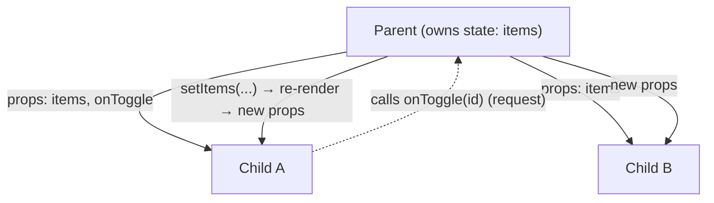
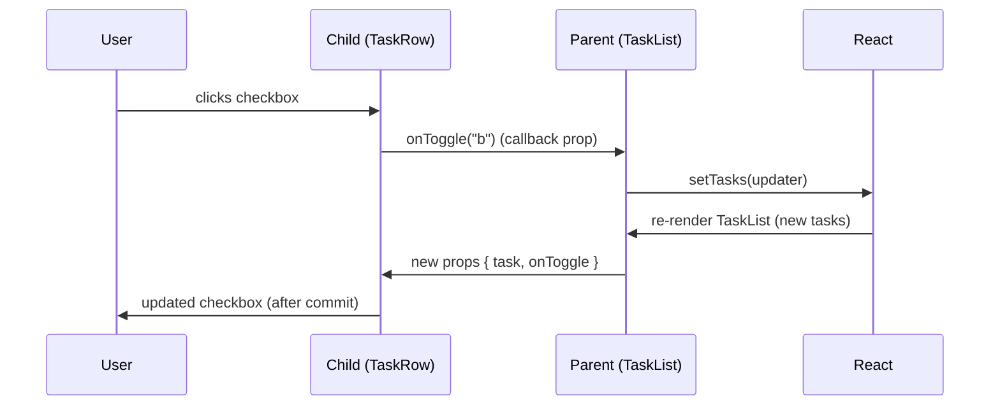
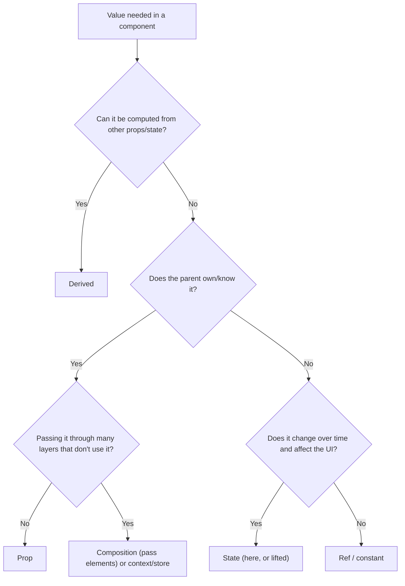

# 01 / 06 — Props and One-Way Data Flow

## 1. Lesson metadata

| | |
|---|---|
| **Level** | Beginner |
| **Study time** | 4 hours (reading 1.5 h, experiments 1 h, exercises 1.5 h) |
| **Prerequisites** | [05 — JSX and its transformation](./05-jsx-explained.md); [03 — UI as a function of state](./03-ui-as-a-function-of-state.md); [00/07 — Functions as values; referential identity](../00-web-and-javascript-foundations/07-functions-and-referential-identity.md); [00/08 — Objects, references, immutability](../00-web-and-javascript-foundations/08-objects-references-immutability.md); [00/18 — TypeScript fundamentals and narrowing](../00-web-and-javascript-foundations/18-typescript-fundamentals-and-narrowing.md) |
| **Next** | [07 — Composition, `children`, slots](./07-composition-and-children.md) |
| **Related later** | [08 — Conditional rendering](./08-conditional-rendering.md), [12 — Component purity](./12-component-purity.md), [Phase 3 / 18 — State colocation and lifting](../03-react-state-and-hooks/18-state-colocation-and-lifting.md), [Phase 5 / 11 — Controlled component pattern](../05-design-patterns/11-controlled-component-pattern.md) |

**Learning objectives.** After this lesson you can:
1. Define props precisely: the single, read-only object a component receives from the element that created it.
2. Pass and receive props of every common kind: primitives, objects, arrays, functions (callbacks), elements, `children`.
3. Type props in TypeScript idiomatically: interfaces, optional props, defaults via destructuring, discriminated-union props, extending DOM props.
4. Explain one-way data flow: data down via props, change requests up via callbacks; and why "child changes parent's data" is expressed as a call, not a write.
5. Explain why props must not be mutated and what React does to help detect it.
6. Decide whether a value should be a prop, state, derived value, or context.
7. Recognize and fix: props-in-state, prop drilling pain, unstable props, over-wide props, boolean prop explosion, and leaking unknown props to the DOM.

**Concepts covered:** props object, destructuring and rest, default values (parameter defaults vs legacy `defaultProps`), read-only guarantee, callback props, lifting state up (first look), controlled vs uncontrolled props (first look), `children` (preview), `key`/`ref` handling, props typing, prop drilling, referential identity of props, `ComponentProps` helpers, props and rendering ("new props" ≠ "changed props").

---

## 2. Deep conceptual explanation

### 2.1 What problem is this lesson solving?

Components are only useful if they can be **configured** and **connected**. A `Button` that always says "Save" is not reusable; a `TodoList` that cannot tell its parent a todo was completed is not an application. Props solve both problems:

- *Configuration*: the parent decides what the child shows.
- *Connection*: the parent decides what the child does when the user interacts (by passing functions).

One-way data flow is the *discipline* about that connection: **information travels from owner to descendant through props; requests for change travel from descendant to owner through callbacks the owner provided.** There is no mechanism for a child to reach up and edit a parent's variable. This constraint is not a limitation; it is what makes a React app traceable: every value on screen has a single, findable owner.

### 2.2 Props defined

> **Props** are the inputs of a component: a single object, built from the attributes (and children) of the element that created it, that the component receives as its first argument.

```tsx
<Avatar user={user} size={48} onClick={open} />
//        ↓ compiles to (automatic runtime)
_jsx(Avatar, { user, size: 48, onClick: open })
//        ↓ React calls
Avatar({ user, size: 48, onClick: open })
```

Properties of props:

1. **One object.** `function Avatar(props)` or destructured `function Avatar({ user, size })`. There is no second positional argument for ordinary components. (Class components read `this.props`; legacy.)
2. **Read-only.** A component must treat its props as immutable. It never assigns to `props.x`, and never mutates objects/arrays it receives ([Lesson 12](./12-component-purity.md)).
3. **Fresh per element.** Each element has its own props object; a re-render of the parent creates a **new props object** for the child even if all values are equal. Props identity is not stable across renders; value identity (for objects, arrays, functions) is whatever the parent passes.
4. **Not state.** Props can change *only because the parent rendered with different values*. The child cannot change them. When props change, the child is re-called with the new props; the instance (and its state) persist ([Lesson 04](./04-elements-components-instances.md)).
5. **Special names.** `key` is consumed by React and never delivered to the component. `ref`: ⚠ in React 19, `ref` is delivered as a regular prop to function components; in React ≤ 18 it was stripped and required `forwardRef`. `children` is a normal prop whose value is the JSX nested between tags ([Lesson 07](./07-composition-and-children.md)).

### 2.3 Everything can be a prop

| Kind | Example | Used for |
|---|---|---|
| Primitive | `label="Save"`, `count={3}`, `disabled` | Configuration |
| Object / array | `user={user}`, `items={rows}` | Data |
| **Function (callback)** | `onSelect={(id) => ...}` | Upward communication, behavior injection |
| **Element / ReactNode** | `icon={<SaveIcon />}`, `children` | Slots; composition ([Lesson 07](./07-composition-and-children.md)) |
| **Component type** | `as={Link}`, `Icon={SaveIcon}` | Polymorphism, strategy-like customization |
| **Ref** | `ref={inputRef}` | Imperative access (React 19: ordinary prop) |
| Render function | `renderItem={(x) => <Row x={x} />}` | Inversion of rendering control ("render props", Phase 5/10) |

Because functions and elements are values, **props are how React composes behavior as well as data**.

### 2.4 One-way data flow



The loop:
1. The owner holds state.
2. It passes **values** (data) and **callbacks** (ways to *request* change) down.
3. A descendant handles a user event and **calls a callback**, passing details.
4. The owner's callback updates the owner's state.
5. The owner re-renders; new props flow down; every consumer sees the new data.

Terminology note: "two-way binding" (e.g. in AngularJS, Vue's `v-model`) lets a child write directly to a bound variable. React's controlled inputs *look* two-way (`value` + `onChange`) but are implemented as one-way flow plus an explicit callback: the input never writes `state`; the handler requests a state change ([Lesson 11](./11-controlled-and-uncontrolled-inputs.md)).

**Why constrain it?** 
- *Traceability:* to find who can change `items`, search the owner, a finite and local set of places.
- *Predictability:* a child's output is a function of props (+ its own state); no hidden writers.
- *Concurrency-safety:* rendering is a pure calculation over snapshots ([Phase 2/12](../02-react-rendering-and-internals/12-why-rendering-must-be-pure.md)).
- *Testability:* render a child with props; assert output; call callbacks and assert they were invoked.

### 2.5 Props vs state vs derived vs context

| Question | Props | State | Derived | Context |
|---|---|---|---|---|
| Owned by | Parent | This component | Computed during render | A provider above |
| Child can change it | No | Yes (via setter) | No | Only through callbacks provided by the provider |
| Changes cause render when | Parent re-renders with different values | Setter called with new value | Inputs change | Provider value changes |
| Use for | Configuration, data from above | Memory that changes over time | Anything computable | Values needed by many levels without passing each level |

Rule of thumb: **if the parent knows it and the child needs it, it's a prop. If the child must remember it and no one else cares, it's state. If it can be computed, compute it.**

### 2.6 Lifting state up (first look)

Two siblings need the same data? Move the state to their *nearest common parent* and pass it down plus callbacks. That's the whole technique; deeper treatment in [Phase 3/18](../03-react-state-and-hooks/18-state-colocation-and-lifting.md). One-way flow is why it works: the single owner is the common parent.

### 2.7 Controlled vs uncontrolled (first look)

A component is **controlled** when its parent passes the value and the change callback (`value`, `onChange`; `open`, `onOpenChange`), and **uncontrolled** when it owns the value itself and takes at most an initial value (`defaultValue`, `defaultOpen`). Naming conventions matter: `defaultX` means "initial only", `x` + `onXChange` means "controlled". Libraries and design systems often support both.

### 2.8 Common misconceptions

| Misconception | Reality |
|---|---|
| "Props are like function arguments, so I can modify them locally." | They are arguments, but they alias the parent's data. Mutating an object prop mutates the parent's data. Primitives are copied, so reassigning `props.x` isn't even visible to the parent; but React freezes the props object in development and assignments throw in strict mode. |
| "A child can update parent state by changing a prop." | No. It can only call a function it was given. |
| "If props are equal, the child won't re-render." | By default, a parent re-render re-renders its children *regardless* of prop equality. Skipping needs `memo` or the structural tricks of [Lesson 07](./07-composition-and-children.md). |
| "Props are just attributes." | Attributes are strings in HTML; props are arbitrary JS values (functions, objects, elements). |
| "I should pass the whole object so I never have to change the signature." | Over-wide props (`user` when only `user.name` is needed) couple the child to a shape and make it hard to reuse and memoize. Balance below (§7). |
| "`defaultProps` is how to set defaults." | ⚠ Legacy for function components: removed for function components in React 19 (still works for classes). Use default parameter values. |
| "Props drilling means my architecture is broken." | Drilling through 2–3 levels is normal and explicit. It's a smell when intermediate components are forced to know about data they don't use across many levels; solutions: composition ([Lesson 07](./07-composition-and-children.md)), context, or a store. |

---

## 3. Internal mechanics

### 3.1 How props reach the component (teaching model)

1. JSX → `jsx(type, propsObject, key)` ([Lesson 05](./05-jsx-explained.md)). The *element* holds `propsObject`.
2. During render, React reads `element.props` and calls `type(props)`.
3. If the element is new and its type/position match the existing instance, React reuses the instance and processes the new props. If the element is *the same object* as before (same reference), React can skip the work ([Lesson 07 §3](./07-composition-and-children.md)).

*Public guarantee:* the component receives an object with the props passed by the parent (except `key`), and `children`. *Implementation detail:* React may freeze element and props objects in development, may reuse the props object when the same element is rendered again, and may compare previous/next props shallowly in `memo`.

### 3.2 Props are frozen in development (how React helps you)

In development builds, elements and their `props` objects are frozen (implementation detail ⚠ may change). In strict-mode code (ES modules), assigning to a frozen property throws a `TypeError`:

```tsx
function Bad(props: { count: number }) {
  props.count = 5; // TypeError: Cannot assign to read only property 'count' of object (dev, strict mode)
  return null;
}
```

But freezing is **shallow**: `props.items.push(1)` still mutates the parent's array without any error. TypeScript's `readonly` arrays/`Readonly<T>` helps catch this at compile time; lint rules and code review catch the rest.

### 3.3 New props object, same values: what re-renders?

Parent re-renders → creates new elements for children → each has a new props object. React's default is to call the child again (re-render) *whether or not values are equal*. `React.memo(Child)` adds a **shallow comparison** of old vs new props (`Object.is` per prop): equal → skip re-render. That's why prop identity matters for memoized children ([Phase 7/05](../07-performance/05-referential-equality.md), [00/07](../00-web-and-javascript-foundations/07-functions-and-referential-identity.md)):

```tsx
<MemoChild onSave={() => save(id)} />   // new function every parent render → memo is defeated
<MemoChild style={{ color: "red" }} />  // new object every time → memo is defeated
```

Don't pre-emptively fix this; it matters only when the child is memoized *and* expensive. Measure first. (⚠ The React Compiler, where enabled, can auto-memoize such cases; its behavior is volatile, verify against current docs: [Phase 9/08](../09-advanced-rendering-and-ecosystem/08-react-compiler.md).)

### 3.4 Default values

Modern pattern:

```tsx
function Button({ variant = "primary", size = "md", children }: ButtonProps) { ... }
```

Semantics: the default applies when the prop is `undefined` (omitted *or* explicitly `undefined`), **not** when it is `null`, `0`, `false`, or `""`. This differs from `||`-based defaults, which would override `0` and `""`.

`Component.defaultProps = {...}` — ⚠ *Legacy:* React 19 removed `defaultProps` support for function components (use default parameters); classes still support it. Likewise `propTypes` runtime validation was removed in React 19 (use TypeScript).

### 3.5 Rest/spread and unknown props

```tsx
function Input({ label, ...rest }: { label: string } & React.ComponentProps<"input">) {
  return <label>{label} <input {...rest} /></label>;
}
```

`...rest` forwards everything else: `type`, `value`, `onChange`, `aria-*`, `id`, `ref` (React 19). Risks: forwarding props the DOM doesn't understand (e.g. `variant="x"`) triggers React warnings about unknown DOM attributes; destructure your own props out before spreading.

---

## 4. Step-by-step execution walkthrough

A parent owns a list; a child row toggles an item.

```tsx
interface Task { id: string; title: string; done: boolean }

function TaskRow({ task, onToggle }: { task: Task; onToggle: (id: string) => void }) {
  return (
    <li>
      <label>
        <input type="checkbox" checked={task.done} onChange={() => onToggle(task.id)} />
        {task.title}
      </label>
    </li>
  );
}

export function TaskList() {
  const [tasks, setTasks] = useState<Task[]>([
    { id: "a", title: "Write", done: false },
    { id: "b", title: "Test", done: false },
  ]);

  const toggle = (id: string) =>
    setTasks((prev) => prev.map((t) => (t.id === id ? { ...t, done: !t.done } : t)));

  return <ul>{tasks.map((t) => <TaskRow key={t.id} task={t} onToggle={toggle} />)}</ul>;
}
```

**Trace: the user checks "Test".**

1. **Mount.** `TaskList()` runs: `tasks` state → two elements `TaskRow` with props `{task: tasksA, onToggle: toggle#1}`, `{task: tasksB, onToggle: toggle#1}`. React calls `TaskRow` for each; the DOM has two unchecked boxes.
2. **Click.** The browser fires the change event on the second checkbox; React calls its `onChange`, which calls `onToggle("b")` → that is `toggle#1`, a function defined in `TaskList`'s first render, closed over nothing stale because it uses the functional updater.
3. **`toggle("b")`** → `setTasks(updater)`: enqueues an update on `TaskList`'s instance. `TaskRow` did not change anything about its props.
4. **Render.** `TaskList()` is called again. `prev.map(...)` returns a *new array*: task A unchanged (same object), task B replaced by `{...B, done: true}` (new object). New elements: `<TaskRow task={A} onToggle={toggle#2} />`, `<TaskRow task={B'} onToggle={toggle#2} />`. Note `toggle#2` is a *new function* (identity changed), and each element has a new props object.
5. **Children render.** Without `memo`, React calls `TaskRow` for **both** rows (props objects are new). Row A's output is identical to before; row B's `checked` is now `true`.
6. **Commit.** Only row B's checkbox `checked` property is updated in the DOM (A's diff is empty).

**Prediction checkpoint:** how many `TaskRow` calls happened in step 5, and how many DOM writes in step 6? **Two** calls (default behavior); **one** DOM write. This distinction (render work vs commit work) is the core of Phase 2; it also shows why preserving the *reference* of unchanged items (`t` for A is the same object) is useful if you later add `memo`.

---

## 5. Code examples

### 5.1 Minimal example — props in, output out

```tsx
interface BadgeProps {
  label: string;
  tone?: "neutral" | "success" | "danger";
}

export function Badge({ label, tone = "neutral" }: BadgeProps) {
  return <span className={`badge badge--${tone}`}>{label}</span>;
}

// <Badge label="Paid" tone="success" />
// <Badge label="Draft" />            // tone defaults to "neutral"
// <Badge label="Overdue" tone="danger" />
```

Line notes:
- `interface BadgeProps`: name props types `XProps`; export them if consumers need them.
- `tone?:` optional → `"neutral" | "success" | "danger" | undefined`; default via destructuring makes it `"neutral" | ...` inside the function.
- The union prevents invalid strings at compile time (`tone="warn"` fails type-checking). At runtime, untyped callers (plain JS, data-driven) can still pass anything; defensive code is warranted only at trust boundaries.
- Accessibility: a colored badge must not rely on color alone; here the text `label` carries the meaning.

**Predict:** `<Badge label="x" tone={undefined} />`: which class? **Result:** `badge badge--neutral` (default applies to explicit `undefined`). `tone={null}` would not type-check (`null` is not in the union) and, if forced, would produce `badge--null`.

### 5.2 Practical example — callbacks and lifting state

```tsx
import { useState } from "react";

interface Product { id: string; name: string; price: number }

interface ProductCardProps {
  product: Product;
  inCart: boolean;
  onAdd: (id: string) => void;
  onRemove: (id: string) => void;
}

function ProductCard({ product, inCart, onAdd, onRemove }: ProductCardProps) {
  return (
    <article>
      <h3>{product.name}</h3>
      <p>${product.price.toFixed(2)}</p>
      {inCart ? (
        <button type="button" onClick={() => onRemove(product.id)} aria-label={`Remove ${product.name} from cart`}>
          Remove
        </button>
      ) : (
        <button type="button" onClick={() => onAdd(product.id)} aria-label={`Add ${product.name} to cart`}>
          Add
        </button>
      )}
    </article>
  );
}

function CartSummary({ count, total }: { count: number; total: number }) {
  return <p role="status">{count} item(s), ${total.toFixed(2)}</p>;
}

export function Shop({ products }: { products: readonly Product[] }) {
  const [cartIds, setCartIds] = useState<ReadonlySet<string>>(new Set());

  const add = (id: string) => setCartIds((prev) => new Set(prev).add(id));
  const remove = (id: string) =>
    setCartIds((prev) => {
      const next = new Set(prev);
      next.delete(id);
      return next;
    });

  const inCart = products.filter((p) => cartIds.has(p.id));
  const total = inCart.reduce((sum, p) => sum + p.price, 0);

  return (
    <>
      <CartSummary count={inCart.length} total={total} />
      {products.map((p) => (
        <ProductCard key={p.id} product={p} inCart={cartIds.has(p.id)} onAdd={add} onRemove={remove} />
      ))}
    </>
  );
}
```

Why it works: `Shop` is the single owner of `cartIds`. `ProductCard` and `CartSummary` are siblings that depend on it: that's why the state is lifted to their common parent. `ProductCard` receives *the minimum*: the product, a boolean, and two callbacks, so it doesn't know about carts at all; it's reusable in a wishlist. `CartSummary` receives derived numbers (`count`, `total`), not the whole set, so it's trivial to test.

Details:
- Immutable Set updates: `new Set(prev).add(id)` creates a new Set (`add` returns the set). Mutating `prev` would be the same bug as array `push` ([Lesson 03](./03-ui-as-a-function-of-state.md)).
- The `aria-label` includes the product name; in a list of identical "Add" buttons, screen-reader users otherwise can't distinguish them.
- *Money in floating-point* is demonstrated for simplicity; use integer minor units in real code.

**Predict:** you click "Add" on product 2. Which components are *called* (rendered), and which are not? **Result (default behavior, no `memo`):** `Shop` (state owner), `CartSummary`, and every `ProductCard` (parent re-rendered with new elements) are called; only product 2's card produces a DOM change in its button text/label; `CartSummary` changes its text. With 1,000 products you'd feel this; the first fixes are structural (virtualize, colocate), then `memo` ([Phase 7](../07-performance/03-why-components-rerender.md)).

### 5.3 Incorrect example — props mutation, props-in-state, over-wide props

```tsx
// ❌ Incorrect
function Counter({ initial, items }: { initial: number; items: string[] }) {
  const [count, setCount] = useState(initial);   // (1) copies the prop once: ignores later changes
  items.push("new");                              // (2) mutates the parent's array during render
  items.sort();                                   // (3) in-place sort: mutates parent's array

  return (
    <div>
      {/* (4) missing type; non-functional update */}
      <button onClick={() => setCount(count + 1)}>{count}</button>
      {/* (5) missing key */}
      <ul>{items.map((i) => <li>{i}</li>)}</ul>
    </div>
  );
}
```

**Predict:** if the parent renders `<Counter initial={5} items={list} />` and then re-renders with `initial={10}`, what shows? And what happens to `list`?

**Result:**
1. After the parent changes `initial` to `10`, the button still shows its own `count` (5 or whatever the user clicked to): `useState(initial)` reads `initial` once ([Lesson 03](./03-ui-as-a-function-of-state.md)). Whether this is a bug depends on intent; if the component should *reflect* `initial`, it's a props-in-state bug.
2. `items.push("new")` runs **every render**, growing the *parent's* array: render count determines length. In StrictMode dev (double render) it grows by 2 per render, a vivid way to see the impurity. The parent's data is corrupted, and since the mutation occurs in render, other components reading `list` see different values depending on render order.
3. `items.sort()` reorders the parent's data in place, a silent side effect (no re-render triggered, so other views are stale until they re-render).
4. `onClick={() => setCount(count + 1)}` is fine for a single click, but prefer the functional form when rapid updates are possible; missing `type="button"` is harmless outside a form but sloppy inside one (submits!).
5. Missing `key` → console warning and potential identity bugs.

### 5.4 Corrected implementation

```tsx
interface CounterProps {
  /** Seed for the counter. Later changes are ignored; remount with `key` to reset. */
  initialCount: number;
  items: readonly string[];
}

function Counter({ initialCount, items }: CounterProps) {
  const [count, setCount] = useState(initialCount);
  const sorted = items.toSorted();               // new array; never mutate props
  const withNew = [...sorted, "new"];            // derived list, computed per render

  return (
    <div>
      <button type="button" onClick={() => setCount((c) => c + 1)}>{count}</button>
      <ul>
        {withNew.map((item) => (
          <li key={item}>{item}</li>
        ))}
      </ul>
    </div>
  );
}
```

Changes: `readonly string[]` makes `push`/`sort` compile errors; `initialCount` names the seeding intent; derived arrays are new; keys are present (`key={item}` assumes unique strings: use ids in real data).

To make the component *follow* the parent's value, remove the state: `function Counter({ count, onCountChange })` (controlled, §2.7), or reset by remounting: `<Counter key={resetToken} initialCount={...} />`.

### 5.5 Advanced example — discriminated-union props and extending DOM props

```tsx
import type { ComponentPropsWithoutRef, ReactNode } from "react";

// 1. Props that must be used together: a discriminated union
interface BaseProps { children: ReactNode; variant?: "primary" | "ghost" }

type ActionProps =
  | (BaseProps & { kind: "link"; href: string })
  | (BaseProps & { kind: "button"; onClick: () => void });

export function Action(props: ActionProps) {
  const className = `btn btn--${props.variant ?? "primary"}`;

  // Narrow on `props` itself: after `props.kind === "link"`, TypeScript knows `props.href` exists.
  if (props.kind === "link") {
    return <a className={className} href={props.href}>{props.children}</a>;
  }
  return (
    <button type="button" className={className} onClick={props.onClick}>
      {props.children}
    </button>
  );
}

// <Action kind="link" href="/docs">Docs</Action>      OK
// <Action kind="link" onClick={fn}>Docs</Action>      type error: no `onClick` on the link arm, `href` missing

// 2. A required-together pair: controlled/uncontrolled
type ToggleProps =
  | { pressed: boolean; onPressedChange: (next: boolean) => void; defaultPressed?: never }
  | { pressed?: undefined; onPressedChange?: (next: boolean) => void; defaultPressed?: boolean };
```

Commentary:
- Part 1 narrows on `props.kind` **without destructuring first**. Destructuring a union-typed props object up front (`const { kind, href, onClick } = props`) loses the correlation between fields in many cases (newer TypeScript versions handle some destructured discriminants, but don't rely on it for large unions), so narrow on the object, then read fields. If the union grows to many arms, two separate components (`Button`, `LinkButton`) sharing a style helper are usually clearer than one clever union; see Phase 5/19 on polymorphic components.
- Part 2 shows a **controlled/uncontrolled** props contract: either `pressed` + `onPressedChange` (controlled) or optional `defaultPressed` (uncontrolled). The `never`/`undefined` fields forbid mixing them at compile time. Implementation of the internal state-sync logic is [Phase 5/11](../05-design-patterns/11-controlled-component-pattern.md).
- `ComponentPropsWithoutRef<"button">` includes all native button props (`disabled`, `onClick`, `aria-*`, `form`...). In React 19 types, `ref` is a regular prop on function components, so use `ComponentProps<"button">` if you want to accept `ref` ⚠ *verify against your `@types/react`*: `ComponentPropsWithoutRef` deliberately omits it.

---

## 6. Visual explanations

### 6.1 Data down, events up



### 6.2 Props are a snapshot per render

```text
Parent render #1: tasks=[A,B]   → element TaskRow{task:A, onToggle:f1}   props object p1
Parent render #2: tasks=[A,B']  → element TaskRow{task:A, onToggle:f2}   props object p2  (new object, new f2)
                                                                           task: same reference as before
```
Equal values, new containers. `memo` compares per-prop with `Object.is`; `task` (same reference) passes, `onToggle` (new function) fails unless the parent stabilizes it.

### 6.3 Prop, state, derived, or context?



---

## 7. Alternative approaches and trade-offs

**How much to pass:**

| Approach | Coupling | Reuse | Memoization friendliness | Typing effort | When to prefer |
|---|---|---|---|---|---|
| **Primitive props** (`name`, `price`) | Low | High | High (primitives compare by value) | Low | Leaf/presentational components |
| **Whole object prop** (`product`) | Medium (shape-coupled) | Medium | Depends on object identity | Low | The component genuinely uses many fields; domain objects are stable |
| **Whole object + `Pick<>`** (`product: Pick<Product, "name" | "price">`) | Low–medium | Same | Medium | Want convenience without coupling to the full type |
| **`children`/slots** | Lowest | Very high | Elements are new each render unless hoisted | Low | Layout and container components ([Lesson 07](./07-composition-and-children.md)) |
| **Spread everything (`{...props}`)** | Hidden | High for wrappers | Poor | Low | Thin wrappers around native elements |
| **Context** | Implicit | Lower (needs provider) | Consumers re-render on value change | Medium | Cross-cutting, rarely changing values |
| **Store/selector** | Implicit | Lower | High with selectors | Higher | Many distant consumers; high update rates |

**Passing data through levels:**

| Approach | Explicitness | Boilerplate | Refactor safety | Perf characteristics | Prefer when |
|---|---|---|---|---|---|
| **Prop drilling** | Highest | Grows with depth | Compiler/TS catches missing props | Re-render path follows props | ≤ 2–3 levels, or when intermediate components legitimately care |
| **Composition (slot elements)** | High | Low | Good | Intermediates needn't re-render for slot content | Layout shells; avoid threading data through layout components |
| **Context** | Medium | Low at use site | Weaker (runtime provider missing) | All consumers re-render per value change | Theme, auth user, locale |
| **External store/selector** | Medium | Medium | Medium | Fine-grained subscriptions | Wide, frequently-updated shared state |

**When the recommended approach (explicit props, minimal coupling) is not best:** a design-system `Table` that takes 30 individually listed props for every cell nuance is *worse* than accepting a `columns` configuration object or compound children. The "pass primitives" advice optimizes leaf components; for *configuration-heavy* components, a single well-typed config object (stable via module constant or `useMemo`) is clearer, at the cost of identity concerns.

---

## 8. Best practices and anti-patterns

**Do**
- Treat props as immutable; type collections as `readonly`.
- Destructure in the parameter list; apply defaults there.
- Name callbacks `onX` (prop) and handlers `handleX` (implementation).
- Pass the smallest sufficient data; keep prop lists focused (a rule of thumb: > 7–8 props suggests a component with multiple responsibilities or a missing grouping).
- Prefer `defaultX`/`x` + `onXChange` naming for (un)controlled APIs.
- Spread `...rest` onto the underlying DOM element in wrappers and keep `aria-*`, `id`, `className`, `ref` flowing.
- Co-locate prop types with the component; export them for consumers when useful.

**Beginner mistakes**
- Mutating props (`props.list.push`).
- Copying props to state without intent.
- Passing a result instead of a function (`onClick={save()}` runs `save` during render) instead of `onClick={save}` or `onClick={() => save(id)}`.
- Forgetting that `key` isn't readable in the child.
- Boolean prop soup (`primary`, `secondary`, `danger`, `large`, `small`) instead of `variant` and `size` unions.

**Experienced-developer mistakes**
- Prop-drilling through generic layout components that then know domain concepts.
- Reaching for context/stores to avoid two levels of props.
- Over-memoizing to protect props that are cheap.
- Callback props with unclear contracts (called with what? synchronously? can they throw?) leading to defensive code in children.
- Passing `setState` functions directly down many levels (leaks implementation: pass intent-revealing callbacks like `onToggle(id)`).
- Using `any`/`Function` for callback types.

**Smells:** a component that accepts both `value` and `defaultValue` without documented precedence; props that must be provided together but aren't typed as such; `// eslint-disable-next-line react/prop-types` leftovers; `props.data.data.items`; booleans that only make sense in combination.

**Accessibility notes:** props should make accessible usage the *easy path*: require `label` (or `aria-label`/`aria-labelledby`) on icon-only buttons; type it so omitting it is a compile error (`{ "aria-label": string } | { children: ReactNode }`). Forward `id`/`aria-describedby` so form-field wrappers can associate errors and hints.

**Justified exceptions:** passing `setState` directly across one boundary is fine for small private components; a "kitchen sink" props object may be the right shape for generated tables; spreading user-controlled objects onto DOM elements is acceptable only when you filter keys.

---

## 9. Real-world application

*Design-system `Button`.* Props express variants (`variant`, `size`), state hooks (`disabled`, `loading`), and semantics (`type`, `aria-*`). Engineering constraints: backward compatibility (adding props is safe; renaming isn't: semver and deprecation paths), accessibility (`loading` should set `aria-busy` and keep the button focusable rather than silently disabling), theming. A *props contract review* is a normal part of component library work.

*Dashboard widgets.* A `<MetricCard value={...} trend={...} onDrilldown={...} />` is presentational: no data fetching. Parents (or a container hook) fetch and map API data to the props. This separation lets you render the card in Storybook with fixtures, test it with plain props, and reuse across screens ([Phase 4/04](../04-react-architecture/04-presentational-vs-container.md)).

*Forms.* Field components take `label`, `error`, `hint`, `value`, `onChange`; the form owns the values. Constraint: `aria-describedby` linking error text and `aria-invalid` are derived from props; forgetting them fails accessibility audits even though everything "works".

*Multi-team systems.* Component boundaries between teams are *prop contracts*. Version them: a prop's type is an API. Breaking changes (a required prop added, a callback's argument shape changed) must be coordinated; TypeScript catches compile-time breaks but not runtime data issues from API responses. Document callback semantics (when called, with what).

*Performance-sensitive trading grid.* Rows memoized by `id` with primitive props (`price`, `qty`) so that a tick for one row doesn't re-render 5,000 rows; callbacks are stabilized via a ref-forwarding pattern or an event-delegation approach ([Phase 7](../07-performance/08-rendering-large-collections.md)). The prop design *is* the performance design.

---

## 10. Debugging and troubleshooting

**Symptom 1:** "My child shows old data after the parent's data changed."
1. DevTools → Components → select the child. Inspect *props* (right panel): is the prop value the new one? If **yes**, the child is receiving new data but ignoring it: check `useState(prop)` copies or memoized derived values with wrong dependencies. If **no**, the parent isn't passing the new value: check the parent's state (maybe mutated in place: same reference, so no re-render).
2. Add a render log in the child: `console.log("render", props)`. Does it log on parent updates?
3. Root cause categories: props-in-state; mutated state in the parent; `memo` with a custom comparator that's too lax; stale closure in a callback.
4. Validate: change the source of truth; the child updates without a manual refresh.

**Symptom 2:** "A callback prop runs immediately on render (or runs on mount)."
- Pattern: `onClick={handle(id)}`. The call executes during render and its *return value* becomes the handler. Fix: `onClick={() => handle(id)}`.

**Symptom 3:** "Warning: React does not recognize the `fooBar` prop on a DOM element" / "Unknown event handler property".
- You spread non-DOM props onto a host element. Destructure custom props out before `...rest`.

**Symptom 4:** "Cannot assign to read only property" (TypeError).
- You mutated a prop. Find the assignment; replace with a derived value or a state copy.

**Symptom 5:** "Memoized child re-renders every time."
- DevTools Profiler: "Why did this render?" (enable in Profiler settings: *Record why each component rendered*) points at changed props. Then identify *which* prop; usually an inline object/function. Fix by hoisting constants, `useCallback`/`useMemo` if justified, or restructure to pass primitives ([Phase 7/02](../07-performance/02-profiler-workflows.md)).

---

## 11. Exercises

### Level A — Knowledge
A1. Define props. List three things props can carry besides strings and numbers.
A2. State the one-way data flow rule in a sentence. How does a child request a change?
A3. What happens when a default value is specified by destructuring and the prop is (i) omitted, (ii) `undefined`, (iii) `null`?
A4. Why can't a child read its own `key`? How would you provide it?
A5. Which of the following is *legacy* in React 19 for function components: `defaultProps`, default parameter values, `propTypes`, `forwardRef`?

### Level B — Code comprehension
B1. What happens on click, and what is the bug?
```tsx
<button onClick={handleSave(item.id)}>Save</button>
```
B2. Predict the number of `Row` calls on a click of "Increment", with and without `memo`:
```tsx
const Row = memo(function Row({ label }: { label: string }) {
  console.log("Row", label);
  return <li>{label}</li>;
});

function List() {
  const [n, setN] = useState(0);
  return (
    <>
      <button type="button" onClick={() => setN((x) => x + 1)}>Increment {n}</button>
      <ul>
        <Row label="a" />
        <Row label="b" />
      </ul>
    </>
  );
}
```
How would the answer change if `<Row label="a" style={{ color: "red" }} />` were added with `Row` accepting `style`?
B3. A teammate says: "Props are immutable, so `props.items.push(x)` will throw." Is that right? Why or why not?
B4. What is the type error (if any) in each?
```tsx
interface Props { size?: "sm" | "md"; onSelect: (id: string) => void }
function X({ size = "md", onSelect }: Props) { return null; }
<X onSelect={(id: number) => {}} />
<X size="lg" onSelect={() => {}} />
<X />
```

### Level C — Implementation
C1. Build `Avatar` with props `src?: string`, `name: string`, `size?: number` (default 40). If `src` is missing, show initials computed from `name`. Include accessible naming and handle empty/whitespace `name`.
C2. Build a controlled `Toggle` component with props `pressed`, `onPressedChange`, `label`. Use a real `<button>` with `aria-pressed`. Then explain how you'd add an uncontrolled mode.
C3. Refactor this component to use composition/props splitting rather than passing the whole `user` object three levels:
```tsx
function Page({ user }: { user: User }) { return <Layout user={user} />; }
function Layout({ user }: { user: User }) { return <><Header user={user} /><Sidebar /></>; }
function Header({ user }: { user: User }) { return <Avatar name={user.name} />; }
```

### Level D — Debugging
D1. The product card's price never updates when the parent changes the `price` prop. Find the bug and give two fixes.
```tsx
function Price({ price }: { price: number }) {
  const [display] = useState(price.toFixed(2));
  return <span>{display}</span>;
}
```
D2. An analytics component calls `track(props)` where `props` includes a `children` element; the tracking library throws "Converting circular structure to JSON". Why does this happen and how would you fix the call site?
D3. A `memo`ized `ExpensiveChart` still re-renders on every parent update. React DevTools says "props changed: options". The parent does `<ExpensiveChart data={data} options={{ legend: true }} />`. Fix it in two ways and state the trade-off of each.

### Level E — Architecture and engineering decisions
E1. Define the props API for a `Dialog` component for a design system. Decide: controlled vs uncontrolled, how to pass title/description (accessibility), how to inject footer actions, how to handle close events (Escape/overlay click), and how to document the contract. Justify each choice.
E2. Your app has `user` needed by 12 deeply nested components across 6 levels. Evaluate drilling, composition, context, and a store. Recommend and state what would change your mind.

### Level F — Expert challenge
F1. Design the props type for a generic `Select<T>` component that supports single or multiple selection (`multiple?: false` → `value: T | null`; `multiple: true` → `value: T[]`), with `getKey`, `getLabel`, and `onChange` correctly typed in each mode. Explain the inference pitfalls and what you would simplify.

---

## 12. Detailed answers and explanations

> Attempt the exercises first.

**A1.** Props are the single read-only input object a component receives, built from the element's attributes and children. Besides strings/numbers: functions (callbacks), objects/arrays, React elements/`ReactNode` (slots), components (types), refs (React 19), render functions.

**A2.** Data flows down the tree through props; changes flow up via callbacks supplied by the owner, which updates the owner's state, causing new props to flow down. A child requests a change by calling a callback prop; it never writes to the parent's data.

**A3.** (i) Omitted → default applies. (ii) `undefined` → default applies. (iii) `null` → **default does not apply**; the value is `null`. Because JS destructuring defaults trigger only on `undefined`. Handle `null` explicitly if your data layer can produce it (`value ?? fallback`).

**A4.** `key` is React's identity hint, consumed during reconciliation, and intentionally not passed to the component. If the child needs it (e.g., to call `onSelect(id)`), pass it separately as `id={item.id}`.

**A5.** Legacy/removed for function components in 19: `defaultProps` (removed for function components) and `propTypes` (runtime checks removed). `forwardRef` is not removed but is legacy-by-necessity (ref as a prop replaces it), ⚠ verify deprecation timing in upgrade docs. Default parameter values are the recommended modern approach.

**B1.** `handleSave(item.id)` is **called during render**; its return value (probably `undefined`) is given to `onClick`, so clicking does nothing; worse, saving fires on every render. Fix: `onClick={() => handleSave(item.id)}` (or `onClick={handleSave}` if the handler takes the event). In TypeScript, an `undefined` return typed as `void` may pass for `onClick` type-checking, so the compiler may not catch it; ESLint/review do.

**B2.** *Without `memo`*: each click re-renders `List`; both `Row`s are called (2 logs). *With `memo`* and `label` primitive props: both rows' props shallow-equal the previous → **0 `Row` calls** after mount. Adding `style={{ color: "red" }}` to row "a": a new object each render → `Object.is` fails → "a" re-renders (1 log), "b" still skips. Fix: hoist the style to a module constant or avoid object props. Edge: `memo` is an optimization, not a semantic guarantee; React may still re-render ([`memo` reference](https://react.dev/reference/react/memo) states this).

**B3.** Not right. Freezing (dev only, implementation detail) is shallow: `props.items` itself isn't reassigned, `.push` mutates the array object that the parent also references; no error. Immutability of props is a **contract**, enforced in part by tools (`readonly` types, lint) and discipline. Assigning `props.items = []` *would* throw in dev strict mode.

**B4.** (1) Error: `onSelect` expects `(id: string) => void`; a callback whose parameter is `number` is not assignable, because the caller will pass a `string`. (2) Error: `"lg"` is not assignable to `"sm" | "md"`. (3) Error: property `onSelect` is missing (required). Three separate errors; `size` being optional is fine.

**C1. Sample**
```tsx
interface AvatarProps { src?: string; name: string; size?: number }

function initials(name: string) {
  const parts = name.trim().split(/\s+/).filter(Boolean);
  if (parts.length === 0) return "?";
  const first = Array.from(parts[0])[0] ?? "";
  const last = parts.length > 1 ? Array.from(parts[parts.length - 1])[0] ?? "" : "";
  return (first + last).toUpperCase();
}

export function Avatar({ src, name, size = 40 }: AvatarProps) {
  const style = { width: size, height: size, borderRadius: "50%" } as const;
  if (src) {
    return ;
  }
  return (
    <span role="img" aria-label={name || "Unknown user"} style={{ ...style, display: "inline-grid", placeItems: "center" }}>
      {initials(name)}
    </span>
  );
}
```
Criteria: accessible name (`alt`/`aria-label`); safe for empty name; no mutation; primitive props. Note: if the avatar is *decorative* because the name is shown next to it, use `alt=""` so screen readers don't repeat it, which means this is a place where a `decorative?: boolean` prop might be warranted. Image load failure fallback (`onError` → initials) needs state; mention as an extension.

**C2. Sample**
```tsx
interface ToggleProps {
  pressed: boolean;
  onPressedChange: (next: boolean) => void;
  label: string;
}

export function Toggle({ pressed, onPressedChange, label }: ToggleProps) {
  return (
    <button type="button" aria-pressed={pressed} onClick={() => onPressedChange(!pressed)}>
      {label}
    </button>
  );
}
```
Uncontrolled mode: add `defaultPressed?: boolean`; if `pressed` is `undefined`, use internal `useState(defaultPressed ?? false)` and call `onPressedChange?.(next)` in both modes; compute `const isControlled = pressed !== undefined` **once** and warn if it changes during the lifetime (React's own inputs do). See Phase 5/11. A `label` that changes with the state ("Mute"/"Unmute") *and* `aria-pressed` double-announces; pick one pattern (stable label + `aria-pressed`).

**C3.** Layout doesn't need `user`; it only positions slots. Compose:
```tsx
function Page({ user }: { user: User }) {
  return <Layout header={<Header name={user.name} />} sidebar={<Sidebar />} />;
}
function Layout({ header, sidebar }: { header: ReactNode; sidebar: ReactNode }) {
  return <div className="layout"><header>{header}</header><aside>{sidebar}</aside></div>;
}
function Header({ name }: { name: string }) { return <Avatar name={name} />; }
```
`Page` (the owner) creates the elements; `Layout` is data-agnostic. This removes drilling through `Layout` without context. The trade-off: `Page` knows what `Layout` has slots for; more slot props to learn. ([Lesson 07](./07-composition-and-children.md) develops this.)

**D1.** `useState(price.toFixed(2))` reads `price` only once. Fix 1 (derive): `return <span>{price.toFixed(2)}</span>`; Fix 2 (if state truly needed): remount on change with `<Price key={price} price={price} />` at the call site: heavier, rarely appropriate here. Wrong fix: effect syncing `display` (extra render, flicker). Deriving is almost always right.

**D2.** React elements (and component props containing them) contain references to internal structures (e.g., `_owner` in dev: Fiber nodes with cyclical references), so `JSON.stringify(props)` can hit circular references; also functions are dropped silently. Fix at the call site: send only serializable, relevant fields (`track({ id: props.id, variant: props.variant })`). Never serialize whole props or elements; ⚠ the `_owner` detail is dev-only and implementation-specific; the principle (props are not serializable data) stands.

**D3.** `options={{ legend: true }}` creates a new object each render, so shallow comparison fails. Fix A: hoist to a module constant (`const CHART_OPTIONS = { legend: true } as const;`) when it's static: zero cost. Fix B: `useMemo(() => ({ legend }), [legend])` when it depends on values: small hook overhead and dependency management. Option C: pass primitives (`legend={true}`) and build the options object inside the chart. Trade-offs: A only for constants; B adds memo bookkeeping; C changes the API but is simplest. Mention a custom `memo` comparator (deep compare) as a last resort; it's costly and error-prone.

**E1.** A strong answer: *Controlled/uncontrolled:* support both (`open` + `onOpenChange`, `defaultOpen`), with documented precedence and a dev warning on switching. *Title/description:* required `title` (rendered as the dialog's accessible name via `aria-labelledby`), optional `description` (`aria-describedby`), because an unlabelled dialog is an accessibility failure; consider making `title` required by type. *Footer actions:* `footer?: ReactNode` slot (or compound `Dialog.Footer`) so callers compose buttons rather than the dialog knowing about "Save/Cancel". *Close events:* single `onOpenChange(false)` for Escape, overlay click, close button; optional `onEscapeKeyDown`/`onInteractOutside` hooks that can `preventDefault` for unsaved-changes guards. *Focus management:* trap focus, restore to trigger, `aria-modal`, inert background (use native `<dialog>` with `showModal()` where support meets requirements, which provides much of this). *Docs:* prop table, controlled example, a11y notes, event ordering. Criteria: accessibility included, slot-based flexibility, one close channel, documented contract.

**E2.** Drilling 6 levels with 12 consumers is brittle: intermediates must know about `user`. Options: *Composition* works if consumers can be created by an ancestor and passed as elements (e.g. `header={<UserMenu user={user}/>}`), best when consumers are few and layout-ish. *Context* is a fit for "current user": read-mostly, changes rarely, many consumers, and re-render cost is acceptable. *Store* (Zustand/Redux): overkill unless updates are frequent or consumers need selectors. Recommendation: context for `user` (stable, read-mostly), with composition for layout shells; guard with a custom hook `useUser()` that throws if the provider is missing. What would change my mind: `user` fields updating at high frequency (switch to a store with selectors), SSR concerns, or consumers needing only slices.

**F1. Example answer.**
```tsx
type SelectProps<T> = {
  options: readonly T[];
  getKey: (o: T) => string;
  getLabel: (o: T) => string;
  "aria-label": string;
} & (
  | { multiple?: false; value: T | null; onChange: (next: T | null) => void }
  | { multiple: true; value: readonly T[]; onChange: (next: T[]) => void }
);

export function Select<T>(props: SelectProps<T>) { /* ... */ return null; }
```
Pitfalls: (1) `T` inference from `options` vs `value` can conflict (e.g., `value: null` with no `options` hint); (2) the discriminant `multiple` is optional-`false` in one arm, so narrowing needs `props.multiple === true`; destructuring before narrowing loses the correlation (same issue as §5.5), so narrow on `props` and call internal helpers that accept the specific arm; (3) callers with `multiple={someBoolean}` (non-literal) don't match either arm: the type forces literal `true`/`false`, which is a reasonable constraint; (4) `readonly T[]` in `value` but `T[]` in `onChange`'s result: choose consistently. Simplification: export two components, `Select` and `MultiSelect`, sharing an internal implementation; the combined union API is clever but yields hard-to-read errors. Evaluation: correct union with `never`/literal discriminant; explicit narrowing strategy; recognizes inference and error-message ergonomics; offers a pragmatic alternative.

---

## 13. Senior engineer interview questions

**Q1. "Explain one-way data flow. How does a child affect parent state?"**
*Strong answer:* Data flows from owner to descendants via props; descendants never mutate parent data. They *request* changes by calling callbacks the owner passed, the owner updates its state, React re-renders, and new props flow down. It makes ownership explicit and rendering a pure function of props/state; it avoids hidden writers. Mention controlled inputs as the canonical example.

**Q2. "What's the difference between props and state?"**
*Strong answer:* Props are inputs from outside, read-only to the component; state is memory the component owns and can update. Both are snapshots in a render. A value should be state only if it changes over time, can't be computed, and affects rendering; if the parent knows it, pass it as a prop.

**Q3. "Why are my memoized children re-rendering?"**
*Strong answer:* `memo` shallow-compares props with `Object.is`. Inline objects, arrays, functions, or JSX elements passed as props are new each parent render. Find the changing prop (Profiler's "why did this render"), then hoist constants, stabilize with `useMemo/useCallback` where it matters, pass primitives, or restructure so the parent doesn't re-render. Warn about premature memoization and mention the compiler as an evolving option.

**Q4. "How do you design a component's props API?"**
*Strong answer:* Start with use cases; minimize required props; prefer unions (`variant`) to boolean piles; express invalid combos as type errors; separate controlled and uncontrolled contracts with consistent naming; accept `children`/slots for flexibility; forward native props and `ref`; make accessibility the default (required labels); document callback contracts; treat props as a versioned API with deprecation policy.

**Q5. "`defaultProps` vs default parameters?"**
*Strong answer:* Default parameters are the modern approach: plain JS, type-friendly. `defaultProps` on function components was removed in React 19 (still supported for classes). Difference in semantics: defaults only apply for `undefined`; `null` is a value.

---

## 14. Further learning resources

| Resource | URL | Covers / why | Level | Study |
|---|---|---|---|---|
| React docs — Passing Props to a Component | <https://react.dev/learn/passing-props-to-a-component> | Props basics, defaults, spread, children, props change over time | Beginner | Whole page |
| React docs — Sharing State Between Components | <https://react.dev/learn/sharing-state-between-components> | Lifting state, controlled vs uncontrolled | Beginner | Whole page |
| React docs — Passing Data Deeply with Context | <https://react.dev/learn/passing-data-deeply-with-context> | Alternatives to drilling, and when *not* to use context | Intermediate | "Before you use context" |
| React docs — `memo` reference | <https://react.dev/reference/react/memo> | Shallow comparison semantics and caveats | Intermediate | Usage, Caveats |
| React docs — Keeping Components Pure | <https://react.dev/learn/keeping-components-pure> | Props/state/context as inputs; no mutation | Beginner–Int. | Whole page |
| React docs — React 19 upgrade guide | <https://react.dev/blog/2024/04/25/react-19-upgrade-guide> | Removal of `propTypes`/`defaultProps` for functions, `ref` as a prop | Intermediate | Breaking changes |
| TypeScript Handbook — Everyday types / Object types | <https://www.typescriptlang.org/docs/handbook/2/objects.html> | Optional/readonly properties, intersections | Beginner | Whole page |
| TypeScript — Narrowing (discriminated unions) | <https://www.typescriptlang.org/docs/handbook/2/narrowing.html> | Union props narrowing | Intermediate | "Discriminated unions" |
| React TypeScript Cheatsheet | <https://react-typescript-cheatsheet.netlify.app/> *(unverified; community-maintained)* | Practical typing patterns for props | Intermediate | Basic/Advanced cheatsheet sections |

URLs in this table were checked for HTTP 200 on 2026-10-22; any still marked *(unverified)* could not be checked automatically (blocked or unreachable). A 200 response does not guarantee the page content still matches the description; if a link has moved, search the site for the quoted title.

---

## 15. Knowledge checkpoint

**You should now understand**
- Props as the read-only input object; everything can be a prop, including functions, elements, and component types.
- One-way data flow: values down, requests up; a single owner for every value.
- Default values, `key`/`ref`/`children` special cases, and the new-props-object-every-render model.
- Why mutation of props is a bug, and how TypeScript `readonly` and dev freezing help.

**You should be able to explain without notes**
- Why `useState(props.x)` doesn't track the prop.
- Why `onClick={fn()}` is a bug.
- How a child changes parent state without writing to it.
- Why inline objects/functions defeat `memo`.

**You should be able to implement**
- Typed props with defaults, unions, and DOM prop forwarding.
- Callback-driven parent/child communication and lifted state.
- A controlled component with a clear contract.

**You should be able to debug**
- Stale props in children, handlers firing during render, unknown-prop DOM warnings, readonly assignment errors, and unnecessary re-renders from unstable props.

**Before moving on:** read [07 — Composition, `children`, slots](./07-composition-and-children.md), which generalizes "props can be elements" into the primary tool for building flexible components.
