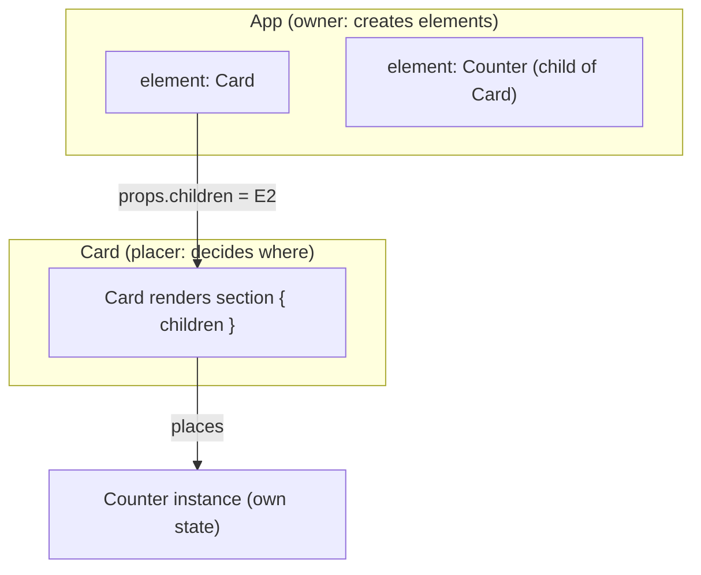
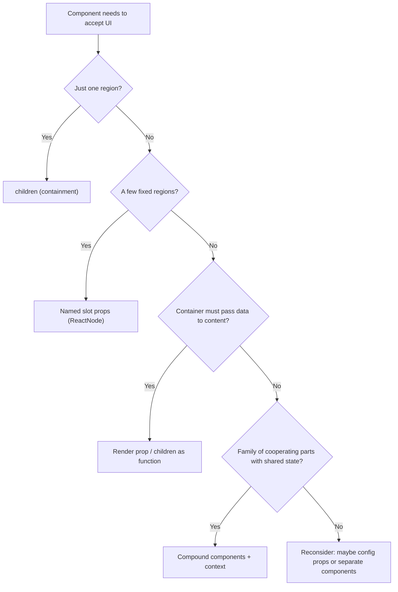

# 01 / 07 — Composition, `children`, and Slots

## 1. Lesson metadata

| | |
|---|---|
| **Level** | Intermediate |
| **Study time** | 4–5 hours (reading 1.5 h, experiments 1.5 h, exercises 1.5 h) |
| **Prerequisites** | [06 — Props and one-way data flow](./06-props-and-one-way-data-flow.md); [04 — Elements, components, instances](./04-elements-components-instances.md); [00/07 — Functions as values; referential identity](../00-web-and-javascript-foundations/07-functions-and-referential-identity.md) |
| **Next** | [08 — Conditional rendering](./08-conditional-rendering.md) |
| **Related later** | [Phase 5 / 03 — Composition over inheritance](../05-design-patterns/03-composition-over-inheritance.md), [Phase 5 / 05 — Compound components](../05-design-patterns/05-compound-components.md), [Phase 5 / 20 — Slot patterns](../05-design-patterns/20-slot-patterns.md), [Phase 7 / 03 — Why components re-render](../07-performance/03-why-components-rerender.md) |

**Learning objectives.** After this lesson you can:
1. Explain composition as React's primary mechanism for reuse and customization, and contrast it with inheritance.
2. Use `children` for containment, named props for slots, and render functions where the child must supply data back.
3. Type `children` and slot props correctly (`ReactNode`, `ReactElement`, function types) and know what each admits.
4. Explain why `children` and slot elements are created by the *owner*, not by the component that places them, and the consequences for state, data flow, and re-rendering.
5. Fix prop drilling with composition ("lifting content up") instead of reflexively reaching for context.
6. Explain why `React.Children` and `cloneElement` are fragile, and what to use instead.
7. Design a small slot-based layout and a compound-style API, and say when each is the wrong tool.

**Concepts covered:** composition vs inheritance, containment, specialization, `children` prop, `ReactNode`, named slots, render props (preview), compound components (preview), element ownership, "children as props" bail-out behavior, lifting content up, `Children.*` utilities and `cloneElement` caveats, fragments in composition, accessibility landmarks and semantics in layouts, TypeScript for `children`.

---

## 2. Deep conceptual explanation

### 2.1 What problem is this lesson solving?

You need components that are **reusable without being rigid**. A `Card` should look like a card around *anything*. A `Dialog` should provide focus management and a backdrop around *any* content. A `PageLayout` should arrange a header, a sidebar, and a main region without knowing what goes inside.

Two failure modes bracket the design space:

1. **Rigid components:** `<Card title body footer />` with a dozen props for every variation. Each new need adds a prop; eventually a prop soup with mutually exclusive flags.
2. **Inheritance-style reuse:** `class SpecialDialog extends Dialog`. React rejects this as the primary tool (the React team has stated they found no use cases that required component inheritance hierarchies); behavior is shared by *containment* and *specialization via props*, and logic via hooks ([Phase 5/03](../05-design-patterns/03-composition-over-inheritance.md)).

Composition is the answer: **a component accepts other UI as input** and decides *where* to place it, without knowing *what* it is.

### 2.2 `children`: containment

`children` is just a prop ([Lesson 06](./06-props-and-one-way-data-flow.md)) whose value is whatever JSX appears between the opening and closing tags:

```tsx
function Card({ children }: { children: ReactNode }) {
  return <section className="card">{children}</section>;
}

<Card>
  <h2>Title</h2>
  <p>Anything at all</p>
</Card>
```

Compiled (automatic runtime, [Lesson 05](./05-jsx-explained.md)): `_jsx(Card, { children: [h2Element, pElement] })`. `Card` doesn't know or care what the elements are. This is **containment**: the component *contains* arbitrary content.

### 2.3 Slots: named children

When you need *several* insertion points, use ordinary props whose values are elements:

```tsx
interface PageLayoutProps {
  header: ReactNode;
  sidebar?: ReactNode;
  children: ReactNode;      // main content
  footer?: ReactNode;
}

function PageLayout({ header, sidebar, children, footer }: PageLayoutProps) {
  return (
    <div className="page">
      <header>{header}</header>
      {sidebar && <aside aria-label="Sidebar">{sidebar}</aside>}
      <main>{children}</main>
      {footer && <footer>{footer}</footer>}
    </div>
  );
}

<PageLayout header={<NavBar />} sidebar={<Filters />} footer={<Legal />}>
  <ProductGrid />
</PageLayout>
```

Slots are not a React feature; they are *the consequence of elements being values* ([Lesson 04](./04-elements-components-instances.md)). Vue/Web Components have a dedicated "slot" concept; in React it is a convention over props. ([Phase 5/20](../05-design-patterns/20-slot-patterns.md) surveys more advanced slot patterns.)

### 2.4 Specialization

A "specific" component is a "generic" component with certain props fixed:

```tsx
function Dialog({ title, children, actions }: DialogProps) { /* generic */ }

function ConfirmDeleteDialog({ itemName, onConfirm, onCancel }: ConfirmProps) {
  return (
    <Dialog
      title={`Delete ${itemName}?`}
      actions={<>
        <button type="button" onClick={onCancel}>Cancel</button>
        <button type="button" onClick={onConfirm}>Delete</button>
      </>}
    >
      <p>This cannot be undone.</p>
    </Dialog>
  );
}
```

`ConfirmDeleteDialog` is not a subclass; it *uses* `Dialog`. Reuse flows through rendering, not through inheritance.

### 2.5 Who creates the elements? (Ownership)

This is the single most important idea of the lesson.

```tsx
function App() {
  return (
    <Card>
      <Counter />
    </Card>
  );
}
```

The `<Counter />` **element is created by `App`'s render**, not by `Card`'s. `Card` merely receives it as `props.children` and places it. Consequences:

1. **Data scope.** The element's props can only reference variables available in `App`. `Card` can't inject data into it (without `cloneElement`/render props/context).
2. **State ownership.** `Counter`'s state belongs to the `Counter` instance, wherever it ends up in the tree; it is *not* `Card`'s state.
3. **Re-rendering.** When `Card` re-renders due to *its own* state, `props.children` is the **same element object** it received last time (because `App` did not re-run). React can reuse the previous result for that element and skip re-calling `Counter` ([§3.2](#32-the-children-as-props-bail-out)).
4. **Identity and position.** Elements placed by `Card` at different positions have different instances; moving where `Card` renders `children` (e.g., from `<main>` to `<aside>`) remounts them (position in the *rendered* tree changed).

### 2.6 Render props (preview): when the container needs to give data back

Slots are *push*: the owner decides content. Sometimes the container has data the content needs (current item, hover state, measurements). Then pass a **function** that returns elements:

```tsx
function Hoverable({ children }: { children: (hovered: boolean) => ReactNode }) {
  const [hovered, setHovered] = useState(false);
  return (
    <div onPointerEnter={() => setHovered(true)} onPointerLeave={() => setHovered(false)}>
      {children(hovered)}
    </div>
  );
}

<Hoverable>{(hovered) => <p>{hovered ? "Hello!" : "Hover me"}</p>}</Hoverable>
```

This is the "render prop" pattern (children-as-a-function). Hooks have replaced many uses ([Phase 5/10](../05-design-patterns/10-render-props.md)), but render functions remain the right tool when *the container controls iteration or placement* (virtualized lists: `renderRow(index)`; tables: `renderCell(row)`).

### 2.7 Compound components (preview)

Sometimes a family of components shares implicit state: `<Tabs><Tabs.List>…</Tabs.List><Tabs.Panel/></Tabs>`. They communicate through context rather than props, keeping the call site declarative. Phase 5/05 covers the pattern; here the takeaway is that **composition scales from one slot to cooperating families** and that the choice among them is a design trade-off ([§7](#7-alternative-approaches-and-trade-offs)).

### 2.8 Lifting content up: composition as the alternative to prop drilling

Problem:

```tsx
function Page({ user }: { user: User }) {
  return <Layout user={user} />;
}
function Layout({ user }: { user: User }) {
  return (
    <div>
      <Header user={user} />
      <Content />
    </div>
  );
}
function Header({ user }: { user: User }) {
  return <Avatar name={user.name} />;
}
```

`Layout` receives `user` only to hand it to `Header`. Solution: *the owner builds the elements and passes them in:*

```tsx
function Page({ user }: { user: User }) {
  return <Layout header={<Header user={user} />} content={<Content />} />;
}
function Layout({ header, content }: { header: ReactNode; content: ReactNode }) {
  return (
    <div>
      {header}
      {content}
    </div>
  );
}
```

`Layout` now knows nothing about users; the data stays in `Page` and `Header`. This often removes the need for context entirely. The trade-off: `Page` (the high component) becomes "heavier" and must know the layout's slot vocabulary; if many layers need different slots, this can invert into a different kind of complexity (see React docs' "lifting content up" caveats). Use it when intermediate components are *structural*, not when they genuinely own behavior related to the data.

### 2.9 Common misconceptions

| Misconception | Reality |
|---|---|
| "`children` is an array." | It can be `undefined`, a single node, a string, an array, or a function. Never assume shape; don't call `.map` on it directly. |
| "`children` must be elements." | It can be any `ReactNode`: text, numbers, `null`, arrays, fragments, elements. |
| "The container renders its children." | The container *places* the children; the **owner** created them and their data. |
| "If a child component re-renders, `children` re-render too." | Elements passed as `children` are re-rendered only if React decides to re-render their instances; the same element reference lets React skip them (see §3.2). |
| "Use `React.Children.map` + `cloneElement` to give children props." | It breaks when children are wrapped, fragmented, or conditionally rendered. Prefer explicit props, context, or render props. |
| "Composition means wrapping everything in components." | It means *designing components to accept UI*. Over-wrapping adds indirection and DevTools noise without benefit. |
| "Slots are a special React feature." | They're ordinary props that hold elements. |
| "Fragments add a DOM wrapper." | They do not; they only group. |

---

## 3. Internal mechanics

### 3.1 What `children` looks like at runtime

| JSX | `props.children` |
|---|---|
| `<Card />` | `undefined` |
| `<Card>text</Card>` | `"text"` |
| `<Card><A /></Card>` | element object for `A` |
| `<Card><A /><B /></Card>` | array `[A element, B element]` (static array) |
| `<Card>{items.map(...)}</Card>` | array of elements (dynamic; keys matter) |
| `<Card>{cond && <A />}</Card>` | `false` or the element |
| `<Card>{(x) => <p>{x}</p>}</Card>` | a function |

*Public guarantee:* `children` is whatever the parent put between the tags, and React can render any `ReactNode` value. *Implementation detail:* the exact wrapping (single value vs array) is determined by the JSX transform and by how many children there are.

Because the shape varies, **render `children` directly** (`{children}`) whenever possible; don't inspect it.

### 3.2 The "children as props" bail-out

Consider the well-known demonstration (the `MovingDot`/pointer example in the React docs and many talks):

```tsx
function PointerTracker({ children }: { children: ReactNode }) {
  const [pos, setPos] = useState({ x: 0, y: 0 });
  return (
    <div
      style={{ position: "relative", height: 200 }}
      onPointerMove={(e) => setPos({ x: e.clientX, y: e.clientY })}
    >
      <div
        aria-hidden="true"
        style={{ position: "absolute", left: pos.x, top: pos.y, width: 8, height: 8, background: "red" }}
      />
      {children}
    </div>
  );
}

function App() {
  return (
    <PointerTracker>
      <ExpensiveTree />
    </PointerTracker>
  );
}
```

Every pointer move updates `PointerTracker`'s state and re-renders it. `children` is `<ExpensiveTree />`, an element created by `App`, **not recreated** when `PointerTracker` re-renders: the `children` prop holds the same object reference as before. React processes `PointerTracker`'s output, reaches that element, sees that it is *identical* to the previous element at that position (same reference ⇒ same type and same props), and it has no pending work (no state/context change inside it), so it **bails out** of re-rendering `ExpensiveTree` and its descendants.

Contrast with the version where the tracker creates the element itself:

```tsx
function PointerTracker() {
  const [pos, setPos] = useState({ x: 0, y: 0 });
  return (
    <div onPointerMove={...}>
      <Dot pos={pos} />
      <ExpensiveTree />      {/* a NEW element object every render: ExpensiveTree is re-called */}
    </div>
  );
}
```

Here `<ExpensiveTree />` is re-created on every `PointerTracker` render, a new element with a new props object, so by default React re-calls `ExpensiveTree` (unless it is wrapped in `memo` and its props are equal).

*Status of this behavior:* ⚠ This is an **optimization in the reconciler** that is widely documented and relied upon (React docs describe it in the context of "moving state down" and "lifting content up"), but it is not a *semantic guarantee*: it's a `may skip`, not a `must skip`. Design for correctness without it; use it as a performance tool you can verify in the Profiler. Context changes still propagate: if `ExpensiveTree` consumes a context whose value changed, it re-renders regardless.

*Teaching model:* "same element reference + no scheduled work in the subtree ⇒ skip." *Implementation detail:* the check is made when React compares the incoming element with the previous props/state/context of the fiber; details in [Phase 2/29](../02-react-rendering-and-internals/29-reasoning-about-unnecessary-renders.md) and [Phase 7/03](../07-performance/03-why-components-rerender.md).

### 3.3 Fragments in composition

A component may return multiple siblings via a Fragment (`<>…</>`), adding no DOM element. Slots/children passed as arrays are flattened similarly. Fragment `key`s are needed when mapping to fragments (`<Fragment key={id}>`).

### 3.4 `React.Children` and `cloneElement`

`Children.map/forEach/count/toArray/only` let you inspect/transform `children`. `cloneElement(element, extraProps)` creates a copy of an element with merged props. The React docs mark both as *uncommon*/*legacy-ish* and list alternatives. Problems:

| Problem | Example |
|---|---|
| **Does not see through components** | `Children.count(<><A/><B/></>)` is `1` (a fragment); `Children.count(<Wrapper/>)` doesn't know what `Wrapper` renders. |
| **Breaks on wrapping** | A parent that injects props into direct children stops working when a consumer wraps a child in `<Tooltip>`. |
| **Ordering/keys** | `Children.toArray` re-keys elements (prefixing keys), which changes identity assumptions. |
| **Type safety** | `ReactElement` props aren't typed; `cloneElement` generics are loose. |
| **Hidden coupling** | The container silently expects specific child types/props. |

Use explicit props, context (compound components), or render props instead ([Phase 5/05](../05-design-patterns/05-compound-components.md)).

---

## 4. Step-by-step execution walkthrough

Scenario: a collapsible `Panel` that owns its `open` state, containing a `Counter` created by `App`. Observe who re-renders and what state is preserved.

```tsx
function Counter() {
  const [n, setN] = useState(0);
  console.log("Counter render");
  return <button type="button" onClick={() => setN((x) => x + 1)}>Count {n}</button>;
}

function Panel({ title, children }: { title: string; children: ReactNode }) {
  const [open, setOpen] = useState(true);
  console.log("Panel render");
  return (
    <section>
      <h2>
        <button type="button" aria-expanded={open} onClick={() => setOpen((o) => !o)}>{title}</button>
      </h2>
      <div hidden={!open}>{children}</div>
    </section>
  );
}

function App() {
  console.log("App render");
  return (
    <Panel title="Stats">
      <Counter />
    </Panel>
  );
}
```

Assume production mode (no StrictMode double logs).

**Mount.**
1. `App` is called (logs `App render`): creates the element tree `Panel{title, children: Counter-element}`.
2. React renders `Panel` (logs `Panel render`) with `open = true`; it returns `section > h2 > button`, `div > {children}`.
3. React reaches the `children` slot: the `Counter` element → instance created → `Counter` called (logs `Counter render`), `n = 0`.
4. Commit: DOM built. Console order: `App render`, `Panel render`, `Counter render`.

**Click on the Panel title (toggle).**
5. `setOpen` updates `Panel`'s instance. React re-renders `Panel` (logs `Panel render`). **`App` is not called**, since its state/props didn't change.
6. `Panel` returns a new element tree, but `{children}` contains the *same* `Counter` element object as before. React reaches it, finds the identical element and no pending update → **skips `Counter`** (no `Counter render` log) ⚠ *optimization*.
7. DOM diff: `h2 > button` `aria-expanded` changes; `div` gets the `hidden` attribute. `Counter`'s DOM remains and its state persists (because `hidden` does not unmount).

**Click Count three times, hide the panel, then show it.** `Counter` re-renders only on its own clicks; its state `3` persists across hide/show because it was never unmounted.

**Variation:** replace `<div hidden={!open}>{children}</div>` with `{open && <div>{children}</div>}`. Now hiding **unmounts** the `div` and its `Counter` instance; showing again mounts a **new** `Counter` with `n = 0` (state lost; [Lesson 16](./16-state-preservation-and-reset.md)). Same composition, different *rendered position* ⇒ different instance lifetime. The `hidden` attribute is also accessibility-friendly: hidden content is removed from the accessibility tree.

**Prediction checkpoint:** if `Panel` were changed to create `<Counter />` itself inside its JSX, what would the toggle click log? **Answer:** `Panel render` and `Counter render` (a new element each time; `Counter` is re-called as a child of a re-rendering parent).

---

## 5. Code examples

### 5.1 Minimal example — a `Card` with `children`

```tsx
import type { ReactNode } from "react";

interface CardProps {
  children: ReactNode;
  as?: "section" | "article" | "div";
}

export function Card({ children, as: Tag = "section" }: CardProps) {
  return <Tag className="card">{children}</Tag>;
}

// Usage
// <Card as="article">
//   <h3>Order #123</h3>
//   <p>Shipped</p>
// </Card>
```

Notes:
- `as: Tag = "section"`: rename on destructure to get a capitalized variable, so JSX treats it as an identifier holding a string host tag ([Lesson 05 §3.6](./05-jsx-explained.md)). The union restricts allowed tags (accessibility: pick semantic elements deliberately; don't default to `div` out of habit).
- `children: ReactNode` is required; making it optional would let `<Card />` render an empty card.

**Predict:** What does `<Card>{0}</Card>` render? **Result:** an empty card with the text `0` (the number `0` is a valid `ReactNode` and renders). `<Card>{false}</Card>` renders an empty card element with no text.

### 5.2 Practical example — slot-based dashboard layout with ownership

```tsx
import { useState, type ReactNode } from "react";

interface DashboardLayoutProps {
  title: string;
  toolbar?: ReactNode;
  aside?: ReactNode;
  children: ReactNode;
}

export function DashboardLayout({ title, toolbar, aside, children }: DashboardLayoutProps) {
  const [asideOpen, setAsideOpen] = useState(true);

  return (
    <div className="dashboard">
      <header className="dashboard__header">
        <h1>{title}</h1>
        {toolbar}
        {aside && (
          <button type="button" aria-expanded={asideOpen} aria-controls="dash-aside" onClick={() => setAsideOpen((o) => !o)}>
            {asideOpen ? "Hide" : "Show"} filters
          </button>
        )}
      </header>
      <div className="dashboard__body">
        {aside && (
          <aside id="dash-aside" aria-label="Filters" hidden={!asideOpen}>
            {aside}
          </aside>
        )}
        <main>{children}</main>
      </div>
    </div>
  );
}

// Page owns the data and creates all elements
export function SalesPage({ data }: { data: SalesData }) {
  const [region, setRegion] = useState("all");

  return (
    <DashboardLayout
      title="Sales"
      toolbar={<ExportButton data={data} />}
      aside={<RegionFilter value={region} onChange={setRegion} />}
    >
      <SalesChart data={data} region={region} />
      <SalesTable data={data} region={region} />
    </DashboardLayout>
  );
}
```

Why this design is good:
- `DashboardLayout` owns only **layout state** (`asideOpen`). It knows nothing about sales, regions, or data.
- `SalesPage` owns **domain state** (`region`) and passes it directly to the components that need it: no drilling through the layout.
- Toggling the aside re-renders `DashboardLayout`, but the elements in `toolbar`, `aside`, and `children` were created by `SalesPage` and are unchanged ⇒ the chart/table can skip re-rendering (§3.2), so opening/closing a sidebar doesn't re-render a 10,000-row table.
- Semantic structure: one `<h1>`, `<header>`, `<main>`, `<aside aria-label>`; the toggle uses `aria-expanded`/`aria-controls`. The `hidden` attribute keeps the filter state alive.

**Predict:** The user changes the region. What re-renders? **Result:** `SalesPage` (owner of `region`) → new elements → `DashboardLayout` is called (new props), and the chart/table (new `region` prop) and `RegionFilter` re-render. The layout's *own* state is unchanged and preserved. In contrast, toggling the aside re-renders only `DashboardLayout` (and cheaply reuses the slots). Two different state owners; two different update scopes: that is the benefit of putting state where it's used.

*Trade-off:* the number of slot props can grow; beyond ~4–5 slots consider compound components (`<Dashboard.Header>`) or render regions via `children` with explicit subcomponents ([§5.5](#55-advanced-example--compound-components-with-context)).

### 5.3 Incorrect example — inspecting and cloning children

```tsx
// ❌ Incorrect
import { Children, cloneElement, isValidElement } from "react";

function ButtonGroup({ children }: { children: React.ReactNode }) {
  return (
    <div role="group">
      {Children.map(children, (child, i) =>
        isValidElement(child)
          ? cloneElement(child as React.ReactElement<{ className?: string }>, {
              className: i === 0 ? "first" : "rest",
            })
          : child,
      )}
    </div>
  );
}

// Consumers:
<ButtonGroup>
  <Button>Save</Button>
  <Tooltip text="Cancel the operation"><Button>Cancel</Button></Tooltip>
  {isAdmin && <Button>Delete</Button>}
</ButtonGroup>
```

**Predict:** which buttons get the `first`/`rest` class?

**Result:**
- `Save` gets `first`, **if** `Button` accepts and applies `className`. If `Button` ignores `className`, nothing happens and no error.
- `Tooltip` (not `Button`) gets `className="rest"`. If `Tooltip` doesn't forward `className`, the *inner* `Button` is untouched; if it forwards it to a wrapper, the style applies to the wrong element.
- `{isAdmin && ...}` is `false` when not admin. In React 19.3.1, `Children.map` still invokes the callback for `false`/`null` (they receive `null`) and `i` counts them (`[<a/>, false, null, <b/>]` gives indexes 0,1,2,3; `Children.count` counts them too), whereas `Children.toArray` drops them; the point is that an index-based rule is only as stable as the consumer's conditional children, so "first" and "rest" can silently shift.
- Wrapping children in fragments (`<><Button/><Button/></>`) makes the whole fragment *one* child ⇒ only the fragment is cloned (and ignores `className`).

**Why wrong:** the container reaches into elements it doesn't own, assumes their types and prop contracts, and breaks under any structural change by the consumer.

### 5.4 Corrected implementation

Prefer CSS for the visual need:

```tsx
function ButtonGroup({ children }: { children: ReactNode }) {
  return <div role="group" className="button-group">{children}</div>;
}
```
```css
.button-group > :first-child { /* first */ }
.button-group > :not(:first-child) { /* rest */ }
```

If behavior (not just style) must be coordinated, use explicit context or props:

```tsx
const GroupContext = createContext<{ size: "sm" | "md" }>({ size: "md" });

function ButtonGroup({ size = "md", children }: { size?: "sm" | "md"; children: ReactNode }) {
  return (
    <GroupContext value={{ size }}>
      <div role="group" className="button-group">{children}</div>
    </GroupContext>
  );
}

function Button({ children }: { children: ReactNode }) {
  const { size } = useContext(GroupContext);
  return <button type="button" className={`btn btn--${size}`}>{children}</button>;
}
```

Wrapped, fragmented, or conditional children all still work because the *context*, not the element tree shape, carries the information. (⚠ React 19 lets you render `<GroupContext value={...}>` directly as the provider; in React ≤ 18 you must write `<GroupContext.Provider value={...}>`. The object literal in `value` is recreated each render; for frequently re-rendering providers, memoize ([Phase 3/14](../03-react-state-and-hooks/14-context-performance.md)).)

### 5.5 Advanced example — compound components with context

```tsx
import { createContext, useContext, useId, useState, type ReactNode } from "react";

interface AccordionContextValue {
  openId: string | null;
  toggle: (id: string) => void;
}

const AccordionContext = createContext<AccordionContextValue | null>(null);

function useAccordion() {
  const ctx = useContext(AccordionContext);
  if (!ctx) throw new Error("Accordion.* components must be rendered inside <Accordion>");
  return ctx;
}

function Accordion({ children, defaultOpenId = null }: { children: ReactNode; defaultOpenId?: string | null }) {
  const [openId, setOpenId] = useState<string | null>(defaultOpenId);
  const toggle = (id: string) => setOpenId((cur) => (cur === id ? null : id));
  return (
    <AccordionContext value={{ openId, toggle }}>
      <div>{children}</div>
    </AccordionContext>
  );
}

function AccordionItem({ id, title, children }: { id: string; title: string; children: ReactNode }) {
  const { openId, toggle } = useAccordion();
  const panelId = useId();
  const isOpen = openId === id;
  return (
    <section>
      <h3>
        <button type="button" aria-expanded={isOpen} aria-controls={panelId} onClick={() => toggle(id)}>
          {title}
        </button>
      </h3>
      <div id={panelId} role="region" aria-label={title} hidden={!isOpen}>
        {children}
      </div>
    </section>
  );
}

Accordion.Item = AccordionItem;

// Usage
// <Accordion defaultOpenId="shipping">
//   <Accordion.Item id="shipping" title="Shipping"><p>…</p></Accordion.Item>
//   <Accordion.Item id="returns" title="Returns"><p>…</p></Accordion.Item>
// </Accordion>
```

Notes:
- **Implicit state sharing** through context lets consumers freely interleave other markup between items.
- The `useAccordion` hook turns a missing provider into a clear error rather than a `null` crash.
- `Accordion.Item = AccordionItem` attaches a static property to a function component; TypeScript supports this via declaration merging of functions with properties (expando properties). Some codebases export `AccordionItem` separately for tree-shaking and simplicity.
- Trade-offs vs. slots: more power and flexible markup; more indirection; context value changes re-render all consumers (here: all items on any toggle: acceptable for small lists; see Phase 3/14 and Phase 5/05).
- Each section uses `hidden` rather than conditional rendering so item content keeps its state; if content is heavy, consider lazy mounting on first open.

---

## 6. Visual explanations

### 6.1 Ownership vs placement



*Created by* `App`. *Placed by* `Card`. *State owned by* the `Counter` instance. *Data available to* `Counter`'s props: only what `App` had in scope.

### 6.2 Update scope: element reference reuse

```text
Panel state changes (toggle)
 ├─ Panel is re-called              → returns new <section>, <h2>, <div> elements
 ├─ children prop === same element  → React can SKIP re-calling Counter  (optimization, not a guarantee)
 └─ DOM: only aria-expanded / hidden changed

Panel creates <Counter /> itself
 ├─ Panel is re-called              → returns NEW <Counter /> element
 └─ Counter is re-called (props object is new), unless wrapped in memo with equal props
```

### 6.3 Choosing a composition mechanism



---

## 7. Alternative approaches and trade-offs

| Approach | Flexibility | Type safety | Coupling | Re-render friendliness | Readability | When to prefer |
|---|---|---|---|---|---|---|
| **Config props** (`<Card title body footer />`) | Low (only anticipated shapes) | Excellent | Container knows content shape | Neutral | High for simple | Few, stable variants; strict visual consistency |
| **`children` only** | High | Good (`ReactNode`) | Low | Good (§3.2) | High | Single content region |
| **Named slots (ReactNode props)** | High | Good | Low | Good | High up to ~4–5 slots | Layouts, dialogs, cards with header/footer |
| **Render props / children-as-function** | Highest | Good (typed callbacks) | Medium (data contract) | Re-created functions each render | Medium (nesting) | Container supplies data/iteration (virtualization, tables, tooltips with position) |
| **Compound components + context** | High | Medium (context generics, static props) | Medium (parts must be inside the parent) | Context consumers re-render on value change | High at call site | Tabs, accordions, menus, selects: related parts sharing state |
| **`cloneElement` / `Children.map`** | Medium | Weak | High, hidden | Neutral | Low | Avoid; legacy codebases |
| **Component-as-prop** (`Icon={SaveIcon}`) | Medium | Good (`ComponentType<P>`) | Medium | Neutral | Medium | Container must instantiate with its own props or choose when to render |
| **Inheritance (class `extends`)** | Low | Medium | Very high | n/a | Low | Not used for UI reuse in React |

**When the recommended approach (slots/children) is not best:** a data table where each cell's content depends on the row and column: slots can't express this; use render functions (`cell: (row) => ReactNode`) or column definitions with a `Cell` component. Likewise a design-system `Button` with variants should use *props* (`variant="danger"`), not `children` slots, because visual consistency matters more than flexibility; giving consumers arbitrary slots for button internals invites inconsistent UI.

---

## 8. Best practices and anti-patterns

**Do**
- Accept `children: ReactNode` for generic containers; accept `ReactNode` slots over `ReactElement` unless you must inspect them.
- Keep state as close as possible to where it's used, and use composition to avoid threading data through structural components.
- Render `children` directly; don't clone or index into them.
- Use semantic structural elements in layouts (`header`, `main`, `nav`, `aside` with labels, `footer`); ensure exactly one `main`.
- Provide sensible defaults (`as` prop limited to semantic tags).
- Use fragments instead of wrapper `div`s that distort layout or semantics (e.g. inside `ul`, `table`).
- Document slot names and expectations (e.g., "`actions` should contain buttons").

**Beginner mistakes**
- Passing data to `children` by modifying them.
- Using `children.map` (crashes when `children` is a single element or string).
- Wrapping everything in layout components that all take `user`/`theme` props (drilling).
- Using `index` as a key for children arrays that reorder ([Lesson 09](./09-lists-keys-and-identity.md)).

**Experienced-developer mistakes**
- Slot sprawl: 12 slot props where compound components or two components would be clearer.
- Using context for what a single level of composition could solve (adds implicit coupling and re-render breadth).
- Relying on `Children.count`/`toArray` for logic (breaks with fragments and wrappers).
- Assuming the `children` bail-out is guaranteed and writing code that is wrong without it (e.g., relying on `Counter` *not* logging).
- Not realizing that moving a slot's render position remounts it.

**Smells:** `cloneElement` in library code; a layout prop named `user`; a component that accepts both `children` and a `content` prop; `typeof children === "string"` checks to switch rendering; `Children.only` used to enforce structure without a good error story.

**Accessibility notes:** layout components decide the document structure: keep heading levels coherent (a `Card` that always renders `<h3>` can break outlines; accept `headingLevel` or let consumers render the heading as a slot); use `aria-label`/`aria-labelledby` on repeated landmarks; ensure hidden slots use `hidden`/`inert`, not only CSS transforms; dialogs need focus trapping and labelling (Phase 8/10, native `<dialog>` where possible). Don't make slots purely visual: a `toolbar` slot should end up in a logical focus order.

**Justified exceptions:** `Children.map` for small, internal, tightly controlled components where you own all children types; `cloneElement` to merge props and refs in `asChild`-style libraries (carefully implemented and tested, usually as a battle-tested library such as Radix's Slot, rather than hand-rolled).

---

## 9. Real-world application

*Design system (multi-team).* `Card`, `Modal`, `PageHeader`, `Stack`, `Toolbar` are composition primitives. Teams fill slots with domain components. The constraint is *API stability*: once `Modal` takes `footer`, consumers depend on it; compound alternatives need careful migration. Accessibility defaults (dialog labelling, focus return) live in the primitive so every team gets them for free; slots must not allow bypassing them.

*Enterprise app shell.* `AppShell` takes `nav`, `header`, `children` slots. Authentication and permissions stay in the page-level owner: the shell never imports `useUser`, so it can be reused for the public site and the admin app. The shell's own state (sidebar collapsed) doesn't re-render the page content (§3.2), which matters for dashboards with heavy charts.

*Data table with custom cells.* Column definitions include `header: ReactNode` and `cell: (row: Row) => ReactNode`. The table owns sorting, selection, and virtualization; consumers own presentation. A render function is chosen over `children` because the table decides *when and how often* to call it per visible row. Constraint: render functions must be pure and cheap; they run per row per render.

*Form field wrappers.* `<Field label="Email" error={err} hint="We never share it"><input .../></Field>`: the wrapper needs to connect `htmlFor`/`id` and `aria-describedby` to the input it contains. Options: render prop (`{({ id, describedBy }) => <input id={id} aria-describedby={describedBy} />}`) or context + a `Field.Input` component. `cloneElement` to inject `id` is the fragile shortcut to avoid.

*Feature flags/experiments.* `<Experiment name="new-checkout" control={<OldCheckout />} variant={<NewCheckout />} />` accepts two slots and renders one. Only the rendered element gets instantiated, but both elements are *created* (cheap) each render; if constructing them has side effects or heavy argument computation, pass functions instead.

---

## 10. Debugging and troubleshooting

**Symptom 1:** "TypeError: children.map is not a function."
- *Cause:* `children` was a single element, string, or `undefined`. *Fix:* don't call `.map` on `children`; if you must iterate, use `Children.map`/`toArray` (accepting their caveats), or accept an explicit `items` array prop.

**Symptom 2:** "Objects are not valid as a React child" when passing a slot.
- *Cause:* passing a component *type* (`icon={Icon}`) where a node was expected, or an object. *Fix:* pass `icon={<Icon />}` or change the prop to `ComponentType` and render it as `<Icon />` in the container. Decide the contract and type it (`ReactNode` vs `ComponentType`).

**Symptom 3:** "Content inside my layout loses state when the sidebar toggles."
- *Investigate:* DevTools Components → toggle → watch for the content instance remounting (state reset, "highlight updates" flashes everything). Check whether the layout's JSX *conditionally changes the position or wrapper* of the slot (`{open ? <div>{children}</div> : <section>{children}</section>}` unmounts because element *type* at the position differs). *Fix:* keep the same element type/position and toggle with `hidden` or CSS; or give both branches the same wrapper.

**Symptom 4:** "My expensive child re-renders on every keystroke in the container even though I use `children`."
- *Cause 1:* the elements are created *inside* the component that re-renders (the owner is the thing with state). *Cause 2:* a context consumed by the subtree changes. *Cause 3:* the `children` are produced by a function or inline wrapper each render (e.g. `children={<Wrapper>{x}</Wrapper>}` in the same component that owns the state).
- *Investigate:* Profiler → "Why did this render?"; look at the *owner* of the elements, not the placer.
- *Fix:* move the state down into a small component so its siblings are created by a parent that doesn't re-render; or lift the content to the owner; or `memo` the expensive child.

**Symptom 5:** "Cloned props don't reach my child."
- *Cause:* the immediate child is a wrapper/fragment/other type. *Fix:* stop cloning; use context, render props, or explicit props.

**Symptom 6:** "Keys warning for children arrays."
- When a component receives `children` as a dynamic array (from `.map`), keys must be present on the elements that the *owner* creates. Warnings blame the component that created the array.

---

## 11. Exercises

### Level A — Knowledge
A1. What is `children`, and what does the JSX compile to for `<Card><A /><B /></Card>`?
A2. List four values that may legally be `children` (as `ReactNode`).
A3. Who creates the element passed as `children`, and why does that matter for data access?
A4. Why does a React app typically *not* use class inheritance for UI reuse? What replaces it?
A5. Give two reasons `cloneElement` + `Children.map` is fragile.

### Level B — Code comprehension
B1. Production mode; the user clicks "Toggle" once. List the log lines in order.
```tsx
function Inner() { console.log("Inner"); return <p>inner</p>; }
function Wrapper({ children }: { children: ReactNode }) {
  const [on, setOn] = useState(false);
  console.log("Wrapper");
  return (
    <div>
      <button type="button" onClick={() => setOn((v) => !v)}>Toggle {String(on)}</button>
      {children}
    </div>
  );
}
function App() {
  console.log("App");
  return <Wrapper><Inner /></Wrapper>;
}
```
(Initial mount logs are not part of the question.)
B2. Same as B1, but `Wrapper` renders `<Inner />` itself and ignores `children`. What logs on click?
B3. Does state in `<Counter />` survive in each of these variations when `open` flips twice (true → false → true)?
```tsx
(a) <div hidden={!open}>{children}</div>
(b) {open && <div>{children}</div>}
(c) {open ? <div>{children}</div> : <section>{children}</section>}
(d) <div style={{ display: open ? "block" : "none" }}>{children}</div>
```
B4. What are the TypeScript types for `children` in these usages: `<A>text</A>`, `<A>{fn}</A>` where `fn: (n: number) => ReactNode`, `<A><B/></A>` if `A` requires a single element?

### Level C — Implementation
C1. Implement a `Stack` component with props `gap?: number` and `children`, rendering a flex column; use CSS custom properties (not inline `margin` hacks), and don't use `cloneElement`.
C2. Implement `Modal` with slots `title`, `children`, `actions`; accessible naming (`aria-labelledby`), Escape to close, `onClose`, and return focus to the trigger. Use the native `<dialog>` element via a ref and `showModal()`.
C3. Implement `<List items renderItem getKey emptyState />` generically typed. Decide how `emptyState` is provided and why.
C4. Refactor the "user prop drilling through Layout" example in §2.8 to composition. Then name a situation where you'd prefer context instead.

### Level D — Debugging
D1. A teammate wrote a `Tabs` component using `Children.map` to number the tabs. After a designer wrapped a tab in `<Tooltip>`, the numbering broke. Explain and propose a fix with minimal API change.
D2. Typing in a header search box (state in `AppShell`) makes the whole page janky. The code:
```tsx
function AppShell() {
  const [q, setQ] = useState("");
  return (
    <div>
      <input value={q} onChange={(e) => setQ(e.target.value)} aria-label="Search" />
      <HugeReport />
    </div>
  );
}
```
Give three fixes in order of preference, and say what each depends on.
D3. A `Dialog` places `children` inside a portal for modals and the content loses state each time the parent re-renders. Investigate possible causes related to this lesson.

### Level E — Architecture and engineering decisions
E1. Your design system needs a `PageHeader` used by 8 teams. Compare an API with config props (`title`, `subtitle`, `actions: Action[]`, `breadcrumbs: Crumb[]`) versus slots (`title`, `actions`, `breadcrumbs` as ReactNode) versus compound components. Evaluate consistency, flexibility, accessibility, and migration cost; recommend.
E2. A team uses context for `theme`, `user`, `locale`, `featureFlags`, `layoutState`, and `modalStack`, and complains about re-renders. Which of these could be replaced by composition, and which should stay context or a store? Justify.

### Level F — Expert challenge
F1. Design a `Tooltip`/`Popover` API that supports: any trigger element (including custom components), correct a11y wiring (`aria-describedby`), and ref/handler merging, without `cloneElement` by consumers. Compare the render-prop approach, the `asChild` approach, and a hook (`useTooltip`) approach. Discuss pitfalls with each.

---

## 12. Detailed answers and explanations

> Attempt the exercises first.

**A1.** `children` is the prop holding whatever JSX is nested between the tags. `<Card><A /><B /></Card>` compiles to `_jsxs(Card, { children: [_jsx(A, {}), _jsx(B, {})] })` (automatic runtime): two children → `jsxs` and an array.

**A2.** Any four: an element, a string, a number, `null`/`undefined`/boolean (render nothing), an array/iterable of nodes, a fragment, a portal. (A function is valid `children` for the *component* that expects a render function, but React cannot render a function as a child.)

**A3.** The component that *wrote the JSX*, here the owner (e.g. `App`), creates it. So the element's props can only use data in the owner's scope; the container (`Card`) can't pass data in without render props/context/cloning. This also determines re-render scope (§3.2).

**A4.** Inheritance couples subclasses to base-class internals and ties customization to a hierarchy; UI variation is better expressed by passing different props/children (containment and specialization), and logic reuse by hooks/composition. React's docs state that the team hasn't found cases that require component inheritance hierarchies.

**A5.** (Any two) It sees only direct children, not what wrappers render; breaks when consumers wrap/fragment/conditionally render children; relies on children's prop contracts silently; weak typing; index-based logic shifts with conditional children; `Children.toArray` rewrites keys.

**B1.** On click: `Wrapper` only. `App` isn't re-rendered (its state didn't change). `Inner` isn't logged because `children` is the same element reference ⇒ bail-out (⚠ optimization; if you saw `Inner` logged in a dev build with some configuration, remember that this skip is not guaranteed; in StrictMode the double render logs `Wrapper` twice). Expected: `Wrapper`.

**B2.** `Wrapper`, `Inner`. `Wrapper` creates a new `<Inner />` element each render, so `Inner` is re-called (no `memo`). The difference between B1 and B2 is who owns the element.

**B3.** (a) **Survives**: element stays mounted; only `hidden` changes. (b) **Lost**: `false` renders nothing; the div and its subtree unmount, remount with fresh state. (c) **Lost**: element `type` at that position changes (`div` ↔ `section`), so React unmounts/mounts the subtree. (d) **Survives**: same element; only the style changes (`display: none` also removes the content from the accessibility tree, like `hidden`). Common wrong answer for (c): "same children ⇒ same state". Identity is by position and parent element type, not by the children value.

**B4.** `<A>text</A>` → `children: string` (assignable to `ReactNode`). `<A>{fn}</A>` → `children: (n: number) => ReactNode`: the prop must be typed as a function, and `A` calls it; a `ReactNode`-typed prop would not accept a function. Single-element requirement: type `children: ReactElement`, which rejects strings and arrays at compile time (multiple children produce an array type error). Runtime enforcement (`Children.only`) is a fallback.

**C1. Sample**
```tsx
import type { CSSProperties, ReactNode } from "react";

export function Stack({ gap = 8, children }: { gap?: number; children: ReactNode }) {
  const style = { "--stack-gap": `${gap}px` } as CSSProperties;
  return <div className="stack" style={style}>{children}</div>;
}
```
```css
.stack { display: flex; flex-direction: column; gap: var(--stack-gap, 8px); }
```
Criteria: no `cloneElement`; `gap` handled in CSS (`gap` property works for flex). The `as CSSProperties` cast is the standard way to set custom properties in TS. Edge: for semantic lists use `<ul>`, not a `div`-based stack.

**C2. Sample**
```tsx
import { useEffect, useId, useRef, type ReactNode } from "react";

interface ModalProps {
  open: boolean;
  onClose: () => void;
  title: ReactNode;
  actions?: ReactNode;
  children: ReactNode;
}

export function Modal({ open, onClose, title, actions, children }: ModalProps) {
  const ref = useRef<HTMLDialogElement>(null);
  const titleId = useId();

  useEffect(() => {
    const dialog = ref.current;
    if (!dialog) return;
    if (open && !dialog.open) dialog.showModal();
    if (!open && dialog.open) dialog.close();
  }, [open]);

  return (
    <dialog
      ref={ref}
      aria-labelledby={titleId}
      onClose={onClose}   // fires on Escape and on dialog.close()
    >
      <h2 id={titleId}>{title}</h2>
      <div>{children}</div>
      {actions && <div className="modal__actions">{actions}</div>}
    </dialog>
  );
}
```
Notes: `<dialog>.showModal()` provides focus trapping/inert background, Escape handling, and focus restoration to the previously focused element in modern browsers (verify behavior across your support matrix on MDN). The `close` event fires on Escape *and* on programmatic `close()`, so `onClose` runs after the component's own `close()` call too; guard against loops by making `onClose` idempotent (setting `open=false` when it's already `false` is a no-op). The `ref` is an ordinary prop in the DOM element (host elements always accepted `ref`). Slots: `title`, `actions`, `children`. The effect is an *imperative sync* with the DOM dialog ([Lesson 02 §2.6](./02-declarative-vs-imperative-ui.md)); the alternative `<dialog open>` attribute doesn't give modal behavior.

**C3. Sample**
```tsx
import type { ReactNode } from "react";

interface ListProps<T> {
  items: readonly T[];
  getKey: (item: T) => string;
  renderItem: (item: T, index: number) => ReactNode;
  emptyState?: ReactNode;
}

export function List<T>({ items, getKey, renderItem, emptyState = <p>No items.</p> }: ListProps<T>) {
  if (items.length === 0) return <>{emptyState}</>;
  return (
    <ul>
      {items.map((item, i) => (
        <li key={getKey(item)}>{renderItem(item, i)}</li>
      ))}
    </ul>
  );
}
```
Why `emptyState` is a `ReactNode` slot: it needs no data from the list; a render function would be unnecessary. `renderItem` is a function because the list supplies the item (and index) per iteration: data flows *from the container into the content*. Default `emptyState` JSX creates a new element each call; it's cheap. Edge: `getKey` must return stable unique ids; using the index is only safe for static lists.

**C4.** See [Lesson 06 C3](./06-props-and-one-way-data-flow.md#12-detailed-answers-and-explanations). Prefer **context** when: many consumers at unpredictable depths need `user` (nav menu, permissions checks, audit logging components), the value changes rarely, and passing elements from the top would require the top to know every consumer. Composition shines when the number of consumers is small and their positions are known near the top.

**D1.** `Children.map` sees direct children only; wrapping a `Tab` in `<Tooltip>` makes the direct child a `Tooltip`, so numbering/props target `Tooltip` not `Tab`. Minimal-API fix: use context: `Tabs` provides a registration mechanism, or—simpler—number from the *data*: accept `tabs: {id; label; content}[]` instead of children. If keeping a children-based API, `Tab` registers itself via context (using an effect/ref-callback or `useId`) and the tab order comes from DOM order. Evaluate: whether the new API survives wrappers, fragments, and conditional rendering.

**D2.** (1) **Move state down:** extract `<SearchBox />` (with `q` state) as a sibling so `AppShell` doesn't re-render: `AppShell` no longer owns `q` at all (if the query isn't needed by `HugeReport`). If `HugeReport` needs it, only the consumer subtree should re-render. (2) **Lift content up / `children`:** if state must live in a wrapper, have the *parent* of `AppShell` create `<HugeReport />` and pass it as `children`, so it can be skipped (§3.2). (3) **`memo(HugeReport)`** with stable props, or defer the expensive work with `useDeferredValue(q)` when the report must depend on `q`. Depends on: whether the report needs `q`, who owns the elements, whether props are stable, and measured cost (Profiler). Order of preference: structural fixes first (1, 2), then memoization/deferral.

**D3.** Possible causes: the `Dialog` conditionally changes its wrapper/element *type* or position around `children` (e.g., switching between a portal and inline render), which remounts the subtree; a changing `key`; the Dialog defined inside the parent component (new type every render, [Lesson 04](./04-elements-components-instances.md)); the portal target container being recreated each render (`createPortal(children, document.createElement("div"))` inside render): a new container every time unmounts content. Fix by stabilizing the container (module-level/`useState`/ref created once), keeping consistent structure, and defining components at module level.

**E1.** Criteria: consistency across teams, flexibility, accessibility defaults (single `h1`, breadcrumb `nav` with `aria-label`, heading level), migration cost, bundle impact, type safety. *Config props:* strongest consistency and easy enforcement (the component renders breadcrumb markup itself), weakest flexibility (custom action types need new props); good if the design is strict. *Slots:* flexible; risk of inconsistent markup (teams put anything in `actions`); mitigate with documented constraints and lint/visual tests. *Compound:* readable call sites (`<PageHeader.Actions>`), room for structure, but more API surface and context overhead. Reasonable recommendation: **hybrid**: config props for the stable, accessibility-critical parts (`title`, `breadcrumbs: Crumb[]` rendered by the system) and a slot for `actions` (arbitrary buttons), plus `children` for rare extras. Migration: ship alongside existing, deprecate with codemods. Evaluation: considers a11y ownership and drift.

**E2.** `layoutState` (sidebar collapsed) belongs *in the layout component* with composition so page content isn't affected; `modalStack` is app-wide imperative-ish state: a store or a provider with stable API (functions that don't change) split from state; `theme`/`locale` change rarely: context is fine; `user` rarely changes: context fine, but split read-only data from actions; `featureFlags` rarely change: context or a module-level store with `useSyncExternalStore`. Key principle: *context for rarely changing, widely read values; composition for structure; stores with selectors for frequently changing shared state.* Also split contexts by update frequency, and memoize provider values ([Phase 3/14](../03-react-state-and-hooks/14-context-performance.md)).

**F1. Example answer.** Requirements: consumer supplies any trigger; system adds `aria-describedby`, event handlers (hover/focus/blur/Escape), and a `ref` for positioning, merging with the consumer's own handlers/ref. 
- **Render-prop:** `<Tooltip content="..." >{(triggerProps) => <button {...triggerProps}>Save</button>}</Tooltip>`. Pro: explicit, type-safe (`triggerProps` typed), works with any element/component that forwards the spread; no cloning. Con: consumer must remember to spread; nesting; custom components must forward props/ref to a DOM node.
- **`asChild` (Slot):** `<Tooltip.Trigger asChild><Link href="/">Save</Link></Tooltip.Trigger>`; the library clones the only child, merging props, handlers (composed), and refs. Pro: ergonomic, low ceremony. Con: relies on `cloneElement` internals; requires exactly one child that forwards props/ref; edge cases (fragments, conditional children); typing is looser. Use a vetted library implementation.
- **Hook (`useTooltip`)** returns `{ triggerProps, tooltipProps, open }`: most flexible and testable; no hidden structure; consumer wires everything and renders the popup; more boilerplate and easier to misuse (forgetting a11y wiring), though the hook can include dev warnings.
Pitfalls common to all: ref merging (React 19 refs as props, but merging two refs requires a helper), handler composition order (`onPointerEnter` of consumer and library), `aria-describedby` id linking, focus vs hover parity (keyboard users must trigger the tooltip on focus), dismissal with Escape (WCAG 1.4.13), content must be hoverable and persistent, portal and stacking contexts, SSR safety (`useId`), touch devices (tooltips don't exist; consider alternatives), and not hiding essential information in tooltips. Evaluation: names a clear contract for merging, includes keyboard accessibility, explains why cloning is isolated in the library, and states a recommendation (e.g., hook + thin component for the library, `asChild` as ergonomic layer).

---

## 13. Senior engineer interview questions

**Q1. "How would you design a reusable `Card` component?"**
*Strong answer:* Start from usage: containment via `children`; semantic root choice (`as` limited to `section|article|div`); optional slots for `header`/`footer` if multiple call sites need them; no data/domain props. Styling through CSS classes/variants, not inline logic. Accessibility: heading level control and landmark labelling. Avoid cloning or inspecting children. Document constraints, and add a story and a11y tests.

**Q2. "What is the 'children as props' optimization, and when does it not apply?"**
*Strong answer:* Elements passed as `children` are created by the owner; when the placing component re-renders for its own state, it receives the same element references, so React can skip re-rendering those subtrees. It doesn't apply if the placing component creates the elements itself, if the owner re-renders (new elements), if the subtree consumes a changed context, or if the subtree has its own pending updates. It's an optimization, not a guarantee, so correctness must not depend on it; verify with the Profiler.

**Q3. "Prop drilling is painful. What are your options?"**
*Strong answer:* First ask why intermediates need to carry the data; lift content up (composition) when they're structural; context for read-mostly values with many scattered consumers; stores/selectors for frequently changing shared state; or restructure state ownership to move consumers closer. Each has costs: composition shifts complexity to the owner; context couples implicitly and re-renders consumers; stores add a dependency and conventions. Choose by number of consumers, change frequency, and how many layers don't care.

**Q4. "Why avoid `cloneElement`?"**
*Strong answer:* Fragile contracts: the container silently assumes child types/props; breaks with wrapping, fragments, conditional children; weak types; it hides data flow. Use explicit props, context/compound components, render props, or hooks. Legit uses exist in libraries merging props/refs for `asChild`, but they should be encapsulated and tested.

**Q5. "Compound components vs. slot props: how do you choose?"**
*Strong answer:* Slots: a small fixed set of regions with no shared internal state. Compound: several cooperating parts, interleaved markup freedom, shared implicit state (tabs, menus, selects), at the cost of context and static-property API surface. Check re-render breadth of context, a11y wiring complexity, and discoverability (autocomplete for `Component.Part`).

---

## 14. Further learning resources

| Resource | URL | Covers / why | Level | Study |
|---|---|---|---|---|
| React docs — Passing Props to a Component (children section) | <https://react.dev/learn/passing-props-to-a-component> | `children` prop basics and "props change over time" | Beginner | "Passing JSX as children" |
| React docs — `Children` reference | <https://react.dev/reference/react/Children> | Utilities and the page's "Alternatives" for avoiding them | Intermediate | Caveats and alternatives |
| React docs — `cloneElement` reference | <https://react.dev/reference/react/cloneElement> | Why it's discouraged, and alternatives | Intermediate | Alternatives section |
| React docs — Passing Data Deeply with Context | <https://react.dev/learn/passing-data-deeply-with-context> | "Before you use context": props and lifting content up | Intermediate | The section on alternatives |
| React docs — `memo` | <https://react.dev/reference/react/memo> | Contrast with structural skipping | Intermediate | Usage, caveats |
| React docs — Thinking in React | <https://react.dev/learn/thinking-in-react> | Component decomposition | Beginner | Whole page |
| Radix UI Primitives — Composition guide | <https://www.radix-ui.com/primitives/docs/guides/composition> | Real-world `asChild` and compound patterns | Intermediate | The `asChild` explanation |
| WAI-ARIA Authoring Practices | <https://www.w3.org/WAI/ARIA/apg/> | Accessible patterns for dialogs, tabs, accordions (for compound components) | Intermediate | Patterns relevant to your component |
| MDN — `<dialog>` element | <https://developer.mozilla.org/en-US/docs/Web/HTML/Element/dialog> | Native modal behavior used in C2 | Beginner | Usage notes, accessibility |

URLs in this table were checked for HTTP 200 on 2026-10-22; any still marked *(unverified)* could not be checked automatically (blocked or unreachable). A 200 response does not guarantee the page content still matches the description; if a link has moved, search the site for the quoted title.

---

## 15. Knowledge checkpoint

**You should now understand**
- Composition via `children` (containment), named slots, render functions, and compound components as points on a spectrum.
- That the owner creates elements and the container places them, which determines data access, state ownership, and re-render scope.
- Why `Children.*` and `cloneElement` are fragile, and which alternatives to use.
- How lifting content up can replace prop drilling without context.

**You should be able to explain without notes**
- Why `<Wrapper><Inner /></Wrapper>` doesn't re-render `Inner` when `Wrapper`'s state changes, and why that's an optimization rather than a promise.
- Why changing where `children` render (type/position) resets state.
- When a render prop is preferable to a slot.

**You should be able to implement**
- A semantic, slot-based layout; a generic `List` with `renderItem`; a small compound component with context; an accessible `Modal` using `<dialog>`.

**You should be able to debug**
- `children.map` crashes, lost state from structural changes, slot contract mistakes, and unexpected re-renders traced to element ownership.

**Before moving on:** continue to [08 — Conditional rendering](./08-conditional-rendering.md). Composition from this lesson connects forward to [Lesson 09 — Lists, keys, identity](./09-lists-keys-and-identity.md) (children arrays) and [Lesson 16 — State preservation and reset](./16-state-preservation-and-reset.md) (identity by position).
