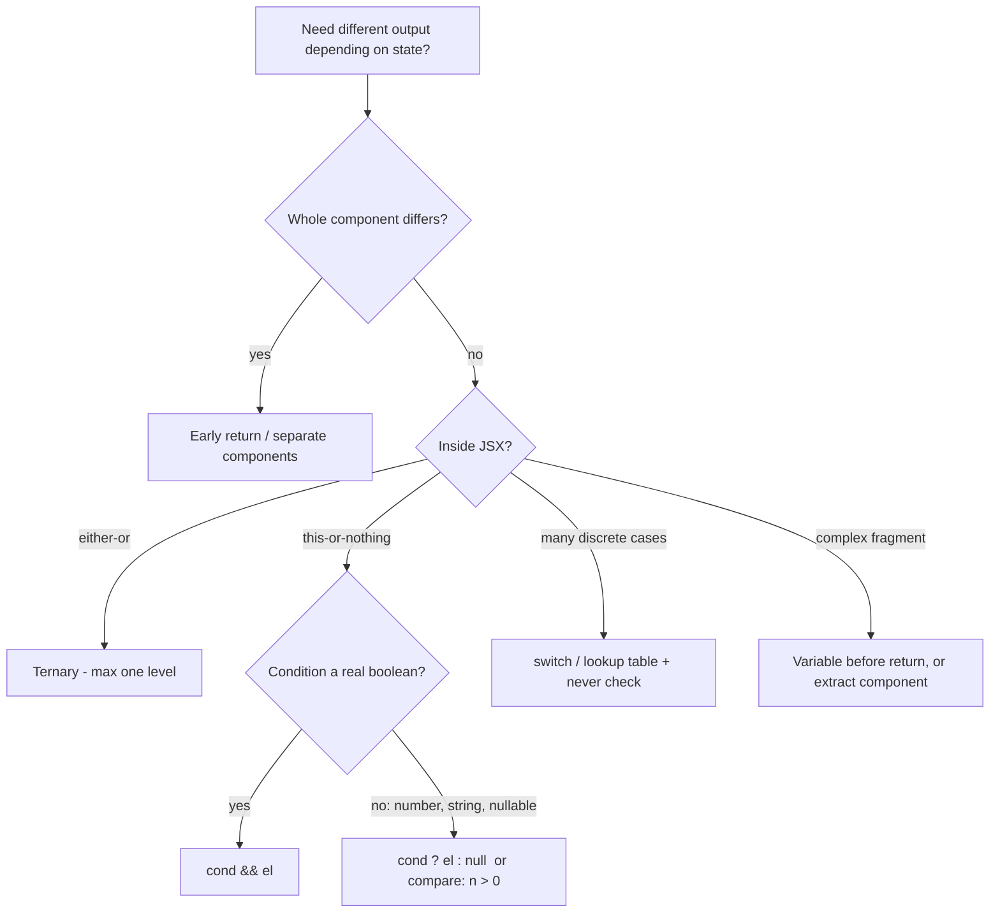
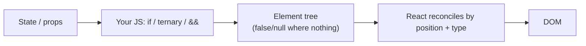

# 01 / 08 — Conditional Rendering

## 1. Lesson metadata

| | |
|---|---|
| **Level** | Beginner |
| **Study time** | 3–4 hours (reading 1.5 h, experiments 1 h, exercises 1–1.5 h) |
| **Prerequisites** | [06 — Props and one-way data flow](./06-props-and-one-way-data-flow.md); [05 — JSX explained](./05-jsx-explained.md); [03 — UI as a function of state](./03-ui-as-a-function-of-state.md) |
| **Next** | [09 — Lists, keys, and identity](./09-lists-keys-and-identity.md) |
| **Related later** | [16 — State preservation and reset](./16-state-preservation-and-reset.md), [Phase 2 / 06 — Reconciliation fundamentals](../02-react-rendering-and-internals/06-reconciliation-fundamentals.md), [Phase 3 / 16 — Rules of Hooks](../03-react-state-and-hooks/16-rules-of-hooks-and-composition.md) |

**Learning objectives.** After this lesson you can:
1. Explain why React has no `if` template directive and why plain JavaScript expressions are enough.
2. Choose between early return, `if`/`else` with a variable, ternary, `&&`, `||`/`??`, and lookup tables for a given situation.
3. Predict exactly what `null`, `undefined`, `false`, `true`, `0`, `""`, `NaN`, and `[]` render.
4. Avoid the `{count && <X />}` bug and know the two safe forms.
5. Distinguish *not rendering* (unmount) from *hiding* (CSS, `hidden`, `<Activity>`) and state the consequence for component state, effects, DOM nodes, and accessibility.
6. Model multi-state UIs (loading / error / empty / ready) as a discriminated union and render them exhaustively in TypeScript.

**Concepts covered:** JSX expression slots, truthiness vs rendering, "renders nothing" values, early return, ternary, short-circuit, element variables, lookup tables, exhaustiveness checking, unmounting vs hiding, `hidden`/`display: none`, accessibility tree, `<Activity>` ⚠, why hooks must not be skipped by conditionals.

---

## 2. Deep conceptual explanation

### 2.1 What problem is this lesson solving?

Every real UI shows different things at different times: a logged-in user menu versus a "Sign in" button; a spinner, an error banner, an empty-state illustration, or a data table; an admin-only column; a validation message that exists only after the user has touched a field. In the imperative style of [Lesson 02](./02-declarative-vs-imperative-ui.md) you would write `if (loggedIn) menu.show(); else button.show();` and *keep both branches in sync* every time something changes. In the declarative style of [Lesson 03](./03-ui-as-a-function-of-state.md), you write one function that returns *the description of the screen for the current state*. Conditional rendering is simply: **the description depends on the state, so the function must be able to return different descriptions.**

React deliberately adds *no* special syntax for this. There is no `v-if`, `*ngIf`, or `{{#if}}`. A component is a JavaScript function; JSX is syntax sugar for expressions that evaluate to elements ([Lesson 05](./05-jsx-explained.md)). So you use the language's own branching constructs. The only question is *which* construct fits *where*, because JSX has two kinds of places where you can branch:

| Place | What is allowed there | Branching tools |
|---|---|---|
| **Function body, before `return`** | Any JavaScript *statements* | `if`/`else`, `switch`, early `return`, `let` variables |
| **Inside JSX `{ … }` slots** | Only JavaScript *expressions* | ternary `a ? b : c`, `&&`, `||`, `??`, function calls, `Array.prototype.map`, immediately-invoked functions (rare) |

Statements (`if`, `for`, `switch`) cannot appear inside `{ }` because `{ }` is an expression slot: JSX compiles it to a function argument or child position, and statements are not valid arguments. This single rule explains almost every "why can't I write an `if` here?" question.

### 2.2 What "renders nothing" means

A component's return value (or the value in a child slot) is a *React node*. In TypeScript, `React.ReactNode` is the type: element, string, number, bigint, iterable of nodes, portal, `null`, `undefined`, `boolean`, (and in React 19 types, also a `Promise` of node for `use`-based Server Component usage; ignore this for now).

The rule for what produces visible output:

| Value in a child slot / returned from a component | Rendered output |
|---|---|
| `null` | Nothing |
| `undefined` | Nothing (⚠ *Version-sensitive*: in React ≤17, a component **returning** `undefined` threw an error. From React 18 on, returning `undefined` from a component is allowed and renders nothing. Older tutorials still say "always return `null`".) |
| `true`, `false` | Nothing |
| `""` (empty string) | An empty text node: invisible, but not "nothing" (no layout effect, but it exists) |
| `0`, `-0` | The text `0` |
| `NaN` | The text `NaN` |
| `[]` (empty array) | Nothing (no children) |
| `"text"`, `42`, `1n` | Text |
| `{}` (plain object) | **Error**: "Objects are not valid as a React child" |
| a function | Warning ("Functions are not valid as a React child"); renders nothing |

The rows for `false`, `null`, and `undefined` are what make conditional rendering ergonomic: `cond && <X />` evaluates to `false` when `cond` is falsy, and React skips `false`. The row for `0` is what makes it dangerous. **JavaScript truthiness decides what `&&` returns; React's rendering rules decide what to do with it. They are two different rules and `0` is falsy in the first and visible in the second.**

### 2.3 The toolbox

**1. Early return (guard clauses).** Best when an entire component has a different shape in some state.

```tsx
function Profile({ user }: { user: User | null }) {
  if (user === null) return <SignInPrompt />;
  return <ProfileCard user={user} />;
}
```

**2. Variable assignment.** Best when most of the markup is shared and only a fragment differs.

```tsx
let badge: React.ReactNode = null;
if (order.status === "shipped") badge = <ShippedBadge />;
else if (order.status === "delayed") badge = <DelayedBadge days={order.delayDays} />;
return <li>{order.title}{badge}</li>;
```

**3. Ternary `cond ? A : B`.** Best for "either this or that" inside JSX. Nest only one level; beyond that, extract.

**4. Short-circuit `cond && A`.** Best for "this or nothing" *when `cond` is a real boolean*.

**5. Lookup table (object or `Record`).** Best when you branch on a discrete value with many cases.

```tsx
const statusLabel: Record<Status, string> = { idle: "Idle", busy: "Working…", done: "Done" };
```

**6. Component-per-branch.** Best when branches have their own state, effects, or hooks. Extracting `<LoggedInMenu />` and `<LoggedOutMenu />` isolates their hooks and makes the "different component type" explicit, which has implications for state (§3.2).

### 2.4 Hiding is not the same as not rendering

There are two fundamentally different ways to make something invisible:

| | **Not rendering** (`cond && <Panel />`) | **Hiding** (`<Panel style={{display:"none"}} />`, `hidden`, `<Activity mode="hidden">`) |
|---|---|---|
| React component function | Not called for that subtree | Called (CSS/`hidden`) — or deferred/low-priority (`Activity`) |
| DOM nodes | Removed | Kept |
| Component state | **Destroyed** (unmount) | Preserved |
| Effects | Cleaned up on unmount; re-run on re-mount | CSS/`hidden`: keep running. `Activity` hidden: ⚠ effects are cleaned up while hidden, state preserved |
| Memory / DOM size | Smaller | Larger |
| Accessibility tree | Absent | `display:none` and `hidden` also remove it from the accessibility tree; `visibility:hidden` too; `opacity:0` and off-screen positioning do **not** |
| Scroll position / focus / typed input inside | Lost | Kept |
| Network requests triggered by effects | Re-issued on re-mount | Not re-issued (CSS) |

Neither is "better". *Tabs that must remember what the user typed* want hiding. *A modal with an expensive subtree* wants not rendering. We return to the state consequences in [Lesson 16](./16-state-preservation-and-reset.md).

### 2.5 Common misconceptions

| Misconception | Reality |
|---|---|
| "`{count && <Badge/>}` is fine because `0` is falsy." | `&&` returns `0`, and React renders `0` as text. Use `count > 0 &&` or a ternary. |
| "Returning `null` from a component unmounts it / destroys its state." | Returning `null` renders nothing, but the component *instance still exists* and keeps its state and effects. Only *not being in the parent's output* unmounts it. |
| "Conditionally rendered children are lazily created, so they cost nothing." | The *element* `<Heavy />` is created if the expression evaluates to it, but the component function runs only if the element ends up in the tree. `cond && <Heavy />` doesn't create the element when `cond` is false. A pre-built `const el = <Heavy />` is only an object; still not rendered unless returned. |
| "`display:none` and not rendering are equivalent." | See the table above. |
| "I can call a hook inside `if` because the branch is stable." | Not allowed ([Rules of Hooks](https://react.dev/reference/rules/rules-of-hooks)). The call order must be the same on every render. |
| "`else` is required." | No. A `&&` expression or early return has no else; "nothing" is a legitimate output. |

---

## 3. Internal mechanics

### 3.1 What the compiler produces

JSX `{cond && <Panel />}` compiles (classic or automatic runtime, see [Lesson 05](./05-jsx-explained.md)) to something like:

```js
_jsx("div", { children: cond && _jsx(Panel, {}) })
```

So the "conditional" is *ordinary JavaScript evaluated before React is involved*. React receives the resulting element tree (an object graph) with `false`/`null`/`undefined` at some child positions, and ignores them when producing DOM. **There is no conditional in React's data model, only the result.** This is the teaching model that dissolves most confusion.

### 3.2 Positions matter: conditionals affect identity

React matches children from one render to the next *by position and type* (lists add keys, Lesson 09). A skipped child still **occupies its slot**, which keeps siblings stable:

```tsx
<div>
  {isAdmin && <AdminBanner />}   // slot 0: AdminBanner element or false
  <Content />                    // slot 1: always Content
</div>
```

When `isAdmin` flips from false to true, slot 0 changes from `false` to an element and slot 1 remains `<Content />` at the same position, so `Content`'s state survives. This is a *public, documented* behavior: [react.dev: Preserving and Resetting State](https://react.dev/learn/preserving-and-resetting-state).

Contrast with an `if` that returns different *types* at the same position:

```tsx
if (isEditing) return <EditForm />;
return <ReadOnlyView />;
```

Both are "the single child of this component's output", at the same position, with different types (`EditForm` vs `ReadOnlyView`). React sees a type change at that position, unmounts the old subtree and mounts the new one. Any state inside is lost. If the *same* type appears at the same position (`cond ? <Field kind="a" /> : <Field kind="b" />`), React **reuses** the instance and just updates props, a surprising source of "stale state" bugs resolved with `key` ([Lesson 16](./16-state-preservation-and-reset.md)).

*Public guarantee:* same type + same position ⇒ same instance; different type ⇒ remount (documented in the state preservation guide).
*Implementation detail:* how React compares is the reconciliation algorithm ([Phase 2/06](../02-react-rendering-and-internals/06-reconciliation-fundamentals.md)).

### 3.3 Why hooks cannot follow a conditional return

```tsx
function Bad({ user }: { user: User | null }) {
  if (!user) return null;          // early return
  const [open, setOpen] = useState(false); // ✗ hook after a conditional return
  ...
}
```

React associates hook state with a component instance **by call order** (teaching model; internals in [Phase 2/17](../02-react-rendering-and-internals/17-hooks-and-fiber-state.md)). If render 1 calls zero hooks and render 2 calls one, the sequences no longer line up. React's lint rule (`react-hooks/rules-of-hooks`) flags this, and at runtime you may see "Rendered more hooks than during the previous render". **Fix:** put all hooks above any early return, or split into a child component that is rendered conditionally and owns its hooks.

### 3.4 What `Activity` is ⚠

React 19.2 added a built-in `<Activity>` component with `mode="visible" | "hidden"`. Hidden children are not shown (rendered with `display: none` semantics), their state is kept, their effects are unmounted (cleaned up), and their rendering is deprioritized. *Verified in React 19.3.1 in the sandbox (hidden: effect cleanup runs, state kept; visible again: effect re-mounts). Still check props and semantics on [react.dev/reference/react/Activity](https://react.dev/reference/react/Activity) before relying on it.* It exists precisely because the two traditional options (unmount vs CSS hide) each lose something: state, or effect cleanup and rendering cost.

---

## 4. Step-by-step execution walkthrough

Component:

```tsx
function Inbox({ messages }: { messages: Message[] }) {
  return (
    <section>
      <h2>Inbox</h2>
      {messages.length && <Badge count={messages.length} />}
    </section>
  );
}
```

Props over time: first `messages = [m1, m2]`, then `[]`.

**Render 1 (`messages.length === 2`):**
1. React calls `Inbox({ messages })`.
2. `messages.length && <Badge .../>`: `2` is truthy, so `&&` returns its right operand: a Badge element.
3. The returned tree: `section > [h2, Badge element]`. React renders Badge.
4. Commit: DOM created.

**Render 2 (`messages.length === 0`):**
1. `0 && …` short-circuits and returns the **left operand**, the number `0`.
2. The tree is `section > [h2, 0]`.
3. React treats the number `0` as a text child. It creates/updates a text node `"0"`.
4. Commit: the screen shows `Inbox` followed by a stray **0**. The Badge is unmounted (its state, if any, is gone).

Fixed:

```tsx
{messages.length > 0 && <Badge count={messages.length} />}
```

`0 > 0` is `false`; `false && …` returns `false`; React renders nothing.

---

## 5. Code examples

### 5.1 Minimal example: all the "nothing" values

```tsx
function Demo() {
  return (
    <ul>
      <li>a {null}</li>
      <li>b {undefined}</li>
      <li>c {false}</li>
      <li>d {true}</li>
      <li>e {0}</li>
      <li>f {""}</li>
      <li>g {NaN}</li>
      <li>h {[]}</li>
    </ul>
  );
}
```

**Predict:** which `<li>` elements show something after their letter?

**Result:** only `e` (shows `0`) and `g` (shows `NaN`). `a`, `b`, `c`, `d`, `f`, `h` show only the letter.
**Why:** `null`, `undefined`, and booleans are never rendered; `""` renders as an empty text node; `[]` has no children; numbers (including `0` and `NaN`) are converted to text. Note `true` rendering nothing surprises people who expect "true".
**Trade-off:** none: this is about knowing the rules so that you can use them intentionally.

### 5.2 Practical example: remote data with a discriminated union

Real screens rarely have one condition; they have a *state machine*: not-started, loading, failed, loaded-but-empty, loaded. Booleans (`isLoading`, `isError`, `data`) allow impossible combinations (loading *and* error). Model the states as one value.

```tsx
type Remote<T> =
  | { status: "loading" }
  | { status: "error"; message: string; retry: () => void }
  | { status: "success"; data: T };

interface Product { id: string; name: string; priceCents: number }

function ProductList({ state }: { state: Remote<Product[]> }) {
  switch (state.status) {
    case "loading":
      return <p role="status">Loading products…</p>;
    case "error":
      return (
        <div role="alert">
          <p>Could not load products: {state.message}</p>
          <button type="button" onClick={state.retry}>Try again</button>
        </div>
      );
    case "success":
      if (state.data.length === 0) return <p>No products match your filters.</p>;
      return (
        <ul>
          {state.data.map((p) => (
            <li key={p.id}>{p.name} — {(p.priceCents / 100).toFixed(2)}</li>
          ))}
        </ul>
      );
    default: {
      const _exhaustive: never = state;
      return _exhaustive;
    }
  }
}
```

Line notes:
- `switch` is a *statement*, legal in the function body, not inside JSX.
- `role="status"` and `role="alert"` make assistive technology announce the loading and error messages (live regions). Conditionally rendered messages are invisible to screen reader users unless they are in a live region or focus moves to them ([WAI-ARIA live regions](https://developer.mozilla.org/en-US/docs/Web/Accessibility/ARIA/ARIA_Live_Regions)). ⚠ A live region generally must exist in the DOM *before* its content changes to be announced reliably; `role="alert"` is the common exception because assistive tech treats insertion of an alert as an event. Test with a real screen reader.
- The `default` branch assigns `state` to `never`. If someone adds `{ status: "stale" }` to `Remote`, TypeScript fails to compile here until the new case is handled. That is *exhaustiveness checking*.
- Empty is a **separate UI state** from loading and error. A common product bug is showing "No results" while loading.

### 5.3 Practical example: "this or nothing" and "this or that"

```tsx
interface CartLineProps { name: string; qty: number; discountPercent?: number }

function CartLine({ name, qty, discountPercent }: CartLineProps) {
  return (
    <li>
      {name} × {qty}
      {discountPercent ? <span> (−{discountPercent}%)</span> : null}
      {qty > 5 && <strong> Bulk order</strong>}
    </li>
  );
}
```

`discountPercent ? … : null` is used rather than `discountPercent && …` because `discountPercent` may be `0` (also: `undefined`, which is fine, but `0` would print "0"). `qty > 5` is already a boolean, so `&&` is safe.

**Predict:** with `discountPercent={0}` and `qty={2}`, what appears after `name × qty`?
**Result:** nothing. `0` is falsy so the ternary picks `null`. If we had written `discountPercent && …`, the page would show `Widget × 2 0`.

### 5.4 Incorrect example

```tsx
function Results({ items }: { items: string[] }) {
  return (
    <div>
      {items.length && <ul>{items.map((i) => <li key={i}>{i}</li>)}</ul>}
      {items.length === 0 && <p>No results</p>}
    </div>
  );
}
```

Problems: (1) with an empty array, the first line renders `0` *and* the second renders "No results": the screen shows "0 No results". (2) Two inverse conditions written separately will drift when someone edits one.

### 5.5 Corrected implementation

```tsx
function Results({ items }: { items: string[] }) {
  if (items.length === 0) return <p>No results</p>;
  return <ul>{items.map((i) => <li key={i}>{i}</li>)}</ul>;
}
```

One condition, two outcomes, no inverse duplication, no truthiness trap. (Keys here assume unique strings; see [Lesson 09](./09-lists-keys-and-identity.md).)

### 5.6 Advanced example: hide vs unmount with state

```tsx
import { useState } from "react";

function Draft() {
  const [text, setText] = useState("");
  return (
    <label>
      Draft
      <textarea value={text} onChange={(e) => setText(e.target.value)} />
    </label>
  );
}

export function Tabs() {
  const [tab, setTab] = useState<"draft" | "preview">("draft");
  return (
    <>
      <button type="button" onClick={() => setTab("draft")}>Draft</button>
      <button type="button" onClick={() => setTab("preview")}>Preview</button>

      {/* Variant A: unmount */}
      {tab === "draft" && <Draft />}

      {/* Variant B: hide (uncomment instead of A)
      <div hidden={tab !== "draft"}><Draft /></div>
      */}
      {tab === "preview" && <p>Preview…</p>}
    </>
  );
}
```

**Predict:** type "hello" in the textarea, switch to Preview, switch back. What does the textarea contain in Variant A? In Variant B?

**Result:** A: empty. B: "hello".
**Why:** In A the `Draft` instance is unmounted on switching away; its `useState` is destroyed; coming back mounts a fresh instance with `""`. In B the instance stays mounted; `hidden` just toggles the attribute (the `hidden` attribute applies `display:none` through the UA stylesheet), and the state remains.
**Trade-offs:** B keeps all tabs' components alive and rendering (CPU, memory, effects like polling keep running). A is cheaper but loses state unless you *lift state up* into the parent or a store ([Phase 3/18](../03-react-state-and-hooks/18-state-colocation-and-lifting.md)). In most apps, *lifting the draft text* is better than keeping the whole tab alive.
**Third option:** `<Activity mode={tab === "draft" ? "visible" : "hidden"}><Draft /></Activity>` ⚠ preserves state while cleaning up effects of hidden children. Verify availability in your React version.

### 5.7 Advanced example: lookup table with exhaustive typing

```tsx
type Role = "admin" | "editor" | "viewer";

const roleBadge = {
  admin: <span className="badge badge-red">Admin</span>,
  editor: <span className="badge badge-blue">Editor</span>,
  viewer: <span className="badge">Viewer</span>,
} satisfies Record<Role, React.ReactNode>;

function RoleBadge({ role }: { role: Role }) {
  return roleBadge[role];
}
```

`satisfies Record<Role, …>` fails compilation if a role is missing. Elements in a module-level constant are created once; elements are immutable descriptions and can be reused safely. **Trade-off:** when branch content depends on props, store *components* or functions instead of prebuilt elements.

---

## 6. Visual explanations

### Decision flow: which tool?



### Where the branching happens



### Slot stability

```text
Render A (isAdmin = false)        Render B (isAdmin = true)
div                                div
 ├─ [0] false                       ├─ [0] <AdminBanner/>   (mounted)
 └─ [1] <Content/>   ◀── same ───▶  └─ [1] <Content/>       (state preserved)
```

---

## 7. Alternative approaches and trade-offs

| Approach | Readability | Safety | Preserves hidden state? | Cost when hidden | Best for |
|---|---|---|---|---|---|
| Early return | High | High | No (different tree) | None | Guarding loading/auth/empty at top |
| Ternary | High (1 level), poor nested | High | No | None | Binary swaps in JSX |
| `&&` | High | Medium (falsy-number trap) | No | None | Boolean flags |
| `cond ? el : null` | Medium | High | No | None | Possibly-numeric or string conditions |
| Lookup table | High for many cases | High with `satisfies`/`Record` | No | None | Status/role/type switching |
| Separate component per branch | High | High | No (but isolates hooks) | None | Branches with own hooks/state |
| CSS hiding (`hidden`, `display:none`) | Medium | High | Yes | Full render + effects + DOM | Tabs that must preserve input; instant toggling |
| `<Activity>` ⚠ | High | Depends on version | Yes | Low-priority render, effects cleaned up | Preserving state of off-screen UI |
| Routing/URL-driven | Medium | High | Depends on router | None | Distinct screens (see Phase 4/18) |

**When the usual recommendation ("don't render what isn't visible") is not best:**
- A multi-step form wizard where users go back and forth: unmounting steps loses typed input unless state is lifted. Keeping steps mounted (hidden) or lifting state both work; lifting is typically more robust because it also supports validation across steps and persistence.
- A chart that takes 400 ms to mount and is toggled often: hiding avoids re-mount cost but costs memory; measure ([Phase 7/01](../07-performance/01-measure-before-optimizing.md)).
- A video player or map that must keep playing/positioned.

---

## 8. Best practices and anti-patterns

**Do**
- Use early returns for guard states (loading/error/empty/unauthorized): flatter, one condition per exit.
- Prefer explicit comparisons (`n > 0`, `str !== ""`, `user != null`) over relying on truthiness when the value can be `0` or `""`.
- Model multi-state UIs as a discriminated union and make the `switch` exhaustive.
- Put **all** hooks before any conditional return.
- Keep conditional markup *close to the condition*; extract once nesting exceeds one ternary.
- Give conditionally inserted status/error content an accessible announcement strategy.

**Beginner mistakes**
- `{list.length && …}` rendering `0`.
- Nested ternaries three levels deep.
- Returning `undefined` by accident (forgetting `return` in a block-bodied arrow: `() => { <div/> }` returns `undefined`); this renders nothing and is silent in React 18+, hard to spot.
- Using `display:none` for sensitive content (it's still in the DOM and DOM-inspectable): never use hiding for authorization. Gate on the server and don't send the data.

**Experienced-developer mistakes**
- Treating `return null` as unmount, then being surprised that effects/state persist.
- Using CSS hiding everywhere "for performance" and paying for hidden subtrees with effects (polling, subscriptions) that keep running.
- Duplicating inverse conditions (`a && …`, `!a && …`) that later drift.
- Representing a 5-state UI with 3 booleans, which allows 8 combinations, 3 of which are meaningless.

**Smells**
- `else` branches that only exist to return `null`.
- A component whose JSX is half-covered by `&&` chains: split it.
- `isLoading && isError`-style code where both can be true.

**Justified exceptions**
- A short chain of `&&` for independent optional decorations (badge, icon, tooltip) is fine.
- A nested ternary is acceptable when formatted clearly and limited to two simple branches; many teams still ban it by lint rule. That's a style choice, not a universal rule.

---

## 9. Real-world application

**E-commerce product page.** States: loading skeleton; error with retry; product exists; out of stock (disable add-to-cart and show restock notification form); logged-in vs guest prices; A/B experiment variants. Constraints: no layout shift (render a fixed-height skeleton, not nothing); screen-reader announcement of "added to cart"; never render price from an untrusted flag. Pattern: top-level discriminated union for fetch state; inside "success", small boolean conditionals.

**Role-based UI (auth).** Hiding an "Admin" button for non-admins is a *UX affordance*, not security. The API must enforce authorization. Rendering gates should read a single `permissions` source; scatter-written `user.role === "admin"` checks cause inconsistent UIs. (Phase 9/12 on auth boundaries.)

**Financial dashboard.** A "stale data" banner appears when the last WebSocket tick is older than N seconds; the banner must not cause layout jumps in the table below (reserve space or overlay). A zero balance (`0`) is a valid value to display, so conditions like `balance && …` are *wrong*, not just risky: `0` and `null` mean different things (a real zero vs unknown). Use `balance == null` / `balance !== null`.

**Forms.** Error text appears after blur or submit. Render the error element only when there is an error, link it with `aria-describedby`, and set `aria-invalid`. Don't unmount the input itself on error.

**Multi-team design systems.** A `<Button loading>` prop swapping its label for a spinner should keep the button's width stable and `aria-busy`/disabled semantics. Conditional rendering inside shared components is public API surface: changing which branch renders is a behavior change for consumers' tests.

---

## 10. Debugging and troubleshooting

**Symptom 1: a stray `0` (or `NaN`) appears on the page.**
- *Repro:* component with `{items.length && …}` and an empty list.
- *Investigate:* search the JSX for `&&` whose left side is numeric. In the Elements panel you will see a text node `0` where a component should be. React DevTools Components tab shows no component for it, which is a clue it's a text node.
- *Root cause:* `&&` returns its left operand.
- *Fix and validate:* compare explicitly; add an ESLint rule (for example `@typescript-eslint/strict-boolean-expressions`, or the `react/jsx-no-leaked-render` rule from eslint-plugin-react) to catch it; add a test rendering the empty case.

**Symptom 2: state "resets" when toggling.**
- *Investigate:* in React DevTools, watch whether the component disappears from the tree when toggled (unmounted) or remains (hidden).
- *Root cause:* conditional rendering unmounted the instance.
- *Fix:* lift state, keep it mounted (hidden), or use `Activity` ⚠; choose by the trade-offs in §7.

**Symptom 3: state does *not* reset when it should** (switching between two users keeps the previous user's draft).
- *Root cause:* same type at the same position is reused. Fix: `key={userId}` ([Lesson 16](./16-state-preservation-and-reset.md)).

**Symptom 4: "Rendered more hooks than during the previous render" / "Rendered fewer hooks…"**
- *Root cause:* a hook after an early return or inside a condition.
- *Fix:* move hooks above the return; verify with the lint rule.

**Symptom 5: the component renders nothing and there's no error.**
- *Investigate:* add a `console.log` before each return; check for a block-bodied arrow without `return`; check that conditions aren't inverted. DevTools shows the component with no host children.
- *Validate:* write a test asserting the expected element appears in each state.

---

## 11. Exercises

### Level A — Knowledge
A1. List all values that render nothing when placed in a JSX child slot, and the values that render visible text despite being "falsy".
A2. Why can't you write `{if (x) <A/>}` in JSX? What are the two legal alternatives?
A3. What is the difference between a component returning `null` and its parent not rendering it?
A4. Name two properties of CSS hiding that differ from unmounting with respect to accessibility or state.
A5. Why does React's Rules of Hooks forbid hooks after an early return?

### Level B — Code comprehension
B1. What does this render for `count = 0`, `count = 3`, `count = NaN`?
```tsx
<p>Unread: {count && <b>{count}</b>}</p>
```
B2. Will `Counter`'s count persist when `show` toggles true → false → true? Explain for both snippets.
```tsx
// (i)
{show && <Counter />}
// (ii)
<div style={{ display: show ? "block" : "none" }}><Counter /></div>
```
B3. Given the following, does typing in the input survive when `isPrimary` flips?
```tsx
{isPrimary ? <Field label="Email" /> : <Field label="Backup email" />}
```
(`Field` holds its own `useState` for the text.)
B4. What does `const App = () => { <h1>Hi</h1> };` render and why?

### Level C — Implementation
C1. Write `<Notice kind="info" | "warning" | "error" message />` using a lookup table so that adding a new `kind` is a compile error until handled. Errors should use `role="alert"`.
C2. Implement `<Async<T> state render>` generic helper that takes a `Remote<T>` (as in §5.2) and a render-prop for success, and handles loading/error itself.
C3. Write a `<Tabs>` component with three panels that preserves each panel's internal state without keeping hidden panels in the accessibility tree.

### Level D — Debugging
D1. The page shows `0 results found` and the table is empty. Find all bugs:
```tsx
function Results({ rows }: { rows: Row[] }) {
  return (
    <>
      {rows.length && <Table rows={rows} />}
      {!rows.length && <p>{rows.length} results found</p>}
    </>
  );
}
```
D2. After logging out, `ProfileMenu` throws "Rendered fewer hooks than expected". Find the bug.
```tsx
function ProfileMenu({ user }: { user: User | null }) {
  if (!user) return null;
  const [open, setOpen] = useState(false);
  return <button onClick={() => setOpen(!open)}>{user.name}</button>;
}
```
D3. A multi-step form loses data when users click "Back". The steps are rendered as `{step === 1 && <StepOne />}` etc., each with local `useState`. Propose two fixes and the trade-off of each.

### Level E — Architecture and engineering decisions
E1. A dashboard has widgets that poll an API every 5 s. Users toggle widgets on/off from a menu. Compare unmounting, CSS hiding, and `Activity` ⚠ for the off state on: network usage, state retention, memory, accessibility, complexity. Recommend one.
E2. Your team debates banning all ternaries and `&&` in JSX in favor of early returns and extracted components. Argue both sides and propose a lint/review policy.

### Level F — Expert challenge
F1. Design a typed `<Match>` helper component API (`<Match value={status} cases={{ idle: …, busy: … }} />`) with exhaustiveness checking, no unnecessary element creation for non-matching cases, and good DevTools names. Discuss whether it is better than a `switch` statement and what it costs.

---

## 12. Detailed answers and explanations

> Attempt the exercises first.

**A1.** Render nothing: `null`, `undefined`, `true`, `false`, `[]`. Renders as an *empty text node* (invisible): `""`. Visible despite falsy: `0` and `NaN` (rendered as text `0`, `NaN`). Plausible wrong answer: "`0` renders nothing because it's falsy". That conflates JS truthiness (decided by `&&`) with React's child rendering (decided by value type).

**A2.** `{ }` in JSX is an *expression* slot; `if` is a statement. Alternatives: use a ternary/`&&` inside the slot, or move the logic into the function body (early return or a variable) and render the variable. (An IIFE works but is noisy.)

**A3.** A component returning `null` still exists as an instance: its state is kept, effects remain subscribed, and it re-renders when its props/state change. If the parent stops including the element, React unmounts the instance: state discarded, effect cleanup runs. Practical consequence: a `Modal` that returns `null` when closed keeps its state and effects; a parent doing `{open && <Modal />}` does not.

**A4.** Any two: hidden subtree keeps state/DOM/effects; `display:none`/`hidden` remove it from the accessibility tree, as unmounting does, but `opacity:0`/off-screen positioning don't; hidden content still occupies memory and is still discoverable by view-source/DOM inspection; hidden inputs still participate in form submission (unless `disabled`).

**A5.** State is matched to hook calls by order within the component instance. A conditionally skipped hook shifts all later hooks' positions so React would hand the wrong state (or detect count mismatch). Fix is to keep call order stable by hoisting hooks or splitting the component.

**B1.** `count = 0`: `Unread: 0` (the `0` is rendered). `count = 3`: `Unread: ` then bold `3`. `count = NaN`: `Unread: NaN`. Fix: `{count > 0 && …}`; note `NaN > 0` is `false`, so it renders nothing.

**B2.** (i) Count resets to initial: unmounted on false, new instance on true. (ii) Count persists: the instance is never unmounted; only the CSS changes. Edge case: effects in (ii) keep running while hidden (timers, subscriptions).

**B3.** The input text **survives**. Both branches produce `<Field>` at the same position with the same type; React reuses the instance and only updates the `label` prop. Whether this is desired depends on the product: if the two fields should be independent, give them different keys (`key="primary"`, `key="backup"`) so React treats them as separate identities.

**B4.** Renders nothing. The braces create a function *body*, not an expression, and there is no `return`, so it returns `undefined`. In React 18+ `undefined` is allowed and renders nothing silently; earlier versions threw an error. Fix: `() => <h1>Hi</h1>` or add `return`.

**C1. Reference solution**
```tsx
type NoticeKind = "info" | "warning" | "error";

const noticeConfig = {
  info: { className: "notice notice-info", role: "status" },
  warning: { className: "notice notice-warning", role: "status" },
  error: { className: "notice notice-error", role: "alert" },
} as const satisfies Record<NoticeKind, { className: string; role: "status" | "alert" }>;

export function Notice({ kind, message }: { kind: NoticeKind; message: string }) {
  const { className, role } = noticeConfig[kind];
  return <div className={className} role={role}>{message}</div>;
}
```
Adding `"success"` to `NoticeKind` makes the `satisfies` clause fail until a config entry is added. Edge: `as const` keeps `role` literal types. Evaluation: exhaustiveness at compile time; no `switch` with a forgotten default.

**C2. Reference solution**
```tsx
type Remote<T> =
  | { status: "loading" }
  | { status: "error"; message: string; retry: () => void }
  | { status: "success"; data: T };

export function Async<T>({
  state,
  children,
}: {
  state: Remote<T>;
  children: (data: T) => React.ReactNode;
}) {
  switch (state.status) {
    case "loading": return <p role="status">Loading…</p>;
    case "error":
      return (
        <div role="alert">
          {state.message} <button type="button" onClick={state.retry}>Retry</button>
        </div>
      );
    case "success": return <>{children(state.data)}</>;
  }
}
```
The function's return type is inferred `ReactNode | undefined`-safe because all cases return; TypeScript knows the switch is exhaustive for a union with `status` discriminant. Trade-off: render-prop children hide the "empty" decision from the helper; some teams add `isEmpty` or an `empty` slot. For TSX generic components, call as `<Async<Product[]> state={s}>{(items) => …}</Async>`; inference usually makes the explicit `<Product[]>` unnecessary.

**C3.** Two sound designs. (a) Lift each panel's state into the parent (or a store) and conditionally render only the active panel: accessibility tree is clean, state survives. (b) Keep all panels mounted and use the `hidden` attribute on inactive ones:
```tsx
function Tabs({ panels }: { panels: { id: string; label: string; content: React.ReactNode }[] }) {
  const [active, setActive] = useState(panels[0].id);
  return (
    <div>
      <div role="tablist">
        {panels.map((p) => (
          <button key={p.id} role="tab" type="button" id={`tab-${p.id}`}
            aria-selected={p.id === active} aria-controls={`panel-${p.id}`}
            onClick={() => setActive(p.id)}>{p.label}</button>
        ))}
      </div>
      {panels.map((p) => (
        <div key={p.id} role="tabpanel" id={`panel-${p.id}`}
          aria-labelledby={`tab-${p.id}`} hidden={p.id !== active}>
          {p.content}
        </div>
      ))}
    </div>
  );
}
```
`hidden` removes inactive panels from the accessibility tree and from layout while keeping state. A complete tab widget also needs roving `tabIndex` and arrow-key handling per the WAI-ARIA tabs pattern; note the omission. Evaluation criteria: state preserved; inactive panels not exposed to AT; keys stable; mention of the keyboard pattern.

**D1.** Bugs: (1) `rows.length && …` renders `0` when empty. (2) `!rows.length && <p>{rows.length} results found</p>` is a second, inverse condition which prints "0 results found" (acceptable text, but it duplicates logic). Net display: `0` + "0 results found", plus an empty table is never rendered. Fix:
```tsx
if (rows.length === 0) return <p>No results found.</p>;
return <Table rows={rows} />;
```

**D2.** `useState` is after a conditional return. When `user` becomes `null`, the render calls zero hooks while the previous render called one. Fix: move `useState` above the `if`, or split: `ProfileMenu` returns `user ? <ProfileMenuInner user={user} /> : null` and `Inner` owns the hook. Why the second is often better: `Inner` is unmounted at logout so its `open` state resets, which is what you usually want.

**D3.** Cause: unmounting steps destroys their local state. Fix 1: lift the form data into the parent (or a reducer/store); steps become controlled by props. Pros: survives back/forward, enables cross-step validation and persistence; cons: more wiring. Fix 2: keep all steps mounted, hide inactive with `hidden`. Pros: tiny change; cons: all steps' effects and validation run, hidden required inputs can block native form validation (a hidden invalid control cannot be focused, so the browser can't show the error; an actual pitfall), and memory grows. Prefer lifting for anything beyond a trivial form.

**E1. Evaluation criteria and example answer.** Criteria: network cost, data freshness on re-enable, memory, a11y, code simplicity. Unmount: stops polling (good), loses state (maybe fine if data is cached by a server-state cache like TanStack Query, Phase 6/08), tiny memory, simple. CSS hide: polling continues (wasted network/battery unless you pause via props), state kept, bigger DOM. `Activity` ⚠: state kept, effects cleaned up while hidden so polling stops, rendering deprioritized; costs: newer API, verify semantics and version support. Recommendation: unmount the widget and keep server data in a cache with a sensible `staleTime`; re-enabling shows cached data instantly and refetches. Use CSS hiding only for widgets with expensive local state that can't be cached. A weak answer picks hiding "for performance" without noticing polling continues.

**E2.** Pro-ban: avoids `0` bug, nested ternary unreadability, forces named components that appear in DevTools. Anti-ban: extraction for trivial conditions is ceremony; many tiny components fragment the reading flow; `cond && <Icon />` is clear. Reasonable policy: enable `react/jsx-no-leaked-render` (or typed `strict-boolean-expressions`) to remove the *dangerous* pattern mechanically; limit ternary nesting to one level (lint `no-nested-ternary`) and require extraction beyond it; leave single `&&` with booleans. Evaluation: distinguishes correctness rules (automatable) from style rules (team preference).

**F1.** Key points of a good answer: `cases` as an object of *functions* (`() => ReactNode`) avoids creating elements for non-matching cases; TypeScript signature `Match<V extends string>({ value, cases }: { value: V; cases: Record<V, () => React.ReactNode> })` gives exhaustiveness; DevTools name is `Match`, adding one extra wrapper node with no DOM output; versus a plain `switch`: `switch` is more flexible (early return, hooks per branch are not possible either way), needs a `never` default for exhaustiveness, and has zero abstraction cost. A helper pays off only when used widely with many cases, and loses when branches need different props/hooks or `return` from the middle of a function. Honest conclusion: the helper is optional sugar; prefer the `switch` + `never` pattern unless your team repeats it dozens of times.

---

## 13. Senior engineer interview questions

**Q1. "Why does `{items.length && <List />}` sometimes print `0`, and how would you prevent the class of bug team-wide?"**
*Strong answer:* `&&` yields its left operand when falsy; `0` is a number, and React renders numbers (only `null`/`undefined`/booleans are skipped). Prevent by writing explicit comparisons, using `cond ? el : null` for possibly-numeric conditions, and enforcing with `react/jsx-no-leaked-render` or typed `strict-boolean-expressions` so the compiler/linter catches it rather than review. Add a test for the empty state.

**Q2. "Unmount, `display:none`, or `Activity`: how do you choose?"**
*Strong answer:* Frame it as what must survive and what must stop. State survives only if the instance survives (CSS hide, Activity) or the state lives above (lifting/store/cache). Effects and DOM cost continue under CSS hiding. A11y: `display:none` and unmount both remove from the accessibility tree. Choose unmount by default; keep state in a parent or a cache if the user would be annoyed to lose it; use hiding for cheap, input-heavy panels; consider `Activity` for expensive trees where it is available, verifying semantics for your React version.

**Q3. "A component returns `null` when closed. A colleague says this saves memory. Is that true?"**
*Strong answer:* It saves DOM, not component instance. Hooks, state, effects, and subscriptions persist; the function still runs on every parent re-render. To truly release them, the parent must stop rendering the element (or the component must be split so the hooky part is unmounted).

**Q4. "How do you represent a screen with loading, error, empty, and success without bugs?"**
*Strong answer:* A single discriminated union (or a state machine) rather than independent booleans, so impossible states are unrepresentable; derive "empty" from success + zero length; a `switch` with a `never` check for exhaustiveness; separate accessibility announcements for each state; skeletons sized to avoid layout shift. Mention that libraries (TanStack Query) expose similar status discriminants and that the same rule applies.

**Q5. "Why do two different-looking branches sometimes share state?"**
*Strong answer:* Position + type identity: the same component type at the same slot is the same instance, whatever props change. Give branches distinct keys or different component types when they represent different identities. This is documented behavior, not a bug.

---

## 14. Further learning resources

| Resource | URL | Covers / why | Level | Study |
|---|---|---|---|---|
| React docs: Conditional Rendering | <https://react.dev/learn/conditional-rendering> | Official walkthrough of `if`, `?:`, `&&`, and the `0` pitfall | Beginner | Entire page |
| React docs: Preserving and Resetting State | <https://react.dev/learn/preserving-and-resetting-state> | Position/type identity, why branches share or lose state | Intermediate | Entire page |
| React docs: Rules of Hooks | <https://react.dev/reference/rules/rules-of-hooks> | Why hooks can't be conditional | Beginner | "Only call Hooks at the top level" |
| React docs: `<Activity>` | <https://react.dev/reference/react/Activity> | Hidden-with-state-preserved semantics ⚠ | Advanced | Reference + caveats |
| MDN: Logical AND (`&&`) | <https://developer.mozilla.org/en-US/docs/Web/JavaScript/Reference/Operators/Logical_AND> | Short-circuit evaluation returns an operand | Beginner | Description |
| MDN: `hidden` global attribute | <https://developer.mozilla.org/en-US/docs/Web/HTML/Global_attributes/hidden> | What `hidden` does and doesn't do | Beginner | Whole page |
| MDN: ARIA live regions | <https://developer.mozilla.org/en-US/docs/Web/Accessibility/ARIA/ARIA_Live_Regions> | Announcing conditionally rendered messages | Intermediate | Whole page |
| TypeScript Handbook: Narrowing (exhaustiveness checking) | <https://www.typescriptlang.org/docs/handbook/2/narrowing.html> | Discriminated unions and `never` checks | Intermediate | "Exhaustiveness checking" |
| eslint-plugin-react `jsx-no-leaked-render` | <https://github.com/jsx-eslint/eslint-plugin-react> *(rule docs path unverified)* | Lint rule against the `0` leak | Intermediate | Rule docs |

---

## 15. Knowledge checkpoint

**You should now understand**
- Conditional rendering is ordinary JavaScript producing different element trees; React only sees the result.
- Which values render nothing, which render text, and why `0` leaks through `&&`.
- That position and type decide whether an instance (and state) survives a conditional.
- That returning `null`, hiding, and unmounting are three different things.

**You should be able to explain without notes**
- Why `if` can't go inside JSX braces and what to do instead.
- Why hooks must precede early returns.
- Why `display:none` is not an access control.

**You should be able to implement**
- Exhaustive loading/error/empty/success rendering with a discriminated union.
- A tab panel that preserves state and keeps hidden content out of the accessibility tree.

**You should be able to debug**
- Stray `0`s, "rendered fewer hooks" errors, and unexpected state loss or retention when toggling.

**Before moving on:** read [09 — Lists, keys, and identity](./09-lists-keys-and-identity.md); the position-and-type identity rule from §3.2 is the foundation for what keys do.
