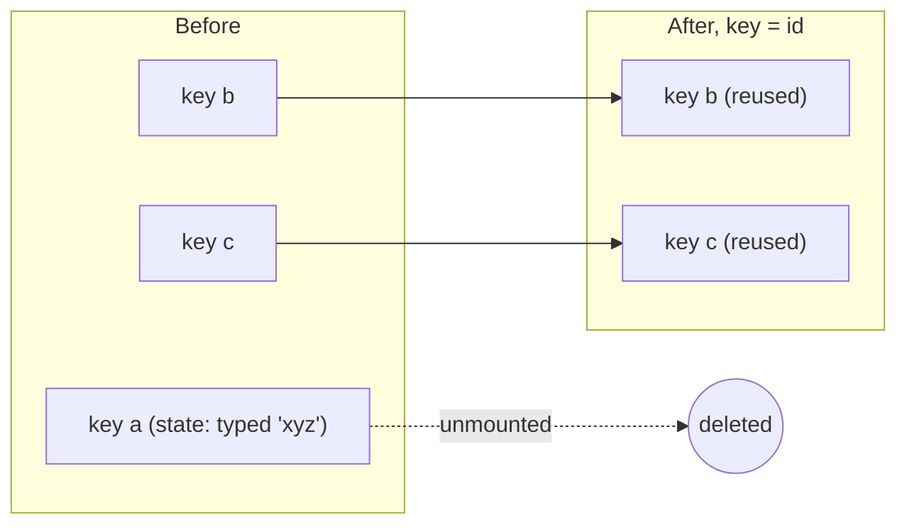
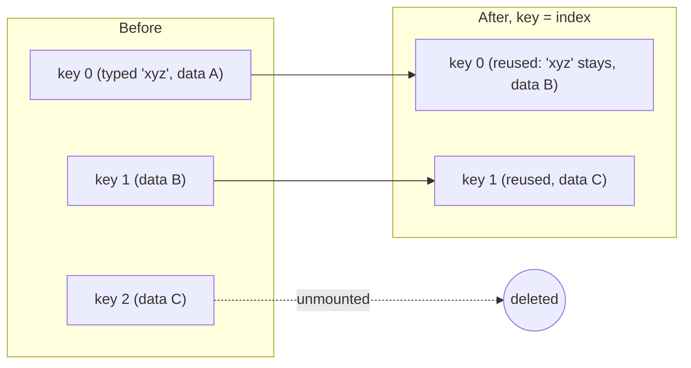

# 01 / 09 — Lists, Keys, and Identity

## 1. Lesson metadata

| | |
|---|---|
| **Level** | Intermediate |
| **Study time** | 4–5 hours (reading 2 h, experiments 1 h, exercises 1.5 h) |
| **Prerequisites** | [08 — Conditional rendering](./08-conditional-rendering.md) (position + type identity, §3.2); [06 — Props and one-way data flow](./06-props-and-one-way-data-flow.md); [Phase 0 / 08 — Objects, references, immutability](../00-web-and-javascript-foundations/08-objects-references-immutability.md) |
| **Next** | [10 — Event handling and the synthetic event system](./10-event-handling.md) |
| **Related later** | [16 — State preservation and reset](./16-state-preservation-and-reset.md), [Phase 2 / 06 — Reconciliation](../02-react-rendering-and-internals/06-reconciliation-fundamentals.md), [Phase 2 / 07 — Identity, keys, and reconciliation, revisited](../02-react-rendering-and-internals/07-identity-keys-and-reconciliation.md), [Phase 2 / 34 — Scenario C: list reorder](../02-react-rendering-and-internals/34-scenario-c-list-reorder.md) |

**Learning objectives.** After this lesson you can:
1. Render arrays of data with `map`, including filtered, sorted, grouped, and nested lists, without mutating the source.
2. Explain what a `key` is: an *identity claim* between renders, not an array index and not a prop.
3. Choose a correct key source (domain id, generated-at-creation id, content-derived id) and know when index keys are acceptable.
4. Predict the visible bugs caused by index keys and random keys: wrong state attached to wrong row, lost focus, wasted DOM work.
5. Use `key` on a Fragment and know where the key must be placed in `map` callbacks.
6. Use `key` deliberately to reset a component's state.
7. Know the point where a list must be paginated or virtualized.

**Concepts covered:** `Array.prototype.map/filter/toSorted`, immutable list updates, key uniqueness scope, stability, index-as-key, `Math.random()` keys, `<Fragment key>`, `key` not being a prop, identity vs equality, state attached to identity, reorder/insert/delete behavior, list performance basics, accessibility of lists.

---

## 2. Deep conceptual explanation

### 2.1 What problem is this lesson solving?

Real UIs are mostly collections: orders, messages, products, table rows, notifications, form fields added by the user. The data is an array; the UI is a repeated structure. In the declarative model ([Lesson 03](./03-ui-as-a-function-of-state.md)) you write `items.map(renderItem)` and React makes the screen match.

The difficulty is not rendering the list *once*. It is **what happens on the next render**, when the array has changed: an item was inserted at the top, another deleted, the order reversed by a sort. React must decide, for each element it now sees, *which previous element it is*. Why? Because each element may have things React (and the browser) is holding on to that are not in your data:

- component **state** (`useState`) inside a row
- DOM state: text typed into an uncontrolled `<input>`, focus, selection, scroll position of an inner `<div>`, a playing `<video>`, CSS transitions in progress
- effect subscriptions set up by a row

If React gets the matching wrong, the *right data* ends up displayed with the *wrong state*: you delete the first row and the second row's text field now shows what you typed into the first. A `key` is how you tell React the answer to "which one is this?".

### 2.2 Key = identity claim

When you write

```tsx
<li key={todo.id}>…</li>
```

you assert: *"Across renders, any element with this key, among its siblings, is the same logical thing."* React then:

- **keeps** (updates in place) the instance with the same key even if its position in the array changed,
- **creates** instances for keys it has not seen,
- **destroys** instances for keys that disappeared.

Without a key, React falls back to **position** as identity: the first child is "the same" as the previous first child, and so on. That is exactly right for static content and exactly wrong for lists that insert, delete, or reorder.

*Public guarantee:* elements with the same key and type among siblings preserve their identity (state/DOM) across renders; a different key means a different identity ([react.dev: Rendering Lists](https://react.dev/learn/rendering-lists), [Preserving and Resetting State](https://react.dev/learn/preserving-and-resetting-state)).
*Implementation detail:* the exact algorithm (maps of existing children by key, placement flags, etc.) is reconciliation ([Phase 2/06–07](../02-react-rendering-and-internals/07-identity-keys-and-reconciliation.md)). In this phase we only need the observable contract.

### 2.3 The rules, precisely

| Rule | Detail |
|---|---|
| **Unique among siblings** | Keys must be unique among elements in the *same array/children list*, not globally. Two different lists on the page may reuse the same keys. |
| **Stable** | The same logical item must get the same key on every render. Not `Math.random()`, not `Date.now()`, not a value regenerated per render. |
| **Not the index (unless the list is static)** | `index` changes meaning when items move. See §2.5. |
| **Placed on the outermost element returned from the `map` callback** | The key belongs to the array element React sees, not to an inner node. |
| **Not accessible as a prop** | `props.key` is not available in the child; pass the id as another prop if the child needs it. (⚠ React warns in development if you read `props.key`. ⚠ In recent versions, *spreading* an object that contains `key` into JSX (`<Row {...props} />` where `props.key` exists) triggers a dev warning; pass `key` explicitly.) |
| **String or number** | Keys are coerced to strings for comparison. Don't use objects. Mixed `1` and `"1"` collide. |
| **Keys are required for arrays, not for static children** | `<ul><li/><li/></ul>` needs no keys because the children are not a dynamic array. |

### 2.4 Where keys come from

| Source | Example | Verdict |
|---|---|---|
| **Database / API id** | `order.id`, `user.uuid` | Best. Stable, unique, meaningful. |
| **Id generated when the item is created on the client** | `crypto.randomUUID()` in the "add todo" handler, stored *in the item* | Good for local-only data. Generate at creation, not at render. ⚠ `crypto.randomUUID()` requires a secure context (HTTPS or localhost); verify support for your targets. |
| **Natural key** | `country.isoCode`, `ticker.symbol` | Good if truly unique and immutable. |
| **Content-derived** | `item.name` | Risky: duplicates and edits change identity. Acceptable for fixed sets of unique labels. |
| **Index** | `i` | Only for lists that are never reordered, inserted into (except at the end), or filtered, *and* whose items have no state. |
| **Random per render** | `Math.random()` | Never. Every render looks like "all items are new". |

Two considerations people miss:

1. **Keys must exist at the time of data creation, not in the view.** If the API gives no ids, derive ids once when the data *enters* your app (in the fetch layer or the add handler) so they are stable for the item's lifetime. Generating them in the render function defeats the purpose.
2. **Server-driven lists with no ids** (for example, a log of text lines that only append): index is fine, because identity *is* position.

### 2.5 Why index keys break

Take rows with an uncontrolled text input each, keyed by index:

```text
data:  [A, B, C]            keys: 0, 1, 2
user types "xyz" into row A's input.
delete A.
data:  [B, C]               keys: 0, 1
```

React compares by key: key 0 existed (it was A's row, now it's receiving B's data), key 1 existed (was B, now C), key 2 disappeared. So React:

- **updates** row-0's instance with B's props. Its DOM `<input>` still contains `"xyz"`; the user-typed value is DOM state, not props.
- **updates** row-1's instance with C's props.
- **removes** row-2's instance (C's old row).

The *last* DOM row is removed, but the *data* that was removed was the first. The text `"xyz"` now sits next to B. This is the canonical key bug. It is visible with inputs; it is also real with component `useState`, focus, animations, and expanded/collapsed state.

If rows are fully controlled and stateless (pure functions of props), index keys produce a *correct* result, just with unnecessary work: React updates every row after the deletion point instead of removing one DOM node. So index keys are a **correctness bug when the rows carry state** and a **performance issue when they don't**.

### 2.6 Lists and immutability

Lists are state; state updates must be immutable ([Phase 0 / 08](../00-web-and-javascript-foundations/08-objects-references-immutability.md)). Mutating methods (`push`, `splice`, `sort`, `reverse`) edit the array in place; React compares the *reference* to decide whether state changed (teaching model; see Lesson 14/15), so in-place edits are invisible or produce stale UI.

| Operation | Mutating (avoid on state) | Non-mutating (use) |
|---|---|---|
| Add | `push`, `unshift`, `splice` | `[...items, item]`, `[item, ...items]`, `items.concat(item)` |
| Remove | `splice`, `pop`, `shift` | `items.filter(x => x.id !== id)` |
| Replace | `items[i] = x` | `items.map(x => x.id === id ? next : x)` |
| Sort | `sort` | `[...items].sort(cmp)` or `items.toSorted(cmp)` ⚠ (ES2023: check browser/Node targets; polyfill/transpile if needed) |
| Reverse | `reverse` | `[...items].reverse()` or `toReversed()` ⚠ |

Sorting and filtering **for display** are *derived data*: compute them during render from the source array and the sort/filter settings; do not store a second sorted copy in state ([Phase 3 / 17 — Derived state](../03-react-state-and-hooks/17-derived-state.md)).

### 2.7 Common misconceptions

| Misconception | Reality |
|---|---|
| "Keys are for performance only." | Keys are about **identity**. Wrong keys cause wrong *behavior* (state on the wrong item), not just slowness. |
| "A key must be globally unique." | Only among siblings. |
| "Index is fine as long as I don't see a bug." | Latent. The bug appears when someone adds sorting, filtering, delete, or a stateful child. |
| "Using `key` on the inner `<div>` is enough." | The key must be on the top-level element returned from `map`. |
| "`Math.random()` is unique so it's a safe key." | Unique, but unstable ⇒ the whole list remounts on every render: state lost, focus lost, inputs unfocused while typing. |
| "Putting the key on my component makes it available as `props.key`." | It isn't a prop. |
| "I can only use `key` in lists." | `key` is general identity: it also resets state on a *single* element ([Lesson 16](./16-state-preservation-and-reset.md)). |
| "React re-renders only the changed rows in a list." | Re-render (calling component functions) happens for all rows whose parent re-rendered, unless memoized. Keys decide DOM/instance *reuse*, not whether functions are called ([Phase 7/03](../07-performance/03-why-components-rerender.md)). |

---

## 3. Internal mechanics

### 3.1 Public guarantee vs teaching model vs implementation detail

- **Public guarantee:** same key (and same component type) among siblings ⇒ same instance; changed key ⇒ remount; duplicate keys ⇒ unsupported (warning; children may be duplicated or omitted in updates); missing keys on dynamic arrays ⇒ warning in development.
- **Teaching model:** conceptually React builds, for the new children, a lookup from key → previous child, matches, and for each new child decides *reuse + update* or *create*, and for old children with no match decides *delete*. Moves are done by repositioning DOM nodes rather than recreating them. (No sorting algorithm is guaranteed; do not assume minimal moves.)
- **Implementation detail:** how children are stored (linked structures), how moves are detected, and whether unkeyed children fall back to index internally are specifics of the reconciler and may change. Do not depend on them. For source reading, see [Phase 2/31](../02-react-rendering-and-internals/31-reading-react-source.md); verify details in the React repo rather than from memory.

### 3.2 What the element tree looks like

`items.map(i => <Row key={i.id} item={i} />)` produces an array of element objects. Each element has `type: Row`, `key: "…"`, `props: { item }`. The key is stored **beside** `props`, not inside it. That is why `props.key` is not available. (The shape of element objects is described conceptually in [Lesson 04](./04-elements-components-instances.md); treat the exact internal field layout as implementation detail.)

### 3.3 Fragments and keys

A shorthand fragment `<>…</>` cannot take attributes, including `key`. When each list item expands to several siblings, use the explicit form:

```tsx
import { Fragment } from "react";

{terms.map((t) => (
  <Fragment key={t.id}>
    <dt>{t.term}</dt>
    <dd>{t.definition}</dd>
  </Fragment>
))}
```

### 3.4 Keys in nested lists

Each `map` creates its own sibling group, so each needs its own keys, and the same ids may repeat across groups:

```tsx
{categories.map((c) => (
  <section key={c.id}>
    <h3>{c.name}</h3>
    <ul>
      {c.items.map((i) => <li key={i.id}>{i.name}</li>)}  {/* uniqueness only within this ul */}
    </ul>
  </section>
))}
```

### 3.5 The cost model of lists (first look)

Rendering N rows calls the row component N times per parent render (if not memoized), creates N elements, and reconciles N children. For hundreds, this is cheap; for tens of thousands, it is the bottleneck. The fix is not clever keys but **not rendering what is not visible** (pagination, windowing/virtualization: [Phase 7/08–09](../07-performance/09-windowing-and-virtualization.md)). Keys only make updates *correct* and, relative to index keys on reorders, cheaper.

---

## 4. Step-by-step execution walkthrough

**Scenario.** A todo list where each row has a local "editing" `useState` and an uncontrolled `<input>`. Data: `[{id:"a"}, {id:"b"}, {id:"c"}]`. The user clicks "edit" on `b` (row `b` has `editing = true`) and then clicks "add to top" which prepends `{id:"d"}`.

**With `key={todo.id}`:**
1. State update in the parent: `setTodos([d, a, b, c])`.
2. Parent renders. `map` yields elements with keys `d, a, b, c`.
3. Reconciliation: existing instances: `a, b, c`. Key `d` is new ⇒ create an instance (state `editing=false`). Keys `a, b, c` match existing instances ⇒ reuse, update props (same props here), keep their state.
4. Commit: one new `<li>` inserted at the top. Existing `<li>` nodes remain; `b` is still `editing = true`, and its input keeps focus and text.

**With `key={index}`:**
1. New elements keyed `0,1,2,3` with data `d, a, b, c`.
2. Existing instances: `0`(a), `1`(b), `2`(c). Keys 0,1,2 match ⇒ **reuse** and give them new props `d, a, b`. Key 3 is new ⇒ create an instance for `c`.
3. Instance `1` (previously `b`, `editing = true`) now receives props for `a`. **The "editing" flag is now on `a`'s row**, and the typed text is in `a`'s input. The new last row `c` is fresh.
4. Commit: text content of three rows is updated, one row appended. Visually: the edit state "slid" down to the wrong item.

This is deterministic, not a race or an edge case, and is demonstrated by experiment in §5.1.

---

## 5. Code examples

### 5.1 Minimal example: see the index bug

```tsx
import { useState } from "react";

interface Item { id: string; label: string }

function Row({ label }: { label: string }) {
  // Uncontrolled input: its text lives in the DOM node, not in props.
  return (
    <li>
      {label}: <input aria-label={`note for ${label}`} />
    </li>
  );
}

export function IndexKeyDemo() {
  const [items, setItems] = useState<Item[]>([
    { id: "a", label: "Alpha" },
    { id: "b", label: "Beta" },
    { id: "c", label: "Gamma" },
  ]);

  return (
    <>
      <button type="button" onClick={() => setItems(items.slice(1))}>Delete first</button>
      <ul>
        {items.map((item, index) => (
          <Row key={index} label={item.label} />   // ← index key
        ))}
      </ul>
    </>
  );
}
```

**Predict:** type `hello` in the Alpha input, then click "Delete first". Which row shows `hello`, and which DOM `<li>` was removed?

**Result:** The Beta row shows `hello`. React removed the *last* `<li>` (key 2); the first two kept their DOM, and the first `<li>` (key 0, which held "hello") was reused for Beta.
**Why:** key 0 existed before and after; React preserved its DOM input value; only the label prop changed.
**Fix:** `key={item.id}`. Then deleting Alpha unmounts exactly Alpha's `<li>` (and its input text) and Beta keeps its own text.
**Trade-off:** none; the id version is strictly better here.

### 5.2 Practical example: a filterable, sortable, editable list

```tsx
import { useMemo, useState } from "react";

interface Task {
  id: string;
  title: string;
  done: boolean;
  createdAt: number;
}

type Sort = "newest" | "title";

export function TaskList() {
  const [tasks, setTasks] = useState<Task[]>([]);
  const [query, setQuery] = useState("");
  const [sort, setSort] = useState<Sort>("newest");

  function addTask(title: string) {
    setTasks((prev) => [
      { id: crypto.randomUUID(), title, done: false, createdAt: Date.now() }, // id at creation
      ...prev,
    ]);
  }

  function toggle(id: string) {
    setTasks((prev) => prev.map((t) => (t.id === id ? { ...t, done: !t.done } : t)));
  }

  function remove(id: string) {
    setTasks((prev) => prev.filter((t) => t.id !== id));
  }

  // Derived data: computed during render, never stored in state.
  const visible = useMemo(() => {
    const q = query.trim().toLowerCase();
    const filtered = tasks.filter((t) => t.title.toLowerCase().includes(q));
    return [...filtered].sort(
      sort === "newest"
        ? (a, b) => b.createdAt - a.createdAt
        : (a, b) => a.title.localeCompare(b.title),
    );
  }, [tasks, query, sort]);

  return (
    <section aria-labelledby="tasks-h">
      <h2 id="tasks-h">Tasks</h2>
      <input
        type="search"
        aria-label="Filter tasks"
        value={query}
        onChange={(e) => setQuery(e.target.value)}
      />
      <select aria-label="Sort" value={sort} onChange={(e) => setSort(e.target.value as Sort)}>
        <option value="newest">Newest</option>
        <option value="title">Title</option>
      </select>

      {visible.length === 0 ? (
        <p>{tasks.length === 0 ? "No tasks yet." : "No tasks match your filter."}</p>
      ) : (
        <ul>
          {visible.map((t) => (
            <li key={t.id}>
              <label>
                <input type="checkbox" checked={t.done} onChange={() => toggle(t.id)} />
                {t.title}
              </label>
              <button type="button" onClick={() => remove(t.id)}>Delete</button>
            </li>
          ))}
        </ul>
      )}
    </section>
  );
}
```

Line notes:
- `setTasks(prev => …)`: functional updates are the safe default when the next state depends on the previous one; the reason is formalized in [Lesson 14](./14-state-as-a-snapshot.md) and Phase 3/02.
- `crypto.randomUUID()` runs in the *handler*, so the id is created once and stored in the item. Stability follows from being data.
- `[...filtered].sort(...)` copies before sorting. `filter` already returned a new array, so `filtered.sort` would not mutate `tasks`, but the copy makes the habit uniform and safe if the filter is later removed.
- `useMemo` here is an optimization-free convenience: removing it changes only speed, not behavior. A first-time reader can ignore it; its trade-offs are in [Phase 3/11](../03-react-state-and-hooks/11-usememo-and-usecallback.md) and [Phase 7/04](../07-performance/04-memoization-trade-offs.md). For small lists it is unnecessary.
- The empty message distinguishes "no data" from "no matches" ([Lesson 08](./08-conditional-rendering.md)).
- Sorting by `title` reorders rows. With `key={t.id}`, React moves existing DOM nodes: checkboxes keep their focus, and no state is mis-assigned.

### 5.3 Incorrect examples (collected)

```tsx
// (a) No key → warning, falls back to position
{items.map((i) => <li>{i.name}</li>)}

// (b) Key on the wrong element
{items.map((i) => (
  <li>
    <span key={i.id}>{i.name}</span>
  </li>
))}

// (c) Random key
{items.map((i) => <Row key={Math.random()} item={i} />)}

// (d) Key built from mutable content
{people.map((p) => <PersonRow key={p.name} person={p} />)}  // two "Alex"? rename = remount

// (e) Mutating state during list update
function addAtTop(title: string) {
  items.unshift({ id: crypto.randomUUID(), title });
  setItems(items);               // same reference → React may skip the update
}

// (f) Key generated in render
const rows = items.map((i) => ({ ...i, key: crypto.randomUUID() }));
```

Why each is wrong:
- (a) React warns; position-based identity is wrong if the list changes.
- (b) The outermost element returned from `map` is `<li>`; it has no key. The warning remains.
- (c) New key each render ⇒ every row is unmounted and remounted every render. Inputs lose focus on each keystroke if the list re-renders.
- (d) Duplicate names produce duplicate keys; editing a name remounts the row.
- (e) The array reference didn't change; React bails out of the update when `Object.is(prev, next)` is true (teaching model; [Lesson 14](./14-state-as-a-snapshot.md)), and the unshift mutated the previous snapshot.
- (f) Same as (c): generated at render time ⇒ unstable.

### 5.4 Corrected implementation

```tsx
// (a),(b) key on the outermost element, stable id
{items.map((i) => (
  <li key={i.id}><span>{i.name}</span></li>
))}

// (c),(f) ids assigned once when data enters the app
function normalize(apiRows: ApiRow[]): RowData[] {
  return apiRows.map((r) => ({ ...r, id: r.id ?? crypto.randomUUID() }));
}
// ...fetch → setRows(normalize(json)); render with key={row.id}

// (e) immutable add
setItems((prev) => [{ id: crypto.randomUUID(), title }, ...prev]);
```

### 5.5 Advanced example: keys to *intentionally* reset state

```tsx
function ChatPage({ conversationId }: { conversationId: string }) {
  return <ChatComposer key={conversationId} conversationId={conversationId} />;
}

function ChatComposer({ conversationId }: { conversationId: string }) {
  const [draft, setDraft] = useState("");  // reset automatically when key changes
  return (
    <textarea
      aria-label={`Message for ${conversationId}`}
      value={draft}
      onChange={(e) => setDraft(e.target.value)}
    />
  );
}
```

**Predict:** the user types a draft in conversation `42`, then navigates to conversation `43` (same `ChatPage` position). Without the `key`, what's in the textarea? With it?

**Result:** Without `key`: the draft from `42` remains (same type, same position ⇒ same instance, `useState` retained). With `key={conversationId}`: the composer is unmounted and a new one mounted, draft `""`.
**Trade-off:** you lose the old draft; if drafts per conversation should be remembered, store drafts keyed by id in a parent/store. Resetting via `key` is often cleaner than a `useEffect` that calls `setDraft("")` on id change (that causes an extra render with stale content first; see [Phase 3/07](../03-react-state-and-hooks/07-you-might-not-need-an-effect.md)).

### 5.6 Advanced example: a generic, typed list with explicit key extraction

```tsx
interface ListProps<T> {
  items: readonly T[];
  getKey: (item: T) => string | number;
  renderItem: (item: T, index: number) => React.ReactNode;
  empty?: React.ReactNode;
}

export function List<T>({ items, getKey, renderItem, empty = null }: ListProps<T>) {
  if (items.length === 0) return <>{empty}</>;
  return (
    <ul>
      {items.map((item, i) => (
        <li key={getKey(item)}>{renderItem(item, i)}</li>
      ))}
    </ul>
  );
}

// usage
<List
  items={orders}
  getKey={(o) => o.id}
  renderItem={(o) => <OrderSummary order={o} />}
  empty={<p>No orders.</p>}
/>
```

Notes: Making `getKey` a *required* prop turns "forgot the key" into a compile error. This is a legitimate use of a small abstraction; it's also an example of over-abstraction if used for a single list ([Phase 5/02](../05-design-patterns/02-dry-kiss-yagni.md)). The generic component's `<li>` wrapper assumes the output is list content; semantic markup is a design decision you must own.

### 5.7 Advanced example: grouping and Fragment keys

```tsx
interface Message { id: string; day: string; text: string }

function groupByDay(messages: readonly Message[]): [string, Message[]][] {
  const map = new Map<string, Message[]>();
  for (const m of messages) {
    const bucket = map.get(m.day);
    if (bucket) bucket.push(m);       // mutating a LOCAL array we just created: fine
    else map.set(m.day, [m]);
  }
  return [...map];
}

function Thread({ messages }: { messages: readonly Message[] }) {
  return (
    <dl>
      {groupByDay(messages).map(([day, msgs]) => (
        <Fragment key={day}>
          <dt>{day}</dt>
          {msgs.map((m) => <dd key={m.id}>{m.text}</dd>)}
        </Fragment>
      ))}
    </dl>
  );
}
```

Mutation of a *local* array that never escaped is not the same as mutating state; the rule protects values React (or other code) may still hold. `Map` preserves insertion order, so group order follows first appearance.

---

## 6. Visual explanations

### Reconciliation of keyed children after a deletion





### Identity cheat sheet

```text
Same type + same key + same parent slot  ──▶ same instance (props updated)
Different key OR different type          ──▶ old unmounted, new mounted
No key (array child)                     ──▶ identity = position (+ dev warning)
```

---

## 7. Alternative approaches and trade-offs

**Key strategies**

| Strategy | Correct under reorder/insert/delete | Stateful rows safe | Effort | Notes |
|---|---|---|---|---|
| Server/domain id | Yes | Yes | Low | Default |
| Client-generated id at creation | Yes | Yes | Low | Store it in the item |
| Natural key (unique, immutable) | Yes | Yes | Low | Verify uniqueness |
| Index | Only for append-only/static | **No** | None | Acceptable for static lists |
| Content hash | Yes unless content edits | Edits remount | Medium | Use for immutable content |
| Random per render | No | No | None | Never |

**Large lists**

| Approach | Readability | Performance | Complexity | When |
|---|---|---|---|---|
| Render all with keys | High | Fine < ~hundreds–low thousands, depends on row cost | Low | Most lists |
| Pagination | High | Good | Medium (server + UX) | Data is naturally paged |
| "Load more"/infinite scroll without windowing | Medium | Degrades as DOM grows | Medium | Feeds of modest length |
| Windowing/virtualization | Lower (measurement, a11y, find-in-page limits) | Excellent for 10k+ | High | Data grids, logs ([Phase 7/09](../07-performance/09-windowing-and-virtualization.md)) |

**When the recommended approach (stable ids as keys) is not best:** an append-only log or a static list of menu items (index keys are simpler and correct); a list whose items you *want* to reset on every change (e.g., an animation that should replay if the data changes: derive the key from a version counter). Also, for a *fixed-length slot list* ("slot 1, slot 2, slot 3") where the slot position is the identity, the index is the honest key.

---

## 8. Best practices and anti-patterns

**Do**
- Make the id part of the data (from the server or assigned at creation).
- Place `key` on the outermost element in the `map` callback.
- Update list state with `map`/`filter`/spread; sort copies.
- Derive filtered/sorted views during render.
- Render a deliberate empty state.
- Use semantic list markup (`ul/ol/li`, `dl`, `table`); for tables use real `<table>` with `<th scope>`.
- Be careful with `aria-live` on lists that change quickly; announce *summaries* ("3 results") not every row.

**Beginner mistakes**
- Index keys on editable/reorderable lists.
- Forgetting to return from a block-bodied arrow in `map` (renders nothing: `items.map(i => { <li/> })`).
- Mutating the array (`items.push(x); setItems(items)`).
- Passing the key to a child expecting `props.key`.
- Rendering an object (`{item}`) instead of a field.

**Experienced-developer mistakes**
- Generating ids in render ("it's unique!").
- Using mutable fields (`name`, `email`) as keys, causing remounts on edit.
- Wrapping each row in an inline-created component type (`const Row = () => …` defined inside the parent); a new component *type* every render ⇒ every row remounts every time regardless of keys. Define components at module level.
- Assuming keyed lists avoid re-rendering rows (they avoid remounting; rendering still runs).
- Using a unique-but-semantic composite key that changes when a user edits the underlying field.

**Smells**
- `key={i}` next to `useState` in the row component.
- `key` computed with string concatenation of several mutable fields.
- Nested `map` three levels deep in one JSX block: extract components.
- Rows holding derived copies of props in state (`useState(props.item.title)`), which then ignore later prop changes. Use a key or lift state.

**Justified exceptions**
- Index keys for static or append-only, stateless lists.
- Keys derived from content for lists of immutable, unique strings.

---

## 9. Real-world application

**E-commerce cart.** Lines keyed by `lineItemId` (not `productId`: the same product may appear in two lines with different options). Quantity steppers are controlled inputs; a "remove" with an exit animation requires that the removed row remain mounted briefly, which is a case where keyed identity enables animation libraries to track leaving elements.

**Data grid / dashboard.** Rows keyed by entity id; live-updating prices change fields but keep the row identity, so cell selection and focus survive. Sorting by price reorders DOM nodes; with 5,000 rows you need virtualization: key stability is still required there so that scroll-recycled rows map correctly. Constraint: the user must not lose their selected row when a tick arrives and reorders the grid; selection state is stored by id in the parent, not by index.

**Chat / realtime.** Messages are append-only; optimistic messages have a client-generated temporary id, then the server returns the canonical id. If you swap keys from temp id to server id, the row remounts (flash, lost animation). Strategy: keep a stable `clientId` as the key for the message's whole life, and store the server id as data ([Phase 6/05](../06-data-fetching-and-state-ecosystems/05-optimistic-updates.md)).

**Forms with dynamic fields.** "Add another phone number" rows each have inputs. Keys must be per-row ids generated when the row is added, otherwise deleting the middle row corrupts the typed values of rows below it (§2.5). In controlled forms, the same ids anchor validation errors to rows.

**Multi-team design systems.** A `<Table rows getRowId>` API makes the id extraction explicit and testable. Document that `getRowId` must return stable ids; unstable ids are the number-one source of "my table loses focus" reports.

---

## 10. Debugging and troubleshooting

**Symptom 1: console warning "Each child in a list should have a unique 'key' prop."**
- *Investigate:* the warning names the component that rendered the list and its parent chain. Find the `map` and check where the key is.
- *Root causes:* missing key; key on the inner element; array children produced elsewhere (e.g., `{[<A/>, <B/>]}`); a `Fragment` shorthand.
- *Validate:* warning disappears; no new warnings after a re-render.

**Symptom 2: "Encountered two children with the same key."**
- *Root cause:* duplicate ids (data bug), `key={name}` with duplicate names, or the same item added twice. *Consequence:* React docs say duplicates may cause children to be duplicated or omitted during updates.
- *Investigate:* log `items.map(i => i.id)` and check uniqueness; find where duplicates enter (merge of paginated pages, optimistic + server copy).
- *Fix:* fix the data (dedupe by id) rather than hiding the warning.

**Symptom 3: input text or focus jumps to the wrong row; checkbox "moves" after sorting/deleting.**
- *Repro:* type in a row, delete/sort.
- *Investigate:* React DevTools → Components: select the row; look at its `key` field shown beside the name; compare before/after the action. If keys are `0,1,2`, you've found the cause.
- *Fix:* switch to stable ids; validate by repeating the repro.

**Symptom 4: input loses focus after every keystroke.**
- *Root causes:* `key={Math.random()}`, or a component type defined inside another component, or a parent that conditionally swaps wrapper elements. *Investigate:* in DevTools, enable "Highlight updates when components render"; observe the DOM in the Elements panel: the node is *replaced* (flashes in the tree) rather than updated. Check for mount/unmount via a `useEffect(() => { console.log("mount"); return () => console.log("unmount"); }, [])` in the row.
- *Note:* In development with Strict Mode, mount/unmount logs appear doubled for the initial mount ([Phase 2/28](../02-react-rendering-and-internals/28-strict-mode-behavior.md)); watch for repeated logs on *every update*, which is the real signal.

**Symptom 5: list "flickers" or all rows re-animate on update.** Same family as 4: unstable keys or inline component definitions.

**Symptom 6: sort button does nothing / list order wrong.**
- *Root cause:* `items.sort()` on state mutated in place and the same reference was set. *Fix:* sort a copy; `setItems(sorted)` or derive during render.

---

## 11. Exercises

### Level A — Knowledge
A1. What does a `key` tell React? What does React do with it that it cannot do without it?
A2. Within what scope must keys be unique?
A3. Why is `props.key` not available in a child?
A4. Give two examples of lists where an index key is acceptable and explain what property they share.
A5. Which of these cannot take a `key`: `<div>`, `<Fragment>`, `<>…</>`, a custom component? Why?
A6. What does "stable key" mean? Give an example of an unstable one.

### Level B — Code comprehension
B1. A list of `<Row>` components, each with `const [open, setOpen] = useState(false)`, keyed by index. The user expands row 2 of `[A,B,C]` (B), then the app removes `A`. Which row (by data) appears expanded afterward? What if keyed by id?
B2. What's wrong here, and what do you see in the console?
```tsx
{users.map((u) => (
  <div>
    <UserCard key={u.id} user={u} />
  </div>
))}
```
B3. Will typing in the input lose focus on each keystroke? Why?
```tsx
function Page() {
  const [text, setText] = useState("");
  function Field() { return <input value={text} onChange={(e) => setText(e.target.value)} />; }
  return <Field />;
}
```
B4. Predict the order of DOM nodes and which instances are preserved:
before `[{id:1},{id:2},{id:3}]`, after `[{id:3},{id:1},{id:2}]`, all keyed by id, each row has a focused-able input and the input of id 2 has focus.
B5. `items.map(i => { <li key={i.id}>{i.name}</li> })` renders what?

### Level C — Implementation
C1. Implement a `ShoppingList` with add (client id at creation), delete, and "move up" buttons. Use stable ids and no mutation. Each row contains an uncontrolled note input whose text must stay with its item when moved.
C2. Implement `groupBy<T>(items: readonly T[], key: (t: T) => string): Map<string, T[]>` and render groups with Fragment keys.
C3. Write a generic `<Table<T>>` with `rows`, `getRowId`, and `columns: { header: string; cell: (row: T) => ReactNode }[]`, using semantic table elements.
C4. Add a "sort by title" toggle to a list without storing the sorted array in state.

### Level D — Debugging
D1. After clicking "Delete" on the first item, the note typed into the *second* item disappears and the first item's note appears at the second's place. Source:
```tsx
{todos.map((t, i) => <TodoRow key={i} todo={t} onDelete={() => remove(i)} />)}
```
Explain exactly why, then fix, including the `remove` function.
D2. Console: "Encountered two children with the same key, `3`." The list merges page 1 and page 2 from an API (`setItems(prev => [...prev, ...page])`). Diagnose three possible root causes and the right fix.
D3. A teammate "fixed" the missing-key warning with `key={Math.random()}`. The warning went away, but now a text input inside rows loses focus while typing. Explain.
D4. `const sorted = items.sort(byName); setItems(sorted);` The UI sometimes doesn't update and the list under `items` elsewhere changes order unexpectedly. Explain and fix.

### Level E — Architecture and engineering decisions
E1. Your API returns records without ids; the UI supports edit and drag-reorder. Where do ids get created, and what are the risks of each location (fetch layer, component render, server)?
E2. Choose between pagination, infinite scroll, and virtualization for (a) a 200-row admin list, (b) a 50,000-row log viewer, (c) a social feed. Justify with criteria: UX, a11y, find-in-page, performance, complexity.
E3. Your design system's `<Table>` takes `rows: T[]` and uses the index as a key internally. A product team complains about focus bugs. Propose an API change with a migration path.

### Level F — Expert challenge
F1. Design the key strategy for a collaborative to-do list (many users, offline edits, optimistic creation, server-assigned ids, drag-reorder with live remote updates). Address: key stability across the temp-id→server-id transition, reorder races, duplicate arrival of the same item via WebSocket and via HTTP response, and how rows keep local state (expanded, draft).

---

## 12. Detailed answers and explanations

> Attempt the exercises first.

**A1.** A key is an identity claim: "this element is the same logical item as the one with this key in the previous render." Without it, React can only match children by position, so it cannot preserve state/DOM across reorders, insertions, or deletions (it can't distinguish "item moved" from "item changed").

**A2.** Among siblings, i.e., the elements of the same array/children list under the same parent. Different lists may reuse keys. Common error: thinking the key must be globally unique, which leads to prefixing everything unnecessarily (harmless but noisy).

**A3.** `key` (and, in the classic API, `ref`) is consumed by React for reconciliation and is stored beside props on the element. ⚠ In React 19, `ref` became an ordinary prop for function components; `key` did not. If the child needs the id, pass it as `id`/`itemId`.

**A4.** Static lists (navigation links defined in code) and append-only logs of immutable lines. Shared property: an item's position *is* its identity and no item carries per-instance state that must follow it when others change.

**A5.** The shorthand `<>…</>` cannot take attributes, so it can't have a key; use `<Fragment key=…>`. `div`, `Fragment`, and components can all take `key`. (A component receives it as a reserved attribute, not a prop.)

**A6.** Stable = same logical item ⇒ same key on every render. Unstable: `Math.random()`, `crypto.randomUUID()` in render, `Date.now()`, or an index when the list reorders.

**B1.** Index-keyed: before, rows keyed 0(A),1(B),2(C); row key 1 has `open = true`. After removing A: `[B, C]` keyed 0, 1. Key 1 is reused and now shows **C expanded**; B is collapsed (key 0's state is `false`). The expansion "slid" to the wrong item. Id-keyed: B stays expanded because key `B` is preserved.

**B2.** The `<div>` returned from `map` is the array element and lacks a key; the key on the inner `UserCard` doesn't count. Console: "Each child in a list should have a unique 'key' prop." Fix: move `key={u.id}` to the `<div>`.

**B3.** Yes. `Field` is declared inside `Page`, so each `Page` render creates a *new function* ⇒ a new component type. React sees a different type at that position ⇒ unmounts the old `<input>` and mounts a new one: focus lost every keystroke. Fix: define `Field` outside `Page` (pass `text` and `setText` as props). This is not about keys, but the cause is the same identity rule.

**B4.** After: DOM order is 3, 1, 2. All three instances are *preserved* (same keys); React moves DOM nodes (or the minimum it chooses). The input of id 2 *typically* keeps its value and focus, because the node is moved rather than recreated, though browsers may reset focus when a focused node is detached and reinserted, which is a case where implementation matters. ⚠ The docs guarantee state preservation, not DOM-node-identity of moved elements in every case; test focus-sensitive reorders in your target browsers. (React generally moves other nodes around the focused one, but treat this as an implementation detail.)

**B5.** Nothing: block body with no `return` ⇒ each callback returns `undefined`; the array is `[undefined, …]` which renders nothing. No key warning either, because no elements were created. Fix: use parentheses `i => (<li …/>)`.

**C1. Reference solution**
```tsx
import { useState } from "react";

interface Entry { id: string; name: string }

function Row({ entry, onDelete, onUp, canUp }: {
  entry: Entry; onDelete: () => void; onUp: () => void; canUp: boolean;
}) {
  return (
    <li>
      {entry.name}{" "}
      <input aria-label={`Note for ${entry.name}`} />
      <button type="button" onClick={onUp} disabled={!canUp}>Up</button>
      <button type="button" onClick={onDelete}>Delete</button>
    </li>
  );
}

export function ShoppingList() {
  const [entries, setEntries] = useState<Entry[]>([]);
  const [draft, setDraft] = useState("");

  function add() {
    const name = draft.trim();
    if (!name) return;
    setEntries((prev) => [...prev, { id: crypto.randomUUID(), name }]);
    setDraft("");
  }
  function remove(id: string) {
    setEntries((prev) => prev.filter((e) => e.id !== id));
  }
  function moveUp(id: string) {
    setEntries((prev) => {
      const i = prev.findIndex((e) => e.id === id);
      if (i <= 0) return prev;
      const next = [...prev];
      [next[i - 1], next[i]] = [next[i], next[i - 1]];  // mutating the fresh copy only
      return next;
    });
  }

  return (
    <section>
      <input aria-label="New item" value={draft} onChange={(e) => setDraft(e.target.value)} />
      <button type="button" onClick={add}>Add</button>
      <ul>
        {entries.map((e, i) => (
          <Row key={e.id} entry={e} canUp={i > 0}
               onUp={() => moveUp(e.id)} onDelete={() => remove(e.id)} />
        ))}
      </ul>
    </section>
  );
}
```
Why correct: the swap mutates a fresh copy, not state; `key={e.id}` keeps each uncontrolled note with its item; returning `prev` when nothing changes lets React skip the re-render (bail-out). Edge cases: duplicate names are fine because ids are distinct; empty names are rejected. Wrong approach to reject: index keys, which would silently move notes to the neighbor row.

**C2.**
```tsx
export function groupBy<T>(items: readonly T[], key: (t: T) => string): Map<string, T[]> {
  const out = new Map<string, T[]>();
  for (const item of items) {
    const k = key(item);
    const bucket = out.get(k);
    if (bucket) bucket.push(item);
    else out.set(k, [item]);
  }
  return out;
}
// render
[...groupBy(people, (p) => p.team)].map(([team, members]) => (
  <Fragment key={team}>
    <h3>{team}</h3>
    <ul>{members.map((m) => <li key={m.id}>{m.name}</li>)}</ul>
  </Fragment>
))
```
`Object.groupBy` / `Map.groupBy` exist in newer runtimes ⚠ (ES2024); check targets before using them.

**C3.**
```tsx
interface Column<T> { header: string; cell: (row: T) => React.ReactNode }

export function Table<T>({ rows, getRowId, columns, caption }: {
  rows: readonly T[];
  getRowId: (row: T) => string | number;
  columns: readonly Column<T>[];
  caption: string;
}) {
  return (
    <table>
      <caption>{caption}</caption>
      <thead>
        <tr>{columns.map((c) => <th key={c.header} scope="col">{c.header}</th>)}</tr>
      </thead>
      <tbody>
        {rows.map((r) => (
          <tr key={getRowId(r)}>
            {columns.map((c) => <td key={c.header}>{c.cell(r)}</td>)}
          </tr>
        ))}
      </tbody>
    </table>
  );
}
```
Criteria: required `getRowId`; keys on `tr`; semantic markup and caption; column keys by header assume unique headers (document it or add an explicit `id`). 

**C4.**
```tsx
const [sortAsc, setSortAsc] = useState(true);
const shown = [...items].sort((a, b) => (sortAsc ? 1 : -1) * a.title.localeCompare(b.title));
```
State holds `items` and the *sort setting*; the sorted array is derived each render. Don't store `shown` in state: it duplicates information and drifts when `items` change.

**D1.** Index keys: delete first item ⇒ keys now `0,1` for items `[B,C]`; key 0's instance (holding A's note text) is reused for B, key 1's instance (holding B's text) for C, key 2 is dropped. B shows A's note, C shows B's note. Additionally `onDelete={() => remove(i)}` captures a stale index when rows shift; with keys by index it happens to match, but with id keys index-based removal is fragile if the list is filtered/sorted for display. Fix:
```tsx
{todos.map((t) => <TodoRow key={t.id} todo={t} onDelete={() => remove(t.id)} />)}
const remove = (id: string) => setTodos((prev) => prev.filter((t) => t.id !== id));
```

**D2.** Possible causes: (1) the server pages overlap (offset pagination while data inserts) so the same record appears in two pages; (2) a refetch/retry appended the same page twice (React Query/Strict Mode double effect in dev); (3) optimistic insert plus the server's copy both present. Right fix: de-duplicate by id at merge time (`Map` keyed by id, later wins), prevent double-fetches (abort/cancel stale requests: [Phase 6/02](../06-data-fetching-and-state-ecosystems/02-cancellation-and-race-conditions.md)), and consider cursor-based pagination. Not a fix: appending the index to the key, which hides duplicates and shows the same record twice.

**D3.** Random keys change every render, so React treats each row as a brand-new element: unmount old, mount new. The DOM `<input>` is replaced, so focus and uncommitted DOM state are lost on every state update that re-renders the list (every keystroke if the text lives in the parent). The warning was about *missing* keys; random keys fix the warning but break the identity contract. Fix: stable id.

**D4.** `Array.prototype.sort` sorts in place and returns the *same array reference*. `setItems(sorted)` receives the same reference as the current state ⇒ React bails out (no re-render) even though the contents changed; and any other holder of `items` sees the mutation. Fix: `setItems([...items].sort(byName))` or `items.toSorted(byName)` ⚠ or, better, derive the sorted view during render.

**E1. Evaluation criteria and a good answer.** Criteria: stability over the item's lifetime, uniqueness, who owns identity, cost, and edit/reorder semantics. Best: the *server* assigns ids (also needed for persistence). If it can't, create ids at the boundary where data enters the client (fetch/normalization layer) once, and store them in the item: stable for the session. Risks: client-created ids are not stable across reloads/refetches (a refetch produces new ids ⇒ remounts; re-merge by a natural key or hash if you need continuity); creating ids in render is wrong (unstable); using content hashes breaks on edit and with duplicate content. For drag-reorder, ids must survive reordering, so index is out. Mention that if a refetch replaces all ids, UI state keyed by id (selection, expanded) is lost: persist identity or accept it.

**E2.** (a) 200 rows: render all with keys; simplest, fully accessible, find-in-page works. (b) 50,000-row log: virtualization (or server pagination if exact search semantics matter); a11y trade-offs: screen readers see only rendered rows, so provide `aria-rowcount`/`aria-rowindex` for grids, and in-page find is limited, so offer in-app search. (c) Social feed: infinite scroll with a cap (windowing for very long sessions), preserve scroll position on navigation back, provide a "load more" fallback for keyboard/AT users and for footer reachability. Look for criteria-based reasoning, not a single "virtualize everything" answer.

**E3.** Add a required `getRowId` (or `rowKey`) prop; in the next minor release keep index fallback with a dev-only console warning (`process.env.NODE_ENV !== "production"`) when omitted, then make it required in the next major, with a codemod suggesting `row => row.id`. Provide docs on key stability. Trade-offs: breaking change cost vs. a class of hard-to-diagnose bugs; staged deprecation respects multiple consumers ([Phase 10/12](../10-production-engineering/12-backward-compatibility.md)).

**F1.** Example well-reasoned answer: Give each item a client-generated `clientId` (UUID) at creation that never changes and is the React key for the item's whole life; store `serverId` separately and reconcile it when the POST returns (swap the field, not the key). Incoming WebSocket events and HTTP responses are merged by `clientId` if known, else by `serverId`: keep a lookup `serverId → clientId` so the second arrival of the same entity updates the existing item rather than adding a duplicate. For reorder, store an explicit order field (fractional index or linked-list order from the server) and derive display order by sorting; do not infer order from array position when remote updates can interleave. Row-local UI state (expanded, drafts) either stays in row components keyed by `clientId` (survives reorder, lost if the row remounts) or in a parent map keyed by `clientId` (survives virtualization). Evaluate against: no remounts at temp→server swap, idempotent merges, deterministic order under concurrent moves. Weak answers key by array index or by `serverId` (undefined before the response) and flash on swap.

---

## 13. Senior engineer interview questions

**Q1. "Why are index keys dangerous? Are they ever fine?"**
*Strong answer:* Keys are identity. Index identifies *position*, not the item; when items are inserted, removed, or reordered, the same index points to different data, so React reuses instances with state/DOM that belonged to other items. It is fine when position is identity: static or append-only lists of items without per-item state. Mention that it's a correctness issue for stateful rows and just inefficiency for stateless ones.

**Q2. "How would you reset a component's state when a prop changes?"**
*Strong answer:* Give it a `key` derived from the prop that defines its identity (`<Editor key={docId} />`). React treats a changed key as a new instance, unmounting the old one. This is preferable to syncing with an effect, which renders once with stale state, then resets. Trade-off: remount cost and loss of any state you wanted to keep; if you need to keep per-id drafts, store them above.

**Q3. "A list re-renders on every keystroke and the focused input inside loses focus. Walk me through diagnosing it."**
*Strong answer:* Suspect remounts: unstable keys, a component type created inside another component, or a wrapper element type that changes. Use DevTools "highlight updates" and the Elements panel to see whether the DOM node is replaced; add mount/unmount logs in the row; inspect `key` values in the Components panel; look for `Math.random()`/inline components; fix by stable keys and hoisting components; verify the node is no longer replaced.

**Q4. "Do keys prevent re-renders?"**
*Strong answer:* No. Keys control *identity* (instance reuse and DOM moves). Whether a row's function runs again depends on its parent rendering and on memoization. Keys make reuse correct and reorders cheaper; skipping renders needs `React.memo`/composition/React Compiler ⚠ ([Phase 3/12](../03-react-state-and-hooks/12-react-memo.md)).

**Q5. "How do you keep keys stable across optimistic creation?"**
*Strong answer:* Use a client-generated id as the permanent key and treat the server id as data. Swapping the key at ack time remounts the row, causing flicker and lost state.

**Q6. "What happens with duplicate keys?"**
*Strong answer:* Unsupported: React warns in development, and during updates children with duplicate keys may be duplicated or omitted. Don't rely on any particular outcome. Fix data, not the warning.

---

## 14. Further learning resources

| Resource | URL | Covers / why | Level | Study |
|---|---|---|---|---|
| React docs: Rendering Lists | <https://react.dev/learn/rendering-lists> | Official `map`/`filter`/keys guide, rules of keys | Beginner | Entire page |
| React docs: Preserving and Resetting State | <https://react.dev/learn/preserving-and-resetting-state> | Identity by position and key; resetting with keys | Intermediate | Entire page |
| React docs: Updating Arrays in State | <https://react.dev/learn/updating-arrays-in-state> | Immutable add/remove/replace/sort patterns | Beginner | Entire page |
| React docs: Fragment | <https://react.dev/reference/react/Fragment> | Keyed Fragments | Beginner | "Rendering a list of Fragments" |
| MDN: `Array.prototype.map` | <https://developer.mozilla.org/en-US/docs/Web/JavaScript/Reference/Global_Objects/Array/map> | Callback semantics | Beginner | Whole page |
| MDN: `Array.prototype.toSorted` | <https://developer.mozilla.org/en-US/docs/Web/JavaScript/Reference/Global_Objects/Array/toSorted> | Non-mutating sort and support notes | Beginner | Browser compatibility |
| MDN: `Crypto.randomUUID()` | <https://developer.mozilla.org/en-US/docs/Web/API/Crypto/randomUUID> | Id generation and secure-context requirement | Beginner | Whole page |
| React source (for later) | <https://github.com/facebook/react> | Reconciler child diffing (verify file locations yourself) | Advanced | After Phase 2/06–07 |

---

## 15. Knowledge checkpoint

**You should now understand**
- A key is an identity claim among siblings; without it, identity is position.
- Why index and random keys produce wrong state or constant remounts.
- That ids belong to the data, assigned once, and that lists are updated immutably.
- That keys do not prevent re-rendering, and that long lists need pagination/virtualization rather than cleverness.

**You should be able to explain without notes**
- The delete-first-row bug step by step (which instance gets which props and DOM).
- Why `key` is not a prop and how to reset state with it.

**You should be able to implement**
- Filtered, sorted, grouped, nested lists with correct keys and empty states.
- A typed generic list/table that forces key extraction.

**You should be able to debug**
- Key warnings, duplicate-key errors, focus loss, and state "sliding" between rows, using DevTools and mount/unmount probes.

**Before moving on:** read [10 — Event handling and the synthetic event system](./10-event-handling.md). Lists are where handlers are most commonly closed over loop variables, which that lesson addresses.
