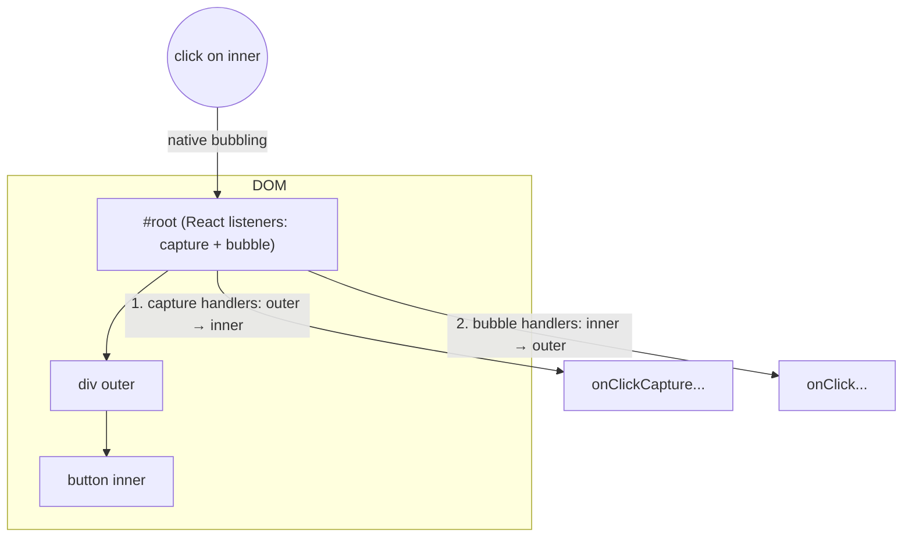

# 01 / 10 — Event Handling and the Synthetic Event System

## 1. Lesson metadata

| | |
|---|---|
| **Level** | Intermediate |
| **Study time** | 4–5 hours (reading 2 h, experiments 1 h, exercises 1.5 h) |
| **Prerequisites** | [Phase 0 / 13 — Events: capture, target, bubble, delegation](../00-web-and-javascript-foundations/13-browser-events-and-propagation.md); [06 — Props and one-way data flow](./06-props-and-one-way-data-flow.md); [Phase 0 / 06 — Lexical scope and closures](../00-web-and-javascript-foundations/06-lexical-scope-and-closures.md) |
| **Next** | [11 — Controlled and uncontrolled inputs](./11-controlled-and-uncontrolled-inputs.md) |
| **Related later** | [14 — State as a snapshot](./14-state-as-a-snapshot.md), [Phase 2 / 01 — What triggers a render](../02-react-rendering-and-internals/01-what-triggers-a-render.md), [Phase 2 / 22 — Automatic batching](../02-react-rendering-and-internals/22-automatic-batching.md), [Phase 3 / 06 — Effect cleanup](../03-react-state-and-hooks/06-effect-cleanup.md) |

**Learning objectives.** After this lesson you can:
1. Attach handlers correctly (pass a function, do not call it) and type them in TypeScript.
2. Explain what React's `SyntheticEvent` is, how it relates to the native event, and where React listens.
3. Predict the order in which React handlers, native listeners on elements, and native listeners on `document`/`window` fire, including capture-phase handlers and portals.
4. Use `preventDefault` and `stopPropagation` correctly and explain why `stopPropagation` is usually a smell.
5. Distinguish `target` from `currentTarget`, and React `onChange` from the native `change` event.
6. Build accessible interactions (real buttons, keyboard handling) instead of clickable `div`s.
7. Know when a *native* listener (via an effect) is justified, and write one with cleanup.
8. Explain why handlers may have side effects while render functions may not, and why handlers see a *snapshot* of state.

**Concepts covered:** event props, handler functions vs calls, inline closures, `SyntheticEvent`, `nativeEvent`, event delegation at the root container, bubbling and capture props (`onClickCapture`), `stopPropagation`, `preventDefault`, `target`/`currentTarget`, `onChange` semantics, focus/blur bubbling, passive listeners, portals and event bubbling, form `onSubmit`, keyboard handling, native listeners in effects, event priority (preview), Actions (preview).

---

## 2. Deep conceptual explanation

### 2.1 What problem is this lesson solving?

Rendering ([Lesson 03](./03-ui-as-a-function-of-state.md)) turns state into UI. **Events turn user intent into state changes.** Every interactive UI is the loop: state → UI → user event → handler → new state → UI. If you misunderstand how events reach your handlers you get: handlers that fire twice, handlers that never fire (calling instead of passing), clicks that "leak" to unrelated parents, `stopPropagation` that mysteriously breaks a third-party library, forms that reload the page, and keyboard users who cannot operate your UI.

### 2.2 What you write

```tsx
<button type="button" onClick={handleSave}>Save</button>
```

- `onClick` is a **prop** with a camelCase name. The value is a **function** that React stores and will call later.
- React DOM defines a set of event props for host elements (`onClick`, `onChange`, `onSubmit`, `onKeyDown`, `onPointerDown`, `onFocus`, `onDragStart`, …). Custom components can have *any* prop names; by convention, event-like props start with `on` and the functions you define start with `handle` ([react.dev: Responding to Events](https://react.dev/learn/responding-to-events)).
- The JSX attribute vs HTML: `onClick={fn}` (a function in braces), not `onclick="fn()"` (a string of code).

**Pass, don't call.**

| Written | What happens |
|---|---|
| `onClick={handleClick}` | Passes the function. React calls it on click. ✓ |
| `onClick={() => handleClick(id)}` | Passes a new arrow function that calls `handleClick(id)` on click. ✓ |
| `onClick={handleClick()}` | **Calls `handleClick` during render**, then passes its return value (probably `undefined`). ✗ |
| `onClick={handleClick(id)}` | Same bug, with an argument. ✗ |

The mistake is common because in HTML you wrote parentheses. In JSX you write an *expression whose value is a function*.

### 2.3 What your handler receives

React calls your handler with a **SyntheticEvent** (in TypeScript, for example `React.MouseEvent<HTMLButtonElement>`). It is a React wrapper that:

- exposes the *same interface as the native event*, with normalized behavior across browsers (`e.target`, `e.preventDefault()`, `e.stopPropagation()`, `e.type`, `e.key`, …),
- adds a few React-specific aspects (`e.nativeEvent` to reach the underlying DOM event; the synthetic *propagation* happens through the React tree),
- is **not pooled** anymore: in React 16 and earlier the event object was reused and nulled after the handler returned (`e.persist()` was required for async access); since **React 17** pooling was removed, `persist()` is a no-op, and you can read properties after `await` ([React 17 release notes](https://legacy.reactjs.org/blog/2020/08/10/react-v17-rc.html)). One caveat remains: `e.currentTarget` is only meaningful *during* dispatch; after your handler returns (e.g., after an `await`), `currentTarget` is `null`, exactly as in native events. Capture what you need first.

### 2.4 Where React actually listens: delegation at the root

You learned event delegation in [Phase 0/13](../00-web-and-javascript-foundations/13-browser-events-and-propagation.md): one listener on an ancestor handles events from many descendants by inspecting the target. React uses this strategy.

*Teaching model (stable since React 17):* when you call `createRoot(container).render(<App />)`, React DOM attaches its event listeners to the **root container element** (the `#root` div), for the supported event types, in both capture and bubble phases. You do **not** get one DOM listener per `onClick`. When a native event bubbles up to the container, React:

1. finds which React element/host node the event targeted,
2. builds the list of handlers from that node up through its React ancestors (bubble order) — or from the top down for capture handlers,
3. creates the SyntheticEvent and calls the handlers in order, honoring `stopPropagation`.

*History:* in React 16 and earlier, listeners were attached to `document`. The change in 17 made it safe to run several React versions/roots on one page and made interop with non-React code predictable. *Implementation detail:* the exact set of registered events, how listeners are attached, and per-event exceptions (non-bubbling events like `scroll`, media events) are internal and have changed across versions. Verify against the React source (`react-dom` event system) rather than relying on lesson text for edge cases.

### 2.5 Bubbling and capture, in React terms

For every event prop there is a capture variant: `onClick` (bubble) and `onClickCapture` (capture). React reproduces the DOM's three-phase flow *across the React component tree*:

```text
capture: root → … → parent → target       (onXCapture handlers)
bubble:  target → parent → … → root       (onX handlers)
```

`e.stopPropagation()` in a React handler stops further React handlers in that phase *and* (since 17) calls `stopPropagation` on the native event, which has already reached the root container; so native listeners on `document`/`window` — **above** the root container — will not see it, but native listeners on elements *inside* the container have already run (they fire during the native bubble, before the event reaches the container).

### 2.6 Differences from native events that matter

| Aspect | Native DOM | React |
|---|---|---|
| `onChange` for `<input>`/`<textarea>` | `input` event fires per edit; `change` fires on commit (blur/Enter) | `onChange` fires **on every edit** (React maps it to the `input` behavior). Use it as "value changed". |
| `focus`/`blur` | Don't bubble (`focusin`/`focusout` do) | `onFocus`/`onBlur` **bubble** in React (built on `focusin`/`focusout` semantics) |
| `onScroll` | Doesn't bubble | Since React 17, `onScroll` **does not bubble** either |
| `mouseenter`/`mouseleave` | Don't bubble | `onMouseEnter`/`onMouseLeave` don't bubble and are computed by React from `mouseover`/`mouseout` |
| Event names | lowercase (`click`) | camelCase props (`onClick`) |
| `return false` to prevent default | Works for inline HTML attributes | Does **not**; call `e.preventDefault()` |
| Propagation through portals | Follows the DOM tree | Follows the **React tree** (a portal's events bubble to the React parent, even if the DOM node is elsewhere) |
| Passive listeners | You choose via `addEventListener` options | React registers `touchstart`, `touchmove` and `wheel` as passive listeners at the root (confirmed in react-dom 19.3.1 source), so `preventDefault()` in `onWheel`/`onTouchStart`/`onTouchMove` is ineffective; use a native listener with `{ passive: false }` when you must cancel those |
| Pooling | n/a | Removed in 17 |

### 2.7 Handlers are not render code

[Lesson 12](./12-component-purity.md) will make the rule: **rendering must be pure; event handlers may have side effects.** A handler is code that runs *because the user did something*, outside rendering. It may mutate state through setters, call APIs, navigate, log, write to `localStorage`, focus an element via a ref, and so on. This is *the* intended place for side effects triggered by a specific interaction. A common anti-pattern is to put such logic in `useEffect` reacting to state that the handler just set (see [Phase 3/07](../03-react-state-and-hooks/07-you-might-not-need-an-effect.md)).

### 2.8 Common misconceptions

| Misconception | Reality |
|---|---|
| "React attaches a listener to each element." | One set of root-level listeners (teaching model) dispatches to your handlers. |
| "`e.stopPropagation()` stops all other click listeners." | It stops further *React* propagation and the native event from reaching ancestors beyond the root container. Native listeners on elements inside the root already ran; other listeners on the same node still run (use `stopImmediatePropagation` natively — and see §3.4). |
| "The event object must be read synchronously." | Only true before React 17. Still avoid reading `currentTarget` after `await`. |
| "`onChange` fires on blur." | Not in React for text inputs. |
| "Inline arrow functions in JSX are slow, always memoize handlers." | They create a new function per render; it matters only when it defeats `memo` on a child or in extreme list sizes. Measure ([Phase 7/04](../07-performance/04-memoization-trade-offs.md)). |
| "An event handler sees the latest state." | It sees the state **of the render that created it** (a snapshot) — [Lesson 14](./14-state-as-a-snapshot.md). |
| "Clicking a `div` with `onClick` is fine." | Mouse-only. Not focusable, no keyboard activation, no role. Use `<button>`. |
| "React handlers run synchronously inside the native event, so state updates apply immediately." | The handlers run during the native event, but state updates are *queued* and applied in a later render ([Lesson 15](./15-update-queues-and-batching.md)). |

---

## 3. Internal mechanics

### 3.1 The dispatch pipeline (teaching model)

```mermaid
sequenceDiagram
  participant U as User
  participant B as Browser
  participant N as Native listeners on inner elements
  participant R as React root container listener
  participant H as Your handlers (React tree order)
  participant D as document / window listeners
  U->>B: click
  B->>N: capture/target/bubble through DOM (inner → outer)
  B->>R: event reaches root container
  R->>R: map DOM target to React node; collect handlers
  R->>H: onClickCapture (top→down), then onClick (bottom→up)
  H-->>R: setState calls are queued
  R->>R: schedule render after handlers (batching)
  B->>D: bubbles on to document / window (unless React stopped it)
```

*Public guarantee:* React handlers run in React-tree capture/bubble order; `stopPropagation` in a handler prevents later React handlers in that flow; state updates inside handlers are batched.
*Teaching model:* root-level delegation and a synthetic event wrapper.
*Implementation detail:* how React maps DOM nodes to fibers, listener registration, per-event priority tagging.

### 3.2 Event priority (preview)

React assigns **priorities** to updates according to the event that caused them: *discrete* events (click, keydown, input) are treated as urgent; *continuous* events (mousemove, scroll, drag) lower. This is why a click-driven update is processed before a transition-driven one ([Phase 2/13](../02-react-rendering-and-internals/13-scheduler-and-priorities.md)). You do not need it to write handlers; remember only that "which event caused the setState" is information React uses.

### 3.3 Order of everything: a worked example

Given DOM nesting `div#outer > button#inner` inside root container `#root`, and:

```tsx
function App() {
  return (
    <div
      id="outer"
      onClickCapture={() => log("React outer capture")}
      onClick={() => log("React outer bubble")}
    >
      <button id="inner" onClick={() => log("React inner bubble")}>Go</button>
    </div>
  );
}

// Native listeners, registered once:
document.getElementById("inner")!.addEventListener("click", () => log("native inner"));
document.getElementById("root")!.addEventListener("click", () => log("native root"), true); // capture
document.addEventListener("click", () => log("native document"));
```

**Predict the log order for a click on the button.**

Native phases: capture goes `document` (capture listeners) → `#root` (capture) → … → target `#inner` → bubble up `#inner`, `#outer`, `#root`, `document`.
- `native root` was registered with capture=true on `#root`, so it fires in the capture phase when the event descends through `#root`.
- React's own root listeners are on `#root` too. React registers both a capture listener and a bubble listener. React's capture listener (on `#root`) dispatches `onClickCapture` handlers. Whether `native root` (capture) runs before or after React's capture listener on the same node depends on registration order: React registered its listeners when `createRoot` ran, i.e. earlier, so React's capture listener fires first. This relative order for same-node listeners follows registration order per the DOM spec; confirmed in the sandbox (React capture, then native root capture).
- Then target phase: `native inner`.
- Bubble: React's bubble listener on `#root` dispatches `onClick` handlers: `React inner bubble`, then `React outer bubble`.
- Then `native document`.

**Result:** `React outer capture` → `native root` → `native inner` → `React inner bubble` → `React outer bubble` → `native document`.

Note `native inner` fires **before** `React inner bubble`: React's handler runs only when the event reaches the root; the native inner listener runs when the event is at the target. This ordering surprise is why `stopPropagation()` in a *native* inner listener can prevent React's `onClick` from ever firing, and why a React `stopPropagation` cannot prevent a native inner listener.

### 3.4 `stopPropagation` and why it's a smell

Stopping propagation couples a component to *every ancestor's behavior*: you are saying "no one above me may react to this click". This breaks:

- analytics listeners at `document`,
- "click outside to close" popovers (they listen on `document` and now never see your click),
- third-party libraries that listen globally,
- unrelated parents (a clickable card containing a button).

Alternatives: restructure so the button isn't inside the clickable region; check `e.target`/`e.currentTarget` in the parent handler; or in the parent, ignore events whose target is inside an interactive element (`(e.target as HTMLElement).closest("button, a, input")`). `stopPropagation` is justified where the *containment is the design*: e.g., a modal's inner content stopping clicks from reaching a backdrop's `onClick` (though comparing `e.target === e.currentTarget` on the backdrop avoids it).

### 3.5 Portals

A portal renders children into a different DOM node (e.g., `document.body`) while keeping them in the same *React* tree ([`createPortal`](https://react.dev/reference/react-dom/createPortal)). Events from portal content bubble to React ancestors as if they were DOM children. Consequence: a `<Modal>` rendered via portal *inside* a clickable `<Card onClick>` will trigger the card's `onClick` when the user clicks the modal, even though the modal's DOM is nowhere near the card. This is documented behavior and a frequent surprise. Stop it deliberately (`e.stopPropagation()` in the modal root), or restructure.

### 3.6 `target` vs `currentTarget`

- `e.target`: the element the event originated on (deepest element clicked, may be a child like an icon `<svg>` inside the button).
- `e.currentTarget`: the element **whose handler is running** (the one you attached the prop to).

For typed access to value, use `currentTarget` in TypeScript because it is typed as the element type: `React.ChangeEvent<HTMLInputElement>` gives `e.target.value` typed (React's types narrow `target` for change events) and `e.currentTarget.value` also typed. For click events, `e.target` is `EventTarget` and you must narrow or cast; `e.currentTarget` is the `HTMLButtonElement`.

---

## 4. Step-by-step execution walkthrough: a click that updates state

```tsx
function LikeButton() {
  const [likes, setLikes] = useState(0);
  function handleClick() {
    setLikes(likes + 1);
    console.log("clicked, likes in this closure =", likes);
  }
  return <button type="button" onClick={handleClick}>Likes: {likes}</button>;
}
```

1. **Initial render.** React calls `LikeButton()`. `likes = 0`. JSX produces `<button onClick={handleClick}>`. This `handleClick` is a function created *during this render*; it closes over `likes = 0`. React commits the DOM and records the handler on the button's props (no per-element DOM listener is added, in the teaching model).
2. **User clicks.** Native `click` goes through capture/target/bubble; at the root container React's listener fires.
3. **React finds the target** (the `<button>`), builds the SyntheticEvent, finds the `onClick` handler on that element's current props, and calls it.
4. **Inside `handleClick`:** `setLikes(0 + 1)` *queues* an update (it does not change `likes` in this closure, nor mutate anything yet). `console.log` prints `likes in this closure = 0`.
5. **Handler returns.** React finishes the event dispatch; any other handlers (ancestors) run; then React processes the queued update: it schedules a re-render (urgent priority since it's a click).
6. **Re-render.** React calls `LikeButton()` again: `useState` returns `1`; new `handleClick` is created, closing over `likes = 1`; JSX has text `Likes: 1`.
7. **Commit.** React updates the text node. The browser later paints.

Key observations: the log shows `0` even though the next screen shows `1`; and the next click's handler is a **different function** (new closure). Both are explained in [Lesson 14](./14-state-as-a-snapshot.md); the *timing* of step 5 is [Lesson 15](./15-update-queues-and-batching.md).

---

## 5. Code examples

### 5.1 Minimal example: pass vs call

```tsx
function Demo() {
  function sayHi() { alert("hi"); }
  return (
    <>
      <button type="button" onClick={sayHi}>A</button>
      <button type="button" onClick={() => sayHi()}>B</button>
      <button type="button" onClick={sayHi()}>C</button>
    </>
  );
}
```

**Predict:** what happens on load, and on clicking each button?

**Result:** On load (during render) `sayHi()` in C runs, so an alert appears immediately (and again on every re-render; in dev Strict Mode, render is invoked twice, so you may see two alerts). A and B alert only on click. Clicking C does nothing, because `onClick` received `undefined`.
**Why:** `sayHi()` is a *call expression*; its value (`undefined`) is passed as the prop.
**TypeScript catch:** `onClick={sayHi()}` where `sayHi` returns `void` typically fails type-checking (`void` is not assignable to a handler type, hence an error). A handler that returns a function (curried) is a valid, intentional use: `onClick={makeHandler(id)}`.

### 5.2 Practical example: typed handlers and a controlled search form

```tsx
import { useState } from "react";

interface SearchFormProps {
  onSearch: (query: string) => void;
}

export function SearchForm({ onSearch }: SearchFormProps) {
  const [query, setQuery] = useState("");

  function handleChange(e: React.ChangeEvent<HTMLInputElement>) {
    setQuery(e.currentTarget.value);
  }

  function handleSubmit(e: React.FormEvent<HTMLFormElement>) {
    e.preventDefault();                 // stop the browser's navigation/page reload
    const trimmed = query.trim();
    if (trimmed) onSearch(trimmed);
  }

  function handleKeyDown(e: React.KeyboardEvent<HTMLInputElement>) {
    if (e.key === "Escape") setQuery("");
  }

  return (
    <form role="search" onSubmit={handleSubmit}>
      <label>
        Search
        <input
          type="search"
          value={query}
          onChange={handleChange}
          onKeyDown={handleKeyDown}
        />
      </label>
      <button type="submit">Go</button>
    </form>
  );
}
```

Line notes:
- `onSubmit` on the **form**, not `onClick` on the button: pressing Enter in the input also submits, and assistive tech and browsers treat forms as forms. Using `onClick` would miss Enter-to-submit.
- `e.preventDefault()` cancels the default navigation (a GET to the same URL, i.e. a page reload). In frameworks with routers or **React 19 Actions** (`<form action={fn}>`), the form submission is handled differently; see §7 and [Phase 9/13](../09-advanced-rendering-and-ecosystem/13-forms-actions-and-mutations.md).
- `e.currentTarget.value` is typed `string` because the generic is `HTMLInputElement`.
- `type="button"` vs `type="submit"`: a `<button>` inside a form defaults to `submit`. Always write the type.

### 5.3 Practical example: one handler, many items (identify by data, not DOM)

```tsx
interface Todo { id: string; title: string; done: boolean }

function TodoList({ todos, onToggle }: { todos: Todo[]; onToggle: (id: string) => void }) {
  return (
    <ul>
      {todos.map((t) => (
        <li key={t.id}>
          <label>
            <input type="checkbox" checked={t.done} onChange={() => onToggle(t.id)} />
            {t.title}
          </label>
        </li>
      ))}
    </ul>
  );
}
```

`() => onToggle(t.id)` closes over the loop variable `t` (a `const` per iteration of `map`'s callback), so each row's handler knows its id. Because React already delegates internally, you do **not** need to write your own delegation (`<ul onClick>` with `e.target.dataset.id`), which is the idiom from Phase 0. Writing it anyway is sometimes useful for thousands of rows, but measure first; it hampers type safety and accessibility.

### 5.4 Incorrect examples (collected)

```tsx
// (a) Calling instead of passing
<button onClick={deleteItem(id)}>Delete</button>

// (b) clickable div
<div onClick={open} className="btn">Open</div>

// (c) Native-style return false
<a href="/x" onClick={() => false}>Go</a>

// (d) Reading a stale event property after await
async function handleChange(e: React.ChangeEvent<HTMLInputElement>) {
  await save();
  setValue(e.currentTarget.value);   // currentTarget is null here
}

// (e) Side effect during render, disguised as a handler
function Bad({ id }: { id: string }) {
  fetch(`/api/view/${id}`, { method: "POST" });   // runs on every render
  return <p>…</p>;
}

// (f) stopPropagation to "fix" a double action
<Card onClick={openDetails}>
  <button onClick={(e) => { e.stopPropagation(); addToCart(); }}>Add</button>
</Card>
```

Problems:
- (a) Runs `deleteItem(id)` at render time (deleting on page load!) and passes `undefined`.
- (b) Not focusable, no Enter/Space activation, no role; invisible to many assistive technologies.
- (c) `return false` doesn't cancel default navigation in React; call `e.preventDefault()`. And for navigation use your router's `<Link>`.
- (d) After `await`, the dispatch is finished, `currentTarget` is `null` (TypeScript will not warn). Read first: `const value = e.currentTarget.value;`.
- (e) A side effect in render (not an event); see [Lesson 12](./12-component-purity.md).
- (f) Works, but silences document-level listeners (analytics, click-outside popovers). Better: don't nest interactive controls inside an interactive card; make the card's primary action a real link/button on the title and keep the other button a sibling, positioned with CSS (the "stretched link" pattern).

### 5.5 Corrected implementation

```tsx
// (a) pass a function
<button type="button" onClick={() => deleteItem(id)}>Delete</button>

// (b) real button
<button type="button" onClick={open} className="btn">Open</button>

// (c) correct default prevention or, better, a router link
<a href="/x" onClick={(e) => { e.preventDefault(); navigate("/x"); }}>Go</a>

// (d) read synchronously
async function handleChange(e: React.ChangeEvent<HTMLInputElement>) {
  const value = e.currentTarget.value;
  await save();
  setValue(value);
}

// (e) move to the handler (or an effect if it's synchronization, not an interaction)
function Good({ id }: { id: string }) {
  function handleOpen() { void fetch(`/api/view/${id}`, { method: "POST" }); }
  return <button type="button" onClick={handleOpen}>View</button>;
}
```

(For (e), recording a *page view* when something appears is a legitimate **effect** because it's synchronization with an external system as a consequence of display, not of an interaction; see [Phase 3/04](../03-react-state-and-hooks/04-useeffect-synchronization.md).)

### 5.6 Advanced example: a native listener in an effect, with cleanup

Some events are not exposed by React or need non-default options: `window` `resize`, `keydown` shortcuts, `visibilitychange`, passive-false `wheel`. This is where `useEffect` comes in. At this stage, the usage-level rule is: *an effect runs after the component is shown; whatever it sets up, it returns a function to undo.*

```tsx
import { useEffect, useState } from "react";

export function useWindowWidth(): number {
  const [width, setWidth] = useState(() => window.innerWidth);

  useEffect(() => {
    function handleResize() {
      setWidth(window.innerWidth);
    }
    window.addEventListener("resize", handleResize);
    return () => window.removeEventListener("resize", handleResize);   // cleanup
  }, []);   // [] ⇒ subscribe once after mount, unsubscribe on unmount

  return width;
}
```

**Predict:** in development with `<StrictMode>`, how many `resize` listeners are attached after mount?

**Result:** one. Strict Mode (dev only) mounts, runs the effect, runs cleanup, runs the effect again to expose missing cleanups, so there are two *setups* but one *cleanup* between them; net one listener. If you omitted the cleanup, you'd end with two listeners in dev: a bug that would become a leak in production on every remount ([Phase 2/28](../02-react-rendering-and-internals/28-strict-mode-behavior.md)).
**Why not a React `onResize`?** `resize` fires on `window`, not on elements; there is no React prop for it.
**Caveats:** `useState(() => window.innerWidth)` breaks on the server (no `window`) and for SSR hydration; for production use, prefer `useSyncExternalStore` or `matchMedia` ([Phase 3/20](../03-react-state-and-hooks/20-usesyncexternalstore-and-external-stores.md)). Also, `resize` fires at high frequency; throttle or use `ResizeObserver`/CSS where possible.

### 5.7 Advanced example: closing a popover on outside click

```tsx
import { useEffect, useRef, useState } from "react";

export function Popover({ label, children }: { label: string; children: React.ReactNode }) {
  const [open, setOpen] = useState(false);
  const rootRef = useRef<HTMLDivElement>(null);

  useEffect(() => {
    if (!open) return;
    function handlePointerDown(e: PointerEvent) {
      if (rootRef.current && !rootRef.current.contains(e.target as Node)) setOpen(false);
    }
    function handleKeyDown(e: KeyboardEvent) {
      if (e.key === "Escape") setOpen(false);
    }
    document.addEventListener("pointerdown", handlePointerDown);
    document.addEventListener("keydown", handleKeyDown);
    return () => {
      document.removeEventListener("pointerdown", handlePointerDown);
      document.removeEventListener("keydown", handleKeyDown);
    };
  }, [open]);

  return (
    <div ref={rootRef}>
      <button type="button" aria-expanded={open} onClick={() => setOpen((o) => !o)}>
        {label}
      </button>
      {open && <div role="dialog" aria-label={label}>{children}</div>}
    </div>
  );
}
```

Notes: listeners exist **only while open** (effect depends on `open`); both are removed in cleanup. Listening on `document` for `pointerdown` means any React `stopPropagation` in a click above the document would hide the event: the reason §3.4 calls `stopPropagation` a smell. This sketch omits focus management (return focus to the button on close, trap focus if modal); for production, prefer a tested primitive (native `<dialog>`/popover API, or a headless library: [Phase 5/07](../05-design-patterns/07-headless-components.md)).

### 5.8 Advanced example: portal bubbling

```tsx
import { createPortal } from "react-dom";

function Modal({ children, onClose }: { children: React.ReactNode; onClose: () => void }) {
  return createPortal(
    <div role="dialog" aria-modal="true" onClick={(e) => e.stopPropagation()}>
      {children}
      <button type="button" onClick={onClose}>Close</button>
    </div>,
    document.body,
  );
}

function Card() {
  const [open, setOpen] = useState(false);
  return (
    <div onClick={() => console.log("card clicked")}>
      <button type="button" onClick={() => setOpen(true)}>Edit</button>
      {open && <Modal onClose={() => setOpen(false)}>…</Modal>}
    </div>
  );
}
```

**Predict:** clicking inside the modal (e.g., on its text) — does "card clicked" log, with and without the `stopPropagation` on the dialog?
**Result:** Without it: **yes** (events bubble through the React tree to `Card`'s div). With it: no. Clicking the "Edit" button logs "card clicked" in both cases (it's a DOM and React descendant of the card).
**Trade-off:** `stopPropagation` here is a deliberate containment boundary, an acceptable use. The cost: global listeners above won't see clicks inside the modal; check that your outside-click logic doesn't depend on them.

---

## 6. Visual explanations

### Delegation, React-tree order



### Where state updates land

```text
Event dispatch (sync)                Later (same task or next)
───────────────────────────────      ─────────────────────────────
handler A runs  ─ setX queued
handler B (ancestor) ─ setY queued
dispatch ends  ───────────────────▶  ONE render with X and Y applied
```

### Pass vs call

```text
onClick={fn}        render:  creates prop = fn         click: fn()
onClick={() => fn(1)} render: creates prop = arrow     click: arrow() → fn(1)
onClick={fn(1)}     render:  CALLS fn(1) now, prop = its result  click: nothing
```

---

## 7. Alternative approaches and trade-offs

| Approach | Readability | Performance | Accessibility | Complexity | When it's right |
|---|---|---|---|---|---|
| React event prop on element (`onClick`) | High | Good | Good if the element is semantic | Low | Default for interaction on elements you render |
| Handler passed down as a prop (`onSelect`) | High | Good | Same | Low | Child reports intent; parent owns state |
| Native listener in an effect | Medium | Good | Same | Medium (cleanup, deps, SSR) | Window/document/media events, non-passive wheel/touch, third-party widgets |
| Custom DOM-level delegation (`<ul onClick>` + `dataset`) | Lower | Marginally better for huge lists | Same | Medium | Rare: 10k+ rows after measurement |
| `<form onSubmit>` + `preventDefault` | High | Good | Best (native semantics) | Low | Classic client-handled forms |
| `<form action={fn}>` (React 19 Actions) | High | Good | Best | Low–Medium | Form-submit flows with pending/optimistic UI; framework integration. Verify current docs; details in [Phase 3/22](../03-react-state-and-hooks/22-modern-hooks-and-apis.md) |
| Event emitter / pub-sub between components | Low | Varies | n/a | High | Decoupled cross-cutting events; usually state-in-a-store is clearer |

**Inline arrow vs named handler vs `useCallback`.** Inline arrows are clear and idiomatic. Named functions help when the handler is non-trivial. `useCallback` only helps when the child is memoized *and* the function identity is the thing changing ([Phase 3/11](../03-react-state-and-hooks/11-usememo-and-usecallback.md)). When the usually recommended approach (plain inline handlers, no memoization) is **not** best: a virtualized table of 5,000 memoized rows where each row's `onSelect` is re-created and defeats `memo`; here stabilizing the handler (or passing the id and a single stable callback) is justified by profiling.

---

## 8. Best practices and anti-patterns

**Do**
- Use semantic elements: `button` for actions, `a href` for navigation, `form` + `onSubmit` for submissions, `input`/`label` for fields.
- Specify `type="button"` on non-submit buttons inside forms.
- Name props `onX` and handlers `handleX`; pass *intent* up (`onSelect(id)`), not DOM events, across component boundaries when possible. (Passing the raw event up couples the parent to DOM details.)
- Type handlers with the `React.XxxEvent<ElementType>` types or extract with `React.ComponentProps<"button">["onClick"]`.
- Do side effects in handlers (or effects for synchronization), never in render.
- Add keyboard support whenever a pointer interaction exists, and visible focus styles.
- Clean up every native listener you add.

**Beginner mistakes**
- Calling the handler instead of passing it.
- Using `onClick` on non-interactive elements.
- Forgetting `preventDefault()` on form submit.
- Expecting `setState` to update the variable immediately within the handler.
- Mutating state in handlers (`items.push(x); setItems(items)`).

**Experienced-developer mistakes**
- Overusing `stopPropagation`, breaking global listeners.
- Adding a native listener without cleanup, or with stale closures because deps are wrong ([Phase 3/05](../03-react-state-and-hooks/05-effect-dependencies-and-stale-closures.md)).
- Using `useCallback` everywhere "for performance" with no memoized consumer.
- Re-implementing delegation by hand with `closest()` selectors in React components.
- Relying on event ordering between React and native listeners without tests.
- Using `setTimeout` inside handlers and forgetting cleanup on unmount.

**Smells**
- `onClick` on `div`/`span` without role/tabIndex/key handlers.
- Handlers more than ~15 lines inline in JSX.
- `e.nativeEvent` in application code (usually indicates a missing abstraction or a library interop).
- Handlers that both change state and navigate and track analytics with no separation (extract a function/hook).

**Justified exceptions**
- `div` with `role="button"` + `tabIndex={0}` + keyboard handlers when you cannot use a `button` (rare; when styling constraints are genuinely incompatible).
- `stopPropagation` at a modal/portal boundary.

---

## 9. Real-world application

**E-commerce.** "Add to cart" on a product card that is also a link to the detail page. Constraints: whole-card click for mouse users, but keyboard users must tab to a single link and then to the cart button, not to a nested interactive element inside a link (invalid HTML). Pattern: the title is the `<a>`, extended over the card with CSS; the "Add" button is a sibling with its own handler; no `stopPropagation` needed.

**Dashboards.** Global shortcuts (`/` focuses search, `g d` goes to dashboard) via a single `keydown` listener on `document` in one effect with cleanup, ignoring events whose target is an input/textarea/contenteditable. Constraint: shortcuts must be discoverable and disable-able for assistive tech users; document them.

**Finance.** Destructive actions ("Cancel order", "Send payment") require confirmation and idempotency: handlers must guard against double-clicks (disable the button while pending, derive pending from state) *and* the server must enforce idempotency keys; UI-only protection is not security.

**Forms.** Submit via `onSubmit`, not Enter-key hacks; validation messages linked via `aria-describedby`; on failed submit, move focus to the first invalid field (a handler concern, using refs).

**Realtime.** Handlers for pointer-driven interactions (drag, draw) fire at high frequency (`pointermove`): do minimal work (store latest coordinates), schedule updates per frame (`requestAnimationFrame`), and consider pointer capture. Updates caused by continuous events have lower priority than discrete ones ([Phase 2/13](../02-react-rendering-and-internals/13-scheduler-and-priorities.md)).

**Multi-team design systems.** Components should forward standard event props (`onClick`, `onKeyDown`) to the underlying element and compose rather than overwrite consumers' handlers (call the consumer's handler, then yours, honoring `e.defaultPrevented`). Document whether your component calls `stopPropagation`.

---

## 10. Debugging and troubleshooting

**Symptom 1: the action fires on page load / on every render.**
- *Repro:* `onClick={doThing(x)}`.
- *Investigate:* put a `console.log` or breakpoint in `doThing`; look at the call stack, which shows it called from your component's render, not from an event.
- *Fix:* wrap in an arrow function; *validate:* no call at load; fires once per click.

**Symptom 2: the handler never fires.**
- Check: is the element disabled (disabled buttons don't dispatch click events)? Is another element covering it (inspect the element at the click point; check `pointer-events`, z-index)? Did an ancestor's *native* listener stop propagation at capture? Did you attach the handler to a custom component that ignores `onClick`? (A custom component only forwards what its props type says.) In DevTools Components, check the props of the node: the `onClick` function should be listed.
- *Fix:* forward the prop to a DOM element; fix the overlay; check the event in the DevTools Elements → Event Listeners pane (note React listeners appear on the root container, not on the element, consistent with delegation).

**Symptom 3: the parent's handler fires when a child is clicked, unexpectedly.**
- *Investigate:* log `e.target` vs `e.currentTarget`; look for portals (React-tree bubbling).
- *Fix:* restructure, or compare `e.target === e.currentTarget`, or `stopPropagation` at a boundary.

**Symptom 4: "click outside" popover doesn't close (or closes immediately on open).**
- *Root causes:* some React handler above calls `stopPropagation` so `document` never sees the event; or the same click that *opens* the popover bubbles to a document listener registered synchronously in the handler. In the effect version (§5.7) the listener is added after the render caused by the click, so the opening click does not trigger it; if you attach listeners inside the handler itself, use `setTimeout` or attach on `pointerdown` vs `click` consistently.
- *Validate:* Event Listeners pane; log in capture phase on `window` (`addEventListener("click", log, true)`) to see whether the event arrived.

**Symptom 5: form reloads the page on submit.**
- *Root cause:* missing `e.preventDefault()` (or a `<button>` with default `type=submit` in a form you didn't intend to submit). The network tab shows a navigation request.

**Symptom 6: handler uses old state ("stale closure").**
- *Repro:* a native listener registered once in an effect with `[]` that reads `count` always sees the initial value; or a `setTimeout` in a handler logs old state.
- *Root cause:* closures capture the render's values ([Lesson 14](./14-state-as-a-snapshot.md)); the listener was created in an old render.
- *Fix:* functional updates (`setCount(c => c + 1)`), include dependencies, or read the latest value via a ref ([Phase 3/05](../03-react-state-and-hooks/05-effect-dependencies-and-stale-closures.md)).

**Symptom 7: handler fires twice in dev.**
- Probably Strict Mode double-invoking *render* or *effects*, not handlers. If a *handler* runs twice, you've attached it twice (an effect without cleanup, or both a native listener and a React prop).

---

## 11. Exercises

### Level A — Knowledge
A1. What is the difference between `onClick={fn}` and `onClick={fn()}`?
A2. What is a SyntheticEvent, and how do you reach the native event?
A3. Where does React 17+ attach its DOM listeners, and what did earlier versions use?
A4. State two differences between React `onChange` and the native `change` event for a text input, or between `onFocus` and native `focus`.
A5. Name the difference between `e.target` and `e.currentTarget`.
A6. Why must `preventDefault()` be called explicitly rather than `return false`?
A7. Why are side effects allowed in event handlers but not in render?

### Level B — Code comprehension
B1. Predict the console output of a click on the button:
```tsx
<div onClickCapture={() => console.log("A")} onClick={() => console.log("B")}>
  <button onClick={() => console.log("C")}>x</button>
</div>
```
B2. Same as B1, but the button's handler is `(e) => { e.stopPropagation(); console.log("C"); }`.
B3. With the §3.3 setup, what's logged for a click on the button if `native inner` calls `e.stopPropagation()`?
B4. What does the log show and why?
```tsx
const [n, setN] = useState(0);
<button onClick={() => { setN(n + 1); setN(n + 1); console.log(n); }}>+</button>
```
After one click, what is `n` on the next render and what was logged?
B5. A `<Modal>` rendered with `createPortal` into `document.body` is a React child of `<Card onClick={track}>`. A user clicks the modal's text. Does `track` run? Why?

### Level C — Implementation
C1. Build a `<ConfirmButton onConfirm>` that requires two clicks within 3 seconds (first click changes label to "Click again to confirm"; reverts after 3 s). Clean up timers.
C2. Write a `useKeyboardShortcut(key: string, handler: () => void)` hook that ignores events while typing in inputs, with proper cleanup and a handler that is always the latest version without re-subscribing.
C3. Build a clickable product card where the title is a link to details, the card is visually clickable as a whole, and an "Add to cart" button works without `stopPropagation`.
C4. Make a `<Button>` wrapper component that forwards all native button props, composes an optional consumer `onClick` with an internal analytics call, and respects `e.defaultPrevented`.

### Level D — Debugging
D1. This deletes every item on page load. Fix it and explain.
```tsx
{items.map((i) => <button key={i.id} onClick={remove(i.id)}>Delete</button>)}
```
D2. An `async` change handler sets `undefined` into state occasionally:
```tsx
async function onChange(e: React.ChangeEvent<HTMLInputElement>) {
  const res = await validate(e.target.value);
  setErrors(res.ok ? null : e.currentTarget.value);
}
```
D3. A dropdown menu doesn't close when clicking elsewhere on a page that uses a third-party analytics script plus your own `onClick={(e) => e.stopPropagation()}` on `<main>`. Diagnose.
D4. Window `resize` listener added in an effect; after navigating around, memory grows and "resize handler runs" logs multiply. Find the bug and describe how you'd confirm the leak in DevTools.
D5. A form inside a modal submits and the whole page reloads, losing state. Two plausible causes?

### Level E — Architecture and engineering decisions
E1. Your design system `<Button>` is used inside clickable table rows. Decide the default propagation policy (stop or don't), what to document, and how to let consumers opt in.
E2. Compare three ways to implement global keyboard shortcuts across a large app (per-component effects, one central registry with context, a library). Evaluate on conflicts, testability, accessibility, and lifecycle correctness.
E3. When should a team prefer native `<form action>`/Actions over `onSubmit` + client state? What's lost and gained?

### Level F — Expert challenge
F1. You must integrate a legacy jQuery date-picker (which listens on `document` for `mousedown` and calls `stopPropagation` in its own handlers) into a React 19 app containing portals and popovers with outside-click logic. Describe the event flow problems that can arise, how React's root-level delegation changes them relative to React 16, and a robust integration strategy including testing.

---

## 12. Detailed answers and explanations

> Attempt the exercises first.

**A1.** `onClick={fn}` passes the function for React to call on click. `onClick={fn()}` calls `fn` during render and passes its *return value*. Wrong answer: "they're equivalent because both call fn". Only the first defers the call.

**A2.** A React wrapper around the native event with cross-browser-normalized properties and the same method names; React's propagation runs through the React tree. Access the DOM event via `e.nativeEvent`. Need it rarely (e.g., library interop, or properties React doesn't expose).

**A3.** React 17+: the root container passed to `createRoot` (or legacy `render`). React ≤16: `document`. The change allows multiple React copies/roots to coexist and makes `stopPropagation` interplay with non-React code more predictable.

**A4.** Any of: `onChange` fires on every edit (native `change` fires on commit/blur); `onFocus` bubbles (native `focus` doesn't; `focusin` does). Plausible wrong answer: "React's onChange is just a rename of change".

**A5.** `target` is where the event originated (maybe a nested icon); `currentTarget` is the element the handler is attached to. For delegated logic, `currentTarget` is usually what you want typed.

**A6.** React handlers are functions, not attribute strings; React ignores return values for cancellation. Cancel default behavior by calling `e.preventDefault()`.

**A7.** A handler runs because of a specific user action and runs once per action; its effects are intended. Render may run many times, be repeated by Strict Mode, be interrupted, or be discarded in concurrent rendering, so its output must depend only on props/state ([Lesson 12](./12-component-purity.md)).

**B1.** `A`, `C`, `B`. Capture handler on the ancestor runs first (top-down), then bubble from target upward: `C` (button), then `B` (div). Wrong answer: `C, B, A` (treating capture as bubbling).

**B2.** `A`, `C`. `stopPropagation` in the button handler (bubble phase) stops later bubble handlers (`B`) but capture handlers ran before. 

**B3.** `native inner` runs at the target phase *before* the event reaches the root container where React listens. Its `stopPropagation()` prevents the event from reaching `#root` bubble listeners ⇒ **no React bubble handlers run** (`React inner bubble`, `React outer bubble` are lost) and `native document` doesn't run either. `React outer capture` and `native root` (capture phase, which happens before target) have already run. Log: `React outer capture, native root, native inner`. This is the classic "mixing native stopPropagation with React" bug.

**B4.** Logged value: `0`. Next render: `n = 1` (not 2). Both `setN(n + 1)` use the same snapshot `n = 0`, so both queue "set to 1". Fix with functional updates `setN(c => c + 1)` twice for 2 ([Lesson 14](./14-state-as-a-snapshot.md), [Lesson 15](./15-update-queues-and-batching.md)).

**B5.** Yes, `track` runs. Portals preserve React-tree bubbling: the synthetic event propagates from the modal element to its React ancestors, including `Card`'s div, though the DOM isn't nested. Stop it at the modal boundary if undesirable.

**C1. Reference solution**
```tsx
import { useEffect, useRef, useState } from "react";

export function ConfirmButton({ onConfirm, children }: {
  onConfirm: () => void; children: React.ReactNode;
}) {
  const [armed, setArmed] = useState(false);
  const timer = useRef<ReturnType<typeof setTimeout> | null>(null);

  useEffect(() => () => { if (timer.current) clearTimeout(timer.current); }, []); // unmount cleanup

  function handleClick() {
    if (!armed) {
      setArmed(true);
      timer.current = setTimeout(() => setArmed(false), 3000);
    } else {
      if (timer.current) clearTimeout(timer.current);
      setArmed(false);
      onConfirm();
    }
  }

  return (
    <button type="button" onClick={handleClick} aria-live="polite">
      {armed ? "Click again to confirm" : children}
    </button>
  );
}
```
Why: the timer id lives in a ref (changing it doesn't need a render); clearing on second click avoids a stale revert; unmount cleanup prevents a setState on an unmounted component and a leaked timer. Edge cases: rapid double-click between renders: `armed` is read from the render snapshot, so two clicks in the same event batch would both see `false`; acceptable because they're separate events (each event is followed by a render for discrete events, though verify with a test). `aria-live` on the button is a simplification; in a production design announce via a separate live region. Evaluation criteria: cleanup, no stale timers, accessibility mention.

**C2. Reference solution**
```tsx
import { useEffect, useRef } from "react";

function isTypingTarget(t: EventTarget | null): boolean {
  if (!(t instanceof HTMLElement)) return false;
  return t.isContentEditable || ["INPUT", "TEXTAREA", "SELECT"].includes(t.tagName);
}

export function useKeyboardShortcut(key: string, handler: () => void): void {
  const latest = useRef(handler);
  useEffect(() => { latest.current = handler; });          // keep the ref current each render

  useEffect(() => {
    function onKeyDown(e: KeyboardEvent) {
      if (e.key === key && !e.metaKey && !e.ctrlKey && !e.altKey && !isTypingTarget(e.target)) {
        latest.current();
      }
    }
    document.addEventListener("keydown", onKeyDown);
    return () => document.removeEventListener("keydown", onKeyDown);
  }, [key]);                                               // resubscribe only when the key changes
}
```
Why: the "latest ref" avoids stale closures without resubscribing on every handler identity change. `useEffectEvent` is a newer API designed for this ([Phase 3/22](../03-react-state-and-hooks/22-modern-hooks-and-apis.md); verify its status in the current docs). Wrong approach: `[]` deps with direct handler use (stale); `[handler]` deps with an inline handler (resubscribes every render).

**C3.**
```tsx
function ProductCard({ product, onAdd }: { product: Product; onAdd: (id: string) => void }) {
  return (
    <article className="card">
      <h3>
        <a href={`/products/${product.id}`} className="card-link">{product.name}</a>
      </h3>
      <p>{product.priceLabel}</p>
      <button type="button" className="card-add" onClick={() => onAdd(product.id)}>
        Add to cart
      </button>
    </article>
  );
}
```
CSS: `.card { position: relative }`, `.card-link::after { content: ""; position: absolute; inset: 0 }` (stretches the link's click area over the card), `.card-add { position: relative; z-index: 1 }` (lifts the button above the stretched area). No JS propagation tricks; keyboard users get one link and one button.

**C4.**
```tsx
type ButtonProps = React.ComponentProps<"button"> & { analyticsId?: string };

export function Button({ onClick, analyticsId, type = "button", ...rest }: ButtonProps) {
  function handleClick(e: React.MouseEvent<HTMLButtonElement>) {
    onClick?.(e);                       // consumer first
    if (e.defaultPrevented) return;     // consumer opted out
    if (analyticsId) track("click", analyticsId);
  }
  return <button type={type} onClick={handleClick} {...rest} />;
}
```
Note: in React 19, `ref` is a regular prop, so `React.ComponentProps<"button">` includes it and spreading `rest` forwards it without `forwardRef`. In React 18 you'd need `forwardRef`. `{...rest}` comes after `onClick` in JSX props, but `onClick` was already destructured out, so `rest` cannot override `handleClick` (an easy bug if you destructure wrongly).

**D1.** `remove(i.id)` is called during render for every item, deleting all of them (and `onClick` receives `undefined`). Fix: `onClick={() => remove(i.id)}`. Validate by confirming `remove` is no longer in the render-time call stack.

**D2.** After `await`, `e.currentTarget` is `null` (and TypeScript doesn't know), so `.value` throws (or, if the handler's error is swallowed, `undefined` flows through). `e.target.value` would still work, since `target` isn't reset, but the robust habit is to read values synchronously: `const value = e.currentTarget.value;` before `await`. Also consider out-of-order validation responses ([Phase 6/02](../06-data-fetching-and-state-ecosystems/02-cancellation-and-race-conditions.md)).

**D3.** The dropdown's outside-click detection is a `document` listener. `<main onClick={e => e.stopPropagation()}>` prevents the native event from reaching `document` for every click inside `main` (React 17+ calls native `stopPropagation` at the root container, which is below `document`), which also starves the analytics script. Fix: remove that handler (find out why it was added); if a boundary is truly needed, scope it narrowly; make popovers listen in the capture phase (`addEventListener("pointerdown", fn, true)`) so they see events before any bubble-phase stopper.

**D4.** Probably the effect lacks a cleanup (or removes a *different* function than it added, e.g., `removeEventListener("resize", () => …)` with a new arrow). Each mount adds a listener that holds the component in memory. Confirm: Chrome DevTools → Memory → take heap snapshots before/after navigation and search for detached DOM/closures; or Elements → Event Listeners on `window` showing multiple `resize` entries; or `getEventListeners(window)` in the console (Chrome DevTools console utility). Fix: return `() => window.removeEventListener("resize", handleResize)` with the same function reference.

**D5.** (1) A `<button>` without `type` inside a `<form>` defaults to submit, and no `onSubmit`/`preventDefault` is handling it. (2) Modal rendered via a portal while the `<form>` lives elsewhere: the submit button isn't inside the form's DOM subtree and therefore is not associated (or conversely, it is inside a *native* form that React's `onSubmit` doesn't intercept because it's attached outside the React root). Also possible: Enter key in a field triggers the implicit submission. Fix by `e.preventDefault()` in `onSubmit` on the actual form element, and `type="button"` on non-submit buttons; use the `form` attribute to associate a button across DOM positions if needed.

**E1.** Criteria: predictability, composability, a11y, analytics, integration with third-party. A good policy: *don't* stop propagation by default (stopping hides events from ancestors and global listeners; consumers can't undo it, whereas consumers can add `stopPropagation` themselves via `onClick`). Document that the Button does not stop propagation and show the recommended row-click pattern (row handler checks `e.target.closest('button, a, input')` or primary action is a real link in a cell). Offer an opt-in `stopPropagation` prop only if a measured need arises. Reject "always stop" because it silently breaks analytics and click-outside logic.

**E2.** Per-component effects: simple, but conflicts are invisible (two components binding the same key), ordering is arbitrary. Central registry (context with a `Map` of bindings + one document listener): conflict detection, discoverable shortcuts list (a11y, help dialog), scopes/priorities, but more machinery and risk of a stale registry; test by simulating `keydown`. Library (e.g., a hotkeys library: choose after checking maintenance): saves time, adds a dependency and its edge cases (international layouts: prefer `e.key` over `e.code` unless you want physical keys). Recommend a central registry for large apps with many shortcuts; per-component hook for a few; always ignore typing targets, respect modifiers, and allow remapping/disable (WCAG 2.1.4 "Character Key Shortcuts").

**E3.** Prefer Actions when the submit is a server mutation with pending/error/optimistic UI and you want progressive enhancement (works before JS loads with frameworks that support it); gain: built-in pending state (`useFormStatus`/`useActionState`), automatic form reset behavior (React resets uncontrolled fields after a successful action; verify), less client state. Lost: fine-grained control of the submit event and sync validation flows; some ecosystems (form libraries) integrate differently; availability depends on React 19 + framework. Keep `onSubmit` for purely client-side flows or when integrating a form library that owns the event.

**F1.** A strong answer covers: (1) jQuery's `document`-level `mousedown` `stopPropagation` hides events from other `document` listeners (e.g., your outside-click close) *registered after it* or in bubble order; `stopPropagation` doesn't stop other listeners on the *same* node (that's `stopImmediatePropagation`). (2) In React 16 React listened on `document` too, so ordering among document listeners was registration-order and `stopPropagation` didn't prevent React handlers firing; in 17+, React's listeners are on the root container *below* `document`, so jQuery's document-level handlers run **after** React handlers and a React `stopPropagation` can prevent jQuery's picker from seeing events (it would never close its panel). (3) Portals: popovers rendered to `document.body` are outside the React root container's DOM (React still delivers synthetic events through the React tree, but *native* listeners on the container never see clicks in portal DOM nodes); jQuery widget content mounted in body similarly escapes the container, so outside-click logic using `contains` on a ref must treat portal content as inside. (4) Strategy: isolate the legacy widget behind a wrapper component with a ref and effect that initializes/destroys the plugin (cleanup!), communicate via props/callbacks only; use capture-phase listeners for your outside-click logic; avoid `stopPropagation` in React around the widget; add integration tests in a real browser (Playwright) since jsdom doesn't model all event ordering; plan replacement with a modern accessible date-picker. Evaluate answers on correct ordering reasoning and cleanup discipline.

---

## 13. Senior engineer interview questions

**Q1. "How does React's event system work, and what changed in 17?"**
*Strong answer:* Handlers are props on elements; React delegates: it attaches listeners to the root container, maps the native target to the React tree, and dispatches synthetic events in React capture/bubble order. React 17 moved listeners from `document` to the root container, enabling multiple React versions on a page and more predictable interop with non-React code, and removed event pooling. I'd add the caveat that precise registration details are internals; the public contract is ordering and `stopPropagation` semantics.

**Q2. "Why might `e.stopPropagation()` in a React handler break an unrelated feature?"**
*Strong answer:* It stops the event from reaching ancestors including `document`/`window` listeners (analytics, click-outside, hotkeys). Hidden coupling. Prefer restructuring or checking `e.target`; if you must, stop at a deliberate boundary and document it. Mention capture-phase listeners as a defensive technique for outside-click logic.

**Q3. "A handler reads state after `setState` and gets the old value. Explain."**
*Strong answer:* The handler closed over the render's state snapshot; `setState` queues an update for the *next* render. The variable in this closure never changes. Use the value you computed, a functional update, or an effect for synchronization after commit. Link to the snapshot model rather than "it's async".

**Q4. "When is it right to use a native `addEventListener` in a React app?"**
*Strong answer:* For targets React doesn't own (window, document, media queries, third-party widgets), non-passive wheel/touch cancellation, or capture-phase global logic. Do it inside an effect, with cleanup, with correct deps or a latest-ref to avoid stale closures, SSR guards, and Strict Mode in mind.

**Q5. "How would you make a clickable card with nested actions accessible?"**
*Strong answer:* One primary link/button providing the accessible name and destination; extend its hit area with CSS; keep secondary actions as sibling controls; avoid nesting interactive elements; no `stopPropagation` needed; verify tab order and screen-reader output.

**Q6. "Why does clicking inside a portal trigger the parent's `onClick`?"**
*Strong answer:* Synthetic events propagate along the React component tree, not the DOM tree; the portal child is still a React child of the parent. This is intentional (context and events behave consistently). Stop at the boundary if you need isolation, or compare targets.

---

## 14. Further learning resources

| Resource | URL | Covers / why | Level | Study |
|---|---|---|---|---|
| React docs: Responding to Events | <https://react.dev/learn/responding-to-events> | Handlers, propagation, `preventDefault`, handler naming | Beginner | Entire page |
| React docs: `SyntheticEvent` reference | <https://react.dev/reference/react-dom/components/common#react-event-object> | Event object properties and methods | Intermediate | "React event object" |
| React docs: Common components (event props list) | <https://react.dev/reference/react-dom/components/common> | List of supported event props, capture variants | Intermediate | Event handler section |
| React docs: `createPortal` | <https://react.dev/reference/react-dom/createPortal> | Portal event bubbling through the React tree | Intermediate | "Event bubbling" notes |
| React docs: Synchronizing with Effects | <https://react.dev/learn/synchronizing-with-effects> | Subscribing to events in effects with cleanup | Intermediate | Subscribing to events |
| React docs: You Might Not Need an Effect | <https://react.dev/learn/you-might-not-need-an-effect> | Putting interaction logic in handlers, not effects | Intermediate | "Sharing logic between event handlers" |
| MDN: Event bubbling | <https://developer.mozilla.org/en-US/docs/Learn_web_development/Core/Scripting/Event_bubbling> | Native bubbling/capture refresher | Beginner | Whole page |
| MDN: `Event.stopPropagation` / `stopImmediatePropagation` | <https://developer.mozilla.org/en-US/docs/Web/API/Event/stopPropagation> | Exact semantics | Beginner | Whole page |
| MDN: `EventTarget.addEventListener` | <https://developer.mozilla.org/en-US/docs/Web/API/EventTarget/addEventListener> | `capture`, `passive`, `once`, `signal` options | Intermediate | Parameters |
| React 17 release post (event delegation change) | <https://legacy.reactjs.org/blog/2020/08/10/react-v17-rc.html> | Root-container delegation, pooling removal | Intermediate | "Changes to Event Delegation" |
| WCAG 2.2: 2.1.4 Character Key Shortcuts | <https://www.w3.org/WAI/WCAG22/Understanding/character-key-shortcuts.html> | Accessibility rule for single-key shortcuts | Intermediate | Whole page |

---

## 15. Knowledge checkpoint

**You should now understand**
- Handlers are functions you pass; calling them in JSX is a bug.
- React delegates events at the root container, wraps them in SyntheticEvents, and propagates in React-tree order (including through portals).
- The ordering relationship between native listeners and React handlers, and why `stopPropagation` is a coupling risk.
- That handlers are where interaction side effects belong and that they see a render snapshot.

**You should be able to explain without notes**
- The log order for nested capture/bubble handlers and native listeners.
- Why `onChange` differs from native `change`, and why `currentTarget` can be `null` after `await`.

**You should be able to implement**
- Typed handlers; accessible clickable cards; a keyboard shortcut hook; outside-click close with cleanup.

**You should be able to debug**
- Handlers firing at render, never firing, firing on the wrong element, firing twice, using stale values, leaking listeners.

**Before moving on:** read [11 — Controlled and uncontrolled inputs](./11-controlled-and-uncontrolled-inputs.md), where `onChange` and `value` form the central controlled-input contract.
