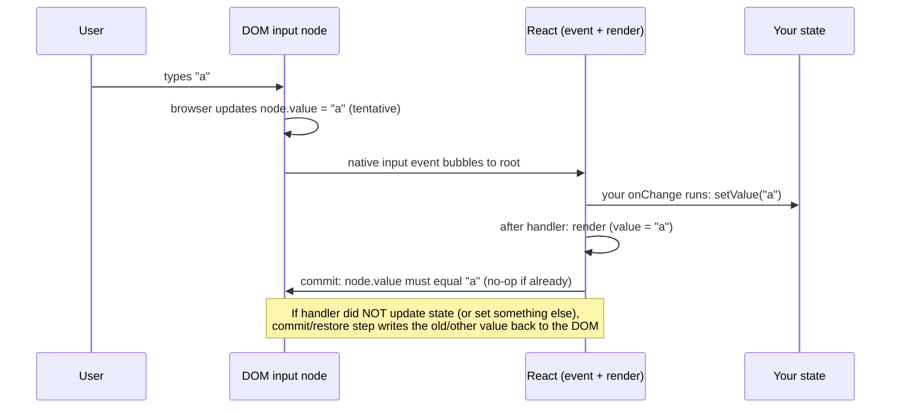
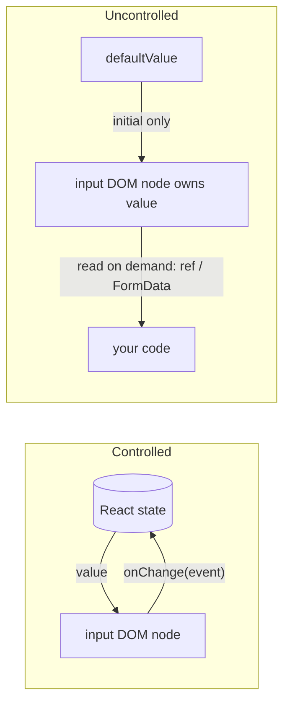
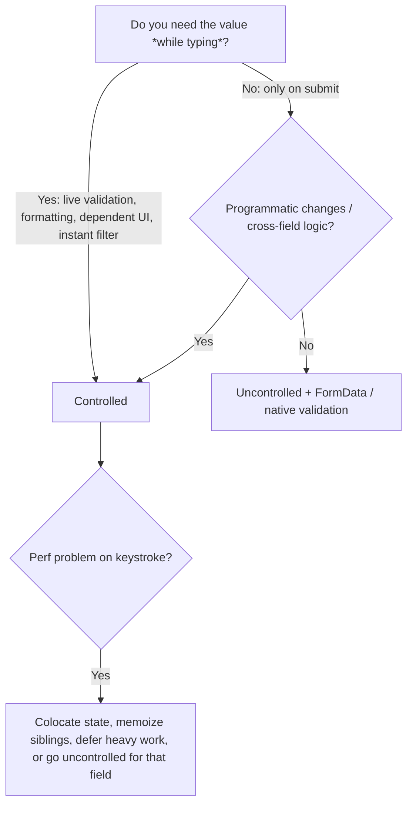

# 01 / 11 — Controlled and Uncontrolled Inputs

## 1. Lesson metadata

| | |
|---|---|
| **Level** | Intermediate |
| **Study time** | 4–5 hours (reading 2 h, experiments 1 h, exercises 1.5 h) |
| **Prerequisites** | [10 — Event handling](./10-event-handling.md); [03 — UI as a function of state](./03-ui-as-a-function-of-state.md); [Phase 0 / 04 — DOM structure and mutation](../00-web-and-javascript-foundations/04-dom-structure-and-mutation.md) |
| **Next** | [12 — Component purity](./12-component-purity.md) |
| **Related later** | [14 — State as a snapshot](./14-state-as-a-snapshot.md), [16 — State preservation and reset](./16-state-preservation-and-reset.md), [Phase 3 / 21 — Forms and complex state](../03-react-state-and-hooks/21-forms-and-complex-state.md), [Phase 5 / 11 — Controlled component pattern](../05-design-patterns/11-controlled-component-pattern.md), [Phase 9 / 13 — Forms, Actions, and mutations](../09-advanced-rendering-and-ecosystem/13-forms-actions-and-mutations.md) |

**Learning objectives.** After this lesson you can:
1. Define *controlled* and *uncontrolled* precisely: **who owns the current value**, React state or the DOM.
2. Write controlled text, checkbox, radio, select (single and multiple), and textarea inputs in TypeScript.
3. Explain why `value` without `onChange` yields a read-only field, and what the "changing an uncontrolled input to be controlled" warning means and how to avoid it.
4. Use uncontrolled inputs with `defaultValue`, refs, and `FormData`, and know when that is the better design.
5. Predict the effect of the `key` prop on uncontrolled inputs' state (reset).
6. Handle practical problems: formatting/masking, cursor jumps, IME composition, number inputs, file inputs, and validation.
7. Apply the same concept to *your own components* (a component is controlled if its parent owns its value).
8. Choose between controlled and uncontrolled by requirements, not dogma.

**Concepts covered:** single source of truth, `value`/`onChange`, `defaultValue`/`defaultChecked`, `checked`, `select` semantics, `FormData`, refs to DOM nodes (usage-level), uncontrolled→controlled switch, `readOnly` vs `disabled`, derived/validated values, cursor position, composition events, file inputs, native constraint validation, controlled vs uncontrolled *components*, per-keystroke render cost.

---

## 2. Deep conceptual explanation

### 2.1 What problem is this lesson solving?

An HTML form control has **its own state inside the browser**: the text typed into an `<input>`, whether a checkbox is checked, which `<option>` is selected. The DOM node is the owner of that value. In plain HTML/JS you read it when you need it (`input.value`).

React's whole premise ([Lesson 03](./03-ui-as-a-function-of-state.md)) is that *state lives in React and the UI is derived from it*. A form control is a hole in that model: there are now **two** places that may hold the truth: React state and the DOM node. If they disagree, which wins? "Controlled vs uncontrolled" is the answer to that question, and picking the answer deliberately is a design decision with consequences for validation, formatting, resets, performance, and testing.

| | **Controlled** | **Uncontrolled** |
|---|---|---|
| Who owns the current value? | React state (a variable in your component or above) | The DOM node |
| How does the input get a value? | `value={state}` (or `checked={state}`) | Initial: `defaultValue` / `defaultChecked`; afterwards the user types |
| How do you learn about changes? | `onChange` → `setState` (every edit) | You don't, until you *ask*: ref (`ref.current.value`) or `FormData` on submit |
| How do you set/reset the value programmatically? | `setState(...)` | Assign to the DOM (`ref.current.value = ""`), `form.reset()`, or change the element's `key` |
| React renders the value on every keystroke? | Yes (state change → render) | No render is caused by typing |

### 2.2 The controlled contract

```tsx
const [name, setName] = useState("");
<input value={name} onChange={(e) => setName(e.target.value)} />
```

Read this as a *loop*:

1. Render: React tells the DOM node, "your value is `name`".
2. The user types a character. The browser updates the DOM node's value *tentatively* and fires an input event.
3. React calls your `onChange`; you call `setName(newValue)`.
4. Re-render: React sets the DOM node's value to the *new* `name`.

The crucial consequence: **React is the final authority.** After your handler returns and React re-renders, the DOM value is forced to equal `value`. If you do not update state (or you update it to something different), the DOM is reset to whatever the state says. That's why:

- `<input value="hello" />` with no state change **cannot be edited**: each keystroke is reverted. (React warns: "You provided a `value` prop to a form field without an `onChange` handler…". Fix by adding `onChange`, using `readOnly`, or using `defaultValue`.)
- You can *transform* input in the handler (uppercase, strip non-digits, cap length) and the user can never type the forbidden characters. Because controlled inputs let the handler decide what value is *allowed to exist*, they are the right tool for masks and constraints.

*Teaching model:* React, in the commit phase, writes the controlled value to the DOM node property after each update and also restores it after an event if state didn't change. *Implementation detail:* the precise mechanics (when the DOM property is assigned, how it avoids unnecessary writes that would disrupt the caret, value tracking for the `input` event) are internal to `react-dom`; do not depend on them.

### 2.3 The uncontrolled approach

```tsx
function Signup() {
  function handleSubmit(e: React.FormEvent<HTMLFormElement>) {
    e.preventDefault();
    const data = new FormData(e.currentTarget);
    const email = String(data.get("email") ?? "");
    const subscribe = data.get("subscribe") === "on";
    save({ email, subscribe });
  }
  return (
    <form onSubmit={handleSubmit}>
      <input name="email" type="email" defaultValue="" required />
      <label><input name="subscribe" type="checkbox" defaultChecked /> Newsletter</label>
      <button type="submit">Sign up</button>
    </form>
  );
}
```

- `defaultValue` / `defaultChecked` give an **initial** value only. Changing them later does *not* update the field (they're read when the node is created). That is exactly what "uncontrolled" means.
- `name` attributes make the control visible to `FormData` and to native form submission.
- No `useState`, no re-render per keystroke, native browser validation (`required`, `type="email"`, `pattern`, `min`/`max`) works with no extra code.

Uncontrolled inputs are not "worse" or "legacy". They are the platform's default model, and a correct *form* can be built from them entirely. React 19's form Actions (`<form action={fn}>`) are designed around `FormData` and uncontrolled fields ([Phase 9/13](../09-advanced-rendering-and-ecosystem/13-forms-actions-and-mutations.md)).

### 2.4 Element-by-element rules

React normalizes a few awkward corners of HTML so that **all** controls follow the `value`/`onChange` pattern:

| Control | Controlled props | Notes |
|---|---|---|
| `<input type="text/email/password/search/...">` | `value`, `onChange` | `e.target.value` is a **string** |
| `<input type="number">` | `value`, `onChange` | Still a string (`""` when empty or unparsable). Convert explicitly; keep the string in state while editing |
| `<input type="checkbox">` | `checked`, `onChange` | Use `e.target.checked` (boolean). `value` is the *submitted* value, not the state |
| `<input type="radio">` | `checked` on each radio, same `name` | One state value for the group: `checked={choice === "a"}` |
| `<textarea>` | `value`, `onChange` | Unlike HTML, content goes in `value`, not as children |
| `<select>` | `value` on the `<select>` (not `selected` on `<option>`) | For `multiple`, `value` is an **array** of strings; read selections via `Array.from(e.target.selectedOptions, o => o.value)` |
| `<input type="file">` | none | **Always uncontrolled** (browsers forbid scripts setting it for security). Read `e.target.files` |
| `<input type="range">`, `date`, `color` | `value`, `onChange` | Value formats are strings in specific formats (`YYYY-MM-DD` etc.) |

### 2.5 The uncontrolled → controlled switch warning

```tsx
const [age, setAge] = useState<string | undefined>();   // starts undefined
<input value={age} onChange={(e) => setAge(e.target.value)} />
```

First render: `value={undefined}` ⇒ React treats the input as **uncontrolled**. After the first keystroke: `value="3"` ⇒ now **controlled**. React warns, in development: "A component is changing an uncontrolled input to be controlled." (and the reverse). Switching modes mid-life is unsupported because the two modes have different ownership rules. `null` is also a problem (React warns that `value` should not be `null`). **Rule:** pick a mode per input at the start and keep it. For controlled inputs, make the state a string from the start: `useState("")`, and map API `null` to `""` at the boundary (`value={user.nickname ?? ""}`).

### 2.6 Controlled/uncontrolled *components* (a general pattern)

The terminology generalizes. A `<Tabs>`, `<Accordion>`, `<Dialog>`, or custom `<DatePicker>` is:

- **Controlled** if the parent passes `value`/`open`/`selected` plus an `onChange`-style callback: the parent owns it.
- **Uncontrolled** if it keeps its own state, initialized by `defaultValue`/`defaultOpen`: the parent doesn't know.

Well-designed libraries support both ([Phase 5/11](../05-design-patterns/11-controlled-component-pattern.md)). The rules carry over: don't flip modes; initial-only props are named `default…`; controlled usage requires the callback.

### 2.7 Common misconceptions

| Misconception | Reality |
|---|---|
| "Controlled inputs are the *correct* way; uncontrolled is a hack." | Both are supported, documented, and appropriate in different cases (§7). |
| "`defaultValue` updates when the prop changes." | It's read when the input mounts; later changes are ignored. To "reset", change the `key`, or imperatively reset. |
| "`value` is just the initial value." | `value` (as opposed to `defaultValue`) makes the input controlled: React enforces it on every render. |
| "`onChange` fires on blur (like the DOM `change`)." | It fires on every edit. |
| "Setting `value` to a number makes it a number input." | Input values are strings. `parseInt` explicitly; handle `""`. |
| "`checked` on a checkbox works like `value` on a text input." | Checkboxes use `checked`/`e.target.checked`. Passing `value={bool}` is wrong. |
| "Controlled inputs re-render the whole page on every keystroke." | They re-render the component that owns the state **and its children** (unless memoized). Putting state high in the tree and having a large subtree makes this slow ([Phase 3/18](../03-react-state-and-hooks/18-state-colocation-and-lifting.md), [Phase 7/07](../07-performance/07-state-colocation-for-perf.md)). |
| "I need controlled inputs to validate." | You can validate uncontrolled inputs on submit (native constraints or your own check on `FormData`) or on `blur`. |

---

## 3. Internal mechanics

### 3.1 What actually happens on a keystroke in a controlled input



*Public guarantee:* for a controlled input, the DOM value after React finishes processing the event equals the `value` prop of the latest render. *Teaching model:* the "restore" step. *Implementation detail:* React compares the DOM's current value to the prop and writes only if they differ (to avoid moving the caret), tracks the last known value to deduplicate events, and does special handling for `number` inputs and IME composition. These details have changed across versions; verify in source if something unusual breaks.

### 3.2 Why controlled updates are synchronous-feeling

Updates caused by discrete events like typing are *urgent* ([Lesson 10 §3.2](./10-event-handling.md)). React processes the state update and commits before the browser can handle the next input, so the character appears in the field without visible lag, **provided the render is fast**. If the same state also drives something expensive (filtering 10,000 rows), typing slows. Remedies: move the state down, split the component, defer the heavy part (`useDeferredValue`, transitions: [Phase 7/12–13](../07-performance/13-usedeferredvalue-in-practice.md)), or go uncontrolled.

If the controlled value is set **asynchronously** (e.g., `await` before `setValue`), the DOM is reverted to the old value on the event, then updated later, causing caret jumps and dropped characters. **Always update a controlled input's state synchronously in `onChange`.** Debounce *derived work*, not the input's own value.

### 3.3 Caret (cursor) jumping

When you rewrite the value in the handler (formatting `"1234567890"` as `"(123) 456-7890"`), React sets the DOM `value` property, and browsers move the caret to the end when a script assigns the property. Typing in the middle of a formatted number then jumps the caret. Fixes: only reformat when needed; restore selection in a layout effect using `selectionStart/selectionEnd`; or use a vetted masking library ([Phase 3/08](../03-react-state-and-hooks/08-uselayouteffect.md)). Don't hand-roll masks for production without testing paste, delete, and mid-string editing.

### 3.4 IME composition

For languages such as Japanese, Chinese, and Korean, text is composed via an input method editor: intermediate characters appear and are replaced on commit. Browsers fire `compositionstart`/`compositionupdate`/`compositionend`, and `input` events *during* composition. A controlled input that **rejects or rewrites** intermediate values (e.g., "digits only", or trimming) can break composition. For fields where IME is plausible, avoid aggressive rewriting during composition (check `e.nativeEvent.isComposing`) and validate at blur/submit instead. (Check browser behavior in your matrix; composition handling varies.)

### 3.5 Refs: the usage-level introduction

An uncontrolled input is read via a **ref**, a mutable box React fills with the DOM node:

```tsx
const inputRef = useRef<HTMLInputElement>(null);
<input ref={inputRef} defaultValue="x" />
// later, in an event handler:
inputRef.current?.value;   // current text
inputRef.current?.focus();
```

`ref.current` is `null` until the node is mounted; read it in handlers or effects, never during render. In React 19, `ref` is a normal prop for function components (no `forwardRef` needed); in earlier versions, passing a ref to your own component required `forwardRef` (legacy in 19). Refs in depth: [Phase 3/10](../03-react-state-and-hooks/10-useref-and-mutable-references.md).

### 3.6 Forms in React 19

React 19 lets `<form action={fn}>` take a function. On submit, React calls `fn(formData)` inside a transition; and, **after a successful action, React resets uncontrolled form fields** to their default values (the form is reset), unless the action is handled differently. Controlled fields are *not* cleared by that reset because their value comes from state; you'd need to reset the state yourself. This is the main behavioral gotcha when mixing the two. Verified in React 19.3.1 (jsdom, 2026-10-22): after a function action completed, the uncontrolled `defaultValue="def"` input reverted to `def` while the controlled input kept its typed value. See <https://react.dev/reference/react-dom/components/form>; details in [Phase 3/22](../03-react-state-and-hooks/22-modern-hooks-and-apis.md).

---

## 4. Step-by-step execution walkthrough

**Scenario:** a controlled username field that forces lowercase and strips spaces. The user types `"A b"` one key at a time.

```tsx
function UsernameField() {
  const [username, setUsername] = useState("");
  return (
    <input
      value={username}
      onChange={(e) => setUsername(e.target.value.toLowerCase().replace(/\s/g, ""))}
    />
  );
}
```

1. **Mount.** `username = ""`. React creates `<input>` with `value=""`.
2. **Keystroke `A`.** Browser sets DOM value `"A"`, fires input. React calls `onChange`; `e.target.value` is `"A"`; handler computes `"a"` and calls `setUsername("a")`.
3. **Render.** `username = "a"`. React compares DOM value (`"A"`) with prop (`"a"`) and writes `"a"` to the node. The user sees `a`.
4. **Keystroke space.** DOM value `"a "`; handler yields `"a"` (strips space); `setUsername("a")`. State is **unchanged**; React may bail out of re-rendering, but the event-end restore step sets the DOM back to `"a"`. The user sees nothing happen: the space is rejected.
5. **Keystroke `b`.** DOM `"ab"`; handler `"ab"`; render and commit. Final: `ab`.

Walking through step 4 is the key insight: even when state doesn't change, React still makes the DOM agree with state ("controlled" means *enforced*).

**Uncontrolled counterpart:** the DOM shows `"A b"` as typed. React learns nothing until you read the value on submit; no renders occur during typing.

---

## 5. Code examples

### 5.1 Minimal example: three flavors of "stuck"

```tsx
function Stuck() {
  const [text, setText] = useState("hi");
  return (
    <>
      <input value="fixed" />                                   {/* A */}
      <input value={text} />                                    {/* B */}
      <input value={text} onChange={(e) => setText(e.target.value)} />  {/* C */}
      <input defaultValue="free" />                             {/* D */}
    </>
  );
}
```

**Predict:** which of A–D can the user edit?

**Result:** Only C and D. A and B are controlled without a handler: every keystroke is reverted. React logs a warning for A and B. C is the controlled contract; D is uncontrolled.
**Why:** controlled = "React enforces `value`"; with no state update, React enforces the old value.
**Fixes:** for read-only display, `readOnly` (still focusable and submitted) or `disabled` (not focusable, not submitted); for editable, add the handler or switch to `defaultValue`.

### 5.2 Practical example: a controlled form with several control types

```tsx
import { useId, useState } from "react";

type Plan = "free" | "pro" | "team";

interface FormState {
  email: string;
  plan: Plan;
  seats: string;            // keep the raw string while editing
  notes: string;
  agree: boolean;
}

const initial: FormState = { email: "", plan: "free", seats: "1", notes: "", agree: false };

export function SubscribeForm({ onSubmit }: { onSubmit: (v: { email: string; plan: Plan; seats: number; notes: string }) => void }) {
  const [form, setForm] = useState<FormState>(initial);
  const emailId = useId();
  const seatsId = useId();

  function update<K extends keyof FormState>(key: K, value: FormState[K]) {
    setForm((prev) => ({ ...prev, [key]: value }));
  }

  const seatsNumber = Number(form.seats);
  const seatsValid = Number.isInteger(seatsNumber) && seatsNumber >= 1 && seatsNumber <= 100;
  const canSubmit = form.email.includes("@") && seatsValid && form.agree;   // derived, not stored

  function handleSubmit(e: React.FormEvent<HTMLFormElement>) {
    e.preventDefault();
    if (!canSubmit) return;
    onSubmit({ email: form.email.trim(), plan: form.plan, seats: seatsNumber, notes: form.notes });
    setForm(initial);                                       // controlled ⇒ you reset it
  }

  return (
    <form onSubmit={handleSubmit} noValidate>
      <label htmlFor={emailId}>Email</label>
      <input id={emailId} type="email" autoComplete="email"
             value={form.email} onChange={(e) => update("email", e.target.value)} />

      <label>
        Plan
        <select value={form.plan} onChange={(e) => update("plan", e.target.value as Plan)}>
          <option value="free">Free</option>
          <option value="pro">Pro</option>
          <option value="team">Team</option>
        </select>
      </label>

      <label htmlFor={seatsId}>Seats</label>
      <input id={seatsId} type="number" min={1} max={100} inputMode="numeric"
             value={form.seats} onChange={(e) => update("seats", e.target.value)}
             aria-invalid={!seatsValid} />

      <label>
        Notes
        <textarea value={form.notes} onChange={(e) => update("notes", e.target.value)} />
      </label>

      <label>
        <input type="checkbox" checked={form.agree}
               onChange={(e) => update("agree", e.target.checked)} />
        I agree to the terms
      </label>

      <button type="submit" disabled={!canSubmit}>Subscribe</button>
    </form>
  );
}
```

Line notes:
- One state object and a generic `update` helper: `K extends keyof FormState` ties the value type to the key, so `update("agree", "yes")` fails to compile.
- `seats` is stored as a **string**, parsed when needed. Storing a `number` would turn the transient empty string (user cleared the field) into `0`, snapping the display and fighting the user.
- `canSubmit` is *derived* each render; there is no `isValid` state to drift out of sync ([Phase 3/17](../03-react-state-and-hooks/17-derived-state.md)).
- `useId` generates stable ids unique per component instance, suitable for `htmlFor`/`id` pairs; SSR-safe ([Phase 3/22](../03-react-state-and-hooks/22-modern-hooks-and-apis.md)). Wrapping an input in `<label>` is an alternative that needs no ids.
- `noValidate` turns off the browser's native constraint UI because we show our own state. Do this only if you provide equivalent accessible messaging; otherwise keep native validation.
- `e.target.value as Plan` is a type assertion: the DOM only gives `string`. It's safe here because options are fixed; for untrusted data, validate at runtime.
- `setForm(initial)` after submit resets all controlled inputs, one state assignment. For uncontrolled forms you'd use `form.reset()`.
- `disabled` submit buttons hide *why* the form can't be submitted, which can hurt usability and accessibility; many teams keep the button enabled and show validation errors on submit instead. This is a design choice, flagged in §8.

### 5.3 Practical example: the uncontrolled form with `FormData`

```tsx
interface Contact { name: string; message: string }

export function ContactForm({ onSend }: { onSend: (c: Contact) => Promise<void> }) {
  const [status, setStatus] = useState<"idle" | "sending" | "sent" | "error">("idle");

  async function handleSubmit(e: React.FormEvent<HTMLFormElement>) {
    e.preventDefault();
    const form = e.currentTarget;                         // read BEFORE await
    const data = new FormData(form);
    const contact: Contact = {
      name: String(data.get("name") ?? "").trim(),
      message: String(data.get("message") ?? "").trim(),
    };
    setStatus("sending");
    try {
      await onSend(contact);
      form.reset();                                       // resets uncontrolled fields to defaultValue
      setStatus("sent");
    } catch {
      setStatus("error");
    }
  }

  return (
    <form onSubmit={handleSubmit}>
      <label>Name <input name="name" required autoComplete="name" /></label>
      <label>Message <textarea name="message" required minLength={10} /></label>
      <button type="submit" disabled={status === "sending"}>Send</button>
      <p role="status">{status === "sent" ? "Thanks!" : status === "error" ? "Something went wrong." : ""}</p>
    </form>
  );
}
```

Notes: the component re-renders only on `status` changes (3 times per submit), not per keystroke. The browser enforces `required`/`minLength` natively. We stash `e.currentTarget` in a local before `await` (Lesson 10: `currentTarget` is `null` afterwards). The status `<p role="status">` is always present so the live region is announced when its text changes.

### 5.4 Incorrect example

```tsx
function Profile({ user }: { user: { nickname: string | null } }) {
  const [nick, setNick] = useState(user.nickname);       // string | null
  return (
    <input
      value={nick}                                       // ✗ null
      onChange={(e) => setNick(e.target.value)}
      defaultValue="anon"                                // ✗ both value and defaultValue
    />
  );
}
```

Problems: (1) `value={null}` ⇒ warning and the input starts "uncontrolled-ish", later flips; TypeScript also complains (`string | null` is not assignable to `string | number | readonly string[] | undefined`). (2) Supplying both `value` and `defaultValue` is an error/warning: pick one mode. (3) `useState(user.nickname)` copies a prop into state *once*; later prop changes are ignored (stale state), a classic bug covered in [Phase 3/17](../03-react-state-and-hooks/17-derived-state.md).

### 5.5 Corrected implementation

```tsx
function Profile({ user }: { user: { id: string; nickname: string | null } }) {
  return <ProfileForm key={user.id} initialNickname={user.nickname ?? ""} />;
}

function ProfileForm({ initialNickname }: { initialNickname: string }) {
  const [nick, setNick] = useState(initialNickname);     // a string from the start
  return <input value={nick} onChange={(e) => setNick(e.target.value)} />;
}
```

`null` is mapped to `""` at the boundary; one mode; and the `key={user.id}` remounts the form when the *identity* of the user changes, so state is re-seeded from the new `initialNickname` ([Lesson 09 §5.5](./09-lists-keys-and-identity.md), [Lesson 16](./16-state-preservation-and-reset.md)). The prop is named `initial…` to signal "seed only", matching the `default…` convention.

### 5.6 Advanced example: formatting with caret preservation (and its cost)

```tsx
import { useLayoutEffect, useRef, useState } from "react";

function formatPhone(digits: string): string {
  const d = digits.slice(0, 10);
  if (d.length <= 3) return d;
  if (d.length <= 6) return `(${d.slice(0, 3)}) ${d.slice(3)}`;
  return `(${d.slice(0, 3)}) ${d.slice(3, 6)}-${d.slice(6)}`;
}

export function PhoneField() {
  const [digits, setDigits] = useState("");
  const ref = useRef<HTMLInputElement>(null);
  const caretDigits = useRef<number | null>(null);        // caret position measured in digits

  function handleChange(e: React.ChangeEvent<HTMLInputElement>) {
    const raw = e.target.value;
    const caret = e.target.selectionStart ?? raw.length;
    caretDigits.current = raw.slice(0, caret).replace(/\D/g, "").length;   // digits before caret
    setDigits(raw.replace(/\D/g, "").slice(0, 10));
  }

  useLayoutEffect(() => {
    const el = ref.current;
    const target = caretDigits.current;
    if (!el || target === null) return;
    // map "n digits before caret" back to a position in the formatted string
    let pos = 0, seen = 0;
    const text = el.value;
    while (pos < text.length && seen < target) {
      if (/\d/.test(text[pos])) seen++;
      pos++;
    }
    el.setSelectionRange(pos, pos);
    caretDigits.current = null;
  }, [digits]);

  return (
    <input ref={ref} type="tel" inputMode="tel" autoComplete="tel"
           value={formatPhone(digits)} onChange={handleChange} />
  );
}
```

**Predict:** the field shows `(123) 456-7890`; the user puts the caret after `3` and types `9`. Where does the caret end up, with and without the layout effect?

**Result:** with the effect: after the new digit (the formatted value becomes `(193) 234-5678`, and the caret sits right after `9`). Without it: at the end of the field, because assigning `value` moves the caret.
**Trade-offs:** this stores only digits and derives the display string (single source of truth; good). It handles mid-string insertion; it does **not** fully handle deletion of a formatting character (e.g., Backspace on `-`) or paste of formatted text with the caret in odd positions. Handling those correctly is why most teams use a tested library. Specific behaviors of `setSelectionRange` for `type="tel"`/`"number"` vary by browser (`type="number"` doesn't support selection APIs at all). *When not to do this:* if you can validate on blur/submit, skip masking entirely.

### 5.7 Advanced example: a component that is both controlled and uncontrolled

```tsx
import { useState } from "react";

interface ToggleProps {
  checked?: boolean;                           // controlled
  defaultChecked?: boolean;                    // uncontrolled initial
  onCheckedChange?: (next: boolean) => void;
  label: string;
}

export function Toggle({ checked, defaultChecked = false, onCheckedChange, label }: ToggleProps) {
  const [inner, setInner] = useState(defaultChecked);
  const isControlled = checked !== undefined;
  const value = isControlled ? checked : inner;

  function handleChange(e: React.ChangeEvent<HTMLInputElement>) {
    const next = e.currentTarget.checked;
    if (!isControlled) setInner(next);         // only manage state when uncontrolled
    onCheckedChange?.(next);
  }

  return (
    <label>
      <input type="checkbox" role="switch" checked={value} onChange={handleChange} />
      {label}
    </label>
  );
}
```

Usage: `<Toggle label="Wi-Fi" />` (uncontrolled, remembers itself) and `<Toggle label="Wi-Fi" checked={on} onCheckedChange={setOn} />` (controlled). A parent can *veto* a change by not updating `checked`; the toggle then snaps back, exactly like a native controlled input.
**Edge cases to handle in a library:** warn in development when `checked` flips between `undefined` and defined; don't read `isControlled` from a stale closure. Real libraries wrap this in a `useControllableState` hook ([Phase 5/11](../05-design-patterns/11-controlled-component-pattern.md)).

### 5.8 Advanced example: resetting an uncontrolled input by key

```tsx
function Note({ id, initialText }: { id: string; initialText: string }) {
  return <textarea key={id} defaultValue={initialText} aria-label="Note" />;
}
```

When `id` changes the `<textarea>` is a **new DOM node** with the new `defaultValue`; the previous text is discarded. Without `key`, switching `id` would keep the old typed text (same node; `defaultValue` is read only on mount). This is the idiomatic way to "reset" uncontrolled fields when the thing being edited changes.

---

## 6. Visual explanations

### Who owns the value?



### Decision guide



### Controlled input timeline

```text
keystroke → DOM value changes → onChange → setState → render(value=new) → commit
                                   │
                                   └─ if setState is skipped/rejects: commit restores old value
```

---

## 7. Alternative approaches and trade-offs

| Criterion | Controlled (`useState` per form) | Uncontrolled (`FormData`/refs) | Form library (React Hook Form–style, mostly uncontrolled) | Form library (controlled; Formik-style) | React 19 Actions + uncontrolled |
|---|---|---|---|---|---|
| Re-renders per keystroke | The owner + children | None | Few (field-level subscriptions) | Often whole form (library-dependent) | None |
| Live validation / dependent fields | Easy | Manual (listen to events) | Supported | Supported | Manual |
| Programmatic set/reset | Trivial (`setState`) | Imperative (`reset()`, refs, `key`) | API-provided | API-provided | `form.reset()` after action (automatic on success) |
| Native validation UI | Possible (`noValidate` off) | Native by default | Both | Both | Native by default |
| Testing | Test via state/DOM | Test via DOM/FormData | Library-specific | Library-specific | DOM + action |
| Boilerplate | Medium–High for big forms | Low | Low–Medium | Medium | Low |
| SSR/progressive enhancement | Needs JS | Works without JS (with framework) | Needs JS for logic | Needs JS | Designed for it with frameworks |
| Typing safety | Strong (your state type) | Weak (`FormData.get` → `FormDataEntryValue | null`) | Depends on schema | Depends | Weak unless schema-validated (e.g., Zod, verify choice) |

**When the typically recommended approach (controlled inputs) is *not* best:**
- A simple "contact us" form that only needs values on submit: uncontrolled is shorter, faster, and gets native validation and accessible error UI for free.
- A form with 200 fields (admin configuration): controlled-per-field in a single state object re-renders everything on each keystroke; use per-field state/subscriptions, an uncontrolled library, or split sections.
- File inputs: always uncontrolled.
- Integrating non-React widgets or autofill-heavy fields (password managers, browser autofill) sometimes interacts poorly with aggressive controlled rewriting; test them.

When controlled is clearly right: live character counters, instant search-as-you-type, masks/constraints, dependent selects, undo/redo, persisting drafts, "unsaved changes" detection, programmatic reset to server state.

---

## 8. Best practices and anti-patterns

**Do**
- Decide per field: controlled *or* uncontrolled, never switching.
- Initialize controlled state with the right type (`""` not `undefined`/`null`); map nulls at the boundary.
- Update controlled state **synchronously** in `onChange`.
- Keep raw strings in state for numeric/date text fields; parse for logic.
- Derive validity and error messages from state; don't store them separately.
- Pair every control with a visible `<label>` (`htmlFor` or wrapping); use `autoComplete`, correct `type`, and `inputMode` for mobile keyboards.
- Show errors in text (not color only), associate with `aria-describedby`, and mark `aria-invalid`.
- Use `key` to reset when the *identity* of the edited thing changes.
- Prefer `readOnly` to `disabled` when the value should remain focusable/submittable; know the difference.

**Beginner mistakes**
- `value` without `onChange`.
- `useState()` with no initial value for an input.
- `value={bool}` on checkbox instead of `checked`.
- Storing numbers for number inputs and fighting the empty string.
- Using `defaultValue` and expecting updates.
- Using `onClick` on the submit button instead of `onSubmit` on the form.

**Experienced-developer mistakes**
- One giant `useState` object at the top of a big form causing a re-render storm.
- Debouncing the *input's value* (state) instead of the derived work, which breaks the controlled contract and drops characters.
- Mirroring props into state to "initialize" inputs and forgetting later updates (`useEffect` to sync, causing flashes). Prefer a `key` or fully controlled-by-parent.
- Rewriting values aggressively during IME composition.
- Re-implementing native validation poorly instead of using constraint validation plus custom messaging.
- Treating client validation as security: the server must validate.

**Smells**
- `useEffect(() => setValue(prop), [prop])` for form seeding.
- Both `value` and `defaultValue`.
- `ref.current.value = …` inside a controlled input's handler (two writers).
- `disabled={!isValid}` on the submit button with no explanation.
- Dozens of `useState` calls, each with its own `onChange` lambda, copy-pasted: reach for a reducer or a form abstraction ([Phase 3/03](../03-react-state-and-hooks/03-usereducer-and-reducer-architecture.md)).

**Justified exceptions**
- Mixed mode: uncontrolled fields for the bulk, plus a controlled field for the one that needs live behavior.
- Imperative focus/scroll via refs alongside controlled inputs: refs for *behaviors*, not for *values*.

---

## 9. Real-world application

**Checkout (e-commerce).** Card numbers, expiry, CVC. Constraints: PCI scope pushes teams to use payment-provider iframes/hosted fields (inputs *you don't control* and cannot read), a hard reminder that not every input can be controlled by your React state. Address forms: `autoComplete` tokens (`address-line1`, `postal-code`) boost conversion and a11y; avoid masks that fight autofill. Validation after blur and on submit, focus the first error, announce the error summary.

**Dashboards (filters).** Search-as-you-type filter over a table: a controlled input at the top; heavy table below. Keep the input's state close to the input; lift only the *debounced/deferred* query to the table. ([Phase 7/13](../07-performance/13-usedeferredvalue-in-practice.md).) URL-synchronized filters: the URL is the source of truth, and the input is controlled by URL state ([Phase 6/18](../06-data-fetching-and-state-ecosystems/18-url-state-management.md)).

**Finance.** Currency fields: store minor units (integers) or a decimal string; never floating-point money. Formatting on blur, raw digits while typing (avoid caret-jumping masks). Prevent accidental changes by scroll-wheel on `type="number"` (a known UX hazard; use `type="text"` + `inputMode="decimal"` + validation). Audit requires that the submitted value equals the displayed value, a reason to keep a single source of truth.

**Authentication.** Password managers and browser autofill write to inputs without keystrokes; ensure `autoComplete="username"`/`"current-password"`, correct `name`s, and that your controlled state captures autofilled values (some browsers fire change events only on interaction; test in real browsers). Never log values; clear sensitive state after use.

**Realtime/collaboration.** A controlled input whose value can also be changed by remote edits needs conflict rules (don't overwrite while the local user is typing; show remote changes after blur or merge via CRDT/OT). The mere existence of two writers makes the controlled/uncontrolled choice an architecture decision.

**Design systems.** Public form components should support both modes (`value`/`defaultValue`), forward `name`, `id`, `ref` (a prop in React 19), `aria-*`, and `onChange` with the real event (so consumers can use `e.target.name`), or a value-first callback (`onValueChange(value)`) *documented* as such. Mixing conventions across components is a common source of confusion across teams.

---

## 10. Debugging and troubleshooting

**Symptom 1: "I can't type in my input."**
- *Investigate:* console warning "You provided a `value` prop to a form field without an `onChange` handler". In Components, check props: `value` present, `onChange` missing or throws. Set a breakpoint in `onChange`; does it fire?
- *Root causes:* missing handler; handler doesn't call `setState`; handler sets a *transformed* value that equals the previous one (§4 step 4); handler updates a different state key; state updated asynchronously.
- *Fix and validate:* synchronous `setState` with the new value; type and confirm characters appear and warning gone.

**Symptom 2: "A component is changing an uncontrolled input to be controlled."**
- *Root cause:* `value` started as `undefined` (state initialized without a value, or API data not yet loaded). Check `useState()` calls and props that feed `value`.
- *Fix:* initialize to `""`; `value={data?.name ?? ""}`; or render the form only after data is available, with `key`.

**Symptom 3: cursor jumps to the end while typing.**
- *Investigate:* does the handler transform the value? Is the state updated asynchronously (debounce/await)? Is the input remounting (changing `key` or defining the component inside another component, Lesson 09 B3)? Remount also loses focus; caret jump without focus loss suggests value rewriting.
- *Fix:* synchronous updates; avoid rewriting unless necessary; restore selection in a layout effect; or format on blur.

**Symptom 4: input loses focus after each keystroke.** Remounting: component defined inside render; unstable `key`; parent conditionally wrapping with different element types. Use the DevTools "Highlight updates" and check whether the DOM node flashes as replaced in the Elements panel; fix as in Lesson 09.

**Symptom 5: input shows stale text when switching records.**
- *Root cause:* same component instance reused (same type/position); local state or `defaultValue` isn't re-seeded.
- *Fix:* `key={recordId}` on the form component, or make it fully controlled by the parent.

**Symptom 6: typing is laggy in a big form.**
- *Investigate:* React DevTools Profiler: record while typing; see which components re-render per keystroke and why ("props changed" vs "parent rendered"); check render time. 
- *Fix:* colocate state (move the field into its own component); memoize heavy siblings; defer derived work; consider uncontrolled for the lagging fields. Validate by re-profiling: the flame graph should show only the input component re-rendering. ([Phase 2/30](../02-react-rendering-and-internals/30-react-devtools-profiler.md).)

**Symptom 7: form values empty on submit with `FormData`.**
- *Root cause:* inputs lack `name`; disabled inputs are excluded from `FormData`; unchecked checkboxes are absent; `FormData` read from the wrong form element; or controls are outside the `<form>` (use the `form` attribute).
- *Validate:* `console.log([...new FormData(form)])`.

**Symptom 8: after submit via Action, controlled field didn't clear / uncontrolled one cleared unexpectedly.** React 19 resets *uncontrolled* fields after a successful form action; controlled ones are driven by state, so reset the state yourself (or make the form uncontrolled).

---

## 11. Exercises

### Level A — Knowledge
A1. Define controlled and uncontrolled input in one sentence each, using the word "owns".
A2. What is the difference between `value` and `defaultValue`? What happens if you change `defaultValue` after mount?
A3. Why does `<input value="x" />` seem frozen? List two ways to make it legitimate.
A4. Which props do checkboxes and radio buttons use for their state? How do you read the new state in the handler?
A5. Which `<input>` type is always uncontrolled and why?
A6. What does the warning "changing an uncontrolled input to be controlled" mean, and what are two typical causes?
A7. What's the difference between `readOnly` and `disabled` for form submission and focus?

### Level B — Code comprehension
B1. What does the user see when typing `abc` into each field?
```tsx
const [v, setV] = useState("");
<input value={v} onChange={(e) => setV(e.target.value.replace(/[^0-9]/g, ""))} />
```
B2. In the following, what's displayed after typing `x` once, and why?
```tsx
const [v, setV] = useState("");
<input value={v} onChange={(e) => setTimeout(() => setV(e.target.value), 0)} />
```
B3. Will this textarea update if `props.text` changes from "a" to "b" without remounting? What if keyed by id?
```tsx
<textarea defaultValue={props.text} />
```
B4. `<select value="b" onChange={...}><option value="a">A</option><option value="b">B</option></select>`: which option is selected? What would `selected` on an option do?
B5. How many renders happen in `ContactForm` (§5.3) while the user types 40 characters before submitting?

### Level C — Implementation
C1. Build a controlled `<CharLimitedTextarea max={140}>` with a live counter, `aria-describedby` linking to the counter, and a polite announcement when 10 characters remain (not on every keystroke).
C2. Build an uncontrolled signup form using `FormData` and native validation that shows a custom error summary on submit failure *without* re-rendering per keystroke.
C3. Implement `useControllableState<T>({ value, defaultValue, onChange })` and use it to build a `<Accordion>` item that supports both modes.
C4. Create a currency input storing integer cents, showing `1,234.56` on blur and the raw digits while focused, with no caret-jump problems.

### Level D — Debugging
D1. The input never changes when typed. Find three possible causes from this code and fix:
```tsx
const [form, setForm] = useState({ email: "", name: "" });
<input value={form.email} onChange={(e) => setForm({ name: e.target.value })} />
```
D2. After loading a user from the API, the form shows an old user's data when you navigate from user 1 to user 2:
```tsx
function Editor({ user }: { user: User }) {
  const [name, setName] = useState(user.name);
  return <input value={name} onChange={(e) => setName(e.target.value)} />;
}
```
Explain, then give two fixes with trade-offs.
D3. A phone-formatting input drops characters when typing quickly; the handler is `async` and awaits a validation call before `setValue`. Explain precisely and fix.
D4. A form submitted through `<form action={saveAction}>` clears the "notes" textarea but not the "title" input. What's happening and how would you make behavior consistent?
D5. `new FormData(form)` is missing the value of a checkbox and a `select`. List causes.

### Level E — Architecture and engineering decisions
E1. A 60-field insurance quote form is slow when typing. You own it. Evaluate: split into components with local state, switch to uncontrolled with a library, memoization, deferred values. Recommend and describe how you'd measure.
E2. Design the public API of your design system's `<TextField>`: controlled/uncontrolled support, event signature, error and description wiring, ref forwarding. Justify each choice.
E3. A product manager wants a "Save draft automatically" feature on a long uncontrolled form. Describe options and trade-offs (controlled conversion, `input` event listener on the form, periodic `FormData` snapshot).

### Level F — Expert challenge
F1. Build a mental model and test plan for a controlled masked input (e.g., IBAN) that must work with: mid-string edits, paste, autofill, IME, undo (Ctrl+Z), mobile keyboards, and screen readers. Identify which behaviors a controlled React input can make worse than a native input and how you'd verify in real browsers. Decide whether to build or buy.

---

## 12. Detailed answers and explanations

> Attempt the exercises first.

**A1.** Controlled: the React component (state) owns the field's current value and pushes it into the DOM on every render. Uncontrolled: the DOM node owns the value; React only supplies an initial one and you read it when needed.

**A2.** `value` makes the input controlled: React enforces it on each render. `defaultValue` provides the initial value of an uncontrolled input; changing it after mount has no effect on the displayed text (to apply, remount with a new `key`, or reset imperatively). Common wrong answer: "defaultValue is an older name for value".

**A3.** `value` is provided without `onChange`, so React enforces the constant value and reverts each edit. Legitimate fixes: add `onChange` + state (editable); `readOnly` (non-editable but focusable/submittable); `disabled` (not focusable, not submitted); or use `defaultValue` for an editable uncontrolled field.

**A4.** `checked` (not `value`). Read `e.target.checked` / `e.currentTarget.checked` (boolean). For radios, each has `checked={group === thisValue}` and handler reads `e.target.value`.

**A5.** `type="file"`: for security, scripts can't set the selected file's value; read `e.target.files` (`FileList`).

**A6.** The input was rendered with `value === undefined` (uncontrolled) and later with a defined `value` (controlled), or vice versa. Causes: `useState()` without initial value; data loading where `value={data?.x}` is `undefined` before the response; `null` from an API. Fix by always providing a string.

**A7.** `readOnly`: focusable, selectable, submitted with the form, not editable. `disabled`: not focusable, not editable, **not** submitted, and often announced as unavailable. Use `readOnly` when the value must still be submitted or copied.

**B1.** Typing `abc` shows nothing: each keystroke yields a value with letters stripped, which equals the current state `""`. State doesn't change; React restores the DOM to `""`. If the user types `a1b2`, they see `1` then `12`. Trap: thinking the DOM shows letters until blur.

**B2.** The character does not appear (or flickers): React finishes the event with state still `""` and restores the DOM to `""`; then the timeout fires and sets `v` to the *event's* `e.target.value`, but by then (a) in React 17+, `e.target.value` reads the DOM value, now restored to `""` (the event object is no longer pooled, but `e.target` is the live DOM node), so the timeout sets `""` again. Net: **nothing can be typed**. In older versions with pooling, `e.target` would be null and throw. The lesson: controlled input state must update synchronously. Fix: `setV(e.target.value)` directly; debounce derived work.

**B3.** No: `defaultValue` is read at mount only; with the same node the old text remains (and if the user typed, their text stays). Keyed by id: when `id` changes the textarea remounts and shows the new default; if only the `text` changes with the same id, still no update (by design; if you need external updates to reflect, the field must be controlled).

**B4.** Option B is selected (`value` on `<select>`). Using `selected` on `<option>` in React is unsupported/warns: use `value`/`defaultValue` on `<select>` so the same pattern works for single, multiple (array), and controlled/uncontrolled.

**B5.** Zero renders from typing: the component has no per-keystroke state. Renders occur on mount and on each `status` change (idle → sending → sent/error). Total: 1 + up to 2 per submit. Strict Mode in dev double-invokes render but that doesn't change the commit count semantics.

**C1. Reference solution**
```tsx
import { useId, useState } from "react";

export function CharLimitedTextarea({ max = 140, label }: { max?: number; label: string }) {
  const [text, setText] = useState("");
  const counterId = useId();
  const remaining = max - text.length;
  const announce = remaining <= 10;       // polite status only near the limit

  return (
    <div>
      <label>
        {label}
        <textarea
          value={text}
          maxLength={max}
          aria-describedby={counterId}
          onChange={(e) => setText(e.target.value)}
        />
      </label>
      <span id={counterId} aria-hidden={announce ? undefined : true}>{remaining} characters left</span>
      <span role="status" className="visually-hidden">
        {announce ? `${remaining} characters left` : ""}
      </span>
    </div>
  );
}
```
Reasoning: `maxLength` is enforced natively; the counter is linked for AT users that read the description on focus; the live region text is empty except near the limit so that screen readers aren't spammed per keystroke. Caveat: `aria-hidden` on a node referenced by `aria-describedby` is still used for the description by most AT per the accessible-name computation spec, but behavior varies; test with a screen reader. Evaluation criteria: controlled, labelled, counter derived (not state), restrained announcements.

**C2. Reference solution (sketch)**
```tsx
export function SignupForm() {
  const [errors, setErrors] = useState<string[]>([]);
  function handleSubmit(e: React.FormEvent<HTMLFormElement>) {
    e.preventDefault();
    const form = e.currentTarget;
    if (!form.checkValidity()) {                       // native constraint validation
      const bad = Array.from(form.elements).filter(
        (el): el is HTMLInputElement => el instanceof HTMLInputElement && !el.validity.valid,
      );
      setErrors(bad.map((el) => `${el.name}: ${el.validationMessage}`));
      bad[0]?.focus();
      return;
    }
    setErrors([]);
    void send(Object.fromEntries(new FormData(form)));
  }
  return (
    <form onSubmit={handleSubmit} noValidate>
      {errors.length > 0 && (
        <ul role="alert">{errors.map((m) => <li key={m}>{m}</li>)}</ul>
      )}
      <label>Email <input name="email" type="email" required /></label>
      <label>Password <input name="password" type="password" required minLength={12} /></label>
      <button type="submit">Create account</button>
    </form>
  );
}
```
Re-renders only occur on failed submission (error list). `noValidate` suppresses browser bubbles so the custom summary is the single UI. Edge cases: `Object.fromEntries(new FormData(form))` loses repeated keys (multi-selects/checkbox groups); use `getAll`. File fields yield `File` objects.

**C3. Reference solution**
```tsx
import { useCallback, useState } from "react";

export function useControllableState<T>({
  value, defaultValue, onChange,
}: { value?: T; defaultValue: T; onChange?: (v: T) => void }) {
  const [inner, setInner] = useState<T>(defaultValue);
  const isControlled = value !== undefined;
  const current = isControlled ? value : inner;

  const set = useCallback(
    (next: T) => {
      if (!isControlled) setInner(next);
      onChange?.(next);
    },
    [isControlled, onChange],
  );
  return [current, set] as const;
}

export function AccordionItem({ title, open, defaultOpen = false, onOpenChange, children }: {
  title: string; open?: boolean; defaultOpen?: boolean;
  onOpenChange?: (o: boolean) => void; children: React.ReactNode;
}) {
  const [isOpen, setOpen] = useControllableState({ value: open, defaultValue: defaultOpen, onChange: onOpenChange });
  return (
    <section>
      <h3><button type="button" aria-expanded={isOpen} onClick={() => setOpen(!isOpen)}>{title}</button></h3>
      {isOpen && <div>{children}</div>}
    </section>
  );
}
```
Notes: `T` that legitimately includes `undefined` breaks the `value !== undefined` test; libraries use an explicit flag or wrapper types. `setOpen(!isOpen)` reads the render snapshot; for rapid toggles, functional updaters would need the hook to support them. Also add a dev warning for mode switching.

**C4. Reference outline.** State holds `cents: number | null` and `focused` and a raw `text` while focused. On focus: show the raw digits/decimal string (`(cents/100).toFixed(2)` without grouping). On change: update `text` synchronously; parse on each change to `cents` if valid (`/^\d*(\.\d{0,2})?$/` else ignore the keystroke by not updating). On blur: set `text` from `cents` formatted with `Intl.NumberFormat`. Because formatting only happens on blur, there's no caret jump. Evaluation: money as integers; no float math (`Math.round(parseFloat(x) * 100)` is acceptable *only* with rounding awareness; best to parse the string parts); locale decimal separators considered (some locales use commas: use `Intl` or restrict).

**D1.** Causes: (1) `setForm({ name: … })` replaces the object, dropping `email`, so `form.email` becomes `undefined` ⇒ uncontrolled/controlled warning and the field resets; (2) it writes `name` from the *email* input; (3) the state shape isn't spread. Fix: `setForm((f) => ({ ...f, email: e.target.value }))`.

**D2.** `useState(user.name)` is read once at mount. When navigating 1 → 2, `Editor` is the same type at the same position: the instance is reused, state remains "Alice" though props show Bob. Fix A: `<Editor key={user.id} user={user} />` (simple, discards edits when switching; usually desired). Fix B: lift the draft state to the parent keyed by user id (retains per-user drafts; more code). Wrong fix: `useEffect(() => setName(user.name), [user.name])`: causes an extra render with stale text and overwrites in-progress edits if the user object refetches; mention only as last resort. 

**D3.** The `await` makes `setValue` happen after the event handler returned; React restores the DOM to the old state value at event end; subsequent keystrokes start from the restored text, so fast typing overwrites/drops characters, and the caret jumps. Fix: update state synchronously with the raw input; run validation separately (effect or debounced derived state) and store the result as its own state keyed to the value (and discard stale results).

**D4.** React 19 resets uncontrolled form fields after a successful action. "notes" is uncontrolled (or its value isn't state-backed) and gets reset to default; "title" is controlled (`value={title}`), so state keeps it. Make it consistent: make both uncontrolled (and treat the form as `FormData`-driven), or make both controlled and reset state explicitly after success (or preserve inputs on error via `defaultValue` from the action state). Verify the exact reset semantics for your version in the `<form>` reference.

**D5.** Causes: missing `name`; control is `disabled`; unchecked checkboxes aren't included by design; a `select` with no selected option and `disabled`/placeholder option; control lies outside the `<form>` without `form="id"`; reading `FormData` from the wrong element; submit button name not included unless used as submitter via `new FormData(form, submitter)`.

**E1. Evaluation criteria and a good answer.** Criteria: measured cost, maintainability, validation needs, team skill. Start by measuring (Profiler: which components re-render per keystroke and for how long). Likely finding: one top-level `useState` object ⇒ the whole form re-renders per keystroke. Recommendation: first *colocate*, make each field (or section) a component with local state or a field-level subscription, and lift only what cross-field rules need; second, memoize or `React.memo` heavy sections *after* confirming they re-render needlessly; third, if the form is mostly submit-time, adopt an uncontrolled-by-default form library with field-level subscriptions; deferred values help when a *derived* heavy computation (premium preview) follows each keystroke. Re-measure to confirm. Weak answers jump to a library without a profile, or add `useMemo` everywhere.

**E2.** A good API: supports `value`/`defaultValue` (uncontrolled via native input when no `value`), `onChange` with the native event (compat) and optionally `onValueChange(value: string)`; forwards `ref` (prop in React 19; `forwardRef` wrapper for ≤18 consumers), `name`, `id` (auto via `useId` when absent), `disabled`, `readOnly`, `required`, `autoComplete`; renders `<label>`, description and error with `aria-describedby`, and `aria-invalid`; error text is a real element with an id; spreads rest props to the input; dev warning on mode switching. Justify: native-event compatibility with form libraries; value-first callback for ergonomics; id wiring to avoid per-team errors. Trade-off: two callbacks create ambiguity (document the order and that both fire).

**E3.** Options: (1) listen to the form's bubbling `input`/`change` events (`<form onChange={…}>`; React's `onChange` on a form receives bubbled events from inputs) and snapshot `FormData` into storage with a debounce: minimal change, works for any control; caveats: controlled children, file inputs can't be persisted, sensitive data in storage. (2) Convert to controlled state: richer control, per-keystroke cost, better for restoring drafts with validation. (3) Periodic snapshot via interval; simpler but may lose last seconds. Recommend (1) for uncontrolled forms, adding `beforeunload`/`visibilitychange` flush, and restoring through `defaultValue`s on mount with a key per draft id. Also address privacy: don't persist passwords/payment data.

**F1.** A strong answer lists known risks: (a) Controlled rewriting breaks the native undo stack (setting `value` programmatically typically clears or corrupts undo history in many browsers), so Ctrl+Z may not behave; (b) caret jumps on mid-string edits/paste; (c) IME composition interruptions; (d) autofill and mobile keyboards (some set values without keystroke-like events); (e) screen readers re-announce the whole value on programmatic replacement. Mitigations: store raw/unformatted state and format only at safe times (blur) or use a masked-input library with caret management tested across browsers; skip rewriting during composition; provide format hints and validation on blur instead of live masks; maintain a test matrix in real browsers (Playwright with Chromium/WebKit/Firefox, plus manual screen reader/IME passes since emulation is limited). Build vs buy: buy (or adopt a vetted component) unless you have unusual rules, as the long tail of input-editing edge cases is costly; if building, restrict the mask to separators-only tolerance (accept pasted/typed input in any grouping, normalize on blur). Evaluate answers on accurate identification of the undo/IME/caret issues and on a real-browser test plan.

---

## 13. Senior engineer interview questions

**Q1. "Controlled vs uncontrolled: how do you decide?"**
*Strong answer:* Decide who should own the value. If the UI must react to the value as it changes (live validation, dependent fields, masks, instant filtering, programmatic resets), React owns it: controlled. If values are needed only at submit, uncontrolled with native validation and `FormData` is simpler, cheaper per keystroke, and more progressive-enhancement friendly. Consider form size/perf, library choice, React 19 form Actions, and file inputs (always uncontrolled). Don't mix modes per field.

**Q2. "Why can't I type in my `<input value={x} />`?"**
*Strong answer:* A `value` prop makes it controlled; React reasserts the prop value after each event, so unless `onChange` updates state to the new value, the edit is reverted. Mention the warning, `readOnly`/`defaultValue` alternatives, and the "async update" variation.

**Q3. "How do you reset a form?"**
*Strong answer:* Controlled: set state to initial. Uncontrolled: `form.reset()` (resets to `defaultValue`s), or change the `key` of the form/fields to remount with new defaults. When the identity of the edited entity changes, prefer `key`. Note React 19 form Actions auto-reset uncontrolled fields on success and don't reset controlled state.

**Q4. "A controlled input is slow on a big page. What do you do?"**
*Strong answer:* Profile first. Typing triggers a render of the state owner and its subtree. Colocate the state so only the input re-renders, memoize or isolate expensive siblings, defer derived heavy work (`useDeferredValue`/transition), debounce the *work* not the value, or make uncontrolled for that field. Re-measure INP/profiler.

**Q5. "What's wrong with `useState(props.value)` for an input's initial value?"**
*Strong answer:* It captures only the initial prop; later changes are ignored, creating stale UI. Make the component controlled by the parent, or treat the prop as an initial/default value and reset with `key` when the identity changes; avoid effect-based syncing, which adds render flashes and overwrites user edits.

**Q6. "How would you support both controlled and uncontrolled in a component library?"**
*Strong answer:* `value`/`defaultValue` + change callback; internal state used only when `value === undefined`; avoid switching modes at runtime (warn); handle `undefined` as a valid value with care; forward refs; keep the callback signature consistent across the library; document that controlled consumers must update the prop to see changes (the parent can veto).

---

## 14. Further learning resources

| Resource | URL | Covers / why | Level | Study |
|---|---|---|---|---|
| React docs: `<input>` | <https://react.dev/reference/react-dom/components/input> | Controlled/uncontrolled behavior, all input types, caveats and troubleshooting | Beginner–Int. | "Usage" and "Troubleshooting" |
| React docs: `<textarea>` | <https://react.dev/reference/react-dom/components/textarea> | Value semantics | Beginner | Usage |
| React docs: `<select>` | <https://react.dev/reference/react-dom/components/select> | `value`, multiple selections | Beginner | Usage |
| React docs: `<form>` | <https://react.dev/reference/react-dom/components/form> | Actions, `FormData`, reset behavior | Intermediate | Usage; verify current semantics |
| React docs: Reacting to Input with State | <https://react.dev/learn/reacting-to-input-with-state> | Declarative forms mental model | Beginner | Entire page |
| React docs: Choosing the State Structure | <https://react.dev/learn/choosing-the-state-structure> | Avoiding contradictory/duplicated form state | Intermediate | Entire page |
| MDN: `FormData` | <https://developer.mozilla.org/en-US/docs/Web/API/FormData> | Reading form values natively | Beginner | Constructor, `get`, `getAll` |
| MDN: Client-side form validation | <https://developer.mozilla.org/en-US/docs/Learn_web_development/Extensions/Forms/Form_validation> | Constraint validation API | Beginner | Whole page |
| MDN: `compositionstart` event | <https://developer.mozilla.org/en-US/docs/Web/API/Element/compositionstart_event> | IME composition basics | Advanced | Whole page |
| WAI: Forms tutorial | <https://www.w3.org/WAI/tutorials/forms/> | Labels, instructions, validation accessibility | Intermediate | Labels, Notifications |
| React docs: `useId` | <https://react.dev/reference/react/useId> | Accessible id pairs | Beginner | Usage |

---

## 15. Knowledge checkpoint

**You should now understand**
- Controlled = React owns the value and enforces it; uncontrolled = the DOM owns it and you read it on demand.
- That `value` without a synchronous state update gives a frozen input, and why mode switching warns.
- How refs, `FormData`, `defaultValue`, and `key` support the uncontrolled path.
- That formatting, IME, caret behavior, and per-keystroke cost are the real-world costs of controlling inputs.

**You should be able to explain without notes**
- The keystroke → onChange → setState → render → DOM-enforcement loop.
- Why `defaultValue` doesn't update and how `key` resets.

**You should be able to implement**
- A typed controlled form, an uncontrolled `FormData` form with native validation, and a component supporting both modes.

**You should be able to debug**
- Frozen inputs, caret jumps, focus loss, stale inputs on record switch, missing `FormData` values, and slow typing.

**Before moving on:** read [12 — Component purity](./12-component-purity.md); it explains *why* the handler/render split in this lesson (state written in handlers, never in render) is a rule rather than a style.
