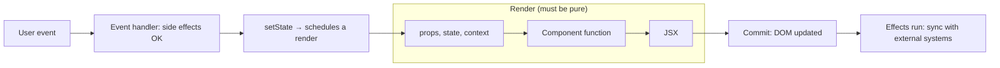
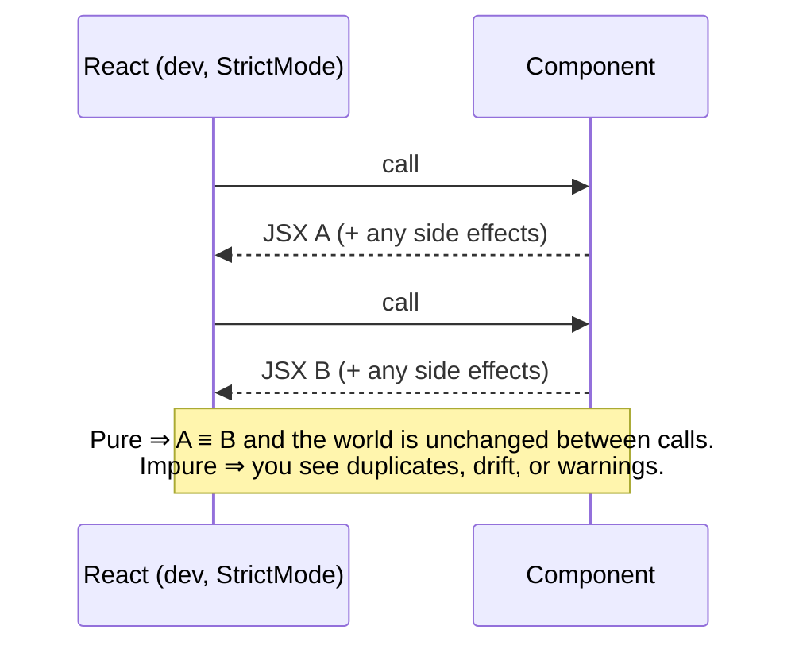

# 01 / 12 — Component Purity

## 1. Lesson metadata

| | |
|---|---|
| **Level** | Intermediate |
| **Study time** | 3.5–4.5 hours (reading 1.5 h, experiments 1 h, exercises 1–1.5 h) |
| **Prerequisites** | [06 — Props and one-way data flow](./06-props-and-one-way-data-flow.md); [10 — Event handling](./10-event-handling.md) (handlers are where side effects live); [Phase 0 / 08 — Objects, references, immutability](../00-web-and-javascript-foundations/08-objects-references-immutability.md); [Phase 0 / 07 — Functions and referential identity](../00-web-and-javascript-foundations/07-functions-and-referential-identity.md) |
| **Next** | [13 — The rendering mental model](./13-rendering-mental-model.md) |
| **Related later** | [Phase 2 / 12 — Why rendering must be pure](../02-react-rendering-and-internals/12-why-rendering-must-be-pure.md), [Phase 2 / 28 — Strict Mode behavior](../02-react-rendering-and-internals/28-strict-mode-behavior.md), [Phase 3 / 07 — You might not need an effect](../03-react-state-and-hooks/07-you-might-not-need-an-effect.md), [Phase 9 / 08 — React Compiler](../09-advanced-rendering-and-ecosystem/08-react-compiler.md) |

**Learning objectives.** After this lesson you can:
1. State React's purity contract for components: **same inputs (props, state, context) ⇒ same JSX, and no observable side effects while rendering**.
2. Distinguish *local mutation* (fine) from mutation of anything that existed before this render began (not fine).
3. Recognize impure patterns: `Math.random()`/`Date.now()` in output, module-level counters, mutating props/state/context, `fetch`/subscriptions/DOM access/`localStorage` writes in render, reading mutable refs during render.
4. Explain *why* React requires purity: skipping and caching work, interruptible/concurrent rendering, server rendering and hydration, Strict Mode checks, and compiler optimizations.
5. Use Strict Mode's double invocation as an impurity detector.
6. Relocate side effects to their correct homes: event handlers first, then effects, then framework-level mechanisms.
7. Identify which *other* functions must be pure (updater functions, reducers, `useMemo`/`useState` initializers).

**Concepts covered:** pure function, side effect, local vs shared mutation, idempotent render, input immutability, double-invocation in Strict Mode, hydration mismatch, `useState` lazy initializers, updater/reducer purity, effects vs handlers, `ref.current` in render, pure vs "impure but harmless" (`console.log`), React Compiler assumptions.

---

## 2. Deep conceptual explanation

### 2.1 What problem is this lesson solving?

Throughout Phase 1 we have treated a component as "a function from props and state to a description of the UI" ([Lesson 03](./03-ui-as-a-function-of-state.md)). That is a *specification*. Purity is the condition under which the specification is actually true and **React is allowed to use it**.

React does not promise to call your component exactly once per screen update. It may:

- call it **twice in a row** in development (Strict Mode) to flush out mistakes,
- call it, **throw the result away**, and call it again (a higher-priority update arrived; a Suspense boundary suspended; a transition was abandoned),
- **skip calling** it entirely when props and state are unchanged (memoization, bailouts),
- call children **in a different order** than they appear in the markup,
- call it on the **server** to produce HTML and then again on the client to hydrate.

Each of these is safe only if *calling a component function is a harmless, repeatable computation.* If a component increments a global counter, sends a request, or reads the clock into its output, then "how many times React happened to call it" becomes visible in your product. You get duplicated analytics events, flickering values, hydration errors, or different screens for the same data, depending on scheduling you cannot control.

So purity is not a stylistic preference borrowed from functional programming. It is the **API contract between your code and the renderer**: "I'll give you a function that only computes; you decide when, how often, and in what order to run it."

### 2.2 Definition

A function is **pure** when:

1. **Deterministic:** given the same arguments, it returns the same result.
2. **No observable side effects:** it doesn't change anything outside itself (nor anything that existed before the call) and doesn't perform I/O.

For a React component the "arguments" are **props, state, and context**, the three things React gives it. (Hook-return values like those from `useState`, `useContext`, `useReducer` are derived from them.) Purity means:

> The same props, state, and context must always produce the same JSX, and rendering must not change anything that existed before it started.

*Public guarantee/contract:* [react.dev: Keeping Components Pure](https://react.dev/learn/keeping-components-pure) states these rules and says React's **render** must be pure.
*Teaching model:* "a component is like a recipe: given the same ingredients, you get the same dish; you don't go and re-arrange the kitchen while cooking."

### 2.3 Local mutation is fine

The restriction is on mutating things *that existed before this render*. Creating a new array inside the component and pushing into it is fine because nothing else can observe it:

```tsx
function TagList({ tags }: { tags: readonly string[] }) {
  const items: React.ReactNode[] = [];            // created during this render
  for (const t of tags) items.push(<li key={t}>{t}</li>);   // mutating our own local array: OK
  return <ul>{items}</ul>;
}
```

This is called **local mutation**: the data is created, mutated, and consumed entirely within one render pass. Contrast:

```tsx
const items: React.ReactNode[] = [];              // module-level: exists before any render
function TagListBad({ tags }: { tags: readonly string[] }) {
  for (const t of tags) items.push(<li key={t}>{t}</li>);   // ✗ shared across renders
  return <ul>{items}</ul>;                                  // grows every render
}
```

| Mutation target | OK in render? |
|---|---|
| Variable/array/object **created in this render call** | Yes (local) |
| A prop (object/array) or anything reachable from it | **No** |
| State value (object/array held in `useState`) | **No** (use the setter with a new value) |
| Context value | **No** |
| Module-level variable, global, `window.x`, `document.title` | **No** |
| `ref.current` | **No** (except one-time lazy initialization) |
| A value you got back from `useMemo`/`useCallback`/`useRef` | **No** (treat as read-only) |
| Arguments you pass to hooks, **after** passing them | **No** |

### 2.4 What counts as a side effect

Anything that **escapes the function** or **depends on something that isn't an input**:

| Category | Examples |
|---|---|
| Reading non-inputs (impure *reads*) | `Math.random()`, `Date.now()`, `new Date()`, `performance.now()`, `crypto.randomUUID()`, `window.innerWidth`, `localStorage.getItem`, `document.cookie`, a mutable module variable, `ref.current` |
| Writing outside | module/global variables, `document.title`, DOM manipulation, `localStorage.setItem`, `history.pushState`, mutating props/state |
| I/O | `fetch`, XHR, WebSocket send, `console` (see below), analytics beacons, subscriptions, `setTimeout`/`setInterval`, `alert` |
| Scheduling | `setState` of *another* component during render ("Cannot update a component while rendering a different component" warning) |

Notes:
- **Impure reads are impurity too.** It's tempting to think "I only read the clock, I don't write anything". But then the output depends on a non-input, so repeating the render yields a different result, and the server render disagrees with the client render hydration mismatch.
- `console.log` is technically an effect, but it is *observable only to developers* and is tolerated (React even dims the second Strict Mode log in DevTools behavior varies by version; don't base logic on it). Don't send logs to a server from render.
- Setting state **of the component itself** during its own render is a documented special pattern (to adjust state in response to a prop change) and is not a general license; avoid until you've studied it ([Phase 3/17](../03-react-state-and-hooks/17-derived-state.md)).

### 2.5 Where side effects *do* belong

Side effects are necessary: an app that cannot fetch, log, focus, or write is useless. React gives them designated homes, ordered by preference:

| Home | When it runs | Use for |
|---|---|---|
| **Event handlers** | When the user does something | Anything caused by an interaction: submit, save, navigate, track a click. Prefer this whenever possible. |
| **Effects** (`useEffect`) | After React has committed the render to the screen (and later when dependencies change) | Synchronizing with external systems *because the component is on screen*: subscriptions, timers, network connections, non-React widgets, page-view analytics |
| **Framework/library mechanisms** | Varies | Data fetching (loaders, Server Components, TanStack Query), form Actions |
| **Ref callbacks** | When the DOM node is attached/detached | Measuring or wiring a DOM node |

At this stage use the working rule: **if it happens *because the user did something*, it goes in a handler; if it must happen *because the component is displayed*, it goes in an effect.** Effects are taught properly in [Phase 3/04](../03-react-state-and-hooks/04-useeffect-synchronization.md).

### 2.6 Why React needs purity (the reasons, concretely)

1. **Skipping.** If the output is a function of inputs, React can skip re-running a component whose inputs haven't changed (`memo`, bailouts, and what the React Compiler automates). If it reads hidden inputs, skipping would show stale output.
2. **Interruptible/concurrent rendering.** React may *pause* a render to handle a more urgent update and later *restart* it from scratch, or abandon it ([Phase 2/15](../02-react-rendering-and-internals/15-interruptible-restartable-abandoned-rendering.md)). Only pure renders can be abandoned without leaving residue. A render that incremented a counter and was thrown away has changed the world for nothing.
3. **Server rendering and hydration.** The server calls your component to produce HTML; the client must produce *the same* output during hydration. A render that depends on `Date.now()` or `window` yields different trees [Phase 2/25](../02-react-rendering-and-internals/25-hydration-and-selective-hydration.md), [Phase 2/37](../02-react-rendering-and-internals/37-scenario-f-hydration-mismatch.md).
4. **Parallel/ordered freedom.** React may render siblings in any order and may render the same component for different purposes (e.g., preparing a hidden/offscreen version). Components must not rely on "I run after my sibling".
5. **Debuggability and testing.** A pure component is trivially testable: call it with props, inspect output.
6. **Optimizing compilers** *(volatile; verify against current docs)*: the React Compiler memoizes automatically *assuming* components and hooks follow the Rules of React, including purity ([react.dev: React Compiler](https://react.dev/learn/react-compiler)).

### 2.7 Common misconceptions

| Misconception | Reality |
|---|---|
| "Mutating a variable in render is fine if I do it carefully." | Only *local* mutation is fine; anything shared is observable and breaks repeatability. |
| "If my component works in production, it's pure." | Production renders once per update in the simple case; impurity surfaces under Strict Mode, concurrent rendering, SSR, and Suspense. |
| "Pure means no state." | Components have state; purity is relative to inputs *including* state. |
| "Strict Mode renders twice, so React is wasteful." | Dev-only; it's a test harness for purity. It doesn't happen in production builds. |
| "`useEffect` is where you put code that shouldn't run during render." | Partly: effects are for *synchronizing with external systems*. Interaction-driven side effects go in handlers. |
| "Reading `Date.now()` is a read, so it's harmless." | It's a hidden input; it breaks determinism, causes hydration mismatches, and defeats memoization. |
| "`console.log` in render violates purity." | Technically a side effect but benign. The danger is thinking logging counts as proof of "how many times it renders" (Strict Mode doubles it). |
| "A pure component can't call an API." | A pure component can *describe* UI for the result of a fetch managed elsewhere; the fetch happens in an effect/handler/framework. |

---

## 3. Internal mechanics

### 3.1 How Strict Mode detects impurity (public behavior)

In development, inside `<StrictMode>`, React deliberately **invokes certain functions twice** per render attempt and ignores one result:

- component function bodies,
- the initializer passed to `useState`, `useMemo`, and `useReducer`,
- state updater functions (`setX(prev => …)`) and reducers,
- Strict Mode also checks effects by re-running setup→cleanup→setup, and (React 19) re-runs ref callbacks as attach→detach→attach on mount (separate checks, covered in Phase 2/28 and Phase 3/06; both observed in React 19.3.1, 2026-10-22).

If your function is pure, the second call returns an identical result and nothing observable happens twice; if not, the duplicate effect (two items pushed, counter incremented twice, two network calls) becomes visible *while you develop*. This is documented behavior ([react.dev: StrictMode](https://react.dev/reference/react/StrictMode)). The React 19 upgrade guide states that during the doubled render `useMemo`/`useCallback` results from the first pass are reused in the second. Observed in React 19.3.1: a `useMemo` factory runs twice per render in total (one extra call, both on mount and on a dependency change), not four times. The exact set of double-invoked functions is version-sensitive; confirm in the reference page for your version.

*Teaching model:* "render twice, compare: if the two results or the world differ, you wrote an impure render."
*Implementation detail:* how React arranges the double call (e.g., reusing hook state, suppressing the second log) isn't part of the contract.

### 3.2 Why local mutation is invisible

Each render call gets a fresh function activation: its local variables exist only for that call. If the function is called twice, each call has its own local `items`. Nothing is shared, so *calling twice is the same as once* from the outside. The moment a variable lives outside (module scope, props), both calls act on the same thing.

### 3.3 Props and state are snapshots; mutation breaks the contract in a second way

React determines "did this change?" by comparing **references** (teaching model; [Lesson 14](./14-state-as-a-snapshot.md), [Lesson 15](./15-update-queues-and-batching.md)). If you mutate a state object in place, the reference is unchanged ⇒ React may skip the update, and meanwhile the *previous snapshot* (which some closure or memoized child still holds) has been altered retroactively. This is why immutable updates ([Phase 0/08](../00-web-and-javascript-foundations/08-objects-references-immutability.md)) are a *consequence* of purity: "treat props and state as read-only snapshots".

### 3.4 The "tea cups" example, explained

The React docs' canonical illustration is a `Cup` component that reads and increments a module-level `guest` variable. Rendering `<Cup />` three times gives different output per call (`Guest #2, #4, #6` on the doubled renders) because each render *depends on and changes* shared state. The fix is not "avoid the variable" in general; it's to **pass the information as a prop**, making the dependence explicit:

```tsx
function Cup({ guest }: { guest: number }) {
  return <h2>Tea cup for guest #{guest}</h2>;
}
export default function TeaSet() {
  return (<><Cup guest={1} /><Cup guest={2} /><Cup guest={3} /></>);
}
```

Now `Cup` is a function of its props. It can be rendered in any order, any number of times.

### 3.5 What "idempotent" means for a render

Rendering is **idempotent** if running it N times for the same inputs leaves the world as if it ran once (and returns the same value). This is weaker than "pure" in theory (it permits harmless caching) and is the property React actually relies on. Practical test: *"If React called this twice and threw away the first call, would anyone know?"*

---

## 4. Step-by-step execution walkthrough

**Scenario.** An impure `OrderRow` renders a "new" badge based on the current time and records a view event:

```tsx
function OrderRow({ order }: { order: Order }) {
  const isNew = Date.now() - order.createdAt < 60_000;   // hidden input
  analytics.track("order_row_rendered", { id: order.id }); // side effect
  return <li>{order.title}{isNew && <b>NEW</b>}</li>;
}
```

Timeline in a development app under Strict Mode, with the parent re-rendering after a keystroke elsewhere:

1. **Parent re-renders** (state change in a sibling input). React decides to re-render `OrderRow` because its parent did (no `memo`).
2. **First call:** `Date.now()` = T. `isNew = true`. `analytics.track(...)` sends event #1. Returns JSX with the badge.
3. **Strict Mode second call:** `Date.now()` = T + 0.3 ms: still `true`. `analytics.track(...)` sends event #2.
4. React keeps one result and commits.
5. **A minute later**, a different, unrelated update re-renders the row: `Date.now()` is now past the threshold; the badge **vanishes without any data change**. The UI changed because *time passed* and *something else happened to re-render*, not because the order changed.
6. **Production (no double invocation):** one analytics event per render, but "per render" ≠ "per view": the count correlates with parent re-renders, not with users seeing the row. Metrics are garbage.
7. **Server render + hydrate:** the server computes `isNew` at server time; the client hydrates 400 ms later; if the row crosses the threshold in between, the badge differs ⇒ hydration mismatch warning/error.

Corrected design: compute `isNew` from **data** (a boolean from the API or computed in a controlled place with an explicit "now" input) and send analytics from an effect or handler:

```tsx
function OrderRow({ order, now }: { order: Order; now: number }) {   // "now" is an explicit input
  const isNew = now - order.createdAt < 60_000;
  useEffect(() => {
    analytics.track("order_row_viewed", { id: order.id });
  }, [order.id]);
  return <li>{order.title}{isNew && <b>NEW</b>}</li>;
}
```

Time is now an *input* (provided by a parent, a clock hook with its own state, or the server). The analytics call occurs after commit, once per `order.id` (and in Strict Mode dev, twice by the effect re-run check, which is expected and documented; analytics should deduplicate or you accept dev-only duplicates).

---

## 5. Code examples

### 5.1 Minimal example: impure counter

```tsx
let renders = 0;                          // module-level: shared across all renders and instances

function Counter() {
  renders += 1;                           // ✗ side effect during render
  return <p>Rendered {renders} times</p>;
}

export default function App() {
  return (<><Counter /><Counter /></>);
}
```

**Predict:** what does the page show on first load in development with `<StrictMode>`? In production?

**Result:** Development: the first `Counter` typically shows `Rendered 2 times` and the second `Rendered 4 times` (each function is called twice and the count is shared; the *committed* output comes from the second call in each pair; verified by running this under `createRoot` + `<StrictMode>` with React 19.3.1, 2026-10-22; which call's output is kept is an implementation detail). Production / without StrictMode: `1` and `2`.
**Why:** the output depends on shared mutable state that every render mutates, so it depends on *how many times React happened to call* the functions, which is not part of your data.
**Fix:** if you need a count of *committed* renders (debugging), use an effect or the Profiler, not render; if you need sequence numbers for display, pass them in as props.

### 5.2 Practical example: sorting without mutating props

```tsx
interface Product { id: string; name: string; priceCents: number }

// ✗ mutates the prop array
function PriceListBad({ products }: { products: Product[] }) {
  products.sort((a, b) => a.priceCents - b.priceCents);
  return <ul>{products.map((p) => <li key={p.id}>{p.name}</li>)}</ul>;
}

// ✓ copy then sort (local mutation of our own copy)
function PriceList({ products }: { products: readonly Product[] }) {
  const sorted = [...products].sort((a, b) => a.priceCents - b.priceCents);
  return <ul>{sorted.map((p) => <li key={p.id}>{p.name}</li>)}</ul>;
}
```

Why the bad version is harmful: it mutates the array that the *parent* owns. Other components reading that array in the same render pass see a new order depending on who renders first, and the reference is unchanged, so memoized children may miss the change. Typing the prop as `readonly Product[]` makes TypeScript reject `products.sort(...)` (`readonly` arrays have no `sort`), turning the rule into a compile error. This is a cheap, high-value habit.

### 5.3 Practical example: moving effects to the right place

```tsx
interface ArticleProps { id: string; title: string }

// ✗ side effects during render
function ArticleBad({ id, title }: ArticleProps) {
  document.title = title;                                  // DOM write
  fetch(`/api/articles/${id}/view`, { method: "POST" });   // network I/O
  localStorage.setItem("lastArticle", id);                 // storage write
  return <h1>{title}</h1>;
}

// ✓ synchronize after commit
function Article({ id, title }: ArticleProps) {
  useEffect(() => {
    document.title = title;
  }, [title]);

  useEffect(() => {
    const controller = new AbortController();
    void fetch(`/api/articles/${id}/view`, { method: "POST", signal: controller.signal }).catch(() => {});
    localStorage.setItem("lastArticle", id);
    return () => controller.abort();
  }, [id]);

  return <h1>{title}</h1>;
}
```

Line notes: each effect has a dependency array so it re-runs only when the relevant input changes; the fetch effect returns a cleanup that aborts the in-flight request when `id` changes or the component unmounts; `.catch(() => {})` swallows the `AbortError` (in real code, only ignore `AbortError`, not all failures). Whether a "view" POST belongs in an effect at all depends: a page-view event *because the article is displayed* is a legitimate effect; "mark as read when the user clicks" belongs in a handler. In a framework with data loaders/Server Components, server-side tracking is often better still. Strict Mode will run the effect twice in dev: for tracking, either dedupe or accept dev duplicates; do **not** "fix" it by removing Strict Mode.

### 5.4 Incorrect examples (collected)

```tsx
// (a) Hidden input: random in render
function Avatar() {
  const hue = Math.floor(Math.random() * 360);
  return <div style={{ background: `hsl(${hue} 70% 60%)` }} />;   // color changes every render
}

// (b) Mutating state in place
function Cart() {
  const [items, setItems] = useState<string[]>([]);
  function add(x: string) { items.push(x); setItems(items); }     // same reference
  ...
}

// (c) Writing a ref during render
function Tracker({ value }: { value: number }) {
  const prev = useRef(value);
  const changed = prev.current !== value;
  prev.current = value;                                           // ✗ mutation in render
  return <p>{changed ? "changed" : "same"}</p>;
}

// (d) Setting another component's state during render
function Child({ onRender }: { onRender: () => void }) {
  onRender();                                                     // parent's setState → warning
  return null;
}

// (e) Depending on render order
let lastId = "";
function Item({ id }: { id: string }) {
  const isFirst = lastId === "";
  lastId = id;
  return <li>{isFirst ? "first" : "later"}</li>;
}

// (f) Subscribing in render
function Price({ symbol }: { symbol: string }) {
  const [p, setP] = useState(0);
  socket.on(`price:${symbol}`, setP);                             // leaks a listener per render
  return <b>{p}</b>;
}
```

Why each is wrong:
- (a) Output isn't a function of inputs; flickers with every re-render (including unrelated ones); can't be hydrated. Fix: generate once in state/`useState(() => …)` lazy init runs twice in Strict Mode dev, which is fine because the second result is discarded and it's pure-enough; or derive from an id: `hashToHue(user.id)`.
- (b) Mutates the state snapshot; `setItems(items)` passes the same reference so React may bail out. Fix: `setItems(prev => [...prev, x])`.
- (c) Writing refs during render makes the output depend on render *history*, which concurrent rendering may repeat or discard. Fix: compute "changed" by comparing to a value stored in state, or write the ref in an effect (and accept it lags one commit).
- (d) Triggers `setState` in another component while rendering; React warns "Cannot update a component while rendering a different component". Fix: call from an effect or the handler that caused the render.
- (e) Order dependence on a module variable. Fix: derive from props (`index === 0`).
- (f) A listener added every render, never removed. Fix: effect with cleanup ([Lesson 10 §5.6](./10-event-handling.md)).

### 5.5 Corrected implementation (selected)

```tsx
// (a) deterministic from data
function hashToHue(s: string): number {
  let h = 0;
  for (let i = 0; i < s.length; i++) h = (h * 31 + s.charCodeAt(i)) % 360;
  return h;
}
function Avatar({ userId }: { userId: string }) {
  return <div style={{ background: `hsl(${hashToHue(userId)} 70% 60%)` }} />;
}

// (b) immutable update with updater
const add = (x: string) => setItems((prev) => [...prev, x]);

// (c) prefer state for "previous value" patterns, or compute from props passed by the parent
function Tracker({ value }: { value: number }) {
  const [prev, setPrev] = useState(value);
  const [changed, setChanged] = useState(false);
  if (value !== prev) { setPrev(value); setChanged(true); }   // documented "adjust state during render" pattern
  return <p>{changed ? "changed" : "same"}</p>;
}
// ...but ask first whether you need this at all: usually derive from props directly.

// (e) explicit input
function Item({ id, isFirst }: { id: string; isFirst: boolean }) {
  return <li>{isFirst ? "first" : "later"}</li>;
}
```

(c) uses the documented exception: calling a state setter of the *same component* during render, guarded by a condition so it converges. It's advanced and easy to get wrong (infinite loops if the condition never becomes false); the preferred solution is nearly always to restructure so you don't need "previous value" (see [Phase 3/17](../03-react-state-and-hooks/17-derived-state.md)).

### 5.6 Advanced example: what *may* be impure inside a pure render

```tsx
import { useState } from "react";

function Dashboard({ rows }: { rows: readonly Row[] }) {
  // Lazy initializer: must be pure; React may call it twice in dev.
  const [selectedId, setSelectedId] = useState<string | null>(() => rows[0]?.id ?? null);

  // Local mutation to build a derived structure: fine.
  const byRegion = new Map<string, Row[]>();
  for (const r of rows) {
    const bucket = byRegion.get(r.region);
    if (bucket) bucket.push(r); else byRegion.set(r.region, [r]);
  }

  // Updater functions must be pure: no side effects inside.
  function select(id: string) {
    setSelectedId((prev) => (prev === id ? null : id));   // pure toggle
    track("row_selected", id);                            // side effect OUTSIDE the updater, in the handler
  }

  return (/* ... */ null);
}
```

**Predict:** what happens if you move `track("row_selected", id)` *inside* the updater `(prev) => { track(...); return … }`?

**Result:** In dev with Strict Mode, React calls updater functions twice, so the event fires twice; in production it may fire once per queued processing, and React may call the updater during the *render* phase (when it processes the update queue), not at the moment you call `setSelectedId` ([Lesson 15](./15-update-queues-and-batching.md)). Either way, "when and how often" is not under your control. Side effects belong beside the setter call, in the handler.
**Why:** an updater is a *pure function of previous state* that React stores and runs later during rendering.

### 5.7 Advanced example: `useMemo` and purity

```tsx
function Results({ query, items }: { query: string; items: readonly Item[] }) {
  const filtered = useMemo(
    () => items.filter((i) => i.name.toLowerCase().includes(query.toLowerCase())),
    [query, items],
  );
  return <List items={filtered} />;
}
```

`useMemo` is a **performance hint**, not a semantic feature: React may discard cached values and recompute (documented: "React will not throw away the cached value unless there is a specific reason to do that", with examples like dev hot reload or components suspending during initial mount; treat it as a hint). That is only safe if the calculation is pure. A "memoized" function that increments a counter or mutates an argument would behave erratically. The same holds for reducers ([Phase 3/03](../03-react-state-and-hooks/03-usereducer-and-reducer-architecture.md)).

---

## 6. Visual explanations

### Where effects may happen



### Impure vs pure, at a glance

```text
Pure:    props ─┐
         state ─┼──▶ [ render ] ──▶ JSX         (nothing else touched)
        context ─┘

Impure:  props ─┐        ┌── reads: clock, random, globals, refs
         state ─┼──▶ [ render ] ──▶ JSX
        context ─┘        └── writes: globals, DOM, network, shared objects
```

### Strict Mode as a detector



---

## 7. Alternative approaches and trade-offs

How to obtain "impure" things a component seems to need:

| Need | Impure-in-render (avoid) | Alternatives | Trade-offs |
|---|---|---|---|
| Current time | `Date.now()` in render | Pass `now` as a prop; a `useNow(intervalMs)` hook with state + effect; server-provided timestamp | Explicit input costs wiring; hook re-renders on interval; server time avoids hydration mismatch |
| Random id / key | `Math.random()` in render | `useId` for DOM ids; generate once in a handler or `useState(() => crypto.randomUUID())` | `useId` is stable and SSR-safe; lazy init runs once per mount |
| Fetch data | `fetch` in render | Framework loader/Server Component, TanStack Query, effect with abort | Libraries handle caching/races; raw effect is the DIY baseline |
| Read browser state (width, online) | `window.innerWidth` in render | `useSyncExternalStore`, CSS media queries, effect + state | CSS is best when it's only styling; `useSyncExternalStore` is correct for concurrent rendering |
| Document title, analytics | direct calls | Effects, framework metadata APIs | Metadata APIs (framework) avoid hand-rolled effects |
| "Previous value" | `ref.current` mutation in render | derive from props; state adjusted during render; effect | Simplest is usually deriving without history |
| Caching a computation | module-level memo object mutated in render | `useMemo` (hint); module-level *pure* cache keyed by args | A module cache is a side effect but an *idempotent* one; acceptable if keyed by immutable inputs and bounded; flag in review |

**When the "strictly pure" approach is not best:** *Idempotent module-level memoization* (a `Map` caching expensive pure results keyed by input) technically writes shared state during render, yet repeating it changes nothing observable. React's own docs treat "lazy initialization" of refs and caches as acceptable ("it's okay to … if it's idempotent"). It still deserves a comment and a size bound. Another honest exception: `console.log` and development-only warnings.

---

## 8. Best practices and anti-patterns

**Do**
- Compute output only from props, state, context, and local variables.
- Treat props, state, and context values as **read-only snapshots**; copy before changing.
- Type props as `readonly`/`ReadonlyArray`/`Readonly<…>` to catch mutation at compile time.
- Put interaction side effects in event handlers; external synchronization in effects with cleanup.
- Keep Strict Mode on in development and fix what it reveals rather than disabling it.
- Make non-input dependencies explicit inputs (time, locale, feature flags via props/context).
- Keep updater functions, reducers, `useMemo` callbacks, and lazy initializers pure.

**Beginner mistakes**
- `array.sort()`/`reverse()`/`push()` directly on props or state.
- Calling `fetch`, `setTimeout`, or `localStorage.setItem` in the body of the component.
- Using `Math.random()` or `new Date()` to generate output or ids.
- Counting renders with a module variable and trusting it.

**Experienced-developer mistakes**
- Smuggling side effects into `useMemo` ("compute-and-register").
- Putting analytics or logging inside reducers/updaters.
- Reading mutable external stores (a global singleton) in render without `useSyncExternalStore`, causing tearing under concurrent rendering ([Phase 3/20](../03-react-state-and-hooks/20-usesyncexternalstore-and-external-stores.md)).
- Assuming a component renders once per mount/update and relying on it for correctness.
- "Fixing" double-invocation by disabling Strict Mode.

**Smells**
- A `let` at module scope that components write.
- Component output that varies between two consecutive identical renders.
- `ref.current = …` outside handlers/effects.
- Components that must be rendered in a particular order.
- `useEffect` that exists only to copy props to state (an effect used to dodge purity thinking).

**Justified exceptions**
- Lazy-initialized refs (`if (ref.current === null) ref.current = createExpensive()`), as documented.
- Idempotent, bounded caches keyed by immutable input.
- Dev-only logging.

---

## 9. Real-world application

**Dashboards with live data.** A tile shows "Updated 5 s ago". Reading `Date.now()` in render makes the text stale until something else re-renders it, and breaks SSR. Approach: a `useNow(1000)` hook (state + interval effect with cleanup) supplies `now` as input; tiles stay pure functions of `(data, now)`. Constraint: 200 tiles each running a one-second timer is wasteful; share one clock via context or store ([Phase 3/20](../03-react-state-and-hooks/20-usesyncexternalstore-and-external-stores.md)).

**E-commerce.** Price formatting uses `Intl.NumberFormat` with the user's locale: locale is *input* (context), not `navigator.language` read in render. Otherwise the server (en-US) and the client (de-DE) produce different markup ⇒ hydration mismatch and flicker. Analytics "product viewed" belongs in an effect with dedupe by product id, not in render.

**Finance / audit.** A statement view must be reproducible: given the same data, same screenshot. Pure rendering makes snapshot tests and audit replays meaningful. Rounding/formatting must be deterministic functions of data and explicit locale.

**Forms.** Validation messages are derived from state (pure). Submission and focus management happen in handlers. A "dirty form" warning registers a `beforeunload` listener in an effect with cleanup.

**Multi-team design systems.** Shared components are rendered in many contexts (SSR, Storybook, tests, portals). Purity guarantees they behave the same everywhere; impure components are the usual source of "works in the app, breaks in Storybook/SSR" tickets. A lint rule (`eslint-plugin-react-hooks`, which in recent versions includes React Compiler–derived rules verify the current plugin docs) catches many violations.

**Realtime.** WebSocket messages arrive outside React; subscribe in an effect or `useSyncExternalStore`, store into state, and render purely from state. Never write to state from render in response to "latest message in a global".

---

## 10. Debugging and troubleshooting

**Symptom 1: duplicated items / counters off by two in development, fine in production.**
- *Repro:* run with `<StrictMode>` (default in `create-vite` templates check your template).
- *Investigate:* search for module-level variables being written, `push` onto props/state/module arrays, and side effects in render, reducers, updaters, `useMemo`/`useState` initializers. Temporarily add `console.count("render X")` to see doubling.
- *Root cause:* the double invocation is exposing a side effect that production merely hides.
- *Fix and validate:* remove/relocate the effect; re-run in Strict Mode; the output must be identical on both passes.

**Symptom 2: "Cannot update a component (`Parent`) while rendering a different component (`Child`)".**
- *Root cause:* `setState` (or a function that calls it) invoked during `Child`'s render.
- *Investigate:* the warning includes a stack; find the call in the body.
- *Fix:* move to an effect or handler; or lift state.

**Symptom 3: hydration mismatch warning ("Text content did not match", "Hydration failed…").**
- *Investigate:* find uses of `Date`, `Math.random`, `window`, `localStorage`, `navigator`, locale reads in render; compare server HTML to client render. See Phase 2/37 for the full procedure.
- *Fix:* make them inputs (props from server), or render a stable placeholder during hydration and update after mount in an effect; use `useSyncExternalStore` with a server snapshot for browser-only values.

**Symptom 4: UI flickers/changes on unrelated updates.**
- *Root cause:* hidden input (time/random/ref) in render; the value recomputes every render.
- *Investigate:* the React DevTools Profiler shows the component re-rendered with "parent rendered"; bisect by replacing the hidden input with a constant.

**Symptom 5: mutation bugs: state "changes" but UI doesn't update, or other components change unexpectedly.**
- *Investigate:* `Object.is(prev, next)` in a debugger; freeze the state in development (`Object.freeze`, or TypeScript `readonly`; Immer-style libraries use freezing) to make mutations throw.
- *Fix:* immutable update; validate that the old and new references differ.

**Symptom 6: the Compiler/lint plugin reports violations.** (Volatile tooling.) Treat reported "Rules of React" violations as real bugs-in-waiting; verify messages against the current docs.

---

## 11. Exercises

### Level A — Knowledge
A1. State the purity contract for a React component in one sentence.
A2. Why is mutating an array you created *inside* the component acceptable, but mutating `props.items` is not?
A3. List four categories of side effects that must not run during render.
A4. Which two places should side effects go, and how do you choose between them?
A5. Which functions besides components must be pure (name at least three)?
A6. Is `Date.now()` in render an impure *read* or *write*? Why does it matter?
A7. True/false: Strict Mode's double invocation happens in production builds.

### Level B — Code comprehension
B1. Is this pure? Explain in terms of inputs, and what happens if it's rendered twice.
```tsx
function Greeting({ name }: { name: string }) {
  const hours = new Date().getHours();
  const word = hours < 12 ? "Good morning" : "Hello";
  return <p>{word}, {name}</p>;
}
```
B2. What does `ListA` do to its caller's data? What about `ListB`?
```tsx
function ListA({ rows }: { rows: string[] }) { return <p>{rows.reverse().join(", ")}</p>; }
function ListB({ rows }: { rows: string[] }) { return <p>{[...rows].reverse().join(", ")}</p>; }
```
B3. Predict the final text for the second `<Badge />` in dev Strict Mode, and in production, for the code below, and explain what a user would see in each environment.
```tsx
let n = 0;
function Badge() { n++; return <span>#{n}</span>; }
// <><Badge /><Badge /></>
```
B4. In the snippet, which of the three lines is a violation, and why do the others pass?
```tsx
function Cart({ items }: { items: readonly Item[] }) {
  const total = items.reduce((s, i) => s + i.price, 0);        // (1)
  const sorted = [...items].sort((a, b) => a.price - b.price); // (2)
  items[0].price = 0;                                          // (3)
  return <p>{total} / {sorted.length}</p>;
}
```
B5. Why is `setItems(prev => { logToServer(prev); return [...prev, x]; })` risky?

### Level C — Implementation
C1. Refactor the "NEW" badge component from §4 to accept `now` as a prop, and write a `useNow(intervalMs)` hook providing it with cleanup.
C2. Write a pure `groupByInitial(names: readonly string[])` helper that returns a `Record<string, string[]>` without mutating inputs, then use it in a component that renders grouped output.
C3. Convert this impure component into a pure one plus a correct effect. Preserve behavior.
```tsx
function Chat({ roomId }: { roomId: string }) {
  const [msgs, setMsgs] = useState<string[]>([]);
  socket.join(roomId);
  socket.on("message", (m: string) => setMsgs([...msgs, m]));
  return <ul>{msgs.map((m, i) => <li key={i}>{m}</li>)}</ul>;
}
```
C4. Make a TypeScript type helper `DeepReadonly<T>` and use it to type a `props` object so that nested mutation fails to compile; discuss its limits.

### Level D — Debugging
D1. The page shows "Rendered 4 times" for what you expect to be 1; in production it shows 1. Explain and fix.
D2. An avatar's color changes whenever you type in an unrelated search box. Find and fix the cause.
D3. The server-rendered HTML shows "Updated 10:00:01" but the client shows "10:00:02" and React logs a hydration error. Fix it properly.
D4. After adding items quickly in a list UI, the 2nd added item sometimes duplicates in Strict Mode only. The code: `setItems(prev => { prev.push(item); return prev; })`. Explain both the duplication and the missed re-render.
D5. A `useMemo` callback increments a global `computeCount` and is used to assert in tests that the calculation ran once. Tests are flaky. Explain.

### Level E — Architecture and engineering decisions
E1. Your team wants to put analytics ("component rendered") in a base component wrapper used by 100 components. Evaluate the idea, propose a correct design, and say what you would measure instead.
E2. Choose between: passing `now` as a prop from the root, a context clock, or each component calling `useNow`. Compare on purity, performance, testability, SSR.
E3. Should your lint/CI enforce `readonly` props and ban `Math.random`/`Date.now` inside component bodies? Propose a policy with exceptions and how you'd implement it.

### Level F — Expert challenge
F1. Explain, with a timeline, a concrete failure that occurs in React concurrent rendering (transition interrupted and restarted) only if a component writes to a module-level variable during render. Include what each render pass observes, which pass commits, and the user-visible symptom. Then propose a design that keeps the feature (for example, "remember the last opened item id") correct.

---

## 12. Detailed answers and explanations

> Attempt the exercises first.

**A1.** Given the same props, state, and context, a component must always return the same JSX and must not change anything that existed before it began rendering.

**A2.** An array created during this call is invisible to anyone else (local mutation) and is recreated on every call, so calling twice equals calling once. `props.items` was created before the render and is shared with its owner and other consumers; mutating it changes the world and is observable (and bypasses reference-based change detection).

**A3.** Any four: network requests; DOM manipulation (`document.title`, `element.focus()`); storage writes; timers/subscriptions; mutating shared/global variables; mutating props/state/context; setting other components' state; analytics; random/time reads (impure reads).

**A4.** Event handlers (when caused by a user interaction) and effects (when caused by the component being displayed/synchronizing with an external system). Choose handler if you can name the event that triggers it; effect if the trigger is "this component is on screen with these values".

**A5.** State updater functions, reducers (`useReducer`), `useMemo` callbacks, `useState`/`useReducer` lazy initializers; also functions derived in render (helpers). In practice also the key-extraction and selector functions passed to libraries during render.

**A6.** An impure *read*: the result depends on something that isn't an input. It matters because repeated renders give different results, server/client renders disagree, and memoization/skipping can show stale values.

**A7.** False. It is dev-only. Production builds don't double-invoke; that's exactly why impure code can "work" in production and still be wrong.

**B1.** Not pure: `new Date().getHours()` is a hidden input. Rendering twice in the same instant matches, but across the 11:59→12:00 boundary the output changes without any prop/state change, and server and client may disagree (timezone and timing) ⇒ hydration risk. Fix: pass the hour/`now` as a prop, or compute it in an effect/`useNow` state, or use `suppressHydrationWarning` only for text-only mismatches that are acceptable (narrow tool; know its limits).

**B2.** `ListA` reverses the caller's array in place (`reverse` mutates), so the parent's `rows` flips on every render of `ListA` (and Strict Mode's double call flips it twice, reverting it), producing an order that depends on call count. `ListB` copies, then reverses the copy: pure.

**B3.** Dev Strict Mode: each `Badge` is called twice per render pass, so the first Badge's second call sees `n` = 2, the second Badge's calls see 3 then 4. Committed text (from the later call of each pair): `#2` and `#4`. (The precise values depend on which call's result React commits; the point is they are not `#1`, `#2`.) Production: `#1`, `#2`. A user sees different numbers in dev vs prod; and on any re-render the numbers *keep growing* (`#3`, `#4`, …). Takeaway: output depends on call count.

**B4.** (3) mutates a prop's item (`items[0].price = 0`) — violation; `readonly Item[]` doesn't stop mutating *properties* of the element objects unless `Item` is also `readonly`. (1) only reads. (2) copies before sorting (local mutation). Better typing: `readonly items: readonly Readonly<Item>[]` so (3) fails to compile.

**B5.** Updaters are called by React when it processes the update queue, potentially during render, potentially twice in Strict Mode dev. A server call inside makes the number of requests depend on React's internal scheduling. Do `logToServer` in the handler, outside the updater; if it must reflect the *committed* state, use an effect keyed to the change.

**C1. Reference solution**
```tsx
import { useEffect, useState } from "react";

export function useNow(intervalMs = 1000): number {
  const [now, setNow] = useState(() => Date.now());     // initializer is evaluated at mount only
  useEffect(() => {
    const id = setInterval(() => setNow(Date.now()), intervalMs);
    return () => clearInterval(id);
  }, [intervalMs]);
  return now;
}

export function OrderRow({ order, now }: { order: Order; now: number }) {
  const isNew = now - order.createdAt < 60_000;
  return <li>{order.title}{isNew && <b> NEW</b>}</li>;
}

export function OrderList({ orders }: { orders: readonly Order[] }) {
  const now = useNow(5000);
  return <ul>{orders.map((o) => <OrderRow key={o.id} order={o} now={now} />)}</ul>;
}
```
Reasoning: `Date.now()` in the `useState` initializer is an impure read, but it happens once at mount (and may run twice in dev, harmlessly, as the second result is discarded). Subsequent time changes flow through state set by the interval effect. SSR: the server's initial `now` and the client's differ ⇒ for text derived from `now` consider a stable placeholder until mount. Edge: one timer for the whole list, not per row. Trade-off: all rows re-render every 5 s unless memoized; fine for hundreds of rows.

**C2.**
```tsx
export function groupByInitial(names: readonly string[]): Record<string, string[]> {
  const out: Record<string, string[]> = {};
  for (const n of names) {
    const k = n.charAt(0).toUpperCase() || "#";
    (out[k] ??= []).push(n);          // local mutation of our own object
  }
  return out;
}

function Directory({ names }: { names: readonly string[] }) {
  const groups = groupByInitial(names);
  return (
    <>
      {Object.keys(groups).sort().map((k) => (
        <section key={k}>
          <h3>{k}</h3>
          <ul>{groups[k].map((n) => <li key={n}>{n}</li>)}</ul>
        </section>
      ))}
    </>
  );
}
```
`Object.keys(groups).sort()` sorts a fresh array. (Keys in `<li key={n}>` assume unique names; use ids in real data.)

**C3. Reference solution**
```tsx
function Chat({ roomId }: { roomId: string }) {
  const [msgs, setMsgs] = useState<string[]>([]);

  useEffect(() => {
    function onMessage(m: string) {
      setMsgs((prev) => [...prev, m]);     // functional update: no stale closure
    }
    socket.join(roomId);
    socket.on("message", onMessage);
    return () => {
      socket.off("message", onMessage);
      socket.leave(roomId);
    };
  }, [roomId]);

  return <ul>{msgs.map((m, i) => <li key={`${roomId}:${i}`}>{m}</li>)}</ul>;
}
```
Fixes: subscription moved to an effect with cleanup (the original added a listener on every render and captured a stale `msgs`); functional update avoids the stale closure; messages reset on room change would need `key={roomId}` on `Chat` or clearing state (omitted here: mention it). Key by index is acceptable only because messages are append-only, immutable lines; ideally the server provides ids (Lesson 09).

**C4.**
```ts
type DeepReadonly<T> =
  T extends (...args: never[]) => unknown ? T :
  T extends readonly (infer U)[] ? readonly DeepReadonly<U>[] :
  T extends object ? { readonly [K in keyof T]: DeepReadonly<T[K]> } :
  T;

function Cart({ cart }: { cart: DeepReadonly<{ items: { id: string; qty: number }[] }> }) {
  // cart.items[0].qty = 2;  // error: read-only property
  return <p>{cart.items.length}</p>;
}
```
Limits: compile-time only (no runtime protection; combine with `Object.freeze` in dev or immutable libraries); `Date`, `Map`, `Set` need special handling (they match `object` and become readonly-property wrappers but methods still mutate); deep types can slow the compiler and obscure errors; passing a `DeepReadonly` value where a mutable type is expected needs conversions. For most code `readonly` on the props object and arrays is the 80% solution.

**D1.** A module-level counter incremented in render. In dev, Strict Mode doubles renders (and the component may render more than once for other reasons); production renders once. Fix: remove the counter from render (use the Profiler or `console.count` for diagnostics only); if you need sequence numbers, pass props. Wrong fix: "disable Strict Mode".

**D2.** `Math.random()`/`Date.now()` (or a counter) used to compute the color in render; typing re-renders the parent, which re-renders `Avatar`, which re-rolls. Fix: derive from `userId` (hash) or generate once with `useState(() => …)`/store with the user record.

**D3.** `new Date()` (or `Date.now()`) in render yields different text on the server and during hydration. Fix options: render the timestamp from server-provided data (same string on both sides); render a stable placeholder first and update in an effect after mount (`useNow`); format on the client only inside a client-only component; as a last resort for text-only differences, `suppressHydrationWarning` on that single element (it silences the warning for that element's text, doesn't fix semantic divergence). Best is data-driven timestamps ("Updated at" from the API) formatted with a fixed time zone and locale.

**D4.** Mutating `prev` in place and returning the same reference: (1) React sees no change (`Object.is(prev, next)`) and may skip the re-render; (2) in Strict Mode the updater runs twice on the *same* array, so `push` happens twice, producing the duplicate. In production the updater runs once, hiding the bug until the double invocation or a rerender reveals the mutated array. Fix: `setItems(prev => [...prev, item])`.

**D5.** `useMemo` is a hint; React may recompute (e.g., Strict Mode double invocation in dev, discarded caches, remounts), so a global counter incremented inside is not a reliable measure and is a side effect in a function that must be pure. Test the *output* and use a spy on the pure helper called directly, or assert via the Profiler/props, not via a side effect in a memo callback.

**E1.** Evaluate: "rendered" counts mix real display with scheduling noise (Strict Mode doubles in dev; concurrent renders may be discarded; parents re-render children for no reason); it measures React's behavior, not user behavior; writing to analytics in render violates purity. Proposed design: record "viewed/mounted" in an effect (once per mount or id change), "interacted" in handlers; for performance, use the React Profiler / `<Profiler onRender>` in dev or RUM metrics like INP; dedupe in the analytics layer. Measure real outcomes: time-to-interaction, long tasks, wasted-render hot spots in profiling sessions, not raw render counts.

**E2.** Criteria. Prop from root: purely explicit and testable, but "prop drilling" through many layers; a re-render of the whole tree each tick unless memoized. Context clock: avoids drilling, one timer; every consumer re-renders per tick (acceptable for a 1–5 s tick; poor at 60 fps); testable by wrapping with a provider; SSR: provide a server `now`. Per-component `useNow`: easiest locally but many timers and drift between components (inconsistent "5 s ago" values); SSR/hydration inconsistent. Recommended: one clock source (context or store) with coarse granularity, `now` as an explicit input to leaf components in tests. Strong answers discuss `useSyncExternalStore` for the shared clock.

**E3.** Policy: enforce via ESLint (`eslint-plugin-react-hooks` recommended rules, plus a custom `no-restricted-syntax`/`no-restricted-globals` rule for `Math.random`/`Date.now` inside functions whose names start with uppercase or `use`); allow in handlers, effects, `useState` initializers, and files marked test/story utilities with documented `// eslint-disable-next-line` and a reason; TypeScript `readonly` props via a team convention (and `@typescript-eslint/prefer-readonly-parameter-types` is noisy; pilot before mandating). Exceptions: id generation in handlers, time in hooks. CI runs the app's tests under Strict Mode so double-invocation issues fail early. Trade-off: lint false positives vs missed violations; start with warnings.

**F1. Timeline (example answer).** `ItemPanel` receives `itemId` and does `lastOpened = itemId` at module scope *during render*. A separate `Header` component (outside the transition) displays `lastOpened` as "Last opened: …". The screen currently shows item A, committed, `lastOpened === "A"`.
1. The user clicks item B; the click handler calls `startTransition(() => setSelected("B"))`. React begins a *non-urgent* render pass of `ItemPanel` with `itemId = "B"`. During that pass the component function runs and sets `lastOpened = "B"`. The pass is slow, so React yields to the browser.
2. The user types in an unrelated search box (urgent). React pauses the transition pass and renders the urgent update. `Header` re-renders in that urgent pass and reads `lastOpened`, which is `"B"`, **even though B has not been committed** and the screen still shows item A. The user sees "Last opened: B" above item A's content.
3. Outcomes vary by scheduling: (a) the transition resumes or restarts and commits B, so the label becomes consistent again after the fact; (b) the user clicks C, B's pass is abandoned and never commits, and if C's pass is also slow `lastOpened` may remain `"B"` for a while or, if the transition is cancelled by a Suspense fallback decision, indefinitely.
4. Symptom: a label that disagrees with the committed screen, intermittently, depending on timing; it never reproduces in a synchronous test and appears only under load or slow devices.
Correct design: record "last opened" in **state or a store written from the click handler** (or from an effect after commit if it must mean "actually displayed"), and read it through React state or `useSyncExternalStore`. Then every reader sees only values React has accepted. Evaluate answers on correctly identifying that render passes can run without committing, and on moving the write to a handler/effect.

---

## 13. Senior engineer interview questions

**Q1. "Why does React require components to be pure?"**
*Strong answer:* Because React treats render as a *computation it may repeat, skip, reorder, interrupt, or discard*. Concurrent features restart and abandon renders; Strict Mode double-invokes; SSR and hydration must agree; memoization and the compiler cache outputs. If render has side effects or hidden inputs, any of those behaviors becomes visible as duplicate effects, stale or flickering output, or hydration mismatch. Purity is the contract that lets React schedule freely.

**Q2. "What's the difference between a side effect in an event handler and one in an effect?"**
*Strong answer:* Handlers respond to a specific user event and run once per event; they are the preferred place for interaction-driven effects. Effects synchronize a component with an external system *because it is displayed* and re-synchronize when dependencies change, with cleanup. Moving handler logic into effects introduces extra renders and indirection ("You might not need an effect").

**Q3. "Is mutation always forbidden in render?"**
*Strong answer:* No. Local mutation of values created in the same render is fine. Forbidden: mutating anything that existed before (props, state, context, module state, refs), because it makes repeated renders observable and defeats reference-equality change detection. Lazy initialization of a ref or an idempotent cache is documented as acceptable.

**Q4. "Your component prints different numbers of logs in dev vs prod. Is that a bug?"**
*Strong answer:* Not by itself: dev Strict Mode double-invokes render to catch impurity; logs may double (React may dim the second). It *is* a red flag if the doubling reveals *state changes or external effects* that differ. Investigate for writes to shared state, network calls, or counters in render; never rely on log counts for logic.

**Q5. "How do you handle 'current time' in a component?"**
*Strong answer:* Make time an explicit input: a `useNow` hook (state updated by an interval effect with cleanup) or a shared clock; avoid reading the clock in render; for SSR render a stable placeholder or server-provided timestamp; keep leaf components pure functions of `(data, now)`.

**Q6. "How would purity affect testing and the React Compiler?"**
*Strong answer:* Pure components are tested by rendering with props and asserting output with no mocking of globals; time and randomness become injected inputs. The React Compiler automatically memoizes based on the assumption that code follows the Rules of React, so impure code can be miscompiled or skipped (the compiler may bail out of components it can't prove safe); purity is what makes automatic optimization sound. Verify current compiler behavior against its docs.

---

## 14. Further learning resources

| Resource | URL | Covers / why | Level | Study |
|---|---|---|---|---|
| React docs: Keeping Components Pure | <https://react.dev/learn/keeping-components-pure> | Official statement of purity, local mutation, where side effects go | Beginner–Int. | Entire page |
| React docs: Rules of React | <https://react.dev/reference/rules> | Components and hooks must be pure; props and state immutable | Intermediate | "Components and Hooks must be pure" |
| React docs: Components and Hooks must be pure | <https://react.dev/reference/rules/components-and-hooks-must-be-pure> | Detailed list: idempotence, side effects, immutability | Intermediate | Entire page |
| React docs: `StrictMode` | <https://react.dev/reference/react/StrictMode> | What is double-invoked, dev-only behavior per version | Intermediate | "Fixing bugs found by double rendering" |
| React docs: `useMemo` | <https://react.dev/reference/react/useMemo> | Memoization as a hint, purity requirement | Intermediate | Caveats |
| React docs: Updating Objects in State | <https://react.dev/learn/updating-objects-in-state> | Treating state as read-only | Beginner | Entire page |
| React docs: React Compiler | <https://react.dev/learn/react-compiler> | Compiler assumptions; volatile: verify | Advanced | Overview |
| MDN: `Object.freeze` | <https://developer.mozilla.org/en-US/docs/Web/JavaScript/Reference/Global_Objects/Object/freeze> | Dev-time mutation detection (shallow) | Intermediate | Description |

---

## 15. Knowledge checkpoint

**You should now understand**
- Purity as the contract that lets React call render repeatedly, skip it, interrupt it, and discard it safely.
- The difference between local mutation (fine) and mutation of shared/pre-existing data (not).
- That impure *reads* (time, randomness, refs, globals) are as problematic as impure writes.
- Which functions beyond components must be pure and why Strict Mode double-invokes them.

**You should be able to explain without notes**
- Why mutating `props.items.sort()` is a bug even if "it works".
- Why effects/handlers exist and how to choose between them.

**You should be able to implement**
- Pure transforms (copy-then-sort, group-by) and time-as-input hooks with cleanup.
- Relocations of fetch/subscription/title code from render into effects or handlers.

**You should be able to debug**
- Strict-Mode-only duplicates, hydration mismatches caused by time/random, and "state mutated, UI stale" bugs.

**Before moving on:** read [13 — The rendering mental model](./13-rendering-mental-model.md), which uses this contract to define exactly what "a render" is and how it differs from updating the DOM.
