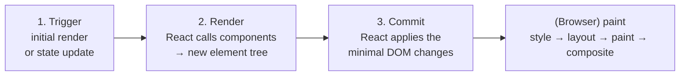
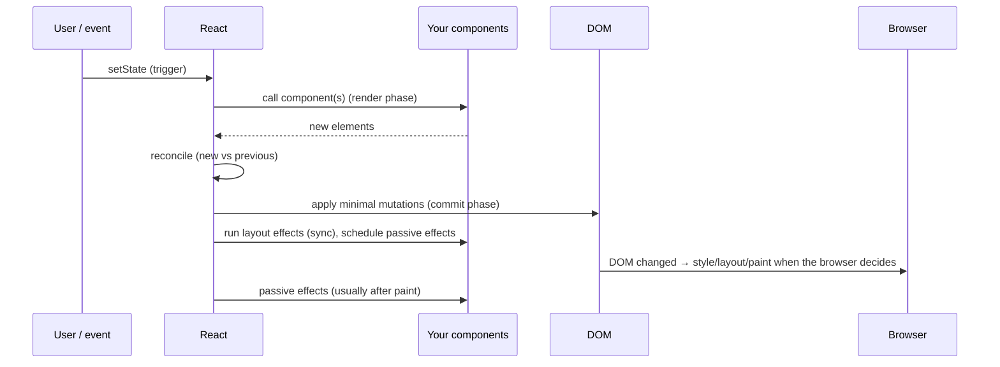

# 01 / 13 — The Rendering Mental Model

## 1. Lesson metadata

| | |
|---|---|
| **Level** | Intermediate |
| **Study time** | 4 hours (reading 1.75 h, experiments 1 h, exercises 1.25 h) |
| **Prerequisites** | [12 — Component purity](./12-component-purity.md); [04 — Elements, components, instances](./04-elements-components-instances.md); [03 — UI as a function of state](./03-ui-as-a-function-of-state.md); [Phase 0 / 03 — Browser rendering pipeline](../00-web-and-javascript-foundations/03-browser-rendering-pipeline.md) |
| **Next** | [14 — State as a snapshot](./14-state-as-a-snapshot.md) |
| **Related later** | [Phase 2 / 01 — What triggers a render](../02-react-rendering-and-internals/01-what-triggers-a-render.md), [Phase 2 / 02 — Render, reconcile, commit, paint](../02-react-rendering-and-internals/02-render-reconcile-commit-paint.md), [Phase 2 / 11 — Render phase vs commit phase](../02-react-rendering-and-internals/11-render-phase-and-commit-phase.md), [Phase 2 / 32 — Scenario A: parent rerenders](../02-react-rendering-and-internals/32-scenario-a-parent-rerender.md), [Phase 7 / 03 — Why components rerender](../07-performance/03-why-components-rerender.md) |

**Learning objectives.** After this lesson you can:
1. Define three words precisely and never confuse them: **render** (React calls your component), **commit** (React applies the result to the DOM), **paint** (the browser draws pixels).
2. Walk through the **trigger → render → commit** model for the initial mount and for updates.
3. Predict exactly which components' functions run after a given state change, including children that received identical props.
4. Explain why "re-render" does not mean "the DOM changed", and why most re-renders produce *zero* DOM mutations.
5. Explain what makes a component re-render (state, a parent's render, context) and what does *not* (props "changing" on its own, a mutated variable, a ref write).
6. Use the "children as props" structure and `memo` to understand when React skips work, and know their limits.
7. Observe renders with `console.log`, React DevTools "Highlight updates", and the Profiler without being fooled by Strict Mode.

**Concepts covered:** trigger/render/commit, initial render vs re-render, recursive rendering down the tree, render output = element tree, comparison with previous output, DOM mutation minimization, bailouts, parent-render propagation, `memo` and element identity (usage level), render ≠ paint, render-phase purity vs commit-phase effects, Strict Mode double render, DevTools observation.

---

## 2. Deep conceptual explanation

### 2.1 What problem is this lesson solving?

Most React bugs and performance complaints reduce to a wrong answer to one of these questions:

- "I changed state; why did *that other component* run?"
- "I rendered the component; why isn't the screen different?"
- "The component re-rendered; why wasn't my input's text reset (or why *was* it)?"
- "My `console.log` printed twice. Did I render twice?"
- "The screen updated; was that a render or a DOM change?"

They all come from the same underspecified word: **"render"**. In everyday speech it means "draw on screen". In React it means something much smaller and earlier: **"call your component function to find out what the UI should look like."** Drawing is someone else's job.

This lesson fixes the vocabulary and the three-step model that the rest of the course builds on. Phase 2 will formalize and deepen it (Fiber, lanes, scheduling), but nothing in Phase 2 contradicts the model here. It refines it.

### 2.2 The restaurant analogy, then dropped

React's official docs use a restaurant: **trigger** = a customer places an order; **render** = the kitchen prepares the order (React calls your components to get descriptions); **commit** = the server places the dish on the table (React updates the DOM). The browser **paint** is the customer actually seeing the dish (the browser draws). The analogy helps with sequence and responsibility; we'll use real names from here.

### 2.3 The three steps



**1. Trigger.** Something asks React to produce UI. There are exactly two kinds of trigger *from your code's perspective*:
- **Initial render:** `root.render(<App />)` (usually once, in `main.tsx`).
- **Re-render:** a state update of a component (`setState` from `useState`, a dispatch from `useReducer`, a context value change that a component consumes, an external-store update, etc.). Formal list: [Phase 2/01](../02-react-rendering-and-internals/01-what-triggers-a-render.md).

**2. Render.** React **calls your component functions** (starting from the root for the initial render, or from the component(s) whose state changed for an update) to compute what each should display. Each call returns elements ([Lesson 04](./04-elements-components-instances.md)). Elements for composite components (`<Panel />`) are then rendered in turn: **rendering is recursive**; React keeps going down until it reaches host elements (`div`, `input`, text). The result is a new **element tree**: a description. Nothing is drawn; nothing in the DOM has changed. During render, your code must be pure ([Lesson 12](./12-component-purity.md)).

**3. Commit.** React compares the *new* description with the *previous* one (reconciliation) and applies **only the necessary changes** to the DOM:
- *Initial render:* create DOM nodes with `document.createElement`, set attributes/properties, insert them into the root container.
- *Re-render:* update only the nodes whose output changed (a text node's content, an attribute, a class), insert/remove nodes for added/removed elements.
- If the new description equals the old for a subtree, **no DOM operations happen** for it.

After commit, React runs *layout effects* synchronously and schedules *passive effects* (`useEffect`) to run after the browser has had a chance to paint ([Phase 2/18–19](../02-react-rendering-and-internals/19-layout-vs-passive-effects.md)).

**Then the browser paints.** The browser notices that the DOM/CSSOM changed and runs its own pipeline on its schedule ([Phase 0/03](../00-web-and-javascript-foundations/03-browser-rendering-pipeline.md)). React doesn't paint and doesn't know when painting occurs.

### 2.4 Vocabulary table

| Term | Meaning in this course | Who does it | Visible to the user? |
|---|---|---|---|
| **Render (verb)** | Call a component function (and its hooks) to compute its element output | React calling *your code* | No |
| **Re-render** | A render of a component that already had been rendered (mounted) | React | No (the *result* may lead to DOM changes) |
| **Render phase** | The period in which React is calling components and building the new tree; must be pure; may be paused/restarted/discarded in concurrent React | React | No |
| **Reconcile** | Compare new output to previous output to decide what changed | React | No |
| **Commit (phase)** | Apply decided changes to the DOM; run layout effects; schedule passive effects | React | DOM changes yes; pixels not yet |
| **Paint** | The browser rasterizes and composites pixels | Browser | Yes |
| **Mount** | First time a component instance is created and added to the DOM | React | After commit + paint |
| **Unmount** | The instance is removed (effects cleaned up) | React | After commit + paint |
| **Update** | A subsequent render/commit of an already-mounted component | React | Maybe |

*Public guarantee:* React calls your component function to render it; renders are triggered by state updates, parent renders, and context changes; DOM updates happen in a commit after render; effects run after commit.
*Teaching model:* "trigger → render → commit", plus "the browser paints after".
*Implementation detail:* how the render is split into units of work, when React yields, how comparison is done, how many passes occur ([Phase 2/08–11](../02-react-rendering-and-internals/11-render-phase-and-commit-phase.md)).

### 2.5 The most useful facts about re-rendering

**Fact 1: A state update re-renders the component that owns the state, and, by default, all of its descendants.** React doesn't check whether a child's props changed before calling it (without `memo`). Calling the child is cheap relative to touching the DOM, and the result is compared afterward.

**Fact 2: A re-render is not a DOM update.** After the render, React compares output. A re-rendered component that returns the same elements causes **no DOM mutations**. This is why re-rendering is normally affordable, and why "unnecessary re-render" is a performance topic (CPU time spent calling functions and diffing) and not a correctness one, *provided your renders are pure*.

**Fact 3: A component does not re-render because its props "changed" in isolation.** Props are inputs passed by the parent when the *parent* renders. The cause chain is always: *something* (state/context/external store) triggers a render of the owner; its render creates new child elements with (possibly identical) props; React renders those children.

**Fact 4: Updating state in a child does not re-render its parent or its siblings.** Rendering flows *down* from the component that owns the changed state. (Lifting state up moves the owner, and therefore the re-render scope, up. [Phase 3/18](../03-react-state-and-hooks/18-state-colocation-and-lifting.md).)

**Fact 5: Setting state to an identical value may still call your component once, but won't re-render its children and won't change the DOM.** If you call a setter with a value that is `Object.is`-equal to the current state, React bails out; the docs note React *may still need to call your component before bailing out*, but it will not go deeper into the tree or fire effects ([react.dev: `useState` caveats](https://react.dev/reference/react/useState)). Don't depend on whether that one extra call happens.

**Fact 6: Context triggers re-render of consumers.** When a context value changes (by `Object.is`), every component that reads that context via `useContext`/`use` re-renders, even if intermediate parents skip rendering ([Phase 3/13](../03-react-state-and-hooks/13-usecontext-and-propagation.md)).

**Fact 7: A mutation is not a trigger.** Changing a local variable, an object stored in state, a module variable, or `ref.current` does not schedule a render. This is why [Lesson 12](./12-component-purity.md)'s "never mutate" rule is also a *correctness-of-updates* rule.

### 2.6 Why does React render children by default instead of checking props?

It is a design decision with a trade-off:

- *Checking* props for every child on every update costs time and can be wrong (props may include functions and objects recreated each render, so a naive check rarely matches anyway).
- *Rendering* children is simple, always correct (if components are pure), and usually cheap.
- Where it is **not** cheap, you opt in to skipping: `memo`, restructuring so that expensive children are passed as `children`, moving state down, or letting the React Compiler insert memoization automatically.

The default "correct first, optimize where measured" is the same philosophy you will see in Phase 7.

### 2.7 Common misconceptions

| Misconception | Reality |
|---|---|
| "Render = update the DOM." | Render = call component functions. DOM update = commit. Often render happens and no DOM update follows. |
| "Render = paint." | Paint is the browser's job, after commit, on its own schedule. |
| "If a component re-renders, the whole DOM is rebuilt." | React applies a minimal diff; most re-renders change nothing in the DOM. |
| "Changing props causes a re-render." | The *parent's render* creates new props; props don't act independently. |
| "A child re-renders only if its props changed." | By default a child re-renders whenever its parent does (unless memoized or the element is identical). |
| "State update re-renders the entire app." | Only the owner and its descendants (and consumers of changed contexts). |
| "A re-render resets component state." | State persists across re-renders of the same instance. Only unmount (or a key change) resets it ([Lesson 16](./16-state-preservation-and-reset.md)). |
| "`useEffect` runs during render." | Effects run *after* commit. |
| "My component rendered twice, so React re-rendered it for no reason." | In development with Strict Mode, React calls the function twice on purpose. Compare against production behavior or the Profiler. |
| "Fewer renders is always better." | Renders are a means; measure user-visible latency. Optimizing a 0.2 ms render is wasted effort ([Phase 7/01](../07-performance/01-measure-before-optimizing.md)). |

---

## 3. Internal mechanics

### 3.1 Public guarantee vs teaching model vs implementation detail

- **Public guarantee** (documented): the trigger/render/commit sequence; render must be pure; re-renders cascade to children unless skipped by documented mechanisms; effects run after commit; React may render a component more than once per committed update (Strict Mode, concurrent rendering); a render may be thrown away.
- **Teaching model** (this lesson): a *tree* of components is evaluated top-down into a tree of elements, compared with the previous tree, and the difference is applied to the DOM.
- **Implementation detail** (may change; verify in source/Phase 2): the Fiber data structure, work loop, lanes, double-buffered trees, how bailouts are detected (props object identity and flags), how effects are queued.

### 3.2 Elements are cheap descriptions

An element is a plain object like `{ type: Panel, props: { title: "A" }, key: null, ... }`. Calling a component returns elements; creating elements is cheap (object allocation). "Rendering" a component is *evaluating a function and allocating objects*; a few microseconds for simple components. This is why 1,000 trivial re-renders may cost less than a single large layout. And why a *non-trivial* component (heavy loops in the body) can dominate.

### 3.3 Comparison: elements vs previous elements

On update, React walks the new element tree alongside the previous one. At each position:

- **Same `type` (and key):** reuse the instance (state kept), render with the new props, recurse into children.
- **Different type or key:** discard the old subtree (unmount) and create a new one (mount).
- **Host elements:** compare props to the previous props; for each changed attribute/property, queue a DOM update; text content changes become text node updates.

This "diff on elements, then patch DOM" is what people call the *virtual DOM approach*; [Phase 2/04](../02-react-rendering-and-internals/04-virtual-dom-what-it-means.md) explains why that label is imprecise. For now: **React never compares DOM nodes to find out what changed; it compares your render output with the previous render output.** (So if something else mutates the DOM behind React's back, React neither notices nor repairs it.)

### 3.4 How skipping works (usage-level)

Two documented ways a child function is *not* called on a parent's re-render:

1. **`memo(Child)`**: React compares the new props to the previous props shallowly (`Object.is` per prop). If all are equal, it reuses the previous render result for `Child`. ([Phase 3/12](../03-react-state-and-hooks/12-react-memo.md).) Note that a fresh object/array/function literal passed as a prop is a *new reference every render*, so `memo` fails unless you stabilize it ([Phase 0/07](../00-web-and-javascript-foundations/07-functions-and-referential-identity.md)).
2. **Identical element reference (the "children as props" pattern).** Consider:

```tsx
function Counter({ children }: { children: React.ReactNode }) {
  const [n, setN] = useState(0);
  return (
    <div>
      <button type="button" onClick={() => setN(n + 1)}>{n}</button>
      {children}
    </div>
  );
}

function App() {
  return (
    <Counter>
      <ExpensiveReport />
    </Counter>
  );
}
```

`<ExpensiveReport />` is an element object created by `App`'s render. When `Counter`'s state changes, only `Counter` re-renders. `App` does not re-render, so the `children` prop is **the very same element object** as before. React, noticing the element and its props are identical to last time, can skip re-rendering that subtree. *Teaching model*: "same element reference ⇒ same output ⇒ skip". *Implementation detail*: how the identical-props check works; confirm in Phase 2/06. This pattern is why composition ([Lesson 07](./07-composition-and-children.md)) is a first-line performance tool, before `memo`.

What defeats it: if `Counter` re-renders *because its parent re-rendered*, `App` re-created `<ExpensiveReport />`, a new element object, so it re-renders (with identical props, but a new element; without `memo`, React calls it).

### 3.5 Render phase vs commit phase: what's allowed where

| | Render phase | Commit phase |
|---|---|---|
| Runs your component bodies | Yes | No |
| Must be pure | **Yes** | Not applicable (React's own work + your effects/refs) |
| May be paused/restarted/discarded (concurrent) | Yes | No: once started, runs synchronously to completion |
| Touches the DOM | No (reads none, writes none) | Yes (React writes) |
| Runs layout effects / refs attach | No | Yes (layout effects and ref attachment during/after DOM mutation) |
| Passive effects (`useEffect`) | No | Scheduled after commit (run later, usually after paint) |

Because the render phase can be repeated or abandoned, anything with side effects in it is unsafe: this is the same argument as in Lesson 12, seen from the pipeline side.

### 3.6 Initial render specifics

`createRoot(container).render(<App />)` renders `App`, recursing down to host elements; commit then creates the entire DOM subtree and appends it (implementation detail: React builds detached DOM nodes during the render/complete work and attaches them in commit so the browser sees one insertion). Then effects run. The **first paint** follows. For client-only SPAs the container is initially empty ([Phase 0/01](../00-web-and-javascript-foundations/01-how-the-browser-works.md)); with SSR, HTML exists already and React *hydrates* instead ([Phase 2/25](../02-react-rendering-and-internals/25-hydration-and-selective-hydration.md)).

### 3.7 Strict Mode and observing "double" renders

In development under `<StrictMode>`, React calls components (and some other functions) twice per render to detect impurity ([Lesson 12 §3.1](./12-component-purity.md)). Consequently `console.log("render")` in a component prints **twice** per render in dev (React itself does not suppress or dim the second log; React DevTools dims it, or hides it via its "Hide logs during additional invocations in Strict Mode" setting, label verified in the DevTools source). It is not "rendered twice on screen": the second invocation's output is discarded. For counting real renders use the React DevTools Profiler or `<Profiler onRender>`, which count commits, not function invocations; or test in a production build.

---

## 4. Step-by-step execution walkthrough

**Setup.**

```tsx
// main.tsx
createRoot(document.getElementById("root")!).render(<App />);

function App() {
  const [count, setCount] = useState(0);
  console.log("render App");
  return (
    <main>
      <h1>Counter</h1>
      <button type="button" onClick={() => setCount(count + 1)}>Clicked {count}</button>
      <Footer />
    </main>
  );
}

function Footer() {
  console.log("render Footer");
  return <footer>© 2026</footer>;
}
```

(We analyze a production build; in dev Strict Mode each `render …` line appears twice.)

### A. Initial render and mount

1. **Trigger:** `root.render(<App />)`.
2. **Render:** React calls `App()`; `useState(0)` initializes state `count = 0`; logs `render App`; returns an element tree: `main > [h1, button, <Footer/>]`. React renders `Footer`: logs `render Footer`; returns `footer`. Host elements have no function to call.
3. **Commit:** React creates DOM: `main`, `h1` with text "Counter", `button` with text "Clicked 0", `footer` with text; attaches the click handler *as prop data* (delegation at the root; [Lesson 10](./10-event-handling.md)); inserts everything into `#root`.
4. **Effects:** none here.
5. **Browser paints.** The user sees the page.

Console: `render App`, `render Footer`.

### B. A click

6. **Event:** click → React's root listener → your `onClick` → `setCount(0 + 1)`: **trigger**. This queues an update on `App`'s state; the handler returns.
7. **Render:** React calls `App()` again. `useState` now returns `count = 1` (a new snapshot, [Lesson 14](./14-state-as-a-snapshot.md)). Logs `render App`. Returns a *new* tree: `main > [h1, button("Clicked 1"), <Footer/>]`. The `<Footer />` is a **new element object** (App re-created it). Without `memo`, React renders `Footer`: logs `render Footer`; returns the same `footer` description.
8. **Reconcile:** compare with previous output position by position: `main`/`h1` identical; `button` child text changed `"Clicked 0"` → `"Clicked 1"`; `footer` identical.
9. **Commit:** React performs **exactly one DOM mutation**: set the button's text node content. `h1` and `footer` DOM nodes are untouched (no attribute writes, no replacement).
10. **Browser paints** the changed text.

Console after the click: `render App`, `render Footer` (even though `Footer` has no props and produced identical output).

### C. Same click with `memo`

If `Footer` is wrapped as `const Footer = memo(function Footer() {…})`: step 7 skips `Footer` because its props (`{}`) are shallow-equal; console shows only `render App`. DOM operations are the same single text update, since `Footer` produced no change either way. **`memo` saved a function call, not a DOM update.**

### D. Same click with the `children` structure

If we rewrite as `function Page() { return <Counter><Footer /></Counter>; }` with `Counter` owning `count`, the click re-renders only `Counter`; `Footer` is in `children`, created by `Page`, which did not re-render; console shows nothing for `Footer`.

---

## 5. Code examples

### 5.1 Minimal example: a probe component to observe renders

```tsx
function Probe({ label }: { label: string }) {
  console.log(`render ${label}`);
  return null;
}
```

Use `Probe` placed next to components of interest to see when they run without adding logs to them. In production builds the logs show real call counts; in dev double them. **Prefer the Profiler/DevTools for decisions; use logs for learning.**

### 5.2 Practical example: predicting the render set

```tsx
import { memo, useState } from "react";

function log(name: string) { console.log("render", name); }

const Row = memo(function Row({ label }: { label: string }) {
  log(`Row ${label}`);
  return <li>{label}</li>;
});

function Header({ title }: { title: string }) {
  log("Header");
  return <h1>{title}</h1>;
}

function List({ items }: { items: string[] }) {
  log("List");
  return <ul>{items.map((i) => <Row key={i} label={i} />)}</ul>;
}

export function Page() {
  const [query, setQuery] = useState("");
  const [items] = useState(["a", "b", "c"]);
  log("Page");
  return (
    <>
      <Header title="Search" />
      <input value={query} onChange={(e) => setQuery(e.target.value)} aria-label="Query" />
      <List items={items} />
    </>
  );
}
```

**Predict (production build):** the user types one character into the input. Which `render …` lines are logged?

**Result:** `render Page`, `render Header`, `render List`. Not `Row a/b/c`.
**Why:**
- `Page` owns `query` state ⇒ it re-renders.
- `Header` and `List` are plain components rendered by `Page`: re-rendered by default even though their props didn't change (`title` is the same string; `items` is the same array reference).
- `Row` is wrapped in `memo`; its props are `label` (same string) ⇒ shallow-equal ⇒ skipped. (`key` is not a prop; it's identity.)
**What the DOM does:** only the input's value is updated (and it already matches what the user typed).
**Optimization options:** (1) *Move state down:* extract the input and `query` into a `SearchBox` component so `Page`, `Header`, and `List` don't re-render; (2) wrap `Header`/`List` in `memo`; (3) restructure with children. Best first choice: (1), because it removes the work rather than caching it, and requires no equality checks.

### 5.3 Practical example: moving state down

```tsx
function SearchBox() {
  const [query, setQuery] = useState("");
  return <input value={query} onChange={(e) => setQuery(e.target.value)} aria-label="Query" />;
}

export function Page() {
  const [items] = useState(["a", "b", "c"]);
  log("Page");
  return (
    <>
      <Header title="Search" />
      <SearchBox />
      <List items={items} />
    </>
  );
}
```

Now typing re-renders only `SearchBox`. `Page` doesn't run. Trade-off: if `List` *needs* `query` (to filter), the state must live in a common ancestor again ([Lesson 06](./06-props-and-one-way-data-flow.md), [Phase 3/18](../03-react-state-and-hooks/18-state-colocation-and-lifting.md)); then deferring the expensive part or memoizing `List` becomes the tool.

### 5.4 Incorrect examples (collected)

```tsx
// (a) Believing a mutation triggers a render
function Counter() {
  let count = 0;
  return <button onClick={() => { count++; console.log(count); }}>{count}</button>;
}

// (b) Believing a re-render resets nothing (and expecting a "fresh" component)
function Parent() {
  const [n, setN] = useState(0);
  return (<><button onClick={() => setN(n + 1)}>+</button><Form /></>);
}
// Form's typed text survives clicks on "+", yet the dev expects it to clear.

// (c) Relying on render count for logic
let renders = 0;
function Widget() { renders++; if (renders > 3) return <p>Too many</p>; return <p>OK</p>; }

// (d) Reading the DOM during render
function Width() {
  const w = document.getElementById("box")!.offsetWidth;   // layout read during render
  return <p>{w}</p>;
}

// (e) Calling setState unconditionally in render
function Loop() {
  const [n, setN] = useState(0);
  setN(n + 1);                         // triggers another render, forever
  return <p>{n}</p>;
}
```

Why each is wrong:
- (a) `count` is a local variable recreated each call; the click changes it, but no trigger occurs ⇒ no render, no DOM change. The log shows `1`, the button shows `0`. Fix: state.
- (b) A re-render is not a reset: same type at same position ⇒ same instance and state ([Lesson 16](./16-state-preservation-and-reset.md)). To clear, change `key` or lift/reset state.
- (c) Output depends on call count (impure); Strict Mode and concurrent rendering change call counts.
- (d) Reading layout in render couples render to DOM state that React hasn't committed yet and forces synchronous layout; the node may not exist on the first render (`null!` crashes). Use a ref + layout effect/`ResizeObserver` ([Phase 3/08](../03-react-state-and-hooks/08-uselayouteffect.md)).
- (e) "Too many re-renders. React limits the number of renders to prevent an infinite loop." Setting state during render unconditionally re-triggers rendering endlessly. (A *guarded* set during render is a documented special pattern; see Lesson 12 §5.5.)

### 5.5 Corrected implementation

```tsx
// (a)
function Counter() {
  const [count, setCount] = useState(0);
  return <button type="button" onClick={() => setCount((c) => c + 1)}>{count}</button>;
}

// (b) reset when identity changes
<Form key={n} />       // only if "clear on each click" is the intended behavior

// (d) measure after commit
function Width() {
  const ref = useRef<HTMLDivElement>(null);
  const [w, setW] = useState(0);
  useLayoutEffect(() => {
    if (ref.current) setW(ref.current.offsetWidth);
  }, []);
  return <div ref={ref}><p>{w}</p></div>;
}
```

### 5.6 Advanced example: observing renders with `<Profiler>`

```tsx
import { Profiler, type ProfilerOnRenderCallback } from "react";

const onRender: ProfilerOnRenderCallback = (id, phase, actualDuration) => {
  // phase: "mount" | "update" | "nested-update"
  console.log(`${id} ${phase} actual=${actualDuration.toFixed(2)}ms`);
};

<Profiler id="Page" onRender={onRender}>
  <Page />
</Profiler>
```

`onRender` fires **once per commit** of the profiled subtree where something in it rendered, not once per component call, so Strict Mode doubling does not inflate it. The `<Profiler>` component is **disabled in production builds by default** (react.dev/reference/react/Profiler: it needs a special profiling build). Verified in React 19.3.1 under `<StrictMode>`: after mount plus one click, `onRender` fired 2 times while the component function ran 4 times. `actualDuration` is the time spent rendering the committed update for the subtree (including descendants), a useful *relative* measure.

### 5.7 Advanced example: a render *is* a function call, tested directly

```tsx
// Pure presentational component: render it as a plain function for a quick mental test
function Price({ cents, currency }: { cents: number; currency: string }) {
  return <span>{new Intl.NumberFormat("en", { style: "currency", currency }).format(cents / 100)}</span>;
}

// Conceptually, React does this:
const element = Price({ cents: 1999, currency: "USD" });   // → a <span> element description
// React does not call components like this itself (hooks need React's context to work),
// but for a hook-free component the analogy is exact: render = f(props) → description.
```

**Caveat:** calling a component directly in application code is wrong when it uses hooks or when you expect it to have its own identity/state: React must be the one to call it so it can associate hook state with an instance. The analogy is for understanding, not a technique.

---

## 6. Visual explanations

### Where each thing happens



### Re-render scope for a state change in `Dashboard`

```text
App
 ├─ Nav                       (not re-rendered: above the owner)
 └─ Dashboard   ← owns state  ──▶ re-renders
     ├─ Filters               ──▶ re-renders (child of owner)
     │   └─ DateRange         ──▶ re-renders
     ├─ Chart                 ──▶ re-renders (unless memo / passed as children)
     └─ Footer (memo)         ──▶ skipped if props shallow-equal
```

### Same element reference ⇒ skip

```text
Parent renders  ─▶ creates <Child/> object #1   ─▶ Child renders
Parent renders  ─▶ creates <Child/> object #2   ─▶ Child renders (new object, no memo)

Owner(children) renders ─▶ props.children is still object #1 (Parent didn't run) ─▶ Child skipped
```

---

## 7. Alternative approaches and trade-offs

Ways to limit unnecessary re-render work:

| Technique | Mechanism | Complexity | Risk | When it wins |
|---|---|---|---|---|
| **Move state down (colocate)** | Shrinks the owner's subtree | Low | Cross-component needs push state back up | First choice |
| **Composition (`children`/slots)** | Elements created by a non-rerendering ancestor are identical | Low | Requires restructuring props | Layout wrappers, providers, expensive static subtrees |
| **`memo(Component)`** | Shallow prop comparison | Medium | Unstable props (inline objects/functions) defeat it; extra comparison cost | Expensive pure component with stable props, in a hot parent |
| **`useMemo`/`useCallback` for props** | Stabilize references for memoized children | Medium–High | Dependency mistakes; cognitive load | Only paired with `memo` or as a hook dependency |
| **React Compiler** | Auto-memoization at build time | Low (adoption) / Medium (migration) | Volatile; violations of Rules of React; verify docs | Teams with lint-clean, pure code |
| **Defer heavy rendering** (`useDeferredValue`, transitions) | Lower priority/interruptible renders | Medium | Visible lag in non-urgent content | Input remains responsive while a heavy list updates |
| **Virtualize/paginate** | Render fewer components | Medium–High | A11y and find-in-page trade-offs | Large collections |
| **Do nothing** | Accept re-render | None | None | Renders are cheap (usually!) |

**When the usual advice ("avoid unnecessary re-renders") is *not* best:** if profiling shows the re-render takes 0.3 ms and produces no user-visible latency, adding `memo`, `useCallback`, and dependency arrays adds *more* risk and cost than it saves (stale-closure bugs, extra equality checks, harder reviews). Optimize interactions that *feel* slow ([Phase 7/04, 23](../07-performance/23-counterproductive-optimizations.md)).

---

## 8. Best practices and anti-patterns

**Do**
- Use the words *render*, *commit*, and *paint* strictly; correct colleagues kindly: "it rendered but nothing changed in the DOM" is a coherent sentence.
- Keep render functions fast and pure; do expensive work with `useMemo` only after measuring.
- Put state as close as possible to where it's used.
- Use the Profiler and DevTools to find *actual* slow renders before changing code.
- Test behavior in a production build when counting renders; keep Strict Mode on in dev.

**Beginner mistakes**
- Treating a re-render as a reset.
- Expecting local variables to survive between renders.
- Using logs in dev to claim "React renders everything twice".
- Mutating objects and expecting a UI update.
- Thinking `setState` is synchronous and logging the "updated" value right after.

**Experienced-developer mistakes**
- Wrapping everything in `memo`/`useCallback` preemptively, leaving most memoization ineffective because one prop is an inline object.
- Optimizing renders when the real cost is commit (huge DOM) or layout/paint ([Phase 7/18](../07-performance/18-react-vs-browser-bottlenecks.md)).
- Passing new object/array/function literals to memoized children inside hot loops.
- Putting state in a high-level provider with a large subtree "for convenience".
- Believing React's diff makes all re-renders "free".

**Smells**
- Dozens of `useCallback`s with no `memo` consumers.
- A top-level component with many unrelated `useState`s (any change re-renders everything).
- Dev logs used as test assertions.

**Justified exceptions**
- Preemptive `memo` on leaf components in a library meant to be used in unknown, performance-critical parents (with documentation of prop stability requirements).
- Hand-rolled equality (`memo(Comp, areEqual)`) for rare, measured cases.

---

## 9. Real-world application

**Typing in a filter above a data table.** State lives in the page; every keystroke re-renders the page, the table, and each row (default). With 500 rows × several cells this can reach tens of milliseconds and make typing feel sticky. Strategy ladder: (1) move the input state into its own component and lift only a *deferred* query; (2) `memo` rows with stable props; (3) `useDeferredValue` for the query consumed by the table; (4) virtualize. Measure interaction latency (INP) with the Profiler under CPU throttling ([Phase 2/30](../02-react-rendering-and-internals/30-react-devtools-profiler.md)).

**Realtime ticker.** Price updates arrive 20 times per second for 100 symbols. If state lives in a top-level store consumed by one component, all rows re-render per tick. Slice state per symbol with selectors so only the changed row's component renders; coalesce updates per frame. The render model dictates the architecture: *scope* of the owner = scope of the re-render.

**E-commerce cart badge.** Cart count in the header; product grid below. If cart state sits in the root and the grid isn't memoized, adding an item re-renders the grid (function calls) but changes no DOM; if the grid is expensive, restructure (cart provider with the grid passed as `children`) or memoize.

**Auth/session context.** A context holding `{ user, permissions, preferences }` as one object changes identity whenever any field changes, re-rendering all consumers. Split contexts or stabilize the value ([Phase 3/14](../03-react-state-and-hooks/14-context-performance.md)).

**Multi-team shells.** A micro-frontend shell re-rendering on route change re-renders embedded apps that don't need it; isolating with separate roots or memoized boundaries prevents cross-team performance coupling ([Phase 11/12](../11-senior-and-architect-mastery/12-microfrontends.md)).

---

## 10. Debugging and troubleshooting

**Symptom 1: "My component renders twice."**
- *Investigate:* is `<StrictMode>` in `main.tsx`? Does the production build log once? Does the Profiler show one commit?
- *Root cause:* dev-only double invocation.
- *Validate:* `vite build && vite preview`, or temporarily remove Strict Mode to confirm; then restore it.

**Symptom 2: "It re-renders when nothing changed."**
- *Investigate:* React DevTools → Components → select component → in settings enable "Record why each component rendered while profiling"; Profiler → record → check "Why did this render?" (parent rendered / state changed / props changed / context changed / hooks changed).
- *Root causes:* parent re-rendered (default); an unstable prop defeats `memo`; a context value changes identity every render (`value={{…}}`).
- *Fix and validate:* move state down / stabilize / split context; re-record to confirm the component no longer appears in the commit.

**Symptom 3: "The state changed but the UI didn't."**
- *Investigate:* did the setter get called with the same reference (mutation)? Is the component the one that owns the state? Is the UI reading stale props? Is the value used in a closure from an old render?
- *Fix:* immutable update; verify via React DevTools that the component's hook value changed.

**Symptom 4: "The UI shows the new value but `console.log(state)` right after `setState` shows the old one."**
- *Root cause:* the log runs in the *same render's snapshot*; the new value arrives in the next render ([Lesson 14](./14-state-as-a-snapshot.md)).

**Symptom 5: "Everything flashes green in Highlight updates."**
- Enable DevTools settings → "Highlight updates when components render". A flash shows a component committed; *it does not imply a DOM change*. Compare with the Elements panel (nodes flash only when DOM attributes/text change in Chrome's "Rendering → Paint flashing" for repaint; "Layout shift regions" for shifts). The two tools answer different questions: React-render vs browser-paint.

**Symptom 6: "Typing is slow only when the list is long."**
- Profile: record while typing; the flame graph shows `List` and rows re-rendering on each keystroke → structural fix (move state down, defer, virtualize), not `useMemo` sprinkled on trivial pieces.

---

## 11. Exercises

### Level A — Knowledge
A1. Define render, commit, and paint in one sentence each. Who performs each?
A2. Name the two kinds of triggers (from your code's perspective). Give three examples of what causes a re-render.
A3. True or false: "A re-render always changes the DOM." Explain.
A4. Which components re-render when `Child` calls its own `setState`: its parent, itself, its children, its siblings?
A5. Does mutating `ref.current` trigger a render?
A6. Why does `console.log` in a component body often print twice in development?
A7. What does `memo` compare, and how?

### Level B — Code comprehension
B1. For the tree below, state lives in `A`. After `A`'s state changes, which components' bodies run (no memo anywhere)?
```text
Root
 ├─ A (state)
 │   ├─ B
 │   │   └─ C
 │   └─ D
 └─ E
```
B2. Same tree, but `D` is `memo`-wrapped and receives no props. And `B` receives `style={{ color: "red" }}` and is also `memo`. Which bodies run?
B3. Predict the logs on click (production build):
```tsx
function Outer() {
  const [n, setN] = useState(0);
  console.log("Outer");
  return <button type="button" onClick={() => setN(n + 1)}><Inner /></button>;
}
function Inner() { console.log("Inner"); return <span>x</span>; }
```
B4. Predict the logs on click now:
```tsx
function Outer({ children }: { children: React.ReactNode }) {
  const [n, setN] = useState(0);
  console.log("Outer");
  return <button type="button" onClick={() => setN(n + 1)}>{children}</button>;
}
function App() { console.log("App"); return <Outer><Inner /></Outer>; }
```
B5. Setting state to the same primitive value: `setN(n)`. What happens to renders and DOM?
B6. In the walkthrough §4B, exactly how many DOM mutations occur on click, and which?

### Level C — Implementation
C1. Build a `RenderCount` development helper hook that displays how many times a component has *committed* (not how many times its function ran), without violating purity. Explain the Strict Mode behavior of your implementation.
C2. Refactor a page with a search `input` and a heavy `Results` component so that typing doesn't re-render `Results` unless the *debounced/deferred* query changes. Use state colocation first, then `useDeferredValue` (usage-level) or `memo`.
C3. Write a component `Stopwatch` where elapsed time changes every 100 ms but only a small `<output>` re-renders (not the controls or a heavy sibling). Show two structures that achieve it.

### Level D — Debugging
D1. The page logs `render Chart` on every keystroke in an unrelated input although `Chart` is memoized with `memo`. Find causes:
```tsx
const Chart = memo(function Chart({ options, onPoint }: ChartProps) { ... });
function Page() {
  const [q, setQ] = useState("");
  return (<>
    <input value={q} onChange={(e) => setQ(e.target.value)} />
    <Chart options={{ animate: true }} onPoint={(p) => console.log(p)} />
  </>);
}
```
D2. A teammate says "React re-rendered, so it must have rebuilt my `<canvas>` and cleared it". Diagnose and give evidence.
D3. A component "randomly" shows stale data. It stores `const user = props.user` in a module variable inside the render and reads it in a click handler elsewhere. Explain in render-model terms.
D4. Highlight-updates flashes the whole page on each keystroke but the user says typing feels fine. What do you conclude and what would change your mind?
D5. "Too many re-renders" error: find the bug.
```tsx
function Toggle() {
  const [on, setOn] = useState(false);
  return <button onClick={setOn(!on)}>{String(on)}</button>;
}
```

### Level E — Architecture and engineering decisions
E1. Your app has a global `AppContext` object (`{ user, theme, notifications, cart }`) provided at the root; any change re-renders 600 components. Propose an incremental plan, ordered by cost/benefit, with how to verify each step.
E2. A teammate proposes wrapping all components in `memo` by default through an ESLint rule. Argue for and against, and propose what you'd do instead.
E3. When would you intentionally *not* fix an "unnecessary re-render" you found in a profile?

### Level F — Expert challenge
F1. Draw (as text) a full timeline for the following: a parent holds `count`; a memoized child receives `onSelect={() => …}` (inline); the user clicks a button that increments `count`. List: trigger, which functions are called in what order, the comparison result for the memoized child, the DOM mutations, effect timing, and what changes if `onSelect` is stabilized with `useCallback` or if the React Compiler is enabled. State clearly which parts are public guarantees vs teaching model.

---

## 12. Detailed answers and explanations

> Attempt the exercises first.

**A1.** *Render:* React calls your component function to compute its element output (React + your code; no DOM change). *Commit:* React applies the computed differences to the DOM and runs layout effects (React). *Paint:* the browser draws pixels based on the DOM/CSSOM (browser). Wrong answer to watch for: "render = draw".

**A2.** Triggers: the initial `root.render` and a re-render caused by an update. Examples of causes: a `useState` setter call; a `useReducer` dispatch; a changed context value consumed by the component; (also) an external store update via `useSyncExternalStore`; and indirectly, a parent's render.

**A3.** False. Render computes a description; commit applies only differences. If the new output equals the old, no DOM mutation occurs. (Most re-renders of unchanged subtrees do nothing to the DOM.)

**A4.** The child itself and its descendants re-render. Its parent and siblings do not (rendering flows down from the state owner). Context consumers elsewhere are only affected if the state is context-provided.

**A5.** No. Refs are mutable boxes; writing to `ref.current` doesn't schedule any render. That's both their purpose (store values without re-rendering) and the reason UI values must not live only in refs.

**A6.** `<StrictMode>` in development deliberately calls component functions twice to expose impure code. The second call's output is discarded. Production builds do not double-invoke.

**A7.** `memo` compares the *props objects* shallowly: for each prop, `Object.is(prevProp, nextProp)`. If all are equal, React reuses the previous output. A new inline object/array/function creates a new reference each render, so equality fails even with the same contents.

**B1.** `A` (owner), `B`, `C`, `D`. Not `Root` or `E`. Components above or beside the owner don't run.

**B2.** `A` runs (owner). `B` is memoized but receives `style={{ color: "red" }}`, a new object each time `A` renders ⇒ shallow comparison fails ⇒ `B` runs, and `C` (a child of `B`, not memoized) runs. `D` is memoized with no props ⇒ skipped. Bodies run: `A`, `B`, `C`. Takeaway: one unstable prop nullifies `memo`.

**B3.** `Outer`, `Inner`. Clicking updates `Outer`'s state; `Outer` re-renders and re-creates `<Inner />` ⇒ `Inner` runs, producing the same output. DOM change: none inside the button (the button has no text depending on `n`). Wrong: "only `Outer` logs because `Inner`'s props are the same". Without `memo` React doesn't check.

**B4.** Only `Outer`. `App` doesn't re-render, so `<Inner />` (created by `App`) is the same element object passed through `children`; React skips it. `App` logs once on mount only.

**B5.** `setN(n)` with the same value: React bails out; it may call `Outer` once more without rendering children, and it will not commit DOM changes or run effects. Observable: possibly a single extra log of the component's own body, no children logs, no DOM mutation. (Version/implementation-dependent; do not rely on it.)

**B6.** One: the button's text content from "Clicked 0" to "Clicked 1" (a text node update). Nothing else is touched.

**C1. Reference solution**
```tsx
import { useEffect, useRef } from "react";

export function useCommitCount(label: string): void {
  const count = useRef(0);
  useEffect(() => {
    count.current += 1;
    console.log(`${label} committed ${count.current}x`);
  });                         // no deps ⇒ runs after every commit of this component
}
```
Why: counting in an effect counts *commits* (post-render side effect), avoiding mutation during render. Strict Mode in dev re-runs effects once on mount (setup, cleanup, setup), so the first mount may show `1x` then `2x`; this is expected, not a bug, and is dev-only. This is a debugging tool: don't ship it or use it for logic. The Profiler is the better instrument.

**C2.** Sketch:
```tsx
function SearchBox({ onQuery }: { onQuery: (q: string) => void }) {
  const [q, setQ] = useState("");
  return <input value={q} aria-label="Search" onChange={(e) => { setQ(e.target.value); onQuery(e.target.value); }} />;
}
const Results = memo(function Results({ query }: { query: string }) { /* heavy */ return null; });

export function Page() {
  const [query, setQuery] = useState("");
  const deferred = useDeferredValue(query);      // lags during heavy renders
  return (<><SearchBox onQuery={setQuery} /><Results query={deferred} /></>);
}
```
Reasoning: `SearchBox` owns the input's text (so typing is cheap and urgent); `Page` holds the *shared* `query` and re-renders on each change (cheap: it only returns two elements), `Results` is `memo`-wrapped so it re-renders only when `deferred` changes, and `useDeferredValue` lets React render the urgent part first and update `Results` at lower priority. `setQuery` is stable (state setters have stable identity), so `onQuery` doesn't break memoization of anything memoized. Alternative if `Results` doesn't need `query` until submit: don't lift at all. Evaluation: state colocated first, `memo` only where measured, no `useCallback` needed.

**C3.** Two structures. (1) *Isolate the ticking state:* `<Elapsed />` owns `ms` state and its interval effect; the page renders `<Elapsed />`, `<Controls />`, `<HeavySibling />` with none of them aware of the time. Only `Elapsed` re-renders. (2) *Children pattern:* `<Timer>{<Heavy />}</Timer>` where `Timer` owns the state and receives its static content as `children` created by a non-rerendering parent. Start/stop controls that need to affect the interval can call a ref/imperative handle or lift only the `running` boolean (rare changes) while keeping `ms` in the leaf. Edge: the interval effect needs cleanup, and the drift between `setInterval` ticks and real time should be handled by computing `Date.now() - start` rather than incrementing.

**D1.** Two unstable props: `options={{ animate: true }}` (new object per render) and `onPoint={(p) => …}` (new function per render). `memo` compares by `Object.is`, fails, and re-renders. Fixes: hoist `options` to a module constant (`const OPTIONS = { animate: true }`), wrap `onPoint` in `useCallback` (or hoist if it doesn't use component values), or restructure so `Chart` doesn't live under the typing state (move the input into its own component). Validate with the Profiler's "Why did this render?" showing no props changes.

**D2.** Re-render ≠ rebuild. Evidence: in the Elements panel the `<canvas>` DOM node is the same node (same identity; compare via "Store as global variable" before/after); React's commit applies only changed attributes. The canvas's *pixel contents* are DOM-external state; React doesn't touch them unless the node is remounted (type/key change) or `width`/`height` attributes are re-set (setting those clears a canvas natively: a classic pitfall). Likely actual cause: a prop change setting `width`/`height`, or a remount from a changed `key`.

**D3.** The module variable stores a snapshot from the render that last ran, which may be an abandoned or doubled render, or a different instance's render if multiple instances exist. The handler may read data from a render that never committed or from another instance. In render-model terms: render has side effects and the handler depends on render order. Fix: read the props/state in the handler's own closure (props are in scope), or keep it in a ref written in an effect/handler.

**D4.** Conclusion: lots of re-rendering, but cheap enough that typing feels fine; "highlight updates" shows *renders/commits*, not cost. Don't optimize yet. What would change your mind: a Profiler recording showing commits taking tens of ms, long tasks in the Performance panel during typing, INP regressions in real-user data, or slow-device testing with CPU throttling.

**D5.** `onClick={setOn(!on)}` *calls* `setOn` during render (instead of passing a function); each render sets state, triggers another render ⇒ infinite loop ⇒ "Too many re-renders". Fix: `onClick={() => setOn(!on)}` (or `setOn((v) => !v)`).

**E1. Evaluation criteria and example answer.** Criteria: measured benefit, risk, effort, reversibility. Plan: (1) Profile to confirm cost: record typical interactions, check "why did this render" for context. (2) Split the context by change frequency and consumer sets (`UserContext`, `ThemeContext`, `CartContext`, `NotificationsContext`); the cheapest effective step. (3) Stabilize provider values (`useMemo`) so that unrelated parent renders don't change identity. (4) Move rapidly changing data (notifications) out of context to a store with selector subscriptions (`useSyncExternalStore`-based library). (5) Memoize expensive consumers only where profiles justify. Verify each step by re-profiling the same interactions: component render counts per commit and total commit time. Don't start with `memo` everywhere.

**E2.** For: consistent default; avoids accidental large re-render trees; some design systems do this for leaf components. Against: `memo` adds comparison cost and does nothing when props are unstable (the common case), encourages `useCallback` noise, hides data-flow problems, and can cause stale UI if props include mutable objects. Recommendation: no blanket rule; adopt measure-first guidance, optionally enable the React Compiler (after verifying lint-clean code and current docs) and memoize leaf components of shared libraries when profiles/prop-stability contracts justify it.

**E3.** When the re-render is cheap (sub-millisecond, no user-visible effect), when the fix adds complexity or risk (stale closures, harder code reading) exceeding the benefit, when the component will be rewritten soon, or when the real bottleneck is elsewhere (network, layout, hydration). Document the decision. Revisit if the component grows or user-perceived latency regresses.

**F1. Timeline (teaching model with guarantees noted).**
1. *Trigger:* click handler runs `setCount(c => c + 1)` (public: updates are queued; processed after the handler).
2. *Render phase:* React calls `Parent()` with `count = c+1`. It creates new elements: `<Child onSelect={newFn} />` where `newFn` is a new function.
3. *Comparison for the memoized child:* `memo` shallow-compares props: `Object.is(prevOnSelect, newFn)` is false ⇒ not equal ⇒ React calls `Child()` (public: memo skips only if props are shallow-equal).
4. `Child` returns its elements; any descendant not memoized renders too.
5. *Reconcile:* compare new output to previous. Only the count text in `Parent`'s output changes (assume `Child`'s output is identical).
6. *Commit:* one text-node mutation for the count; `Child`'s DOM unchanged. Layout effects (if any) run synchronously after mutations; passive effects are scheduled (they run after the browser has had a chance to paint, typically).
7. *Paint:* browser paints the changed text.
With `useCallback(() => …, [])` (deps stable): `onSelect` identity is unchanged ⇒ `memo` bails out ⇒ `Child()` is not called; DOM operations are identical. With the React Compiler enabled and the code compliant, the compiler may memoize the inline function and/or the element automatically, with the same visible result: verify with the Profiler (and the docs), since compiler output is an implementation detail. Public guarantees: trigger-render-commit ordering, `memo`'s shallow equality contract, effects after commit. Teaching model: element comparison and "same output ⇒ no DOM change". Implementation detail: how React tracks and skips work internally.

---

## 13. Senior engineer interview questions

**Q1. "What happens between `setState` and pixels on the screen?"**
*Strong answer:* The call queues an update and schedules a render; after the handler finishes, React enters the render phase: it calls the owning component (and descendants by default) to build a new element tree; it reconciles the new tree with the previous one and, in commit, applies the minimal DOM mutations and runs layout effects; passive effects are scheduled; the browser then recalculates style/layout, paints, and composites on its own schedule. State that React doesn't paint, and that the render phase may be repeated or discarded in concurrent mode.

**Q2. "If a component re-renders, does the DOM update?"**
*Strong answer:* Not necessarily. Render produces a description; React diffs against the previous output and mutates the DOM only where it differs. Re-render cost is the function calls and diffing, not DOM writes. That distinction is why "unnecessary re-render" is usually a CPU concern and why you measure before optimizing.

**Q3. "Why does a child re-render when its props didn't change?"**
*Strong answer:* Because its parent rendered and React, by default, renders all children of a rendered component; prop comparison is opt-in (`memo`). Mention that new object/function props defeat `memo`, and that passing children through a non-re-rendering ancestor keeps element identity so React can skip them.

**Q4. "How do you tell a real double render from Strict Mode's?"**
*Strong answer:* Compare with a production build, count commits with the Profiler or `<Profiler onRender>`, or look at "Why did this render?". Strict Mode invokes the function twice per render in dev only to flush out impurity; the second result is discarded.

**Q5. "Where does React's 'virtual DOM' fit in this model?"**
*Strong answer:* The element tree returned by render is the "virtual" description; React compares it with the previous one and patches the real DOM. The term is imprecise: React never reads DOM state to diff, and Fiber nodes, not elements, are the internal work units ([Phase 2/04](../02-react-rendering-and-internals/04-virtual-dom-what-it-means.md)).

**Q6. "How would you reduce re-renders caused by a frequently updating piece of state?"**
*Strong answer:* Colocate the state with the components that need it; split components so the changing part is a small leaf; pass static subtrees as children; use selectors/external stores for shared data; memoize expensive children with stable props; defer non-urgent heavy work; verify with the Profiler; stop when the interaction is fast enough.

---

## 14. Further learning resources

| Resource | URL | Covers / why | Level | Study |
|---|---|---|---|---|
| React docs: Render and Commit | <https://react.dev/learn/render-and-commit> | Official trigger → render → commit model | Beginner | Entire page |
| React docs: State as a Snapshot | <https://react.dev/learn/state-as-a-snapshot> | How a render's state is fixed | Beginner–Int. | Entire page (preview for Lesson 14) |
| React docs: Queueing a Series of State Updates | <https://react.dev/learn/queueing-a-series-of-state-updates> | Batching, updater functions (preview for Lesson 15) | Intermediate | Entire page |
| React docs: Preserving and Resetting State | <https://react.dev/learn/preserving-and-resetting-state> | Why re-render doesn't reset state | Intermediate | Entire page |
| React docs: `memo` | <https://react.dev/reference/react/memo> | Skipping re-renders with unchanged props, caveats | Intermediate | Usage + Troubleshooting |
| React docs: `<Profiler>` | <https://react.dev/reference/react/Profiler> | Measuring render cost programmatically | Intermediate | Usage |
| React docs: React Developer Tools | <https://react.dev/learn/react-developer-tools> | Installing and using DevTools | Beginner | Entire page |
| React docs: `StrictMode` | <https://react.dev/reference/react/StrictMode> | Dev-only double invocation | Intermediate | Overview |
| React source (later) | <https://github.com/facebook/react> | Reconciler implementation; read after Phase 2 | Advanced | See [Phase 2/31](../02-react-rendering-and-internals/31-reading-react-source.md) |

---

## 15. Knowledge checkpoint

**You should now understand**
- Render, commit, and paint are three different things done by different parties.
- Re-rendering cascades down from the state owner by default, and most re-renders do not change the DOM.
- Props never act as triggers; parent renders, state, and context do.
- Skipping work happens through `memo`, element identity (children pattern), and moving state down.
- Strict Mode doubles invocations in development only.

**You should be able to explain without notes**
- The complete sequence from `setState` to a DOM mutation to a paint.
- Why `Footer` logs on every click without `memo` and how three techniques stop that.

**You should be able to implement**
- State colocation and children-based composition to shrink re-render scope; a `Profiler` probe.

**You should be able to debug**
- "Why did this render?", stale-UI-after-mutation, "Too many re-renders", and dev-vs-prod render count confusion.

**Before moving on:** read [14 — State as a snapshot](./14-state-as-a-snapshot.md): it explains what *values* a given render sees, which determines what handlers and closures capture.
