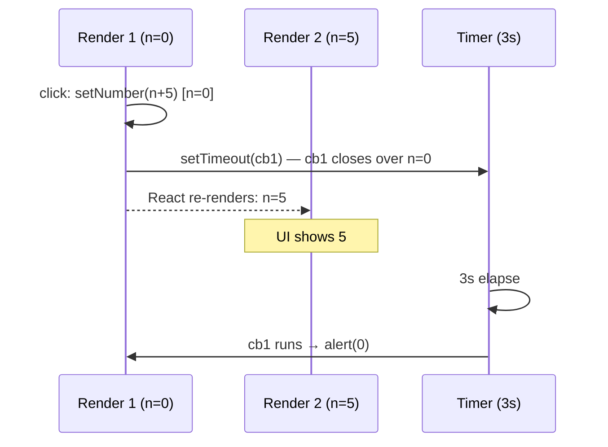

# 01 / 14 — State as a Snapshot

## 1. Lesson metadata

| | |
|---|---|
| **Level** | Intermediate |
| **Study time** | 3.5–4.5 hours (reading 1.5 h, experiments 1 h, exercises 1–1.5 h) |
| **Prerequisites** | [13 — The rendering mental model](./13-rendering-mental-model.md); [Phase 0 / 06 — Lexical scope and closures](../00-web-and-javascript-foundations/06-lexical-scope-and-closures.md); [10 — Event handling](./10-event-handling.md); [Phase 0 / 08 — Objects, references, immutability](../00-web-and-javascript-foundations/08-objects-references-immutability.md) |
| **Next** | [15 — Update queues and batching (first look)](./15-update-queues-and-batching.md) |
| **Related later** | [16 — State preservation and reset](./16-state-preservation-and-reset.md), [Phase 2 / 17 — How hooks attach to Fiber](../02-react-rendering-and-internals/17-hooks-and-fiber-state.md), [Phase 3 / 01 — `useState` internals and update semantics](../03-react-state-and-hooks/01-usestate-internals-and-update-semantics.md), [Phase 3 / 02 — Functional state updates](../03-react-state-and-hooks/02-functional-state-updates.md), [Phase 3 / 05 — Effect dependencies and stale closures](../03-react-state-and-hooks/05-effect-dependencies-and-stale-closures.md) |

**Learning objectives.** After this lesson you can:
1. State the rule: **within one render, `state`, `props`, and every handler created in that render see the same fixed values.** Calling a setter does not change those values; it requests a new render with new values.
2. Predict the output of code that calls setters and then reads state, logs, shows `alert`s, uses `setTimeout`, or `await`s.
3. Explain, using closures, *why* a handler "remembers" the state of the render that created it.
4. Distinguish "the value I closed over" from "the latest value" and pick the right tool to get the latest value when you genuinely need it (updater functions, refs, effects with correct dependencies, stores).
5. Diagnose stale-closure bugs in handlers, timers, intervals, promises, and effects.
6. Explain why this design makes UI consistent and easier to reason about.
7. Apply the same thinking to **props**, **context**, and **derived values**: all are snapshots of one render.

**Concepts covered:** state snapshot, render-scoped constants, closures over render values, `setState` as a *request*, "next render" semantics, console.log-after-set confusion, async handlers and timers, stale closures, updater functions (first contact; full treatment in Lesson 15 and Phase 3/02), refs as escape hatch (preview), derived values from snapshots, immutability link.

---

## 2. Deep conceptual explanation

### 2.1 What problem is this lesson solving?

Experienced JavaScript programmers meet state in React with a strong intuition: *state is a variable; `setState` assigns to it.* That intuition is wrong in a specific, consistent way, and the resulting bugs are among the most common in React:

```tsx
const [count, setCount] = useState(0);

function handleClick() {
  setCount(count + 1);
  console.log(count);        // you expect 1; you see 0
}
```

```tsx
function handleClick() {
  setCount(count + 1);
  setCount(count + 1);
  setCount(count + 1);       // you expect +3; you get +1
}
```

```tsx
function handleSend() {
  setTimeout(() => alert(`Sent to ${recipient}`), 5000);   // which recipient: at click, or after 5 s?
}
```

All three are answered by one idea: **state is a snapshot.** Each render captures a fixed set of values; your code and your handlers for that render are *closed over* those values. A state setter does not mutate them. It tells React "schedule another render in which this state variable has a new value". Then *that* render, a new function call with its own constants, sees the new value.

### 2.2 The rule

> **Rendering is calling your component. The values `useState` returns during that call are constants for that call and for every function created during it.**

When React renders `Counter`, it calls `Counter()`. `useState(0)` returns the pair `[count, setCount]` for that call. `count` is a `const` binding in this invocation. Every event handler, `setTimeout` callback, and `async` continuation created during this invocation closes over *this* `count`. The next render is a **different function invocation** with a **different `count` binding**: the old invocation's `count` never changes, and the closures created in it keep seeing it forever.

The React docs' image is a **photograph** (or a film frame): React takes a snapshot of the UI for a given state. The snapshot includes the JSX, the props, the state, the local variables, and the handlers, all internally consistent, and none of them are updated in place. When state changes React takes a *new photograph*.

*Public guarantee:* "[Setting state only changes it for the *next* render](https://react.dev/learn/state-as-a-snapshot)": values read in the current render and closures created in it do not change. State updates are applied in a later render.
*Teaching model:* closures + "render = function call".
*Implementation detail:* where React stores state (conceptually on the component's Fiber, outside your function; [Phase 2/17](../02-react-rendering-and-internals/17-hooks-and-fiber-state.md)) and exactly when it processes the queue ([Lesson 15](./15-update-queues-and-batching.md)).

### 2.3 What `setState` actually does

`setCount(5)` has three effects, in this order:

1. It **enqueues** an update (`5`, or a function) on that state hook's queue, *outside* your component.
2. It **schedules** a render of the component (if there is no pending one).
3. It **returns** (value: `undefined`). Your function continues running, and the variable `count` in scope is untouched.

Later, React renders the component. During that render `useState` **processes the queue**: starting from the last committed state, applying each queued update in order, and returns the resulting value as the new `count` for *that* render.

```mermaid
sequenceDiagram
  participant H as Handler (render N snapshot)
  participant Q as React: update queue
  participant R as Render N+1
  H->>Q: setCount(count + 1)  [count is N's constant: 0]
  Note over H: handler continues; count still 0
  H->>H: console.log(count) → 0
  Note over H,Q: handler returns
  Q->>R: schedule render
  R->>Q: useState processes queue → 1
  R-->>R: count = 1 (new constant, new closures)
```

### 2.4 Why React works this way

1. **Consistency within a render.** If `count` could change midway through rendering (because some other code called a setter), two parts of the same output could disagree: a header showing 3 and a list built from 4. A snapshot guarantees a render is internally consistent, a prerequisite for pure rendering ([Lesson 12](./12-component-purity.md)) and for concurrent rendering, where React may pause a render and resume or restart it.
2. **Predictable event handlers.** A handler reflects *what the user saw* when they clicked. The "Send" button's handler uses the message and recipient shown at click time even if the UI moves on.
3. **Batching.** Because handlers don't see updates immediately, React can collect several updates from one event and render once ([Lesson 15](./15-update-queues-and-batching.md)).
4. **Time-travel and debuggability.** Each render is a pure function of its snapshot: easy to log, test, replay.

The price: you must remember that code *in a render's closures* can be **stale** relative to the latest state when it runs *later*.

### 2.5 Two timelines to keep apart

| | **Render-time values** | **Latest state** |
|---|---|---|
| What is it? | The constants `useState` returned during a specific render | The value React currently holds (after processing queued updates) |
| Who sees it? | That render's JSX, handlers, timers, promise continuations | The *next* render; updater functions; refs you maintain; external stores |
| Changes during the render? | Never | Only through the queue |
| Appropriate for | Describing the UI; handlers reflecting what the user saw | "Do something with the most recent value" (rare) |

Many bugs are asking the first column for what the second holds (stale closure), or asking the second when the first was intended (a handler that should use what the user saw but reads a ref updated later).

### 2.6 Everything else is a snapshot too

- **Props.** A child's props in a render are fixed for that render. A callback prop `onSave` captured by a timer is the one from that render.
- **Context values.** `useContext(Theme)` returns the value for this render.
- **Derived values.** `const total = items.reduce(...)` is computed from this render's `items`.
- **Event handler functions.** A new function is created each render and captures that render's snapshot ([Phase 0/07](../00-web-and-javascript-foundations/07-functions-and-referential-identity.md)).
- **Refs are the exception:** `ref.current` is a mutable box shared across renders, which is why it can hold "the latest" value, and why it must not be read during render if you want pure output (Lesson 12).

### 2.7 Common misconceptions

| Misconception | Reality |
|---|---|
| "`setState` is async, so I need to wait for it." | The *render* is later; there is nothing to wait for. Your closure's value will never change. Don't `await` setters. (They return `undefined`.) |
| "After `setState`, `state` has the new value in the next line." | It never will in that function. The next *render* has it. |
| "React batching explains why I see the old value." | Batching explains *when* the render happens; the old value is due to snapshots. Even with no batching at all (a hypothetical synchronous render), your closure would keep the old binding. |
| "`useEffect` will see the latest state because it runs later." | An effect sees the snapshot of the render that *created it*, unless you list dependencies correctly (re-created effects get the new snapshot). |
| "Use `setTimeout` so it runs after the update." | A timer created in handler `N` captures render `N`'s values. Waiting doesn't give it later values. |
| "State is a normal variable in my component function." | The *binding* is a render constant; the *storage* is React's, outside your function. |
| "Mutating state `count++` would work if I then call `setCount(count)`." | `count` is a `const` (can't be reassigned); for objects, mutation corrupts snapshots shared with other closures and prevents change detection ([§5.4](#54-incorrect-examples-collected)). |

---

## 3. Internal mechanics

### 3.1 How a closure keeps a snapshot

Reduce a component to plain JavaScript (no React) to see that nothing magic is involved:

```ts
// Pretend React's storage:
const store = { count: 0, queue: [] as Array<number | ((c: number) => number)> };

function render() {
  // processing the queue yields this render's snapshot
  let c = store.count;
  for (const u of store.queue) c = typeof u === "function" ? u(c) : u;
  store.count = c;
  store.queue = [];

  const count = c;                          // const: fixed for this call
  function handleClick() {
    store.queue.push(count + 1);            // setCount(count + 1)
    console.log(count);                     // the closure's constant
    schedule(render);                       // React schedules the next render
  }
  return { count, handleClick };
}
```

Each call to `render()` defines a **new** `count` and a **new** `handleClick` closing over it. The old `handleClick` (still attached to the DOM until commit, or captured by a timer) holds the old `count`. This is all there is to it. React's real implementation stores per-hook state on the component's Fiber and the queue per hook; the semantic above is the *teaching model*.

### 3.2 What gets captured, precisely

Closures capture **bindings**, not values: but because `useState`'s returned `count` is a `const`-style binding in each invocation that is never reassigned, the effect is "frozen value". For *objects*, the binding holds a **reference**: the object's contents can still be mutated through the reference if you (incorrectly) mutate, which would change what *all snapshots sharing that reference* see. Immutable updates ([Phase 0/08](../00-web-and-javascript-foundations/08-objects-references-immutability.md)) are what make "snapshot" literally true for objects: each new state is a new object, old ones remain intact for old closures.

### 3.3 The update queue (preview)

State updates are queued per state hook. When React next renders the component, it applies the queue to the previous state **in order**:

- a **value** update (`setN(5)`) *replaces* the pending state with that value,
- a **function** update (`setN(n => n + 1)`) *computes from the pending state*, where `n` is the pending state at that point in the queue, **not** your render's snapshot.

That second form is the sanctioned way to say "relative to the latest", and it's why `setN(n => n + 1)` three times adds three. Lesson 15 develops the queue and batching in depth; Phase 3/02 treats functional updates as a design topic. In this lesson we only need the contrast: **a value says "set it to what I computed from my snapshot"; a function says "compute the next from whatever is current".**

### 3.4 Timers, promises, and `await`

`await` suspends a function and resumes it later, but its locals, including the snapshot bindings, are preserved by the closure. Therefore:

```tsx
async function handleSave() {
  setStatus("saving");
  await api.save(draft);        // `draft` is the snapshot of this render
  console.log(status);          // still the snapshot value (e.g. "idle")
  setStatus("saved");
}
```

After the `await` the function resumes with the same `status`/`draft` it had: the *old* ones. If the user kept typing during the save, `draft` in this closure is not the latest text. Whether that's right depends on the product: saving what the user clicked "Save" on is usually the *desired* behavior; the bug appears when you assume the closure sees the latest.

### 3.5 Effects and snapshots

Each render creates its own effect function that closes over that render's values. React runs an effect function from render N after commit N, and (if dependencies changed) *cleans up* the previous effect before running the next. An effect that captures `count` and is **never re-created** (empty dependency array) keeps seeing the initial `count` forever, the classic **stale closure**. The dependency array is how you say "re-create this closure when these values change" ([Phase 3/05](../03-react-state-and-hooks/05-effect-dependencies-and-stale-closures.md); the linter rule `react-hooks/exhaustive-deps` enforces it).

### 3.6 "But the UI shows the new value, and my handler shows the old"

Both are true because they live in different snapshots: the **on-screen text** was produced by render N+1 (after the update), while the **handler code running now** belongs to render N (the one you clicked in). The first click's handler is replaced in the DOM by render N+1's handler once committed; a *second* click uses the new handler and its newer snapshot.

---

## 4. Step-by-step execution walkthrough

### 4.1 `setCount(count + 1)` three times

```tsx
function Counter() {
  const [count, setCount] = useState(0);
  return (
    <>
      <p>{count}</p>
      <button type="button" onClick={() => {
        setCount(count + 1);
        setCount(count + 1);
        setCount(count + 1);
      }}>+3?</button>
    </>
  );
}
```

1. **Render 1.** `count = 0` (constant). The handler `h1` closes over `count = 0`. DOM shows `0`.
2. **Click.** React calls `h1`.
3. `setCount(0 + 1)` → queue: `[replace with 1]`.
4. `setCount(0 + 1)` → queue: `[replace with 1, replace with 1]`.
5. `setCount(0 + 1)` → queue: `[1, 1, 1]`.
6. `h1` returns. React schedules a render.
7. **Render 2.** `useState` processes the queue from base state `0`: `1`, `1`, `1` → result `1`. `count = 1`. New handler `h2` closes over `count = 1`. DOM shows `1`.

Result: `+1`, not `+3`. With the updater form `setCount(c => c + 1)` ×3, the queue is `[c=>c+1, c=>c+1, c=>c+1]` → `0 → 1 → 2 → 3`.

### 4.2 The five-second alert

```tsx
function Counter() {
  const [number, setNumber] = useState(0);
  return (
    <button type="button" onClick={() => {
      setNumber(number + 5);
      setTimeout(() => alert(number), 3000);
    }}>{number}</button>
  );
}
```

1. **Render 1:** `number = 0`; handler `h1` closes over `0`.
2. **Click:** `setNumber(0 + 5)` queues 5; `setTimeout` registers callback `cb` (a closure from `h1`'s scope, `number = 0`).
3. Handler returns. React renders: **Render 2** `number = 5`; DOM shows `5`.
4. **Two seconds later (before the alert),** the user clicks again. Handler `h2` (closing over 5): `setNumber(5 + 5)` queues 10; registers `cb2` (closes over 5).
5. Render 3: `number = 10`.
6. **At t = 3 s:** `cb` fires: `alert(0)`. **At t ≈ 5 s:** `cb2` fires: `alert(5)`.
7. Final UI: `10`.

The alert shows the value the *user saw when they clicked*, not what is on screen now. This is the **intended** semantics for most UIs. If it surprises you, the fix is not to "wait until updated"; it's to decide which snapshot you want.

---

## 5. Code examples

### 5.1 Minimal example: log after set

```tsx
import { useState } from "react";

export function LogAfterSet() {
  const [n, setN] = useState(0);

  function handleClick() {
    console.log("before:", n);
    setN(n + 1);
    console.log("after:", n);
  }

  console.log("render:", n);
  return <button type="button" onClick={handleClick}>{n}</button>;
}
```

**Predict:** console output after the page loads, and after one click (production build; in dev Strict Mode, render logs are doubled).

**Result:**
```text
render: 0          ← initial render
before: 0
after: 0           ← still 0
render: 1          ← the re-render that happens after the handler returns
```
**Why:** `n` in `handleClick` is the render-0 constant; `setN` only schedules render 1.
**Takeaway:** to log the *new* state, log in the next render (body or an effect), not right after the setter. To use a value you are about to set, compute it in a local variable (`const next = n + 1; setN(next); use(next)`).

### 5.2 Practical example: submit with the data the user saw

```tsx
import { useState } from "react";

export function MessageForm() {
  const [to, setTo] = useState("Alice");
  const [message, setMessage] = useState("Hello");
  const [log, setLog] = useState<string[]>([]);

  function handleSubmit(e: React.FormEvent<HTMLFormElement>) {
    e.preventDefault();
    const sentTo = to;                 // optional: name the snapshot we intend to use
    const sentMessage = message;
    setMessage("");
    setTimeout(() => {
      setLog((prev) => [...prev, `You said "${sentMessage}" to ${sentTo}`]);
    }, 5000);
  }

  return (
    <form onSubmit={handleSubmit}>
      <label>To:
        <select value={to} onChange={(e) => setTo(e.target.value)}>
          <option>Alice</option>
          <option>Bob</option>
        </select>
      </label>
      <textarea value={message} onChange={(e) => setMessage(e.target.value)} />
      <button type="submit">Send</button>
      <ul>{log.map((l, i) => <li key={i}>{l}</li>)}</ul>
    </form>
  );
}
```

**Predict:** the user clicks Send with "Hello" to Alice, then immediately switches the recipient to Bob and types "Bye". Five seconds later, what is appended to the log?

**Result:** `You said "Hello" to Alice`. The timer callback closes over the submit-time snapshot (`to = "Alice"`, `message = "Hello"`), even though the UI now says Bob and "Bye".
**Why:** closures capture the render in which `handleSubmit` was created.
**Line notes:** `const sentTo = to` is redundant for correctness (`to` is already a constant) but documents intent; some teams prefer it for readability. `setLog(prev => …)` uses the updater form: here we *do* want "the latest log", since the timer fires later and other entries may have been added in between: capturing `log` and writing `[...log, x]` would drop entries (stale closure).
**Trade-off:** if the product requirement is "send to whoever is selected *when the timer fires*", you must read the latest via a ref or restructure (send immediately and show "sending…").

### 5.3 Practical example: functional updates for relative changes

```tsx
function Cart() {
  const [qty, setQty] = useState(1);

  function addThree() {
    setQty((q) => q + 1);
    setQty((q) => q + 1);
    setQty((q) => q + 1);          // 1 → 4
  }

  function addOneAfterSave() {
    saveToServer().then(() => setQty((q) => q + 1));   // safe even if qty changed meanwhile
  }
  // ...
}
```

Use updater functions when the next state **depends on the previous state** *and* the update might be queued with others, or applied later (promises, timers, intervals). Use the value form when the next state is *independent* of the previous (`setName(e.target.value)`).

### 5.4 Incorrect examples (collected)

```tsx
// (a) Expecting the setter to be synchronous
function handleAdd() {
  setItems([...items, newItem]);
  save(items);                 // saves the OLD list
}

// (b) Stale interval
function Clock() {
  const [count, setCount] = useState(0);
  useEffect(() => {
    const id = setInterval(() => setCount(count + 1), 1000);   // `count` frozen at 0
    return () => clearInterval(id);
  }, []);
  return <p>{count}</p>;
}

// (c) Mutating state to "get the new value now"
function handleClick() {
  user.age = 31;               // mutates the snapshot in place
  setUser(user);
}

// (d) Awaiting a setter
async function handleClick() {
  await setCount(count + 1);   // setters return undefined; there's nothing to await
  console.log(count);          // still old
}

// (e) Reading state in a listener registered once
useEffect(() => {
  const onKey = () => console.log(count);    // always the initial count
  window.addEventListener("keydown", onKey);
  return () => window.removeEventListener("keydown", onKey);
}, []);                                      // missing `count` dependency

// (f) Multiple dependent updates from one snapshot
function handleDouble() {
  setCount(count * 2);
  setCount(count * 2);         // not 4×; both compute from the same snapshot
}
```

Why each is wrong:
- (a) `items` in this closure is the old list; `save` receives the old data. Compute `const next = [...items, newItem]; setItems(next); save(next);`.
- (b) The effect runs once; its closure has `count = 0` forever, so every tick sets `1`. The UI goes `0 → 1` and stops. (In dev Strict Mode, the effect is set up twice but each closure is still `count = 0`.) Fix: `setCount(c => c + 1)`.
- (c) Mutation changes the object that earlier closures (and memoized children comparing references) hold; React may bail out because the reference is identical; and you lose the "previous snapshot" for comparisons. Fix: `setUser({ ...user, age: 31 })`.
- (d) A setter returns `undefined`; awaiting it only yields a microtask tick. It does not wait for the render.
- (e) A stale listener; fix with the dependency (and re-subscribe) or a "latest value" ref.
- (f) Identical queued value updates: result `count * 2`, not `count * 4`. Use `setCount(c => c * 2)` twice if repeated doubling is intended.

### 5.5 Corrected implementations

```tsx
// (a)
function handleAdd() {
  const next = [...items, newItem];
  setItems(next);
  save(next);
}

// (b) updater: independent of the closure's snapshot
useEffect(() => {
  const id = setInterval(() => setCount((c) => c + 1), 1000);
  return () => clearInterval(id);
}, []);

// (c)
setUser((prev) => ({ ...prev, age: 31 }));

// (e) re-subscribe when count changes (simple and correct for light handlers)
useEffect(() => {
  const onKey = () => console.log(count);
  window.addEventListener("keydown", onKey);
  return () => window.removeEventListener("keydown", onKey);
}, [count]);

// (f)
setCount((c) => c * 2);
setCount((c) => c * 2);
```

### 5.6 Advanced example: "latest value" via a ref (escape hatch)

Sometimes you *do* want "whatever is current when this fires": a global keyboard shortcut, a long-lived subscription, an interval that reads state but shouldn't be torn down on each change.

```tsx
import { useEffect, useRef, useState } from "react";

export function useLatest<T>(value: T) {
  const ref = useRef(value);
  useEffect(() => {
    ref.current = value;       // update after each commit
  });
  return ref;
}

export function AutoSave({ draft }: { draft: string }) {
  const latestDraft = useLatest(draft);

  useEffect(() => {
    const id = setInterval(() => {
      void fetch("/api/draft", { method: "PUT", body: latestDraft.current });
    }, 10_000);
    return () => clearInterval(id);
  }, [latestDraft]);           // ref object identity is stable → effect runs once

  return null;
}
```

**Predict:** the user types for 25 s without stopping. How many saves, and what do they contain?

**Result:** two saves (≈ 10 s and ≈ 20 s) *(plus the dev double-setup of the effect in Strict Mode; each setup is cleaned up)*, each with the text as of that moment: the interval callback reads `latestDraft.current`, which the effect keeps updated, rather than the closure snapshot.
**Why this isn't a purity violation:** the ref is written in an effect (after commit) and read in a timer callback, not during render.
**Trade-offs:** you've opted out of snapshot semantics deliberately. The value in the ref can be *newer than what's on screen* if an uncommitted render exists; for a save timer that's acceptable. Don't read `latest.current` during render (output would depend on render history, Lesson 12). `useEffectEvent` (stable since React 19.2) is a purpose-built alternative: it wraps an event-like callback so it always sees the latest props/state, and may only be called from Effects, see <https://react.dev/reference/react/useEffectEvent> ([Phase 3/22](../03-react-state-and-hooks/22-modern-hooks-and-apis.md)).

### 5.7 Advanced example: snapshots and async races

```tsx
import { useEffect, useState } from "react";

function UserProfile({ userId }: { userId: string }) {
  const [profile, setProfile] = useState<Profile | null>(null);

  useEffect(() => {
    let ignore = false;                       // belongs to THIS render's effect closure
    setProfile(null);
    fetchProfile(userId).then((p) => {
      if (!ignore) setProfile(p);             // only the latest effect's closure may write
    });
    return () => { ignore = true; };          // cleanup flips THIS closure's flag
  }, [userId]);

  return profile ? <ProfileCard profile={profile} /> : <p role="status">Loading…</p>;
}
```

**Predict:** the user switches from user 1 to user 2 while user 1's request is in flight, and user 1's response arrives *after* user 2's. What shows?

**Result:** user 2's profile. Each effect run has its own `ignore` variable: when `userId` changes, cleanup of the first effect sets *its* `ignore = true`; when user 1's response arrives, its `.then` callback (a closure over the first `ignore`) sees `true` and does nothing.
**Why this works:** it's the snapshot-per-render idea applied to effects: each effect invocation owns private state. This is the foundation of correct fetch-in-effect code and of why cancellation and race handling are *about closures* ([Phase 6/02](../06-data-fetching-and-state-ecosystems/02-cancellation-and-race-conditions.md)).
**Better in production:** use a data library or framework loader; hand-written effects miss caching, retries, and de-duplication.

### 5.8 Advanced example: derived values are part of the snapshot

```tsx
function Invoice({ lines }: { lines: readonly { qty: number; cents: number }[] }) {
  const [discountPct, setDiscountPct] = useState(0);

  const subtotal = lines.reduce((s, l) => s + l.qty * l.cents, 0);   // snapshot-derived
  const total = Math.round(subtotal * (1 - discountPct / 100));       // snapshot-derived

  function handleApply() {
    setDiscountPct(10);
    console.log(total);        // total for discount = old value; the 10% total appears next render
  }
  // ...
}
```

`total` isn't state; it's a pure function of the snapshot. There is no `setTotal`. This is why derived values never go stale *within* a render and why you should not copy them into state ([Phase 3/17](../03-react-state-and-hooks/17-derived-state.md)).

---

## 6. Visual explanations

### Renders as frames

```text
Render 1 (count = 0)                  Render 2 (count = 1)                Render 3 (count = 2)
┌───────────────────────────┐        ┌───────────────────────────┐       ┌───────────────────────────┐
│ props, state: 0           │        │ props, state: 1           │       │ props, state: 2           │
│ JSX:  <p>0</p>            │        │ JSX:  <p>1</p>            │       │ JSX:  <p>2</p>            │
│ handler h1 ──closes──▶ 0  │        │ handler h2 ──closes──▶ 1  │       │ handler h3 ──closes──▶ 2  │
└───────────────────────────┘        └───────────────────────────┘       └───────────────────────────┘
      │  click h1: setCount(0+1)  ───────────▶ React's queue ─────────────▶ next frame
```

### Which snapshot does the callback see?



### Value update vs function update

```text
queue (base state = 0):   [ 5 ] , [ n => n + 1 ] , [ 42 ]
                           ↓         ↓                ↓
                    state → 5 ──────▶ 6 ───────────▶ 42       (final: 42)
```

---

## 7. Alternative approaches and trade-offs

How to get at "the value" you need in asynchronous or deferred code:

| Approach | Gets you | Pros | Cons | Use when |
|---|---|---|---|---|
| **Closure over snapshot** (default) | The value the user saw at the time | Simplest; predictable; matches user intent for actions | Stale if you wanted "latest" | Submit/save/click actions; most handlers |
| **Updater function** `setX(prev => …)` | Latest *queued* state for computing the next state | Correct under batching and async; no stale closure | Only for computing next state; can't "read" for other purposes; must be pure | Counters, appends, toggles, merges |
| **Local variable for next value** | Exactly what you're about to set | Clear; use the same value for set and side effect | Easy to forget in complex handlers | Set + side effect with the same data |
| **Ref ("latest value")** | Current committed-ish value, at any time | Works in long-lived callbacks without re-subscribing | Bypasses snapshot guarantees; must not be read in render; extra code | Global listeners, timers, subscriptions |
| **Effect with dependencies** | Re-created closure on change | Idiomatic and lint-checked | Teardown/re-setup cost; re-subscription churn | Syncing with external systems |
| **`useEffectEvent`** | Latest values inside effect callbacks without dependency churn | Purpose-built | Stable export in React 19.2+ (verified: `typeof useEffectEvent === "function"` in react 19.3.1; documented at react.dev/reference/react/useEffectEvent); only call it from Effects | Effects needing latest props/state but not re-running |
| **External store / reducer with `getState()`** | Authoritative latest state outside React | No staleness for store-managed state | Extra architecture | App-level or shared state ([Phase 6/09–10](../06-data-fetching-and-state-ecosystems/10-zustand.md)) |
| **`flushSync`** | Forces a synchronous render+commit | Needed for rare DOM-measure-after-update cases | Defeats batching; performance and ordering hazards | Almost never; DOM interop |

**When the usual advice (updater functions) is not best:** when the next state depends on *multiple* pieces of state (use a reducer, so the logic sees them together), or when you want the user-seen snapshot (the closure is exactly right and an updater would be *wrong*, e.g., "the alert should show the number at click time"). Also, `setItems(prev => …)` is unnecessary in a plain click handler that sets `setName(inputValue)`: the value form is clearer when the update doesn't depend on previous state.

---

## 8. Best practices and anti-patterns

**Do**
- Read state in the render body or handler as *this render's* constant; reason in terms of "which render is this code from?".
- Compute the next value in a local variable when you need to use it right away.
- Use updater functions when the new state depends on the old one and when updates may be queued, deferred, or concurrent.
- Treat state, props, and context as immutable; create new objects and arrays.
- In effects, list every reactive value used (let the lint rule guide you).
- Prefer restructuring over refs for "latest value" needs; use refs deliberately and document why.
- Name the snapshot you intend (`const sentTo = to`) when the logic is subtle.

**Beginner mistakes**
- Logging after `setState` and concluding "setState is broken/async".
- Calling `setX(x + 1)` several times expecting accumulation.
- Awaiting a setter.
- Using state to hold a value that changes every frame and expecting immediate reads.

**Experienced-developer mistakes**
- Disabling `react-hooks/exhaustive-deps` to "fix" a stale closure instead of restructuring.
- Putting everything in refs to avoid re-renders, losing UI updates and testability.
- Using `useEffect` to "read the updated state after set" (you can: it runs after the next render; but usually the right fix is to compute the value directly or to move logic into the handler).
- Capturing the *whole state object* in a long-lived closure.
- Assuming a closure is "live" because the variable is `let`/object-like. The binding is per-render.

**Smells**
- A `setTimeout`/`setInterval` in a handler that reads state variables.
- An effect with `[]` that references state/props.
- Handlers that call a setter then read the same variable.
- `useRef` mirrors of state everywhere (usually a design smell: `const countRef = useRef(count); countRef.current = count;` in render violates purity).

**Justified exceptions**
- `useLatest`-style refs for global listeners and subscriptions.
- Deliberately stale snapshots (the user-saw-this semantics).

---

## 9. Real-world application

**E-commerce checkout.** "Place order" captures the cart and shipping method *as displayed* when the user clicked. While the request is in flight the user may edit the cart (or a background refresh may change prices). Capturing the snapshot (cart id, version, total shown) and sending it with a version/expected-total check to the server prevents surprises; the client closure's staleness is a *feature* if the server validates.

**Chat / realtime.** A message list receives events via a WebSocket subscription created once. Use `setMessages(prev => [...prev, msg])` in the handler: capturing `messages` would drop messages that arrived between renders. Any subscription callback should be written as "apply this event to previous state", not "set to computed from snapshot".

**Dashboards with polling.** A `setInterval` poll that reads filter state: either re-create the interval when filters change (simple), or keep a "latest filters" ref; not an empty-deps effect that polls with initial filters forever, a common cause of "filter doesn't affect auto-refresh" bug reports.

**Forms with debounced autosave.** The debounced callback must save the *latest* draft; implement with a ref or by debouncing the *value* and saving in an effect keyed to the debounced value, not by capturing `draft` in a timer created at the first keystroke.

**Finance/audit.** Double-click protection: two clicks in quick succession both read `isSubmitting = false` from the same snapshot if no render happened between them (rare for discrete events, since React flushes updates between discrete events; but possible with programmatic calls or very fast timers). The server must enforce idempotency; UI state is not a lock ([Phase 10/10](../10-production-engineering/10-resilience-and-degradation.md)).

**Multi-team libraries.** Public hooks (e.g., `useDebounce`, `useInterval`) must document and test snapshot behavior: does the callback see the latest props? Libraries typically store the latest callback in a ref so consumers can pass inline functions without re-subscribing, exactly the pattern in §5.6.

---

## 10. Debugging and troubleshooting

**Symptom 1: "State didn't update!" (logging old value after setState).**
- *Repro:* §5.1.
- *Investigate:* log in the component body (`console.log("render", state)`) and compare ordering with the handler's logs; React DevTools → Components → select the component → watch the hooks values update after the click.
- *Root cause:* the log is in the old snapshot.
- *Fix:* compute locally or log in the next render; validate by checking DevTools state values.

**Symptom 2: counter increments by 1 though I call the setter 3 times.**
- *Root cause:* value updates all computed from one snapshot. *Fix:* updater functions.

**Symptom 3: interval/timeout uses old state.**
- *Investigate:* check the effect's dependency array and what the callback reads; `react-hooks/exhaustive-deps` warnings are the strongest signal; add `console.log(count)` inside the callback and watch it never change.
- *Fix:* updater form, dependencies, or latest-value ref; validate by observing logs change.

**Symptom 4: a response from an old request overwrites newer UI.**
- *Root cause:* callback not guarded; async continuation from a stale render writes state. *Fix:* cleanup flag/`AbortController` (§5.7); validate by throttling the network in DevTools and switching quickly (Network tab → "Slow 3G").

**Symptom 5: handler sees stale props from a child component's memoized callback.**
- *Root cause:* `useCallback` with missing deps (or an outdated `memo` comparator) preserved an old closure. *Investigate:* check the dependency array; verify with the Profiler that the callback identity doesn't change when it should. *Fix:* correct deps; or remove premature memoization.

**Symptom 6: "I set state and then called a function that reads state; it sees the old one."**
- *Fix:* pass the computed value as an argument to that function rather than having it read from state, or perform the work in an effect keyed on the changed state if it is truly synchronization.

**Symptom 7: StrictMode shows my effect running twice and the interval doubling.**
- *Root cause:* missing cleanup. *Fix:* return `() => clearInterval(id)`.

---

## 11. Exercises

### Level A — Knowledge
A1. In your own words, what is the "snapshot" of a render? Which values does it include?
A2. What does `setCount(5)` do, in order? What does it *not* do?
A3. Why does `console.log(count)` right after `setCount(count + 1)` print the old value?
A4. What is the difference between `setCount(count + 1)` and `setCount(c => c + 1)`?
A5. Why is awaiting `setCount(...)` pointless?
A6. Name two situations where the closure's old value is *exactly what you want*, and two where it's a bug.
A7. Why must state not be mutated, in terms of snapshots?

### Level B — Code comprehension
B1. What is shown after a single click?
```tsx
const [n, setN] = useState(0);
<button onClick={() => { setN(n + 1); setN(n + 1); setN(n + 1); }}>{n}</button>
```
B2. And now?
```tsx
<button onClick={() => { setN(n + 5); setN((x) => x + 1); setN(42); }}>{n}</button>
```
B3. And now? (Starting from `n = 0`.)
```tsx
<button onClick={() => { setN(n + 5); setN((x) => x + 1); }}>{n}</button>
```
B4. What are the alerts, in order, if the user clicks once, then clicks again 1 s later (before the first alert)? Initial `number = 0`.
```tsx
<button onClick={() => { setNumber(number + 1); setTimeout(() => alert(number), 3000); }}>{number}</button>
```
B5. After the component mounts, how does `count` evolve over 5 seconds, and why?
```tsx
useEffect(() => {
  const id = setInterval(() => setCount(count + 1), 1000);
  return () => clearInterval(id);
}, []);
```
B6. What does this log, in order? (Production build, one click, `n` starts at 0.)
```tsx
function C() {
  const [n, setN] = useState(0);
  console.log("render", n);
  return <button onClick={() => { console.log("click", n); setN(n + 1); console.log("done", n); }}>x</button>;
}
```
B7. In `async function save() { setSaving(true); await post(draft); setSaving(false); }`, which `draft` is posted if the user types more during the `await`... and which if they typed *before* `post` started?

### Level C — Implementation
C1. Implement `useInterval(callback, delayMs)` so callers can pass an inline callback that always sees the latest props/state, without clearing/restarting the interval on every render.
C2. Implement `<ClickCounter>` with a button "+1" and a button "+3 (one click)", plus a "Show alert in 2 s" button that shows (a) the count at click time, and a second button that shows (b) the *latest* count at fire time.
C3. Write a `useDebouncedCallback(fn, ms)` that always calls the latest `fn` but only after `ms` of inactivity; discuss the stale-closure design choices.
C4. Implement a "Like" button with optimistic UI: increment immediately, send a request, and roll back on failure. The rollback must restore the correct value even if the user clicks several times quickly.

### Level D — Debugging
D1. "My list loses items when messages arrive quickly." Find and fix:
```tsx
useEffect(() => {
  const unsubscribe = chat.onMessage((m) => setMessages([...messages, m]));
  return unsubscribe;
}, []);
```
D2. "The autosave always saves the first character only."
```tsx
function Editor() {
  const [text, setText] = useState("");
  useEffect(() => {
    const id = setInterval(() => save(text), 5000);
    return () => clearInterval(id);
  }, []);
  return <textarea value={text} onChange={(e) => setText(e.target.value)} />;
}
```
D3. "After toggling the checkbox quickly twice, state is wrong." Explain and fix:
```tsx
function toggle() { setTimeout(() => setOn(!on), 200); }
```
D4. A teammate "fixed" a stale closure by adding `// eslint-disable-next-line react-hooks/exhaustive-deps`. Explain why the bug is hidden, not fixed, and propose two real fixes.
D5. "My `useCallback` returns an old value." Explain:
```tsx
const onSave = useCallback(() => api.save(draft), []);
```

### Level E — Architecture and engineering decisions
E1. A product requires "Save" to submit exactly what the user saw when they pressed Save, even though background updates may modify fields. Design the client behavior and server contract (versioning), and discuss how closure snapshots help or hurt.
E2. Compare for a shared `useInterval` hook: (a) re-create interval on callback change, (b) latest-callback ref, (c) `useEffectEvent`. Evaluate on correctness, performance, API clarity, forward-compatibility.
E3. How would you teach a team of Redux/MobX developers (used to mutable "live" state or `getState()` in thunks) the snapshot model so their React code is correct? What exercises and review rules do you use?

### Level F — Expert challenge
F1. Explain, using the snapshot model, why this pattern can lose updates and then give two *different* correct designs (one reducer-based, one queue-based):
```tsx
const [count, setCount] = useState(0);
async function handleClick() {
  const current = count;
  await delay(1000);
  setCount(current + 1);
}
```
Two rapid clicks. Describe the timeline, final state, and what you'd choose for (a) "count clicks", and (b) "set to the server's confirmation value".

---

## 12. Detailed answers and explanations

> Attempt the exercises first.

**A1.** The snapshot is everything a single call of the component sees and produces: props, state, context values, local variables and derived values, the JSX it returned, and the event handlers/closures created during that call. All are fixed for that render. Wrong answer: "only the state".

**A2.** (1) Enqueues an update for that state hook; (2) schedules a re-render of the component; (3) returns `undefined`. It does not change the variable `count` in the running function, doesn't render synchronously within the handler, and doesn't block.

**A3.** `count` in the handler is the constant from the render the handler was created in; the update is applied in the *next* render, in which a new `count` constant exists. (Not because "setState is async" in the Promise sense; the same would hold if the render were synchronous.)

**A4.** The first enqueues the *value* `count + 1` computed from the render's snapshot; the second enqueues a *function* React applies to the latest pending state. Repeated value updates from one snapshot collapse to the same value; repeated function updates compose.

**A5.** Setters return `undefined`, so `await` waits only a microtask; it doesn't wait for rendering, and the closure's `count` wouldn't change even after the render completes.

**A6.** Wanted: "Submit" or "Place order" using what the user saw; an alert/confirmation reflecting the click-time data; analytics events describing the clicked state. Bugs: an interval that should reflect current state; a long-lived subscription appending to a list; a debounced autosave capturing initial text; a listener registered once reading evolving state.

**A7.** If you mutate an object in place, "previous snapshots" (held by earlier closures, memoized children, in-flight async callbacks) change retroactively, breaking the guarantee that a render is internally consistent and that handlers see what the user saw. And since React detects change by reference, an in-place mutation may not even trigger a re-render.

**B1.** `1`. All three calls compute `0 + 1` from the same snapshot, so the queue is `[1, 1, 1]`; final state `1`.

**B2.** `42`. Queue: replace with `0 + 5 = 5`; apply `x => x + 1` → `6`; replace with `42` → `42`. The last replacement wins.

**B3.** `6`. Replace with `5`, then `5 + 1 = 6`.

**B4.** First click at t = 0: snapshot `number = 0`; sets 1; alert at t = 3 s shows `0`. Second click at t = 1 s: the displayed (and handler-closed-over) `number` is `1`; sets `2`; alert at t = 4 s shows `1`. Alerts: `0`, then `1`. Final UI `2`. Wrong guess: `1`, `2` (assuming "latest at alert time").

**B5.** `count` goes `0 → 1` after one second and then stays at `1`. The effect runs once; its interval callback closes over the first render's `count = 0` and sets `1` each second. (The interval keeps ticking and calling `setCount(1)`, but identical state values bail out of re-rendering.) Fix: `setCount(c => c + 1)`.

**B6.** `render 0` (mount); on click: `click 0`, `done 0`, then `render 1`. `done` shows `0` because the closure didn't change.

**B7.** The `draft` posted is the one in the closure of the render in which `save` was created, i.e., the text at the moment the user *triggered save*; typing during the `await` doesn't change what was posted (it was passed as an argument when `post(draft)` was *called*, which occurs immediately after `setSaving(true)` and before the `await` suspends). Typing *before* the click is included; typing after isn't. So there is no "typed more during await" case for `post`'s argument because the argument is evaluated before awaiting. Code after the `await` that reads `draft` (e.g., to compare) sees the snapshot value, not the latest.

**C1. Reference solution**
```tsx
import { useEffect, useRef } from "react";

export function useInterval(callback: () => void, delayMs: number | null): void {
  const saved = useRef(callback);

  useEffect(() => {
    saved.current = callback;                // always the latest closure, updated after each commit
  });

  useEffect(() => {
    if (delayMs === null) return;
    const id = setInterval(() => saved.current(), delayMs);
    return () => clearInterval(id);
  }, [delayMs]);                              // restarts only when the delay changes
}
```
Why: the interval is stable; the *callback it invokes* is looked up at fire time from the ref. The ref is written in an effect, not in render (purity). Edge cases: effects run in order, so on a commit the ref update runs before the interval effect in the same commit; between a render and its commit, a tick could call the previous callback: acceptable. `delayMs === null` pauses. Strict Mode: dev re-runs effects; cleanup clears the first interval. If `useEffectEvent` is stable in your React version, it can replace the ref (verify docs).

**C2. Reference solution**
```tsx
function ClickCounter() {
  const [count, setCount] = useState(0);
  const latest = useRef(count);
  useEffect(() => { latest.current = count; });

  return (
    <>
      <p>{count}</p>
      <button type="button" onClick={() => setCount((c) => c + 1)}>+1</button>
      <button type="button" onClick={() => { setCount((c) => c + 1); setCount((c) => c + 1); setCount((c) => c + 1); }}>+3</button>
      <button type="button" onClick={() => setTimeout(() => alert(`at click: ${count}`), 2000)}>Alert (snapshot)</button>
      <button type="button" onClick={() => setTimeout(() => alert(`latest: ${latest.current}`), 2000)}>Alert (latest)</button>
    </>
  );
}
```
Notes: the snapshot alert uses the closure; the latest one uses the ref (written in an effect). The "+3" uses updater functions; `setCount(count + 3)` also works here since only one update is queued and the intent is "+3 from what I see". Discuss when each is preferable: the updater version is robust if the handler can run twice before a render.

**C3. Reference solution**
```tsx
import { useCallback, useEffect, useRef } from "react";

export function useDebouncedCallback<A extends unknown[]>(fn: (...args: A) => void, ms: number) {
  const latest = useRef(fn);
  const timer = useRef<ReturnType<typeof setTimeout> | undefined>(undefined);

  useEffect(() => { latest.current = fn; });                       // latest fn
  useEffect(() => () => clearTimeout(timer.current), []);           // cleanup on unmount

  return useCallback((...args: A) => {
    clearTimeout(timer.current);
    timer.current = setTimeout(() => latest.current(...args), ms);  // calls latest fn, with args from the triggering call
  }, [ms]);
}
```
Design choices: *Latest `fn`, call-time args.* The function that runs is the latest passed; the arguments are those of the last call, snapshot at call time. If the debounced action should use *state* at fire time rather than call time, read it from a ref or pass nothing and read inside `fn` (latest). The returned function's identity changes only with `ms`, so it's safe in dependency arrays.

**C4. Reference solution**
```tsx
function LikeButton({ postId, initial }: { postId: string; initial: number }) {
  const [likes, setLikes] = useState(initial);

  async function handleClick() {
    setLikes((n) => n + 1);                           // optimistic, relative to latest
    try {
      await api.like(postId);
    } catch {
      setLikes((n) => n - 1);                         // rollback: relative, not "restore old snapshot"
    }
  }
  return <button type="button" onClick={handleClick}>♥ {likes}</button>;
}
```
Why relative updates: with several quick clicks, restoring a captured snapshot (`setLikes(previous)`) would erase other clicks' increments; subtracting one undoes only this click's effect. Production concerns: idempotency/toggle semantics (a "like" should be a PUT to a state, not an increment), disabling during pending, and reconciling with the server's returned count. Libraries (TanStack Query's optimistic updates, Phase 6/05) handle ordering and rollback more robustly.

**D1.** `messages` in the effect's closure is the initial `[]` forever, so each message produces `[m]`, replacing the list. Fix: `setMessages(prev => [...prev, m])`. Validate by sending messages in rapid succession.

**D2.** The interval callback closes over the first render's `text` (`""`), so it saves `""` forever (symptom may vary: "first character" suggests the interval was recreated once; regardless the cause is a stale closure). Fixes: (1) add `[text]` to dependencies, which restarts the timer on each keystroke (so with continuous typing it may never fire): changes semantics; (2) latest-ref pattern (§5.6) so one interval reads `latest.current`; (3) debounce on change. For autosave, (2) or a debounce-after-change is typically best.

**D3.** The timer closes over the `on` from the click-time snapshot. Two rapid toggles both compute `!on` from the same snapshot (say `false → true`) and set `true` twice: final `true` instead of the expected `false`. Fix: `setTimeout(() => setOn(prev => !prev), 200)`.

**D4.** The lint rule flagged that the closure uses a value that isn't in the dependency list, i.e., it will be stale. Disabling it silences the warning, not the bug. Real fixes: include the dependency (and handle resubscription cost); use an updater function so the closure doesn't need the value; use a latest-value ref for long-lived callbacks; move logic out of the effect into the handler that actually caused it.

**D5.** `useCallback(…, [])` freezes the function from the first render, closing over its `draft` (initial `""`). Every call saves the initial draft. Fix: add `[draft]` (the callback changes when `draft` does), or don't memoize at all unless a memoized child needs a stable identity; or read the latest through a ref.

**E1. Evaluation criteria and example answer.** Criteria: correct user intent, consistency, conflict handling, complexity. Design: on Save, capture the form snapshot (field values + `version` of the loaded record) in the handler, send `{values, baseVersion}`; the server compares `baseVersion`, applying the update or returning a conflict with the latest values. Use the closure snapshot deliberately: it represents what the user confirmed. During the in-flight request, disable editing or keep a "pending snapshot" so the UI can show "saved at v7" and reconcile later edits as a new draft; after success, update `baseVersion` from the response with an updater function that preserves edits made since. Hurts: if background refreshes silently replace fields, the user may save values they never saw; show a visible "changed elsewhere" banner. Mention idempotency keys for retries.

**E2.** (a) Re-create on every callback change: simplest and correct, but timer drift/restart every render means an interval may never fire if the callback changes more often than the delay; poor for fast renders. (b) Latest-callback ref: correct and stable; small implementation cost; widely used; relies on effects for ref updates. (c) `useEffectEvent`: expresses intent in the API; avoids manual refs; newer, constraints (can only be called from effects), verify availability and rules. Recommendation: (b) today in a library supporting multiple React versions; migrate to (c) when stable and the supported React range allows. Weak answer: picks (a) without noticing restart behavior.

**E3.** Key message: React state is *not* a live object; it's a series of immutable frames. Teach with closures and the alert exercises (§4.2), then drill "which render is this code from?". Exercises: predict-the-output sets (B1–B6), fix stale intervals, convert thunk-style `getState()` handlers. Review rules: no mutation of state/props; updater functions for relative updates and async code; no empty-deps effects reading state; lint rules enabled and not disabled without a written reason; prefer reducers when updates depend on multiple fields. Contrast with stores: external stores can offer "latest" (`getState()`), React local state offers *consistent frames*. Weak answers treat it as "setState is async".

**F1.** Timeline: click 1 at t=0: `current = 0` (snapshot); awaits 1 s. Click 2 at t=0.5 s: still `count = 0` (no commit changes it), `current = 0`; awaits. At t=1 s: `setCount(0 + 1)` → `1`. At t=1.5 s: `setCount(0 + 1)` → `1`. Final `1`; one click lost, because both closures computed from the same stale `count`. Designs: (a) *Counting clicks:* use relative updates: `await delay(1000); setCount(c => c + 1)`, final `2`. Reducer-based: `dispatch({ type: "clicked" })` after the delay with `case "clicked": return { count: state.count + 1 }`, centralizing logic. (b) *Set to server confirmation:* the right state is the server's number, not a local computation: `const { count: serverCount } = await api.click(); setCount(serverCount)`, with a request-ordering guard (ignore responses older than the latest request, via a sequence number or cancellation) so a late response doesn't overwrite a newer one. Alternative queue-based design: serialize clicks in a promise queue (`queue.current = queue.current.then(() => api.click())`) and update from each response. Choose relative updates for local counters; authoritative server values for shared counts. Evaluate on identifying the shared stale snapshot and on handling response ordering.

---

## 13. Senior engineer interview questions

**Q1. "Why does `console.log(state)` right after `setState` show the old value?"**
*Strong answer:* Because the handler's `state` is a constant from the render that created it. `setState` enqueues an update and schedules a render; the new value only exists in the next render's call of the component. Batching and asynchrony affect *when* that render occurs but aren't the reason: even a synchronous render wouldn't change the already-bound variable. Compute the next value locally or log in the next render.

**Q2. "When do you use `setState(prev => …)`?"**
*Strong answer:* When the new state depends on the previous state and the update might be queued with others or applied later (several updates in one event, promises, timers, subscriptions), since the updater receives the latest pending state, not the render's snapshot. Don't use it reflexively for independent values (`setName(e.target.value)`); keep updaters pure, and prefer a reducer when the update touches several fields.

**Q3. "Explain a stale closure bug you've seen in React and how you fixed it."**
*Strong answer:* Example: an interval/subscription in an effect with `[]` that reads state, so it always sees the initial value. Explain the snapshot-per-render model, the closure captured by the effect from the first render, and fixes (updater form, correct dependencies, latest ref/`useEffectEvent`), plus how the lint rule signals it, and why disabling it hides the bug.

**Q4. "Is it a bug that an alert shows the old value after waiting, even though the screen updated?"**
*Strong answer:* No, it's the designed behavior: the handler reflects the UI at click time. If the product wants the latest at fire time, use a ref or restructure; if it wants click-time data, the closure is correct. Show awareness of which semantics the feature needs, and of the downside (stale writes) where you do want "latest".

**Q5. "How does the snapshot model relate to concurrent rendering?"**
*Strong answer:* Each render is a pure function of its snapshot, so React can render a tree, pause, discard, or restart without leaving partially applied state; different renders can coexist briefly (committed vs in-progress) because each has its own consistent constants. Mutable globals or refs read in render would break this consistency.

**Q6. "How do snapshots interact with `useCallback` and `memo`?"**
*Strong answer:* A memoized callback keeps the snapshot of the render that created it until dependencies change; a missing dependency freezes old values. `memo` skips a child when props are shallow-equal, so a stale callback prop can persist; correct dependency lists make the snapshot refresh when needed. This is why premature memoization risks stale-closure bugs.

---

## 14. Further learning resources

| Resource | URL | Covers / why | Level | Study |
|---|---|---|---|---|
| React docs: State as a Snapshot | <https://react.dev/learn/state-as-a-snapshot> | The canonical explanation with the alert and "Send" examples | Beginner–Int. | Entire page |
| React docs: Queueing a Series of State Updates | <https://react.dev/learn/queueing-a-series-of-state-updates> | Value vs updater updates, the queue example (5, +1, 42) | Intermediate | Entire page |
| React docs: `useState` reference | <https://react.dev/reference/react/useState> | `set` function semantics, caveats, Strict Mode double-calls | Intermediate | "set functions" and Caveats |
| React docs: Updating Objects in State | <https://react.dev/learn/updating-objects-in-state> | Immutability and why mutation breaks snapshots | Beginner | Entire page |
| React docs: Synchronizing with Effects | <https://react.dev/learn/synchronizing-with-effects> | Effects as per-render closures; dependencies; cleanup | Intermediate | Entire page |
| React docs: Separating Events from Effects | <https://react.dev/learn/separating-events-from-effects> | "Latest value" patterns and `useEffectEvent` (stable in 19.2+) | Advanced | Whole page |
| React docs: Referencing Values with Refs | <https://react.dev/learn/referencing-values-with-refs> | Refs as mutable boxes outside the render snapshot | Intermediate | Entire page |
| MDN: Closures | <https://developer.mozilla.org/en-US/docs/Web/JavaScript/Closures> | JavaScript closure mechanics | Beginner | Whole page |
| React docs: `use` and Actions (later) | <https://react.dev/reference/react/useActionState> | Modern async-state patterns | Advanced | After Phase 3/22 |

---

## 15. Knowledge checkpoint

**You should now understand**
- A render's state, props, derived values, and handlers are one consistent, fixed snapshot.
- A setter enqueues an update for the *next* render and changes nothing in the current closure.
- Closures in handlers, timers, promises, and effects keep the snapshot of the render that created them.
- Updater functions, refs, effect dependencies, and stores are the tools for relating to "latest" state, each with trade-offs.

**You should be able to explain without notes**
- Why three `setCount(count + 1)` calls add one, and three `setCount(c => c + 1)` add three.
- Why the alert shows the click-time value.

**You should be able to implement**
- `useInterval`, a latest-ref helper, debounced callbacks, optimistic updates with relative rollback.

**You should be able to debug**
- Stale intervals/listeners, lost updates from async handlers, stale `useCallback` closures, and out-of-order responses.

**Before moving on:** read [15 — Update queues and batching (first look)](./15-update-queues-and-batching.md) for the precise rules of how queued updates are processed and when React renders; then [16 — State preservation and reset](./16-state-preservation-and-reset.md) for how state persists across renders and when it's discarded.
