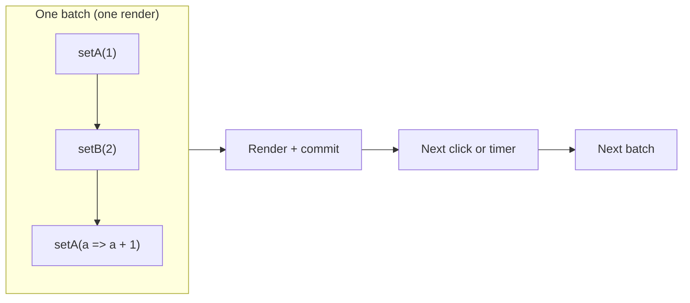
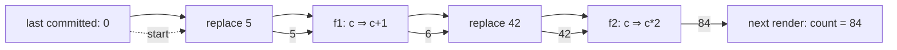

# 01 / 15 — Update Queues and Batching (First Look)

## 1. Lesson metadata

| | |
|---|---|
| **Level** | Intermediate |
| **Study time** | 3–4 hours (reading 1.5 h, experiments 1 h, exercises 1–1.5 h) |
| **Prerequisites** | [14 — State as a snapshot](./14-state-as-a-snapshot.md) (required), [13 — The rendering mental model](./13-rendering-mental-model.md), [10 — Event handling](./10-event-handling.md), [Foundations 06 — Closures](../00-web-and-javascript-foundations/06-lexical-scope-and-closures.md), [Foundations 08 — Immutable updates](../00-web-and-javascript-foundations/08-objects-references-immutability.md) |
| **Next** | [16 — State preservation and reset](./16-state-preservation-and-reset.md) |
| **Related later** | [Phase 2 / 01 — What triggers a render](../02-react-rendering-and-internals/01-what-triggers-a-render.md), [Phase 2 / 22 — Automatic batching](../02-react-rendering-and-internals/22-automatic-batching.md), [Phase 3 / 01 — `useState` internals and update semantics](../03-react-state-and-hooks/01-usestate-internals-and-update-semantics.md), [Phase 3 / 02 — Functional state updates](../03-react-state-and-hooks/02-functional-state-updates.md) |

**Learning objectives.** After this lesson you can:
1. Explain why calling a state setter does **not** change the variable in the running render, and what it does instead.
2. Describe the *update queue* model: setter calls enqueue work; React processes the queue during the next render.
3. Predict the final state for any mix of "replace with value" and "updater function" calls in one handler.
4. State what batching is, what guarantee React gives about it, and how React 18+ differs from React 17.
5. Choose between `setX(x + 1)` and `setX(prev => prev + 1)` based on where the new value comes from.
6. Write pure updater functions and recognise the ones that are not pure.

**Concepts covered:** state setter as a request, update queue, replacement update vs updater function, processing order, batching, one render per batch, automatic batching (React 18+), `Object.is` bail-out, updater purity and StrictMode double invocation, `flushSync` (mentioned only), where batching stops (separate events).

> Scope note. This is a *first look*. We stay at the usage level: what you can observe and rely on. Which "lane" an update gets, how the queue is stored on the Fiber, and what the scheduler does are deferred to [Phase 2](../02-react-rendering-and-internals/22-automatic-batching.md) and [Phase 3](../03-react-state-and-hooks/01-usestate-internals-and-update-semantics.md).

---

## 2. Deep conceptual explanation

### 2.1 What problem is this lesson solving?

[Lesson 14](./14-state-as-a-snapshot.md) established that each render sees a fixed snapshot of state. That raises two immediate questions every learner hits within a day:

1. If I call `setCount(count + 1)` three times in a row, why does the count go up by **one**, not three?
2. If I call `setA(…)` and `setB(…)` in the same handler, does the component render twice?

Both are answered by the same model: **a state setter does not change state; it *requests* an update. Requests accumulate in a queue. React processes the queue when it next renders.** Once you see the queue, the strange-looking behaviours become consequences:

- The three `setCount(count + 1)` calls each enqueue "set state to 1" (because `count` is `0` in this snapshot). Processing the queue yields `1`.
- Two setters in one handler enqueue two requests; React handles them together and renders once.

### 2.2 The three vocabulary items

| Term | Meaning |
|---|---|
| **Update** | One call to a state setter (`setCount(…)`). |
| **Queue** | The ordered list of pending updates for one piece of state, kept by React between your setter call and the next render. |
| **Batch** | A group of updates that React processes together and reflects in a **single** render and commit. |

### 2.3 Two kinds of update

A setter accepts either of two argument shapes. They are enqueued as different *kinds* of request:

```ts
setCount(5);               // 1. replacement: "the next state is 5"
setCount(prev => prev + 1) // 2. updater function: "given whatever state you have at this point in the queue, compute the next state"
```

- A **replacement value** is evaluated *by you, now*, using the snapshot in your closure.
- An **updater function** is evaluated *by React, later*, using the state that results from all earlier queued updates.

This is the whole reason updater functions exist. When the new state depends on the *previous state* and more than one update may be pending, only the updater form is guaranteed to see the up-to-date value.

> Naming. React documents the argument as an "updater function". The convention for its parameter is the first letter(s) of the state variable (`setEnabled(e => !e)`) or `prevEnabled`. Pick one convention per codebase.

### 2.4 What "batching" is and why it exists

Rendering a component is not free: React calls your function, compares the result to the previous one, and may mutate the DOM. If every setter call rendered immediately, a handler that updates three pieces of state would render three times, each producing an intermediate UI the user would never be meant to see, possibly in an *inconsistent* intermediate combination (e.g., `status = "success"` but `data = null`).

**Batching** means React waits until your code finishes its current work, then processes all queued updates and renders once. The user sees only the final, consistent screen.

*Public guarantee* (documented): React batches state updates that occur in the same event, and since React 18 batches updates automatically regardless of where they originate (event handlers, timeouts, promises, native event handlers). It *does not* guarantee a particular number of renders for code that spans separate events, awaits, or timers.

*Not a guarantee:* that React renders exactly once per handler in every situation. Treat "one render per batch" as the model, and write code that is *correct* either way.

### 2.5 React 17 vs React 18+ (version-sensitive)

| Situation | React 17 and earlier | React 18+ (including 19) |
|---|---|---|
| Multiple `setState` calls inside a React event handler | Batched | Batched |
| Multiple `setState` calls in `setTimeout`, a promise `.then`, or after `await` (same synchronous stretch) | **Not batched**: each call rendered synchronously | Batched |
| Multiple `setState` calls inside a native `addEventListener` handler | **Not batched** | Batched |
| Opt out of batching for one update | `ReactDOM.unstable_batchedUpdates` existed for the opposite need (opt in) | `flushSync` from `react-dom` forces a synchronous flush |

Automatic batching in React 18 requires the `createRoot` API. Apps still on the legacy `ReactDOM.render` API retain the older behaviour *(legacy; not covered further)*. Everything in this curriculum assumes `createRoot` (see [Lesson 19](./19-project-setup-vite-typescript.md)).

### 2.6 Relation to JavaScript and the browser

Batching is a direct application of run-to-completion ([Foundations 11](../00-web-and-javascript-foundations/11-event-loop-tasks-microtasks.md)): while your handler runs, nothing else runs on the main thread. React can therefore collect all setter calls the handler makes and act on them *after* the handler returns. The closure facts from [Foundations 06](../00-web-and-javascript-foundations/06-lexical-scope-and-closures.md) explain why `count` inside the handler cannot change: it is a `const` binding in that render's function scope.

### 2.7 Common misconceptions

| Misconception | Reality |
|---|---|
| "`setCount` changes `count` right away." | It enqueues a request. The `count` in the running closure is a constant for that render. |
| "Calling the setter three times increments three times." | Only if each call is an updater function (`prev => prev + 1`). Three `setCount(count + 1)` enqueue the same replacement value. |
| "Batching means React delays and drops updates." | Nothing is dropped. Every queued update is processed in order; only the *rendering* is deferred and merged. |
| "`setX(x + 1)` is always a bug." | It is correct when the new value is computed from the *current snapshot* and you intend that (e.g., a button that sets "the visible value + 1" once). It is wrong only when you intend it to compose with other pending updates. |
| "Batching only happens in event handlers." | Before React 18 that was true. Since 18 it applies broadly. |
| "Updater functions are slower / only for advanced use." | Their cost is negligible; they are the correct tool whenever the next value is derived from the previous one. |
| "State is updated after the handler returns, so I can read it in `setTimeout`." | A closure created in this render still sees this render's snapshot, even if it runs later ([Lesson 14](./14-state-as-a-snapshot.md)). |

---

## 3. Internal mechanics

### 3.1 Teaching model: a queue per state slot

For each `useState` call (conceptually, each "slot" belonging to the component instance), React keeps a list of pending updates. The processing rule is:

```text
state = (value from last committed render)
for each update in queue, in the order they were enqueued:
    if update is a replacement value v:   state = v
    if update is an updater function f:   state = f(state)
result = state     // this is the state variable's value in the next render
```

Everything in this lesson follows from this loop.

*Public guarantee:* updates are applied in the order they were requested; updater functions receive the result of all previous updates in the queue as their argument; the final value is what the next render sees.

*Implementation detail:* how the queue is stored (a linked list on a Fiber), when and on which priority lane it is processed, and the fact that React may *discard and recompute* a queue-processing pass if a render is interrupted. None of that is observable through the public API as long as your updaters are pure. This is exactly why purity of updaters matters ([§3.4](#34-why-updater-functions-must-be-pure)). Details: [Phase 2 / 17](../02-react-rendering-and-internals/17-hooks-and-fiber-state.md).

### 3.2 When does processing happen?

Conceptually:

1. Your code calls a setter. React records the update and **schedules a render** for the owning component's root. (Scheduling is cheap and idempotent: scheduling twice does not mean rendering twice.)
2. Your handler (or timeout callback, or microtask) continues and eventually returns.
3. React then performs the render: for each affected state slot, it runs the queue-processing loop above and calls your component with the resulting state.
4. If nothing differs, React can stop early (see bail-out below). Otherwise it commits DOM changes.

*Implementation detail:* exactly **when** step 3 starts differs by origin. For discrete user events (click, keydown), React flushes the render at the end of the event's handling, before the browser can process the next discrete event. For updates originating elsewhere (timers, promise callbacks), React schedules the render shortly after, typically in a microtask or a scheduler task. In both cases, all setter calls made in the same synchronous run before that point share one batch. Do not write code that relies on the exact flush moment. Verify in the source if you need precision *(Phase 2/22)*.

### 3.3 Bail-out: same value, no work

If a replacement's value is identical to the current state according to `Object.is`, React documents that it will skip re-rendering the component **and its children**. Two caveats from the React docs:

- React may still call your component function once more before deciding to bail out; it just won't descend into children or commit anything.
- Because `Object.is` compares references for objects, `setUser({ ...user })` (a new object with identical content) is *not* a bail-out; `setUser(user)` after mutating `user` **is** a bail-out, and that is exactly why mutating state fails to update the screen ([Lesson 12](./12-component-purity.md), [Foundations 08](../00-web-and-javascript-foundations/08-objects-references-immutability.md)).

For updater functions, React runs the function to compute the next state, then applies the same comparison.

### 3.4 Why updater functions must be pure

An updater function is code React calls, not you. React may call it:

- during a render that it later discards (e.g., because a more urgent update arrived),
- twice in a row on purpose in development under `<StrictMode>`, to expose impurity ([Phase 2 / 28](../02-react-rendering-and-internals/28-strict-mode-behavior.md)).

Therefore an updater must be a pure function of its argument: no mutation of the argument, no side effects (no `fetch`, no `console.log` you rely on, no incrementing an external counter, no calling other setters), and no reading mutable external values for its result.

```ts
// Impure: mutates its input and an outside variable
let calls = 0;
setItems(prev => { calls++; prev.push("x"); return prev; });
```

In development StrictMode this would push `"x"` twice and return the same array reference (bail-out: no render!). The double invocation turns a latent bug into a visible one, which is its purpose.

### 3.5 Batching boundaries

Batching merges updates **within one synchronous run before React flushes**. It does *not* merge:

- two separate clicks (React flushes between discrete events so the second event sees the UI from the first),
- updates separated by `await` (the code after `await` runs in a later microtask; React may or may not have rendered in between),
- updates in different `setTimeout` callbacks.



---

## 4. Step-by-step execution walkthrough

Component and click:

```tsx
import { useState } from "react";

export function Counter() {
  const [count, setCount] = useState(0);

  function handleClick() {
    setCount(count + 5);          // (a)
    setCount(c => c + 1);         // (b)
    setCount(42);                 // (c)
    setCount(c => c * 2);         // (d)
  }

  return <button onClick={handleClick}>Count: {count}</button>;
}
```

**Predict:** after one click, what does the button show? Is `Counter` called once or more after the click?

Walkthrough (initial snapshot `count = 0`):

1. The user clicks. The browser dispatches the event; React runs `handleClick` from the snapshot where `count` is `0`.
2. (a) `count + 5` is evaluated **now** → `5`. React enqueues *replace with 5*. No render yet.
3. (b) React enqueues *updater f1 = c => c + 1*.
4. (c) React enqueues *replace with 42*.
5. (d) React enqueues *updater f2 = c => c * 2*.
6. `handleClick` returns. The main thread's task for the click completes its handler.
7. React processes the queue starting from the last committed value `0`:
   - start `0`
   - replace with 5 → `5`
   - f1(5) → `6`
   - replace with 42 → `42`
   - f2(42) → `84`
8. React calls `Counter` **once** with `count = 84` (in development StrictMode it calls the function body twice for the same render to detect impurity; the output of one is used and nothing is committed twice).
9. The returned element tree differs (text `0` → `84`), so React commits one text-node update.
10. The browser then runs style/layout/paint at the next rendering opportunity ([Foundations 03](../00-web-and-javascript-foundations/03-browser-rendering-pipeline.md)).

**Result:** `Count: 84`. Many learners answer `42` (forgetting (d)) or `2`. The queue loop gives `84` deterministically.

---

## 5. Code examples

### 5.1 Minimal example: the "three clicks" puzzle

```tsx
import { useState } from "react";

export function PlusThree() {
  const [n, setN] = useState(0);
  return (
    <>
      <button onClick={() => { setN(n + 1); setN(n + 1); setN(n + 1); }}>
        +3 (replacement)
      </button>
      <button onClick={() => { setN(p => p + 1); setN(p => p + 1); setN(p => p + 1); }}>
        +3 (updater)
      </button>
      <p>n = {n}</p>
    </>
  );
}
```

**Predict:** click the first button once, then the second once. What is `n` after each click?

**Result:** after the first click `n = 1`; after the second `n = 4`.

**Why:** in the first handler, `n` is `0` in the snapshot, so all three calls enqueue *replace with 1*. In the second handler each updater receives the result of the previous queue entry: `0 → 1 → 2 → 3`; from `1` that is `4`.

**Trade-off:** the updater form is a little more to type and reveals your intent ("increment relative to whatever is current"). The replacement form is right whenever the value does not depend on prior state (`setName(e.target.value)`).

### 5.2 Practical example: a quantity stepper in a cart

```tsx
import { useState } from "react";

type Props = { min?: number; max: number; onChange?: (qty: number) => void };

export function QuantityStepper({ min = 1, max, onChange }: Props) {
  const [qty, setQty] = useState(min);

  function change(delta: number) {
    setQty(prev => {
      const next = Math.min(max, Math.max(min, prev + delta)); // pure: no side effects
      return next;
    });
  }

  return (
    <div role="group" aria-label="Quantity">
      <button type="button" onClick={() => change(-1)} disabled={qty <= min} aria-label="Decrease">−</button>
      <output aria-live="polite">{qty}</output>
      <button type="button" onClick={() => change(+1)} disabled={qty >= max} aria-label="Increase">+</button>
    </div>
  );
}
```

Line notes:
- `change` uses an updater because "plus one" is relative; fast double-clicks or a "+5" shortcut button invoked in the same handler would compose correctly.
- Clamping lives **inside** the updater so every queued step is clamped against the true intermediate value, not a stale snapshot.
- We deliberately do **not** call `onChange?.(next)` inside the updater: that would be a side effect inside a function React may call twice. The parent notification belongs in the event handler or (rarely) an effect. See §5.3 for the corrected pattern.
- `aria-live="polite"` announces the new quantity to screen readers; `aria-label` provides accessible names for the symbol-only buttons.

### 5.3 Incorrect example: side effect in an updater

```tsx
function change(delta: number) {
  setQty(prev => {
    const next = Math.min(max, Math.max(min, prev + delta));
    onChange?.(next);            // BUG: side effect inside updater
    return next;
  });
}
```

**Predict:** in development with `<StrictMode>`, how many times does `onChange` fire per click?

**Result:** typically **twice**. StrictMode double-invokes updater functions in development; in production it fires once. The bug appears only in development, which makes it confusing, and in some concurrent scenarios React could invoke the updater for a render that is then discarded, so the parent may be told about a value that never committed.

**Why:** updaters are part of rendering, and rendering must be pure ([Lesson 12](./12-component-purity.md)).

### 5.4 Corrected implementation

Compute the next value from the snapshot in the handler *when you need to notify*, and keep the updater pure:

```tsx
function change(delta: number) {
  const next = Math.min(max, Math.max(min, qty + delta)); // from the snapshot
  setQty(next);
  onChange?.(next);                                       // event handler: side effects are fine here
}
```

**Trade-off:** this version uses the snapshot, so two `change` calls in the *same* handler would not compose. For a stepper whose buttons each call `change` once per event, that is fine and arguably clearer. If composition within one event matters, keep the updater and notify from an effect that reacts to `qty`, or lift state to the parent ([Phase 3 / 18](../03-react-state-and-hooks/18-state-colocation-and-lifting.md)).

### 5.5 Advanced example: multiple state variables, one render, consistent UI

```tsx
import { useState } from "react";

type Status = "idle" | "saving" | "saved" | "error";

export function SaveButton({ save }: { save: () => Promise<void> }) {
  const [status, setStatus] = useState<Status>("idle");
  const [error, setError] = useState<string | null>(null);
  const [savedAt, setSavedAt] = useState<number | null>(null);

  async function handleClick() {
    setStatus("saving");   // enqueued, batched with setError below
    setError(null);        // one render shows "saving" with no stale error
    try {
      await save();
      setStatus("saved");  // after await: a new synchronous run, batched together (React 18+)
      setSavedAt(Date.now());
    } catch (e) {
      setStatus("error");
      setError(e instanceof Error ? e.message : "Unknown error");
    }
  }

  return (
    <>
      <button onClick={handleClick} disabled={status === "saving"}>
        {status === "saving" ? "Saving…" : "Save"}
      </button>
      {status === "saved" && savedAt !== null && <p>Saved at {new Date(savedAt).toLocaleTimeString()}</p>}
      {status === "error" && <p role="alert">{error}</p>}
    </>
  );
}
```

Observations:
- The first two setters (before `await`) form one batch: one render shows `status = "saving"` and `error = null` together.
- After `await save()`, `setStatus("saved")` and `setSavedAt(…)` run in one synchronous stretch, so on React 18+ they form one batch. On React 17 they would have rendered twice, once with `status: "saved"` and `savedAt: null`, which is why the JSX guards with `savedAt !== null`.
- Defensive design: the code is correct even if React rendered between the setters. Three loose variables that must be consistent is a smell; [Phase 3 / 03](../03-react-state-and-hooks/03-usereducer-and-reducer-architecture.md) shows a single `useReducer` state or a discriminated union that makes inconsistent combinations unrepresentable.
- There is a second, unrelated concern: if the component unmounts during `await save()`, setters still run harmlessly in React 18+ (the old "setState on an unmounted component" warning was removed), but stale responses and cancellation are a data-fetching topic ([Phase 6 / 02](../06-data-fetching-and-state-ecosystems/02-cancellation-and-race-conditions.md)).

### 5.6 Mixing replacement and updater: ordering matters

```tsx
setN(n => n + 1);   // queue: updater
setN(10);           // queue: replace
setN(n => n + 1);   // queue: updater
// start 0 → 1 → 10 → 11
```

Reordering to `setN(10); setN(n => n + 1); setN(n => n + 1)` gives `12`. The loop is order-sensitive and deterministic. *Exercise B3 checks this.*

### 5.7 `flushSync` (for completeness, rarely needed)

```tsx
import { flushSync } from "react-dom";

flushSync(() => setOpen(true));
// DOM is updated here
inputRef.current?.focus();
```

`flushSync` forces React to process the enclosed updates and update the DOM synchronously before it returns. Legitimate uses are narrow (integrating with a non-React API that must read the updated DOM immediately). It hurts performance and defeats batching; do not use it to "make state update immediately". The [`useEffect`/ref lessons](../03-react-state-and-hooks/10-useref-and-mutable-references.md) show the usual alternatives.

---

## 6. Visual explanations

### Queue processing for the §4 walkthrough



### Where batches begin and end

```text
click #1
  handler runs ───────────────────────┐
    setA(...)   ┐                      │ one task, run to completion
    setB(...)   ├─ enqueued            │
    setA(f)     ┘                      │
  handler returns ─────────────────────┘
  React: process queues → render once → commit
click #2
  handler runs ... (a separate batch)

timeout callback (React 18+)
  setA(...) setB(...) ── same synchronous run ──▶ one batch
await boundary
  code before await ──▶ batch X
  code after  await ──▶ batch Y (separate; React may render between)
```

### Replacement vs updater: who reads the value, and when

| | Replacement `setN(n + 1)` | Updater `setN(p => p + 1)` |
|---|---|---|
| Value computed by | your code, **now**, from the snapshot | React, **later**, from the queue's running value |
| Sees earlier queued updates? | No | Yes |
| Good for | values independent of previous state (`e.target.value`) | values derived from previous state (counters, toggles, list edits) |
| Typical bug | stale value when composing | impure updater (side effects, mutation) |

---

## 7. Alternative approaches and trade-offs

How to express "the next state depends on the previous state":

| Approach | Readability | Correctness under composition | Testability | Complexity | Prefer when |
|---|---|---|---|---|---|
| `setN(n + 1)` (replacement from snapshot) | High | Poor if several updates can be pending | High | Lowest | Single update per event; value not derived from earlier updates in the same batch |
| `setN(p => p + 1)` (updater) | Medium–High | Excellent | High (pure function) | Low | Counters, toggles, appending to lists, any relative change |
| `useReducer` with an action | Medium | Excellent (same queue semantics) | Excellent (pure reducer unit-tested separately) | Medium | Several related fields, named transitions, complex rules ([Phase 3 / 03](../03-react-state-and-hooks/03-usereducer-and-reducer-architecture.md)) |
| Mutable ref counter (`ref.current++`) | Low | Not tied to rendering | Medium | Medium | Values that must **not** trigger renders (timers, previous values) |
| External store | Medium | Defined by store | High | Highest | Cross-component state |

**When the recommended default (updaters for relative changes) is *not* best:**
- *"Set to what the user typed"* — `setText(e.target.value)` is a replacement and exactly right; wrapping it in `setText(() => e.target.value)` adds nothing, and an updater that reads `e.target.value` runs later, when the DOM input's value may already have changed (event pooling was removed in React 17, but reading live DOM values in deferred code is still fragile). Read the value in the handler instead.
- *"Reset"* — `setCount(0)` is clearer than `setCount(() => 0)`.
- *Notification needs* — when you must tell a parent the new value, compute from the snapshot in the handler (§5.4) rather than in an updater.

---

## 8. Best practices and anti-patterns

**Do**
- Use the updater form whenever the new value is computed from the previous value, especially for counters, toggles (`setOn(o => !o)`), and list edits (`setItems(prev => [...prev, item])`).
- Keep updaters pure: same input, same output, no mutation, no side effects.
- Batch-friendly design: update all related state in the same handler so the UI never renders half-updated combinations.
- Group state that must change together into one object, a discriminated union, or a reducer ([Lesson 03](./03-ui-as-a-function-of-state.md) introduced "state is the source of truth for UI").
- Render-count debugging: temporarily `console.log` in the component body or use the DevTools Profiler ([Lesson 18](./18-react-devtools.md)).

**Beginner mistakes**
- Expecting the variable to change on the next line (`setX(1); console.log(x)` prints the old value).
- Calling the same replacement setter several times to "add more".
- Mutating arrays/objects and calling the setter with the same reference (bail-out; no visible change).
- Using `setTimeout(() => setCount(count + 1), 1000)` inside an event and expecting "the latest count".

**Experienced-developer mistakes**
- Putting side effects (analytics, `onChange` callbacks, logging that matters) inside updaters.
- Using `flushSync` to work around a design issue.
- Assuming "one render per handler" and writing code that depends on it (e.g., counting renders to detect events).
- Relying on pre-React-18 non-batched behaviour in legacy code when migrating (a migration risk: code that read the DOM synchronously after a `setState` in a timeout used to see the updated DOM, and no longer does).

**Smells**
- Three or more `useState`s that are always set together: likely one state object or a reducer.
- `useEffect` whose only job is to set state from other state ([Phase 3 / 07](../03-react-state-and-hooks/07-you-might-not-need-an-effect.md)).
- An updater that references variables from the surrounding scope to decide its result.

**Justified exceptions**
- A replacement derived from the snapshot is fine, and sometimes necessary, when the handler must also use that exact number elsewhere in the same event (as in §5.4).
- In a small prototype, `setN(n + 1)` where only one update per event can occur is perfectly adequate.

---

## 9. Real-world application

**E-commerce cart.** A line item's `+` button, a "add 5 units" bulk action, and an inventory-sync callback can all update the same quantity. Updater functions with clamping inside make the arithmetic correct no matter how updates interleave. Constraint: the *server* is the source of truth for stock, so the UI value is an optimistic request, not a fact ([Phase 6 / 05](../06-data-fetching-and-state-ecosystems/05-optimistic-updates.md)).

**Dashboard with live data.** A WebSocket callback receives messages in bursts; each message calls `setRows(prev => applyDelta(prev, msg))`. With automatic batching, a burst processed in one synchronous stretch yields one render; bursts across many macrotasks still yield many. Constraint: batching does not make an expensive render cheap. If a message storm is the problem, coalesce at the source (e.g., buffer messages and flush once per animation frame) and consider transitions ([Phase 7 / 12](../07-performance/12-usetransition-in-practice.md)).

**Finance: order entry form.** "Quantity", "limit price" and computed "notional" must never display out of sync. Keeping `quantity` and `price` as state and *deriving* notional during render avoids the batching question entirely: there is nothing to keep consistent ([Phase 3 / 17](../03-react-state-and-hooks/17-derived-state.md)). Constraint: compliance often requires that the number displayed equals the number submitted; deriving guarantees that.

**Authentication.** After login you may set `user`, `token expiry`, and `isAuthenticated`. Storing `isAuthenticated` separately invites an inconsistent render (`user = null`, `isAuthenticated = true`). Derive it (`const isAuthenticated = user !== null`) instead of batching your way to consistency.

**Realtime collaboration.** Remote operations arrive while the local user types. Relative updates via updaters (`prev => applyOp(prev, op)`) keep local and remote edits composable; the reducer pattern formalises it.

---

## 10. Debugging and troubleshooting

**Symptom 1: "The counter goes up by one although I call the setter three times."**
1. Reproduce and `console.log(count)` at the top of the handler and the render.
2. Observe that each setter call used the same `count`.
3. Root cause: replacement form with a stale snapshot. 4. Fix: updater form. 5. Validate: click once; the counter moves by three; add a unit test that clicks once and asserts `3`.

**Symptom 2: "State doesn't change after `setState`, and the next line still logs the old value."**
Cause: reading state in the same handler after calling the setter. Fix: use the computed local value, or read state in the next render.

**Symptom 3: "My callback prop fires twice in development only."**
1. Check whether the callback is called inside an updater or during render.
2. Remove `<StrictMode>` temporarily (as a *diagnostic*, not a fix): the doubled call disappears, confirming impurity.
3. Move the call into the event handler or an effect.

**Symptom 4: "I clicked once but the component rendered twice."**
Possible causes: StrictMode double-render in development (the body runs twice but only one commit happens); a parent re-render; two updates separated by an `await`; an effect that sets state after the first render. DevTools Profiler shows **commits**, not function invocations, so a single committed render with two console logs implies StrictMode. Tool: Profiler → record → click → count commits ([Lesson 18](./18-react-devtools.md)).

**Symptom 5: "UI doesn't update although I called the setter."**
Check for mutation: compare references (`prev === next`). If `Object.is(prev, next)` is true, React bails out. Fix by copying.

**Technique: instrument the queue.** Temporarily use `setN(p => { console.log("updater sees", p); return p + 1; })` to watch the running value. Remove it afterwards (it is an intentionally impure debug aid) and remember StrictMode will print twice.

---

## 11. Exercises

### Level A — Knowledge
A1. What does a state setter call do immediately, and what does it *not* do?
A2. What is an updater function, and when does React call it?
A3. State the rule for processing a queue that contains both replacement values and updater functions.
A4. What is batching, and what user-visible problem does it prevent?
A5. Name one behavioural difference between React 17 and React 18 batching.
A6. What does React do if you set state to a value `Object.is`-equal to the current one?

### Level B — Code comprehension
B1. `const [n, setN] = useState(0);` A click handler runs `setN(n + 1); setN(n + 1);`. What is `n` after one click? After two clicks?
B2. Same state; handler runs `setN(p => p + 1); setN(p => p + 1);`. After one click? After two?
B3. Start `n = 0`. Handler: `setN(n => n + 1); setN(10); setN(n => n + 1);`. Final value? Then reorder to `setN(10); setN(n => n + 1); setN(n => n + 1);`.
B4. Why does this alert `0` after a click, even though the button shows `1` after one second?
```tsx
<button onClick={() => { setN(n + 1); setTimeout(() => alert(n), 1000); }}>Go</button>
```
B5. In a component with `const [a, setA] = useState(0); const [b, setB] = useState(0);` a handler calls `setA(1); setB(1);` and the body has `console.log("render")`. Without StrictMode, how many "render" lines are printed per click, and why?

### Level C — Implementation
C1. Write a `Toggle` component with `useState<boolean>` whose button flips the value using an updater, and typed props `{ initial?: boolean; onLabel: string; offLabel: string }`.
C2. Write a `Cart` list component (typed `Item = { id: string; qty: number }`) with `+`, `−` (not below 1) and "Remove". Use updaters and immutable updates; keys by `id`.
C3. Implement "Add 3" for a counter that works by calling a helper `increment` three times in one handler, where `increment` is defined as `const increment = () => setCount(…)`. Make it correct.

### Level D — Debugging
D1. A "Like" button shows `likes` and has `onClick={() => { setLikes(likes + 1); setLikes(likes + 1); }}` intended to add two on a "double like" action. It adds one. Fix and explain.
D2. This code logs "added" twice per click in development only. Find the bug.
```tsx
setItems(prev => { analytics.track("added"); return [...prev, makeItem()]; });
```
D3. The list does not update after clicking "Add":
```tsx
function add() { items.push(makeItem()); setItems(items); }
```
Explain with the queue/bail-out model and fix.

### Level E — Architecture and engineering decisions
E1. A form has `loading`, `error`, `data` as three `useState`s set in different `await` stages. Discuss risks from non-batched or separate renders and propose a safer shape. Include a scenario where three separate states would still be acceptable.
E2. A team proposes "always use updater functions everywhere, banning the replacement form". Evaluate, including a case where the ban makes code worse.

### Level F — Expert challenge
F1. Design an experiment (code + what you would observe) that demonstrates that React 18 batches updates in a `setTimeout` callback while React 17 would not, using render-count logging. Explain what changes if you wrap the last setter in `flushSync`.
F2. Explain how purity of updaters relates to the possibility that React renders a component and then throws the work away. Give a concrete example where an impure updater corrupts external state even in production.

---

## 12. Detailed answers and explanations

> Attempt the exercises first.

**A1.** It enqueues an update request and schedules a render. It does *not* change the variable in the currently running function (that variable is a per-render constant), and it does not synchronously re-run your component. Wrong answer: "it updates the state and re-renders immediately".

**A2.** An updater function is the function form of the argument (`prev => next`). React calls it while processing the queue during the next render, passing the state resulting from all earlier queued updates. Wrong answer: "React calls it at once like a callback"; it is deferred. Edge case: it may be called more than once (StrictMode, discarded renders), so it must be pure.

**A3.** Start from the last committed value; for each update in enqueue order, a replacement sets the running value to its argument, an updater sets it to `updater(runningValue)`. The final running value is the next render's state.

**A4.** Batching processes several queued updates together and renders once. It avoids wasted intermediate renders and, more importantly, intermediate *inconsistent* screens (e.g., new `status` with old `data`).

**A5.** In React 17 only updates inside React event handlers were batched; updates in timeouts, promises, and native handlers each rendered immediately. In React 18+ (with `createRoot`), updates are batched regardless of origin. (Legacy `ReactDOM.render` roots keep the old behaviour.)

**A6.** React compares with `Object.is`. If equal, it skips re-rendering the component and its children (it may still call the component once before deciding). Implication: mutated objects with the same reference appear "unchanged".

**B1.** After one click: `1` (both calls enqueue "replace with 1"). After the second click: `2` (snapshot `n = 1`, both enqueue "replace with 2"). Plausible wrong answers: `2` and `4`.

**B2.** One click: `2` (`0 → 1 → 2`). Two clicks: `4`.

**B3.** First order: `0 → 1 → 10 → 11`. Reordered: `10 → 11 → 12`, so `12`. Lesson: replacement erases earlier results; updaters build on the running value.

**B4.** The closure created in this render captured `n = 0`. The timeout callback reads that constant. The button label comes from the *next* render's different closure. Fix if you want the latest value in an async callback: pass through an updater to compute from latest, or store the value in a ref (Phase 3). Not a React bug; it is closure semantics ([Lesson 14](./14-state-as-a-snapshot.md)).

**B5.** One "render" line per click: both updates are in one batch, so React renders the component once with `a = 1, b = 1`. With StrictMode in development you would see the body invoked twice for that single render (two log lines, one commit). Wrong answer: two (one per setter), which was the pre-batching mental model.

**C1.**
```tsx
import { useState } from "react";

type ToggleProps = { initial?: boolean; onLabel: string; offLabel: string };

export function Toggle({ initial = false, onLabel, offLabel }: ToggleProps) {
  const [on, setOn] = useState<boolean>(initial);
  return (
    <button type="button" aria-pressed={on} onClick={() => setOn(o => !o)}>
      {on ? onLabel : offLabel}
    </button>
  );
}
```
Reasoning: toggling is relative to the previous value, so an updater. `aria-pressed` conveys toggle state to assistive tech. Edge: `useState(initial)` only uses `initial` on mount; later prop changes do not reset it ([Lesson 16](./16-state-preservation-and-reset.md) for resetting).

**C2.**
```tsx
import { useState } from "react";

type Item = { id: string; qty: number };

export function Cart({ initial }: { initial: Item[] }) {
  const [items, setItems] = useState<Item[]>(initial);

  const change = (id: string, delta: number) =>
    setItems(prev => prev.map(it => (it.id === id ? { ...it, qty: Math.max(1, it.qty + delta) } : it)));

  const remove = (id: string) => setItems(prev => prev.filter(it => it.id !== id));

  return (
    <ul>
      {items.map(it => (
        <li key={it.id}>
          {it.id}: {it.qty}
          <button type="button" onClick={() => change(it.id, -1)} aria-label={`Decrease ${it.id}`}>−</button>
          <button type="button" onClick={() => change(it.id, +1)} aria-label={`Increase ${it.id}`}>+</button>
          <button type="button" onClick={() => remove(it.id)}>Remove</button>
        </li>
      ))}
    </ul>
  );
}
```
Why: `map`/`filter` return new arrays and new object for the changed item (immutable), keys are stable ids, clamping inside the updater. Wrong answer: `items[i].qty++; setItems(items)`, which bails out. Edge: `qty` of removed item pending in the queue is harmless because `filter` on the running value drops it.

**C3.**
```tsx
const increment = () => setCount(c => c + 1);
function addThree() { increment(); increment(); increment(); }
```
If `increment` were `() => setCount(count + 1)`, all three calls would enqueue the same value. A good alternative with no repeated calls: `setCount(c => c + 3)`.

**D1.** Both calls enqueue "replace with `likes + 1`" (same snapshot). Fix: `setLikes(l => l + 1); setLikes(l => l + 1);`, or simply `setLikes(l => l + 2)`.

**D2.** Side effect (`analytics.track`) inside the updater. StrictMode double-invokes updaters in development. Move tracking to the event handler (`analytics.track("added"); setItems(prev => [...prev, makeItem()]);`). Edge: `makeItem()` inside the updater is also questionable if it generates random ids (impure; two invocations may produce different items, and only one is used). Create it in the handler: `const item = makeItem(); setItems(prev => [...prev, item]);`.

**D3.** `items.push` mutates the existing array; `setItems(items)` enqueues the *same reference*; `Object.is` is true; React bails out. Additionally the mutation violates snapshot semantics. Fix: `setItems(prev => [...prev, makeItem()])`.

**E1. Evaluation criteria:** identifies inconsistent intermediate states (e.g., `loading = false` and `data = null` and `error = null` rendered together, which a naive UI might show as "empty" for a frame); mentions that batching reduces but does not eliminate the window across `await`; proposes a single state (`{ status: "loading" } | { status: "success"; data: T } | { status: "error"; error: string }`) or `useReducer`; notes the acceptable case: independent state, e.g. `loading` from one request and an unrelated UI toggle, or when every combination is valid. *Example answer:* "Three separate variables allow 8 combinations, of which only 3 are meaningful. A discriminated union makes illegal states unrepresentable, and each transition is one atomic update, so batching becomes irrelevant to correctness."

**E2. Evaluation criteria:** shows that updaters are correct for relative changes, but a blanket ban adds noise and can introduce bugs. Example answer: `setText(e.target.value)` and `setSelectedId(id)` are replacements whose values come from outside state; forcing `setText(() => e.target.value)` hurts readability and can break (reading the event inside a deferred function). A better rule: "if the new value is computed from existing state, use an updater (or reducer); otherwise pass the value". Enforcement is by code review/tests rather than a lint ban; some lint rules cannot decide semantics.

**F1.** Example:
```tsx
function Demo() {
  const [a, setA] = useState(0);
  const [b, setB] = useState(0);
  console.log("render", a, b);
  return (
    <button onClick={() => {
      setTimeout(() => { setA(1); setB(1); }, 0);
    }}>go</button>
  );
}
```
React 17 (legacy `ReactDOM.render`): logs `render 1 0` then `render 1 1` (two renders). React 18 with `createRoot`: logs a single `render 1 1`. Wrapping `setB(1)` in `flushSync` makes React flush the pending work synchronously at that call: you would typically see `render 1 1` from the flush for both pending updates; if you wrap the first setter (`flushSync(() => setA(1))`) you would see `render 1 0` immediately, then `render 1 1` after `setB`. (Verify your exact output against your React version; production vs development and StrictMode affect the number of log lines, not the number of commits.)

**F2.** React may start rendering, process your queue (calling updaters), then abandon the render if a higher-priority update arrives, and later redo it. Updaters called in the abandoned pass have already run. If an updater increments an external counter, pushes to an array, or sends a request, that effect has happened but the UI state it was meant to mirror never committed. Example in production (no StrictMode): `setItems(prev => { sentToServer.push(prev.length); return [...prev, x]; })` with a concurrent transition rerendering the tree; the external array can contain entries for renders that were thrown away. Pure updaters make "discard and redo" invisible. Concurrency details: [Phase 2 / 15](../02-react-rendering-and-internals/15-interruptible-restartable-abandoned-rendering.md).

---

## 13. Senior engineer interview questions

**Q1. "Why does `setCount(count + 1)` three times add only one?"**
*Strong answer:* A setter is a request, not an assignment. Within one render `count` is a constant captured by the handler's closure, so all three calls enqueue "set state to the same value". React processes the queue in order from the last committed state; replacements overwrite each other. With updaters, each receives the running value from the previous entry, so they compose. The deeper principle is the snapshot model.

**Q2. "What changed about batching in React 18?"**
*Strong answer:* In 17, batching was tied to React's synthetic event dispatch, so updates in promises, timeouts and native handlers rendered synchronously one by one. 18 (with `createRoot`) batches updates regardless of origin, scheduling the render after the current synchronous run. Practical impacts: fewer renders; code that read the DOM right after a setter outside an event handler may need `flushSync` or (better) a ref/effect; legacy roots keep old behaviour.

**Q3. "Can you rely on exactly one render per handler?"**
*Strong answer:* No. It is the typical result, not a contract. Awaits split batches, StrictMode double-invokes in dev, parents may re-render, transitions can restart renders. Write code whose *correctness* does not depend on the number of renders; use render counts for performance diagnosis only.

**Q4. "Why must an updater function be pure, and what can go wrong if it isn't?"**
*Strong answer:* It runs as part of rendering, which React may call multiple times or discard (StrictMode in dev; interrupted concurrent renders). Side effects inside would run for renders that never commit or run twice; mutation can return the same reference and trigger a bail-out. Move side effects to event handlers or effects; compute derived data in the updater without touching outside variables.

**Q5. "When would you choose `useReducer` over several updater calls?"**
*Strong answer:* When transitions are named and interdependent, when multiple fields must change atomically with invariants, or when I want the transition logic unit-testable without rendering. It uses the same queue semantics (the reducer is the updater), so it changes structure, not scheduling.

**Q6. "Is `flushSync` a way to get the new state immediately?"**
*Strong answer:* It forces a synchronous render/commit for the enclosed updates, so the DOM is updated when it returns; it does not change the fact that the surrounding closure still holds the old snapshot. It costs performance and disables the benefits of batching. Use only for DOM-synchronisation needs (scroll or focus integration with non-React code), after considering refs and effects.

---

## 14. Further learning resources

| Resource | URL | Covers / why | Level | Study |
|---|---|---|---|---|
| React docs: Queueing a Series of State Updates | <https://react.dev/learn/queueing-a-series-of-state-updates> | The official explanation of batching and updater queues, with the "replace then updater" example | Beginner–Int. | Whole page, including challenges |
| React docs: State as a Snapshot | <https://react.dev/learn/state-as-a-snapshot> | Why the running render sees fixed values | Beginner | Whole page (this is Lesson 14's source) |
| React docs: `useState` reference | <https://react.dev/reference/react/useState> | Setter semantics, `Object.is` bail-out, StrictMode double calls, troubleshooting | Intermediate | "Caveats" and "Troubleshooting" |
| React docs: `flushSync` | <https://react.dev/reference/react-dom/flushSync> | Opting out of batching, caveats | Intermediate | Reference + Caveats |
| React 18 announcement: Automatic batching | <https://react.dev/blog/2022/03/29/react-v18> | Release-notes description of automatic batching | Intermediate | The batching section |
| React Working Group: "Automatic batching for fewer renders in React 18" | <https://github.com/reactwg/react-18/discussions/21> | Original discussion with before/after examples | Intermediate | The post |
| React source | <https://github.com/facebook/react> | Reading the hooks implementation (later, Phase 2) | Advanced | Defer to Phase 2/17, 31 |

Links marked were not fetched; search the site for the quoted title if a link has moved.

---

## 15. Knowledge checkpoint

**You should now understand**
- A setter enqueues an update; it never mutates the current render's variable.
- Queue processing: ordered, replacement overrides, updater composes.
- Batching: one render per batch; automatic in React 18+; not across separate events or awaits.
- Same-value bail-out via `Object.is`, and why mutation defeats it.
- Why updaters must be pure.

**You should be able to explain without notes**
- Why `setN(n + 1)` ×3 gives +1 but `setN(p => p + 1)` ×3 gives +3.
- How a mixed queue like `+5, updater, 42, updater` resolves.
- Why you cannot depend on a specific render count.

**You should be able to implement**
- Counter, toggle, cart quantity and list editors using updaters and immutable updates, with typed props.

**You should be able to debug**
- "Only increments once", "double callback in dev", and "UI not updating after setState" using logging and the Profiler's commit count.

**Before moving on:** read [16 — State preservation and reset](./16-state-preservation-and-reset.md). It asks *when* the queue and the state it belongs to survive across renders, and when React throws them away.
