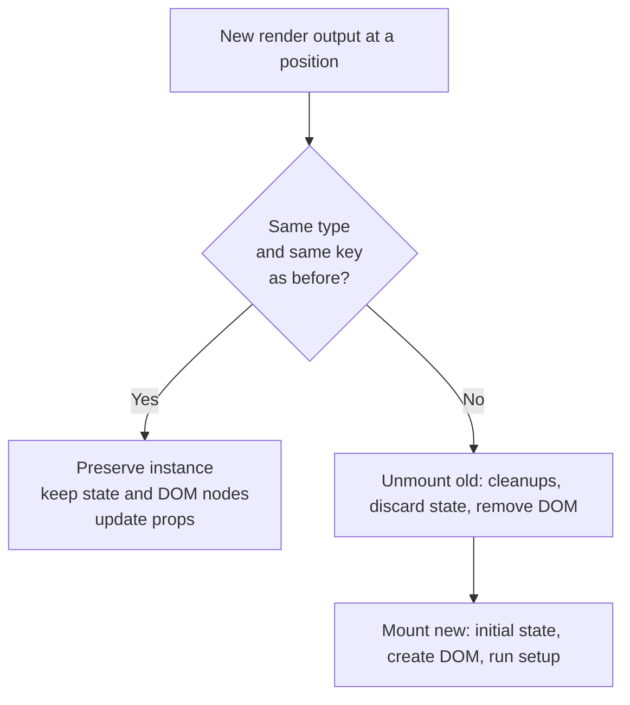
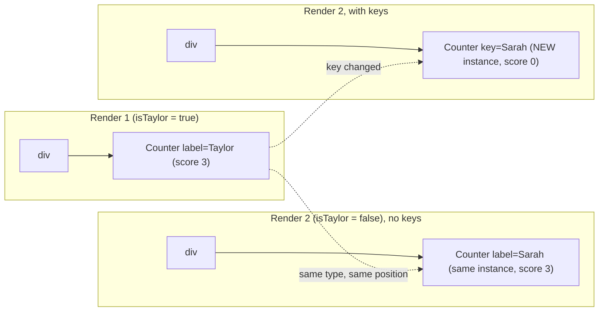
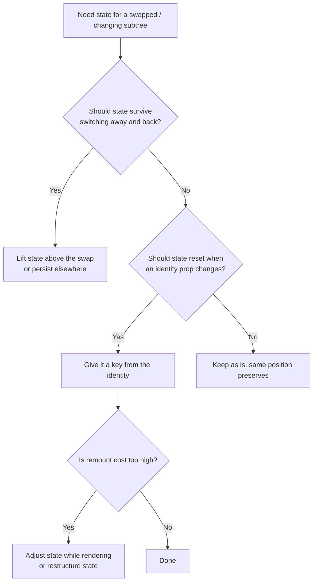

# 01 / 16 — State Preservation and Reset

## 1. Lesson metadata

| | |
|---|---|
| **Level** | Intermediate |
| **Study time** | 3–4 hours (reading 1.5 h, experiments 1 h, exercises 1–1.5 h) |
| **Prerequisites** | [09 — Lists, keys, and identity](./09-lists-keys-and-identity.md), [15 — Update queues and batching](./15-update-queues-and-batching.md), [08 — Conditional rendering](./08-conditional-rendering.md), [04 — Elements, components, instances](./04-elements-components-instances.md) |
| **Next** | [17 — Lifecycle concepts](./17-lifecycle-concepts.md) |
| **Related later** | [Phase 2 / 06 — Reconciliation fundamentals](../02-react-rendering-and-internals/06-reconciliation-fundamentals.md), [Phase 2 / 07 — Component identity and keys, revisited](../02-react-rendering-and-internals/07-identity-keys-and-reconciliation.md), [Phase 3 / 17 — Derived state](../03-react-state-and-hooks/17-derived-state.md), [Phase 3 / 18 — State colocation and lifting](../03-react-state-and-hooks/18-state-colocation-and-lifting.md) |

**Learning objectives.** After this lesson you can:
1. State the rule that decides whether a component's state is **preserved** or **destroyed** across renders.
2. Predict preservation/reset for conditional branches, wrapper changes, reordering, and nested component definitions.
3. Use the `key` attribute deliberately to reset (or preserve) state, outside of lists.
4. Diagnose "the form shows the previous user's data", "input loses focus on every keystroke", and "state resets when the parent re-renders".
5. Choose among key-reset, lifting state, derived/adjusted state, and visibility toggling.

**Concepts covered:** state belongs to a *position in the tree*, component type at a position, same-type-same-position rule, remounting, `key` as identity (not just for lists), nested component definitions as a bug, resetting with a key vs resetting in handlers vs effects, preserving hidden state (CSS hiding, lifting, `<Activity>`), DOM-state preservation (focus, scroll, uncontrolled input values), effects and remounting.

---

## 2. Deep conceptual explanation

### 2.1 What problem is this lesson solving?

You have learned that a component's state survives re-renders ([Lesson 14](./14-state-as-a-snapshot.md)). But "survives" cannot be unconditional, or you could never get a fresh form after switching to a different contact, and state could never be freed. Equally, if state were lost whenever the parent re-rendered, no UI would hold a typed value for even a second. React needs a precise rule for **which "instance" of a component a new render refers to**. That rule is what this lesson is about, and it explains a family of bugs that look like React randomly forgetting or remembering things:

- Typing into a field and watching it lose focus after each character.
- Switching between two users and seeing the first user's unsaved edits on the second.
- Toggling a panel and finding its inner counter back at zero.
- Reordering a list and seeing text inputs stay put while labels move.

### 2.2 The rule

> **State is not stored inside your component function. React keeps it, associated with the component's *position in the render tree*. When a render produces, at the same position, an element of the same component type (and same key), React treats it as the same component instance and keeps its state. Otherwise it destroys the old instance (with its state) and creates a new one.**

Three parts:

1. **Position.** "Position" means a place in the tree of the UI description React is building: the first child of this `<div>`, the third child of that `<ul>`, and so on. It is *not* a position in your source code or in the browser's DOM.
2. **Type.** Two elements are "the same kind" if their `type` is the same: the same string tag (`"div"`) or the **same component function reference** (`Counter === Counter`).
3. **Key.** If a `key` is specified, it participates in identity: same position + same type + same key = same instance. Different key = different identity.

The consequence of a changed identity is **unmount of the old one and mount of a new one**: all state is discarded, effects clean up, and DOM nodes are removed and recreated.

*Public guarantee* (documented in React's "Preserving and Resetting State"): components with the same type and key at the same position preserve state; changing the component type or key at a position resets state.

*Implementation detail:* the process of comparing the previous and next trees is **reconciliation**, and the full set of heuristics (including how children arrays are matched) is covered in [Phase 2 / 06](../02-react-rendering-and-internals/06-reconciliation-fundamentals.md) and [07](../02-react-rendering-and-internals/07-identity-keys-and-reconciliation.md). Here we use only the documented rule.

### 2.3 Components are not their function calls

In [Lesson 04](./04-elements-components-instances.md) you separated *elements* (plain descriptions) from *instances* (the live things React tracks for state). This lesson is that distinction paying off: calling `<Counter />` in JSX produces a description. Whether it is "the same Counter" as last time is decided by comparing descriptions at the same tree position.

Think of it as React asking, for each place in the new tree: "Was there something of the same kind here last time?" If yes, update it. If no, replace it.

### 2.4 What counts as "the same position"

A subtle point: the tree position includes the **slot** the child occupies in its parent's children, even for things that render nothing.

```tsx
<div>
  {showHint && <Hint />}   // slot 0: either <Hint/> or false
  <Form />                // slot 1: always Form
</div>
```

`false`, `null` and `undefined` occupy a slot but render nothing. Toggling `showHint` does **not** shift `<Form />` to a different slot, so `Form` keeps its state. This is a major reason `{cond && <X />}` is safer than building arrays conditionally: the other siblings stay in their slots. (Children created by `.map()` are matched by *key* within their array rather than purely by slot, see [Lesson 09](./09-lists-keys-and-identity.md).)

### 2.5 Why not always reset? Why not always preserve?

| Policy | Failure |
|---|---|
| Reset state on every render | Nothing could hold typed text, a selected tab, or a counter. |
| Preserve forever | You could not "start over" for a new context; memory would grow with every item ever shown. |
| Position + type + key (React's choice) | Cheap to compute locally; lets *you* express "this is the same thing" or "this is a new thing" in the JSX you write. |

The key point: **identity is expressed by the structure you render**, not by React guessing. When React guesses wrong for your intention, you correct it with a `key` or by restructuring.

### 2.6 Relation to JavaScript and the browser

- **Closures** ([Foundations 06](../00-web-and-javascript-foundations/06-lexical-scope-and-closures.md)): each render's function call creates new closures, but state lives outside, so identity preservation is what reconnects a fresh function call to its old state.
- **Referential identity** ([Foundations 07](../00-web-and-javascript-foundations/07-functions-and-referential-identity.md)): "same type" for a component means *function reference equality*. A function defined inside another component's body is a new reference every render, so it is a new type every time (the nested-component bug, §5.3).
- **The DOM** ([Foundations 04](../00-web-and-javascript-foundations/04-dom-structure-and-mutation.md)): when identity is preserved React updates the *same* DOM nodes, so browser-held state such as focus, selection, scroll position, and an *uncontrolled* input's value persists too. When identity changes, nodes are removed and recreated and that browser state is lost.

### 2.7 Common misconceptions

| Misconception | Reality |
|---|---|
| "State lives in the component function." | It lives in React, attached to the instance at a tree position. The function is just called with it each render. |
| "A different prop means a different component." | Props changing never resets state. Same type + position + key = same instance, with new props. |
| "`key` is only for lists." | `key` is identity for *any* child. `<Form key={userId} />` is the idiomatic way to reset a component. |
| "If I render `<A/>` in two different `if` branches the state is separate." | If both branches render the **same type at the same tree position**, state is *shared/preserved* across branches. |
| "Hiding a component with `{show && …}` keeps its state." | Removing it from the output unmounts it and destroys its state. Hiding with CSS keeps it mounted. |
| "Re-rendering and remounting are the same." | A re-render calls your function again on the same instance. A **remount** destroys and recreates the instance. They have very different costs and consequences. |
| "Using `Math.random()` as a key is fine; it's unique." | A new key each render means *new identity each render*: constant remounting, state loss, lost focus. |

---

## 3. Internal mechanics

### 3.1 The comparison, at the level we need

When a component re-renders, React compares the element tree it just produced with the previous one **top-down, position by position**:

```text
for each child position in the new tree:
    old = what was at this position (type, key)
    new = what is there now      (type, key)
    if old.type === new.type and old.key === new.key:
        reuse the instance (keep state, DOM nodes), pass new props, continue comparing its children
    else:
        unmount old subtree (discard state, run cleanups, remove DOM)
        mount new subtree (fresh state, create DOM, run setup)
```

*Teaching model.* This pseudo-code is simplified: for host elements (`div`, `input`) React also updates changed attributes in place; for lists it uses keys to match items regardless of order; it will not try to move a subtree to a new parent and keep its state (it considers a type change at a given parent position as replacement). The heuristics are intentionally simple to keep the comparison linear-time. See [Phase 2 / 06](../02-react-rendering-and-internals/06-reconciliation-fundamentals.md).

*Public guarantee:* identity = (type, key) at a position; a change resets.

*Implementation detail:* React may reuse and update DOM nodes more or less aggressively than your mental model predicts when the type is the same but structure differs deeply; rely on the documented identity rule, not on guesses about specific DOM node reuse.

### 3.2 Same type at the same position: preserved

```tsx
{isFancy ? <Counter isFancy /> : <Counter />}
```

Both branches describe a `Counter` at the same position: React sees one `Counter` whose `isFancy` prop changed. State is preserved. This surprises people who expected two separate counters.

### 3.3 Different type at the same position: reset

```tsx
{isPaused ? <p>See you later</p> : <Counter />}
```

`p` vs `Counter` differ in type. Switching destroys `Counter`'s state. Switching back creates a new `Counter` with its initial state.

Wrapper changes count too:

```tsx
{isFancy ? <div><Counter /></div> : <section><Counter /></section>}
```

The `div` becomes a `section` at the same position: different type, so the whole subtree, including the nested `Counter`, is destroyed and rebuilt.

### 3.4 Keys give identity at a position

```tsx
{isPlayerA ? <Counter key="Taylor" person="Taylor" /> : <Counter key="Sarah" person="Sarah" />}
```

Same type, but different keys: different identity, so the state resets when you switch. Equivalent and more common:

```tsx
<Counter key={person} person={person} />
```

### 3.5 Effects and remounting

Remounting an instance runs its effect *cleanup* functions for the old instance, then *setup* for the new one ([Lesson 17](./17-lifecycle-concepts.md)). If a child opens a connection or starts a timer, a key change closes and reopens it. This is often exactly what you want (a chat room per contact) but costs real work.

### 3.6 When is state "created"?

State for an instance is created on **mount** using the initial value (`useState(initial)`). Later renders ignore the argument. This is why changing an `initial` prop does *not* update state, and why resetting needs a new identity (key) or explicit code ([§7](#7-alternative-approaches-and-trade-offs)).



---

## 4. Step-by-step execution walkthrough

Component under study:

```tsx
import { useState } from "react";

function Counter({ label }: { label: string }) {
  const [score, setScore] = useState(0);
  return (
    <div>
      <h3>{label}: {score}</h3>
      <button onClick={() => setScore(s => s + 1)}>+1</button>
    </div>
  );
}

export function Scoreboard() {
  const [isTaylor, setIsTaylor] = useState(true);
  return (
    <div>
      {isTaylor ? <Counter label="Taylor" /> : <Counter label="Sarah" />}
      <button onClick={() => setIsTaylor(t => !t)}>Next player</button>
    </div>
  );
}
```

**Predict:** click "+1" three times for Taylor, then "Next player". What score does Sarah show? Then click "Next player" again. What does Taylor show?

Walkthrough:

1. **Mount.** `Scoreboard` renders; position 0 of its `div` holds `<Counter label="Taylor" />` (type `Counter`, no key). React creates an instance, its state `score = 0`.
2. **Three clicks.** Each click enqueues an updater; each renders `score` 1, 2, 3 ([Lesson 15](./15-update-queues-and-batching.md)).
3. **"Next player".** `isTaylor` becomes `false`. New render output at position 0: `<Counter label="Sarah" />`. Compare: same type (`Counter` function reference identical), same key (none), same position → **same instance**. Props change: `label: "Sarah"`. State is retained: **score = 3**. The heading shows "Sarah: 3". This is the surprise.
4. **"Next player" again.** Same logic: "Taylor: 3". The score is a property of *the Counter instance at that position*, not of either player.

Now add keys:

```tsx
{isTaylor ? <Counter key="Taylor" label="Taylor" /> : <Counter key="Sarah" label="Sarah" />}
```

Repeat: after three Taylor clicks, "Next player" compares key `"Taylor"` with `"Sarah"`: different identity. The old instance is unmounted (state `3` discarded) and a new one mounted: Sarah shows **0**. Switch back: Taylor is a *new* instance and shows **0**. Resetting is symmetric; if you need each player's score retained, the state must live in `Scoreboard` (lifted), not in the swapped child ([§7](#7-alternative-approaches-and-trade-offs)).

---

## 5. Code examples

### 5.1 Minimal example: preserved vs reset side by side

```tsx
import { useState } from "react";

function Counter() {
  const [n, setN] = useState(0);
  return <button onClick={() => setN(c => c + 1)}>Clicked {n}</button>;
}

export function Demo() {
  const [mode, setMode] = useState<"a" | "b" | "text">("a");
  return (
    <>
      <select value={mode} onChange={e => setMode(e.target.value as "a" | "b" | "text")} aria-label="Mode">
        <option value="a">A</option>
        <option value="b">B</option>
        <option value="text">Text</option>
      </select>
      {mode === "text" ? <p>No counter</p> : <Counter />}
    </>
  );
}
```

**Predict:** click the counter to 4, switch to B, then A, then Text, then A. What does the counter show at each step?

**Result:** `4` after switching to B (same type, same position: preserved), `4` after A, then it disappears for Text, and on returning to A shows `0` (a new instance).
**Why:** A and B both render `<Counter />` at the same position, so identity never changed. The `<p>` replaced it for "Text", forcing an unmount.
**Trade-off:** none; this is a demonstration. In real UIs the *intended* semantics (should A and B share a counter?) drive the design.

### 5.2 Practical example: reset an editor when the selected record changes

```tsx
import { useState } from "react";

type User = { id: string; name: string; email: string };

function UserEditor({ user }: { user: User }) {
  const [name, setName] = useState(user.name);
  const [email, setEmail] = useState(user.email);
  return (
    <form onSubmit={e => e.preventDefault()}>
      <label>Name <input value={name} onChange={e => setName(e.target.value)} /></label>
      <label>Email <input type="email" value={email} onChange={e => setEmail(e.target.value)} /></label>
      <button type="submit">Save</button>
    </form>
  );
}

export function UserPane({ users }: { users: User[] }) {
  const [selectedId, setSelectedId] = useState(users[0]?.id ?? "");
  const selected = users.find(u => u.id === selectedId);
  return (
    <section>
      <ul>
        {users.map(u => (
          <li key={u.id}>
            <button type="button" aria-current={u.id === selectedId} onClick={() => setSelectedId(u.id)}>
              {u.name}
            </button>
          </li>
        ))}
      </ul>
      {selected && <UserEditor key={selected.id} user={selected} />}
    </section>
  );
}
```

Line notes:
- `useState(user.name)` uses the prop only as an **initial** value. Without the key, selecting another user would keep the old user's edits in the inputs; the `user` prop changes but state isn't re-initialised ([§3.6](#36-when-is-state-created)).
- `key={selected.id}` ties the editor's identity to the record. Switching users unmounts and mounts a fresh editor, whose state initialises from the new `user`.
- `aria-current` marks the selected item for assistive technology.

**Trade-off:** unsaved edits for the previous user are discarded silently. In a real product you would warn or persist drafts ([§9](#9-real-world-application)).

### 5.3 Incorrect example: component defined inside a component

```tsx
import { useState } from "react";

export function Profile() {
  const [name, setName] = useState("");

  // BUG: a new function (new component type) is created on every render of Profile
  function NameField() {
    return <input value={name} onChange={e => setName(e.target.value)} />;
  }

  return (
    <form>
      <NameField />
    </form>
  );
}
```

**Predict:** you type "a". What happens to the input's focus, and why?

**Result:** the state updates (`name = "a"`) but the input loses focus after every keystroke and (depending on the browser) the caret jumps.
**Why:** each render of `Profile` creates a **new** `NameField` function. `NameField` at position 0 is "a different type" from last time, so React unmounts the old input and mounts a new one; the DOM node is replaced, and focus is lost. The same bug would also wipe any state inside `NameField`.
**Why it is easy to miss:** the code *looks* like a tidy local helper, and the value does update because it comes from `Profile`'s state.

### 5.4 Corrected implementation

Hoist the component to module scope and pass data through props:

```tsx
function NameField({ value, onChange }: { value: string; onChange: (v: string) => void }) {
  return <input value={value} onChange={e => onChange(e.target.value)} />;
}

export function Profile() {
  const [name, setName] = useState("");
  return (
    <form>
      <NameField value={name} onChange={setName} />
    </form>
  );
}
```

`NameField` is now one stable function reference for the module's lifetime, so identity is stable. If you only need a *fragment of JSX* (no state or hooks of its own), calling a helper function that returns JSX, `renderField()` (not rendered as `<renderField />`), is also fine; it creates no component type. Prefer real components for anything reusable or stateful. (Lint rules such as `react/no-unstable-nested-components` can catch this; availability depends on your ESLint plugin setup, verify in your project.)

### 5.5 Advanced example: per-conversation draft, two correct designs

*Requirement:* a chat has contacts; the message draft must be **independent per contact** and must **survive switching away and back**.

**Design 1 — state in the swapped child + key: does NOT meet "survive":**

```tsx
function Composer({ contact }: { contact: string }) {
  const [draft, setDraft] = useState("");
  return <textarea aria-label={`Message to ${contact}`} value={draft} onChange={e => setDraft(e.target.value)} />;
}
// <Composer key={contact} contact={contact} />  → independent but erased when you switch away
```

**Design 2 — lift drafts into the parent keyed by contact:**

```tsx
import { useState } from "react";

function Composer({ contact, draft, onDraftChange }: {
  contact: string;
  draft: string;
  onDraftChange: (contact: string, text: string) => void;
}) {
  return (
    <textarea
      aria-label={`Message to ${contact}`}
      value={draft}
      onChange={e => onDraftChange(contact, e.target.value)}
    />
  );
}

export function Chat({ contacts }: { contacts: string[] }) {
  const [current, setCurrent] = useState(contacts[0] ?? "");
  const [drafts, setDrafts] = useState<Record<string, string>>({});

  const onDraftChange = (c: string, text: string) =>
    setDrafts(prev => ({ ...prev, [c]: text }));

  return (
    <div>
      <nav>
        {contacts.map(c => (
          <button key={c} type="button" aria-pressed={c === current} onClick={() => setCurrent(c)}>{c}</button>
        ))}
      </nav>
      <Composer contact={current} draft={drafts[current] ?? ""} onDraftChange={onDraftChange} />
    </div>
  );
}
```

Observations:
- Here the **drafts live above** the thing that gets swapped, so the swap cannot erase them. No key is needed, because `Composer` is controlled and holds no private state.
- A third design persists drafts to `localStorage` (survives reload) or the server (survives devices); each adds failure modes (quota, privacy on shared computers, sync conflicts).

---

## 6. Visual explanations

### Same position, same type: state follows the position



### Tree position vs source position

```text
JSX:                              Tree positions (slots) under <div>:
<div>                               slot 0: false | <Hint/>
  {showHint && <Hint />}            slot 1: <Form/>      ← always slot 1
  <Form />                          slot 2: <button>
  <button/>
</div>
Form keeps its state when showHint toggles.
```

### Decision chart: reset or preserve?



---

## 7. Alternative approaches and trade-offs

Scenario: *"A detail form must show fresh data whenever the selected record changes."*

| Approach | Readability | Correctness | Performance | Complexity | Notes |
|---|---|---|---|---|---|
| `key={record.id}` on the form | High | Excellent: all inner state (and nested children's) resets atomically | Remount cost: DOM recreate, effects re-run | Lowest | The documented, idiomatic reset. |
| Reset in an event handler (`setName(next.name)` when user clicks) | Medium | Good if every change path goes through the handler | Cheap | Medium | Breaks if the record can change from elsewhere (server push, parent logic). |
| Reset in `useEffect` on prop change | Low | Fragile: renders once with stale state, then again | Extra render + flash of stale UI | Medium | Usually an anti-pattern ([Phase 3 / 07](../03-react-state-and-hooks/07-you-might-not-need-an-effect.md)). |
| Store previous prop in state and adjust during render | Low–Medium | Correct (no stale commit) | Cheap | Higher | Documented in "You Might Not Need an Effect"; prefer a key unless remount is costly. |
| Controlled form: state lifted to parent keyed by id | Medium | Excellent, also preserves drafts | Cheap | Medium | Best when drafts must survive. |
| Derive from props, no local copy | High | Excellent | Cheap | Lowest | Best when the user cannot edit locally. |

**When the generally recommended approach (key) is *not* best:**
- The subtree is **heavy** (a big chart or editor with expensive setup) and only one small value should reset: lift or adjust that value instead of remounting everything.
- You must **keep focus and scroll** across the change (e.g., a live-updating inbox where the selected item id changes but the reading pane should keep its scroll). A remount loses them.
- The subtree owns **ongoing external resources** (a video element playing, an open socket) where teardown/restart would be visible to the user.

**Preserving state of something hidden** (the inverse need):

| Approach | Preserves state? | Cost / caveat |
|---|---|---|
| `{show && <Panel/>}` | No (unmounts) | Cheapest memory; lose state |
| CSS `display: none` / `hidden` attribute while still rendering | Yes (stays mounted) | Still rendered and updated; effects keep running; hidden content must be removed from tab order/AT automatically only if truly `display:none`/`hidden` |
| Lift state up | Yes (the state, not DOM state) | Parent owns more state ([Phase 3 / 18](../03-react-state-and-hooks/18-state-colocation-and-lifting.md)) |
| `<Activity>` | Yes (state kept; effects of hidden subtree cleaned up; lower-priority rendering) | Stable since React 19.2; verified in React 19.3.1: hidden children get `display: none !important`, state survives, effects run cleanup on hide and setup again on show |
| Persist to storage/URL | Yes (even across reloads) | Serialization, privacy, staleness |

---

## 8. Best practices and anti-patterns

**Do**
- Define components at **module scope**. If you need parameterisation, use props.
- Use `key={id}` on a component to say "this is a different thing now" and reset all of its state.
- Keep keys **stable and meaningful** (ids from your data) and unique among siblings.
- When designing, ask explicitly: *should this state survive when this subtree is swapped?* Write the answer in the structure (lift vs key).
- Use `useState` initial values as truly initial; name props accordingly (`initialName`) to signal that later changes are ignored.

**Beginner mistakes**
- Expecting two branches that render the same component to have separate state.
- Defining a component inside another component.
- Using `Math.random()`, `Date.now()` or a fresh `crypto.randomUUID()` per render as a key.
- Using array index as key in dynamic lists where items can be inserted, removed, or reordered ([Lesson 09](./09-lists-keys-and-identity.md)).

**Experienced-developer mistakes**
- Resetting with effects (`useEffect(() => setX(initial), [id])`) instead of a key, producing flicker and extra renders.
- Using a key reset on a huge subtree for a tiny reset, hurting performance and losing scroll/focus.
- Forgetting that remounting re-runs *effects and data fetching* (duplicate network requests, flicker) and that StrictMode additionally double-mounts in development ([Lesson 17](./17-lifecycle-concepts.md)).
- Relying on hidden-but-mounted panels for large content (memory and update costs).

**Smells**
- A comment like `// reset form when user changes` above an effect.
- `useState(props.value)` without any plan for what happens when `props.value` changes.
- A component wrapper that changes between `div`/`section` depending on a flag, accidentally resetting state.

**Justified exceptions**
- Index keys are fine for static lists that never reorder or change (a fixed set of navigation links).
- Intentionally *remounting* on a timer or action (`key={retryCount}`) is a legitimate way to "retry" a subtree that fetched on mount.

---

## 9. Real-world application

**Multi-step checkout wizard.** Steps render `<ShippingStep/>`, `<PaymentStep/>`, `<ReviewStep/>` at the same position. Different types, so each step's local state is destroyed on navigation. If users press "Back" and expect their input to persist, the data must live in the wizard (or a store) rather than in the steps. Constraint: payment data must **not** linger in React state or storage longer than required (PCI scope); unmounting the card step to discard the number can be a *feature*, but prefer provider-hosted fields, and never persist card numbers yourself.

**Admin table with a detail drawer.** Selecting a row opens `<DetailDrawer key={row.id} row={row} />`. Resetting on identity change avoids showing user A's unsaved edits on user B, which can be a data-privacy incident in healthcare or finance. Constraint: warn about unsaved changes before switching (draft persistence or a confirm dialog).

**Chat/messaging.** One composer per conversation (see §5.5). Constraint: drafts on shared computers should be stored under the signed-in user's scope and cleared on logout.

**Dashboards with tabs.** Each tab may hold filters. Decide per tab: reset on switch (cheap, simple), keep via lifting (filters survive), or keep tab content mounted but hidden (charts retain zoom). Constraint: hidden charts still consume update work and memory with real-time data.

**Authentication.** After logout, any component tree below the auth boundary should be torn down so no user-specific state remains in memory. Rendering `<AuthedApp key={user.id} />` (or unmounting it entirely at logout) is a robust reset; relying on each component to clear its own state is not.

**Multi-team design systems.** A shared `<Tabs>` component that wraps content in different elements by variant (`div` vs `section`) can silently reset consumers' state when variants change. Document identity-affecting behaviour in the component's contract.

---

## 10. Debugging and troubleshooting

**Symptom A: "State resets whenever my parent re-renders."**
1. Look for a component **defined inside** another component's body (or `React.memo(...)`/HOC invoked inside render, creating a new type each time).
2. In React DevTools Components tab ([Lesson 18](./18-react-devtools.md)), watch whether the component's subtree is re-created: with "Highlight updates" you see whole subtrees flash and local state values go back to defaults.
3. Add a one-off `useEffect(() => { console.log("mounted"); return () => console.log("unmounted"); }, []);` in the suspect. If "unmounted/mounted" prints on each parent render, it's remounting. (In StrictMode development you will see one extra unmount/mount pair at startup; that is expected.)
4. Fix: hoist the definition; pass data via props.
5. Validate: the logs stop, focus stays, state persists.

**Symptom B: "The form shows the previous record's values."**
1. Find `useState(props.x)` initialisation.
2. Confirm that the parent passes a new `x` prop but the same position/type/key.
3. Fix with `key={recordId}` (or controlled design).
4. Validate: switch records and confirm all inputs, including nested uncontrolled ones and child components' internal state, reset; confirm effects re-run as intended.

**Symptom C: "Input loses focus when I type."**
Most commonly a component defined inside render (§5.3), or a **key that changes every render** (`key={Math.random()}` or a key derived from the value being typed, e.g. `key={name}`). Check that the key identifies the entity, not its mutable content.

**Symptom D: "State persisted when I expected a reset."**
Same type, same position, no key. Add a key or restructure. Check conditional branches that render the same component.

**Symptom E: "After reordering, text in inputs doesn't move with the row."**
Index keys or missing keys. Row state is attached to the *position* rather than the item. Use stable ids ([Lesson 09](./09-lists-keys-and-identity.md)).

**Tooling tips.**
- DevTools Components tab: selecting a component shows its hooks' current state; if values reset after an action, remount occurred. The Profiler's "why did this render" distinguishes updates from mounts ([Lesson 18](./18-react-devtools.md)).
- A temporary `console.count("render Foo")` combined with mount/unmount logs separates re-render from remount.

---

## 11. Exercises

### Level A — Knowledge
A1. What three things determine whether React preserves a component's state at a position?
A2. Is a component's state stored in the function body? Explain where it conceptually lives.
A3. Why is `key` useful outside of lists? Give a use case.
A4. What happens to a child's effects (setup/cleanup) when its key changes?
A5. Why does `{cond && <A />}` followed by `<B />` not reset `B` when `cond` toggles?
A6. Name two ways to keep state of a panel you are "hiding".

### Level B — Code comprehension
B1. For each snippet, does the counter keep its count when `flag` toggles?
```tsx
// (i)   {flag ? <Counter /> : <Counter />}
// (ii)  {flag ? <Counter /> : <p>text</p>}
// (iii) {flag ? <div><Counter /></div> : <section><Counter /></section>}
// (iv)  {flag ? <Counter key="x" /> : <Counter key="y" />}
// (v)   {flag && <Counter />}   (flag toggles false → true)
```
B2. Predict what happens when typing into this input and why.
```tsx
function App() {
  const [t, setT] = useState("");
  const Field = () => <input value={t} onChange={e => setT(e.target.value)} />;
  return <Field />;
}
```
B3. A list `[A, B, C]` renders `<Row key={index} />` where each `Row` holds its own `useState("")` bound to a text input. The user types "x" into A's row, then A is deleted from the array. Which row shows "x"?
B4. `UserEditor` initialises `useState(user.name)`. The parent re-renders with a different `user` object (same `UserEditor` position, no key). What does the input show?

### Level C — Implementation
C1. Write `ProfileForm` (typed props `{ user: User }`) and a parent `ProfilePage` with a user `<select>`. Ensure switching users resets the form without an effect.
C2. Write a `Tabs` component (typed) that keeps each panel's internal state when you switch tabs but renders only the active panel visibly, using hidden attribute or CSS. Include accessible roles.
C3. Write a "Retry" wrapper: `<Retry>` renders `children` and a button that remounts them (re-running their mount logic).

### Level D — Debugging
D1. A reviewer reports: "typing in the search box loses focus after each letter". The code is:
```tsx
function Page() {
  const [q, setQ] = useState("");
  return <Layout><Search key={q} value={q} onChange={setQ} /></Layout>;
}
```
Diagnose and fix.
D2. A dashboard component calls `const Chart = withLoading(BaseChart);` inside its render function. Each parent update resets the chart's zoom state. Why? Fix.
D3. A modal edit form shows the previous record's email for a moment after switching records, then corrects itself (via an effect that sets state when `record.id` changes). Explain the flash and propose a better design.

### Level E — Architecture and engineering decisions
E1. A product detail page has: gallery (carousel position state), review form (draft text), size selector. When navigating from product A to product B (same route component), which of these should reset, which should persist? Propose structure and justify.
E2. You must keep 12 tab panels, each with a live chart, available "instantly" when switched to, but the app handles real-time data. Compare unmount-on-switch, CSS-hidden-but-mounted, and lifting state with re-creating charts.

### Level F — Expert challenge
F1. Explain why changing a component's wrapper element type resets descendants' state, and design a design-system `Card` API that lets consumers change heading level or wrapper semantics without resetting children's state.
F2. A team uses `key={JSON.stringify(filters)}` on a data table to reset pagination when filters change. List three risks and propose an alternative.

---

## 12. Detailed answers and explanations

> Attempt the exercises first.

**A1.** Position in the tree, element **type** (same function reference or same host tag), and **key** (same key or both absent). All three equal → preserved. Any difference → remount.

**A2.** Conceptually it lives in React's internal bookkeeping for the component *instance* at a tree position (implemented on Fiber nodes, [Phase 2 / 17](../02-react-rendering-and-internals/17-hooks-and-fiber-state.md)). Your function is re-invoked each render and receives the current values through hooks. Wrong: "in a closure variable that persists", because each render creates a new closure; persistence comes from React.

**A3.** A key is an identity label. Putting it on a component (not an array element) says "treat this as a different instance when the key changes". Use case: `<ChatRoom key={roomId} />` or `<UserEditor key={userId} />` to reset local state without effects.

**A4.** React unmounts the old instance, which runs its effect cleanups, and mounts a new one, which runs setup again ([Lesson 17](./17-lifecycle-concepts.md)). Anything like fetch-on-mount, subscriptions, timers restarts.

**A5.** `false` occupies slot 0 in both cases; `<B />` stays at slot 1 whether slot 0 holds `<A />` or `false`. So B's position and type don't change. Contrast: `{cond ? <><A /><B /></> : <B />}` would put `B` at slot 1 inside a fragment in one branch but at slot 0 (the fragment's position itself) in the other, which are different tree positions, so `B` would remount when `cond` toggles.

**A6.** Any two: lift state to an ancestor that stays mounted; keep the component mounted and hide with CSS/`hidden`; persist state outside (URL/localStorage/store); `<Activity>` (React 19.2+).

**B1.** (i) **Keeps**: same type, same position, no keys. (ii) **Resets** (different type). (iii) **Resets**: `div` vs `section` differ, so the subtree is replaced. (iv) **Resets**: keys differ. (v) **Resets** after hiding: `false` unmounts it; when true again it mounts new with initial state.

**B2.** The input loses focus on every keystroke. `Field` is a new function each render of `App`, thus a new type, thus unmount/mount of the input DOM node. State `t` updates (it lives in `App`) which is why the problem looks like "React is eating focus". Fix by hoisting `Field` out of `App` and passing props, or inlining the `<input>`.

**B3.** The row at *index 0* (originally B's row, now at index 0 with key `0`) shows "x". Keys are positions: after removing A, the remaining items are re-indexed `[B, C]` with keys 0 and 1. React sees key 0 still present and preserves *its* instance, whose state is "x", and gives it B's props. Key 2 disappears and its row is unmounted. The visible effect is that "x" appears next to B. Fix: use stable ids as keys ([Lesson 09](./09-lists-keys-and-identity.md)).

**B4.** It keeps showing the **old** name. `useState(user.name)` ran at mount only; subsequent renders ignore the argument. Without a key or other logic, the instance is the same, so the stale state remains while `user` is new. A partially updated screen is the classic "form shows previous user" bug.

**C1.**
```tsx
import { useState } from "react";

type User = { id: string; name: string };

function ProfileForm({ user }: { user: User }) {
  const [name, setName] = useState(user.name);
  return (
    <label>
      Name
      <input value={name} onChange={e => setName(e.target.value)} />
    </label>
  );
}

export function ProfilePage({ users }: { users: User[] }) {
  const [id, setId] = useState(users[0]?.id ?? "");
  const user = users.find(u => u.id === id);
  return (
    <>
      <select aria-label="User" value={id} onChange={e => setId(e.target.value)}>
        {users.map(u => <option key={u.id} value={u.id}>{u.name}</option>)}
      </select>
      {user && <ProfileForm key={user.id} user={user} />}
    </>
  );
}
```
Reasoning: `key={user.id}` resets all form state. Edge: if `users` refetches and `user.name` changes on the server while the same user is selected, the form will *not* update (same key); that is usually correct (don't overwrite typing) but note it. Wrong answer: an effect with `setName(user.name)` → extra render, flash.

**C2.**
```tsx
import { useState, type ReactNode } from "react";

type Tab = { id: string; label: string; content: ReactNode };

export function Tabs({ tabs }: { tabs: Tab[] }) {
  const [active, setActive] = useState(tabs[0]?.id ?? "");
  return (
    <div>
      <div role="tablist" aria-label="Sections">
        {tabs.map(t => (
          <button
            key={t.id}
            role="tab"
            id={`tab-${t.id}`}
            aria-selected={t.id === active}
            aria-controls={`panel-${t.id}`}
            tabIndex={t.id === active ? 0 : -1}
            onClick={() => setActive(t.id)}
          >
            {t.label}
          </button>
        ))}
      </div>
      {tabs.map(t => (
        <div
          key={t.id}
          role="tabpanel"
          id={`panel-${t.id}`}
          aria-labelledby={`tab-${t.id}`}
          hidden={t.id !== active}
        >
          {t.content}
        </div>
      ))}
    </div>
  );
}
```
Notes: all panels stay mounted (state preserved); `hidden` removes inactive ones from layout and the accessibility tree. Arrow-key navigation for tablists is omitted for brevity; a production tabs widget should follow the WAI-ARIA tabs pattern *(keyboard handling is a Phase 5 / Phase 8 topic)*. Trade-off: all panels render and update even when hidden; for heavy panels mount lazily on first visit and then keep mounted.

**C3.**
```tsx
import { useState, type ReactNode } from "react";

export function Retry({ children }: { children: ReactNode }) {
  const [attempt, setAttempt] = useState(0);
  return (
    <>
      <div key={attempt}>{children}</div>
      <button type="button" onClick={() => setAttempt(a => a + 1)}>Retry</button>
    </>
  );
}
```
Why it works: changing `key` on the wrapper `div` changes identity, remounting `children`'s subtree, so any fetch-on-mount reruns. Edge: `children` elements are created by the parent; their *props* are the same but instances are new. For error recovery in production, use an error boundary reset ([Phase 4 / 19](../04-react-architecture/19-error-boundaries.md)).

**D1.** `key={q}` makes the key the typed text; each keystroke changes the key, so `Search` remounts and loses focus. Keys must identify an *entity*, not mutable content. Fix: remove the key (`<Search value={q} onChange={setQ} />`). (Reset a search box with a "Clear" button handler, not a key.)

**D2.** `withLoading(BaseChart)` returns a *new* component function every call; calling it in render creates a new type each time, so the chart remounts and loses its internal zoom state. Fix: call the HOC once at module scope (`const ChartWithLoading = withLoading(BaseChart);`). Higher-order components are historically common; modern code usually prefers composition and hooks ([Phase 5 / 09](../05-design-patterns/09-higher-order-components.md)).

**D3.** The flash occurs because the effect runs *after* the render commits; the first commit shows new record with old state, then the effect sets state and a second render shows correct data. Better: `key={record.id}` (state is fresh in the first commit), or derive the value from props if not locally editable. If a remount is too heavy, adjust state during render by comparing previous id stored in state ([Phase 3 / 17](../03-react-state-and-hooks/17-derived-state.md)).

**E1. Evaluation criteria:** distinguishes *navigation-specific* state (gallery position, size) from *user content* (review draft); identifies identity prop `productId`; considers whether to preserve a review draft across products (usually per-product draft or warn); mentions URL as state for the selected size/variant for shareable links. *Example answer:* "Give the product subtree `key={productId}` so gallery index and size selection reset. Keep the review draft in a per-product drafts map persisted in session storage, because losing a half-written review is user-hostile; show a 'draft saved' note. The size is also in the URL query so links are shareable and back/forward works." Wrong answers: reset everything blindly; or preserve everything and show a stale gallery position for the wrong product.

**E2. Evaluation criteria:** costs measured, not guessed. Unmount-on-switch: lowest steady-state cost, slowest switch (re-create chart, refetch or recompute), loses zoom/selection. Hidden-but-mounted: instant switch and preserved UI state, but 12 charts consume memory and process data updates (and effects like resize observers) in the background; hidden canvases may need re-layout. Lifting state with re-creation: preserves *configuration* (zoom, series) but not DOM; moderate. *Example decision:* "Mount lazily on first visit, keep the last N visited mounted, hide the rest; pause realtime subscriptions for hidden tabs; measure with the Profiler ([Lesson 18](./18-react-devtools.md)) and memory snapshots. If `<Activity>` is available in your React version, evaluate it for this exact use (verify docs)."

**F1.** Changing `div` to `section` changes the element **type** at that tree position; React cannot reuse a DOM `div` as a `section` (the DOM has no way to change an element's tag), and its rule is that a type change replaces the subtree, so descendants, which are *children of the replaced node*, are unmounted and re-created. API design: don't change the wrapper type based on props that may change at runtime; instead offer a polymorphic `as` prop that is *stable per usage* (set once), or render a fixed wrapper and put variation in attributes (`role`, `aria-level`, class) rather than tag when the content has state. For headings, `aria-level` with a `div role="heading"` is one option, but native `h1–h6` are preferable semantically; document that changing `as` remounts children. *Evaluation criteria:* names the DOM constraint; offers a stable-structure design; discusses a11y trade-offs; documents the contract.

**F2.** Risks: (1) the key changes on any key-order or irrelevant filter change (`{a:1,b:2}` vs `{b:2,a:1}` stringify differently), causing needless remounts; (2) *every* filter change remounts the whole table, losing scroll, selection, focus, column widths, and re-running effects and fetches; (3) large filter objects mean costly stringification on every render and large key strings; also non-serialisable values (dates, functions) break or collide. Alternative: reset only the pagination state, either by owning `page` in the parent and setting `setPage(0)` in the filter-change handler, by storing the page in the URL with filters (so one navigation updates both), or by adjusting state while rendering when filters change. Use a key only when a full reset is truly desired.

---

## 13. Senior engineer interview questions

**Q1. "A form shows the previous user's data after switching users. Why, and how do you fix it?"**
*Strong answer:* `useState(props.user.name)` only seeds at mount. The parent renders the same component type at the same position, so React preserves the instance and its stale state while props change. Fix with `key={user.id}` to give the form a new identity, so all state, including nested children's, re-initialises in the first commit without an extra render. Alternatives (lift state, derive, adjust during render) when remount cost or draft preservation matters; an effect-based reset causes a flash of stale UI.

**Q2. "Why shouldn't you define a component inside another component?"**
*Strong answer:* Each render creates a new function, i.e., a new component *type*. React compares types by reference, so it treats it as a different component at that position: unmount and mount the whole subtree each parent render, losing state, focus, scroll, and re-running effects. Also defeats memoization. Hoist it to module scope and pass props; if you only need a JSX fragment, a plain helper function or inlined JSX is fine.

**Q3. "Is `key` just for lists?"**
*Strong answer:* No. `key` is part of an element's identity for reconciliation. In lists it matches items across reorderings. On a single child it's the sanctioned way to force a remount. Keys must be stable and identify the entity; deriving them from mutable content or randomness breaks state and performance.

**Q4. "How do you keep a hidden tab's state?"**
*Strong answer:* Decide what to keep. Lift the state (survives unmounts, cheapest memory), keep the panel mounted and hidden (preserves DOM state like scroll and uncontrolled inputs but pays for rendering and effects), persist to URL/storage for reload survival, or evaluate `<Activity>` in recent React versions (verify). Choose by what must survive, the cost of hidden updates, and accessibility (hidden content must not remain focusable).

**Q5. "What's the cost of resetting with a key?"**
*Strong answer:* A full unmount and mount of that subtree: DOM nodes destroyed/created, state discarded, effect cleanups and setups run (including network requests or subscriptions), focus/scroll lost, and in development StrictMode adds an extra setup/cleanup cycle on mount. Cheap for small forms; potentially expensive for large subtrees, in which case reset only the relevant state or restructure.

**Q6. "Two ternary branches render the same component. Separate state?"**
*Strong answer:* No, if both are the same type at the same position with no differing keys, it's one instance and state persists across branches. To get separate state, differentiate by key or structure.

---

## 14. Further learning resources

| Resource | URL | Covers / why | Level | Study |
|---|---|---|---|---|
| React docs: Preserving and Resetting State | <https://react.dev/learn/preserving-and-resetting-state> | The canonical explanation of position/type/key identity, with interactive examples | Beginner–Int. | Whole page including all challenges |
| React docs: Rendering Lists (keys) | <https://react.dev/learn/rendering-lists> | Why keys matter, rules for keys | Beginner | "Keeping list items in order with `key`" |
| React docs: Your First Component, "Nesting and organizing components" | <https://react.dev/learn/your-first-component> | The warning against defining components inside others | Beginner | Final section |
| React docs: You Might Not Need an Effect | <https://react.dev/learn/you-might-not-need-an-effect> | "Resetting all state when a prop changes" and "Adjusting some state when a prop changes" | Intermediate | The two sections named |
| React docs: `<Activity>` | <https://react.dev/reference/react/Activity> | Preserving state of hidden UI | Intermediate–Adv. | Reference page (React 19.2+) |
| React docs: Reconciliation (legacy docs) | <https://legacy.reactjs.org/docs/reconciliation.html> | Historical explanation of the diffing heuristics | Advanced | Read in Phase 2 |
| React source | <https://github.com/facebook/react> | Reconciler implementation (later, Phase 2) | Advanced | Phase 2/31 |

Links marked were not fetched; search the site for the quoted title if a link has moved.

---

## 15. Knowledge checkpoint

**You should now understand**
- State is attached to an instance identified by (position, type, key); same identity = preserved; different = destroyed and recreated.
- `key` is identity for any element, and an idiomatic reset tool.
- Why nested component definitions break state and focus.
- The remount costs (DOM, effects, scroll/focus) and the alternatives.

**You should be able to explain without notes**
- Why `{flag ? <Counter /> : <Counter />}` shares state and why a `div`→`section` swap resets it.
- Why `useState(props.x)` doesn't follow `props.x`.
- How to preserve state of hidden content, and the costs.

**You should be able to implement**
- Reset-on-identity forms with `key`, lifted per-entity drafts, tabs that preserve state, a retry remount.

**You should be able to debug**
- Focus loss, stale form values, "state resets on parent render", and index-key row mix-ups, using mount/unmount logs and DevTools.

**Before moving on:** read [17 — Lifecycle concepts](./17-lifecycle-concepts.md), which names the events (mount, update, unmount) you have just been triggering with keys, and explains what effects do at each of them.
