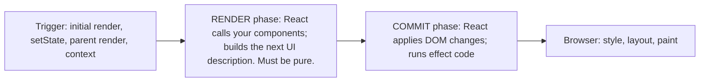
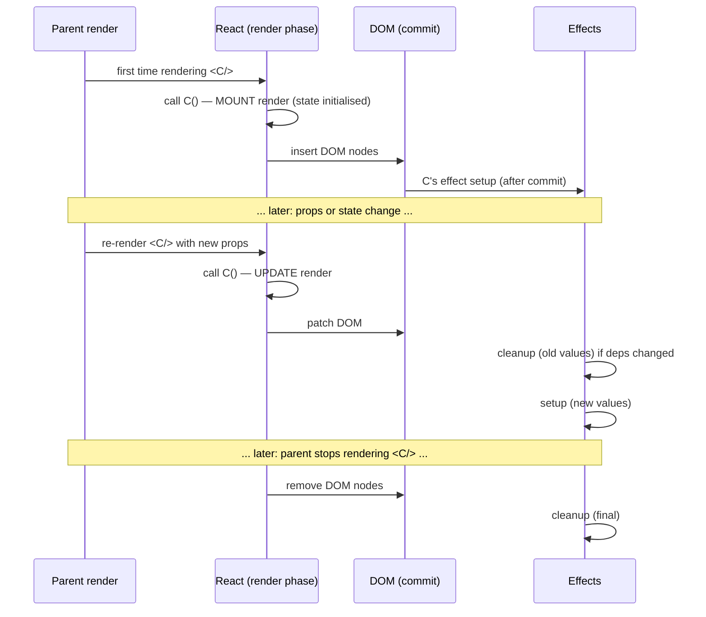
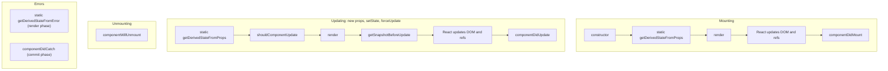
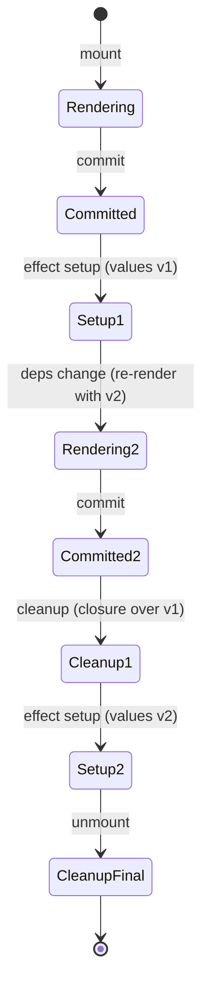

# 01 / 17 — Lifecycle Concepts: Mount, Update, Unmount (Class History Included)

## 1. Lesson metadata

| | |
|---|---|
| **Level** | Intermediate |
| **Study time** | 3.5–4.5 hours (reading 1.75 h, experiments 1 h, exercises 1–1.5 h) |
| **Prerequisites** | [16 — State preservation and reset](./16-state-preservation-and-reset.md), [13 — The rendering mental model](./13-rendering-mental-model.md), [12 — Component purity](./12-component-purity.md), [10 — Event handling](./10-event-handling.md), [Foundations 09 — Prototypes, `this`, classes](../00-web-and-javascript-foundations/09-prototypes-and-object-model.md) (for the class history sections) |
| **Next** | [18 — React Developer Tools](./18-react-devtools.md) |
| **Related later** | [Phase 2 / 03 — Initial mount and updates](../02-react-rendering-and-internals/03-initial-mount-and-updates.md), [Phase 2 / 18 — Effects and their timing](../02-react-rendering-and-internals/18-effects-and-their-timing.md), [Phase 2 / 19 — Layout vs passive effects](../02-react-rendering-and-internals/19-layout-vs-passive-effects.md), [Phase 2 / 28 — Strict Mode behavior](../02-react-rendering-and-internals/28-strict-mode-behavior.md), [Phase 3 / 04 — `useEffect` synchronization](../03-react-state-and-hooks/04-useeffect-synchronization.md), [Phase 3 / 06 — Effect cleanup](../03-react-state-and-hooks/06-effect-cleanup.md), [Phase 4 / 19 — Error boundaries](../04-react-architecture/19-error-boundaries.md) |

**Learning objectives.** After this lesson you can:
1. Define **mount**, **update**, and **unmount** precisely, and relate them to the state-identity rule from [Lesson 16](./16-state-preservation-and-reset.md).
2. Separate the **render phase** (pure calculation) from the **commit phase** (touching the DOM and running effects) at a conceptual level.
3. Use `useEffect` at a *usage level*: setup, cleanup, dependency array, and what each one means.
4. Explain why "`useEffect(fn, [])` is `componentDidMount`" is a lossy and misleading translation.
5. Read class-component lifecycle code (history), recognise its common bugs, and translate it to function components.
6. Predict the development-only Strict Mode mount sequence (setup → cleanup → setup) and say why it exists.

**Concepts covered:** component lifecycle (mount/update/unmount), render vs commit phase, effects as synchronization, effect setup/cleanup, dependency array, effect timing relative to paint (high level), child-before-parent effect order on mount, Strict Mode double-mount (dev), data fetching race guard (`ignore` flag), and *(historical)* class lifecycle methods: `constructor`, `render`, `componentDidMount`, `componentDidUpdate`, `componentWillUnmount`, `shouldComponentUpdate`, `getDerivedStateFromProps`, `getSnapshotBeforeUpdate`, `UNSAFE_*` methods, error-boundary methods.

> Scope note. This lesson teaches `useEffect` **at usage level** so you can read and write ordinary code. Why effects behave as they do (Fiber, passive vs layout scheduling, the dependency comparison) is Phase 2 and Phase 3 material. Wherever this lesson says "usually" or "typically" about timing, that is deliberate: it is not a guarantee.

---

## 2. Deep conceptual explanation

### 2.1 What problem is this lesson solving?

Rendering is pure ([Lesson 12](./12-component-purity.md)): given props and state it returns a description of UI, and nothing else. But real components must sometimes do things *outside* of rendering:

- Open a WebSocket when a chat room is shown and close it when the room is left.
- Start a timer, listen to `window` resize, or subscribe to a store.
- Focus an input, measure a DOM node, start a third-party chart widget.
- Fetch data when an identifier changes.

These are **side effects**: work that reaches outside the render calculation. React therefore gives you a place to put them and a vocabulary for *when* they start and stop. That vocabulary is the component lifecycle, and mastering it prevents leaks (connections never closed), duplicated work, and stale data.

### 2.2 The three lifecycle moments

| Moment | Definition | What triggers it |
|---|---|---|
| **Mount** | React creates an instance of a component at a tree position, calls it for the first time, and commits its output to the DOM (host environment) for the first time. | A parent starts rendering it for the first time: initial `createRoot(...).render(...)`, a conditional becoming true, a `key` change, a list item added, a wrapper type change ([Lesson 16](./16-state-preservation-and-reset.md)). |
| **Update** | The same instance re-renders and its new output is committed. | Its own state changed, its parent re-rendered, or a context it reads changed. |
| **Unmount** | React removes the instance and its DOM from the tree and discards its state. | A parent stops rendering it, its key/type changes, or an ancestor unmounts. |

Observe that this is the **identity rule from Lesson 16 viewed over time**: identity preserved → update; identity lost → unmount of the old, mount of the new.

### 2.3 Render phase and commit phase (a first look)

Each update happens in two broad phases:



- **Render phase:** your component functions run. React may run them more than once, pause, discard results (in concurrent rendering and in StrictMode development). So nothing in them may have lasting side effects.
- **Commit phase:** React applies the minimal DOM changes, sets refs, and **runs effects**. Effects are the sanctioned location for side effects because commit happens once per update that actually lands.

*Public guarantee:* rendering must be pure; effects run after the corresponding DOM changes are committed. *Implementation detail:* the exact sub-steps and scheduling (layout effects synchronously, passive effects later) are in [Phase 2 / 02, 11, 18–20](../02-react-rendering-and-internals/18-effects-and-their-timing.md).

### 2.4 The mindset shift: effects synchronize; they are not "lifecycle hooks"

Class components made you think "what should run when this mounts, when it updates, when it unmounts?" Function components with effects invite a different question: **"what external thing must be kept in sync with the current props and state, and how do I start and stop that synchronization?"**

An effect is one *synchronization process*:

```ts
useEffect(() => {
  // START synchronizing with the outside world, using this render's values
  const connection = createConnection(serverUrl, roomId);
  connection.connect();
  return () => {
    // STOP that synchronization (undo exactly what setup did)
    connection.disconnect();
  };
}, [serverUrl, roomId]); // re-sync whenever these values changed
```

- **Setup** runs after commit.
- **Cleanup** runs before the next setup (when dependencies changed), and when the component unmounts.
- **Dependencies** are the reactive values (props, state, values derived from them) that the setup reads. If any changed since the last run, React runs cleanup (with the *old* values) and then setup (with the *new* values).

The React docs summarise: each effect describes a single start/stop cycle, and you should think about one cycle at a time. The component may mount, update, unmount and the effect may start/stop many more times than that: for example, if `roomId` changes five times while the component stays mounted, the effect cycles five more times.

### 2.5 The translation trap: `useEffect(…, [])` ≠ `componentDidMount`

| Aspect | Class `componentDidMount` / `componentWillUnmount` | `useEffect(fn, [])` |
|---|---|---|
| Runs when | After first commit | After first commit (usually after paint) |
| Sees props/state | Via `this.props` (always latest, mutable) | The values captured by *that render* (closure) |
| In development | Once | **Setup, cleanup, setup** under Strict Mode (see §2.7) |
| Intent | "Do this once when it appears." | "Synchronize with something that doesn't depend on reactive values." |
| If it reads a prop | Works (reads latest at call time) | Linting warns: the value must be in deps, or the effect uses a stale closure |

Writing `[]` to emulate "run once" is a common source of stale-closure bugs. Correct thinking: list the reactive values the effect reads; if the list is empty, then and only then is `[]` correct ([Phase 3 / 05](../03-react-state-and-hooks/05-effect-dependencies-and-stale-closures.md)).

### 2.6 When *not* to use an effect

Effects are for **synchronizing with systems outside React**. They are the wrong tool for:

- Computing a value from props/state: calculate it during render.
- Handling a user event: put the logic in the event handler (you know exactly *what* the user did; an effect only sees "something changed").
- Resetting state when a prop changes: use a `key` ([Lesson 16](./16-state-preservation-and-reset.md)).
- Chains of effects that set state to trigger more effects.

Full treatment in [Phase 3 / 07 — You might not need an effect](../03-react-state-and-hooks/07-you-might-not-need-an-effect.md).

### 2.7 Strict Mode's development remount

In **development**, a component wrapped in `<StrictMode>` (the default in Vite templates, see [Lesson 19](./19-project-setup-vite-typescript.md)) gets an extra, deliberate cycle when it mounts:

```text
render (function body may be invoked twice)  →  commit  →  effect setup  →  effect cleanup  →  effect setup
```

React simulates "the component was shown, hidden, then shown again" immediately, to reveal effects that do not clean up properly. In production none of this happens.

*Public guarantee:* Strict Mode in development re-runs effects once on mount; it may also call component bodies and updater functions twice. It **never** affects production behaviour. The extra effect cycle was introduced in React 18; React 19 adds a dev-only ref-callback re-run (attach, detach, attach on mount; observed in React 19.3.1 and documented on react.dev/reference/react/StrictMode) and reuses `useMemo`/`useCallback` results across the double render.

A correct effect survives this test: after setup → cleanup → setup, the world looks the same as after a single setup. A leaky effect (never disconnects, adds a duplicate listener) shows duplicated behaviour in development: "my interval ticks twice as fast". That is a bug report from React, not a React bug.

### 2.8 Relation to JavaScript and the browser

- **Closures** ([Foundations 06](../00-web-and-javascript-foundations/06-lexical-scope-and-closures.md)): each render has its own effect function closed over that render's values. That is why cleanup sees the *old* values and why effects "snapshot" like everything else ([Lesson 14](./14-state-as-a-snapshot.md)).
- **Event loop** ([Foundations 11](../00-web-and-javascript-foundations/11-event-loop-tasks-microtasks.md)): effect timing is about tasks and paint. Typically React runs effect setups after the browser has had a chance to paint, so they do not delay the first visual update. A different hook (`useLayoutEffect`) runs before paint when you must measure/adjust the DOM without flicker ([Phase 3 / 08](../03-react-state-and-hooks/08-uselayouteffect.md)).
- **Resource lifetimes** ([Foundations 16](../00-web-and-javascript-foundations/16-memory-management-and-gc.md)): event listeners, timers, and subscriptions keep objects alive until explicitly released. Cleanup is how you prevent leaks.

### 2.9 Common misconceptions

| Misconception | Reality |
|---|---|
| "`useEffect` runs after every update only if there are deps." | With **no** dependency array it runs after *every* render; with `[]` after mount only (plus dev double mount); with `[a, b]` when `a` or `b` changed. |
| "Cleanup runs only on unmount." | Also before every re-run caused by changed dependencies. |
| "Effects run during render." | They run after commit; code in the body of the component runs during render. |
| "A component mounts once per page load." | It mounts every time its identity is created: conditional show, key change, route change, list insertion. |
| "Class lifecycle methods map one-to-one onto hooks." | The models differ: lifecycle methods are *events*; effects are *synchronization*. |
| "Effects are the place to fetch everything." | Fine for simple cases; for real apps use a data-fetching library or framework loader ([Phase 6](../06-data-fetching-and-state-ecosystems/01-fetch-lifecycle.md)). |
| "Strict Mode double-effects are a bug in React." | It is a development check for missing cleanup; production runs once. |
| "Unmount only happens when the user navigates away." | Also on conditional rendering flips, key changes, and parent type changes. |

---

## 3. Internal mechanics

### 3.1 A unified timeline

For a component `C` appearing, changing, and disappearing:



### 3.2 Effect timing (usage-level)

| Hook | Typical timing | Typical use |
|---|---|---|
| Component body | During render | Calculate output (pure) |
| `useLayoutEffect` | After DOM mutation, **before** the browser paints | Measure layout, synchronously adjust before paint |
| `useEffect` | After commit, **usually after paint** | Subscriptions, timers, fetch triggers, logging |
| Class `componentDidMount` / `componentDidUpdate` *(legacy)* | After DOM mutation, before paint (similar timing to layout effect) | See §5.6 |

*Implementation detail:* "usually after paint" is not a promise. React may flush passive effects earlier, for example when the render was caused by a discrete event like a click, or before processing another update. Code must be correct for either timing. Details: [Phase 2 / 18–19](../02-react-rendering-and-internals/19-layout-vs-passive-effects.md).

### 3.3 Ordering rules you can rely on (and those you shouldn't)

Reliable at the usage level (documented/teaching model):
- Effects of a component run **after** that component's DOM changes are committed.
- For one component, effects run in the order they are declared in the function body.
- On mount, a child's effects run before its parent's effects (children complete first, as in "bubble up").
- When dependencies change, React runs the **previous** effect's cleanup before running the new setup, and, since React 17, **all** pending cleanups for a commit run before any new setups.

Do **not** rely on: the relative order between unrelated siblings' effects, whether effects flush before the next paint, or exact order of cleanups across components.

### 3.4 The dependency check, conceptually

After each render, React compares the dependency array's items to the previous render's using `Object.is`, one by one. If any differ (or there's no array), the effect's cleanup and setup are scheduled. This is why an **object or function created during render** in the deps (`[options]`, `[handler]`) makes the effect re-run every render: it is a new reference each time ([Foundations 07](../00-web-and-javascript-foundations/07-functions-and-referential-identity.md)). Fix by depending on primitives, moving the object into the effect, or moving it out of the component. The `eslint-plugin-react-hooks` `exhaustive-deps` rule helps (see [Lesson 19](./19-project-setup-vite-typescript.md)); treat its warnings as design feedback, not noise.

### 3.5 What state does across the lifecycle

- **Mount:** `useState(initial)` evaluated; initializer used once.
- **Update:** React supplies the stored state; the initializer argument is ignored.
- **Unmount:** state discarded. A later mount at that position starts fresh.

### 3.6 Class-component lifecycle (labelled history)

> **Legacy / historical.** Class components still work in React 19 and appear in older code and some libraries. **All new code should use function components.** One exception remains: *error boundaries* can only be written as classes today (a function-component equivalent for `getDerivedStateFromError`/`componentDidCatch` does not exist as of this writing; verify current docs), and libraries such as `react-error-boundary` wrap that for you ([Phase 4 / 19](../04-react-architecture/19-error-boundaries.md)).

Class lifecycle, grouped by phase:



| Method | Phase | Purpose (historical) | Modern replacement |
|---|---|---|---|
| `constructor(props)` | Render | Initialise `this.state`, bind handlers | `useState` initial value; arrow functions or inline handlers |
| `render()` | Render | Return JSX (must be pure) | The function body |
| `componentDidMount()` | Commit | Start fetches, subscriptions, DOM measurement | `useEffect` setup (or `useLayoutEffect` for measure-before-paint) |
| `componentDidUpdate(prevProps, prevState, snapshot)` | Commit | Respond to changes: compare prev vs current and act | `useEffect` with dependencies |
| `componentWillUnmount()` | Commit | Clean up timers/subscriptions | The cleanup function returned from `useEffect` |
| `shouldComponentUpdate(nextProps, nextState)` / `PureComponent` | Render | Skip re-render if nothing relevant changed | `React.memo` (and compiler-based auto-memoization verify) |
| `static getDerivedStateFromProps(props, state)` | Render | Derive state from props (rarely right) | Derive during render; or key reset ([Lesson 16](./16-state-preservation-and-reset.md)) |
| `getSnapshotBeforeUpdate(prevProps, prevState)` | Commit (pre-DOM mutation) | Read DOM (e.g., scroll position) just before it changes | `useLayoutEffect`-based patterns; no direct hook equivalent |
| `static getDerivedStateFromError(error)` / `componentDidCatch(error, info)` | Render / Commit | Error boundaries | Still class-based; or `react-error-boundary` |
| `UNSAFE_componentWillMount`, `UNSAFE_componentWillReceiveProps`, `UNSAFE_componentWillUpdate` (formerly `componentWill*`) | Render | Early hooks into render; problematic with concurrent rendering because they may run more than once | Removed from recommended use; do not write them |

Why the `componentWill*` methods were renamed `UNSAFE_`: they run in the render phase, which React may repeat or abandon; code with side effects in them (subscriptions, fetches) leaks or duplicates. The renaming (starting in React 16.3/16.9 deprecation warnings) signalled that they are incompatible with the direction toward concurrent rendering.

Other class facts that explain old code:
- `this.setState(partial)` **shallow-merges** into state; `useState`'s setter **replaces**.
- `this.props` and `this.state` are mutable references updated by React. A handler that reads `this.props.x` later sees the *latest* value; a function component's handler sees its render's snapshot. This is the root of many "stale closure vs latest value" differences ([Lesson 14](./14-state-as-a-snapshot.md)).
- `this` must be bound in handlers (`this.handle = this.handle.bind(this)` or class-field arrow functions) because of how methods lose `this` when passed as callbacks ([Foundations 09](../00-web-and-javascript-foundations/09-prototypes-and-object-model.md)).
- Reuse used mixins (removed), then HOCs and render props; custom hooks replaced all three ([Phase 3 / 15](../03-react-state-and-hooks/15-custom-hooks.md)).

---

## 4. Step-by-step execution walkthrough

Component:

```tsx
import { useEffect, useState } from "react";

function log(msg: string) { console.log(msg); }

export function RoomBanner({ roomId }: { roomId: string }) {
  log(`render ${roomId}`);

  useEffect(() => {
    log(`connect ${roomId}`);
    return () => log(`disconnect ${roomId}`);
  }, [roomId]);

  return <h2>Room: {roomId}</h2>;
}

export function App() {
  const [room, setRoom] = useState("general");
  const [show, setShow] = useState(true);
  return (
    <>
      <button onClick={() => setRoom(r => (r === "general" ? "travel" : "general"))}>Switch room</button>
      <button onClick={() => setShow(s => !s)}>Toggle banner</button>
      {show && <RoomBanner roomId={room} />}
    </>
  );
}
```

**Predict (production build, no StrictMode):** page loads; click "Switch room"; click "Toggle banner" (hide). What is logged, in order?

Walkthrough:

1. **Mount.** `App` renders; `show` is true so `RoomBanner` is created with `roomId="general"`.
   - Render phase: logs `render general`.
   - Commit: `<h2>` inserted.
   - Effects: logs `connect general`.
2. **Click "Switch room".** `room` becomes `"travel"`. `App` re-renders; `RoomBanner` at the same position/type/key is **updated** with a new prop.
   - Render: `render travel`.
   - Commit: text node changes to "Room: travel".
   - Dependencies `[roomId]` changed (`"general"` → `"travel"`): React runs the *previous* effect's cleanup, which closes over the old value: `disconnect general`. Then runs the new setup: `connect travel`.
3. **Click "Toggle banner".** `show` is false; `RoomBanner` is no longer rendered: **unmount**. DOM removed; final cleanup: `disconnect travel`.

Full log: `render general, connect general, render travel, disconnect general, connect travel, disconnect travel`.

**Same program in development with `<StrictMode>`:** on initial mount you would additionally see the render invoked twice (two `render general` lines, one dimmed in some consoles), and the effect cycle `connect general, disconnect general, connect general` before any interaction. The later steps behave as above (updates are not doubled in effect cycles, though renders may be doubled).

*Why the first log in step 2 is "disconnect general" and not "disconnect travel":* the cleanup function is a closure created in the earlier render; it captured `roomId = "general"` ([Lesson 14](./14-state-as-a-snapshot.md)).

---

## 5. Code examples

### 5.1 Minimal example: three dependency-array shapes

```tsx
import { useEffect, useState } from "react";

export function EffectShapes() {
  const [count, setCount] = useState(0);

  useEffect(() => { console.log("A: every render"); });                // no array
  useEffect(() => { console.log("B: mount only (+ dev remount)"); }, []); // empty array
  useEffect(() => { console.log("C: when count changes"); }, [count]);    // with deps

  return <button onClick={() => setCount(c => c + 1)}>count {count}</button>;
}
```

**Predict (production):** mount, then one click. Which logs, in which order?

**Result:** mount: `A`, `B`, `C` (declaration order). Click: `A`, `C`. `B` does not rerun.
**Why:** `A` has no dependency list; `B`'s empty list never changes; `C`'s dependency `count` changed `0 → 1`.
**Trade-off:** none; a teaching sample. In real code, effect A without deps is rare and usually suspicious.

### 5.2 Practical example: subscribe to window resize (with cleanup)

```tsx
import { useEffect, useState } from "react";

export function WindowWidth() {
  const [width, setWidth] = useState<number>(() => window.innerWidth);

  useEffect(() => {
    const onResize = () => setWidth(window.innerWidth);
    window.addEventListener("resize", onResize);
    return () => window.removeEventListener("resize", onResize); // same function reference
  }, []); // reads no reactive values: onResize only uses setWidth (stable) and window (global)

  return <p>Window width: {width}px</p>;
}
```

Line notes:
- Initial state uses a **lazy initialiser** (`() => window.innerWidth`) so it is computed once at mount ([Lesson 14](./14-state-as-a-snapshot.md)). In server rendering `window` doesn't exist; guard or use another approach ([Phase 9](../09-advanced-rendering-and-ecosystem/01-spa-ssr-ssg-streaming.md)).
- The same function reference must be passed to `removeEventListener`; an inline arrow in each call would not match ([Foundations 13](../00-web-and-javascript-foundations/13-browser-events-and-propagation.md)).
- `[]` is correct *because* the effect reads no props or state. Setters are stable and need not be listed.
- Strict Mode's setup → cleanup → setup leaves exactly one listener attached: the effect is *resilient*.
- For this exact case, `useSyncExternalStore` is arguably the more robust tool ([Phase 3 / 20](../03-react-state-and-hooks/20-usesyncexternalstore-and-external-stores.md)); the effect version is the common baseline.

### 5.3 Incorrect example: no cleanup

```tsx
useEffect(() => {
  const id = setInterval(() => setTick(t => t + 1), 1000);
  // BUG: nothing clears the interval
}, []);
```

**Predict:** in development (StrictMode), how fast does `tick` increase? After unmounting the component?

**Result:** about **two per second** in development: setup, cleanup (missing), setup creates two intervals. After unmount both intervals keep running and keep calling `setTick` on an unmounted component (React 18+ no longer warns; the work and memory are still wasted, and in a long-lived SPA it accumulates). In production without StrictMode the single interval still leaks after unmount.
**Why:** timers belong to the browser ([Foundations 14](../00-web-and-javascript-foundations/14-web-apis-and-network-requests.md)), not to your component; the component's disappearance doesn't cancel them.

### 5.4 Corrected implementation

```tsx
useEffect(() => {
  const id = setInterval(() => setTick(t => t + 1), 1000);
  return () => clearInterval(id);
}, []);
```

An updater (`t => t + 1`) means the effect does not read `tick`, so `[]` is accurate. Had we written `setTick(tick + 1)` we'd have a stale closure: the interval would keep adding to the *first render's* `tick` (always 0), so the display would stick at 1 ([Lesson 14](./14-state-as-a-snapshot.md), [Lesson 15](./15-update-queues-and-batching.md)).

### 5.5 Advanced example: fetch on id change with a stale-response guard

```tsx
import { useEffect, useState } from "react";

type User = { id: string; name: string };

async function fetchUser(id: string, signal: AbortSignal): Promise<User> {
  const res = await fetch(`/api/users/${encodeURIComponent(id)}`, { signal });
  if (!res.ok) throw new Error(`HTTP ${res.status}`);
  return (await res.json()) as User;
}

type State =
  | { status: "loading" }
  | { status: "success"; user: User }
  | { status: "error"; message: string };

export function UserCard({ userId }: { userId: string }) {
  const [state, setState] = useState<State>({ status: "loading" });

  useEffect(() => {
    const controller = new AbortController();
    setState({ status: "loading" });

    fetchUser(userId, controller.signal)
      .then(user => setState({ status: "success", user }))
      .catch((e: unknown) => {
        if (e instanceof DOMException && e.name === "AbortError") return; // expected on cleanup
        setState({ status: "error", message: e instanceof Error ? e.message : "Unknown error" });
      });

    return () => controller.abort(); // cleanup: cancel the request for the OLD userId
  }, [userId]);

  if (state.status === "loading") return <p aria-busy="true">Loading…</p>;
  if (state.status === "error") return <p role="alert">{state.message}</p>;
  return <h2>{state.user.name}</h2>;
}
```

Line notes:
- The effect **starts a synchronization** with the server for `userId` and **stops** it by aborting. If `userId` goes `1 → 2 → 3` rapidly, requests for 1 and 2 are cancelled, so a slow response for `1` cannot overwrite `3`.
- `setState({ status: "loading" })` at the start resets the UI when the id changes (an alternative is a key, [Lesson 16](./16-state-preservation-and-reset.md)). Calling setState synchronously inside an effect triggers an additional render; that is acceptable here and flagged by some lint rules in newer plugin versions; weigh that against alternatives in Phase 3.
- A discriminated union makes illegal combinations (e.g., `loading` with `user`) unrepresentable.
- `AbortError` handling avoids reporting the intentional cancellation as an error. An alternative to `AbortController` is a boolean `ignore` flag set in cleanup, which prevents state updates but does not cancel the network request.
- **Production reality:** hand-written effects for fetching omit caching, deduplication, retries, and request sharing. Prefer TanStack Query or framework data APIs for non-trivial apps ([Phase 6 / 08](../06-data-fetching-and-state-ecosystems/08-tanstack-query.md)). Also under Strict Mode the first request is aborted and re-issued in development: expected.

### 5.6 Historical example: the same behavior as a class (legacy)

> **Legacy.** For reading old code only.

```tsx
import { Component } from "react";

type Props = { roomId: string };
type State = { status: "connecting" | "connected" };

class ChatRoom extends Component<Props, State> {
  state: State = { status: "connecting" };
  private connection: ReturnType<typeof createConnection> | null = null;

  componentDidMount() {
    this.connect();
  }

  componentDidUpdate(prevProps: Props) {
    if (prevProps.roomId !== this.props.roomId) {   // you must compare manually
      this.disconnect();
      this.connect();
    }
  }

  componentWillUnmount() {
    this.disconnect();
  }

  private connect() {
    this.connection = createConnection(this.props.roomId);
    this.connection.connect();
    this.setState({ status: "connected" });
  }

  private disconnect() {
    this.connection?.disconnect();
    this.connection = null;
  }

  render() {
    return <h2>{this.props.roomId}: {this.state.status}</h2>;
  }
}
```

Compare with the hook version (§2.4): the class **splits one concern across three methods** (`componentDidMount`, `componentDidUpdate`, `componentWillUnmount`) and relies on you to remember the comparison in `componentDidUpdate`. Forgetting that comparison leaves the component connected to the *old* room forever: the most common class-lifecycle bug. Putting `this.setState` in `componentDidUpdate` without a guard produces an infinite update loop (update → `componentDidUpdate` → `setState` → update …).

*Why hooks fixed it:* related setup/teardown colocated; dependencies declared; no instance fields; reusable via custom hooks.

### 5.7 Mount ordering of parent and child effects

```tsx
import { useEffect } from "react";

function Child() {
  console.log("child render");
  useEffect(() => { console.log("child effect"); }, []);
  return null;
}
export function Parent() {
  console.log("parent render");
  useEffect(() => { console.log("parent effect"); }, []);
  return <Child />;
}
```

**Predict (production):** the order of the four logs on first mount.

**Result:** `parent render`, `child render`, `child effect`, `parent effect`. Rendering goes top-down (a parent must render to produce the child); effects run bottom-up (children finish before parents). Practical consequence: a parent effect can assume that its children's DOM and effects are in place; a child cannot assume the parent's effect has run.

---

## 6. Visual explanations

### The lifecycle of one effect across renders



### Class methods vs hook structure

```text
CLASS (events)                          FUNCTION + HOOKS (synchronization)
componentDidMount    ─┐                 useEffect(() => {
  start thing(props)  │                   start thing(props)     ← setup
componentDidUpdate   ─┤  one concern     return () => stop(thing) ← cleanup
  if changed: restart │  three places  }, [props.x])              ← when to restart
componentWillUnmount ─┘
  stop thing
```

### Mount / update / unmount trigger table

| You do this in JSX | Result for the child |
|---|---|
| `{show && <C />}` false → true | Mount |
| `{show && <C />}` true → false | Unmount |
| `<C key={id} />` and `id` changes | Unmount old, mount new |
| `<C x={1} />` → `<C x={2} />` | Update (same instance) |
| Parent re-renders, `<C />` unchanged | Update (re-render; may be skipped with `memo`, [Phase 3 / 12](../03-react-state-and-hooks/12-react-memo.md)) |
| `<div><C/></div>` → `<section><C/></section>` | Unmount + mount |

---

## 7. Alternative approaches and trade-offs

Scenario: *keeping something outside React in sync with props/state.*

| Approach | Readability | Correctness | Performance | Complexity | Prefer when |
|---|---|---|---|---|---|
| `useEffect` with cleanup | High | Good with correct deps | Runs after paint, minimal main-thread blocking | Low–Medium | Subscriptions, timers, imperative widgets, simple fetches |
| `useLayoutEffect` | Medium | Good | Blocks paint (synchronous before paint) | Medium | Measuring/positioning DOM to avoid flicker |
| Event handler | Highest | Excellent | Cheapest | Lowest | Work caused by a **user action** (submit, click) |
| Compute during render | Highest | Excellent | Cheap if cheap | Lowest | Anything derivable from props/state |
| `useSyncExternalStore` | Medium | Excellent for tearing-safe subscriptions | Good | Medium | Reading external mutable stores (browser APIs, Redux-like) |
| Data library (TanStack Query / framework loader) | High | Best for caching/races | Best (dedupe, cache) | Medium (dependency) | Server state |
| Class component lifecycle *(legacy)* | Low | Easy to get wrong | Similar | Higher | Maintaining existing code; error boundaries |
| Key-based remount | High | Good | Remount cost | Low | Reset "everything" for a new identity |

**When the recommended approach (effect with cleanup) is *not* best:**
- Fetching data in an effect in a **framework** with route loaders or Server Components: the data should arrive before render (no waterfall, no loading flash).
- "When X is clicked, send analytics": do it in the click handler; an effect observing state would also fire on mount, on StrictMode double-run, and for unrelated reasons.
- Mirroring props into state: derive during render.
- Mounted-only initialisation of a non-React widget that is truly one-time and idempotent (e.g., a module-level analytics init): do it at module level or in the app entry, not in a component effect.

---

## 8. Best practices and anti-patterns

**Do**
- Write effect code as **start/stop of one synchronization**; make cleanup undo setup exactly.
- Declare *all* reactive values the effect reads in the dependency array; follow the exhaustive-deps lint rule and restructure code instead of silencing it.
- Use updater functions inside effects/intervals to avoid depending on state ([Lesson 15](./15-update-queues-and-batching.md)).
- Make effects idempotent and **resilient to setup → cleanup → setup**.
- One effect per concern, not one giant effect.
- Guard async work against stale responses (abort or ignore flag).

**Beginner mistakes**
- Missing cleanup for timers/listeners/subscriptions.
- `[]` to "run once" while reading props/state inside (stale closure).
- Putting data derivable in render into state set by an effect.
- Making the effect callback itself `async` (`useEffect(async () => …)`): it would return a promise instead of a cleanup function. Define an inner async function and call it.

**Experienced-developer mistakes**
- Using effects for event-driven logic (analytics on click, form submission).
- Chaining effects: effect A sets state that triggers effect B that sets state ... (hard to follow, extra renders).
- Suppressing the lint rule with `// eslint-disable-next-line react-hooks/exhaustive-deps` instead of fixing the design.
- Depending on object/function created in render (new each time) → effect runs each render.
- Treating Strict Mode's double run as noise and suppressing it, rather than fixing the leak.

**Smells**
- An effect that calls `setState` with a value computable from current props/state.
- A comment "run only on mount" next to an effect that reads props.
- `useEffect` with no deps array and a `setState` inside (potential infinite loop: render → effect → setState → render …).

**Justified exceptions**
- Disabling a lint warning is occasionally warranted for a value intentionally read once; document why, and prefer `useEffectEvent` (stable since React 19.2; call it only from inside Effects) for "non-reactive" reads.
- `useLayoutEffect` for measurement before paint.

---

## 9. Real-world application

**Realtime dashboard (finance).** A component subscribes to a price feed for `symbol`. The effect opens a subscription for the symbol and its cleanup unsubscribes; changing the selected symbol cycles it. Constraints: connection count limits on the server, so *cleanup correctness* is a cost concern; Strict Mode's double mount in development may open two connections briefly, so the client wrapper must be safe to open/close quickly (idempotent, ref-counted).

**E-commerce product page.** Fetching product details by `productId` with the cancellation pattern prevents showing product A's data on product B's page when the network is out of order. A real implementation would use a query cache: the user returning to a product shouldn't wait for a refetch ([Phase 6](../06-data-fetching-and-state-ecosystems/07-server-state-management.md)).

**Authentication/session timeout.** A timer effect warns after 25 minutes of inactivity; it must reset on user activity (dependencies include the last activity timestamp or the effect resets the timer via an event listener) and clean up on logout. A missed cleanup can show a "session expired" modal after the user has logged out and is on a public landing page.

**Forms.** Autosave drafts: debounce saves in an effect with cleanup (clear the timer). Constraint: do not autosave sensitive fields (passwords, payment details).

**Multi-team apps.** A widget from another team (map, charts) is imperative. Wrap it in a component whose effect creates and destroys the widget; test it with Strict Mode on; never let the widget outlive the component (memory leaks accumulate in long-lived SPAs).

**Analytics.** Page-view tracking in an effect keyed on `pathname` fires twice in dev under Strict Mode; track in a router-level listener or dedupe, and accept that development double-fires are expected.

---

## 10. Debugging and troubleshooting

**Symptom 1: "My effect runs twice on load."**
1. Check whether `<StrictMode>` is present ([Lesson 19](./19-project-setup-vite-typescript.md)'s `main.tsx`).
2. Verify in a production build (`npm run build && npm run preview`): if it runs once, the double run is dev-only.
3. Confirm the effect is resilient: after the double run, is there exactly one subscription/timer? If not, add or fix cleanup.
4. Do **not** remove StrictMode to hide it.

**Symptom 2: "Counter/interval is stuck at 1."**
Stale closure in an effect with `[]` that reads state. Use an updater or list the dependency ([Lesson 15](./15-update-queues-and-batching.md)).

**Symptom 3: "Effect runs on every render / infinite loop."**
1. Inspect the dependency array for objects, arrays, or functions created during render.
2. Add `console.log` in the effect with the deps; compare `Object.is` between renders.
3. Move the object inside the effect, memoise it, or depend on primitive fields.
4. If the effect sets state that is itself a dependency, rethink: can the value be derived?

**Symptom 4: "Old data flashes after changing the id."**
Race or stale state. Add abort/ignore cleanup; consider resetting with a key.

**Symptom 5: "Memory/CPU grows after navigating around."**
Leaked subscriptions/timers. Use the DevTools Memory panel (heap snapshots) or Performance monitor to watch listener and node counts; temporarily log setup/cleanup counts with matching labels; they must balance.

**Technique: lifecycle probe.**
```tsx
useEffect(() => {
  console.log("mount/setup", id);
  return () => console.log("cleanup", id);
}, [id]);
```
React DevTools can't show effect timing directly; combine this probe with the Profiler (commit list) ([Lesson 18](./18-react-devtools.md)).

---

## 11. Exercises

### Level A — Knowledge
A1. Define mount, update, and unmount. Give two different JSX changes that cause a *mount*.
A2. What is the difference between the render phase and the commit phase? Which one may React repeat or discard?
A3. When does an effect's cleanup run?
A4. What do the three dependency-array shapes (omitted, `[]`, `[a]`) mean?
A5. Name three class lifecycle methods and their hook-based counterparts.
A6. Why were `componentWillMount`/`componentWillReceiveProps`/`componentWillUpdate` renamed with `UNSAFE_`?

### Level B — Code comprehension
B1. Predict the logs (production) for mount, then a re-render caused by `setCount` in this component, then unmount:
```tsx
function T({ count }: { count: number }) {
  useEffect(() => { console.log("setup", count); return () => console.log("cleanup", count); }, [count]);
  return null;
}
```
(`count` goes 0 → 1 via parent, then the parent unmounts `T`.)
B2. Same component in development StrictMode, on initial mount only: what logs?
B3. Explain why this prints "1" forever:
```tsx
const [n, setN] = useState(0);
useEffect(() => { const id = setInterval(() => setN(n + 1), 1000); return () => clearInterval(id); }, []);
```
B4. What is wrong with `useEffect(async () => { const r = await fetch(url); setData(await r.json()); }, [url]);`?

### Level C — Implementation
C1. Write `useDocumentTitle(title: string)` as a custom hook that sets `document.title` and restores the previous title on cleanup. Use it in a component.
C2. Write a `Clock` component showing the current time, updating every second, with proper cleanup. Format via `toLocaleTimeString`.
C3. Translate this class to a function component:
```tsx
class Timer extends Component<{ ms: number }, { ticks: number }> {
  state = { ticks: 0 };
  id?: number;
  componentDidMount() { this.id = window.setInterval(() => this.setState(s => ({ ticks: s.ticks + 1 })), this.props.ms); }
  componentDidUpdate(prev: { ms: number }) {
    if (prev.ms !== this.props.ms) { clearInterval(this.id); this.id = window.setInterval(() => this.setState(s => ({ ticks: s.ticks + 1 })), this.props.ms); }
  }
  componentWillUnmount() { clearInterval(this.id); }
  render() { return <p>{this.state.ticks}</p>; }
}
```

### Level D — Debugging
D1. A component adds `window.addEventListener("keydown", e => handle(e))` in an effect and removes it in cleanup with `window.removeEventListener("keydown", e => handle(e))`. Events keep firing after unmount. Why?
D2. This logs "tick" faster than once per second in development only:
```tsx
useEffect(() => { setInterval(() => console.log("tick"), 1000); }, []);
```
Explain and fix.
D3. A `useEffect(() => { setCount(count + 1); })` (no deps) freezes the tab. Why? What would you do if the intent was "count renders"?

### Level E — Architecture and engineering decisions
E1. A team wants to port 200 class components to hooks mechanically (`componentDidMount` → `useEffect(fn, [])`). Propose a migration strategy with risk controls; which components should *not* be ported?
E2. Choose between `useEffect`, an event handler, and `useSyncExternalStore` for: (a) sending an analytics event when a form is submitted, (b) syncing a component with `matchMedia("(prefers-reduced-motion)")`, (c) focusing an input when a modal opens.

### Level F — Expert challenge
F1. Design a test strategy proving that a custom `useWebSocket(url)` hook cleans up correctly under Strict Mode and URL changes. What would you assert and how?
F2. Explain why React runs **all** cleanups of a commit before **any** new setups (React 17+), with a concrete bug scenario that the older interleaved behaviour could create.

---

## 12. Detailed answers and explanations

> Attempt the exercises first.

**A1.** *Mount:* first creation and commit of an instance. *Update:* re-render + commit of an existing instance. *Unmount:* removal and state discard. Mount triggers: a conditional flips true (`{show && <C/>}`); a `key` change on `<C key={id}/>`; wrapper type change; a new list item; initial render.

**A2.** Render phase calls components to compute the next UI and must be pure; commit applies DOM changes and runs effects. React may repeat or discard the **render** phase (concurrent rendering, StrictMode); the commit happens once per landed update.

**A3.** Before re-running the effect when dependencies changed (using the previous render's values), and when the component unmounts. Also, in development StrictMode, once immediately after the first setup.

**A4.** Omitted: after every render. `[]`: after mount (and the dev re-mount cycle) only. `[a]`: after mount and whenever `a` changes (`Object.is`).

**A5.** `componentDidMount` → `useEffect` setup; `componentDidUpdate` → `useEffect` with dependencies; `componentWillUnmount` → cleanup return; `shouldComponentUpdate` → `React.memo`; `constructor` → `useState` initial value. Also `getSnapshotBeforeUpdate` has no direct hook.

**A6.** They run in the render phase, which React may call multiple times, pause, or abandon in concurrent rendering. Side effects in them (subscriptions, requests) could be duplicated or leak. `UNSAFE_` flags them as unsuitable for modern React.

**B1.** `setup 0` (mount), then after the parent changes `count` to 1: `cleanup 0`, `setup 1`; on unmount: `cleanup 1`. The cleanup logs the *old* value because it closes over the previous render's `count`.

**B2.** In development StrictMode: `setup 0`, `cleanup 0`, `setup 0` (the component body may also run twice). In production: `setup 0` once.

**B3.** `[]` means the effect runs once and its closure captured `n = 0` from the first render; every tick calls `setN(0 + 1)`, which is `1`. After the first tick, state is 1, and later ticks set it to 1 again (bail-out). Fix: `setN(p => p + 1)`, which doesn't read `n`.

**B4.** An `async` function returns a Promise, but `useEffect` expects either nothing or a cleanup *function*; React warns and the cleanup contract breaks. Fix: define `async function load() {…}` inside the effect and call `load()`, or use `.then` (as in §5.5). Also: handle errors and stale responses.

**C1.**
```ts
import { useEffect } from "react";

export function useDocumentTitle(title: string): void {
  useEffect(() => {
    const previous = document.title;
    document.title = title;
    return () => { document.title = previous; };
  }, [title]);
}
// Usage: function ProductPage({ name }: { name: string }) { useDocumentTitle(`${name} | Shop`); return <h1>{name}</h1>; }
```
Reasoning: setup changes the external system (document title); cleanup restores. Edge: with two components setting titles, restore order can produce unexpected titles (last cleanup wins); a routing framework's head management is more robust. In StrictMode, setup → cleanup → setup leaves the right title.

**C2.**
```tsx
import { useEffect, useState } from "react";

export function Clock() {
  const [now, setNow] = useState(() => new Date());
  useEffect(() => {
    const id = setInterval(() => setNow(new Date()), 1000);
    return () => clearInterval(id);
  }, []);
  return <time dateTime={now.toISOString()}>{now.toLocaleTimeString()}</time>;
}
```
Notes: `[]` is correct (reads nothing reactive). Edge: intervals drift and are throttled in background tabs; the displayed time is recomputed from `new Date()`, so it is correct regardless of drift.

**C3.**
```tsx
import { useEffect, useState } from "react";

export function Timer({ ms }: { ms: number }) {
  const [ticks, setTicks] = useState(0);
  useEffect(() => {
    const id = window.setInterval(() => setTicks(t => t + 1), ms);
    return () => window.clearInterval(id);
  }, [ms]);
  return <p>{ticks}</p>;
}
```
Why simpler: one effect handles start, restart on `ms` change (via deps), and stop. Behavior difference: when `ms` changes the class kept `ticks`; the function version also keeps `ticks` (state is untouched). The class version needs the manual `prev.ms !== this.props.ms` comparison; forgetting it is the classic bug.

**D1.** `removeEventListener` requires the *same function reference* as `addEventListener`. Two inline arrows are different functions, so nothing is removed. Fix: `const onKey = (e: KeyboardEvent) => handle(e); window.addEventListener("keydown", onKey); return () => window.removeEventListener("keydown", onKey);`. Also ensure `handle` is in dependencies or stable.

**D2.** Nothing clears the interval, so Strict Mode's setup → cleanup → setup creates two timers. Fix: `const id = setInterval(...); return () => clearInterval(id);`. The doubled rate is a *development symptom* of a real production leak (after unmount the timer keeps running).

**D3.** Effect with no deps runs after every render; it sets state, which triggers a render, which triggers the effect: infinite loop. If the intent is to count renders, use a ref (`renders.current += 1` inside the effect without setState) since a render count should not itself cause rendering ([Phase 3 / 10](../03-react-state-and-hooks/10-useref-and-mutable-references.md)).

**E1. Evaluation criteria:** recognises that mechanical translation is risky because of semantic differences (snapshot vs `this`, merge vs replace setState, dev double effects); plans incremental porting driven by value (touched files, buggy components) rather than blanket conversion; adds tests before porting; ports shared logic to custom hooks; leaves stable, rarely touched components and **error boundaries** as classes (or replaces with `react-error-boundary`); verifies with Strict Mode on; uses lint rules; tracks behaviour via snapshot/integration tests. *Example answer:* "Don't port 200 components. Define a boundary: new code is function components; ported when touched. For each port, translate by *concern* (not by method), write a characterization test first, run under Strict Mode, and compare Profiler commit counts before and after. Components using `getSnapshotBeforeUpdate`, error boundaries, or legacy third-party base classes are last or never."

**E2.** (a) Event handler: the cause is a user action. An effect reacting to a `submitted` state would fire on remount and in Strict Mode. (b) `useSyncExternalStore` (subscribe to `matchMedia` change events; correct reads on every render and SSR snapshot) or an effect with cleanup as a simpler baseline. (c) An effect with a ref (`useEffect(() => { if (open) ref.current?.focus() }, [open])`) or the `autoFocus` attribute when appropriate; focus management in dialogs is an accessibility topic (native `<dialog>` handles some of it). Reasoning criterion: *Is the trigger a user event, a value change, or an external source?*

**F1. Evaluation criteria:** uses a fake `WebSocket` (a spy class counting instances, open and closed) injected via global stub; renders the hook in a test harness wrapped in `<StrictMode>`; asserts that after mount there is exactly **one open** socket (created ≥ 2, closed ≥ 1, net open = 1); re-renders with a new URL and asserts that the old closed before/with the new opened; unmounts and asserts zero open; includes message-after-close not calling setState; tests error path. Tools: Vitest + React Testing Library `renderHook` ([Phase 8 / 05](../08-testing-and-quality/05-testing-custom-hooks.md)). Net-open count is the key invariant; exact call counts are implementation-specific.

**F2.** Suppose component A's cleanup releases a shared resource (e.g., unsubscribes from a ref-counted channel) and component B's setup acquires the same resource. If B's setup ran before A's cleanup, the ref-count could briefly go 1 → 2 → 1 correctly, but with *non-ref-counted* resources (a singleton connection keyed by name) B's setup may reuse the connection that A's cleanup then closes, leaving B with a dead connection. Running all cleanups first guarantees a clean slate: the resource is released before any new acquirer sets up. It matches the mental model "tear down the old world, then build the new world" across the whole commit. (This describes the documented change in React 17's effect cleanup timing; verify the release notes for specifics.)

---

## 13. Senior engineer interview questions

**Q1. "Is `useEffect(fn, [])` the same as `componentDidMount`?"**
*Strong answer:* No. `componentDidMount` is an event that happens once; `useEffect` describes a synchronization. With `[]`, the effect starts after mount and stops at unmount, but it runs with the first render's values (closure), in development Strict Mode it runs setup → cleanup → setup, and it typically runs after paint, whereas `componentDidMount` runs before paint (closer to `useLayoutEffect`). Treating it as didMount hides stale-closure and cleanup bugs.

**Q2. "Why does React double-invoke effects in development?"**
*Strong answer:* To simulate a component being unmounted and remounted (which happens in real apps via navigation, Suspense, Offscreen/Activity-style features and fast refresh) and verify that setup/cleanup are symmetric. Effects that pass the test stay correct when React unmounts/remounts subtrees for performance or UX features. It's development-only, and the fix for a visible double behavior is cleanup, not removing StrictMode.

**Q3. "Where should data fetching live?"**
*Strong answer:* Depends on the stack. In a framework with route loaders/Server Components, fetch there, so data is present on first render without a client waterfall. In an SPA, a query library (TanStack Query) handles caching, dedupe, retries, cancellation. A hand-rolled `useEffect` fetch is acceptable for simple/internal use if it handles cancellation, errors, and stale responses. Fetching in effects causes waterfalls (child fetches wait for parent render) and flashes.

**Q4. "Walk me through what happens when `roomId` changes for a mounted `ChatRoom` with `useEffect(..., [roomId])`."**
*Strong answer:* A render with the new prop runs (component updates); commit updates DOM; React sees `roomId` differs by `Object.is`, so it runs the previous effect's cleanup (closed over old room → disconnect), then the new setup (connect new room). The component never unmounted; the effect cycled.

**Q5. "Why can't error boundaries be written with hooks?"**
*Strong answer:* As of the last documented state, error boundaries require `getDerivedStateFromError`/`componentDidCatch`, class-only APIs; no hook equivalent exists verify current docs. In practice use a class once (or a library wrapper) at architectural boundaries ([Phase 4 / 19](../04-react-architecture/19-error-boundaries.md)).

**Q6. "How would you identify a leaked subscription in a large app?"**
*Strong answer:* Reproduce navigating repeatedly, take heap snapshots and compare retained listeners/closures (Memory panel), use performance monitor for listener/node counts, add paired setup/cleanup logging, test under Strict Mode in development where leaks become duplicated behaviours, and add automated tests asserting net-zero open resources after unmount.

---

## 14. Further learning resources

| Resource | URL | Covers / why | Level | Study |
|---|---|---|---|---|
| React docs: Lifecycle of Reactive Effects | <https://react.dev/learn/lifecycle-of-reactive-effects> | The "start/stop synchronization" model; why dependencies are not a choice | Intermediate | Whole page |
| React docs: Synchronizing with Effects | <https://react.dev/learn/synchronizing-with-effects> | Setup/cleanup, Strict Mode remount explanation, fetching caveats | Beginner–Int. | Whole page |
| React docs: You Might Not Need an Effect | <https://react.dev/learn/you-might-not-need-an-effect> | When effects are the wrong tool | Intermediate | Whole page |
| React docs: `useEffect` reference | <https://react.dev/reference/react/useEffect> | Parameters, caveats, troubleshooting | Intermediate | Caveats + Troubleshooting |
| React docs: `<StrictMode>` | <https://react.dev/reference/react/StrictMode> | Dev-only behaviors list (double render, effect re-run, ref callbacks) | Intermediate | "Reference" and "Usage" |
| React docs: `Component` (legacy API reference) | <https://react.dev/reference/react/Component> | Class lifecycle methods and legacy notes; includes error boundary methods | Intermediate | "Reference" lifecycle sections |
| React docs: Legacy API reference | <https://react.dev/reference/react/legacy> | Index of legacy APIs | Beginner | Skim |
| React blog: "React v16.3 / 16.9 deprecations of `componentWill*`" | <https://legacy.reactjs.org/blog/2018/03/27/update-on-async-rendering.html> | Rationale for UNSAFE_ renames | Intermediate | Whole post |
| MDN: `AbortController` | <https://developer.mozilla.org/en-US/docs/Web/API/AbortController> | Cancelling fetch in cleanup | Beginner–Int. | Overview + examples |

Links marked were not fetched; search the site for the quoted title if a link has moved.

---

## 15. Knowledge checkpoint

**You should now understand**
- Mount/update/unmount as the lifetime of an instance whose identity is (position, type, key).
- Render phase (pure) vs commit phase (DOM and effects).
- Effects as start/stop synchronization with dependencies, cleanup before re-run and on unmount.
- Why Strict Mode double-mounts in development, and how to pass the test.
- The class lifecycle as legacy vocabulary and how it maps (imperfectly) to hooks.

**You should be able to explain without notes**
- Why `[]` is not "componentDidMount".
- The log order for a component whose prop changes, then unmounts.
- Why you shouldn't put event-driven or derived logic in effects.

**You should be able to implement**
- Effects with cleanup for timers, listeners, and fetches with cancellation; a custom hook (`useDocumentTitle`); a class-to-function translation.

**You should be able to debug**
- Duplicate effects in development, stale-closure intervals, missing cleanup, unstable dependencies.

**Before moving on:** read [18 — React Developer Tools](./18-react-devtools.md). You will use it to *see* mounts, updates, and state, and to confirm what this lesson predicted.
