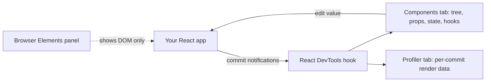
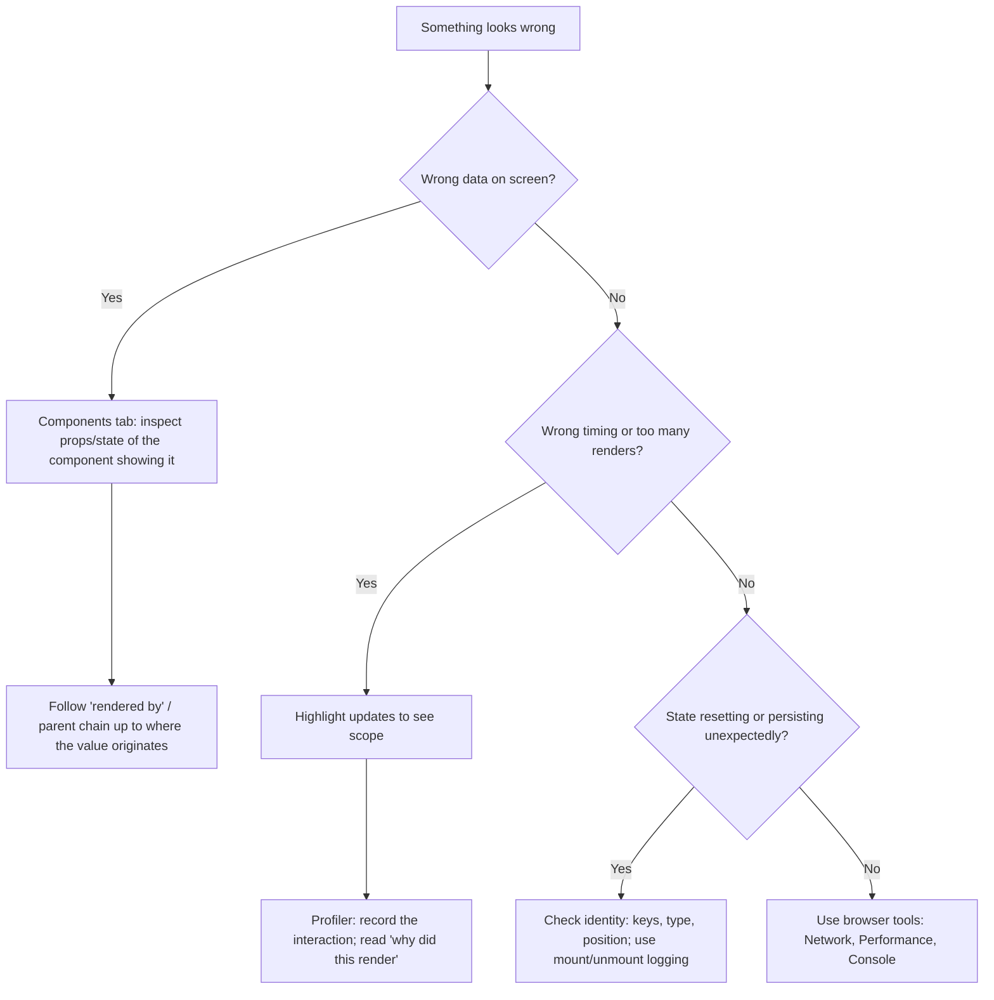

# 01 / 18 — React Developer Tools

## 1. Lesson metadata

| | |
|---|---|
| **Level** | Beginner |
| **Study time** | 2.5–3.5 hours (reading 1 h, hands-on 1 h, exercises 1 h). **Do this lesson with a running app open.** |
| **Prerequisites** | [06 — Props and one-way data flow](./06-props-and-one-way-data-flow.md). Helpful: [14 — State as a snapshot](./14-state-as-a-snapshot.md), [16 — State preservation and reset](./16-state-preservation-and-reset.md), [17 — Lifecycle concepts](./17-lifecycle-concepts.md) |
| **Next** | [19 — Project setup: Vite, TypeScript, ESLint](./19-project-setup-vite-typescript.md) |
| **Related later** | [Phase 2 / 30 — DevTools Profiler](../02-react-rendering-and-internals/30-react-devtools-profiler.md), [Phase 7 / 02 — Profiler workflows](../07-performance/02-profiler-workflows.md), [Foundations 01 — How the browser works](../00-web-and-javascript-foundations/01-how-the-browser-works.md) (browser Performance panel) |

**Learning objectives.** After this lesson you can:
1. Install React Developer Tools and recognise whether a page runs a development or production build of React.
2. Navigate the **Components** tab: component tree, props, state, hooks, owners, source, and the relationship to the DOM.
3. Edit props/state/hooks live to test hypotheses, and read values in the Console.
4. Use "highlight updates" and the **Profiler** to see *what rendered and why*.
5. Use DevTools to confirm the Phase 1 mental models: snapshots, batching, preservation/reset, mount/unmount.
6. Know what DevTools does **not** tell you and when to use the browser's own tools instead.

**Concepts covered:** the React DevTools extension and standalone app, dev vs production builds, component tree (the *React* tree, not the DOM tree), props/state/hooks inspector, owner vs parent, inspect element ↔ component, search and filters, live editing, `$r`, highlight updates, Profiler recording, flamegraph and ranked views, "why did this render?", commits, limits (production builds, source maps, third-party boundaries).

> Version-sensitive. DevTools ships independently of React and its UI changes between releases (labels, panels, settings placement). This lesson names the features and where to *look*; if a label differs in your version, use the DevTools search/settings and the official docs (§14). Items I am less certain of are marked *(verify in your version)*.

---

## 2. Deep conceptual explanation

### 2.1 What problem is this lesson solving?

Everything in Phase 1 describes what React *does*: a tree of components, props flowing down, state attached to instances, renders triggered by updates, mounts and unmounts. Until now you have had to trust those descriptions or infer them with `console.log`. The browser's Elements panel can't help: it shows the **DOM**, which has no components, props, or state. React Developer Tools shows the **component tree** React is actually maintaining, along with each component's props and hooks, and can record what rendered during an interaction.

Using it turns debugging from guessing ("I think the child re-renders because...") into observing ("the child re-rendered because its parent rendered and its `onSelect` prop changed identity"). The sooner you build the habit, the faster you learn the rest of the curriculum, because every later lesson ends with "confirm in the Profiler".

### 2.2 What it is

React Developer Tools (often "React DevTools") is:

- A **browser extension** for Chromium-based browsers (Chrome, Edge, Brave...) and Firefox. It adds **Components** and **Profiler** tabs to the browser DevTools (and, from DevTools 7/8, a **Suspense** tab, on by default in 8.0; the old Timeline tab was removed in 8.0 in favour of the browser Performance panel's React tracks, per the DevTools CHANGELOG, September 2026).
- A **standalone app** (npm package, run as `react-devtools`) that connects to a React app over a local WebSocket. Used for React Native, for environments where the extension isn't available (e.g., some Safari setups, embedded WebViews), and for remote debugging.

It works by hooking into React through a global hook object that `react-dom` registers with when the page loads. React reports its tree after each commit; DevTools renders that tree in its UI. That is why DevTools must be present *before* React starts (the extension injects early), and why it sees only React-managed components.

*Teaching model.* Think of DevTools as a read-mostly **mirror of the Fiber tree**, with editing hooks. Exactly how React exposes the tree is an implementation detail owned by the React and DevTools teams.

### 2.3 Development vs production builds

DevTools works on both, but:

| | Development build | Production build |
|---|---|---|
| Component names | Original function names | Often **minified** (`t`, `n`) unless names are preserved |
| Extra checks | Warnings, StrictMode double-rendering, detailed errors | Stripped for speed/size |
| Profiler | Available (with dev overhead; timings inflate) | Not available unless built with a profiling build *(verify bundler setup)* |
| Extension icon | Indicates dev build | Indicates production build |
| Timings meaningful? | Relative only | Closest to reality |

The extension's toolbar icon changes appearance depending on whether it detects React and whether the build is production or development; clicking it shows a short message. *(Exact colours vary by version; read the popup text.)*

**Rule:** use a dev build to understand *what/why*; measure *how slow* only on a production-like build ([Phase 7 / 01](../07-performance/01-measure-before-optimizing.md)).

### 2.4 The component tree is not the DOM tree

A **component** like `ProductCard` doesn't exist in the DOM; only its host output (`<div>`, ``) does. In the Components tab you see:

- **Components** you wrote (`App`, `ProductCard`).
- **Host components** (`div`, `button`), shown by default or hidden via filters.
- **Library components**, **context providers/consumers** (`Context.Provider`), and wrappers such as `Memo` or `ForwardRef` *(naming varies)*.

The tab's tree reflects **render-tree parentage** (which component renders which), not the DOM nesting only. Portals and fragments illustrate this: a modal rendered with a portal to `document.body` still appears as a child of the component that rendered it ([Lesson 04](./04-elements-components-instances.md)).

### 2.5 Parent vs owner

The inspector shows **"rendered by"** information: the chain of *owners*, which are the components whose render functions created this element (called its JSX), not necessarily its tree parent. Example: `<Card><Title/></Card>` written inside `Page`. `Title`'s tree parent is `Card`, but its *owner* is `Page` because `Page`'s function created the element. Owners matter when you ask "whose render produced these props?" because that is where you must change the code ([Lesson 07](./07-composition-and-children.md)).

### 2.6 Common misconceptions

| Misconception | Reality |
|---|---|
| "DevTools shows what's in the DOM." | It shows React's component tree. Use the Elements panel for DOM. They are linked but different. |
| "If a component flashes in 'Highlight updates', its DOM changed." | The highlight means the component *rendered* (function called/committed). The DOM may not have changed at all. "Rendered" ≠ "DOM updated" ([Phase 2 / 02](../02-react-rendering-and-internals/02-render-reconcile-commit-paint.md)). |
| "Profiler timings from dev mode tell me how slow production is." | Dev builds are slower and add checks. Use relative comparisons or a production profiling build. |
| "Editing state in DevTools changes my code." | It changes the live instance only; a reload loses it. Excellent for experiments. |
| "Everything that re-renders is a performance problem." | Rendering is normal ([Lesson 13](./13-rendering-mental-model.md)). Only slow or *unneeded-and-expensive* renders matter. |
| "DevTools can't be used in production." | It can inspect production builds (minified names, no Profiler by default). Be careful: don't ship dev builds just to debug. |
| "DevTools is only a tool for performance." | Most daily use is inspecting props/state and tracing *where a value came from*. |

---

## 3. Internal mechanics

### 3.1 How DevTools gets its data (conceptual)

1. When the page loads, the extension injects a small script that installs a global hook object *before* any application script runs.
2. When `react-dom` initialises (a root is created), it detects the hook and **registers** itself (a "renderer"), providing functions to inspect internal structures.
3. After each **commit**, React notifies the hook; DevTools serialises changes to the tree (component names, keys, types, props/state/hooks summaries) and sends them to the DevTools UI over a message channel.
4. Editing a value in the UI sends a message back; DevTools calls React's overrides to set a prop/state/hook value and trigger a re-render.

*Public guarantee:* the DevTools extension and React cooperate through a documented-enough hook interface across supported versions. *Implementation detail:* message formats, the internal hook name, and how values are serialised (large objects are truncated or lazily loaded) change over time. Do not build tools against them without reading the source *(verify in `facebook/react`'s `packages/react-devtools*` directories)*.

### 3.2 Why names appear in the tree

Names come from `function.name` or `displayName`. Anonymous components (`export default () => ...` or `const X = memo(() => ...)`) may appear as `Anonymous` or `ForwardRef`/`Memo` wrappers around anonymous functions. Name your functions. Minifiers rename functions; bundlers can keep names (an option) and source maps help *(verify in your toolchain)*.

### 3.3 The Profiler's data model

When you press **Record** in the Profiler tab:

- React (dev or profiling build) records, for each **commit**, which components rendered, and how long each took (`actualDuration`, self time).
- The UI shows a bar chart of commits across time; selecting a commit shows a **flamegraph** (tree layout; width ≈ render time) or a **ranked chart** (components sorted by time).
- With the setting "**Record why each component rendered while profiling**" enabled (Settings, Profiler; label verified), the sidebar lists reasons: props changed (which), state changed, hooks changed, context changed, parent rendered.

Grey bars mean a component *did not render* in that commit. This works because React can skip children when nothing changed ([Lesson 13](./13-rendering-mental-model.md)).



---

## 4. Step-by-step execution walkthrough

Hands-on: a **guided debugging session**. Create (or reuse) a small app, ideally in the Vite project from [Lesson 19](./19-project-setup-vite-typescript.md). Use this code in `App.tsx`:

```tsx
import { useState } from "react";

type Todo = { id: number; title: string; done: boolean };

function TodoItem({ todo, onToggle }: { todo: Todo; onToggle: (id: number) => void }) {
  return (
    <li>
      <label>
        <input type="checkbox" checked={todo.done} onChange={() => onToggle(todo.id)} />
        {todo.title}
      </label>
    </li>
  );
}

function TodoList({ todos, onToggle }: { todos: Todo[]; onToggle: (id: number) => void }) {
  return (
    <ul>
      {todos.map(t => <TodoItem key={t.id} todo={t} onToggle={onToggle} />)}
    </ul>
  );
}

export default function App() {
  const [todos, setTodos] = useState<Todo[]>([
    { id: 1, title: "Learn props", done: true },
    { id: 2, title: "Learn state", done: false },
    { id: 3, title: "Learn DevTools", done: false },
  ]);
  const [filter, setFilter] = useState("");

  const toggle = (id: number) =>
    setTodos(prev => prev.map(t => (t.id === id ? { ...t, done: !t.done } : t)));

  const visible = todos.filter(t => t.title.toLowerCase().includes(filter.toLowerCase()));

  return (
    <main>
      <h1>Todos</h1>
      <input aria-label="Filter" value={filter} onChange={e => setFilter(e.target.value)} />
      <TodoList todos={visible} onToggle={toggle} />
    </main>
  );
}
```

**Predict before you start:** when you type one character in the filter box, which components will *render* (function called)? Which will have DOM changes? Write down your answer; we will check it in step 6.

**Steps**

1. **Install** React Developer Tools for your browser from the official sources (links in §14; the Chrome Web Store/Firefox Add-ons listings are named "React Developer Tools"). Restart DevTools; reload your app. Two new tabs (**⚛ Components**, **⚛ Profiler**) appear in browser DevTools. If they don't, check the extension icon popup for a message ("React is detected" or "not detected").
2. **Inspect the tree.** In the Components tab you see `App → TodoList → TodoItem ×3`, plus host elements if enabled. Click `App`: the right panel lists **hooks**: `State` for `todos` (array of 3 objects) and `State` for `filter` (`""`). Expand the array.
3. **Select from the page.** Use the "select element in the page" arrow (top-left of the Components tab), then click a checkbox on the page: DevTools selects the corresponding host element and you can walk up to `TodoItem` and see its `props: todo, onToggle`.
4. **Edit live.** In `App`'s hooks, change `filter` to `learn` (double-click the value; edit; Enter). The page filters instantly even though you didn't type. You have *set state from outside*, testing the claim that UI is a function of state ([Lesson 03](./03-ui-as-a-function-of-state.md)). Reload to discard.
5. **Highlight updates.** Open the DevTools settings (gear icon in the Components tab) and enable **"Highlight updates when components render"** (label verified in the DevTools source, 2026-10-22). Click a checkbox: the `TodoItem` you toggled flashes, and so do others *(see step 6)*.
6. **Check your prediction.** Type one character into the filter. Result: `App` renders (its state changed) and **re-renders `TodoList` and every visible `TodoItem`**, because a parent render renders its children by default ([Lesson 13](./13-rendering-mental-model.md)). The DOM changes only for items that disappear/appear; unchanged `li` DOM stays untouched. This distinction (rendered ≠ DOM mutated) is the point of the exercise.
7. **Profile.** Open the **Profiler** tab. In DevTools Settings, Profiler section, enable "Record why each component rendered while profiling" (label verified in the DevTools source). Click Record, type two characters in the filter, Stop. You should see two commits. Select the first: the flamegraph shows `App` and descendants coloured by render time. The sidebar for `TodoItem` says something like "Rendered because: parent component rendered" (the `todo` object and `onToggle` are stable? Check: is `toggle` re-created? Yes: `App` creates a new `toggle` each render, so a *props changed* reason may also list `onToggle`; that matters if you later wrap `TodoItem` in `memo`: the memo would not help until `toggle` is stabilised, see [Phase 3 / 11–12](../03-react-state-and-hooks/11-usememo-and-usecallback.md).)
8. **Observe preserve/reset.** Replace `<TodoItem key={t.id} …>` with `key={index}` temporarily (`todos.map((t, index) => …)`), tick a checkbox in a filtered list, then change the filter. In the Components tab, watch which instances' props change versus which are created/removed (a removed row disappears; with index keys, state-bearing rows shift). This is [Lesson 16](./16-state-preservation-and-reset.md) made visible. Restore the id key.

---

## 5. Code examples

DevTools is a tool rather than code, but these snippets make it effective.

### 5.1 Minimal example: names that show up in the tree

```tsx
// Anonymous: harder to find in DevTools
export default () => <h1>Hello</h1>;

// Named: shows as "Greeting"
export default function Greeting() {
  return <h1>Hello</h1>;
}
```

For components created by factories or HOCs, set `displayName`:

```tsx
const Memoed = memo(function ProductRow({ p }: { p: Product }) { return <li>{p.name}</li>; });
// DevTools shows Memo → ProductRow
```

### 5.2 Practical example: using `$r` and the Console

With a component selected in the Components tab, the Console exposes it as **`$r`** (the selected component's data/instance, including props and hooks information *(shape varies by version; inspect it)*).

```text
> $r.props            // props of the selected component
> $r.hooks            // hooks metadata (version-dependent)
> $0                  // currently selected DOM node in the Elements panel (browser feature)
```

Use cases: copy a complex props object to the clipboard (`copy($r.props)`), compare two renders, or call a handler with arguments for a quick experiment. Also useful: the **"log this component data to the console"** button (bug icon; label varies by version) prints props/state as expandable objects, and the **eye** icon jumps to the DOM node.

*Warning:* `$r` is a debugging convenience, not an API for application code. Never reference it in source.

### 5.3 Incorrect approach: debugging with only console.log

```tsx
function TodoItem(props: TodoItemProps) {
  console.log("TodoItem rendered", props);  // noisy, doubled in StrictMode dev
  ...
}
```

**Problems:** logs fire on *every* render with no hierarchy, doubled in development StrictMode; they don't show *why* it rendered or which component owns the prop; you must edit code and remember to remove logs.

### 5.4 Corrected approach: observe first, instrument second

1. Components tab → select the component → read props/hooks.
2. Highlight updates → see the scope of a render.
3. Profiler with "why did this render" → see the reason.
4. Only then, targeted, temporary instrumentation:
```tsx
useEffect(() => { console.count("TodoItem mounted"); return () => console.count("TodoItem unmounted"); }, []);
```
Counting mount/unmount (not render) answers the *identity* questions from [Lessons 16–17](./16-state-preservation-and-reset.md).

### 5.5 Advanced example: custom hook labels with `useDebugValue`

```tsx
import { useDebugValue, useEffect, useState } from "react";

function useOnlineStatus(): boolean {
  const [online, setOnline] = useState(() => navigator.onLine);
  useEffect(() => {
    const on = () => setOnline(true);
    const off = () => setOnline(false);
    window.addEventListener("online", on);
    window.addEventListener("offline", off);
    return () => { window.removeEventListener("online", on); window.removeEventListener("offline", off); };
  }, []);
  useDebugValue(online ? "Online" : "Offline");  // appears next to the hook in DevTools
  return online;
}
```

`useDebugValue` adds a human-readable label for a custom hook in the Components tab's hooks list. It has no effect on behaviour. Use it sparingly in shared libraries where the hook's raw state is not self-explanatory. DevTools also offers a **"parse hook names"** option that tries to recover variable names for hooks from source maps (the setting is labelled "Always parse hook names from source" in Settings, Components; verified in the DevTools source); without it, built-in hooks display generically (`State`, `Effect`, `Memo`).

---

## 6. Visual explanations

### What each tool shows

```text
Browser Elements panel          React Components tab               React Profiler tab
─────────────────────           ─────────────────────              ──────────────────
<main>                          App                                Commit #1  (12.3 ms)
  <h1>                            hooks: State(todos), State(filter) └ App ▇▇▇▇▇▇
  <input>                         TodoList                              TodoList ▇▇▇▇
  <ul>                              props: todos, onToggle              TodoItem ▇▇ ▇▇ ▇▇
    <li> <label> <input>...         TodoItem  key=1  props: todo...   Commit #2  (8.1 ms)
DOM nodes only                  React tree, props, state, hooks     per-commit render data
```

### Debugging decision flow



---

## 7. Alternative approaches and trade-offs

Scenario: *"A component shows the wrong value."*

| Approach | Readability of result | Speed to insight | Intrusiveness | Works in production? | Prefer when |
|---|---|---|---|---|---|
| React DevTools Components tab | High (structured) | Fast | None (no code change) | Yes (names minified) | First step; inspecting props/state/ownership |
| `console.log` / `debugger` | Medium | Medium | Edits code | Yes, if you ship logs | Need *timeline* of values or logic inside a function |
| Browser Elements panel | Low for React questions | Fast for DOM/CSS | None | Yes | CSS, DOM structure, attributes, event listeners |
| Profiler (React) | High for render reasons | Medium | Dev/profiling build | Profiling builds only | "Why/how much did it render" |
| Browser Performance panel | High for timing/main thread | Medium–Slow | None | Yes | Real-world timing, long tasks, layout/paint ([Foundations 01](../00-web-and-javascript-foundations/01-how-the-browser-works.md)) |
| Unit/integration test with RTL | Reproducible | Slow to set up | Needs test | N/A | Preventing regression after the fix ([Phase 8](../08-testing-and-quality/03-react-testing-library.md)) |
| Logging/telemetry (RUM, error monitoring) | Aggregated | Slow | Needs setup | Yes | Issues you can't reproduce locally ([Phase 10](../10-production-engineering/04-observability-and-logging.md)) |

**When DevTools is not the best tool:**
- The slowness is in **layout/paint/network**: React Profiler only measures React render work. Use the browser Performance and Network panels.
- Logic bugs inside a pure function: write a unit test or use the debugger.
- Intermittent bugs on user devices: telemetry beats local inspection.
- Verifying timing precisely: dev-build Profiler numbers are inflated; prefer production profiling builds and the Performance panel.

---

## 8. Best practices and anti-patterns

**Do**
- Install DevTools at the start of the course and keep it open while developing.
- **Name your components** (named function declarations) so the tree is readable.
- Start with "what does the tree say?" before adding logs.
- Use *Highlight updates* to learn how far a render propagates; use the Profiler to answer "why".
- Test hypotheses by editing state/props live before changing code.
- Record Profiler sessions of **one interaction at a time** with a clear start/stop.
- Compare *before/after* recordings of the same scenario when you optimise.

**Beginner mistakes**
- Treating highlights/flashes as DOM mutations or as inherently bad.
- Profiling a dev build and concluding "React is slow".
- Looking for components in the Elements panel.
- Forgetting StrictMode's dev double-render when counting renders.

**Experienced-developer mistakes**
- Optimising (adding `memo`) based on highlights without measuring time ([Phase 7](../07-performance/01-measure-before-optimizing.md)).
- Ignoring the "why did this render" reasons and memoising the wrong thing (e.g., unstable prop identity).
- Leaving DevTools hooks or `debugger` statements in committed code.
- Shipping a profiling build to all users.

**Smells**
- Dozens of `Anonymous` components in the tree: naming hygiene problem.
- A component that re-renders on every keystroke but has no relationship to the input: state probably too high ([Phase 3 / 18](../03-react-state-and-hooks/18-state-colocation-and-lifting.md)).

**Justified exceptions**
- Hiding host components and library components with *component filters* to reduce noise in deep trees; keep a note so teammates know filters are on.
- Using `console.log` in addition to DevTools for sequence-of-events questions the tools don't capture.

---

## 9. Real-world application

**E-commerce checkout bug triage.** QA reports "the discount disappears after changing shipping method". With DevTools you select the `OrderSummary` component and see `discountCode` prop is `null` after the change. Tracing "rendered by" reveals a parent component re-creating the order object without `discountCode`. Constraint: reproduce on the staging build, which is a production build with minified names; solve by enabling readable names in staging (preserve function names or ship source maps behind auth) *(verify with your build tool)*.

**Dashboard performance regressions.** A weekly review profiles the same interaction (changing a date range) on a production profiling build and compares commit duration and the components that rendered. Constraint: CI/lab data isn't field data; keep a record of the reproduction steps.

**Forms.** Typing in a field re-renders the whole form. DevTools shows 40 fields rendering. Constraint: only fix if the interaction is actually slow on target devices (throttle CPU 4–6× in the browser's Performance panel). Otherwise leave it.

**Multi-team apps.** Teams embed micro-frontends; each may bundle its own React copy, in which case DevTools may show multiple roots or a component tree that stops at an embed boundary. Mixed React versions and duplicate React copies are common sources of hook errors; DevTools helps discover multiple roots.

**Auth/security.** DevTools reveals props and state, including tokens or PII if you put them there. Remember that *anything in client state is visible to the user*; DevTools doesn't create the exposure but makes it plain. Never treat client-held values as secrets.

---

## 10. Debugging and troubleshooting

**Symptom: the React tabs don't appear.**
- Is React detected? Click the extension icon; check the message.
- Page uses an iframe? Select the correct frame context in DevTools.
- The extension doesn't have access to `file://` URLs by default in some browsers: enable "Allow access to file URLs" or use a dev server.
- React is bundled in a way that hides it (rare), or multiple React versions: check `import "react"` resolves once.
- Standalone mode needed (Safari/WebView): run `npx react-devtools` and include its script/connection *(see the docs; the setup instructions change)*.

**Symptom: components show as `Anonymous` / single letters.**
Use named functions; in production builds, enable function-name preservation or source-map-based name parsing *(verify in your bundler)*.

**Symptom: Profiler tab says "Profiling not supported".**
You're on a production build without profiling instrumentation. Use the dev server, or build with the profiling alias supported by your framework *(verify docs)*.

**Symptom: I see render logs twice.**
StrictMode (development). The Profiler's commit count is the truth for "how many updates landed".

**Symptom: editing state in DevTools doesn't affect the UI.**
The value you edited isn't what drives the view (derived value or a copy), or the component is memoised and the edit is on a prop that gets overwritten on the next parent render. Edit at the source (the owner).

**Investigation loop (use for any bug):**
1. Reproduce reliably. 2. Components tab: inspect values at the failing moment. 3. Identify the *owner* that produces the bad value. 4. Form a hypothesis, test with live edit. 5. Fix in code. 6. Validate with the same steps; if performance-related, compare Profiler recordings.

---

## 11. Exercises

### Level A — Knowledge
A1. What two tabs does React DevTools add, and what does each show?
A2. Why can't the browser's Elements panel show a component's props?
A3. What is the difference between a component's *parent* and its *owner*?
A4. What does it mean when a component flashes under "Highlight updates"? What does it *not* necessarily mean?
A5. Name two reasons Profiler timings from `npm run dev` should not be quoted as production performance.
A6. What is `$r`?

### Level B — Code comprehension
B1. In §4's app, you click the "Learn state" checkbox. Which components render? Is `TodoItem` for "Learn props" re-rendered? Explain from the code.
B2. You select a `TodoItem` in the Components tab and see props `todo`, `onToggle`. You edit `todo.done` to `true` via DevTools. Is the value in `App`'s `todos` state changed? What happens on the next parent re-render?
B3. Two components in the tree are both named `Anonymous`. Write the two code changes that make them identifiable.
B4. You record a Profiler session and a component's bar is grey in a commit. What does that tell you?

### Level C — Implementation
C1. Add `useDebugValue` to a `useToggle` custom hook so DevTools shows `"on"`/`"off"`.
C2. Write a tiny `<RenderCounter />` helper component or hook (for dev only) that shows how many times a component has *committed* (not counting StrictMode double render). Explain the technique, then say why this is a debugging aid, not a pattern.
C3. Using only DevTools (no code change), design the steps to determine whether `TodoList` re-renders when the filter text changes but visible todos are unchanged.

### Level D — Debugging
D1. A teammate says "DevTools shows no components on our deployed site, only on localhost." List three plausible causes and the checks.
D2. In the Profiler, a `Chart` component renders on every keystroke in an unrelated search box. Using DevTools, outline how to find *why*, and list two possible fixes.
D3. After clicking "Next user", a form retains the previous user's input. Which DevTools observations would confirm the instance wasn't remounted? What is the fix? ([Lesson 16](./16-state-preservation-and-reset.md))

### Level E — Architecture and engineering decisions
E1. Your team wants a rule: "Every PR that touches a rendering hot path must include a Profiler recording." Evaluate the idea. What are its benefits, costs, and a better-scoped variant?
E2. Should staging ship minified production builds with source maps and readable component names? Discuss trade-offs (security, size, debuggability).

### Level F — Expert challenge
F1. You suspect a *context* value change is causing 300 components to re-render. Design an investigation using DevTools: what you record, which "why" reasons you expect, how you confirm the diagnosis, and what evidence would disprove it.
F2. Explain why DevTools shows the owner chain differently for elements passed as `children`, and how that can mislead someone debugging "where do these props come from".

---

## 12. Detailed answers and explanations

> Attempt the exercises first.

**A1.** **Components**: the live React component tree with props, state, hooks, ownership, and editing. **Profiler**: recordings of commits, showing which components rendered and how long they took, with optional reasons.

**A2.** The Elements panel displays the DOM, which contains only host nodes (tags and attributes). Components, props, and hooks are React-level concepts that never become DOM nodes. DevTools reads them from React.

**A3.** The *parent* is the component whose rendered output directly contains the element in the tree (the tree-structural parent). The *owner* is the component whose function created the element via JSX. With `<Card><Title/></Card>` written in `Page`, `Card` is `Title`'s parent, and `Page` is the owner of both. Owner matters to find *where props originate*.

**A4.** It means the component **rendered** (React called its function and committed an update involving it). It does not mean the DOM changed, that the render was wasteful, or that it was slow.

**A5.** Any two: dev builds include extra checks and warnings; StrictMode double-invokes; no minification/dead-code elimination; the Profiler's own instrumentation overhead; different JIT warmup. Use relative comparisons, or a production profiling build.

**A6.** A Console shortcut referencing the component currently selected in the Components tab (and `$0` is the browser's shortcut for the selected DOM element). For debugging only.

**B1.** `toggle` calls `setTodos`, which belongs to `App`, so `App` renders. `App` returns `TodoList`, which renders; `TodoList` renders every `TodoItem`: all three. React renders children by default when the parent renders ([Lesson 13](./13-rendering-mental-model.md)), even though props for two of them are `===` equal (the `todo` objects of unchanged items are the same reference), because nothing prevents it (no `memo`). DOM mutation happens only for the checkbox whose `checked` changed. This is "rendered but not DOM-updated" for the other two.

**B2.** No. You edited the *prop value* on that instance; `App`'s state was not changed. On the next parent render, `App` passes the real `todo` from state again, overwriting your edit. To change the real data, edit the `todos` hook on `App`. Lesson: data flows down one way ([Lesson 06](./06-props-and-one-way-data-flow.md)); props are not the source of truth.

**B3.** Give the functions names: change `export default () => ...` to `export default function Sidebar() { ... }`; for a wrapped component use a named inner function (`memo(function Sidebar() {...})`) or assign `Sidebar.displayName = "Sidebar"`.

**B4.** The component did **not** render in that commit: React skipped it because nothing relevant to it changed (and no ancestor re-render forced it, or an ancestor bailed out). Grey = not rendered.

**C1.**
```tsx
import { useDebugValue, useState } from "react";

export function useToggle(initial = false): [boolean, () => void] {
  const [on, setOn] = useState(initial);
  useDebugValue(on ? "on" : "off");
  return [on, () => setOn(o => !o)];
}
```
Note: the returned toggle function is a new function each render; fine here. `useDebugValue` takes an optional formatter as the second argument for expensive formatting.

**C2.**
```tsx
import { useEffect, useRef } from "react";

export function useRenderCount(label: string) {
  const commits = useRef(0);
  useEffect(() => {
    commits.current += 1;
    console.log(`${label}: committed ${commits.current}`);
  });                                   // runs after every committed render
}
```
Technique: counting inside an *effect* counts committed renders, not function invocations (StrictMode's extra function invocation in dev doesn't commit twice; though StrictMode's dev double *effects* only happen on mount, so the first count may appear twice in dev). A ref is used because incrementing must not itself trigger a render. This is a throwaway debug aid; the Profiler's commit view gives the same information without code changes. Wrong approach: `console.log` in the body (counts double in dev) or a state counter set in an effect (infinite loop).

**C3.** Open Profiler settings and enable "record why each component rendered". Record; type one character in the filter that doesn't change which items are visible (e.g., typing a space at the end if filtering ignores it, or a letter present in all titles); stop. Select the commit; check whether `TodoList` is coloured (rendered) and read the reason: "parent rendered" (not a props change; `visible` is a new array from `filter()` each render, so even "props changed: todos" may appear). Expected: it renders, because `App` rendered, and `todos` is a new array reference even if it has equal contents. This shows why memoization alone wouldn't save it unless props are stable.

**D1.** (1) Production build with the extension in a mode that doesn't show it, or minified React with no hook; check the extension popup message. (2) The app renders inside an iframe or shadow context, so the page's React isn't in the frame DevTools is attached to: select the frame. (3) A second bundled React copy or a micro-frontend loaded after DevTools hook detection; check `window.__REACT_DEVTOOLS_GLOBAL_HOOK__` existence in the console *(internal global; checking it is fine for diagnosis)* and that scripts load after the extension's injection. (4) Browser policy blocks extensions on that site/profile.

**D2.** Record the keystroke with "why did this render" on; select `Chart` in the commit; read reasons. If "parent rendered", trace the owner chain up to the component whose state holds the search text (state too high). Fixes: colocate the search state in the search box component; or wrap `Chart` in `memo` *and* ensure its props are referentially stable. Verify with the same recording: `Chart` is grey. ([Phase 3 / 18](../03-react-state-and-hooks/18-state-colocation-and-lifting.md) covers colocation.)

**D3.** Confirm: the component's identity (position/type/key) is unchanged; the key in the inspector is the same before and after; the hook state still holds old values after the props changed. Also the Profiler shows an update, not a mount. Fix: `key={user.id}` on the form so it remounts with fresh state.

**E1. Evaluation criteria:** benefits: evidence-driven performance work; shared vocabulary; regressions caught. Costs: friction, noisy dev builds, non-reproducible timings, review burden, risk of ritual. Better variant: require evidence only when the PR claims a performance improvement or touches components identified as hot (via perf budgets/RUM), standardise the recording scenario, record on a production profiling build with CPU throttling, and add automated checks (e.g., bundle size, render-count tests, Web Vitals in CI) rather than manual screenshots. *Example answer:* "I'd scope it to PRs that claim a perf win; attach before/after commit durations for a documented scenario, and complement with automated budgets, since screenshots of the Profiler are easy to cherry-pick."

**E2.** Trade-offs: readable names and source maps help debugging but expose source structure; public source maps leak code and comments, so upload to an error-monitoring service and keep them off public servers, or protect behind auth. Preserving names increases bundle size marginally. For **staging**, readable builds are usually fine (non-public or access-controlled). For **production**, keep names minified, upload source maps to your monitoring tool, and reproduce on staging. Decision criteria: threat model, team size, support needs, compliance. ([Phase 10](../10-production-engineering/05-error-monitoring.md).)

**F1. Evaluation criteria:** records the interaction that changes the context value with "why did this render" enabled; expects reasons "context changed" for consumers (and "parent rendered" for descendants); checks that the Provider's `value` prop is a new object each render (inspect the Provider's props) and which consumers read it; confirms by temporarily memoising the value (or splitting context) and re-recording: the consumer count drops; disproof: reasons show "props changed"/"state changed" instead of context, or the count is unchanged after stabilising the value, meaning another cause. Quantify with commit duration and number of components rendered. ([Phase 7 / 06](../07-performance/06-context-propagation-cost.md).)

**F2.** Elements passed as `children` are *created by the owner* (the component whose JSX contains them), but *rendered inside* a different parent. In the inspector, a child element's props come from its owner's render, while its tree parent is the wrapper component. A developer who looks at the wrapper to find where props originated will be misled: the wrapper never saw or changed those props. The "rendered by" chain points to the owner, the correct place to change data. It also explains why a wrapper re-rendering doesn't necessarily re-create children elements it merely passes through (their identity is stable if the owner didn't re-render), a mechanism behind the "lift content up" optimisation ([Lesson 07](./07-composition-and-children.md)).

---

## 13. Senior engineer interview questions

**Q1. "How do you debug a component that re-renders too often?"**
*Strong answer:* Reproduce one interaction; record it in the Profiler with "why did this render" enabled on a dev build to get causal reasons, then confirm timing on a production profiling build or the Performance panel. Identify whether it's parent re-render, changed props (identity), state, or context. Fix the cause, such as colocating state, stabilising props, or splitting context, rather than sprinkling `memo`. Re-record to prove improvement and check that the fix didn't just shift cost elsewhere. Also ask first whether it is slow enough to matter.

**Q2. "What does DevTools actually show you, and what can it not tell you?"**
*Strong answer:* It shows React's tree with props/state/hooks and render data per commit. It can't show layout/paint cost, network waterfalls, main-thread long tasks outside React, or user-device conditions; for those use the browser's Performance/Network panels and field telemetry. It also doesn't show *why code is written that way*, only runtime values.

**Q3. "Highlight updates shows a lot of flashing. Is that a bug?"**
*Strong answer:* Not by itself. A render is normal and cheap in most cases. Evaluate by cost (Profiler time, device throttling) and by whether the render did meaningful work. Flashing indicates which components were *rendered*, not DOM mutations. Investigate only if the interaction is perceptibly slow or if the flashes show something unrelated to the user's action (state too high).

**Q4. "How would you debug a production-only issue where you can't use dev builds?"**
*Strong answer:* Use the extension on the production build (names minified), reproduce on staging with readable names and source maps, add telemetry/error monitoring with source maps, use feature flags or session replay for field data, and add a regression test once understood. Avoid shipping dev builds to production.

**Q5. "How do owner and parent differ and why does it matter?"**
*Strong answer:* Owner = component whose render created the element; parent = tree container. For `children` passed through wrappers, props originate in the owner. When debugging "wrong prop", fix at the owner, not the wrapper. DevTools exposes this as "rendered by".

---

## 14. Further learning resources

| Resource | URL | Covers / why | Level | Study |
|---|---|---|---|---|
| React docs: React Developer Tools | <https://react.dev/learn/react-developer-tools> | Official installation (extension, Safari/other browsers/mobile via standalone package) | Beginner | Whole page |
| React docs: `useDebugValue` | <https://react.dev/reference/react/useDebugValue> | Labelling custom hooks in DevTools | Intermediate | Reference |
| React docs: `<Profiler>` component | <https://react.dev/reference/react/Profiler> | Programmatic profiling API (different from the DevTools tab) | Intermediate | Reference + caveats |
| React source: DevTools packages | <https://github.com/facebook/react/tree/main/packages/react-devtools> | README for the standalone app and extensions | Advanced | README |
| Chrome DevTools docs | <https://developer.chrome.com/docs/devtools> | Browser Elements/Performance/Memory panels | Beginner–Int. | Overview and Performance |
| MDN: Firefox DevTools | <https://firefox-source-docs.mozilla.org/devtools-user/> | Firefox tooling alongside React DevTools | Beginner | Overview |
| React blog: React DevTools announcements | <https://react.dev/blog> | Release notes for DevTools features; check for recent Profiler/Performance-track changes | Intermediate | Latest posts mentioning DevTools |

Links marked were not fetched; search the site for the quoted title if a link has moved.

---

## 15. Knowledge checkpoint

**You should now understand**
- DevTools mirrors React's tree (not the DOM), with props, state, hooks, owners, and per-commit render data.
- Dev vs production differences and why timings from dev builds are relative.
- "Rendered" (function called/committed) ≠ "DOM changed".
- How to use the Components tab, highlight updates, and Profiler reasons to answer *what* and *why*.

**You should be able to explain without notes**
- The difference between parent and owner.
- Why a parent render re-renders unchanged children, and how the Profiler shows it.
- When to use DevTools and when to use the browser's tools.

**You should be able to implement**
- Named components, `useDebugValue` labels, and a throwaway render counter for experiments.

**You should be able to debug**
- Wrong-props issues by tracing owners; unexpected state persistence/reset by checking identity; unexplained re-renders by recording with reasons.

**Before moving on:** read [19 — Project setup: Vite, TypeScript, ESLint](./19-project-setup-vite-typescript.md) and set up a project that you can inspect with these tools; Project 1 and the Phase 1 assessment assume you have one running.
