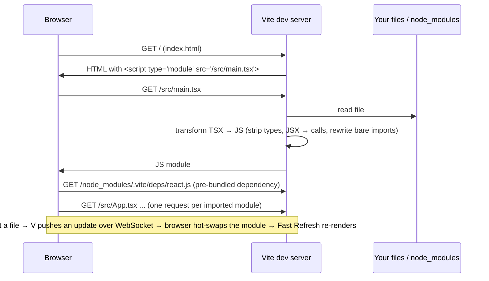
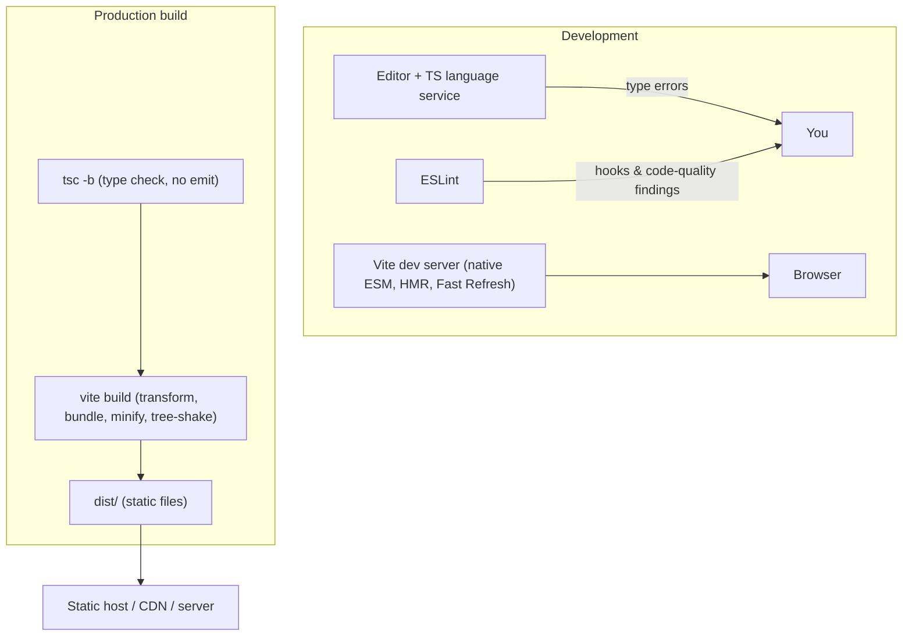

# 01 / 19 — Project Setup: Vite, TypeScript, ESLint

## 1. Lesson metadata

| | |
|---|---|
| **Level** | Beginner |
| **Study time** | 3–4 hours (reading 1 h, hands-on setup and tour 1.5 h, exercises 1 h) |
| **Prerequisites** | [Foundations 20 — Transpilers, bundlers, dev server, source maps](../00-web-and-javascript-foundations/20-tooling-transpilation-and-bundling.md), [Foundations 10 — ES modules and dependency graphs](../00-web-and-javascript-foundations/10-modules-and-dependency-graphs.md), [Foundations 18 — TypeScript fundamentals](../00-web-and-javascript-foundations/18-typescript-fundamentals-and-narrowing.md), [05 — JSX explained](./05-jsx-explained.md) |
| **Next** | [20 — Phase 1 assessment](./20-phase-assessment.md) |
| **Related later** | [Phase 8 / 02 — Unit testing with Vitest](../08-testing-and-quality/02-unit-testing-with-vitest.md), [Phase 8 / 14 — Linting and static analysis](../08-testing-and-quality/14-linting-and-static-analysis.md), [Phase 10 / 03 — Environment configuration](../10-production-engineering/03-environment-configuration.md) |

**Learning objectives.** After this lesson you can:
1. Scaffold a React + TypeScript project with Vite and explain every generated file's job.
2. Explain what the dev server does, what `vite build` does, and why `tsc` and Vite are *both* needed.
3. Read and adjust `tsconfig` settings that matter for React (`jsx`, `strict`, module resolution) and explain what the template's split config files are for.
4. Run ESLint with TypeScript and React Hooks rules and interpret its output as design feedback.
5. Use environment variables correctly (and know why they are not secrets).
6. Type common React code: props, `children`, state, events, refs (usage level).
7. Diagnose the common first-hour failures: blank page, stale env var, type errors that Vite doesn't show, Fast Refresh surprises.

**Concepts covered:** Node and package manager prerequisites, `npm create vite`, template layout, `index.html` as entry, `main.tsx` and `createRoot`, `StrictMode`, `@vitejs/plugin-react`, dev server (native ESM, HMR, React Fast Refresh), production build, `preview`, `tsc -b` type checking, `tsconfig.app.json` vs `tsconfig.node.json`, ESLint flat config, `eslint-plugin-react-hooks`, `import.meta.env`, `VITE_` prefix, path aliases, scripts, and the "when not to use Vite" decision.

> Version-sensitive. Vite, its templates, `typescript-eslint`, and `eslint-plugin-react-hooks` all change frequently. Command names and the *shape* of the generated files here are stable; exact option values, plugin versions, and Node requirements are not. **After scaffolding, treat your generated files as the source of truth and compare with this lesson**, rather than copying config text from here. Check the current Vite docs (<https://vite.dev/guide/>) for the supported Node version and template options.

---

## 2. Deep conceptual explanation

### 2.1 What problem is this lesson solving?

Browsers can't run `.tsx` files. They don't understand JSX or TypeScript, they don't resolve bare imports like `import { useState } from "react"`, and they request a separate HTTP resource for each module. A React app therefore needs a **toolchain** that:

1. **Transforms** `.tsx` into plain JavaScript (JSX → `jsx()` calls, types stripped) ([Lesson 05](./05-jsx-explained.md)).
2. **Resolves** dependencies from `node_modules`.
3. **Serves** modules quickly in development with live updates.
4. **Bundles/optimises** for production (minify, split, hash file names, tree-shake) ([Foundations 20](../00-web-and-javascript-foundations/20-tooling-transpilation-and-bundling.md)).
5. **Checks** types and style so mistakes surface before runtime.

You could assemble these yourself, but you shouldn't need to. Vite provides the dev server and build; TypeScript provides types; ESLint provides static rules.

### 2.2 The division of labour (the single most important idea)

| Tool | Does | Does *not* do |
|---|---|---|
| **Vite** (dev server + build) | Transforms TSX/TS quickly, **strips types**, serves modules, HMR, bundles for production | **Does not type-check** |
| **`tsc` (TypeScript compiler)** | Type-checks the whole project (`--noEmit` in this setup) | Does not produce your bundle (the template sets `noEmit`) |
| **ESLint** | Finds suspicious or non-idiomatic code: unused variables, hooks rule violations, missing dependencies | Does not check types in depth (unless configured with type-aware rules) or format code |
| **Prettier** (optional) | Formats code | Does not find bugs |
| **Node.js + npm** | Runs the tools and installs packages | Not shipped to the browser (in an SPA) |

Consequence: **a type error does not stop `npm run dev`**. The page runs; your editor and `npm run build` (which runs `tsc` first in the template) report the error. This surprises beginners who assume "it runs, so it's type-correct". Keep your editor's TypeScript service on and run the type check in CI.

### 2.3 Why Vite? (and what it replaced)

Historically, `create-react-app` (CRA, webpack-based) was the default. It is **deprecated** (React announced its sunset in early 2025 and recommends a framework or a modern build tool) and shouldn't be used for new projects. Vite's design:

- **Dev:** don't bundle. Serve source files as **native ES modules**; the browser requests each module; Vite transforms files on demand and caches them. Dependencies from `node_modules` are pre-bundled once (so hundreds of internal modules of a library become one request). Start-up time stays small as the app grows.
- **Build:** bundle for production using the bundler Vite currently ships (Rollup up to Vite 7; Rolldown from Vite 8, verified in the `vite@8` npm dependencies on 2026-10-22; an implementation detail that has changed before).
- **HMR (Hot Module Replacement):** when you edit a file, Vite sends the changed module to the browser, which swaps it without a full reload. With the React plugin, **React Fast Refresh** also preserves component state across edits when possible.

*Teaching model:* the dev server and the production build are **different pipelines** that should produce equivalent behaviour. Bugs that appear only in one (module-order issues, environment variables, CSS ordering, dev-only warnings) are real, which is why you run `npm run build && npm run preview` before shipping.

### 2.4 What the React plugin adds

`@vitejs/plugin-react` (historically Babel-based; v6+, used with Vite 8, uses Oxc and does not need Babel unless you opt in for the React Compiler) or the older `@vitejs/plugin-react-swc` provides:
- the JSX transform setup (the automatic runtime, so you don't `import React` just for JSX),
- React Fast Refresh in dev,
- optional Babel plugin hooks (e.g., for the React Compiler *a volatile topic: see [Phase 9 / 08](../09-advanced-rendering-and-ecosystem/08-react-compiler.md) (planned) and verify against current docs*).

Which one the template picks depends on Vite and template versions (verified 2026-10-22: `create-vite` 9.3.1's `react-ts` template uses `@vitejs/plugin-react` ^6 with Vite ^8); both are fine for this curriculum.

### 2.5 Alternatives at a glance (details in §7)

The React team's current guidance for **new production apps** is to start with a **framework** (Next.js, React Router in framework mode, Expo for native, etc.) that handles routing, data loading, and SSR. Vite + React is entirely legitimate for SPAs, internal tools, learning, libraries, and prototypes, and it's the baseline this curriculum uses for Phases 1–8. Phase 9 revisits frameworks.

### 2.6 Common misconceptions

| Misconception | Reality |
|---|---|
| "Vite checks my types." | It strips them. Run `tsc` (the template's `build` script does) or rely on the editor. |
| "ESLint errors are style opinions." | Rules like `react-hooks/rules-of-hooks` and `exhaustive-deps` catch real bugs. Treat violations as design feedback. |
| "`.env` values are secret." | Anything exposed to client code (`VITE_*`) is bundled into JavaScript the user can read. Never put secrets there. |
| "The dev server output is what I deploy." | You deploy the build output (`dist/`). Test it with `npm run preview`. |
| "`React.FC` is required to type components." | Plain functions with a typed props parameter are the common modern style. |
| "I must `import React from 'react'` in every file." | Not with the automatic JSX runtime (the template config). |
| "Fast Refresh preserves *all* state." | It preserves state of function components when the edited module exports only components; it resets state in some cases and remounts class components. Effects re-run on edit. |
| "Vite is a framework." | It is a build tool and dev server. It doesn't impose routing, data fetching, or SSR. |

---

## 3. Internal mechanics

### 3.1 What happens when you run `npm run dev` (teaching model)



*Public guarantee:* Vite's dev server serves modules on demand and supports HMR; the production build outputs static assets in `dist/`. *Implementation detail:* the transformer (esbuild, SWC, Oxc, etc.) and bundler (Rollup, Rolldown, etc.) used under the hood have changed across Vite versions and may differ in yours; your code shouldn't depend on which.

### 3.2 What `npm run build` does (as generated by the React-TS template)

The template script (typical; check yours) is:

```json
"build": "tsc -b && vite build"
```

1. `tsc -b` ("build mode") type-checks the projects referenced by `tsconfig.json` (the app config and the Node/tooling config) with `noEmit`. A type error fails the command; Vite never runs.
2. `vite build` bundles `index.html` and its module graph, minifies, hashes names (`assets/index-AbC123.js`), tree-shakes unused exports, and writes `dist/`.

`npm run preview` serves `dist/` locally to test the built output.

### 3.3 Why there are two tsconfig files

A typical template includes:

- `tsconfig.json`: a "solution" file with `references` to the other two, and `files: []` so it checks nothing itself.
- `tsconfig.app.json`: settings for code that runs **in the browser** (`src/`): `lib` includes `DOM`, `jsx: "react-jsx"`, strict options.
- `tsconfig.node.json`: settings for code that runs **in Node** (`vite.config.ts`): no DOM types, Node-flavoured.

Why: browser code and build-tool code have different globals. Mixing them in one config lets browser code accidentally use Node APIs (or vice versa) without a type error. *(The exact split has varied between template versions: older ones had a single `tsconfig.json` plus `tsconfig.node.json`. Read yours.)*

Key options you will see and what they mean *(names stable; defaults and exact sets vary by template)*:

| Option | Meaning |
|---|---|
| `"jsx": "react-jsx"` | Use the automatic runtime (`react/jsx-runtime`): no `React` import needed. |
| `"strict": true` | Enables the strict family (`strictNullChecks`, `noImplicitAny`, ...). Keep it on. |
| `"target"`, `"lib"` | Which JS syntax/APIs the *type checker* assumes. (Transpilation target for the bundle is separate in Vite's config.) |
| `"module": "ESNext"`, `"moduleResolution": "bundler"` | Resolution rules that match how bundlers resolve imports. |
| `"noEmit": true` | `tsc` only checks; Vite emits. |
| `"isolatedModules"` / `"verbatimModuleSyntax"` | Enforce file-by-file transpilation safety: type-only imports must be marked (`import type { X }`), since a per-file transformer like esbuild can't know whether an import is a type. |
| `"noUnusedLocals"`, `"noUnusedParameters"` | Treat unused names as errors (may be strict for early learning; adjust deliberately). |
| `"skipLibCheck"` | Skip checking `.d.ts` files in dependencies (speeds checking; reduces noise). |

### 3.4 The entry chain

```text
index.html  ──<script type="module" src="/src/main.tsx">──▶  src/main.tsx  ──▶  src/App.tsx  ──▶ your components
   │                                                              │
   └─ <div id="root"></div>   ◀──── createRoot(...).render(...) ──┘
```

`index.html` lives at the **project root** (not in `public/`) because in Vite it's the real entry point and is processed for asset URLs. `public/` holds static files copied as-is.

### 3.5 Environment variables

Vite loads `.env`, `.env.local`, `.env.[mode]` files. Variables **prefixed with `VITE_`** are exposed to client code as `import.meta.env.VITE_NAME` (strings). Others stay on the Node side. Built-ins include `import.meta.env.MODE`, `DEV`, `PROD`, `BASE_URL`.

- Values are **inlined at build time** into the bundle (for `VITE_` variables). Changing them requires a rebuild; a deployed bundle can't read a different environment without reconfiguration (a classic production surprise: "build once, deploy anywhere" requires runtime config, [Phase 10 / 03](../10-production-engineering/03-environment-configuration.md)).
- Editing `.env` requires **restarting the dev server**.
- TypeScript typing for them goes through `ImportMetaEnv` augmentation in `src/vite-env.d.ts` (or the template's equivalent).

### 3.6 Fast Refresh, in one paragraph

When you save a component file, Fast Refresh re-evaluates that module and re-renders affected components while *preserving state of function components* (hooks keep their values) if the file only exports components. If a file also exports non-components (constants, helpers), edits to it can force a full module update that resets state in importing components, which is why the template's lint config includes `react-refresh/only-export-components` as a warning. **Effects re-run** on Fast Refresh edits, even with empty deps *(in dev, to keep effects consistent with edited code)*; class components always remount. These are development conveniences, not production behaviours.

---

## 4. Step-by-step execution walkthrough

Goal: from nothing to a typed React component running with lint and type checking.

**Prerequisites:** a supported Node.js LTS (Vite documents a minimum; check <https://vite.dev/guide/> and `node -v`), plus npm (bundled with Node), pnpm, or yarn. Examples use npm.

1. **Scaffold.**
```bash
npm create vite@latest hello-react -- --template react-ts
cd hello-react
npm install
```
`npm create vite@latest` runs the Vite scaffolder (`create-vite`); `--template react-ts` selects React + TypeScript. (Without flags the scaffolder prompts interactively for framework/variant; choose React + TypeScript. Prompts vary by version. `create-vite` 9.x requires Node `^20.19.0 || >=22.12.0`.)

2. **Inspect the result.**
```text
hello-react/
├─ index.html
├─ package.json
├─ package-lock.json
├─ vite.config.ts
├─ tsconfig.json
├─ tsconfig.app.json
├─ tsconfig.node.json
├─ eslint.config.js   (older templates; create-vite 9.x generates .oxlintrc.json instead)
├─ public/
│  └─ vite.svg        (create-vite 9.x: favicon.svg, icons.svg)
└─ src/
   ├─ main.tsx
   ├─ App.tsx
   ├─ App.css
   ├─ index.css
   ├─ vite-env.d.ts   (older templates; newer ones use "types": ["vite/client"] in tsconfig.app.json)
   └─ assets/
```
Your file list may differ by version; that's fine. (Generated with `create-vite` 9.3.1 on 2026-10-22: `react-ts` produced `.oxlintrc.json`, no `eslint.config.js`, `"lint": "oxlint"`, TypeScript ~6.0, `target: es2023`, `erasableSyntaxOnly`, `verbatimModuleSyntax`.)

3. **Read `package.json` scripts.** Typically:
```jsonc
{
  "scripts": {
    "dev": "vite",
    "build": "tsc -b && vite build",
    "lint": "eslint .",      // create-vite 9.x: "oxlint"
    "preview": "vite preview"
  }
}
```
4. **Run the dev server:** `npm run dev`. Open the printed local URL (default port 5173; Vite picks the next free port if busy). Edit text in `src/App.tsx` and save; the browser updates without reload.

5. **Read `src/main.tsx`:**
```tsx
import { StrictMode } from "react";
import { createRoot } from "react-dom/client";
import "./index.css";
import App from "./App.tsx";

createRoot(document.getElementById("root")!).render(
  <StrictMode>
    <App />
  </StrictMode>,
);
```
Line notes: `createRoot` is the React 18+/19 root API (not legacy `ReactDOM.render`); the `!` is a TypeScript non-null assertion: you promise `#root` exists in `index.html` (if it doesn't, you get a runtime error, see §10); `StrictMode` enables development-only checks ([Lesson 17](./17-lifecycle-concepts.md)); the `.tsx` extension in the import is allowed by the template's `allowImportingTsExtensions` *(version-dependent; extensionless imports also work)*.

6. **Replace `src/App.tsx`** with a typed example (see §5.1), save, and watch HMR.

7. **Introduce a type error** deliberately: pass `count="3"` to a prop typed `number`. Observe: the browser still renders (Vite doesn't check types); your editor underlines the error; `npx tsc -b` (or `npm run build`) fails with the error message.

8. **Run lint:** `npm run lint`. Add a deliberately wrong hook usage (call `useState` inside an `if`), run lint, and read the `react-hooks/rules-of-hooks` error.

9. **Build and preview:**
```bash
npm run build      # type-check + bundle → dist/
npm run preview    # serve dist/ locally
```
Open the previewed URL. Check the Network tab: a handful of hashed files, minified. Compare size and behaviour with dev. Open [React DevTools](./18-react-devtools.md): component names may be minified; no Strict Mode double effects (production).

10. **Commit** with a `.gitignore` that excludes `node_modules/` and `dist/` (the template provides one). Commit the lockfile (`package-lock.json`) for reproducible installs.

---

## 5. Code examples

### 5.1 Minimal example: a typed component with props, state, and events

```tsx
// src/App.tsx
import { useState, type ChangeEvent, type ReactNode } from "react";

type CounterProps = {
  label: string;
  initial?: number;
  step?: number;
  children?: ReactNode;
};

function Counter({ label, initial = 0, step = 1, children }: CounterProps) {
  const [count, setCount] = useState<number>(initial);
  return (
    <section aria-label={label}>
      <h2>{label}: {count}</h2>
      <button type="button" onClick={() => setCount(c => c + step)}>+{step}</button>
      {children}
    </section>
  );
}

export default function App() {
  const [name, setName] = useState("");

  function handleChange(e: ChangeEvent<HTMLInputElement>) {
    setName(e.target.value);
  }

  return (
    <main>
      <h1>Hello{name ? `, ${name}` : ""}!</h1>
      <label>
        Your name <input value={name} onChange={handleChange} />
      </label>
      <Counter label="Clicks" step={2}>
        <p>Step is 2.</p>
      </Counter>
    </main>
  );
}
```

**Predict:** if you change `step={2}` to `step="2"`, what happens (a) in the browser at runtime, (b) in the editor, (c) at `npm run build`?

**Result:** (a) The page still runs (Vite doesn't type-check): `c + "2"` does string concatenation, so clicks produce `0` → `"02"` → `"022"`, a classic JS coercion bug ([Foundations 18](../00-web-and-javascript-foundations/18-typescript-fundamentals-and-narrowing.md)). (b) The editor shows a type error ("Type 'string' is not assignable to type 'number'"). (c) `tsc -b` fails, so the build stops.
**Why:** types exist only at compile time; the JavaScript runtime sees a string. The check is the only guard.

Typing notes:
- Props typed by an inline `type` alias; destructured with defaults (the idiom replacing `defaultProps`, which is legacy for function components).
- `children?: ReactNode` is the type for anything renderable ([Lesson 07](./07-composition-and-children.md)).
- Event types come from React (`ChangeEvent<HTMLInputElement>`); `e.target.value` is a `string`.
- `useState<number>(initial)`: the generic is optional when inferable; use it when the initial value doesn't convey the full type (e.g., `useState<User | null>(null)`).
- `type` modifier in `import { type ReactNode }` marks type-only imports, which matters for `verbatimModuleSyntax`/`isolatedModules`.

### 5.2 Practical example: environment variables with types

`.env`:
```text
VITE_API_BASE_URL=https://api.example.com
```

`src/vite-env.d.ts` (extend the generated declarations):
```ts
/// <reference types="vite/client" />

interface ImportMetaEnv {
  readonly VITE_API_BASE_URL: string;
}
interface ImportMeta {
  readonly env: ImportMetaEnv;
}
```

`src/config.ts`:
```ts
const raw = import.meta.env.VITE_API_BASE_URL;

if (!raw) {
  throw new Error("VITE_API_BASE_URL is not set. Add it to .env and restart the dev server.");
}

export const API_BASE_URL: string = raw.replace(/\/$/, "");
```

Line notes: fail **fast and loudly** at startup instead of getting `undefined` in a URL later; the value is public (bundled); `.env.local` (git-ignored) holds per-developer values; commit an `.env.example` listing names without values.

### 5.3 Incorrect examples (three common first-hour mistakes)

```tsx
// (1) Secret in client env: it ships to every user
// .env:  VITE_STRIPE_SECRET_KEY=sk_live_...
const key = import.meta.env.VITE_STRIPE_SECRET_KEY;   // WRONG: readable in the bundle
```

```tsx
// (2) Variable without the VITE_ prefix
// .env:  API_URL=https://api.example.com
fetch(import.meta.env.API_URL);   // undefined at runtime: not exposed to the client
```

```tsx
// (3) Importing React unnecessarily and typing with React.FC "because tutorials"
import React from "react";
const Card: React.FC<{ title: string }> = ({ title }) => <h2>{title}</h2>;
```
(3) isn't wrong at runtime but is outdated noise: no `React` import needed for JSX with the automatic runtime; a plain typed function is the common modern style. (React 18 removed implicit `children` from `React.FC`'s props, one of the reasons teams moved away from it.) Follow your team's convention.

### 5.4 Corrected implementations

(1) Keep secrets on a server; the browser calls *your* backend, which holds the key. Public keys (e.g., a publishable key) may use `VITE_`. (2) Rename to `VITE_API_URL` and **restart** the dev server. (3) `function Card({ title }: { title: string }) { return <h2>{title}</h2>; }`.

### 5.5 Advanced example: ESLint flat config and path alias

Illustrative `eslint.config.js` in the shape of the earlier (2025) templates. Note: the current `create-vite` `react-ts` template (9.x) ships Oxlint with `.oxlintrc.json` instead; ESLint with typescript-eslint remains a very common choice and is what this section teaches. Your generated file is authoritative:

```js
import js from "@eslint/js";
import globals from "globals";
import reactHooks from "eslint-plugin-react-hooks";
import reactRefresh from "eslint-plugin-react-refresh";
import tseslint from "typescript-eslint";
import { defineConfig, globalIgnores } from "eslint/config";

export default defineConfig([
  globalIgnores(["dist"]),
  {
    files: ["**/*.{ts,tsx}"],
    extends: [
      js.configs.recommended,
      tseslint.configs.recommended,
      reactHooks.configs.flat.recommended,
      reactRefresh.configs.vite,
    ],
    languageOptions: {
      ecmaVersion: 2022,
      globals: globals.browser,
    },
  },
]);
```

What each piece does:
- **Flat config** (`eslint.config.js`) is the current ESLint config format; the older `.eslintrc.*` is legacy.
- `js.configs.recommended`: core JavaScript rules (no undefined variables, etc.).
- `tseslint.configs.recommended`: TypeScript-aware rule set (no unused vars with TS semantics, no `any` abuse warnings...). *Type-aware* rules (using the type checker; slower, stricter) are an opt-in config (`recommendedTypeChecked`), valuable on mature codebases ([Phase 8 / 14](../08-testing-and-quality/14-linting-and-static-analysis.md)).
- `eslint-plugin-react-hooks`: `rules-of-hooks` (error) and `exhaustive-deps` (warning). Since v6/v7 the plugin also ships React Compiler-based rules; use `reactHooks.configs.flat.recommended` (README, v7.1) for the stable set and `flat['recommended-latest']` for experimental rules.
- `eslint-plugin-react-refresh`: warns when a file mixes component and non-component exports, which degrades Fast Refresh.

Path alias (optional) in `vite.config.ts` and `tsconfig.app.json`:

```ts
// vite.config.ts
import { defineConfig } from "vite";
import react from "@vitejs/plugin-react";
import { fileURLToPath, URL } from "node:url";

export default defineConfig({
  plugins: [react()],
  resolve: {
    alias: { "@": fileURLToPath(new URL("./src", import.meta.url)) },
  },
});
```
```jsonc
// tsconfig.app.json  (inside "compilerOptions")
{
  "baseUrl": ".",          // required for "paths" in older TypeScript setups; check TS version notes
  "paths": { "@/*": ["src/*"] }
}
```
Both are needed: Vite's alias makes the *bundler* resolve `@/`; `paths` makes the *type checker and editor* understand it. Forgetting one produces "works in the app but red squiggles" or the reverse. Aliases are a convenience, not an architecture; deep relative imports (`../../../`) often signal a folder-structure problem ([Phase 4 / 06](../04-react-architecture/06-feature-vs-layer-structure.md)).

---

## 6. Visual explanations

### Toolchain map



### Project anatomy

```text
index.html              ← the real entry (processed by Vite)
 └─ src/main.tsx        ← createRoot(...).render(<StrictMode><App/></StrictMode>)
     └─ src/App.tsx     ← your root component
public/                 ← copied unchanged to dist/ (favicon, robots.txt)
vite.config.ts          ← plugins, aliases, dev-server proxy (runs in Node)
tsconfig*.json          ← type-checking settings (app vs node)
eslint.config.js        ← lint rules
.env, .env.local        ← environment variables (VITE_* exposed to the browser)
```

### Where errors show up

| Error kind | Editor | `npm run dev` | `npm run lint` | `npm run build` | Browser runtime |
|---|---|---|---|---|---|
| Type error | Yes | **No** | No (unless type-aware rules) | **Yes** (`tsc -b`) | Maybe (wrong behaviour) |
| Syntax error | Yes | Yes (overlay) | Yes | Yes | n/a |
| Hooks rule violation | Yes (with plugin) | No | **Yes** | Not by default | Often crashes or misbehaves |
| Missing import / typo in path | Yes | Yes (overlay) | Maybe | Yes | n/a |
| Missing env var | No | No | No | No | **Yes** (undefined) |

---

## 7. Alternative approaches and trade-offs

Scenario: *starting a new React app.*

| Option | Readability / learning curve | Capabilities | Build/dev speed | Complexity | Prefer when |
|---|---|---|---|---|---|
| **Vite + React + TS** | Low, transparent | SPA, libraries, prototypes; you choose routing/data | Fast | Low–Medium (you assemble pieces) | Learning, SPAs, internal tools, component libraries |
| **Next.js (App Router)** | Medium–High | SSR, RSC, routing, data loading, image/font optimisation | Good | Medium–High | Public sites needing SEO/perf, full-stack in one repo |
| **React Router framework mode** / **TanStack Start** | Medium | Routing + loaders/actions, SSR options | Good | Medium | You want framework features with a different design philosophy |
| **Expo** | Medium | React Native | n/a | Medium | Mobile apps |
| **Create React App** | n/a | Deprecated | Slow | n/a | **Do not use** for new projects; migrate existing ones |
| **Parcel / Rsbuild / webpack custom** | Varies | Flexible | Varies | Medium–High | Existing constraints, monorepo conventions, advanced bundling needs |
| **No build tool (ESM + CDN + `htm`/`React.createElement`)** | Low | Tiny demos | n/a | Low | Teaching how JSX works; not production |

**When the recommended default (Vite for this course) is *not* best:**
- A public marketing/e-commerce site where SEO and time-to-content matter: a framework with SSR/SSG will likely outperform a client-rendered SPA on first load ([Phase 9 / 01](../09-advanced-rendering-and-ecosystem/01-spa-ssr-ssg-streaming.md)).
- A team that needs conventions, routing, data patterns, and deployment guidance out of the box.
- A monorepo where an existing build system (Nx, Turborepo with its own conventions) already dictates tooling.

Package manager choices (npm, pnpm, yarn, bun): all work. npm is the default and requires no install; pnpm saves disk space and enforces stricter dependency boundaries. Pick one per repo and commit its lockfile.

---

## 8. Best practices and anti-patterns

**Do**
- Keep `strict: true`; fix type errors rather than casting.
- Run `tsc` in CI (and `npm run build` locally before merging) because dev won't report type errors.
- Keep lint on in the editor and in CI; treat `exhaustive-deps` warnings as design feedback ([Lesson 17](./17-lifecycle-concepts.md)).
- Commit the lockfile; pin Node via `.nvmrc` or `engines` for reproducibility.
- Use `npm run build && npm run preview` to check production behaviour before deploying.
- Keep `src/` organised from the start (components, hooks, lib/api); don't let `App.tsx` become the whole app.
- Use `import type` / `type` modifiers for type-only imports.

**Beginner mistakes**
- Ignoring red squiggles because "it still runs".
- Editing `.env` without restarting the dev server.
- Putting secrets in `VITE_` variables.
- Importing from `"../../../../utils"` chains instead of fixing the structure.
- Installing packages globally rather than per project.

**Experienced-developer mistakes**
- Disabling lint rules wholesale instead of fixing causes.
- Divergent dev/prod behaviour never tested until release (CSS order, env, base path).
- Treating Vite aliases as free: forgetting the tsconfig `paths` counterpart, or aliasing so heavily that code becomes un-greppable.
- Over-configuring early (custom Babel plugins, many Vite plugins) before the need is proven.
- Letting dependency versions float (`^`) without a lockfile policy or automated updates ([Phase 10 / 07](../10-production-engineering/07-dependency-security.md)).

**Smells**
- `// @ts-ignore` / `any` sprinkled to silence errors.
- A `vite.config.ts` with dozens of plugins nobody can explain.
- `console.log(import.meta.env)` committed.

**Justified exceptions**
- Loosening `noUnusedLocals` while prototyping (reinstate before merging).
- Using `any` at a *boundary* with untyped data, immediately validated/narrowed (e.g., parse JSON with a schema validator) ([Foundations 19](../00-web-and-javascript-foundations/19-typescript-generics-and-utility-types.md)).

---

## 9. Real-world application

**Internal tooling at a logistics/finance company.** An SPA behind SSO, no SEO needs. Vite + React + TS ships quickly; `npm run build` in CI produces static assets served from object storage + CDN. Constraints: a CSP forbidding inline scripts (Vite's production output works with `script-src 'self'`, but dev features (HMR) need relaxed policy only locally) ([Phase 10 / 06](../10-production-engineering/06-security-xss-csrf-csp.md)); runtime config because the same artifact is promoted dev → staging → prod (avoid baking environment-specific URLs at build time: fetch a `/config.json` at startup or inject at deploy).

**Multi-team monorepo.** Several apps share a design system. Each app has its own Vite config; the shared package is built or consumed via workspace references. Constraint: **duplicate React copies** cause "Invalid hook call"; configure `resolve.dedupe: ["react", "react-dom"]` or use workspace hoisting (Phase 4 / 22).

**E-commerce prototype for A/B testing.** Vite for the experiment shell with proxying to a staging API via `server.proxy` (avoids CORS in dev; not a production solution, which needs real CORS headers or same-origin routing) ([Foundations 14–15](../00-web-and-javascript-foundations/15-http-caching-and-navigation.md)).

**Compliance-sensitive apps (auth, payments).** Source maps and environment values are reviewed: no secrets in the bundle, source maps either private or uploaded to monitoring only, SRI/CSP considerations, dependency audits.

**Onboarding.** A clean `README` with `node -v`, `npm ci`, `npm run dev`, `npm run lint`, `npm run build` lets a new teammate be productive in minutes. Pin versions; automate checks with a pre-commit hook or CI.

---

## 10. Debugging and troubleshooting

**Blank page, no errors.** Check the browser console and Network. Common causes: `getElementById("root")` returns `null` (typo or missing `<div id="root">` in `index.html`; with the `!` assertion TypeScript won't warn). Fix the id. If the Console shows `Uncaught TypeError: Cannot read properties of null (reading 'render')`, that's the cause.

**Terminal shows a Vite error overlay about a missing import.** Check the spelling, file extension, case sensitivity (macOS is case-insensitive by default, Linux CI is not: `import "./app"` vs `App.tsx` works locally and fails in CI), and that the package is installed.

**`Failed to resolve import "x"` or `Cannot find module 'react'` in the editor.** `npm install` hasn't run, the editor's TS server uses a different workspace root, or `@types/react` is missing. Restart the TS server; check `node_modules`.

**TS error in the editor but the app works.** Expected: Vite doesn't type-check. Fix the type error; run `npx tsc -b`.

**`import.meta.env.VITE_X` is `undefined`.** Missing `VITE_` prefix; `.env` in the wrong directory (must be at the project root, alongside `package.json`, unless `envDir` is configured); dev server not restarted; for production, the variable wasn't available at *build* time.

**"Invalid hook call" error.** Usually two React copies (monorepo/linked packages), mismatched `react`/`react-dom` versions, or hooks called outside a component/custom hook. Check `npm ls react react-dom`.

**Fast Refresh warning: "Fast refresh only works when a file only exports components."** Move non-component exports (constants, helpers) to another file; otherwise edits to that file reset state of importing components during development.

**Dev works, production build breaks.** Run `npm run build && npm run preview`. Check: hard-coded base path (`base` config for sub-path deploys), case-sensitive imports, dev-only code paths (`import.meta.env.DEV`), environment variables, CSS ordering, dynamic imports with variable paths.

**Slow dev server start / HMR lag.** Large dependency graph, barrel files (`index.ts` re-exporting hundreds of modules), or a CPU-heavy plugin. Use the dev server's logs; consider direct imports instead of barrels.

**Validation habit:** after any fix, re-run the failing command (`npm run lint`, `npm run build`) rather than trusting the editor alone.

---

## 11. Exercises

### Level A — Knowledge
A1. Why doesn't `npm run dev` report TypeScript type errors? Where *are* they reported?
A2. What is the role of `index.html` in a Vite app?
A3. What is the difference between `public/` and `src/assets/`?
A4. Why does the template have both `tsconfig.app.json` and `tsconfig.node.json`?
A5. Which environment variables are exposed to browser code, and why is that not a place for secrets?
A6. What does the automatic JSX runtime (`"jsx": "react-jsx"`) allow you to omit?

### Level B — Code comprehension
B1. In what order do the files execute at startup: `index.html`, `main.tsx`, `App.tsx`, `index.css`? Describe the chain.
B2. Given `import type { User } from "./types"`, what exists in the emitted JavaScript for that line, and why does the distinction matter for a per-file transformer?
B3. A teammate's `useEffect` appears to run twice in development but once after `npm run build && npm run preview`. Explain precisely.
B4. `eslint-plugin-react-hooks` reports: "React Hook useEffect has a missing dependency: 'userId'". Explain what bug class this warns about.

### Level C — Implementation
C1. Scaffold a project and add a `Greeting` component with typed props `{ name: string; excited?: boolean }`; render it from `App`. Write the commands and the file.
C2. Add `VITE_APP_TITLE` to your project, type it in `vite-env.d.ts`, and set `document.title` from it in `main.tsx`.
C3. Add an `@` alias for `src` end-to-end (Vite and TypeScript), and refactor one relative import to use it.
C4. Write a typed `useLocalStorageState<T>(key: string, initial: T)` hook that reads/writes JSON safely. Note any runtime pitfalls.

### Level D — Debugging
D1. `npm run dev` shows a white page. The Console says `Cannot read properties of null (reading 'render')`. Diagnose and fix.
D2. The build fails in CI with `Could not resolve "./components/button"` but works on your Mac; the file is `Button.tsx`. Why?
D3. After renaming `.env` variable `VITE_API_URL` to `API_URL` the app calls `undefined/users`. Why? Fix and explain the rule.
D4. You get "Invalid hook call" after linking a local component library into your app. List three checks.

### Level E — Architecture and engineering decisions
E1. Your team of 6 will build a customer-facing marketing site with a small interactive configurator. Evaluate Vite SPA vs a framework with SSR/SSG. Recommend one with criteria.
E2. Decide how to handle environment configuration for an app promoted unchanged from staging to production (same build artifact). Discuss build-time vs runtime config.
E3. Argue for or against enabling type-aware ESLint rules from day one on a new codebase.

### Level F — Expert challenge
F1. Design a CI pipeline (stages and commands) for this project that catches type errors, lint violations, test failures, and a broken production build, with sensible caching. State what each stage would *miss*.
F2. A developer proposes replacing Vite with a custom webpack config "for control". Build the decision framework: what evidence would justify it, and what would you measure before and after?

---

## 12. Detailed answers and explanations

> Attempt the exercises first.

**A1.** Vite transforms each file independently and strips types without checking them (checking requires whole-program analysis, which would slow the dev loop). Type errors appear in your **editor** (TypeScript language service), when you run `tsc` (`npx tsc -b`), and in `npm run build` (which runs `tsc -b` first), and in CI.

**A2.** It is the real entry point of the app: it contains `<div id="root">` and a `<script type="module" src="/src/main.tsx">`. Vite processes it (rewrites asset URLs, injects HMR in dev, includes hashed assets in build). It is not just a static file in `public/`.

**A3.** `public/` files are copied unchanged to the output and referenced by absolute URL (`/robots.txt`); no hashing or processing. Files imported from `src/assets/` go through the build: they get content-hashed names (good for long-term caching), may be inlined if small, and missing files cause build errors. Use `public/` for files that must keep their exact URL.

**A4.** Browser-side code (`src/`) uses DOM types and JSX; build-tool code (`vite.config.ts`) runs in Node and needs Node types without DOM. Separate configs prevent each from accidentally using the other's globals and let each have appropriate `lib`/`types`.

**A5.** Only those prefixed `VITE_` (via `import.meta.env`). They are replaced with literal values at build time and end up in JavaScript delivered to every visitor, so anyone can read them. Secrets (private API keys, DB passwords) belong on a server.

**A6.** The `import React from "react"` line that older JSX required for `React.createElement`. (The compiler imports from `react/jsx-runtime` automatically.) You still import hooks and types from `react`.

**B1.** The browser loads `index.html`; the `<script type="module" src="/src/main.tsx">` fetches `main.tsx`; its imports are resolved depth-first as modules are fetched and evaluated: `react` and `react-dom/client` first (dependencies), then `./index.css` (side-effect import that injects styles in dev), then `App.tsx` (and whatever it imports), and only after all imports are evaluated does the body of `main.tsx` run: `createRoot(...).render(...)`. ES modules evaluate dependencies before the importer ([Foundations 10](../00-web-and-javascript-foundations/10-modules-and-dependency-graphs.md)).

**B2.** Nothing: type-only imports are erased. A per-file transformer (esbuild/SWC/Babel) can't see whether `User` is a type or a value exported from another file, so without `import type` it might keep the import and fail at runtime if the target module doesn't export a value named `User`. With `verbatimModuleSyntax`/`isolatedModules`, TypeScript requires you to mark type-only imports so the transformer can safely erase them.

**B3.** `<StrictMode>` in `main.tsx` is active in development: it simulates unmount/remount on first mount so effects run setup → cleanup → setup. A production build doesn't include this behaviour, so the effect runs once. The effect should be resilient to the extra cycle; if the double run reveals a bug (a duplicate subscription), fix cleanup ([Lesson 17](./17-lifecycle-concepts.md)).

**B4.** Stale closure bugs: the effect uses `userId` but won't re-run when it changes, so it keeps working with the old value (e.g., fetching the wrong user). The rule asks you to declare dependencies so the effect re-synchronises. Resolve by adding the dependency, moving values inside the effect, or restructuring (not by suppressing the rule).

**C1.**
```bash
npm create vite@latest hello-react -- --template react-ts
cd hello-react && npm install
```
```tsx
// src/Greeting.tsx
type GreetingProps = { name: string; excited?: boolean };

export function Greeting({ name, excited = false }: GreetingProps) {
  return <p>Hello, {name}{excited ? "!" : "."}</p>;
}
```
```tsx
// src/App.tsx
import { Greeting } from "./Greeting";
export default function App() { return <Greeting name="Ada" excited />; }
```
Notes: a named export (not default) improves refactoring/grep; the file exports only a component, keeping Fast Refresh happy.

**C2.** `.env`: `VITE_APP_TITLE=Hello React`; in `vite-env.d.ts` add `readonly VITE_APP_TITLE: string;` to `ImportMetaEnv`; in `main.tsx` before rendering: `document.title = import.meta.env.VITE_APP_TITLE;`. Restart the dev server after editing `.env`. Edge: value is a build-time constant; changing it requires rebuilding for production.

**C3.** See §5.5: add `resolve.alias` in `vite.config.ts` and `paths` in `tsconfig.app.json`; then `import { Greeting } from "@/Greeting";`. Verify both: the app runs *and* `npx tsc -b` passes. If only the tsconfig is updated, the editor is happy but Vite fails to resolve; if only Vite is updated, the app runs but `tsc` fails. (Some setups use a plugin to sync `paths`; not required.)

**C4.**
```ts
import { useEffect, useState } from "react";

export function useLocalStorageState<T>(key: string, initial: T) {
  const [value, setValue] = useState<T>(() => {
    try {
      const raw = window.localStorage.getItem(key);
      return raw === null ? initial : (JSON.parse(raw) as T);
    } catch {
      return initial; // unavailable storage or invalid JSON
    }
  });

  useEffect(() => {
    try {
      window.localStorage.setItem(key, JSON.stringify(value));
    } catch {
      /* quota exceeded or storage disabled: ignore, state still works in memory */
    }
  }, [key, value]);

  return [value, setValue] as const;
}
```
Pitfalls: the `as T` cast trusts stored data, so for stored data from older app versions or tampering, validate with a schema; storage may throw (private mode, quota); `key` changes don't reload the value for the new key (state initialised once; reset with a `key` on the component, [Lesson 16](./16-state-preservation-and-reset.md)); multiple tabs don't sync without the `storage` event; SSR has no `window`; never store secrets or tokens in `localStorage` if XSS is a concern ([Phase 10 / 06](../10-production-engineering/06-security-xss-csrf-csp.md)). `as const` makes the return a tuple.

**D1.** `document.getElementById("root")` returned `null`: `index.html` lacks `<div id="root"></div>` or the id differs from the one in `main.tsx`. The non-null assertion `!` suppresses TypeScript's warning but cannot create the element. Fix the id/markup. (More defensive: check and throw a descriptive error.)

**D2.** macOS file systems are typically case-insensitive, so `./components/button` resolves to `Button.tsx` locally; Linux CI is case-sensitive, so it doesn't. Fix the import to match the file name exactly (and enable `forceConsistentCasingInFileNames` in TypeScript to catch it early).

**D3.** Only variables prefixed `VITE_` are exposed to client code; `API_URL` isn't, so `import.meta.env.API_URL` is `undefined`, and string concatenation produced `"undefined/users"`. Rename to `VITE_API_URL`, restart the dev server, and fail fast if missing (§5.2).

**D4.** (1) Multiple React copies: `npm ls react react-dom`; check that the library lists React as a `peerDependency` (not a bundled dependency) and that the app resolves a single copy (`resolve.dedupe` or linking behaviours with npm link/workspaces). (2) Version mismatch between `react` and `react-dom`. (3) The hook is called conditionally or outside a component: run ESLint `rules-of-hooks`.

**E1. Evaluation criteria:** SEO and first-load performance (public site) favour server rendering or static generation; marketing sites often update content (CMS) and benefit from SSG/ISR; the interactive configurator can be a client island. Team size and ops capability affect framework adoption. *Example answer:* "Use a framework with SSG/SSR (e.g., Next.js or similar) for content pages, because crawlability, LCP, and CMS integration are the main business goals; implement the configurator as a client component. Choose Vite SPA only if the site is behind login or SEO is irrelevant. Re-evaluate if hosting constraints prohibit a Node server (SSG/static export remains possible)."

**E2. Evaluation criteria:** immutable artifact principle; secrets vs configuration; cache correctness; operational complexity. *Example answer:* "Build once; keep environment-specific, non-secret configuration out of the bundle. Serve a `config.json` (or inline script injected by the server/CDN at deploy time) fetched at startup, typed and validated; keep build-time `VITE_` values for things identical in all environments (feature names, public keys that are the same). Secrets stay server-side. Trade-off: one extra request at startup (inline it to avoid), and the need to validate config." Build-time per environment is acceptable for small teams with per-environment builds, at the cost of non-promotable artifacts.

**E3. Evaluation criteria:** catching bugs vs lint time/complexity; team experience. Arguments for: catches floating promises, unsafe `any` use, misused async handlers. Against: slower lint, steeper learning, noisy for beginners, requires correct `tsconfig` setup. *Example answer:* "Start with the recommended non-type-aware set (fast feedback) and add type-aware rules for the subset with the highest bug yield (`no-floating-promises`, `no-misused-promises`) once the team is comfortable. In CI, run the full type-aware set; locally, run it on changed files."

**F1. Example pipeline.** Stages: (1) install with `npm ci` (cache `~/.npm` keyed by lockfile hash); (2) `tsc -b` type-check; (3) `eslint .` (`--max-warnings 0` if the team treats warnings as failures); (4) unit/component tests (Vitest) with coverage thresholds if desired; (5) `vite build`; (6) optionally `vite preview` + Playwright smoke test; (7) bundle-size check. Each stage's blind spots: type check: no runtime validation of API data; lint: logic bugs; unit tests: integration issues; build: not runtime behaviour; smoke test: breadth; size check: doesn't measure runtime performance. Cache `node_modules`/TS build info carefully (invalidate on lockfile change); run lint and type-check in parallel to cut time; fail fast ordering by cost.

**F2. Evaluation criteria:** concrete requirements Vite can't meet (e.g., unusual module federation setup, legacy loaders), measured pain (build time, dev start time, bundle size), maintenance cost of owning config, upgrade burden, team expertise, and an exit plan. Measure: cold start and HMR latency, production build time, bundle sizes and Web Vitals before/after, config line count and time-to-onboard. Without evidence that a specific requirement is unmet, the decision is mostly about preference and carries ownership cost. *Example answer:* "Require a written requirement list with a failing spike in Vite first; a webpack config adopted for control but not for a measurable need typically costs more maintenance than it returns."

---

## 13. Senior engineer interview questions

**Q1. "Vite dev runs fine but the build fails with type errors. Why?"**
*Strong answer:* Dev strips types per file without checking; the build's `tsc -b` type-checks the whole program. The fix is in the types (or tsconfig), and the process fix is to run type checking continuously via the editor and in CI so the build is never the first place errors appear.

**Q2. "Why is Vite fast in development?"**
*Strong answer:* It avoids bundling the app: the browser's native ES module loader requests modules, Vite transforms them on demand and caches, and dependencies are pre-bundled once. Only changed modules are invalidated on edit (HMR), so cost scales with change size rather than app size. Production still bundles for network efficiency, so dev and prod pipelines differ and both need testing.

**Q3. "What's the risk of `VITE_` variables?"**
*Strong answer:* They are public and inlined at build time. Risks: leaking secrets; building environment-specific artifacts that can't be promoted unchanged; stale values after changing `.env` without restart/rebuild. Mitigation: secrets server-side, runtime config for per-environment values, validated config module.

**Q4. "When would you not choose Vite for a new React app?"**
*Strong answer:* When SSR/SSG, SEO, streaming, or server components are central, a framework gives routing, data loading, and rendering strategies integrated and supported. Also when organisational standards dictate another toolchain. Vite is excellent for SPAs, tools behind auth, and libraries/prototypes.

**Q5. "How do you stop hook-related bugs from reaching production?"**
*Strong answer:* Enforce `eslint-plugin-react-hooks` rules in CI as errors for `rules-of-hooks` and as failing warnings for `exhaustive-deps` with a justified-exception process; test under Strict Mode; write tests that simulate prop changes and unmounts; code review attention to effects; prefer designs that need fewer effects ([Phase 3 / 07](../03-react-state-and-hooks/07-you-might-not-need-an-effect.md)).

**Q6. "What belongs in `public/` vs imported assets?"**
*Strong answer:* `public/` is for files that must keep a fixed URL and no processing (robots.txt, favicons referenced by external systems). Imported assets benefit from hashing (long-lived cache with immutable filenames), build-time validation, optimisation, and inlining. Prefer imports unless you need the stable URL.

---

## 14. Further learning resources

| Resource | URL | Covers / why | Level | Study |
|---|---|---|---|---|
| Vite — Getting Started | <https://vite.dev/guide/> | Scaffolding, supported Node versions, templates, commands | Beginner | "Getting Started", "Scaffolding" |
| Vite — Features | <https://vite.dev/guide/features.html> | TypeScript behaviour (no type-check), JSX, CSS, static assets, HMR | Beginner–Int. | TypeScript, JSX, Static assets |
| Vite — Env variables and modes | <https://vite.dev/guide/env-and-mode.html> | `VITE_` prefix, `.env` files, TypeScript IntelliSense for env | Beginner | Whole page |
| Vite — Building for production / Static deploy | <https://vite.dev/guide/build.html> | `build`, `preview`, `base` | Intermediate | Build + Deploy guides |
| React docs: Start a New React Project | <https://react.dev/learn/start-a-new-react-project> | Official guidance on frameworks vs build tools (including Vite) | Beginner | Whole page |
| React docs: Build a React app from scratch | <https://react.dev/learn/build-a-react-app-from-scratch> | What a framework provides that a custom toolchain needs to replicate | Intermediate | Whole page |
| React docs: Editor setup / TypeScript | <https://react.dev/learn/typescript> | Typing props, hooks, events with React types | Beginner–Int. | All sections |
| TypeScript docs: tsconfig reference | <https://www.typescriptlang.org/tsconfig> | Every compiler option | Intermediate | Options named in §3.3 |
| typescript-eslint | <https://typescript-eslint.io/> | Getting started, configs, type-aware linting | Intermediate | "Getting Started", "Typed Linting" |
| ESLint — Configuration files (flat config) | <https://eslint.org/docs/latest/use/configure/configuration-files> | The current config format | Intermediate | Whole page |
| `eslint-plugin-react-hooks` | <https://www.npmjs.com/package/eslint-plugin-react-hooks> | Available rules and presets | Intermediate | README |
| React docs: `<StrictMode>` | <https://react.dev/reference/react/StrictMode> | Dev-only checks you will see immediately | Beginner–Int. | Usage |
| Create React App deprecation notice | <https://react.dev/blog/2025/02/14/sunsetting-create-react-app> | Why CRA was sunset | Beginner | Whole post |

Links marked were not fetched; search the site for the quoted title if a link has moved.

---

## 15. Knowledge checkpoint

**You should now understand**
- The toolchain split: Vite transforms/serves/bundles; TypeScript checks; ESLint analyses; none of the others replaces type checking.
- Dev and production pipelines differ; verify with `build` + `preview`.
- What each generated file does and which config applies to browser vs Node code.
- `VITE_` variables are public build-time constants.

**You should be able to explain without notes**
- Why a type error doesn't break `npm run dev`.
- What `index.html`, `main.tsx`, and `createRoot` do in the startup chain.
- Why Strict Mode doubles effects in development only.

**You should be able to implement**
- A new Vite React-TS project with typed components, env variables, an alias, and a passing lint/type/build.

**You should be able to debug**
- Blank page (missing root), undefined env vars, case-sensitive import failures, "Invalid hook call", type errors invisible in dev.

**Before moving on:** have a working project open in your editor with DevTools installed ([Lesson 18](./18-react-devtools.md)). Then take the [Phase 1 assessment](./20-phase-assessment.md); its implementation tasks are designed to be done in this project.
