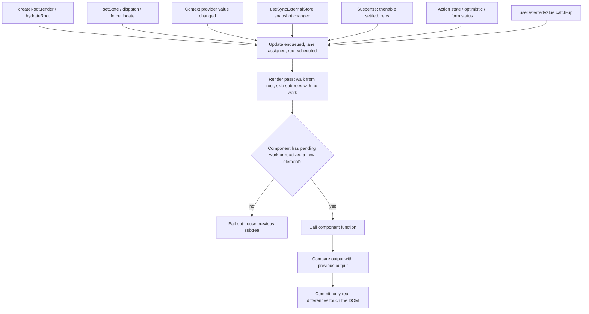
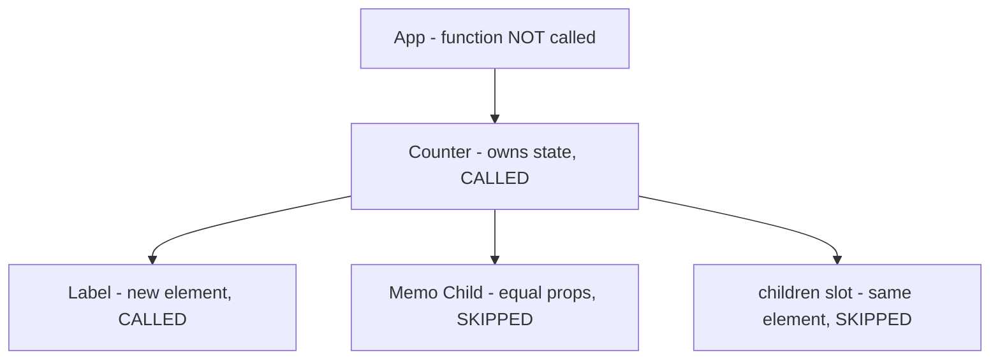

# 02 / 01 — What Actually Triggers a Render

## 1. Lesson metadata

| | |
|---|---|
| **Level** | Intermediate |
| **Study time** | 4–5 hours (reading 2 h, experiments 1 h, exercises 1.5–2 h) |
| **Prerequisites** | [Phase 0 / 01 — How the browser works](../00-web-and-javascript-foundations/01-how-the-browser-works.md); [Phase 1 / 12 — Component purity](../01-react-fundamentals/12-component-purity.md), [13 — The rendering mental model](../01-react-fundamentals/13-rendering-mental-model.md), [14 — State as a snapshot](../01-react-fundamentals/14-state-as-a-snapshot.md), [15 — Update queues and batching (first look)](../01-react-fundamentals/15-update-queues-and-batching.md) |
| **Next** | [02 — Invocation vs render vs reconcile vs commit vs layout vs paint](./02-render-reconcile-commit-paint.md) |
| **Related later** | [03 — Initial mount and subsequent updates](./03-initial-mount-and-updates.md), [22 — Automatic batching](./22-automatic-batching.md), [23 — Transitions and deferred rendering](./23-transitions-and-deferred-rendering.md), [29 — Reasoning about unnecessary renders](./29-reasoning-about-unnecessary-renders.md), [Phase 3 / 01 — useState internals](../03-react-state-and-hooks/01-usestate-internals-and-update-semantics.md), [Phase 3 / 13 — useContext and propagation](../03-react-state-and-hooks/13-usecontext-and-propagation.md) |

**Learning objectives.** After this lesson you can:

1. List every mechanism that causes React to render a component, and name the few things that look like triggers but are not.
2. Explain why a parent re-render re-renders its children even when their props did not change, and exactly when React skips them.
3. Predict, before running, how many times a component function is called after a given interaction (including Strict Mode doubling).
4. Distinguish *scheduling* a render from *performing* it, and explain why `setState` never changes the variable in the current closure.
5. Explain the `Object.is` bail-out, the "one extra render" quirk, and why you must not depend on it.
6. Diagnose "why did this component render?" with the React DevTools Profiler.

**Concepts covered:** render trigger, initial render, state update, update queue, scheduling vs performing, parent-driven rendering, props identity bail-out, context propagation, external-store subscription, Suspense retry, transitions and deferred values, Actions, key-driven remount, Strict Mode, eager state bail-out, render-phase updates, `flushSync`.

---

## 2. Deep conceptual explanation

### 2.1 What problem is this lesson solving?

Most "React performance" and "React bug" questions come down to one of two questions:

- *Why did this component render when I expected it not to?*
- *Why did this component **not** render when I expected it to?*

Both are answered by one precise model of **what causes React to call your component function again**. Without that model, developers adopt superstition: "props changed, so it re-rendered," "I used `memo`, so it won't," "I changed the object, so React should notice." Each is wrong in a way that wastes hours. This lesson replaces superstition with a closed list.

A second reason: in later lessons ([02](./02-render-reconcile-commit-paint.md), [11](./11-render-phase-and-commit-phase.md)) we separate *render* from *commit* from *paint*. The word "render" is overloaded, and the first step is to say exactly what it means.

### 2.2 Definition: what "render" means in React

> **Public guarantee (documented):** *Rendering* is React calling your components to figure out what should be on the screen. It is not the same as updating the DOM, and it is not the same as painting. React's documentation frames the lifecycle as three steps: **trigger**, **render**, **commit**; after the commit, the *browser* paints.

In this lesson, **"a component renders"** means *React invokes that component's function* (for function components) during a render pass and uses the returned element tree. It does not imply that any DOM node was touched. A component can render and cause zero DOM mutations; that is the normal case for a re-render whose output is unchanged.

### 2.3 Trigger = "something told React that a root has work to do"

A render is never started by "React noticing that data changed." React cannot observe your variables. A render begins only because **some React API call or host event told React that a root has pending work**. Every trigger below is such a call.

### 2.4 The complete list of triggers

| # | Trigger | What it re-renders (teaching model) | Notes |
|---|---|---|---|
| 1 | **Initial render**: `createRoot(el).render(<App />)` (or `hydrateRoot`) | The whole tree, from the root | Happens once per root unless you call `root.render` again. See [03](./03-initial-mount-and-updates.md). |
| 2 | **State update in a component**: a `useState` setter, a `useReducer` dispatch, class `setState`/`forceUpdate` | The component that owns the state, **and all of its descendants** by default | Skipped if the new state is `Object.is`-equal (with caveats, §3.5). |
| 3 | **Parent re-rendered** and produced a *new element* for this child | The child (and, recursively, its descendants) | Props do **not** have to differ. This is the single most misunderstood trigger. |
| 4 | **Context value changed** for a component that reads that context (`use(Context)` / `useContext`) | Every consumer of that context under the provider, **even through `memo`** | Consumers re-render even if an ancestor between them and the provider bailed out. See [Phase 3 / 13](../03-react-state-and-hooks/13-usecontext-and-propagation.md). |
| 5 | **External store changed** (`useSyncExternalStore` snapshot differs) | Components that subscribed | Updates caused by it are synchronous (always `SyncLane`; they opt out of time-slicing; checked in `forceStoreRerender` in `ReactFiberHooks`). See [Phase 3 / 20](../03-react-state-and-hooks/20-usesyncexternalstore-and-external-stores.md). |
| 6 | **Suspense retry**: a thenable that a component suspended on settles | The suspended boundary's contents are retried | See [24](./24-suspense-conceptual-internals.md). |
| 7 | **Deferred value caught up**: `useDeferredValue(value)` | A *second*, lower-priority render with the new value after the urgent render with the old value | See [23](./23-transitions-and-deferred-rendering.md). |
| 8 | **Transition**: updates wrapped in `startTransition` / `useTransition` | Same as #2 but scheduled as non-urgent | See [23](./23-transitions-and-deferred-rendering.md). |
| 9 | **Actions**: `useActionState` dispatch, `<form action>` submission, `useOptimistic` setter, pending state from `useFormStatus` | Components owning or reading that action state | They are state updates in disguise (React 19). |
| 10 | **Key change** on an element | The component with the new key mounts from scratch (an *initial render of that subtree*); the old instance unmounts | See [07](./07-identity-keys-and-reconciliation.md). |
| 11 | **Dev-only**: Strict Mode double invocation, Fast Refresh (hot reload), DevTools "edit state/props" | The affected components | Never rely on these; they do not exist in production. |

Three observations about the table:

- Rows 2, 4, 5, 6, 9 all reduce to "an update was enqueued for a particular fiber/hook, and React scheduled the root." Row 3 is *not* an enqueued update at all; it is a consequence of an ancestor rendering. Row 1 is "an update enqueued for the root itself."
- **There is no row for "props changed."** Props are an *input* to a render, not a cause of one. A prop can only change because a parent rendered (row 3) or because the root was given new elements (row 1).
- **There is no row for "a variable changed."** Mutation of locals, module variables, objects in state, or `ref.current` triggers nothing.

### 2.5 Things that look like triggers but are not

| Looks like a trigger | Actually |
|---|---|
| Mutating a local variable or module-level variable | Nothing happens; React does not observe it. The value may show up *later* if something else triggers a render, causing "it updates only sometimes" bugs. |
| `ref.current = x` | Nothing. Refs are deliberately outside the render-trigger system ([Phase 3 / 10](../03-react-state-and-hooks/10-useref-and-mutable-references.md)). |
| Mutating state in place (`arr.push(x); setArr(arr)`) | The setter *is* called, but the new value is the same reference, so `Object.is` says "no change" and React bails out. |
| `setState` with an identical primitive (`setCount(count)`) | Bails out (§3.5). |
| `useEffect` running | Running an effect does not render. Only a `setState` *inside* the effect would. |
| `console.log`, timers, network responses | Nothing unless their callback calls a trigger API. |
| Props "changing" | Only a symptom of a parent having rendered. |
| DOM changes made outside React (`el.textContent = …`) | React does not notice; it may overwrite or desync later. |
| `React.memo` / `useMemo` "preventing" rendering | They don't stop the trigger; they let React **skip** work for a component whose inputs are equal. See [Phase 3 / 11–12](../03-react-state-and-hooks/11-usememo-and-usecallback.md). |

### 2.6 Scheduling a render vs performing a render

This is the central conceptual split:

```text
   trigger API call                      later (same task or next)
 ┌──────────────────────┐             ┌────────────────────────────────┐
 │ setCount(c + 1)      │  enqueue    │ React picks the pending work,  │
 │ (inside an onClick)  │ ─────────►  │ calls your components, diffs,  │
 │ returns immediately  │  + schedule │ commits                        │
 └──────────────────────┘             └────────────────────────────────┘
        SCHEDULING                              PERFORMING
```

- **Scheduling** is cheap and synchronous: put an update object in a queue attached to the hook, mark the owning component and its ancestors "has pending work," and ask the scheduler to process the root.
- **Performing** is when your component functions actually run.

Consequences that fall out immediately:

1. `setState` **does not change the variable in the current closure.** The function that called it is a snapshot of one render; the new value exists only in the *next* render ([Phase 1 / 14](../01-react-fundamentals/14-state-as-a-snapshot.md)).
2. **Several `setState` calls in one event produce one render** (batching; [22](./22-automatic-batching.md)). The renders you see are per *flush*, not per call.
3. The render may happen *after the current JavaScript task's synchronous code finishes*, so reading the DOM immediately after `setState` shows the old DOM. (`flushSync` is the explicit escape hatch; §5.5.)

### 2.7 Why parents re-render children: the design reason

React's contract is "UI = f(state)." For React to guarantee that the UI is consistent with state, it cannot assume that a child's output depends *only* on the props you passed. A child may read a module-level value, a context, a ref (which it should not during render), or call `Date.now()`. React cannot know. The *safe default* is therefore:

> When a component renders, React renders all of its children (recursively), unless it can *prove cheaply* that nothing the child depends on changed.

The cheap proof React uses by default is **referential**: if the element you returned for the child is *the very same object* as last time (same props object, same type), and there is no pending work on that subtree, React skips it. If you create `<Child />` freshly during the parent's render (JSX does this on every call), the element is a new object, so the proof fails, and the child renders. `React.memo` extends the proof with a shallow comparison of props. We examine this in §3.3 and in [29](./29-reasoning-about-unnecessary-renders.md).

### 2.8 Misconceptions

| Misconception | Reality |
|---|---|
| "A component re-renders when its props change." | It re-renders because its **parent rendered** (or its own state/context changed). Props are compared only in `memo`/bail-out checks. |
| "Re-rendering is expensive because it rebuilds the DOM." | Rendering does not rebuild the DOM. It runs functions and diffs. DOM mutation happens only for actual differences ([02](./02-render-reconcile-commit-paint.md)). |
| "`setState` is asynchronous." | It is a *synchronous call that enqueues*; the *effect* on rendered output is deferred. "Asynchronous" invites confusion with promises. |
| "`useState` setter re-renders immediately." | Never immediately inside an event handler; renders are flushed after the handler (batched). |
| "A child state update re-renders the parent." | No. React starts at the root internally but only *re-executes* components on the path with pending work and their descendants; the parent function is not called. |
| "`memo` makes a component never re-render." | A memoized component still re-renders when its own state or a consumed context changes. |
| "If the output is the same, nothing was wasted." | Render work (calling functions, diffing) was still done. Whether it matters is a measurement question. |

---

## 3. Internal mechanics

For each topic we mark: **[Public guarantee]** documented behavior you can rely on; **[Teaching model]** a simplification faithful enough for reasoning; **[Implementation detail]** accurate to current source in spirit but subject to change.

### 3.1 The update queue on a hook

**[Teaching model]** Each `useState`/`useReducer` hook has a queue of pending updates. `setCount(5)` or `setCount(c => c + 1)` appends an entry. During the next render of that component, React processes the queue in order against the previous state to produce the new state, and your component function receives the result from `useState`.

**[Public guarantee]** Functional updaters (`c => c + 1`) receive the latest queued state, so multiple calls compose; plain values replace. Updaters must be pure; in Strict Mode development React calls them twice to catch impurity.

**[Implementation detail]** `useState` is implemented as `useReducer` with a built-in basic reducer; the queue is a circular linked list on the hook object; each update carries a *lane* (priority). Verify in the source ([31 — Reading React's source code](./31-reading-react-source.md)); do not memorize names. Full treatment: [17 — How hooks attach to Fiber](./17-hooks-and-fiber-state.md) and [Phase 3 / 01](../03-react-state-and-hooks/01-usestate-internals-and-update-semantics.md).

### 3.2 Marking the path to the root

**[Teaching model]** Enqueuing an update marks the owning component (a *fiber*, see [09](./09-fiber-nodes-and-units-of-work.md)) as having pending work and marks each ancestor up to the root as "has a descendant with pending work." Then React asks its scheduler to process the root at the update's priority ([13](./13-scheduler-and-priorities.md), [14](./14-lanes.md)).

When the render pass begins, React walks down from the root. At each component, it asks: *does this subtree have any pending work, or has the element changed?* If no, it skips the whole subtree and reuses it. If yes, it descends or re-executes.

This is why a deep `setState` does not call the ancestors' functions: React passes through them without invoking them, because the ancestor fibers have no pending work *of their own*, only "work below."

### 3.3 The default skip check (the "bail-out")

**[Teaching model]** When React reaches a component fiber during a render pass, it will skip re-executing it if *all* of these hold:

1. The element's **props object is referentially identical** to the previous one (or `memo` says the props are shallowly equal).
2. The component has **no pending state/reducer update**.
3. No **context** the component consumes has changed.
4. (Legacy classes: `shouldComponentUpdate`/`PureComponent` did not say otherwise.)

If (1) fails because the parent produced a new element, the component renders. The props object is new on every parent render, even when each prop value is the same. That is *why* "same props" does not save you without `memo`.

**[Implementation detail]** Props identity is compared as `oldProps !== newProps`; "no pending work" is determined with the lanes bitmask on the fiber; context changes are propagated by walking the subtree under a provider and marking matching consumers. The details differ across versions; the rule of thumb above does not.

> **React Compiler (stable 1.0 since October 2025).** With the React Compiler enabled ([Phase 9 / 08](../09-advanced-rendering-and-ecosystem/08-react-compiler.md)), the compiler can memoize JSX and values inside a component automatically, so a parent re-render may skip children without hand-written `memo`. The *rules* in this lesson describe React's runtime; what the compiler changes is how often your code *creates new elements/objects*. See react.dev/learn/react-compiler for current adoption guidance.

### 3.4 Children passed as props: a bail-out by construction

```tsx
function App() {
  return (
    <Counter>
      <ExpensiveTree />
    </Counter>
  );
}
```

`<ExpensiveTree />` is created in `App`'s render. When `Counter` re-renders due to *its own state*, `App` did **not** re-render, so `props.children` is the same element object as before. React sees the same element reference → bails out for that subtree. This is a *consequence* of the identity rule, widely documented in React guidance as "passing JSX as `children`" and as lifting content up. It is the cheapest optimization React offers: zero `memo`, zero comparison cost.

### 3.5 The `Object.is` check and the "one extra render" quirk

**[Public guarantee]** From the `useState` reference: if the new state is identical to the current state as determined by `Object.is`, React skips re-rendering the component **and its children**. The docs add that, in some cases, React may still need to call your component before skipping the children, and that this should not matter to correct code.

**[Implementation detail]** When a fiber has no other pending work and the update queue is empty, React can compute the next state *eagerly* (inside the setter call) and, if equal, drop the update without scheduling anything. If the fiber *does* already have pending work (or a previous update left its alternate fiber marked), the eager path is unavailable; React schedules, renders the component, finds the state unchanged, and bails out without committing or rendering children. Observable result: a `console.log` in the component body can fire **once more** after a state change when you set the same value again, with no DOM change and no child renders. Consequence: **never** use render-count as a correctness signal and never put side effects in the render body.

### 3.6 Context propagation

**[Public guarantee]** All components that read a context re-render when the provider's `value` changes (compared with `Object.is`), regardless of intermediate `memo`.

**[Teaching model]** Providers do not "re-render consumers" by calling them from above; when the value changes React finds consumers beneath the provider and marks them as having pending work, then the normal render pass reaches them even through memoized ancestors (which themselves are skipped).

Note: a new object literal `value={{ user, setUser }}` is a *new value on every provider render* and thus re-renders all consumers each time. Details in [Phase 3 / 14](../03-react-state-and-hooks/14-context-performance.md).

### 3.7 External stores, Suspense, transitions

- **External stores.** `useSyncExternalStore(subscribe, getSnapshot)`: the store calls the subscription callback; React re-reads `getSnapshot()`, compares with `Object.is`, and schedules a **synchronous** render if different. React also re-checks the snapshot during rendering and at commit to avoid *tearing* (two components showing different versions of the store).
- **Suspense.** A component that reads an unresolved promise via `use(promise)` (or a Suspense-enabled library) suspends; React shows the fallback and, when the promise settles, **retries** the render. That retry is a trigger you did not write ([24](./24-suspense-conceptual-internals.md)).
- **Transitions / deferred values.** These do not change *whether* a render happens, but *when* and with what priority, and whether it may be interrupted or abandoned ([23](./23-transitions-and-deferred-rendering.md), [15](./15-interruptible-restartable-abandoned-rendering.md)). `useDeferredValue(v)` guarantees the old value is used for an urgent render and the new one later; a component using it can therefore render *twice* for one change.

### 3.8 Render-phase updates (setting state while rendering)

**[Public guarantee]** You may call the `set` function of **the same component's own state** during its render (the documented "storing information from previous renders" pattern), conditionally, to adjust state immediately; React will re-run that component right away *before* rendering children or committing, discarding the first output. Calling another component's setter during render is a bug and logs a warning. If you do it unconditionally you create an infinite loop ("Too many re-renders").

### 3.9 Strict Mode

**[Public guarantee]** In development, `<StrictMode>` renders every component twice per render pass (component body, `useState` initializers, `useMemo` factories, reducers, updater functions) to expose impure code; it also re-runs effects once on mount (mount → cleanup → mount) and, since React 19, ref callbacks. None of this happens in production. Since React 19 the second render reuses memoized results (`useMemo`, `useCallback`) from the first (verified by execution on 19.3.1, 2026-10-22: the `useMemo` factory ran twice in the first invocation and not in the second); how the duplicate `console.log` output is presented (shown, dimmed, or hidden) has varied across React/DevTools versions. Do not build tooling around either. Details: [28 — Strict Mode development behavior](./28-strict-mode-behavior.md).

---

## 4. Step-by-step execution walkthrough

Scenario: a user clicks a button whose handler calls `setCount(c => c + 1)` once. The tree is `App > Counter(state) > [Label, Child]`, no memo. Dev build *without* Strict Mode for clarity.

| Step | Time (conceptual) | Where | What happens | Rendered? | DOM effect |
|---|---|---|---|---|---|
| 1 | t0 | Browser | `click` event is dispatched to the React root's listener (React delegates events from the root container). | – | none |
| 2 | t0 | React event system | React determines the event's *priority* (discrete → urgent) and calls your `onClick`. | – | none |
| 3 | t0 | Your handler | `setCount(c => c + 1)` appends an update to the hook queue. The `count` variable in the handler closure is unchanged. The owner fiber and ancestors are marked with pending work; the root is scheduled. | **No** | none |
| 4 | t0 | React event system | Handler returns. React flushes the scheduled work for discrete events essentially immediately after the event handler returns (at the end of the event dispatch or in a microtask right after, depending on version), not on a later timer. | – | none |
| 5 | t0+ε | Render phase | React starts at the root. `App`: no pending work, props identical → **not called**; descends. `Counter`: has pending update → **called**; `useState` processes the queue; returns new elements. | `Counter` ✔ | none |
| 6 | t0+ε | Render phase | `Label` and `Child` get *new elements* from `Counter`'s return → **called** (rule 3). | `Label` ✔ `Child` ✔ | none |
| 7 | t0+ε | Reconcile (during render) | React compares new vs previous output per fiber. `Label` returns `<span>Count: 1</span>` vs `<span>Count: 0</span>`: text differs → record "update text." `Child` output identical → nothing recorded. | – | none yet |
| 8 | t0+ε | Commit phase | React applies recorded changes synchronously: sets the text node's value. Layout effects (if any) run; refs attach/detach. | – | **1 DOM write** |
| 9 | t0+ε… | Browser | After the task ends: microtasks, then at the next rendering opportunity: style → layout → paint. | – | pixels change |
| 10 | after paint (usually) | Passive effects | `useEffect` callbacks whose deps changed run. If the render was in `SyncLane` (discrete event such as a click, or `flushSync`), React flushes passive effects synchronously at the end of the commit, before paint (verified in `ReactFiberWorkLoop`: `includesSyncLane(pendingEffectsLanes)` then `flushPendingEffects()`; continuous events such as `mousemove` do not). | – | none |

Take-aways: 3 component calls (`Counter`, `Label`, `Child`; none for `App`), 1 DOM write, and the click handler's `count` never changed.

**Predict:** if `Child` were wrapped in `memo` and received no props, how many component calls would step 6 contain? *Answer:* 1 (`Label` only): `memo` finds shallow-equal (empty) props and no own pending work.

---

## 5. Code examples

### 5.1 Minimal example — the render counter

```tsx
import { useState } from "react";

function Counter() {
  const [count, setCount] = useState(0);
  console.log("Counter render, count =", count);
  return <button onClick={() => setCount(count + 1)}>Clicked {count}</button>;
}
```

**Predict:** you click three times (no Strict Mode). What is logged, in total, including the first mount?

**Result:** four lines: `count = 0` (mount), `1`, `2`, `3`.
**Why:** one initial render and three state-triggered renders; each click enqueues one update and flushes once.
**With Strict Mode in development:** each of those four render *passes* invokes `Counter` twice, so eight calls, and React DevTools may dim the duplicate logs. Production: four.

Line notes: `count` is a constant in each render's closure; `setCount(count + 1)` closes over that render's snapshot. Calling it three times in one handler would still yield `+1` (all three read the same `count`); use `setCount(c => c + 1)` to compose ([02-functional-state-updates](../03-react-state-and-hooks/02-functional-state-updates.md)).

### 5.2 Practical example — parent-driven rendering

```tsx
import { memo, useState, type ReactNode } from "react";

function Dashboard() {
  const [query, setQuery] = useState("");
  return (
    <>
      <input value={query} onChange={(e) => setQuery(e.target.value)} />
      <ResultsHeader />          {/* A */}
      <MemoFooter />             {/* B */}
    </>
  );
}

function ResultsHeader() {
  console.log("ResultsHeader render");
  return <h2>Results</h2>;
}

const MemoFooter = memo(function Footer() {
  console.log("Footer render");
  return <footer>© Acme</footer>;
});
```

**Predict:** the user types "abc" (three `onChange` events). Which logs appear, and how many?

**Result:** `ResultsHeader render` ×3; `Footer render` ×0 after mount.
**Why:** each keystroke is a state update on `Dashboard`; the `Dashboard` function runs and returns *new* elements for A and B. A has no props but its element is new → renders. B is `memo`-wrapped: props `{}` shallow-equal `{}` → skipped. The DOM for `<h2>` is untouched: React renders `ResultsHeader`, compares its output with the previous output, finds nothing different, and does not write.
**Trade-off:** `memo` costs a props comparison on every parent render; it is worth it only when the skipped subtree is meaningfully expensive or the comparison is cheap relative to it. The input must stay responsive: the *typing* cost here is the render of `Dashboard` and anything not skipped.

### 5.3 Incorrect example — mutation does not trigger

```tsx
import { useState } from "react";

type Todo = { id: number; title: string; done: boolean };

export function TodoList({ initial }: { initial: Todo[] }) {
  const [todos, setTodos] = useState<Todo[]>(initial);

  function add() {
    todos.push({ id: Date.now(), title: "New", done: false }); // mutation
    setTodos(todos);                                            // same reference
  }

  return (
    <>
      <button onClick={add}>Add</button>
      <ul>{todos.map((t) => <li key={t.id}>{t.title}</li>)}</ul>
    </>
  );
}
```

**Predict:** click "Add". What does the user see?

**Result:** nothing changes in the UI (usually). The array has a new element in memory, but `Object.is(todos, todos)` is `true`, so React treats the update as "no change," skipping the render. The new item may appear later, "randomly," the next time *anything else* re-renders the component (a different state update, a parent render), which makes the bug intermittent and hard to find.

### 5.4 Corrected implementation

```tsx
function add() {
  setTodos((prev) => [...prev, { id: Date.now(), title: "New", done: false }]);
}
```

A *new array* means `Object.is` differs, so the render is scheduled. The functional form avoids reading a stale `todos` if multiple adds are batched. (`Date.now()` as an id is acceptable for a demo; in production, use `crypto.randomUUID()` or server ids; see [07](./07-identity-keys-and-reconciliation.md).)

### 5.5 Advanced example — controlling *when* the render happens

```tsx
import { flushSync } from "react-dom";
import { useRef, useState } from "react";

export function Chat() {
  const [messages, setMessages] = useState<string[]>([]);
  const listRef = useRef<HTMLUListElement>(null);

  function send(text: string) {
    flushSync(() => {
      setMessages((m) => [...m, text]);
    });
    // The DOM now contains the new <li>. Without flushSync it would not yet.
    listRef.current?.lastElementChild?.scrollIntoView();
  }

  return (
    <ul ref={listRef}>
      {messages.map((m, i) => <li key={i}>{m}</li>)}
    </ul>
  );
}
```

`flushSync` forces React to process the update **synchronously** and commit before returning, which is useful when you must measure or scroll to DOM that depends on the new state. Trade-offs: it defeats batching (extra render), blocks the main thread for the duration, must not be called during render or inside an effect/lifecycle (React logs a dev warning "flushSync was called from inside a lifecycle method" and the flush is postponed until React finishes the current work; verified on 19.3.1), and many cases that need it are better handled by `useLayoutEffect` ([Phase 3 / 08](../03-react-state-and-hooks/08-uselayouteffect.md)) or by ref callbacks. (Index keys in this example are fine only because the list is append-only; see [07](./07-identity-keys-and-reconciliation.md).)

### 5.6 Advanced example — a context trigger that bypasses `memo`

```tsx
import { createContext, memo, use, useState } from "react";

const ThemeContext = createContext<"light" | "dark">("light");

const Panel = memo(function Panel() {
  console.log("Panel render");            // no props, memoized
  return <Themed />;
});

function Themed() {
  const theme = use(ThemeContext);        // consumer
  console.log("Themed render", theme);
  return <div className={theme}>content</div>;
}

export function App() {
  const [theme, setTheme] = useState<"light" | "dark">("light");
  return (
    <ThemeContext value={theme}>
      <button onClick={() => setTheme((t) => (t === "light" ? "dark" : "light"))}>toggle</button>
      <Panel />
    </ThemeContext>
  );
}
```

**Predict:** click "toggle". Which of `Panel` and `Themed` log?

**Result:** only `Themed render dark`.
**Why:** `Panel` has equal props and no pending work → skipped. `Themed` consumes the context whose value changed → marked as having work → rendered, even though its parent was skipped. (In React 19, `<ThemeContext value=…>` is the provider syntax; `<ThemeContext.Provider>` is the older form. `use(ThemeContext)` can also be called conditionally; `useContext` cannot.)

---

## 6. Visual explanations

### 6.1 The trigger funnel



### 6.2 Who re-renders after a state update at `Counter`



### 6.3 Timeline of one click (urgent update)

```text
main thread  ─►|click task                                         |paint…
               |dispatch|handler:setState|render (App skip,Counter,Label)|commit|
                                         ▲ enqueue only                 ▲ DOM write
                                                                        │
                                                      layout effects run here (sync, before paint)
                                                      passive effects: after paint (or sync, before paint, for SyncLane renders such as clicks)
```

---

## 7. Alternative approaches and trade-offs

Goal: "typing in a search input must not re-render an unrelated expensive chart that lives in the same parent."

| Approach | Readability | Performance | Complexity | Testability | When to prefer |
|---|---|---|---|---|---|
| **Colocate the state** (move `query` into a `SearchBox` component) | High | Best: the chart's parent never renders | Low | High | The state is only used by the search UI. First choice. |
| **Pass the chart as `children`** (lift content up, wrap) | Medium | Excellent | Low–Medium | High | A stateful wrapper must contain a heavy static subtree. |
| **`React.memo` on the chart** | Medium | Good, but pays a comparison on every parent render; fails if props are unstable | Medium (stabilize props) | Medium | The chart is expensive and its props are stable. |
| **`useDeferredValue` / transition** | Medium | Keeps typing responsive; total render work can *increase* | Medium | Medium | The chart *must* depend on `query`, and its render is slow. |
| **External store with selectors** | Medium | Fine-grained | High (library) | Medium | Many distant consumers read slices of one large state. |
| **React Compiler** | High (no manual code) | Often good | Tooling adoption | High | Greenfield on React 19 where you can adopt it; Compiler 1.0 is stable (react.dev blog, 2025-10-07). |

**When "colocate the state" is *not* best:** the query is needed by both the input *and* the chart (it filters the chart's data). State cannot be colocated; you either defer the expensive consumer (`useDeferredValue`), memoize it with stable props, or virtualize it. Also, if profiling shows the re-render takes 0.3 ms, **do nothing**. The rule "avoid re-renders" is a means, not a goal.

---

## 8. Best practices and anti-patterns

**Do**
- Treat render as a *pure calculation* from props, state, and context. If you cannot afford to run it twice, it is not pure.
- Update state immutably (`[...arr]`, `{ ...obj, x }`); use the functional updater when the new value depends on the old.
- Place state as low as it can go while still serving all readers.
- Measure before optimizing ([Phase 7 / 01](../07-performance/01-measure-before-optimizing.md)).

**Beginner mistakes**
- "Props changed, so it re-rendered." (Parent re-rendered.)
- Mutating state and calling the setter with the same reference.
- Expecting `console.log(count)` right after `setCount(count + 1)` to show the new value.
- Setting state unconditionally in the render body (infinite loop).

**Experienced-developer mistakes**
- Wrapping everything in `memo` / `useCallback` "just in case," paying comparisons and adding dependency bugs without measuring.
- Using render counts as a correctness test or as a trigger ("it re-renders, so the effect will run"). Effects depend on dependency changes, not renders ([Phase 3 / 04](../03-react-state-and-hooks/04-useeffect-synchronization.md)).
- Putting a fast-changing value (mouse position, input text) in a high-level context.
- Relying on the one-extra-render bail-out quirk, or on Strict Mode's exact call counts.

**Smells:** a `useEffect` whose only job is to `setState` from other state (derived state, [Phase 3 / 17](../03-react-state-and-hooks/17-derived-state.md)); `forceUpdate`-like counters; a provider whose `value` is an inline object literal.

**Justified exceptions:** a component that *intentionally* re-renders on a timer (a clock) via `setState` in an interval effect; `flushSync` for scroll-after-insert in a chat; a deliberately non-memoized leaf because the comparison costs more than the render.

---

## 9. Real-world application

**E-commerce product listing with filters.** A `ProductPage` holds `filters`, `sort`, `cartCount`. A cart badge in the header updates when you add an item. If `cartCount` state lives in `ProductPage`, adding one item re-renders the 200-card grid. Constraint: the add-to-cart click must feel instant (INP target ≈ 200 ms or less). Fix: move cart state to a store/context at app level *and* scope consumers to the badge only; the grid is not a consumer. Context with `{ items, add }` re-renders every consumer on any change; split into `CartCountContext` and `CartActionsContext` or use an external store with selectors ([Phase 6 / 10](../06-data-fetching-and-state-ecosystems/10-zustand.md)).

**Trading dashboard.** A WebSocket pushes 200 ticks/second. Each message via `setPrices` triggers a render of the table; at 5 ms/render that is a full second of CPU per second. Constraints: price cells must update within ~100 ms; Cancel-order clicks must be instant. Tools: coalesce messages and flush once per animation frame; keep prices in an external store read per row via `useSyncExternalStore` selectors so only changed rows re-render; virtualize.

**Multi-step form.** Each keystroke in step 3 re-renders the wizard shell and steps 1–2 (collapsed). Move field state into step components (colocation) or use uncontrolled inputs plus `FormData` on submit ([Phase 3 / 21](../03-react-state-and-hooks/21-forms-and-complex-state.md)).

**Auth/session context.** `user` object rarely changes, so a single context is fine. But if you also stash `lastActivityAt` in that context and update it every second, *every consumer in the app* re-renders every second. Constraint: contexts should group values that change together.

**Multi-team codebase.** A shared `<DataTable>` from a design-system package re-renders on every parent render. The team that owns it cannot know consumers' prop stability, so it should be written to be correct without memo and documented for how to avoid unnecessary renders (stable props, `children` slots).

---

## 10. Debugging and troubleshooting

### Symptom A: "My component re-renders too much."
1. Install the React Developer Tools; open **Profiler** ⚙ settings → enable **"Record why each component rendered while profiling."**
2. Record the interaction. Select a flame-chart bar for the component. The sidebar lists reasons: *"Props changed: (children, onClick)"*, *"Hooks changed: (1)"*, *"Context changed"*, *"The parent component rendered"*.
3. Interpret: **"The parent component rendered"** means rule 3 (no changed props needed). **"Props changed: onClick"** often means an inline function literal; that is a *new function each render*, relevant only if the child is memoized.
4. Fix by the cheapest effective tool: colocate state → children slot → stabilize props + `memo` → defer. Re-record the **same** interaction and compare commit durations.
5. Cross-check with the *Highlight updates when components render* option (flashing outlines), but remember: a flash shows a component rendered **and committed**; a bail-out render (§3.5) will not flash.

### Symptom B: "UI doesn't update after a state change."
- Is the same reference passed to the setter (mutation)? Log `Object.is(prev, next)`.
- Is the state setter from a different component instance (a remount via changed `key`/inline component type) than the one rendering the UI?
- Is the value stored in a `ref`/module variable instead of state?
- Is the render happening but the *effect* of it not (e.g., `key={index}` with an uncontrolled input)? See [07](./07-identity-keys-and-reconciliation.md).

### Symptom C: "Too many re-renders" error
A setter is called during render unconditionally, or an effect sets state with a dependency that changes every time (`useEffect(() => setObj({}), [obj])`). Search for `set…(` calls in the render body and in effects; check dependency stability.

### Symptom D: "Logs appear twice in development only."
Strict Mode. Confirm by temporarily removing `<StrictMode>`. If the *production* build still double-logs, you are rendering twice for real (two roots, or a parent state loop).

**Validate the fix:** same interaction, same data size, Profiler *commit* count and total render duration before/after; cumulative, not just the single bar.

---

## 11. Exercises

### Level A — Knowledge
A1. List five distinct triggers that can cause a component function to be called.
A2. True or false, with one sentence each: (a) A component re-renders when its props change. (b) Mutating `ref.current` re-renders. (c) `setState(sameValue)` always skips calling the component function. (d) A child's state update calls its parent's function.
A3. What is the difference between *scheduling* and *performing* a render?
A4. Why does `useState`'s setter not change the variable in the closure that called it?
A5. Name two situations where a component can render without any DOM mutation.

### Level B — Code comprehension
B1. Predict the logs after one click (no Strict Mode):
```tsx
function A() {
  const [n, setN] = useState(0);
  console.log("A");
  return <><button onClick={() => setN(n + 1)}>+</button><B /><C label="x" /></>;
}
function B() { console.log("B"); return null; }
const C = memo(function C({ label }: { label: string }) { console.log("C"); return <i>{label}</i>; });
```
B2. How many renders (component calls) of `Counter` after one click on the button?
```tsx
function Counter() {
  const [n, setN] = useState(0);
  return <button onClick={() => { setN(n + 1); setN(n + 1); setN(n + 1); }}>{n}</button>;
}
```
What does the button show afterwards, and why?
B3. Given `const [n, setN] = useState(0)` and a click handler `async () => { await fetch("/x"); setN(1); setN(2); }`, how many renders happen in React 18+? In React 17?
B4. Which of `P`, `Q` log after clicking Toggle?
```tsx
function App({ children }: { children: ReactNode }) {
  const [on, setOn] = useState(false);
  return <div><button onClick={() => setOn(!on)}>Toggle</button>{on ? "on" : "off"}{children}<Q /></div>;
}
// Root: <App><P /></App>
```

### Level C — Implementation
C1. Write a `useRenderCount()` hook that returns how many times the component *committed* (not merely rendered). Explain why incrementing a ref in the render body is unreliable.
C2. Refactor the `Dashboard` example (§5.2) so `ResultsHeader` does not re-render on typing *without* `memo`.
C3. Write a typed `useWhyDidYouRender(name, props)` dev hook that logs which prop keys changed by `Object.is` since the last render.

### Level D — Debugging
D1. The "Add" button in this component does nothing visible. Find the bug and fix it.
```tsx
const [form, setForm] = useState({ name: "", tags: [] as string[] });
const addTag = (t: string) => { form.tags.push(t); setForm(form); };
```
D2. A page logs `"render"` once on mount and again every time you click anywhere, although the component's state never changes. List three plausible causes and how to tell them apart.
D3. This component crashes with "Too many re-renders." Why?
```tsx
function Toggle() {
  const [on, setOn] = useState(false);
  return <button onClick={setOn(!on)}>toggle</button>;
}
```
D4. A `Row` wrapped in `memo` still re-renders on every parent render. Props: `<Row item={item} onSelect={() => select(item.id)} style={{ color: "red" }} />`. Why, and what are the options?

### Level E — Architecture decisions
E1. A `Layout` holds `sidebarOpen`, `theme`, and `notifications[]` in one context value object; notifications arrive every few seconds; 400 components read `theme`. Propose a restructuring and justify with criteria (render frequency, consumer count, API stability).
E2. Your team debates "wrap every component in `memo`." Write the decision framework you would present, including when it is harmful.

### Level F — Expert challenge
F1. Without running it, determine the exact set of component calls after clicking once, in dev with Strict Mode on, for `App > Parent(state) > Child(memo) > Leaf`, and explain which of the calls are *evidence* of impurity and which are not. Then describe how `useDeferredValue` in `Child` would change the render sequence for one keystroke.

---

## 12. Detailed answers and explanations

> Attempt the exercises first.

**A1.** Any five: initial `root.render`; own `useState`/`useReducer` update; class `setState`/`forceUpdate`; parent re-render producing a new element; context value change (consumers); `useSyncExternalStore` snapshot change; Suspense retry after a thenable settles; `useDeferredValue` catch-up render; transition update; action state update (`useActionState`, `useOptimistic`); key change causing remount; dev-only Fast Refresh/Strict Mode.

**A2.** (a) **False** as a cause; props change *because* a parent rendered. A child with the same props still re-renders (unless skipped). (b) **False.** Refs are not tracked. (c) **False/mostly:** React skips *children* and does not commit, but may call the component once more (§3.5); correct code must not care. (d) **False.** Only the owner and descendants are called; React passes through ancestors without calling them.

**A3.** *Scheduling:* enqueue update + mark fibers + request processing: synchronous, cheap, returns immediately. *Performing:* React later calls components, reconciles, commits. Wrong answer: "scheduling = async." The call is synchronous; the *effect* is deferred.

**A4.** The handler closes over the render's snapshot (`const count` is a constant in that call). The setter enqueues for the *next* render, which is a new function call with a new closure ([Phase 1 / 14](../01-react-fundamentals/14-state-as-a-snapshot.md)).

**A5.** (1) A re-render whose output equals the previous output (the typical "wasted" render). (2) A bail-out render after `setState(sameValue)` (§3.5). (3) A Strict Mode double invocation. Also a render that is *discarded* (interrupted or abandoned in concurrent rendering) never touches the DOM.

**B1.** Output: `A`, `B`. **`C` does not log.** `A` owns state and is called; `B` receives a fresh element (not memo) → called; `C` is memo with shallow-equal props (`label="x"`) → skipped. Common wrong answer: "`C` logs because its parent rendered": that is exactly what `memo` overrides.

**B2.** One render (batching), the button shows **1**. All three calls use the same stale `n` (0), so each enqueues "set to 1"; the last wins; the state is 1. To get 3, use `setN(c => c + 1)` three times. Wrong answer "3" confuses setter-with-value with updater.

**B3.** One render in React 18+ (automatic batching applies after `await`, in timeouts, in promises). Final state 2. In React 17 (legacy mode `ReactDOM.render`), updates outside React event handlers were not batched → two renders. ([22](./22-automatic-batching.md).)

**B4.** Only `Q` logs. `Q` is created inside `App`'s render, so it is a new element each time `App` renders → **`Q` logs**. `P` was created by whoever rendered `<App><P /></App>` (the root/parent), which did not re-render → same element reference as `children` → **`P` does not log**. This is the children-as-props bail-out (§3.4).

**C1.** Reference:
```tsx
import { useEffect, useRef } from "react";
export function useCommitCount(): number {
  const count = useRef(0);
  useEffect(() => { count.current += 1; });   // runs after every commit
  return count.current;                        // value as of the *previous* commit
}
```
Note it returns the count *before* this commit. Incrementing in the render body is unreliable because renders may be discarded, repeated (Strict Mode), or interrupted; render count ≠ commit count, and writing to a ref during render violates purity. A debug-only counter that logs "render" is fine; one that drives behavior is not. Edge: effects run only after commit; a suspended-then-retried tree commits once.

**C2.** Move the state down:
```tsx
function Dashboard() {
  return (<><SearchBox /><ResultsHeader /><MemoFooter /></>);
}
function SearchBox() {
  const [query, setQuery] = useState("");
  return <input value={query} onChange={(e) => setQuery(e.target.value)} />;
}
```
`Dashboard` has no state; typing renders only `SearchBox`. If `query` is needed by a sibling, lift only as high as the common ancestor and pass the siblings that don't need it as `children`.

**C3.**
```tsx
import { useRef } from "react";
export function useWhyDidYouRender(name: string, props: Record<string, unknown>): void {
  const prev = useRef<Record<string, unknown> | null>(null);
  if (process.env.NODE_ENV !== "production" && prev.current) {
    const changed = Object.keys({ ...prev.current, ...props }).filter(
      (k) => !Object.is(prev.current![k], props[k]),
    );
    if (changed.length) console.log(`[${name}] changed props:`, changed);
    else console.log(`[${name}] rendered with identical props (parent/state/context caused it)`);
  }
  prev.current = props;   // ⚠ writing a ref in render: acceptable only for dev diagnostics
}
```
Caveats: Strict Mode double calls make the second call compare identical props; a Profiler is more reliable. `process.env` needs bundler support (`import.meta.env.DEV` in Vite).

**D1.** `form.tags.push` mutates; `setForm(form)` passes the same reference → `Object.is` equal → bail out. Fix: `setForm((f) => ({ ...f, tags: [...f.tags, t] }))`. Edge: mutating the old array also corrupts previous snapshots (undo history, memoized derived values).

**D2.** (1) A parent re-renders on every click (e.g., a global click handler updates parent state): confirm with Profiler "The parent component rendered." (2) A context provider above updates on every click (check "Context changed"). (3) Strict Mode/duplicate roots: only doubles. Also possible: a store subscription with an unstable `getSnapshot` (returns a new object each call; React warns of an infinite loop). Distinguish through the Profiler's "why did this render" and by finding who calls a setter on click.

**D3.** `onClick={setOn(!on)}` *calls* `setOn` during render (the expression is evaluated, not passed). Setting another state while rendering schedules a re-render, which calls it again → loop. Fix: `onClick={() => setOn(!on)}` (or `setOn(o => !o)`).

**D4.** `onSelect` (inline arrow) and `style` (object literal) are new references each render → shallow comparison fails → `memo` is defeated. Options: stabilize with `useCallback`/hoist the constant style object; pass `id` and have `Row` call a stable `select`; or use a custom comparator (rarely worth it); or React Compiler. The best option depends on measurement: with 10 rows the whole thing is irrelevant; with 5,000 rows, virtualization beats fixing memo.

**E1.** Criteria: change frequency, consumer count, API stability, split cost. Answer sketch: split by *change frequency*: `ThemeContext` (rarely changes; 400 consumers) separate from `NotificationsContext` (frequent; few consumers: bell icon, toast region); `sidebarOpen` is likely local to `Layout`/header (colocate). Memoize provider values (`useMemo`) or use stable `dispatch` in a separate actions context. Alternative: external store with `useSyncExternalStore` selectors for notifications. Reject: "wrap 400 consumers in memo": memo does not stop context-driven renders. Evidence to gather: Profiler commit shows "Context changed" on theme consumers when notifications arrive.

**E2.** Framework: memoize when (a) profiler shows the subtree is expensive relative to the comparison, (b) props can be made referentially stable cheaply, (c) the parent re-renders much more often than the child's inputs change. Harmful when props are unstable (comparison always fails: pure overhead), when the component is trivial, when it hides dependency bugs (`useCallback` stale closures), and in code that will move to React Compiler (redundant). Policy: no blanket memo; memo at measured boundaries (list rows, charts); prefer structural fixes first.

**F1.** Tree: `App > Parent(state) > Child(memo, no props) > Leaf`; click triggers `Parent` state update. Strict Mode dev: `Parent` is called **twice** in the same render pass (the two invocations should produce equal output; React keeps one result). `Child` is skipped (equal props) → 0 calls; `Leaf` is skipped (never reached). `App` is not called. Evidence of impurity: only differences *between the two Parent invocations* (e.g., a different logged random value, mutated outer variable); the duplication itself is not impurity. With `useDeferredValue(value)` in `Child` where `value` is passed from `Parent` (so Child has props now): keystroke → urgent render: `Parent` renders with new value; `Child` renders (props changed) but `useDeferredValue` returns the *old* value, so `Leaf` gets old data (cheap/skipped if memoized); after the urgent commit, React schedules a low-priority render where `Child` gets the new value; that render is interruptible and may be abandoned if another keystroke arrives. So one keystroke = two `Child` renders (urgent with old value, deferred with new value), each doubled in dev Strict Mode.

---

## 13. Senior engineer interview questions

**Q1. "What causes a React component to re-render?"**
*Strong answer:* Name the closed list (own state/reducer update, parent render producing a new element, context change for consumers, external-store change, Suspense retry, transitions/deferred catch-up), then clarify that props are not a cause; they are a symptom of the parent. Add the skip conditions (same element reference or `memo` equal props, no pending work, no context change) and that bail-out on `Object.is`-equal state exists but is not a guarantee against one more call. The causal reasoning: React cannot observe data, so every render begins from an API call; children re-render by default because React cannot prove purity of arbitrary children.

**Q2. "A child component re-renders although its props are identical. Why, and is it a bug?"**
*Strong answer:* Not a bug: the parent rendered and created a new element; `memo` was not applied; or context changed. Verify in the Profiler ("parent component rendered"). Decide by measurement whether it matters; if so choose colocation/children slot before `memo`.

**Q3. "Why doesn't `setCount(count + 1)` three times add 3?"**
*Strong answer:* Snapshot semantics: every call reads the same `count` from the closure; the updates enqueue "set to X" three times; use functional updaters to compose; batching yields one render regardless.

**Q4. "Does a state update in a child cause the parent to re-render?"**
*Strong answer:* No. The parent function is not called. React marks ancestors as having *descendant work* so the traversal reaches the child, but passes through them. Contrast with lifting state, where the parent owns the state and the children re-render.

**Q5. "Explain why `useEffect(() => setX(f(y)), [y])` is usually a smell."**
*Strong answer:* It produces an extra render pass: first render with stale `x`, commit, effect, second render with the right `x`. Derived values should be computed during render (or memoized if expensive). Exceptions: syncing with external systems; resetting state on identity change, where `key` is better.

**Q6. "How would you prove a component's re-render is a performance problem?"**
*Strong answer:* Profile the interaction (Profiler commit durations, "why did this render"), throttle CPU to mimic target devices, check INP-style metrics, and only then optimize; validate by re-measuring. A re-render that takes 0.2 ms at 60 renders/s is not a problem; a 40 ms render per keystroke is.

---

## 14. Further learning resources

| Resource | URL | Covers / why | Level | Study |
|---|---|---|---|---|
| React docs — Render and Commit | <https://react.dev/learn/render-and-commit> | Official trigger / render / commit model | Beginner | Whole page |
| React docs — State as a Snapshot | <https://react.dev/learn/state-as-a-snapshot> | Why setters do not change the current closure | Beginner | Whole page |
| React docs — Queueing a Series of State Updates | <https://react.dev/learn/queueing-a-series-of-state-updates> | Batching and updater functions | Beginner–Int. | Whole page |
| React docs — `useState` reference | <https://react.dev/reference/react/useState> | `Object.is` bail-out, Strict Mode double calls, storing previous-render info | Intermediate | Caveats; "Storing information from previous renders" |
| React docs — `memo` reference | <https://react.dev/reference/react/memo> | When children re-render by default; shallow props comparison | Intermediate | Usage and caveats |
| React docs — `useContext` / `use` | <https://react.dev/reference/react/useContext>, <https://react.dev/reference/react/use> | Context re-render semantics | Intermediate | Caveats |
| React docs — `useSyncExternalStore` | <https://react.dev/reference/react/useSyncExternalStore> | External store triggers | Advanced | Caveats |
| React docs — `flushSync` | <https://react.dev/reference/react-dom/flushSync> | Forcing synchronous updates | Advanced | Whole page |
| React docs — Strict Mode | <https://react.dev/reference/react/StrictMode> | Double rendering, effects re-run | Intermediate | Fixing bugs found by double rendering |
| React docs — React Developer Tools | <https://react.dev/learn/react-developer-tools> | Installing DevTools | Beginner | Whole page |
| React GitHub repository | <https://github.com/facebook/react> | Source to verify implementation details | Advanced | `packages/react-reconciler` (see [31](./31-reading-react-source.md)) |

All React docs URLs above are stable top-level pages as of this writing; if one moves, search react.dev for the quoted title.

---

## 15. Knowledge checkpoint

**You should now understand**
- That a render begins only from a React API call (or ancestor render), never from observing a variable.
- The closed list of triggers and the common non-triggers.
- Why parents re-render children by default, and the reference-equality (`children`, `memo`) ways to skip.
- `Object.is` bail-out, its eager/non-eager forms, and why you cannot rely on it for correctness.
- Snapshot semantics and batching: scheduling vs performing.

**You should be able to explain without notes**
- What re-renders when a deep component calls `setState`, and why ancestors' functions are not called.
- Why a context change bypasses `memo`.
- Why logs double in development only.

**You should be able to implement**
- State colocation and children-slot refactors that remove re-renders; a diagnostic hook for changed props.

**You should be able to debug**
- "Doesn't update" (mutation), "updates too often" (parent/context), "too many re-renders" (setter in render/effect) using Profiler's *why did this render*.

**Before moving on:** read [02 — Invocation vs render vs reconcile vs commit vs layout vs paint](./02-render-reconcile-commit-paint.md) to split the word "render" into precise stages.
