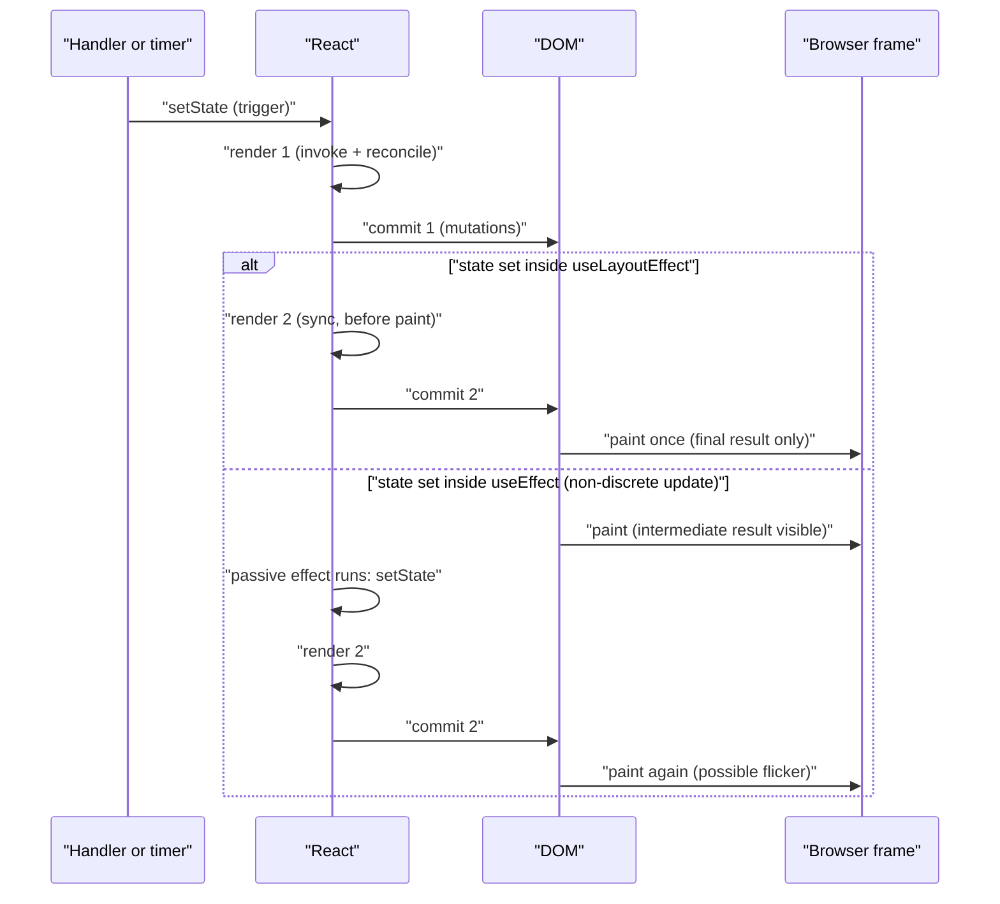

# 02 / 02 — Invocation vs Render vs Reconcile vs Commit vs Layout vs Paint

## 1. Lesson metadata

| | |
|---|---|
| **Level** | Advanced |
| **Study time** | 5–6 hours (reading 2.5 h, experiments 1.5 h, exercises 2 h) |
| **Prerequisites** | [02 / 01 — What actually triggers a render](./01-what-triggers-a-render.md); [Phase 0 / 01 — How the browser works](../00-web-and-javascript-foundations/01-how-the-browser-works.md); [Phase 0 / 03 — Style → layout → paint → composite](../00-web-and-javascript-foundations/03-browser-rendering-pipeline.md); [Phase 0 / 11 — Event loop, tasks, microtasks](../00-web-and-javascript-foundations/11-event-loop-tasks-microtasks.md); [Phase 1 / 13 — The rendering mental model](../01-react-fundamentals/13-rendering-mental-model.md) |
| **Next** | [03 — Initial mount and subsequent updates](./03-initial-mount-and-updates.md) |
| **Related later** | [11 — Render phase vs commit phase](./11-render-phase-and-commit-phase.md), [18 — Effects and their timing](./18-effects-and-their-timing.md), [19 — Layout vs passive effects](./19-layout-vs-passive-effects.md), [20 — Commit work and DOM mutations](./20-commit-and-dom-mutation.md), [21 — Browser paint vs React updates](./21-browser-paint-and-react-updates.md) |

**Learning objectives.** After this lesson you can:

1. Define six words that are constantly confused (*invocation, render, reconcile, commit, layout, paint*) and say which belong to React, which to the browser, and which are ambiguous.
2. Draw the timeline of one update from the user's click to pixels, marking what runs on the main thread, what is interruptible, and what is synchronous.
3. State precisely **when** refs attach, layout effects run, passive effects run, and when the browser can paint, separating guarantees from implementation detail.
4. Explain why reconciliation is not a separate pass "after rendering" in current React, even though we teach it as a stage.
5. Choose between `useLayoutEffect`, `useEffect`, and `flushSync` based on timeline reasoning, and predict flicker.
6. Measure render and commit durations with the `<Profiler>` API and DevTools.

**Concepts covered:** invocation, render phase, reconciliation, commit phase (before-mutation / mutation / layout sub-steps), passive effects, browser style/layout/paint/composite, the "render" and "layout" name collisions, task boundaries, rendering opportunities, discrete vs continuous updates, `flushSync`, `<Profiler>`.

---

## 2. Deep conceptual explanation

### 2.1 What problem is this lesson solving?

"React renders" is used to mean at least five different things:

- "My component function was called."
- "React decided what the UI should look like."
- "React changed the DOM."
- "The browser calculated geometry."
- "The user can see the change."

Each of these happens at a different moment, on different code, with different guarantees and different costs. If you conflate them you will misdiagnose bugs ("the component rendered, so the DOM must be updated"), choose the wrong hook (`useEffect` for DOM measurements, causing a one-frame flicker), and misread the Profiler. This lesson pins each term to a specific point on a timeline.

### 2.2 The six terms

We define each term, state who owns it, and give its *observable signature*, a thing you can see in the debugger that tells you it happened.

| Term | Owner | Meaning in this curriculum | Observable signature |
|---|---|---|---|
| **Invocation** | JavaScript | A function call. When we say *"React invokes your component"* we mean `Component(props)` executes on the call stack. Hooks run *inside* the invocation. Event handlers are also invoked, but *not* during render. | A `console.log` in the function body; a breakpoint inside it. |
| **Render** (React sense) | React | The **phase** in which React invokes components (and hooks) to compute the next element tree. It has **no side effects on the host** (no DOM mutations, no effect callbacks). Can be paused, repeated, or discarded in concurrent mode. | Logs from component bodies; the **Profiler's "Render duration"**. |
| **Reconcile** | React | Comparing the new elements to the previous fibers to decide what to create, update, move, or delete, and recording those decisions. In the Fiber architecture this is done *as part of* the render phase, interleaved with invocations, not as a later pass. | The result: a set of marked fibers (effect flags) waiting to be applied; no direct signature besides Profiler totals. |
| **Commit** | React | The **phase** in which React applies the decided changes to the host (DOM mutations), attaches/detaches refs, runs layout effects, and then schedules passive effects. **Synchronous and not interruptible.** | DOM mutations visible in the Elements panel; `useLayoutEffect` logs; Profiler "commit". |
| **Layout** (browser sense) | Browser | Computing the geometry (size, position) of boxes. Occurs in the browser's "update the rendering" steps *after* JS yields, or earlier if you force it by reading geometry. | Purple "Layout" blocks in the Performance panel; `getBoundingClientRect()` forcing it. |
| **Paint** | Browser | Recording draw operations and (with compositing/raster) producing pixels. | Green "Paint" blocks; the frame actually shown. |

### 2.3 Two collisions to memorize

**"Render" collision.** The React docs use *render* for "React calls your components." The browser pipeline calls its whole process "rendering" (and the HTML standard's "update the rendering"). When someone says "rendering is slow," ask: *React render (JS), or browser rendering (style/layout/paint)?* The remedies differ completely.

**"Layout" collision.** `useLayoutEffect` is **not** "an effect that runs during browser layout." It is an effect that runs **synchronously in React's commit phase, after DOM mutations and before the browser paints.** The name comes from the use case, *measuring layout and synchronously re-adjusting*, not from when the browser computes layout. (The browser may *force* layout *inside* your layout effect if you read geometry; that is the link.)

Other collisions: **commit** (React's phase vs a compositor "commit" of layer trees vs a git commit); **mount/update/unmount** (React lifecycle terms vs DOM insertion); **effect** (React effect vs "side effect" in the general sense: event handlers have side effects too).

### 2.4 Why React separates render from commit

Three reasons that connect to everything that follows in Phase 2:

1. **Purity enables interruption.** If render has no host side effects, React can stop in the middle, throw the partial result away, or restart it with newer data, and the user never sees a half-updated screen. All DOM changes are deferred to commit, which then runs without interruption so the DOM is never visibly inconsistent. ([12 — Why rendering must be pure](./12-why-rendering-must-be-pure.md), [15](./15-interruptible-restartable-abandoned-rendering.md).)
2. **Batching host work.** All mutations for one update are applied together in one synchronous burst; the browser sees one consistent DOM change per commit.
3. **Multiple renderers.** The same render/reconcile logic drives DOM, native, canvas, and test renderers; only the commit-time host operations differ ([04](./04-virtual-dom-what-it-means.md)).

### 2.5 Public guarantee vs teaching model for the whole pipeline

> **Public guarantee (documented behavior you can rely on)**
> - Components are called during render; render should be pure; React may call them more than once, may discard results, and in development Strict Mode deliberately calls them twice.
> - DOM updates happen in commit, not during render.
> - `useLayoutEffect` callbacks run after React has updated the DOM and before the browser repaints; they can read layout and synchronously re-render.
> - `useEffect` callbacks run after commit, typically after the browser paints, **but timing is not guaranteed**; React may run them earlier (e.g. before the next render, or synchronously for discrete events, see §3.4).
> - Refs are set during commit, before layout effects of the owning component run, and are not set during render.
> - The browser paints *after* your task finishes, at its discretion; React cannot force a paint.

> **Teaching model:** *Trigger → Render (invoke + reconcile) → Commit (mutate, layout effects) → Browser (style, layout, paint) → Passive effects.*

> **Implementation detail:** the three internal commit sub-steps, the `current` tree pointer switch, the time-slicing via the scheduler and `MessageChannel`, effect-list representation, and the names of internal functions. Treat as "true in the current source, subject to change."

---

## 3. Internal mechanics

### 3.1 Render phase: invocation interleaved with reconciliation

**[Teaching model]** Think of the render phase as a depth-first walk over the tree of *fibers* ([09](./09-fiber-nodes-and-units-of-work.md)). At each fiber, React does a unit of work:

1. **Invoke** the component (function components: `Component(props)`; hooks execute and read state from the fiber).
2. Receive the returned elements (the *children* of this fiber).
3. **Reconcile** those children against the fiber's existing children: reuse a fiber when type (and key) match and update its props; create a new fiber for new elements; mark old fibers for deletion. Record in each fiber a flag that says "this needs a placement / update / deletion / ref work / effect."
4. Move to the first child; when a subtree is done, "complete" the fiber (for host elements, prepare the DOM instance and the property diff in memory) and move to the sibling, then back up.

So the order is **parent invoked → its children reconciled → first child invoked → …** Reconciliation is not "after render"; each parent's reconciliation of its children happens right after that parent is invoked and before the children are invoked. We say *"render then reconcile"* only for narration.

**[Implementation detail]** The two halves of the per-fiber work are usually described as *begin* (invoke + reconcile children) and *complete* (build host instance / bubble flags upward); see [09](./09-fiber-nodes-and-units-of-work.md) and [10](./10-current-and-work-in-progress-trees.md). For host components, creating the new DOM *element object* for a newly mounted node can happen during the completion step, *detached* from the document, and the final **insertion into the live tree** happens in commit. (In current source, `completeWork` for a host component calls `createInstance` and `appendAllChildren`, i.e. creation happens in the render phase; verified in `ReactFiberCompleteWork.js`, 2026-10-22.) Whether creation happens in render or commit is an internal choice; what is guaranteed is that **nothing becomes part of the live document until commit.**

**[Public guarantee]** In the render phase React may: call the same component multiple times with the same props (Strict Mode, restarts); throw away a finished render; render components that never end up on screen (e.g. under a Suspense boundary that is later hidden or in an abandoned transition). Hence: no side effects, no mutation of external state, no reading refs.

### 3.2 Where render duration comes from

The Profiler's *render duration* for a commit is the time spent in the render phase for components in that update: invocations + reconcile bookkeeping, minus time React spent yielding between slices (concurrent renders). `actualDuration` in `<Profiler onRender>` is the time rendering the profiled subtree for this update. It **does not include**: commit time, effects, style, layout, paint. This is why a "fast render, slow interaction" is common.

### 3.3 Commit phase: synchronous and uninterruptible

**[Public guarantee]** Once React starts committing, it finishes: the commit is not interleaved with other JavaScript (no yielding to event handlers) and is not time-sliced. That makes the DOM transition atomic from JavaScript's point of view.

**[Teaching model / implementation detail]** Conceptually the commit has three passes over the changed fibers, then a deferred fourth:

| Sub-step | What happens | Why it exists |
|---|---|---|
| **Before mutation** | Class `getSnapshotBeforeUpdate` runs; read DOM state *before* it changes (e.g. scroll position) | Lets classes capture pre-change layout. Function components have no direct equivalent. |
| **Mutation** | Insert / update / delete host nodes; detach refs of removed or changed nodes; run **cleanups of layout effects** of components being unmounted or updated | The only place the document changes |
| *(tree swap)* | The tree React just built becomes the *current* tree | So that layout-phase code sees the new tree; see [10](./10-current-and-work-in-progress-trees.md) |
| **Layout** | Attach refs; run **layout effect** callbacks (`useLayoutEffect`, `componentDidMount/Update`) child-first | Code that must observe the *new* DOM before paint |
| **Passive** (later) | Run `useEffect` cleanups, then callbacks | Work that need not block painting: subscriptions, logging, data syncing |

**Ordering rules that are safe to rely on (documented effect semantics):** within one commit, effect *callbacks* run **child before parent** (siblings in order); for a given component, React runs the previous render's *cleanup* before the new callback; all cleanups for updated components run before any new callbacks of the same effect kind in that commit. The exact internal traversal is an implementation detail; test ordering assumptions rather than hard-coding them.

### 3.4 When do passive effects run?

**[Public guarantee]** `useEffect` runs *after* the commit has been applied to the DOM. React does not promise it runs after the browser has painted, but that is the typical case, which is the reason "effects don't block paint."

**[Implementation detail]**
- After a commit, React schedules a task to flush passive effects through its scheduler. The browser often paints between the commit's task and that scheduled task, but need not.
- For renders in the **`SyncLane`** (discrete user events such as click and keydown, and `flushSync`), React (18+) flushes passive effects *synchronously at the end of the commit* (`includesSyncLane(...)` then `flushPendingEffects()` in `ReactFiberWorkLoop`; continuous events such as `mousemove` are not included), i.e., before the browser has a chance to paint, so that state updates from effects triggered by a click land in the same frame as the click's result. Consequence: for a click, `useEffect` can behave closer to `useLayoutEffect` in timing. The consequence: **never build correctness on effects running after paint**, and do not use `useEffect` timing to "wait for paint."
- Before React starts the *next* render, it flushes any pending passive effects from the previous commit, so effects never overlap across renders.

### 3.5 Between commit and pixels: the browser's part

After React's commit completes, your JS task continues (microtasks, remaining handler code), then ends. The browser then, at its next *rendering opportunity* (typically aligned to display refresh; skipped if nothing visual changed or the tab is hidden), performs "update the rendering": `requestAnimationFrame` callbacks → style recalculation → layout → paint recording → hand-off to the compositor/raster/GPU ([Phase 0 / 03](../00-web-and-javascript-foundations/03-browser-rendering-pipeline.md)). Key facts:

- **Dirtiness is batched.** React's several DOM writes in a commit cause one style/layout pass, unless something *reads* layout in between (forced synchronous layout). Reading `offsetWidth` inside a layout effect forces style+layout then, and the subsequent paint reuses it.
- **Order inside a frame:** your task(s) → microtasks → [if rendering opportunity] rAF callbacks → style → layout → paint → composite → (later) next task. A `setTimeout(0)` or `MessageChannel` message posted from the commit runs in a *later task*, which may or may not be before the next rendering opportunity.
- **React cannot await paint.** There is no React API that says "after paint." Approximations (`requestAnimationFrame` then a task) are heuristics.

### 3.6 Two important re-render paths that skip the browser

1. **State updates inside `useLayoutEffect`** (or `componentDidMount`) are processed **synchronously** before the browser paints: React re-renders and re-commits, *then* the browser paints once. The user never sees the intermediate DOM. (This is the feature layout effects exist for.)
2. **`flushSync`** forces an update to render and commit synchronously before it returns (§5.5).

A state update inside a **passive** effect, in contrast, is *normally* processed after the first paint (except for the discrete-event case above) and produces a second render and potentially a second paint: the visible flicker of `useEffect`-based measurement.

### 3.7 Errors and the phases

An error thrown during render (invocation) is caught by the nearest error boundary, and React attempts to render the fallback; if no boundary exists, the whole tree unmounts. Errors in event handlers and async callbacks are *not* caught by error boundaries because they are not part of render ([Phase 4 / 19](../04-react-architecture/19-error-boundaries.md)). Errors in effects (layout/passive) do get routed to boundaries as commit-phase errors.

---

## 4. Step-by-step execution walkthrough

Scenario: A `Search` page. A click on "Next page" calls `setPage(p => p + 1)`. The page component renders a list of 50 `ResultRow`s. A `useLayoutEffect` in `ResultList` measures its height to set a CSS variable; a `useEffect` in `Search` logs analytics. One of the rows' text changes. No Strict Mode. Times are illustrative.

| # | t (ms) | Layer | Event | Phase label | DOM mutated? | Interruptible? |
|---|---|---|---|---|---|---|
| 1 | 0.0 | Browser | Pointer up → `click` task begins on main thread (waited 2 ms behind earlier work: input delay). | – | no | – |
| 2 | 0.1 | React DOM | Root listener receives the event; React finds the target's `onClick`; assigns *discrete event* priority. | – | no | – |
| 3 | 0.2 | App code | `onClick` calls `setPage(p => p + 1)`. Update enqueued; fibers marked; root scheduled. | **Trigger** (scheduling) | no | – |
| 4 | 0.3 | React | Handler returns. Urgent work flushes. | – | no | – |
| 5 | 0.3–4.5 | React | `Search` **invoked**: `useState` processes queue, returns new elements. Children **reconciled**: `ResultList` same type → update. | **Render** (invoke + reconcile) | no | Urgent (sync lane) renders are not time-sliced; transition renders are. |
| 6 | 4.5–8.0 | React | `ResultList` invoked (new element) → reconcile 50 `ResultRow` elements by key: 3 new, 3 deleted, 44 reused. Each reused `ResultRow` invoked (not memo), output compared: 6 rows have changed text. | **Render** | no | same as above |
| 7 | 8.0 | React | Render phase complete. Work-in-progress tree is finished. A list of effect flags exists: 3 placements, 3 deletions, 6 text updates, 1 layout effect, 1 passive effect. | End of render | **no** (nothing mutated yet) | – |
| 8 | 8.0–8.6 | React | **Commit — mutation:** remove 3 nodes, create/insert 3 nodes, set 6 text nodes. `ResultList`'s previous layout-effect cleanup runs. | **Commit** | **yes** | **No** |
| 9 | 8.6–8.9 | React | **Commit — layout:** attach refs; run `ResultList` layout effect: reads `el.offsetHeight` → browser **forces style recalculation + layout now** (~1.2 ms); sets a CSS variable on `:root` (invalidates style again). | **Commit (layout effects)** | yes (style) | **No** |
| 10 | 10.1 | React | Commit done. Discrete event: passive effects flush synchronously: `Search`'s analytics effect runs. | Passive effects | no | – |
| 11 | 10.3 | Browser | Task ends; microtasks drain. | – | – | – |
| 12 | ~16.0 | Browser | Rendering opportunity (next vsync): rAF callbacks → style → layout (reused if still valid; part re-run due to CSS variable change) → paint recording → composite handoff. | **Browser style/layout/paint** | pixels | – |
| 13 | ~20–30 | GPU/display | Raster + display. The user sees page 2. | **Paint** | – | – |

Observations that this timeline teaches:

- "Render" accounted for 8 ms; the **mutations took 0.6 ms**. DOM updates are usually *not* the expensive part of a React interaction; the invocations are. That inverts the folk belief that "React is slow because the DOM is slow."
- The **layout effect forced layout in the middle of commit**, extending the uninterruptible region. Use layout effects sparingly.
- The browser paints **once**, after everything. No frame ever showed old rows mixed with new rows.
- From click to pixels: ~20+ ms in this model; INP would count input delay + processing (steps 2–11) + presentation delay (12–13).

**Predict:** If step 6 had been a transition (`startTransition(() => setPage(...))`), where would the browser have been able to paint between? *Answer:* between *slices of the render phase* (step 5–7), since transition renders yield to the scheduler; the **commit (8–10) would still be atomic**. The old UI remains on screen while the transition render proceeds, so intermediate paints show the *old* page, not a partial new one ([23](./23-transitions-and-deferred-rendering.md)).

---

## 5. Code examples

### 5.1 Minimal example — logging every stage

```tsx
import { useEffect, useLayoutEffect } from "react";

export function Demo({ label }: { label: string }) {
  console.log(`${label}: render (invocation)`);

  useLayoutEffect(() => {
    console.log(`${label}: layout effect`);
    return () => console.log(`${label}: layout cleanup`);
  });

  useEffect(() => {
    console.log(`${label}: passive effect`);
    return () => console.log(`${label}: passive cleanup`);
  });

  return (
    <div ref={(node) => console.log(`${label}: ref ${node ? "attached" : "detached"}`)}>
      {label}
    </div>
  );
}

export function App() {
  return (<Demo label="parent" />);
}
```

**Predict:** On first mount (production, no Strict Mode), what is the log order for `<Demo label="A" />`?

**Result:**
```
A: render (invocation)
A: ref attached
A: layout effect
A: passive effect
```
**Why:** render (no DOM yet); commit mutation inserts the `div`; commit *layout* step attaches the ref (host child) and then runs the component's layout effect; passive effect later. The ref callback is on the child host element, which is processed before the owning component's layout effects within the same step.
**After a re-render with new props:** *render*, then (during mutation) `ref detached` and `layout cleanup`, then (during layout) `ref attached` and `layout effect`, then later `passive cleanup`, `passive effect`. The **ref callback** is only re-run if the callback *identity changes*: here the inline arrow is new on every render, so React calls the old callback with `null` ("detached") and the new callback with the node, so the full order after an update is `render` → (mutation: `ref detached`, `layout cleanup`) → (layout: `ref attached`, `layout effect`) → passive cleanup → passive effect. The ref is detached first because the `div` is a *child* fiber and mutation-phase work runs child-first. In React 19 a ref callback may return a cleanup function, in which case that cleanup is called *instead of* calling the callback with `null`. *(Order verified by execution on React 19.3.1, 2026-10-22.)*

### 5.2 Practical example — a tooltip: layout effect vs passive effect

```tsx
import { useLayoutEffect, useRef, useState, type ReactNode } from "react";

type TooltipProps = { anchor: DOMRect; children: ReactNode };

export function Tooltip({ anchor, children }: TooltipProps) {
  const ref = useRef<HTMLDivElement>(null);
  const [top, setTop] = useState(anchor.bottom + 8);

  useLayoutEffect(() => {
    const el = ref.current;
    if (!el) return;
    const { height } = el.getBoundingClientRect();           // forces layout
    const fitsBelow = anchor.bottom + 8 + height <= window.innerHeight;
    setTop(fitsBelow ? anchor.bottom + 8 : anchor.top - 8 - height);
  }, [anchor]);

  return (
    <div ref={ref} role="tooltip" style={{ position: "fixed", left: anchor.left, top }}>
      {children}
    </div>
  );
}
```

Line notes:
- The tooltip's height is unknowable until it is laid out. First commit renders at the *guess* position (`top` initial).
- `useLayoutEffect` runs after the DOM is inserted, **before the paint**: it reads height, calls `setTop`. React processes that update **synchronously** (second render + commit) before the browser paints. The user only ever sees the corrected position.
- Same code with `useEffect`: the browser can paint the first (wrong) position, then the effect runs, then a second paint shows the corrected one: a one-frame **flicker**. (For discrete events React may flush passive effects early, which hides the flicker for click-triggered tooltips and not for hover/async-triggered ones. **Do not rely on that**; the behavior is an implementation detail.)

**Trade-offs.** Layout effects block paint: any slow work in them delays the frame. Keep them to measuring and synchronous adjustment. For simple placement prefer CSS (anchor positioning, `position: absolute` with flipping libraries) when available; verify browser support before adopting newer CSS features.

### 5.3 Incorrect example — assuming the DOM is updated right after `setState`

```tsx
import { useRef, useState } from "react";

export function Counter() {
  const [n, setN] = useState(0);
  const ref = useRef<HTMLSpanElement>(null);

  function handleClick() {
    setN(n + 1);
    console.log("DOM text after setN:", ref.current?.textContent);
    console.log("n in closure:", n);
  }

  return (
    <>
      <span ref={ref}>{n}</span>
      <button onClick={handleClick}>+</button>
    </>
  );
}
```

**Predict:** First click. What is logged?

**Result:** `DOM text after setN: 0` and `n in closure: 0`.
**Why:** `setN` only *schedules*. The handler is part of the click task; render and commit happen after the handler returns. Both the closure's `n` (snapshot) and the DOM text (not yet committed) are old.

### 5.4 Corrected implementation

Option 1: read the new DOM where it exists, in an effect (preferred, declarative):

```tsx
useEffect(() => {
  console.log("DOM text after commit:", ref.current?.textContent);
}, [n]);
```

Option 2: when you *must* read it synchronously in the handler, force the commit (rare, costly):

```tsx
import { flushSync } from "react-dom";

function handleClick() {
  flushSync(() => setN((c) => c + 1));
  console.log("DOM text after flushSync:", ref.current?.textContent); // "1"
}
```

`flushSync` renders and commits synchronously (but still does not paint; the browser paints after your task). Prefer deriving what you need from state rather than the DOM; read the DOM only when you truly need layout facts (focus, scroll, size).

### 5.5 Advanced example — instrumenting the stages with `<Profiler>` and a paint approximation

```tsx
import { Profiler, useLayoutEffect, type ProfilerOnRenderCallback, type ReactNode } from "react";

const onRender: ProfilerOnRenderCallback = (id, phase, actualDuration, baseDuration, startTime, commitTime) => {
  // phase: "mount" | "update" | "nested-update"
  console.table({ id, phase, actualDuration, baseDuration, startTime, commitTime });
};

/** Approximate "after the next paint" without any React API. A heuristic, not a guarantee. */
function afterNextPaint(cb: () => void): void {
  requestAnimationFrame(() => {
    // rAF runs before paint in the frame; a message/timeout posted now runs after that frame's work.
    const ch = new MessageChannel();
    ch.port1.onmessage = () => cb();
    ch.port2.postMessage(null);
  });
}

export function Measured({ id, children }: { id: string; children: ReactNode }) {
  useLayoutEffect(() => {
    const t0 = performance.now();                       // inside commit, before paint
    afterNextPaint(() => {
      console.log(`${id}: commit→(approx)paint ≈ ${(performance.now() - t0).toFixed(1)}ms`);
    });
  });
  return <Profiler id={id} onRender={onRender}>{children}</Profiler>;
}
```

Notes: `actualDuration` is render-phase time for the profiled subtree in this update; `baseDuration` is the estimated cost to render the subtree *without memoization*. `<Profiler>` adds overhead and is **disabled in production builds unless you use the profiling build** (react.dev/reference/react/Profiler: "disabled in the production build by default"; opt in with the profiling build). The paint approximation has jitter; use it to compare *relative* changes, and use the browser Performance panel (Frames, Interactions tracks) for truth. Note: newer browsers expose richer timing (event timing, long animation frames); consult current MDN compatibility data before using them in production.

---

## 6. Visual explanations

### 6.1 The pipeline with owners

```mermaid
flowchart LR
  subgraph Trigger["Trigger: scheduling"]
    T1["setState / render call / context / store"]
  end
  subgraph ReactRender["React render phase: pure, interruptible in concurrent mode"]
    R1["Invoke component"] --> R2["Reconcile its children"]
    R2 --> R3["Next fiber..."]
    R3 --> R1
  end
  subgraph ReactCommit["React commit phase: synchronous"]
    C1["Before mutation"] --> C2["Mutate DOM, detach refs, layout cleanups"]
    C2 --> C3["Attach refs, layout effects"]
  end
  subgraph Browser["Browser: its own schedule"]
    B1["rAF"] --> B2["Style"] --> B3["Layout"] --> B4["Paint record"] --> B5["Composite / raster / display"]
  end
  P["Passive effects"]
  T1 --> R1
  R3 -->|"done"| C1
  C3 --> B1
  C3 -.->|"often after paint; sync for discrete events"| P
```



### 6.2 Sequence for a layout-effect state update vs a passive-effect state update



### 6.3 What's atomic

```text
timeline ─────────────────────────────────────────────────────────────►
 [ render slice ][yield][ render slice ][yield][ render slice ]  [ COMMIT ]  ... [ browser frame ]
   interruptible (concurrent/transition renders)               atomic, sync
   urgent (sync-lane) renders: one uninterrupted slice
```

---

## 7. Alternative approaches and trade-offs

Problem: "After an update, adjust something based on measured layout."

| Approach | Visible flicker | Blocks paint | Complexity | Testability | Notes |
|---|---|---|---|---|---|
| `useLayoutEffect` + `setState` | No | Yes (briefly) | Low | Medium (needs DOM/layout; jsdom has no layout) | The designed tool for measure-then-adjust |
| `useEffect` + `setState` | Possible | No | Low | Medium | Fine when the adjustment is not visually critical (analytics, non-visual state) |
| Ref callback (measure on attach) | No (attach is in commit) | Yes | Medium | Medium | Good for "measure when this node appears" |
| `flushSync` in handler | No | Yes (sync) | Medium | Low–Medium | Only for imperative flows (scroll to new item); hurts batching |
| CSS-only (flexbox, `position-area`/anchor positioning, container queries) | No | No | Low in CSS | High | Best when browser support allows ([Phase 0 / 03](../00-web-and-javascript-foundations/03-browser-rendering-pipeline.md)) |
| `ResizeObserver` | Possibly one frame | No (async) | Medium | Medium | For *ongoing* size changes rather than a single post-commit measurement |

**When the recommended approach (layout effect) is *not* best:** measuring in a layout effect on a list of 2,000 rows forces a large layout within the uninterruptible commit and delays the frame; CSS or virtualization is better. And for server rendering, `useLayoutEffect` does not run on the server (React warns in older versions; it is a no-op in `renderToString`), so measure-and-adjust UI is *not* correct in the first server HTML either way.

---

## 8. Best practices and anti-patterns

**Do**
- Reason with a timeline: *which phase am I in?* Render: pure compute. Commit: DOM exists, layout effects run. After paint: passive effects (usually).
- Read DOM geometry in layout effects or ref callbacks, not in render.
- Keep layout effects tiny and synchronous.
- Measure phases separately (Profiler render duration vs Performance-panel scripting vs layout/paint).

**Beginner mistakes**
- Reading `ref.current` during render.
- Reading the DOM right after `setState` and expecting the new content.
- Putting DOM measurement in `useEffect` and seeing flicker.
- Believing "React re-rendered" means "the DOM changed" (or vice versa).

**Experienced-developer mistakes**
- Using `useLayoutEffect` as a general replacement for `useEffect` "to be safe": it delays paint and breaks SSR expectations.
- Attributing jank to "React re-rendering" when profiles show browser layout dominated by thrashing: reading layout in a loop of effects.
- Calling `flushSync` inside effects or render (not allowed in render; problematic in effects).
- Writing tests that assert intermediate states that React may batch or skip.

**Smells:** a `useEffect` that measures and sets state used for visual positioning; `setTimeout(…, 0)` to "wait for React to finish"; `requestAnimationFrame` hacks to "wait for the DOM."

**Justified exceptions:** a passive `useEffect` measurement for non-visual state (e.g., reporting size to analytics); `setTimeout` waits when integrating a third-party widget with no lifecycle hooks (isolate in a custom hook).

---

## 9. Real-world application

**Chat window (realtime).** New messages arrive via WebSocket in a non-React callback. Constraint: after a message is rendered, the list must scroll to the bottom *before the next paint* or the user sees the old scroll position for a frame. Use `useLayoutEffect` keyed on `messages.length` to scroll, or a ref callback on the last item. Anti-pattern: `setTimeout(scrollToBottom, 0)`. Also: if the user has scrolled up, do not auto-scroll; compute `isNearBottom` *before* the update (during render or in `getSnapshotBeforeUpdate`-like logic captured in a ref in the handler).

**Data grid with column auto-sizing (dashboards).** Measuring text widths requires layout. Measuring 50 columns × 1,000 rows in a layout effect is a long uninterruptible commit; instead measure a sample, use CSS `table-layout`, or virtualize. Verify with the Performance panel that "Layout" is not dominating the commit.

**Form with focus management (accessibility).** After a validation error, move focus to the first invalid field. Focus is a DOM operation: do it in an effect (after the error elements exist) keyed on error state; not in render and not synchronously in the submit handler before the state commit.

**Checkout page analytics.** A "page viewed" event belongs in a passive effect: it must not delay paint, and it is okay if it fires slightly later. Mind Strict Mode double effects in development and deduplicate with an idempotency key or "ignore flag" in cleanup ([Phase 3 / 06](../03-react-state-and-hooks/06-effect-cleanup.md)).

**Micro-frontends / multi-team.** Two teams' widgets in one page share the main thread. One team's slow layout effect delays everyone's paint. Establish a budget (e.g., commit-phase work in layout effects < 1–2 ms) and enforce via Profiler checks in CI or review.

---

## 10. Debugging and troubleshooting

### Symptom A: "The UI flashes the wrong state for a frame."
1. Reproduce with Performance panel recording and **Screenshots** enabled; scrub frames.
2. Find the effect that sets state after a measurement; confirm it is `useEffect`.
3. Switch to `useLayoutEffect` (or restructure to compute during render). Re-record: the intermediate frame should disappear.
4. Validate in a throttled CPU run (4–6×); flicker is easier to see.

### Symptom B: "The click feels slow, but React Profiler shows tiny render times."
Profiler measures render (and commit durations at the commit level); the main-thread time may be in **layout/paint** or in **effects**. In the Performance panel, check the "Interactions" track: input delay, processing (JS, including effects) and presentation delay (style/layout/paint). If *Recalculate Style/Layout* is large, the cost is browser-side (huge DOM, forced layout in an effect); fix with smaller DOM, batching reads/writes, or virtualization.

### Symptom C: "My `ref.current` is `null`."
You are reading it in render (refs attach in commit) or the node is conditionally unmounted. Move the read to an effect/handler or use a ref callback. In React 19 you may also return a cleanup from a ref callback.

### Symptom D: "Effect order surprises me."
Remember child-before-parent for callbacks; cleanup-before-callback across the commit; layout before passive. Add `console.log` with labels, or the Profiler's effect markers; do not infer from memory.

### Symptom E: "Forced reflow" warning in DevTools.
Chrome flags "Forced reflow" in the Performance panel's call tree: a layout read after a write. Find the offending effect/handler; batch reads before writes; move reads into a single layout effect.

---

## 11. Exercises

### Level A — Knowledge
A1. Define invocation, render, reconcile, commit, layout, paint in one line each, and say which are React's and which the browser's.
A2. Which phase is allowed to mutate the DOM? Which may run more than once for a single committed update?
A3. State two ways the word "render" is ambiguous.
A4. When does React attach `ref`s? When are they set to `null`?
A5. Does React guarantee `useEffect` runs after the browser paints? Explain.

### Level B — Code comprehension
B1. Predict the order of logs on mount for `Parent` containing `Child` where each has `console.log` in the body, a layout effect, and a passive effect:
```tsx
function Child() { console.log("child render"); useLayoutEffect(() => console.log("child layout")); useEffect(() => console.log("child passive")); return null; }
function Parent() { console.log("parent render"); useLayoutEffect(() => console.log("parent layout")); useEffect(() => console.log("parent passive")); return <Child />; }
```
B2. For the §5.3 example, what is logged if `handleClick` uses `flushSync`?
B3. A layout effect sets state unconditionally with no dependency array: `useLayoutEffect(() => { setN(n + 1); })`. What happens?
B4. In what order do these appear: (1) browser paint, (2) layout-effect callback, (3) component function call, (4) `useEffect` callback? State what is guaranteed and what is typical.

### Level C — Implementation
C1. Write a `useMeasure<T extends HTMLElement>()` hook returning `[ref, size]` that measures *before paint* on mount and when the element resizes. Decide which hooks to use for each part.
C2. Write a `usePrevious<T>(value)` hook correctly, and explain at which phase the "previous" value is updated.
C3. Using only `<Profiler>`, build a dev-only wrapper that warns when a commit's `actualDuration` exceeds a budget (e.g. 16 ms).

### Level D — Debugging
D1. A modal's backdrop appears at the wrong position for one frame on slow devices. Code: `useEffect(() => { setPos(el.getBoundingClientRect()) }, [])`. Diagnose and fix.
D2. A developer notes "my `console.log` in `useEffect` shows the old DOM text." Their effect has `[]` deps and reads `ref.current.textContent` that depends on `count`. Why and how to fix?
D3. An analytics effect fires twice in development, once in production. Is this a bug? How do you handle it?
D4. The Performance panel shows a 120 ms "Recalculate Style + Layout" inside an effect after each keystroke; Profiler shows render of 3 ms. What is the likely culprit and what do you change?

### Level E — Architecture decisions
E1. Your design system's `Popover` must position itself without flicker, work with SSR, and handle 500 instances on a page. Compare approaches (layout effect, CSS positioning, `ResizeObserver`, lazy mount) and recommend with criteria.
E2. Decide where in your app to put a performance budget on commit-phase work, and how to enforce it across teams.

### Level F — Expert challenge
F1. Construct a scenario where a single user click results in **three** React renders, **two** commits, and **one** browser paint, using only `useState`, `useLayoutEffect`, and `useEffect`. Explain precisely which calls cause each, and then explain how the picture changes if the discrete-event passive-effect flush did not exist.

---

## 12. Detailed answers and explanations

> Attempt the exercises first.

**A1.** *Invocation*: a JS function call, here `Component(props)` (JS). *Render*: React's phase of invoking components to compute the next tree, pure (React). *Reconcile*: comparing next elements to the previous fibers to decide create/update/delete (React; done per fiber during render). *Commit*: synchronous application of changes to the host: DOM mutations, refs, layout effects (React). *Layout*: browser geometry computation (browser); also confusingly the name of `useLayoutEffect`. *Paint*: browser drawing (browser). Common wrong answer: calling the DOM mutation part "render."

**A2.** *Commit* mutates. *Render* may run more than once per committed update (Strict Mode, restarts, discarded concurrent renders). Wrong plausible answer: "effects can repeat": true in Strict Mode dev but irrelevant to the question of mutation.

**A3.** (1) React render (invoke components) vs browser "rendering" (style/layout/paint). (2) "Render" as used in "render a component" vs "render" as "show on screen." Also *rendering* is used for server rendering (`renderToString`), which is also React's render phase with no commit.

**A4.** Refs attach during commit (layout step) for new/changed nodes, after DOM insertion and before the owner's layout effects (host child before parent). They detach (callback with `null`, or the ref callback's cleanup in React 19, or `ref.current = null`) during commit mutation when the node is removed or the ref changes. Never during render.

**A5.** No. Documented behavior: effects run after the commit; typical timing is after paint, but React may run them earlier (e.g. flushed before the next render, or synchronously for discrete events). If correctness requires "after paint" or "before paint," pick `useEffect` vs `useLayoutEffect` accordingly and don't depend on paint timing.

**B1.** Mount order: `parent render`, `child render`, `child layout`, `parent layout`, `child passive`, `parent passive`. Render is parent-first (invoking parent returns the child element, which is then invoked); layout and passive callbacks are child-first. Plausible wrong answer: "parent render, parent layout, child ...". That would mean the parent commits before its children, which would let parent effects see an incomplete subtree. Between the layout and passive logs, the browser may paint.

**B2.** `DOM text after flushSync: 1` and `n in closure: 0` (if the log reads the stale `n`). The DOM is committed synchronously, but the closure variable remains the old snapshot.

**B3.** Infinite loop: the effect runs after every commit, sets state to a new value each time (`n` from the closure changes each render), triggering another synchronous render before paint; React throws "Maximum update depth exceeded" (limit of nested synchronous updates, 50 in current implementation, treat as unspecified). Fix: add dependencies and a conditional, or compute during render.

**B4.** Guaranteed: component function call (3) precedes the layout effect (2) for that commit; layout effect (2) precedes the browser's repaint of that commit's result (1); `useEffect` (4) follows the commit's DOM update. Typical (not guaranteed): (3) → (2) → (1) → (4). For discrete events (4) may run *before* (1).

**C1.**
```tsx
import { useLayoutEffect, useRef, useState, type RefObject } from "react";

type Size = { width: number; height: number } | null;

export function useMeasure<T extends HTMLElement>(): [RefObject<T | null>, Size] {
  const ref = useRef<T | null>(null);
  const [size, setSize] = useState<Size>(null);

  useLayoutEffect(() => {
    const el = ref.current;
    if (!el) return;
    const r = el.getBoundingClientRect();           // initial measurement before paint
    setSize({ width: r.width, height: r.height });

    const ro = new ResizeObserver(([entry]) => {   // later changes (async, post-layout)
      const { width, height } = entry.contentRect;
      setSize((prev) => (prev && prev.width === width && prev.height === height ? prev : { width, height }));
    });
    ro.observe(el);
    return () => ro.disconnect();
  }, []);

  return [ref, size];
}
```
Reasoning: the first measurement must happen before paint (layout effect); subsequent size changes arrive via `ResizeObserver`, whose callbacks are delivered by the browser after layout in the same frame, so React may paint them one frame later, acceptable for ongoing changes. Returning `prev` when equal avoids needless renders. Edge cases: SSR (no layout; `size` is `null` initially), element swapped (`ref` change not tracked; use a ref callback if elements change), border-box vs content-box. In React 19 `useRef<T>(null)` returns `RefObject<T | null>`.

**C2.**
```tsx
import { useEffect, useRef } from "react";
export function usePrevious<T>(value: T): T | undefined {
  const ref = useRef<T | undefined>(undefined);
  useEffect(() => { ref.current = value; });   // runs after commit
  return ref.current;                           // value from the previous commit
}
```
The ref is updated in an effect (after commit), so during render it still holds the previous value. Writing the ref during render would break purity and could be wrong after discarded renders. Edge: with Strict Mode and interrupted renders this approach remains correct because only committed values are stored.

**C3.**
```tsx
import { Profiler, type ProfilerOnRenderCallback, type ReactNode } from "react";
const BUDGET_MS = 16;
const onRender: ProfilerOnRenderCallback = (id, phase, actualDuration) => {
  if (actualDuration > BUDGET_MS) console.warn(`[perf] ${id} ${phase} took ${actualDuration.toFixed(1)}ms`);
};
export function Budget({ id, children }: { id: string; children: ReactNode }) {
  return import.meta.env.DEV ? <Profiler id={id} onRender={onRender}>{children}</Profiler> : <>{children}</>;
}
```
Notes: production builds typically strip Profiler timing; this measures render duration only, not commit/effects/browser costs. Conditionally swapping `Profiler` vs fragment changes tree structure only between builds, not within a run.

**D1.** `useEffect` allows the browser to paint with `pos` at its initial value, then correct it. Use `useLayoutEffect` (same body) so the measurement and the second render occur before paint; or compute position with CSS. Validate: record frames with screenshots; the first-frame wrong position disappears. If the modal is server-rendered, remember layout effects do not run on the server.

**D2.** An effect with `[]` deps runs only after the *first* commit, when `count` was its initial value. Fix: add `count` (or the DOM-derived input) to deps: `useEffect(() => {...}, [count])`; the effect then runs after each commit where `count` changed, and the DOM already reflects it. Also explain: the effect does not "see old DOM"; it ran at a different time than the developer believed.

**D3.** Not a bug. Strict Mode (dev) mounts effects, runs cleanup, and mounts again to simulate a remount, flushing out missing cleanup. Production runs once. For analytics, either tolerate duplicates in dev, deduplicate at the sender (event id per page view), or track "already sent" state outside the component lifecycle. Do not remove Strict Mode to hide it.

**D4.** Forced synchronous layout (layout thrashing) in the effect, or a huge DOM whose style recalculation is expensive. Look in the call tree for `getBoundingClientRect`/`offsetHeight` calls interleaved with style writes. Fix: batch all reads first, then all writes; read once per commit; reduce DOM size/virtualize; avoid invalidating large subtrees (e.g., changing `className` on `<body>` per keystroke). Validate with the Performance panel (Layout + Recalculate Style times).

**E1.** Criteria: flicker, SSR, scale (500 instances), complexity, browser support. Good answer: *Popover mounts lazily* (only open popovers are in the DOM) which cuts instance cost to ~1–2. For positioning: use CSS-based positioning where supported (anchor positioning, flexible fallbacks) as the primary strategy because it needs no JS measurement and works in SSR output. Fall back to a layout-effect measure-and-flip in the portal for older browsers; use `ResizeObserver`/scroll listeners (passive, throttled) for ongoing changes. Reject: `useEffect`-only measurement (flicker), per-instance global listeners for 500 hidden popovers. Document the decision for the library's consumers; flag "verify browser support."

**E2.** Example answer: put budgets where cross-team interference occurs: shared layout shell, design-system primitives that use layout effects, and list/grid components. Enforce with (a) a dev-only `<Profiler>` budget wrapper that warns, (b) Playwright performance traces in CI for key flows with thresholds on long tasks, (c) code review checklist: "layout effect reads a bounded number of elements," (d) RUM INP by route. Trade-off: lab thresholds are noisy; use relative regressions rather than absolute numbers; avoid shipping Profiler in production bundles.

**F1.** Count three different things: *component invocations*, *commits*, *paints*. One construction that gives **3 invocations of the component, 2 commits, 1 paint**:
```tsx
function Demo() {
  const [a, setA] = useState(0);
  const [b, setB] = useState(0);
  const [c, setC] = useState(0);
  if (a === 1 && b === 0) setB(1);                          // render-phase update (own state, guarded)
  useLayoutEffect(() => { if (b === 1) setC(1); }, [b]);    // update inside commit, processed before paint
  return <button onClick={() => setA(1)}>{a}/{b}/{c}</button>;
}
```
Click: `setA(1)` → **invocation 1** (a=1, b=0) calls `setB(1)` during render → React immediately re-invokes the component: **invocation 2** (a=1, b=1), same render pass; invocation 1's output is discarded, nothing was committed → **commit 1** (DOM shows `1/1/0`) → the layout effect runs (b changed) and calls `setC(1)` → React processes it synchronously → **invocation 3** → **commit 2** (`1/1/1`) → the browser, at its next rendering opportunity, paints **once**, showing only the final state. (There are only two render *passes*, three *invocations*.) If instead the second update were made in a passive `useEffect`, then for a non-discrete trigger (timer, network callback) the browser could paint after commit 1, giving **two paints**; for a click, React 18+ typically flushes the passive effect before paint, so you would still likely see one. That difference is exactly what the discrete-event flush is for: it keeps results of a click effect chain in one frame; without it, a click's effect-driven update could land one frame late. Evaluation criteria: separates the three counts; uses only guarded same-component render-phase updates; makes no claim that React controls paint; states that the passive-effect timing is an implementation detail.

---

## 13. Senior engineer interview questions

**Q1. "Walk me through what happens between a click and the user seeing the result in React."**
*Strong answer:* Input event task on main thread (possible input delay) → React's root listener → handler invocation → state update enqueued (scheduling) → at end of event, render phase: invoke components, reconcile children, compute effects → commit phase: synchronous DOM mutations, ref attach, layout effects → task ends → browser's next rendering opportunity: rAF, style, layout, paint, composite → passive effects (often after paint, synchronously for discrete events). Call out which stages React controls (the first half) and which the browser does (the second), and where INP's three components fall.

**Q2. "Is reconciliation a step that happens after rendering?"**
*Strong answer:* Not in current React: reconciliation of a component's children happens immediately after that component is invoked, as part of the same unit of work; the commit then applies the recorded results. Teaching as "render then diff" is acceptable as a model but not the mechanism; the observable guarantee is only that no host changes happen until commit.

**Q3. "Why would you use `useLayoutEffect` instead of `useEffect`, and what does it cost?"**
*Strong answer:* When you must read layout and adjust before the user sees a frame: avoiding flicker. Costs: it runs inside the uninterruptible commit and delays paint; it does not run on the server; overuse increases input latency. Alternatives: CSS, ref callbacks. Fall back to `useEffect` for non-visual work.

**Q4. "Can React guarantee a paint after a state update?"**
*Strong answer:* No. React guarantees the DOM is committed synchronously after render; the browser decides when to paint (vsync, visibility, throttling). React can *avoid blocking* paint by yielding in concurrent renders and by running passive effects later, but cannot force a paint; `flushSync` forces commit, not paint.

**Q5. "A component 'renders' but the DOM doesn't change. Walk me through why this is normal."**
*Strong answer:* Render is invocation + reconciliation; if the new output equals the old (same types, same props on host nodes), the recorded effect flags are empty and commit has nothing to apply. That is why renders are "cheap-ish" but not free: you pay invocation and comparison, not mutation.

---

## 14. Further learning resources

| Resource | URL | Covers / why | Level | Study |
|---|---|---|---|---|
| React docs — Render and Commit | <https://react.dev/learn/render-and-commit> | Official trigger/render/commit and "browser paint" distinction | Beginner | Whole page |
| React docs — `useLayoutEffect` | <https://react.dev/reference/react/useLayoutEffect> | Timing relative to paint; measurement example | Intermediate | Usage and Caveats |
| React docs — `useEffect` | <https://react.dev/reference/react/useEffect> | Effect timing; Strict Mode re-run | Intermediate | Caveats |
| React docs — `<Profiler>` | <https://react.dev/reference/react/Profiler> | `onRender` parameters | Intermediate | Reference |
| React docs — `flushSync` | <https://react.dev/reference/react-dom/flushSync> | Synchronous commit | Advanced | Whole page |
| MDN — Event loop | <https://developer.mozilla.org/en-US/docs/Web/JavaScript/Event_loop> | Tasks and microtasks; why paint comes after your task | Beginner–Int. | Whole page |
| HTML Standard — Event loops | <https://html.spec.whatwg.org/multipage/webappapis.html#event-loops> | Normative "update the rendering" steps | Advanced | Processing model |
| web.dev — Optimize INP | <https://web.dev/articles/optimize-inp> | Input delay / processing / presentation delay | Intermediate | Interaction phases |
| Chrome DevTools — Performance panel | <https://developer.chrome.com/docs/devtools/performance> | Reading main-thread tracks and Layout/Paint | Beginner–Int. | Analyze runtime performance |
| React repository | <https://github.com/facebook/react> | Verify commit sub-steps in `packages/react-reconciler` | Advanced | See [31](./31-reading-react-source.md) |

URLs in this table were checked for HTTP 200 on 2026-10-22; any still marked *(unverified)* could not be checked automatically. A 200 does not guarantee the page content still matches the description; if a link has moved, search the site for the quoted title.

---

## 15. Knowledge checkpoint

**You should now understand**
- The six terms and which belong to React, the browser, or both (the "render" and "layout" collisions).
- That render is pure/interruptible/repeatable, commit is synchronous and the only DOM-mutating phase, and paint is the browser's.
- That reconciliation is interleaved with invocation per fiber.
- Layout effects before paint, passive effects usually after (not guaranteed; synchronous for discrete events).

**You should be able to explain without notes**
- The click-to-pixels timeline with phase labels.
- Why measure-then-adjust with `useEffect` flickers and with `useLayoutEffect` does not.
- Why `setState` followed by a DOM read in the same handler sees stale DOM.

**You should be able to implement**
- A `useMeasure` hook, a `usePrevious` hook, and a Profiler budget wrapper.

**You should be able to debug**
- Flicker, stale-DOM reads, forced reflow, and "fast render, slow interaction" with the Performance panel and Profiler.

**Before moving on:** read [03 — Initial mount and subsequent updates](./03-initial-mount-and-updates.md), where we apply this timeline to the very first render of a tree and compare it with later updates.
