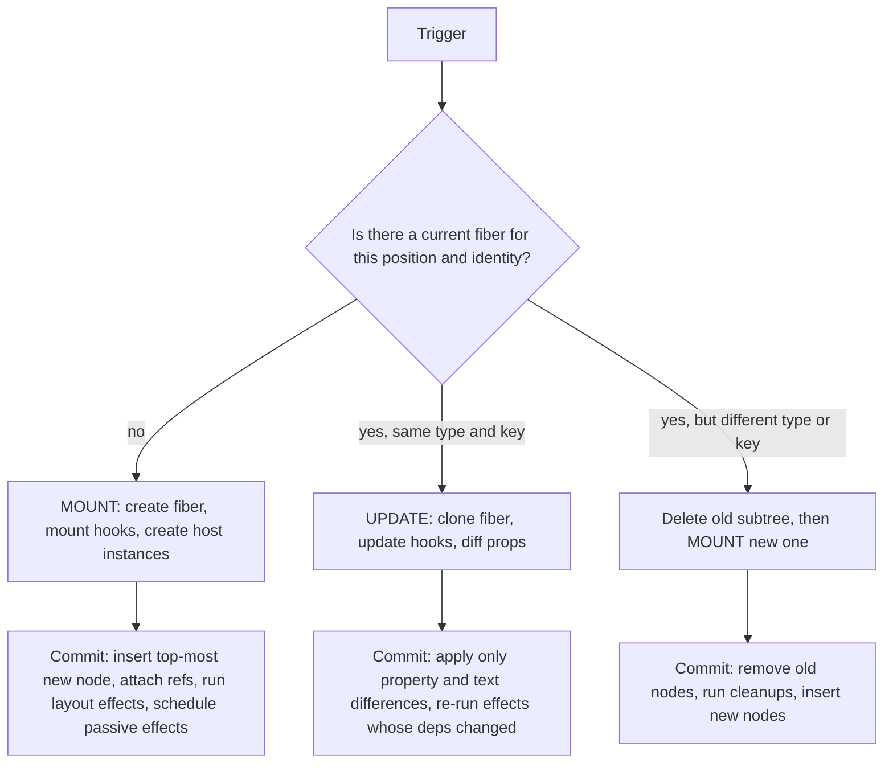
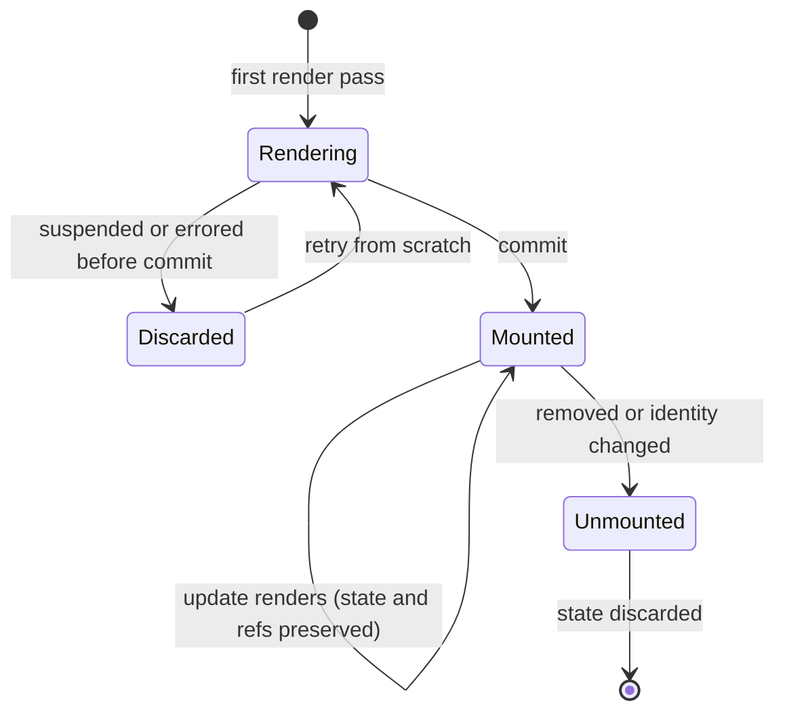

# 02 / 03 — Initial Mount and Subsequent Updates

## 1. Lesson metadata

| | |
|---|---|
| **Level** | Advanced |
| **Study time** | 4–5 hours (reading 2 h, experiments 1 h, exercises 1.5–2 h) |
| **Prerequisites** | [02 / 01 — What actually triggers a render](./01-what-triggers-a-render.md); [02 / 02 — Invocation vs render vs reconcile vs commit vs layout vs paint](./02-render-reconcile-commit-paint.md); [Phase 1 / 16 — State preservation and reset](../01-react-fundamentals/16-state-preservation-and-reset.md); [Phase 1 / 17 — Mount/update/unmount concepts](../01-react-fundamentals/17-lifecycle-concepts.md) |
| **Next** | [04 — The "virtual DOM": what it is and is not](./04-virtual-dom-what-it-means.md) |
| **Related later** | [09 — Fiber nodes and units of work](./09-fiber-nodes-and-units-of-work.md), [10 — Current and work-in-progress trees](./10-current-and-work-in-progress-trees.md), [17 — How hooks attach to Fiber](./17-hooks-and-fiber-state.md), [18 — Effects and their timing](./18-effects-and-their-timing.md), [25 — Hydration and selective hydration](./25-hydration-and-selective-hydration.md), [28 — Strict Mode development behavior](./28-strict-mode-behavior.md) |

**Learning objectives.** After this lesson you can:

1. Describe step by step what happens when `createRoot(container).render(<App />)` runs, up to the first paint and the first effects.
2. State exactly what is different between a component's *mount* render and an *update* render, for state, memoized values, refs, effects, and DOM work.
3. Explain what "mount", "update", and "unmount" mean in terms of **fiber identity** and why they are not the same as "render called".
4. Predict logs for mount, update, unmount, and Strict Mode's mount–unmount–mount simulation.
5. Explain what happens when a component suspends or throws during its *initial* mount.
6. Avoid the classic bugs: eager state initializers, `useEffect(..., [])` assumed to mean "once forever", components defined inside components, and repeated `root.render` misunderstandings.

**Concepts covered:** root creation, `root.render`, initial render, fiber creation, host instance creation vs insertion, mount vs update dispatch of hooks, lazy initializers, mount effects, update effects and dependencies, unmount cleanup, Strict Mode remount simulation, suspended mounts, `root.unmount`, root error callbacks, multiple roots.

---

## 2. Deep conceptual explanation

### 2.1 What problem is this lesson solving?

Developers use "mount" and "update" daily, and the two are *not* distinguished by "whether the function is called." The function is called in both cases. They differ in what React **already has**: on mount, React has nothing for this position in the tree and must create everything (state slots, memo caches, refs, DOM nodes); on update, React has a record of the previous render (state, deps, previous children) and can compare and reuse it.

Almost every lifecycle bug comes from mixing these up:

- "This effect runs on every render" (it doesn't: deps are compared against the previous render, which exists only for updates).
- "This component remounts when the parent re-renders" (it doesn't, unless its identity changed; see [06](./06-reconciliation-fundamentals.md), [07](./07-identity-keys-and-reconciliation.md)).
- "State resets when props change" (it doesn't, unless the identity changed).
- "The initializer function for `useState` runs once" (true in production; in development it runs twice on purpose).

### 2.2 Definitions

| Term | Meaning |
|---|---|
| **Root** | The object returned by `createRoot(domNode)`. It owns one tree. Everything React renders lives under a root. |
| **Initial render** | The first render pass of a root: no previous tree exists. `root.render(<App />)` for the first time (or `hydrateRoot`). |
| **Mount (of a component instance)** | The first time a component at a given position/identity is rendered *and committed*. It creates the instance's persistent records: hook state, refs, effects. |
| **Update** | A later render of an instance that already exists (identity preserved). |
| **Unmount** | The instance is removed from the tree: effects cleaned up, refs detached, host nodes removed, state discarded. |
| **Remount** | Unmount followed by a mount of a *new* instance at the same place. Happens when identity changes (type or key). |

A key subtlety: **initial render** is about the *root*; **mount** is about a *component instance*. A component can mount long after the initial render (a modal opened later; a route navigated to). Every mount is "an initial render *for that subtree*", and all rules in §2.3–§2.5 apply to it.

### 2.3 Mount vs update: the comparison

| Aspect | Mount render | Update render |
|---|---|---|
| Does React have a previous record for this instance? | No | Yes |
| `useState(init)` | Computes the initial state (runs `init` if it is a function); stores it in a new hook slot | **Ignores** the argument; returns the stored state (after applying queued updates) |
| `useReducer(reducer, arg, init)` | Computes the initial state via `init`/`arg` | Applies queued actions through `reducer` |
| `useMemo(fn, deps)` | Runs `fn` | Runs `fn` only if `deps` differ from the stored deps (otherwise returns the cached value) |
| `useRef(init)` | Creates `{ current: init }` once | Returns the **same** object each time |
| `useEffect(fn, deps)` / `useLayoutEffect` | Always scheduled (runs after commit) | Scheduled only if `deps` changed (or no deps array) |
| `useId` | Generates the id | Returns the same id |
| Ref callbacks / ref objects | Attached in commit | Re-attached only if the ref changed (or detached if node removed) |
| DOM | New host instances created; inserted at commit | Existing nodes mutated only where output differs |
| Hook-count check | n/a | React compares hook usage to the previous render (dev warns if order/count changes) |
| Children reconciliation | All children are new → new fibers | Compared by type/key/position |

Two consequences you must internalize:

1. **There is no "mount flag" you can read.** React deliberately exposes no `isMounted()` for function components. You detect "first time" by using an effect with empty dependencies, a ref, or lazy initialization; and you must keep those robust to Strict Mode.
2. **Dependencies are compared against the *previous render of the same instance*.** On mount there is nothing to compare, so an effect always runs.

### 2.4 Public guarantee vs teaching model vs implementation detail

> **Public guarantee**
> - `createRoot(container).render(element)` renders the tree into `container`; any existing DOM content inside `container` is replaced when `render` is called for the first time. `root.render` returns immediately and does not guarantee that the DOM is updated by the time it returns.
> - Lazy `useState` initializers run on mount (and twice in development under Strict Mode); state is preserved across updates for the same instance.
> - Effects run after the DOM is committed; cleanup runs before re-running and on unmount.
> - State of a component that has *not yet been committed* (it suspended or errored during its first render) is not preserved: when React retries it starts from scratch.
> - The relative ordering contract: children's effects run before parents' within one commit; parents' bodies render before children's.

> **Teaching model:** *mount creates; update compares.*

> **Implementation detail** (confirmed against `ReactFiberHooks` and `ReactFiberCompleteWork`, 2026-10-22; see [31](./31-reading-react-source.md))
> - React uses separate hook implementations for the mount render and for update renders (a "dispatcher" switch: one that allocates hook records, another that reads them), which is also why changing the *order* of hooks between renders corrupts state.
> - New host (DOM) nodes for a mounting subtree are typically created during the render phase's *completion* step, assembled bottom-up *detached* from the document, and only the *top-most* new node is inserted into the live DOM in commit. Hence the "one insertion per new subtree" behavior.
> - The very first commit inserts the whole new tree with a single top-level insertion into the container.

### 2.5 Misconceptions

| Misconception | Reality |
|---|---|
| "`useEffect(…, [])` runs once for the lifetime of the app." | It runs once **per mount of that instance** (plus Strict Mode's extra simulated mount in development). A remount creates a new instance and runs it again. |
| "Re-rendering a component re-mounts it." | Re-render ≠ remount. Remount only when identity changes (type, key, or an ancestor was removed). |
| "`root.render` is synchronous." | It schedules the render; when it returns the DOM has typically not been updated yet. Use `flushSync` if you need the commit to have happened. |
| "Mount renders are slower because React builds the DOM." | Often true in total cost (new fibers, host instances, effects), but the dominant cost for large apps is usually *your components' work* and subsequent hydration/effects/data fetching. |
| "The `useState` initializer's result is recomputed if props change." | Never. Initial state uses props *as of mount*; later prop changes don't re-initialize. Use `key` to reset. |
| "The first render happens before paint, always." | The first commit is synchronous after its render, but a *Suspense* mount may commit a fallback first, and passive effects (data fetching) run later. |

---

## 3. Internal mechanics

### 3.1 What `createRoot` and `root.render` do

**[Public guarantee]** `createRoot(container, options?)` returns a root with `render(node)` and `unmount()`. It does not render anything by itself. `render(node)` schedules a render of `node` into the container. Calling `render` again on the same root with a new element *updates* the tree (same reconciliation rules as any update); calling `unmount()` removes and cleans up everything.

**[Implementation detail]** A root has two layers conceptually: a `FiberRoot` (host container info, pending lanes, scheduling metadata, callbacks) and a `HostRoot` fiber at the top of the fiber tree whose "state" holds the element passed to `render`. `root.render(el)` is implemented as an *update on the HostRoot fiber* ("here is the new element to render"); this is why the initial render is mechanically "an update to an empty root" ([10](./10-current-and-work-in-progress-trees.md)). Priority: an initial `root.render` called outside a user event is scheduled as a *default*-lane update (not flushed synchronously like the legacy `ReactDOM.render`). The default lane is a *blocking* lane, so once started the initial render is **not** time-sliced: a slow initial render blocks the main thread until it finishes ([13 §2.4](./13-scheduler-and-priorities.md); `includesBlockingLane` in `ReactFiberLane`, checked 2026-10-22). Called from inside a discrete event handler it gets the sync lane instead.

**Root options (React 19).** `createRoot` accepts error-reporting callbacks (`onUncaughtError`, `onCaughtError`, `onRecoverableError`) and an `identifierPrefix`. `onCaughtError` and `onUncaughtError` are new in React 19 (verified on the react.dev `createRoot` reference, 2026-10-22).

### 3.2 Render phase of an initial render

For `root.render(<App />)` with `App → Header, Main → List → Item, Item`:

1. HostRoot fiber processes its update; its "children" = `<App />` element.
2. Reconcile: no existing child fiber → **create** a fiber for `App`. (All subsequent children likewise; no "update" branch exists because there is nothing to match.)
3. Invoke `App` with mount-time hook implementations: hooks allocate their records on the fiber in call order.
4. `App` returns `<><Header/><Main/></>` → create fibers for `Header`, `Main` (and a fragment fiber, maybe optimized away).
5. Continue depth-first: invoke `Header`, create its host fibers (`header`, `h1`, text), "complete" them: create DOM element instances detached and wire children into parents (implementation detail).
6. Invoke `Main` → `List` → each `Item` (keyed or positional); complete bottom-up.
7. Reach the root; the render phase ends with a fully built **work-in-progress tree** (the *current* tree is just the empty HostRoot).

Flags: only the **top-most** new host node needs a "Placement" flag, because its descendants were already attached to it while detached. Effects needing commit work (refs, layout, passive) are flagged on their fibers.

### 3.3 Commit of an initial render

1. **Mutation:** the root child DOM node(s) are appended to `container` (after the container's previous content was cleared). One insertion into the live DOM for the entire UI.
2. The `current` pointer flips: the work-in-progress tree becomes the current tree.
3. **Layout:** refs attached (child-first), layout effects run (child-first).
4. **Passive effects** scheduled (and for non-discrete updates, run after paint; for the initial render, which is not a `SyncLane` render, they typically run after the first paint; this is not guaranteed).

Everything the user sees is built in memory first and appears in one atomic insertion. That is why the browser never paints "half an app" from a single React commit.

### 3.4 What an update changes

Updates *clone* rather than create: React creates a **work-in-progress** copy of each fiber it needs to touch, linked to its current counterpart ([10](./10-current-and-work-in-progress-trees.md)). Reconciliation matches new children to current fibers. A match reuses the fiber (preserving its hook records: *state, refs, memo caches, effect records*), so hooks "continue" from last time. DOM nodes tied to host fibers are reused and only changed properties are applied during commit ([06](./06-reconciliation-fundamentals.md), [20](./20-commit-and-dom-mutation.md)).

### 3.5 Hook records on mount vs update (teaching model)

```text
Mount of  function Counter() {
            const [n, setN] = useState(() => init());   // hook 0: {state: init(), queue}
            const ref = useRef(null);                   // hook 1: {current: null}
            const label = useMemo(() => fmt(n), [n]);   // hook 2: {value, deps:[n]}
            useEffect(() => { ... }, [n]);              // hook 3: {create, destroy, deps:[n]}
            ...
          }
 fiber.memoizedState → hook0 → hook1 → hook2 → hook3 (a linked list in call order)

Update: React walks that list in the same order. useState returns hook0's state;
        useMemo compares deps to hook2.deps; useEffect compares to hook3.deps.
```

This is why the **Rules of Hooks** exist: the identity of a hook is its position in the call order. Conditional hooks shift the list. See [Phase 3 / 16](../03-react-state-and-hooks/16-rules-of-hooks-and-composition.md) and [17](./17-hooks-and-fiber-state.md). *Teaching model:* the actual structures (linked list, `memoizedState`, queues) are internal; the contract is "call hooks in the same order every render."

### 3.6 Unmount

When reconciliation determines that a fiber has no counterpart in the new output (or its identity changed), React marks it for **deletion**. In commit:

- **Mutation step:** the top-most host nodes of the deleted subtree are removed from the DOM (descendant nodes go with them); refs detached; layout-effect cleanups run (parent before child during deletion traversal; verified by execution on React 19.3.1, though the exact order is internal).
- **Passive cleanups** for deleted components run in the passive-effects flush after the commit (React 17+ made unmount cleanups of `useEffect` asynchronous like the callbacks).
- Fibers and their hook records become unreachable and are garbage collected. State is **gone**; a later remount starts from the initial state.

### 3.7 Mounting under Suspense and errors

**[Public guarantee]** If a component suspends during its *first* render (before it ever committed), React does not preserve any state from that attempt: it shows the nearest fallback and later **re-renders from scratch** when the thenable resolves; effects for that instance never ran for the abandoned attempt. Likewise if rendering throws and an error boundary catches it, the failed subtree never mounted. Therefore, **code in render and in initializers can run for a component instance that never appears.** More in [24](./24-suspense-conceptual-internals.md) and [Phase 9 / 05](../09-advanced-rendering-and-ecosystem/05-suspense-architecture.md).

### 3.8 Strict Mode: simulated remount

**[Public guarantee]** In development with `<StrictMode>`, React 18+ simulates an unmount-and-remount of each component after it mounts: it runs effect cleanups and then effect setups a second time (state is preserved). React 19 additionally re-invokes ref callbacks/cleanups on that simulated remount. Purpose: surface missing cleanup and non-idempotent effects. None of this runs in production. Details: [28](./28-strict-mode-behavior.md).

**[Teaching model]** The development mount sequence for one component with a layout effect and a passive effect is:

```text
render (×2 invocations)  →  commit  →  layout effect (setup)  →  passive effect (setup)
→ [simulated unmount] layout cleanup → passive cleanup
→ [simulated remount] layout setup → passive setup
```
Order of the four simulated calls follows the above pattern (cleanups first, then setups; layout before passive); *verified by execution on React 19.3.1 (2026-10-22): in the sequence `layout cleanup`, `ref null`, `passive cleanup`, `ref attach`, `layout setup`, `passive setup` the ref callback is detached and re-attached too*; the exact interleaving remains an implementation detail.

---

## 4. Step-by-step execution walkthrough

### 4.1 Walkthrough A: the initial render of a small client-rendered app

Source:
```tsx
// main.tsx
import { createRoot } from "react-dom/client";
createRoot(document.getElementById("root")!).render(<App />);

function App() {
  const [user, setUser] = useState<User | null>(null);
  useEffect(() => { fetchUser().then(setUser); }, []);
  return user ? <Profile user={user} /> : <p>Loading…</p>;
}
```

| # | Layer | What happens | Render pass | DOM effect |
|---|---|---|---|---|
| 1 | Browser | HTML (with empty `#root`) parsed; the module script executes. | – | `#root` empty |
| 2 | JS | `createRoot(container)` creates the root. No render yet. | – | none |
| 3 | JS | `root.render(<App />)` enqueues an update on the HostRoot; **returns immediately**. | – | none |
| 4 | React | Scheduler runs the root at default priority. **Render phase 1:** create `App` fiber; invoke `App` (mount dispatcher): `useState(null)` → slot 0 = `null`; `useEffect` recorded (deps `[]`); returns `<p>Loading…</p>`. Create host fibers for `p` and text. Complete: detached `<p>` with text. | **R1** | none yet |
| 5 | React | **Commit 1 (mutation):** clear `#root`'s existing children; append `<p>`. | – | `<p>Loading…</p>` in DOM |
| 6 | React | **Commit 1 (layout):** nothing to run (no refs/layout effects). Passive effect scheduled. | – | – |
| 7 | Browser | Task ends; style, layout, **first paint** shows "Loading…". | – | pixels |
| 8 | React | Passive effects flush: `fetchUser()` starts (network, off main thread); the promise is pending. | – | – |
| 9 | Network | Response arrives; a task runs the `.then` callback: `setUser(data)`. Update enqueued (non-discrete → default priority). | – | – |
| 10 | React | **Render phase 2 (update):** `App` invoked (update dispatcher): `useState` returns `data`; effect deps `[]` equal to previous → *not* rescheduled; returns `<Profile user=... />`. Reconcile child: previous child was `<p>`, new is `Profile` → **different type → delete `p`, create `Profile`** subtree (a mount for `Profile`, per §3.2). | **R2** (Profile **mounts** inside this update) | none yet |
| 11 | React | **Commit 2:** remove `<p>`, insert Profile's DOM (one insertion for its top node). Profile's layout/passive effects (if any) are scheduled; refs attach. | – | Profile in DOM |
| 12 | Browser | Next paint shows the profile. | – | pixels |

What to learn from this:

- "Mount" and "update" are per-instance: `App` *updates* in R2 while `Profile` *mounts* in the very same render pass.
- The loading UI is painted *before* the data fetch even starts, because passive effects run after commit. This is the **render-then-fetch waterfall** that Suspense/data frameworks and server rendering try to avoid ([Phase 6 / 01](../06-data-fetching-and-state-ecosystems/01-fetch-lifecycle.md), [Phase 9 / 01](../09-advanced-rendering-and-ecosystem/01-spa-ssr-ssg-streaming.md)).
- Total component calls: `App` ×2, `Profile` ×1 (no Strict Mode). With Strict Mode in development: each pass doubles the invocations, the effect runs twice (fetch twice), and cleanup runs between them. See §5.3.

### 4.2 Walkthrough B: what a single component records, then reuses

Component:
```tsx
function Counter({ step }: { step: number }) {
  console.log("render");
  const [n, setN] = useState(() => { console.log("init"); return 0; });
  useLayoutEffect(() => { console.log("layout n=", n); return () => console.log("layout cleanup n=", n); }, [n]);
  useEffect(() => { console.log("passive mount-only"); return () => console.log("passive cleanup mount-only"); }, []);
  return <button onClick={() => setN(n + step)}>{n}</button>;
}
```
Production build (no Strict Mode). Sequence:

| Event | Logs (in order) | Why |
|---|---|---|
| Mount | `render`, `init`, `layout n= 0`, `passive mount-only` | `init` runs because there is no stored state; hooks run in order; layout then passive |
| Click (n becomes 1) | `render`, `layout cleanup n= 0`, `layout n= 1` | No `init` (ignored on update); layout effect deps `[n]` changed → cleanup from *previous* render's closure (`n=0`) then new setup; the `[]` effect isn't re-run; no passive log |
| Parent re-renders with new `step` only (n unchanged) | `render` | Deps `[n]` unchanged → no layout effect; DOM text unchanged |
| Unmount | `layout cleanup n= 1`, `passive cleanup mount-only` | All cleanups run with the closure they were created in |

Note the logged `n` in cleanup is the *old* value: cleanups close over the render in which the effect was created.

---

## 5. Code examples

### 5.1 Minimal example — mount-only vs every-render vs dependency-based

```tsx
import { useEffect, useState } from "react";

export function EffectKinds({ id }: { id: string }) {
  const [tick, setTick] = useState(0);

  useEffect(() => { console.log("A: every render"); });
  useEffect(() => { console.log("B: mount only"); }, []);
  useEffect(() => { console.log("C: when id changes", id); }, [id]);

  return <button onClick={() => setTick((t) => t + 1)}>tick {tick}</button>;
}
```

**Predict:** production. The component mounts with `id="x"`, the user clicks once, then the parent re-renders it with `id="y"`. List the effect logs.

**Result:**
1. Mount: `A`, `B`, `C x`.
2. Click: `A` only (state changed; deps of B and C unchanged).
3. Parent sets `id="y"`: `A`, `C y`.
**Why:** on mount all effects are scheduled; on updates, an effect with no deps array is rescheduled every time, `[]` never again, `[id]` when `id` changes. Note B did *not* re-run in step 3: the component was **updated**, not remounted.

### 5.2 Practical example — lazy initialization and mount cost

```tsx
import { useState } from "react";

function parseLargeJson(raw: string): Map<string, number> { /* expensive */ return new Map(); }

// ❌ Incorrect
export function BadTable({ raw }: { raw: string }) {
  const [index] = useState(parseLargeJson(raw));   // parseLargeJson runs on EVERY render
  return <div>{index.size}</div>;
}

// ✅ Correct
export function GoodTable({ raw }: { raw: string }) {
  const [index] = useState(() => parseLargeJson(raw));   // runs on mount only
  return <div>{index.size}</div>;
}
```

**Predict:** parent re-renders `BadTable` 10 times with the same `raw`. How many times does `parseLargeJson` run?

**Result:** 11 (one per render, including mount). The result of 10 of them is *thrown away* because `useState` ignores its argument after mount. `GoodTable`: 1 (2 in development Strict Mode, by design).
**Why:** `useState(parse(raw))` evaluates `parse(raw)` *as an argument expression* before `useState` is even called; React never sees the cost. Passing a function lets React decide (mount only).
**Trade-off:** If `raw` can change and the index must follow it, you want *derived data* via `useMemo(() => parse(raw), [raw])`, not state with an initializer, because an initializer never re-runs when `raw` changes ([Phase 3 / 17](../03-react-state-and-hooks/17-derived-state.md)).

### 5.3 Incorrect example — assuming the mount effect runs once (development double run)

```tsx
import { useEffect, useState } from "react";

export function Dashboard({ userId }: { userId: string }) {
  const [data, setData] = useState<Data | null>(null);

  useEffect(() => {
    fetch(`/api/dashboard/${userId}`)
      .then((r) => r.json())
      .then((d: Data) => setData(d));
  }, [userId]);

  return data ? <View data={data} /> : <Spinner />;
}
```

**Predict:** in development with Strict Mode, how many requests are made on mount? What if `userId` changes quickly from `"1"` to `"2"` and the response for `"1"` arrives *after* the response for `"2"`?

**Result:** two requests on mount (effect, simulated cleanup, effect). With quick `userId` changes there is a **race**: the late response for `"1"` calls `setData` after `"2"`'s data was set, so the UI shows user 1's data under user 2's id. Both problems stem from the same omission: there is no cleanup.

### 5.4 Corrected implementation

```tsx
import { useEffect, useState } from "react";

export function Dashboard({ userId }: { userId: string }) {
  const [data, setData] = useState<Data | null>(null);

  useEffect(() => {
    const controller = new AbortController();
    setData(null);                               // optional: show spinner when id changes
    fetch(`/api/dashboard/${userId}`, { signal: controller.signal })
      .then((r) => r.json())
      .then((d: Data) => setData(d))
      .catch((e: unknown) => {
        if (e instanceof DOMException && e.name === "AbortError") return; // expected on cleanup
        console.error(e);
      });
    return () => controller.abort();             // cleanup on id change and on unmount
  }, [userId]);

  return data ? <View data={data} /> : <Spinner />;
}
```

Notes: the Strict Mode double effect now aborts the first request, so the *network* sees one cancelled and one completed request in development, and the stale response can't write. In production, one request. A more robust approach is a data library (TanStack Query) or Suspense-based fetching ([Phase 6 / 02](../06-data-fetching-and-state-ecosystems/02-cancellation-and-race-conditions.md), [08](../06-data-fetching-and-state-ecosystems/08-tanstack-query.md)). The point here: *mount behavior includes the cleanup contract.*

### 5.5 Advanced example — root management, error callbacks, unmount

```tsx
import { createRoot, type Root } from "react-dom/client";
import { flushSync } from "react-dom";

let widgetRoot: Root | null = null;

export function mountWidget(container: HTMLElement, props: WidgetProps): void {
  widgetRoot ??= createRoot(container, {
    onUncaughtError(error, info) {      // React 19 root option
      reportToMonitoring(error, info.componentStack);
    },
    onRecoverableError(error) {
      reportToMonitoring(error);
    },
  });
  widgetRoot.render(<Widget {...props} />);   // same root: this is an UPDATE of the existing tree
}

export function mountWidgetSync(container: HTMLElement, props: WidgetProps): void {
  flushSync(() => mountWidget(container, props));  // DOM is committed when flushSync returns
}

export function unmountWidget(): void {
  widgetRoot?.unmount();   // runs cleanups, removes DOM, discards state
  widgetRoot = null;
}
```

Use case: embedding React in a host page (CMS, micro-frontend shell, legacy jQuery page). Key points:
- Calling `mountWidget` again with new props **updates**; `Widget`'s state survives (same root, same type at the root).
- Create **one root per container** and reuse it; calling `createRoot` twice on the same container triggers a warning and undefined interplay.
- Each root is an independent React tree: contexts do not cross roots (use a portal if you need to render into another DOM location while staying in the same tree).
- `unmount()` is the supported teardown; to avoid leaks in SPAs that mount/unmount widgets, always unmount and drop the reference.

### 5.6 Practical example — a component defined inside a component remounts every render

```tsx
function Page({ theme }: { theme: string }) {
  function Panel() {                       // new function identity on every Page render
    const [open, setOpen] = useState(false);
    useEffect(() => console.log("Panel mounted"), []);
    return <button onClick={() => setOpen(!open)}>{open ? "open" : "closed"}</button>;
  }
  return <Panel />;
}
```

**Predict:** `Page` re-renders with a new `theme`. What happens to `Panel`'s state and the mount log?

**Result:** state resets and "Panel mounted" logs again after each `Page` render. **Why:** the element type is a *different function object each render*; reconciliation compares types by identity (`===`); different type → unmount old subtree, mount new ([06](./06-reconciliation-fundamentals.md)). Fix: define `Panel` at module scope and pass `theme` as a prop.

---

## 6. Visual explanations

### 6.1 Mount vs update flow



### 6.2 Lifetime of a component instance



### 6.3 Initial render timeline (client-rendered)

```text
 time ──────────────────────────────────────────────────────────────────────────►
 main:  [parse+exec bundle][createRoot.render()→returns] [RENDER R1][COMMIT 1] ... [paint 1] [effects: fetch starts] ...
 net:                                                                       [───── fetch ─────]
 main:                                                            [task: setUser][RENDER R2][COMMIT 2] [paint 2]
 user sees:  blank ................................... "Loading…" ........................... Profile
```

---

## 7. Alternative approaches and trade-offs

Goal: get data on the screen for a profile page.

| Approach | When data fetch starts | First paint content | Complexity | Testability | Typical trade-off |
|---|---|---|---|---|---|
| Fetch in `useEffect` after mount (above) | After first commit (render → fetch waterfall) | Loading UI | Low | Medium (needs mocked network + async) | Simplest; slowest; race/cleanup burden |
| Fetch in a route loader / before render (framework or router) | Before the component renders | Data (or pending UI from router) | Medium | High | Avoids the render-then-fetch waterfall; needs router/framework |
| Suspense + `use(promise)` with cache | During render (suspends) | Fallback → data | Medium | Medium | Requires a stable promise cache; creating promises in render is a bug |
| Data library (TanStack Query) | On mount via observer, dedupes/caches | Cached data or loading | Medium | High | Extra dependency; solves races, retries, cache |
| Server render the initial data (SSR/RSC) | On the server | Real content in HTML | High (infra) | Medium | Best first paint; hydration and server costs ([25](./25-hydration-and-selective-hydration.md), [26](./26-ssr-and-client-rendering.md)) |
| Seed `useState` from props (initial data) | Already available | Data | Low | High | Only valid if data is truly available at mount; stale on prop change |

**When the simplest (effect-based fetch) is the best approach:** a rarely visited internal admin panel where latency is tolerable, no caching is needed, and cancellation is trivial with `AbortController`. Adding a data library there may cost more than the waterfall.

---

## 8. Best practices and anti-patterns

**Do**
- Write effects as *synchronization with cleanup*, so mount, double-mount, and re-mount are all safe.
- Use lazy initializers (`useState(() => …)`) for non-trivial initial values; `useMemo` for derived values that follow props.
- Reset state by changing `key` ([07](./07-identity-keys-and-reconciliation.md)) rather than manual resets in effects.
- Keep one root per container; unmount roots you create dynamically.

**Beginner mistakes**
- Treating `useEffect(..., [])` as "componentDidMount, guaranteed once."
- Calling expensive functions as arguments to `useState`.
- Defining components inside other components.
- Expecting initial state to update when props change.

**Experienced-developer mistakes**
- Suppressing Strict Mode to "fix" double effects instead of fixing the effect's cleanup.
- Adding a "has mounted" ref hack to skip the second dev setup; this hides real remount bugs (e.g., from Suspense, Offscreen/Activity, and fast refresh) and breaks when React uses state-preserving remounts in the future.
- Initializing global singletons inside components (executed on every mount, including abandoned ones).
- Reading `window`/`localStorage` in the render body for initial state without considering SSR/hydration ([25](./25-hydration-and-selective-hydration.md)).

**Smells:** `isFirstRender` refs; `setTimeout` in a mount effect to "wait for layout"; a mount effect that does *navigation or purchase* without idempotency; multiple `createRoot` calls on one container.

**Justified exceptions:** a module-level one-time initialization (e.g., analytics SDK `init`) *outside* components; a ref guard for a truly non-idempotent external call when the external API provides no dedupe (document why, and prefer moving it out of React lifecycle).

---

## 9. Real-world application

**SPA bootstrap (e-commerce).** The app shell `createRoot().render` happens after the bundle executes. Constraint: Largest Contentful Paint depends on how soon the real content (hero + product grid) is *committed*, not on how soon the first commit happens. A shell-then-fetch design commits "skeleton" first (good for perceived speed) but delays LCP content until after effects + network. Mitigations: route-level data loading before render, preloading critical data in HTML, SSR/streaming for landing pages, code-splitting so the initial bundle is small ([Phase 7 / 15](../07-performance/15-code-splitting-and-lazy-loading.md)).

**Embedding React widgets into a legacy host page (multi-team).** A payments widget is mounted/unmounted by a non-React shell as the user navigates. Constraints: the host controls lifetimes; hot paths may call `mount` repeatedly. Use `widgetRoot ??= createRoot(...)`, `unmount()` on teardown, root error callbacks to report to monitoring, and `identifierPrefix` to avoid `useId` collisions when multiple roots coexist.

**Wizard with expensive step (finance forms).** Each step mounts when visited and unmounts when left, discarding state. If users go back, state resets, surprising them. Options: hoist the form state up (ownership), keep steps mounted but hidden (`display: none`; costs memory and effects keep running), or use the `<Activity>` component (stable since React 19.2: `mode="hidden"` keeps state and DOM but unmounts effects; see [Phase 9 / 07](../09-advanced-rendering-and-ecosystem/07-modern-react-apis.md)).

**Realtime dashboard.** A WebSocket subscription is set up in a mount effect keyed on the channel id. Constraint: Strict Mode (dev) opens and closes the subscription twice; ensure idempotent `subscribe` and symmetrical `unsubscribe`. Production mount happens once per channel switch.

**Authentication gate.** `AuthProvider` mounts, checks a session, and renders children only when known. Constraint: if it mounts *inside* a keyed route that remounts on navigation, the session check re-runs each time; place it above the keyed parts.

---

## 10. Debugging and troubleshooting

### Symptom A: "My effect runs twice on load."
- Development with Strict Mode: expected. Confirm via a production build or by removing `<StrictMode>` temporarily.
- Production double run: two roots rendering the same app? A parent *remounting* the child (key change/inline component definition)? Check with the Profiler and the *Components* tab: select the component and see whether its instance persists, or log with an id created in a mount-only `useRef(crypto.randomUUID())`: if the id changes, it's a remount.

### Symptom B: "State resets unexpectedly."
You are looking at a remount. Typical causes: component defined inside another component; `key` that changes (random, index-reordering) ([07](./07-identity-keys-and-reconciliation.md)); conditional wrapper changes (`cond ? <div><X/></div> : <X/>` changes X's parent type); route layout remount; error boundary reset. Investigation: Profiler "Why did this render? / Mounted" markers ("mount" phase in `<Profiler onRender>` is `"mount"`), or log mount/unmount in an effect with cleanup.

### Symptom C: "State does not reset when I change the prop."
It is an update, not a remount: initial state is used only at mount. Fix: `key={prop}` on the component, or derive from props during render.

### Symptom D: "Initial render is slow."
Performance panel: bundle parse/compile + `createRoot.render` task. Identify (1) main-thread script evaluation (bundle size), (2) the render phase of first commit (component work, big lists), (3) layout/style of the initial DOM. Remedies: code-splitting, lazy components, virtualization, server rendering. Use the Profiler's *mount* commit to see which components dominate.

### Symptom E: "`useEffect` runs before data is ready / `ref.current` is `null` in effect."
Remember: mount commit attaches refs *before* effects run, but a ref to a conditionally rendered node can still be `null`. Guard `if (!ref.current) return;`. For data, effects run after the first paint with initial state.

**Validate fixes** by testing the specific mount path (React Testing Library `render`, `unmount`, `rerender`) and by running in Strict Mode to prove idempotence.

---

## 11. Exercises

### Level A — Knowledge
A1. What is the difference between *initial render* and *mount*?
A2. What does `useState(initial)` do with `initial` on the second render?
A3. When does a `useEffect(..., [])` effect run again for the same component instance without any remount?
A4. List three things that cause a component instance to unmount.
A5. What happens to the state of a component that suspends during its first render?

### Level B — Code comprehension
B1. Predict the logs (production) for mount, then for one click:
```tsx
function C() {
  const [n, setN] = useState(() => { console.log("init"); return 0; });
  useEffect(() => { console.log("effect", n); return () => console.log("cleanup", n); });
  console.log("render", n);
  return <button onClick={() => setN(n + 1)}>{n}</button>;
}
```
B2. In Strict Mode development, is `init` guaranteed to be logged exactly once on mount? What does the sequence of `effect`/`cleanup` logs look like on mount?
B3. Explain what the user sees and what logs appear:
```tsx
function Parent({ show }: { show: boolean }) {
  return show ? <div><Child /></div> : <Child />;
}
```
when `show` toggles from `true` to `false`. Does `Child`'s state persist?
B4. What is the order of the following for the first mount of `<A><B/></A>`: A render, B render, B layout effect, A layout effect, B passive effect, A passive effect, DOM insertion?

### Level C — Implementation
C1. Write `useOnMount(fn)` that is safe in Strict Mode, calls `fn` once per real mount, and supports a cleanup returned from `fn`. Discuss whether "once per real mount" is implementable and why a naive ref guard is wrong.
C2. Write `createWidget(container, props)` returning `{ update(props), destroy() }` backed by one React root, with error reporting hooks.
C3. Convert the `Dashboard` data effect (5.3) into a custom hook `useDashboard(userId)` returning a discriminated union `{status:"loading"} | {status:"success", data} | {status:"error", error}` with correct cleanup.

### Level D — Debugging
D1. "My modal's form keeps its old input after reopening." The modal is rendered as `{open && <Modal />}`. Why might it *not* keep the input, and what if it is always rendered with `display:none`? Explain both and the design choices.
D2. A component logs "mounted" in a `[]` effect each time the user switches between two tabs. Parent code: `{tab === "a" ? <Panel key="a" /> : <Panel key="b" />}`. Is this expected? How to keep `Panel`'s state per tab?
D3. After upgrading to React 19, an effect that previously appeared to run once now runs twice in development. List diagnostic steps and what the fix should look like.
D4. `useState(expensive(props.x))` makes typing laggy even though the result is ignored. Why?

### Level E — Architecture decisions
E1. You are embedding a React widget in a host page that can add and remove it many times. Specify the lifecycle API, how it deals with state retention, multiple instances, error reporting, and memory leaks.
E2. A wizard has five steps with substantial form state. Compare "unmount inactive steps", "hide inactive steps", and "lift state to the wizard (reducer/store)". Decide with criteria.

### Level F — Expert challenge
F1. Produce a complete render/commit timeline (including mount vs update labels, DOM operations, and effect calls) for a parent that renders `<Child key={id} />`, starting from `id=1`, then switching to `id=2`. Child has a `useState`, a ref callback, a layout effect, and a passive effect. Mark which calls are cleanups from the old instance and which are setups of the new one, and state which orderings are guaranteed vs implementation-defined.

---

## 12. Detailed answers and explanations

> Attempt the exercises first.

**A1.** *Initial render* is the first render pass of a **root** (nothing existed). *Mount* is the creation of a **component instance** at some position; it happens during the initial render for components present from the start and later for components that appear (modal, route). Every component in the first render mounts; not every mount is part of the initial render.

**A2.** It ignores it. The stored state (after queued updates) is returned. If `initial` is a function it is not called either. The first-render value persists even if the expression's value would differ now.

**A3.** It does not, by definition: `[]` means no dependency changes. It can *appear* to run again only if the instance remounts (identity change) or, in dev, Strict Mode's simulated remount.

**A4.** (a) The parent no longer renders it (conditional); (b) its `key` or type at that position changed; (c) an ancestor unmounted; (d) `root.unmount()`; (e) an error boundary swapped it for a fallback. Also Suspense *hiding* does not unmount a committed tree (it hides content and keeps state), but a first-time suspended mount never committed.

**A5.** It is discarded; React retries from scratch after the thenable resolves. (Documented: state of components that suspended before first mount is not preserved.) Consequence: don't hold anything important in an instance that hasn't committed.

**B1.** Mount: `init`, `render 0`, `effect 0`. Click: `render 1`, `cleanup 0`, `effect 1`. (Order: render during render phase; cleanups of the previous effect then the new effect during the passive flush.) No `init` on update. Wrong answer: `cleanup 1` — cleanup closes over the old render's `n`.

**B2.** No. Strict Mode double-invokes initializer functions and component bodies on purpose, so `init` and `render` log more than once; the exact count depends on the React version and is not part of the contract (do not assert it). For effects the documented pattern is: `effect 0`, `cleanup 0`, `effect 0` (setup, simulated unmount cleanup, setup again), with state preserved. In production: `init` once, `effect 0` once.

**B3.** The first branch's `Child` sits under a `div`; the second renders `Child` directly under `Parent`. Types at the *Parent's child position* differ (`div` vs `Child`) → old subtree (div and Child) is deleted; a new `Child` mounts. **State is lost**, effects clean up and re-run. To preserve, keep the same wrapper structure (always render the `div`, vary its style) or lift the state.

**B4.** Render A → render B → DOM insertion (commit mutation) → B layout → A layout → (paint may occur) → B passive → A passive. The DOM insertion of the top-level node happens after all renders; layout/passive are child-first.

**C1.** The honest answer: you cannot reliably implement "once per real mount" with a ref guard. Under Strict Mode the effect is *meant* to run, clean up, and run again, and React may legitimately remount later for other reasons (Fast Refresh, hiding/showing UI while preserving state). The robust approach is to make the setup/cleanup symmetric and idempotent. If you still want a named helper, make it honest about what it does: run on every effect *setup*, and always accept a cleanup.
```tsx
import { useEffect, useRef } from "react";

export function useMountEffect(setup: () => void | (() => void)): void {
  const latest = useRef(setup);
  useEffect(() => { latest.current = setup; });   // keep the latest closure without re-subscribing
  useEffect(() => latest.current(), []);           // setup per mount of this instance; cleanup returned by setup
}
```
Do not add `if (didRun.current) return`: it skips the second dev setup, hides a missing cleanup, and breaks when a legitimate remount happens. Evaluation criteria: the answer explains why "exactly once per real mount" is not a coherent primitive and that symmetric setup/cleanup is the fix.

**C2.**
```tsx
import { createRoot, type Root } from "react-dom/client";

type Handlers = { onError?: (e: unknown) => void };

export function createWidget<P extends object>(
  container: HTMLElement,
  Component: React.ComponentType<P>,
  initial: P,
  { onError }: Handlers = {},
) {
  const root: Root = createRoot(container, {
    onUncaughtError: (e) => onError?.(e),      // React 19 option
    onRecoverableError: (e) => onError?.(e),
  });
  root.render(<Component {...initial} />);
  return {
    update(next: P) { root.render(<Component {...next} />); },   // update, same root: state preserved
    destroy() { root.unmount(); },
  };
}
```
Edge cases: calling `update` after `destroy` (guard), multiple widgets per page need distinct `identifierPrefix`, containers removed from DOM without calling `destroy` leak the root.

**C3.**
```tsx
type State =
  | { status: "loading" }
  | { status: "success"; data: Data }
  | { status: "error"; error: unknown };

export function useDashboard(userId: string): State {
  const [state, setState] = useState<State>({ status: "loading" });
  useEffect(() => {
    const controller = new AbortController();
    setState({ status: "loading" });
    fetch(`/api/dashboard/${userId}`, { signal: controller.signal })
      .then((r) => { if (!r.ok) throw new Error(String(r.status)); return r.json() as Promise<Data>; })
      .then((data) => setState({ status: "success", data }))
      .catch((error: unknown) => {
        if (controller.signal.aborted) return;
        setState({ status: "error", error });
      });
    return () => controller.abort();
  }, [userId]);
  return state;
}
```
`controller.signal.aborted` is a cleaner check than matching error names, and it also covers non-fetch errors thrown after abort.

**D1.** With `{open && <Modal />}`, closing *unmounts* `Modal`, so state (including input) resets on reopen; the input is "lost" if the user wanted it kept. If you see the *old* input after reopening, the modal is not unmounting (always mounted, hidden by CSS), or the state lives in a parent. Design: unmount for fresh state and memory efficiency; hide for preserved state (cost: memory, effects still running); lift the draft state if it should persist across mounts. Decide by product requirement.

**D2.** Expected: different `key`s ("a" and "b") at the same position mean different identities, so switching unmounts one and mounts the other. To preserve state per tab, render both always (hidden) or lift state keyed by tab id, or use one `Panel` with a prop and store per-tab state externally.

**D3.** Strict Mode double-effect (introduced in React 18; check whether you newly enabled Strict Mode in the upgrade, or upgraded from 17). Steps: confirm it's dev-only; read the effect: does it create a resource without cleanup (subscriptions, timers, requests)? Fix by adding the symmetric cleanup (abort, unsubscribe, `clearInterval`) and making it idempotent. Do not remove Strict Mode.

**D4.** `expensive(props.x)` is evaluated on *every render* as an argument before `useState` is called, so typing (which causes renders) pays its cost each keystroke. Use `useState(() => expensive(props.x))` or `useMemo`.

**E1.** Evaluation criteria: one root per container (`createRoot` once, `render` for updates, `unmount` for teardown); a registry mapping container → root to prevent duplicates; state retention policy (unmount discards; to keep, store outside React or hide instead of unmount); error callbacks to the host's monitoring; `identifierPrefix` for `useId` stability across roots; style isolation (shadow DOM or CSS scoping) as a separate decision; leak avoidance (unsubscribe in effect cleanups; destroy on host teardown). Example answer includes a `Widget` API: `mount(el, props) → handle`, `handle.update(props)`, `handle.unmount()`. Reject: re-calling `createRoot` per update (loses state, warns), global singletons in components.

**E2.** Criteria: memory, state fidelity, complexity, effect/subscription cost, testability, accessibility (hidden content must be `inert`/`hidden`). *Unmount inactive*: simplest, discards state; fine for stateless steps. *Hide inactive*: preserves state, but runs effects/timers and keeps DOM; also form inputs remain submitted if in one `<form>` (use `hidden`/`disabled` carefully). *Lift state*: the most robust: wizard reducer or store holds the draft; steps are views; supports persistence (sessionStorage), validation across steps, and testing the reducer in isolation. Recommended: lift state (ownership) + unmount inactive views; use hide only when step view state (scroll, uncontrolled inputs) must also persist.

**F1.** Timeline for `id: 1 → 2`:

| Step | Phase | Operation |
|---|---|---|
| 1 | Render | Parent invoked with `id=2`; returns `<Child key=2/>`. |
| 2 | Reconcile | Existing child has `key=1`; new has `key=2` → keys differ → old fiber (`key=1`) marked for deletion; **new fiber created** (mount). |
| 3 | Render | `Child(key=2)` invoked in **mount mode**: `useState` initial, effects recorded. Its host children created detached. |
| 4 | Commit–mutation | Old Child subtree DOM removed; **old layout-effect cleanup** and **ref callback detach (null)** for instance 1; new DOM inserted. |
| 5 | Commit–layout | New instance: ref attached, layout effect setup. |
| 6 | Passive flush | Old instance **passive cleanup**, then new instance **passive setup** (cleanups for the commit run before setups). |

Guaranteed (documented effect semantics): cleanups of a replaced/removed instance run before the replacement's setups of the same kind; refs are detached before being re-attached; the new instance starts with initial state. Implementation-defined: exact interleaving of layout cleanups relative to DOM removal and ref detachment, and whether the old DOM is removed before or after new DOM is inserted (observable only by reading the DOM inside cleanups, which you should not rely on).

---

## 13. Senior engineer interview questions

**Q1. "What is the difference between a component rendering and a component mounting?"**
*Strong answer:* Rendering is a function invocation; mounting is the creation of a persistent instance record (state, refs, effects) tied to identity at a position. A mounted component renders many times; it unmounts only when identity changes or it's removed. Initializers run on mount only, and an effect with `[]` deps runs once per mount of that instance. Also cover that some renders never mount (suspended or aborted).

**Q2. "Why does `useEffect(() => {...}, [])` run twice in development?"**
*Strong answer:* Strict Mode intentionally mounts, unmounts, and remounts to simulate future behaviors (preserving state while hiding/showing UI, fast refresh). The effect should be symmetric; double invocation exposes missing cleanup. It's development-only; the right fix is a cleanup, not a ref guard or removing Strict Mode.

**Q3. "How would you embed React in a non-React page?"**
*Strong answer:* One `createRoot` per container, `render` to update, `unmount` to tear down, error callbacks, id prefixes, and a thin adapter API; discuss state retention and isolation; mention portals and events crossing roots.

**Q4. "A component's initial state is stale after props change. What's wrong and what are the fixes?"**
*Strong answer:* State initialization runs only at mount. Fixes: derive from props (no state), or reset identity with `key`, or keep state controlled by the parent. Avoid effects that copy props to state (extra render, flicker, and drift).

**Q5. "What does React do on the very first render that it doesn't on updates, and what does that imply for performance?"**
*Strong answer:* Creates fibers and host instances for the entire tree, runs initializers, records effects, and inserts one DOM subtree; nothing can be skipped by bail-outs because there is no previous tree. Performance work for first render: smaller bundles, code splitting, avoiding heavy render work, SSR/streaming, and deferring non-critical subtrees (Suspense), whereas update performance is about skipping and colocation.

---

## 14. Further learning resources

| Resource | URL | Covers / why | Level | Study |
|---|---|---|---|---|
| React docs — `createRoot` | <https://react.dev/reference/react-dom/client/createRoot> | Root API, options, `render`, `unmount`, caveats | Intermediate | Whole page |
| React docs — `hydrateRoot` | <https://react.dev/reference/react-dom/client/hydrateRoot> | Initial render of server HTML | Advanced | Overview |
| React docs — Render and Commit | <https://react.dev/learn/render-and-commit> | "Initial render" description | Beginner | "Step 2: React renders" |
| React docs — Preserving and Resetting State | <https://react.dev/learn/preserving-and-resetting-state> | Identity, position and key | Intermediate | Whole page |
| React docs — `useState` | <https://react.dev/reference/react/useState> | Initializer function, Strict Mode, state ignoring | Intermediate | Reference + caveats |
| React docs — `useEffect` | <https://react.dev/reference/react/useEffect> | Mount/cleanup semantics | Intermediate | Caveats |
| React docs — Synchronizing with Effects | <https://react.dev/learn/synchronizing-with-effects> | Mount double-run explanation, fetching | Intermediate | "How to handle the Effect firing twice in development" |
| React docs — `<Suspense>` | <https://react.dev/reference/react/Suspense> | State not preserved for suspended first renders | Advanced | Caveats |
| React docs — `StrictMode` | <https://react.dev/reference/react/StrictMode> | Dev double render/effects/refs | Intermediate | Whole page |
| React repository | <https://github.com/facebook/react> | Verify mount/update dispatchers in `ReactFiberHooks` | Advanced | See [31](./31-reading-react-source.md) |

---

## 15. Knowledge checkpoint

**You should now understand**
- Initial render vs mount vs update vs unmount, and that these are about *instance identity*, not function calls.
- What React creates on mount (fibers, hook records, host nodes) and compares on update (deps, children, props).
- Why effects with `[]` mean "per mount of this instance," and how Strict Mode's remount simulation works.
- That suspended or errored first renders never mount, so initializers may run for instances that never appear.

**You should be able to explain without notes**
- The initial-render timeline from `root.render` to first paint to the first effect.
- Why `useState(expensive())` is wrong and `useState(() => expensive())` is right.
- Why a component defined inside another component resets state on every parent render.

**You should be able to implement**
- Idempotent effect setup/cleanup; a managed React root for embedding; lazy initialization.

**You should be able to debug**
- Unexpected state resets (remounts), effects running twice, stale initial state.

**Before moving on:** read [04 — The "virtual DOM": what it is and is not](./04-virtual-dom-what-it-means.md) to place elements, fibers, and DOM nodes in a precise vocabulary.
