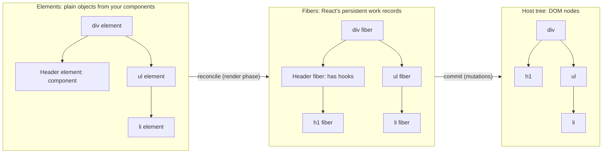

# 02 / 04 — The "Virtual DOM": What It Is and Is Not

## 1. Lesson metadata

| | |
|---|---|
| **Level** | Advanced |
| **Study time** | 4–5 hours (reading 2 h, building the mini-VDOM 1 h, exercises 1.5 h) |
| **Prerequisites** | [02 / 02 — Invocation vs render vs reconcile vs commit vs layout vs paint](./02-render-reconcile-commit-paint.md); [02 / 03 — Initial mount and subsequent updates](./03-initial-mount-and-updates.md); [Phase 0 / 04 — DOM structure, mutation, and the cost of touching it](../00-web-and-javascript-foundations/04-dom-structure-and-mutation.md); [Phase 1 / 04 — Elements, components, instances](../01-react-fundamentals/04-elements-components-instances.md) |
| **Next** | [05 — React elements vs DOM nodes](./05-elements-vs-dom-nodes.md) |
| **Related later** | [06 — Reconciliation: the diffing heuristics](./06-reconciliation-fundamentals.md), [08 — Why Fiber exists](./08-why-fiber.md), [09 — Fiber nodes and units of work](./09-fiber-nodes-and-units-of-work.md), [20 — Commit work and DOM mutations](./20-commit-and-dom-mutation.md), [Phase 9 / 08 — React Compiler](../09-advanced-rendering-and-ecosystem/08-react-compiler.md) |

**Learning objectives.** After this lesson you can:

1. Define "virtual DOM" as a *pattern* and map it onto React's three concrete structures: **elements**, **fibers**, and **host nodes**.
2. Explain what problem the pattern solves (a declarative programming model) and what problem it does **not** solve (it is not a performance trick that beats hand-written DOM code).
3. Refute the six most common virtual-DOM myths with mechanisms, not slogans.
4. Build a 60-line virtual DOM with diff/patch, and use it to explain why positional diffing needs keys.
5. Explain why React diffs against *previous props held by React*, not against the live DOM, and why external DOM mutation therefore breaks React.
6. Compare React's approach with compile-time (Svelte), fine-grained reactive (Solid), and optimized-VDOM (Vue) approaches without tribalism.

**Concepts covered:** virtual DOM as pattern, React element tree, fiber tree, host instances, reconciler vs renderer, host config, diff/patch, overhead vs abstraction, platform renderers, fine-grained reactivity, compiler-based frameworks, external DOM mutation hazards.

---

## 2. Deep conceptual explanation

### 2.1 What problem is this lesson solving?

"Virtual DOM" is the most repeated and least precise phrase in front-end engineering. In interviews you hear "React is fast because of the virtual DOM"; on social media you read "the virtual DOM is pure overhead." Both are slogans. You need an account that survives contact with the source code and with a profiler, because it determines:

- What you can safely do to the DOM from your own code (and why some things corrupt React).
- Where the cost of a re-render really lies (invocation and comparison, not DOM writes, usually).
- How to talk about alternative frameworks without folklore.
- Why the same React code can render to DOM, native views, PDFs, or a terminal.

### 2.2 The pattern, stated plainly

> **Teaching model.** A *virtual DOM* is the idea that the UI is described, on each update, as a **lightweight in-memory data structure** (a tree of plain objects). A library compares the new description with the previous one, computes the **minimal set of changes**, and applies only those changes to the real, expensive-to-mutate, stateful host (the browser DOM).

Why do this? Because writing UI by hand as "for each event, figure out which DOM nodes to touch and how" (*imperative* UI) is the part that does not scale in complexity: the number of state transitions grows combinatorially. The pattern lets you write *"given this state, the UI looks like this"* (*declarative*) and have the library derive the transitions ([Phase 1 / 02](../01-react-fundamentals/02-declarative-vs-imperative-ui.md), [03](../01-react-fundamentals/03-ui-as-a-function-of-state.md)).

> **The virtual DOM is a means to a programming model, not an end.** The thing you buy is *"re-describe the whole UI on every change, and let the machine work out the delta."* The thing you pay is the cost of re-describing and comparing.

### 2.3 React's concrete structures (and what "virtual DOM" refers to)

React has no single object called "the virtual DOM." It has three layers, and the phrase is sometimes used for the first, sometimes for the second, rarely precisely:

| Layer | What it is | Lifetime | Created by | Who uses it |
|---|---|---|---|---|
| **React elements** | Immutable plain objects: `{ type, props, key, … }`. A *description* of what you want. Cheap to create. | One render; usually garbage after the next render | `jsx()`/`createElement` (your JSX) | You, and React as input to reconciliation |
| **Fibers** | Mutable internal records: one per component instance and per host node. They carry state, hooks, props from the last render, pointers (parent/child/sibling), flags, and a link to the host node | Persist across renders for the life of the instance (double-buffered, see [10](./10-current-and-work-in-progress-trees.md)) | React's reconciler | React only |
| **Host instances** | The real DOM nodes (or native views etc.) | Persist while mounted | The renderer (`react-dom`), via the host config | Browser, your refs, DevTools |

Elements are what most people mean by the "virtual DOM" ("a tree of JS objects representing the DOM"). Fibers are what React actually walks and updates; they are the "virtual" structure with memory. Neither is a copy of the DOM: the element tree includes *components* (which have no DOM equivalent), has no layout or style information, and is not kept in sync node-by-node with the DOM by any browser mechanism.

> **This curriculum's convention.** We say **element tree** for what your components return, **fiber tree** for React's persistent internal tree, and **host tree** for DOM nodes. We use "virtual DOM" only to name the *pattern* and to discuss claims about it.

### 2.4 What React's own documentation says

React's current documentation (react.dev) does not build its explanations on the phrase: it speaks of *render*, *commit*, *the UI tree*, and *elements*. The older React docs (the legacy site) had an FAQ entry describing the virtual DOM as a programming concept where an ideal representation of the UI is kept in memory and synced with the real DOM by a library like ReactDOM, a process called reconciliation; it also described React elements and fibers as the concrete structures involved. Treat that as historical orientation, not a spec; the wording above was confirmed against the legacy FAQ (<https://legacy.reactjs.org/docs/faq-internals.html>, checked 2026-10-22).

> **Public guarantee.** React guarantees that after a commit, host nodes reflect the output of your components. It does **not** guarantee any specific diff algorithm, a minimal number of DOM operations, or that a particular DOM node is reused, except as the identity rules say ([06](./06-reconciliation-fundamentals.md), [07](./07-identity-keys-and-reconciliation.md)).

### 2.5 The six myths

| Myth | Reality (mechanism) |
|---|---|
| **1. "The virtual DOM makes React faster than the DOM."** | It cannot be faster than the best possible hand-written DOM code: React ultimately calls the same DOM APIs, *after* extra work (invoking components, creating elements, comparing). What it gives you is **good-enough, predictable performance for arbitrary UI updates without hand-written update logic.** |
| **2. "The DOM is slow, so we avoid it."** | DOM operations are not individually slow; what costs time is the browser work they *trigger*: style recalculation, layout, paint, and forced synchronous layout when reads and writes interleave ([Phase 0 / 03–04](../00-web-and-javascript-foundations/03-browser-rendering-pipeline.md)). Reducing needless DOM writes helps; the framework layer is not the only way to do so. |
| **3. "React diffs the virtual DOM against the real DOM."** | React compares the *new elements* with the *previous props/children recorded on fibers* (what it rendered last time). It does not read the DOM to find out what is there (except during hydration, and for some form-control synchronization). Hence mutating React-managed DOM from outside makes React's records wrong. |
| **4. "A re-render rebuilds the DOM."** | A render builds *elements* (cheap objects); commit applies only differences. Often a re-render performs **zero** DOM writes. |
| **5. "The virtual DOM is why React batches updates."** | Batching is an *update-scheduling* feature ([22](./22-automatic-batching.md)): several state updates are processed in one render pass. It is independent of whether you use a virtual DOM. A virtual DOM library with no batching would still diff correctly but render more often. |
| **6. "Virtual DOM = a copy of the DOM tree in memory."** | A copy of the DOM would include every node and attribute the browser holds. React elements describe only what *you* returned, including components that have no DOM nodes. The fiber tree contains component fibers, host fibers, fragments, contexts, Suspense boundaries; it is a *work-and-state graph*, not a DOM clone. |

### 2.6 Why not just update the DOM directly? When is the pattern worth it?

Direct DOM updates are the *fastest possible* implementation for a **known, small set of transitions**: you know exactly which node changes. They fail on **maintainability** when the state space is large: a dashboard with filters, selection, loading, error, optimistic, and offline states has too many pairwise transitions to hand-code correctly.

The virtual-DOM pattern trades a constant factor of overhead for **a model where correctness is local** ("this function returns the right UI for this state"). Equivalent mental model: *a pure function from state to UI plus a generic interpreter*. When the overhead matters, you still have escape hatches: skip subtrees (`memo`, children identity), virtualize lists, move hot paths to refs or canvas/WebGL, or compile away the overhead ([Phase 9 / 08 — React Compiler](../09-advanced-rendering-and-ecosystem/08-react-compiler.md)).

### 2.7 Other approaches (a map, not a ranking)

| Approach | Core idea | Example libraries | Cost model |
|---|---|---|---|
| **Virtual DOM, re-run component per update** | Re-run render function; diff element tree; patch | React, Preact | O(size of re-rendered subtree) per update, even if little changes |
| **Virtual DOM + compiler hints** | Compiler analyzes templates; marks dynamic parts so diff skips static ones | Vue 3 (patch flags, hoisting) | Close to O(dynamic bindings) per update |
| **Compile-time reactive updates** | Compiler turns templates into code that updates specific DOM nodes when specific variables change; no VDOM diff | Svelte | O(number of changed bindings) |
| **Fine-grained signals** | Components run once to build the DOM and wire subscriptions; signals update exactly the DOM text/attributes that depend on them | Solid (and signals in other frameworks) | O(subscribers of the changed signal) |
| **Template diffing at runtime** | Tagged-template strings cached; only dynamic parts updated | Lit (`lit-html`) | Proportional to dynamic parts |
| **Incremental DOM / change detection** | Compiled instructions walk and update DOM; framework decides when to run | Angular (Ivy; plus signals) | Depends on change-detection strategy |

These descriptions are summaries; each ecosystem evolves quickly (e.g., Vue's no-VDOM "Vapor" compilation mode is in the Vue 3.6 release-candidate line on npm as of 2026-10-22; Angular builds on signals). Check current docs before citing them in a design document. The point for this course: **React's cost is "re-run and compare"; its benefit is "arbitrary JavaScript in render, uniform model, many renderers."** The React Compiler narrows the cost side by skipping recomputation automatically ([Phase 9 / 08](../09-advanced-rendering-and-ecosystem/08-react-compiler.md), volatile; verify).

---

## 3. Internal mechanics

### 3.1 Reconciler and renderer: why "virtual" matters for portability

**[Teaching model]** React is split into:

- **The reconciler** (platform-independent): fibers, render phase, hooks, scheduling, diffing of elements.
- **A renderer / host config** (platform-specific): "how do I create a node, set a property, append, remove, schedule a callback in this environment?"

`react-dom` is the web renderer; React Native has its own; others render to canvas/three.js, PDFs, terminals. The reconciler is exposed as a package (`react-reconciler`) that lets you write a custom renderer by implementing a host config. Because the reconciler only talks to the host through that interface, the element/fiber trees must be *independent of the DOM*, which is the strongest reason they are "virtual." `react-test-renderer` was deprecated in React 19 (React 19 Upgrade Guide); prefer React Testing Library ([Phase 8 / 03](../08-testing-and-quality/03-react-testing-library.md)).

**[Public guarantee]** `react-dom`'s public API (`createRoot`, `flushSync`, portals, etc.) is stable; the reconciler's internals and `react-reconciler`'s host-config surface are **not** public application API and change between releases.

### 3.2 Where the previous state lives: fibers keep the "old virtual DOM"

During an update, for each host component (`<div className="a">`), React holds:

- `fiber.memoizedProps`: the props from the last committed render.
- `fiber.pendingProps`: the props from the render in progress (from the new element).
- `fiber.stateNode`: the live DOM node.

**[Implementation detail]** Comparing `memoizedProps` and `pendingProps` produces the set of property changes to apply at commit. React reads **nothing** from `stateNode` to decide what to change (an important exception: controlled inputs, where React sets `value` and checks DOM `value` to restore it; and hydration, where server HTML is compared). This is why:

- `document.querySelector("p").textContent = "hacked"` on a React-managed node will **not** be reverted by React if React thinks nothing changed, and will be **overwritten** only if React later computes a change to that text. React's records say the text is "Hello", the DOM says "hacked": divergence.
- Removing a node React manages with `el.remove()` can make a later React `removeChild` throw (`NotFoundError`).

### 3.3 What diffing compares

For each fiber, comparing "new element vs old fiber":

| Case | Decision |
|---|---|
| Same `type` and `key` | Reuse the fiber (keep state/DOM); update props |
| Different `type` (or key) | Delete old subtree; create a new one |
| Host component, same type | Diff props: for each prop, compare old and new values (style object property-wise); apply changes; recurse into children |
| Text | Update text content if string differs |
| Component, same type | Re-invoke (unless skipped), recurse into returned children |

The full heuristics are the subject of [06](./06-reconciliation-fundamentals.md). Here the point is only: **the comparison is against previous React-side data.**

### 3.4 Cost anatomy of a "virtual DOM update"

For a subtree re-rendered with unchanged output, the costs are:

1. **Invocation** of each component function (your code; usually the largest).
2. **Element creation**: allocating plain objects for all JSX returned (garbage pressure).
3. **Reconciliation bookkeeping**: fiber cloning, prop comparisons, flag setting.
4. **Commit** work: only for real differences (small, often zero).
5. **Browser work** triggered by the DOM writes (style/layout/paint).

Steps 1–3 are "virtual DOM overhead." They scale with the number of components *rendered*, not with the number of DOM changes. This is why the optimization levers ([Phase 7](../07-performance/01-measure-before-optimizing.md)) are mostly about **rendering fewer components** (colocation, bailing out, virtualization), not about "reducing DOM writes."

### 3.5 The React Compiler and the pattern

The React Compiler (opt-in build step; v1.0 stable since October 2025, see react.dev/learn/react-compiler) automatically memoizes values and JSX inside components, so a re-render creates fewer new element objects and lets more subtrees bail out by reference equality. It does not change the *pattern*: the output of a component is still elements, diffed by the reconciler. It reduces the overhead term in §3.4, not the programming model.

---

## 4. Step-by-step execution walkthrough

Scenario: a `Status` component renders `<p className="ok">Saved</p>`. After a state change it renders `<p className="ok">Saving…</p>`.

| # | Step | Data structure | Notes |
|---|---|---|---|
| 1 | Render N (previous): `Status` returns an element. | `{ type: "p", key: null, props: { className: "ok", children: "Saved" } }` (an **element**) | Created by `jsx("p", { className: "ok", children: "Saved" })` |
| 2 | Reconciliation (mount): React creates a host fiber for `p`. | Fiber `p`: `memoizedProps = { className: "ok", children: "Saved" }`, `stateNode = <p class="ok">Saved</p>` (a **host node**) | The old element object is no longer needed; its props live on the fiber |
| 3 | Update triggered. `Status` invoked again. | New element `{ type: "p", props: { className: "ok", children: "Saving…" } }` | A *different object* even though most values are equal |
| 4 | Reconcile: same type `"p"`, same key (`null`) → reuse fiber; `pendingProps` = new props. | Fiber `p` (work-in-progress clone) | |
| 5 | Prop diff: `className` equal (`"ok" === "ok"`) → skip; `children` string differs → record text change. | A set of changes on the fiber (conceptual: `{ children: "Saving…" }`) | Not a DOM operation yet |
| 6 | Commit: apply to `stateNode` (the live `<p>`): set its text content. | **One DOM write** | `className` is untouched |
| 7 | After commit: `memoizedProps ← pendingProps`. | Fiber now records the new props | The next diff will use these |

What this teaches: the "virtual" element existed for microseconds; the long-lived record is on the fiber; and exactly one DOM mutation happened.

**Predict:** if instead `Status` returned `<span className="ok">Saving…</span>`, what changes at step 4? *Answer:* different `type` → no reuse; React deletes the `<p>` host node and creates a new `<span>` (two DOM operations: remove and insert), and any state in a *component* below would be lost.

---

## 5. Code examples

### 5.1 Minimal example — inspect an element (it is just an object)

```tsx
const el = <p className="ok">Saved</p>;
console.log(el);
console.log(typeof el, Object.isFrozen(el), el.type, el.props);
```

**Predict:** What does `el.type` print? Is `el` a DOM node?

**Result:** `el.type` is the string `"p"`; `el` is a plain object (`typeof` is `"object"`), not an `HTMLParagraphElement`; `el.props` is `{ className: "ok", children: "Saved" }`. In development builds the element is frozen (`Object.isFrozen` true; verified on React 19.3.1); in production it may not be. Do not depend on frozen-ness or on private fields such as `_owner` or `_store`. More in [05](./05-elements-vs-dom-nodes.md).

### 5.2 Practical example — measuring the "overhead" honestly

Hypothesis to test: *"React re-rendering a list with unchanged output costs more than doing nothing, but far less than rebuilding the DOM."* Experiment sketch (do it in a production build with `vite build && vite preview`):

```tsx
import { useState } from "react";

function Row({ n }: { n: number }) { return <li>{n}</li>; }

export function List({ size }: { size: number }) {
  const [tick, setTick] = useState(0);
  const t0 = performance.now();
  const rows = Array.from({ length: size }, (_, i) => <Row key={i} n={i} />);
  // The commit happens after this function returns; measure around setTick with the Profiler instead.
  console.log("element creation ms:", (performance.now() - t0).toFixed(2));
  return (
    <>
      <button onClick={() => setTick((t) => t + 1)}>re-render {tick}</button>
      <ul>{rows}</ul>
    </>
  );
}
```
Use `<Profiler>` (see [02](./02-render-reconcile-commit-paint.md) §5.5) around `<List>` to read `actualDuration`, and the Performance panel to see commit and layout. Typical observations (qualitative; numbers vary hugely by hardware): re-rendering 10,000 identical rows costs tens of milliseconds of scripting and **no** layout or paint (no DOM mutations), while rebuilding the list's DOM would cost significantly more layout/paint work. If you wrap `Row` in `memo`, the cost collapses to the comparisons. If `size` is 20, the cost is invisible. Lesson: the overhead is real and proportional to components rendered; it is paid in JS, not in DOM writes.

### 5.3 Incorrect example — fighting React over the DOM

```tsx
import { useEffect, useRef, useState } from "react";

export function Banner() {
  const [msg, setMsg] = useState("Hello");
  const ref = useRef<HTMLParagraphElement>(null);

  useEffect(() => {
    // A third-party "enhancer" or a developer mutates the node React manages:
    ref.current!.textContent = "Hello (enhanced)";
  }, []);

  return (
    <>
      <p ref={ref}>{msg}</p>
      <button onClick={() => setMsg("Goodbye")}>change</button>
    </>
  );
}
```

**Predict:** After mount the page shows "Hello (enhanced)". The user clicks "change". What does the paragraph show?

**Result:** "Goodbye". React's recorded previous text is `"Hello"`; the new text is `"Goodbye"`; they differ, so React sets the text node's content. The enhancement is overwritten. In a variant where `msg` does *not* change (e.g. `setMsg("Hello")` again), React sees no difference and leaves the DOM alone: the DOM now **lies** about the component's output ("Hello (enhanced)" while React thinks "Hello"). Worse case: if the "enhancer" *replaces the text node* rather than changing its data (e.g., wraps it in a `<font>` element, as some page-translation tools have done), the next React text update may throw `NotFoundError` on `removeChild`/`insertBefore` because the node React holds is no longer a child of its parent.

### 5.4 Corrected implementation

Treat DOM you do not own as a boundary. Two safe patterns:

```tsx
// 1) Let React own the content; derive "enhanced" from state.
const label = enhanced ? `${msg} (enhanced)` : msg;
return <p>{label}</p>;

// 2) For third-party widgets that must own a subtree: give them a dedicated empty container,
//    create/destroy in an effect with cleanup, and never let React render children into it.
function ThirdPartyChart({ data }: { data: number[] }) {
  const ref = useRef<HTMLDivElement>(null);
  useEffect(() => {
    const chart = createChart(ref.current!, data);   // library mutates ref.current's children
    return () => chart.destroy();                     // cleanup symmetric with setup
  }, [data]);
  return <div ref={ref} />;                           // React renders only the empty container
}
```
Pattern 2 works because React never has children recorded for that `div`, so there is nothing to diverge from. (If `ThirdPartyChart` re-renders with identical props, React writes nothing to the div, so the chart survives.)

### 5.5 Advanced example — a 60-line virtual DOM, then why keys exist

```ts
// mini-vdom.ts — a teaching toy, not React.
export type VNode = { tag: string; props: Record<string, string>; children: VChild[] };
export type VChild = VNode | string;

export function h(tag: string, props: Record<string, string> | null, ...children: VChild[]): VNode {
  return { tag, props: props ?? {}, children };
}

function create(v: VChild): Node {
  if (typeof v === "string") return document.createTextNode(v);
  const el = document.createElement(v.tag);
  for (const [k, val] of Object.entries(v.props)) el.setAttribute(k, val);
  for (const c of v.children) el.appendChild(create(c));
  return el;
}

function changed(a: VChild, b: VChild): boolean {
  if (typeof a === "string" || typeof b === "string") return a !== b;   // text vs text or text vs element
  return a.tag !== b.tag;
}

function patchProps(el: Element, oldP: Record<string, string>, newP: Record<string, string>): void {
  for (const k of Object.keys(oldP)) if (!(k in newP)) el.removeAttribute(k);
  for (const [k, v] of Object.entries(newP)) if (oldP[k] !== v) el.setAttribute(k, v);
}

function patchNode(parent: Node, dom: Node, oldV: VChild, newV: VChild): void {
  if (changed(oldV, newV)) { parent.replaceChild(create(newV), dom); return; }
  if (typeof oldV === "string" || typeof newV === "string") return;      // equal text
  patchProps(dom as Element, oldV.props, newV.props);
  patchChildren(dom, oldV.children, newV.children);
}

function patchChildren(dom: Node, oldC: VChild[], newC: VChild[]): void {
  const common = Math.min(oldC.length, newC.length);
  for (let i = 0; i < common; i++) patchNode(dom, dom.childNodes[i], oldC[i], newC[i]);  // by POSITION
  for (let i = common; i < newC.length; i++) dom.appendChild(create(newC[i]));
  for (let i = oldC.length - 1; i >= common; i--) dom.removeChild(dom.childNodes[i]);
}

export function mount(container: Element, tree: VNode): { update(next: VNode): void } {
  container.replaceChildren(create(tree));
  let prev = tree;
  return {
    update(next) { patchNode(container, container.firstChild!, prev, next); prev = next; },
  };
}
```

Usage:
```ts
const app = mount(document.getElementById("root")!,
  h("ul", null, h("li", { id: "a" }, "Ann"), h("li", { id: "b" }, "Bob"), h("li", { id: "c" }, "Cy")));

app.update(h("ul", null, h("li", { id: "a" }, "Ann"), h("li", { id: "b" }, "Bob!"), h("li", { id: "c" }, "Cy")));
```

**Predict:** the second call changes one text. Which DOM operations run?

**Result:** exactly one: `Text.data` replacement through `replaceChild` of the text node inside the second `<li>` (this toy replaces the text node rather than editing its data; a refinement is to set `nodeValue`). Tag, attributes and the other items are untouched. That is the whole virtual-DOM idea.

**Now the failure mode.** Update to *remove Ann at the front*:
```ts
app.update(h("ul", null, h("li", { id: "b" }, "Bob!"), h("li", { id: "c" }, "Cy")));
```
This toy compares by position: item 0 (`id="a"`, "Ann") against new item 0 (`id="b"`, "Bob!"): it rewrites the attribute and the text of the first `<li>`; item 1 likewise; then removes the *last* `<li>`. Result: 2 attribute writes + 2 text replacements + 1 removal, instead of 1 removal, and any state **inside** those `<li>`s (a focused input, a running animation) now sits in the wrong item. React's `key` solves exactly this: it lets the diff say "the first old child is gone; the other two *moved*", preserving each item's DOM and state ([07](./07-identity-keys-and-reconciliation.md)).

**Trade-offs.** The toy has no keys, no components, no events, no batching, no scheduling, no interruption, no hooks. Everything React adds beyond this toy exists to make the *pattern* usable at scale: identity (keys/types), state attached to identity, effects, priorities, and interruptibility ([08](./08-why-fiber.md)).

---

## 6. Visual explanations

### 6.1 Three trees



Note the shape mismatch: `Header` is a component, so it exists in the element and fiber trees but has **no** DOM node of its own.

### 6.2 Where the "old" tree lives for diffing

```text
RENDER N   (previous commit)                            RENDER N+1 (this update)
 your component ──► elements_N  ──reconcile──► fibers_N       your component ──► elements_N+1
                                │ memoizedProps                                       │ pendingProps
                                ▼                                                     ▼
                       DOM nodes (stateNode)           diff(memoizedProps, pendingProps) ──► changes
                                                                                           │
                                                      commit: apply changes to DOM nodes ◄─┘
 React never reads DOM to compute the diff (except hydration / controlled inputs).
```

### 6.3 Cost model of "re-run and compare" vs "update exactly what changed"

```text
Change one value that affects one text node, in a subtree of N components:

 React (no memo):      invoke ~N components → compare outputs → 1 DOM write      cost ∝ N
 React (memo/colocate): invoke ~k components → compare → 1 DOM write             cost ∝ k  (k ≪ N)
 Signals / compiled:   run the 1 subscriber that updates the text node            cost ∝ 1
 Hand-written DOM:     el.textContent = x                                          cost ∝ 1, you maintain the wiring
```

---

## 7. Alternative approaches and trade-offs

Scenario: a live-updating price table (500 cells change per second).

| Approach | Readability | Performance ceiling | Complexity | Testability | Notes |
|---|---|---|---|---|---|
| React, state at top, re-render everything | High | Low | Low | High | Fine for ≤100 rows; poor for streaming |
| React, per-row subscription (`useSyncExternalStore` + `memo` rows) | Medium | Good | Medium | High | Only changed rows re-render ([Phase 3 / 20](../03-react-state-and-hooks/20-usesyncexternalstore-and-external-stores.md)) |
| React + imperative DOM writes via refs for hot cells | Low–Medium | Excellent | Medium–High | Medium | Bypasses reconciliation for the hot path; React must not render children for those nodes |
| Canvas / WebGL grid | Low | Excellent for huge grids | High | Low | Accessibility and text selection become your problem |
| Signals-based framework (Solid etc.) | High | Excellent | Framework migration cost | High | Not an option if you are committed to React |
| Virtualized React table | Medium | Excellent (limits DOM size) | Medium | Medium | Usually the best first move ([Phase 7 / 09](../07-performance/09-windowing-and-virtualization.md)) |

**When "just use React declaratively" is not best:** a 60 fps drag interaction updating a single element's `transform`: use a ref and write `el.style.transform` directly (or CSS animations/Web Animations), because routing every pointer move through React state is wasted work, and the single element is not part of the "UI state" you need to render declaratively. Commit the final position to state on release.

---

## 8. Best practices and anti-patterns

**Do**
- Own your subtree: if React renders it, only React mutates it. If a library mutates it, give the library an empty container React renders no children into.
- Use refs and effects (with symmetric cleanup) for integrating imperative libraries.
- Discuss "re-render cost" in terms of *components invoked* and *work per component*, not "DOM diffs."
- Say "elements," "fibers," and "host nodes" when precision matters.

**Beginner mistakes**
- Calling `document.getElementById(...).innerHTML = ...` on nodes React renders.
- Believing `memo` or keys "make the virtual DOM faster" without knowing what they skip.
- Believing a re-render always modifies the DOM.

**Experienced-developer mistakes**
- Repeating "virtual DOM is fast/slow" in design discussions instead of measuring.
- Over-optimizing DOM writes while ignoring invocation cost of large rerenders.
- Choosing a framework by VDOM slogans rather than team skill, ecosystem, SSR/RSC story, and measured needs.
- Allowing browser extensions/translation features to be ignored in QA for global audiences (see §10).

**Smells:** `dangerouslySetInnerHTML` used as a way to run imperative DOM code; direct `querySelector` in components for things refs can do; `forceUpdate`-style hacks to resync with external DOM changes.

**Justified exceptions:** imperative DOM for animation hot paths, canvas/WebGL, third-party widgets, focus/scroll management (always via refs and effects).

---

## 9. Real-world application

**Financial dashboard with a map widget.** A third-party map library (Mapbox/Leaflet-like) mounts into a `div`. React must render *only* the container; the map mutates its children. When `center` or `layers` props change, an effect calls the library's `setCenter`/`setLayers` rather than re-rendering children. Constraints: avoid re-creating the map on each render (stable instance in a ref, created in an effect with cleanup), and handle Strict Mode's double setup (destroy in cleanup).

**Global product with auto-translation.** Browser translation features can mutate text nodes. In a React app, a user translating the page may later trigger crashes ("Failed to execute 'removeChild' on 'Node'") when React updates text that was wrapped/replaced. Constraints: you cannot control user browsers. Mitigations: wrap dynamic text in elements (so React updates an element's content rather than a bare text node sibling), mark non-translatable parts `translate="no"`, offer in-app localization ([Phase 10 / 09](../10-production-engineering/09-internationalization.md)), and track errors in monitoring ([Phase 10 / 05](../10-production-engineering/05-error-monitoring.md)). ⚠ Behavior depends on the browser/tool; reproduce with the actual tool before claiming a fix.

**Multi-platform product (web + native).** The same business logic and hooks can be shared across React DOM and React Native because the reconciler is platform-independent; only the host components (`div` vs `View`) differ. Constraint: share logic, not markup, unless using a cross-platform component layer.

**Rich text editor.** `contentEditable` makes the *browser* mutate the DOM as the user types. Letting React also render those children is a recipe for divergence; editor libraries (ProseMirror/Lexical/Slate) own the DOM and expose state; React hosts them in a container and subscribes to their state.

**Design-system `Portal`.** Modals rendered via `createPortal` live in a different DOM location but remain in the same fiber tree (context, events bubble through the React tree): evidence that fibers and DOM are different structures.

---

## 10. Debugging and troubleshooting

### Symptom A: "NotFoundError: Failed to execute 'removeChild' / 'insertBefore' on 'Node'"
1. This means React tried to operate on a node that is no longer where it believes it is.
2. Reproduce with a clean profile and no extensions; then enable translation/extension candidates one by one.
3. Search your code for imperative DOM access to React-owned nodes: `innerHTML`, `appendChild`, `remove()`, jQuery on rendered nodes, third-party code that wraps text.
4. Check for **two copies of React** or two roots managing the same container.
5. Validate the fix: stress with repeated state toggles (`for` loop in tests) and the specific extension/tool.

### Symptom B: "UI shows something that is not in my state."
The DOM and React's records diverged (external mutation) or a controlled input is out of sync (value without `onChange`, or an uncontrolled→controlled switch warning). Compare DevTools *Components* props/state with the *Elements* panel. If the *Components* tab says one thing and the DOM another, suspect external mutation.

### Symptom C: "Re-render of a big subtree is slow although no DOM changes happen."
That's the "virtual DOM overhead": invocation/comparison cost. Use the Profiler: which components, how long, how many commits. Fix by reducing components rendered (colocate, `children`, `memo`, virtualization), not by "optimizing DOM operations."

### Symptom D: "Third-party widget disappears after parent re-render."
Likely React re-created the container (key/type change) or renders children into it. Ensure the container element's identity is stable and has no React children; instantiate the widget in an effect keyed to the container.

---

## 11. Exercises

### Level A — Knowledge
A1. Define the virtual-DOM pattern in two sentences.
A2. Name React's three concrete structures and give one fact about the lifetime of each.
A3. True/false with a reason: (a) React compares the new elements to the live DOM. (b) A component with no DOM output still has a fiber. (c) The virtual DOM is why React batches updates.
A4. What does the reconciler delegate to the renderer (host config)?
A5. Give two reasons the DOM is "expensive" that are not "DOM operations are slow."

### Level B — Code comprehension
B1. How many DOM writes does this update cause (from `n=1` to `n=2`)? Explain.
```tsx
function Box({ n }: { n: number }) {
  return <div className="box" data-n={n}><span>static</span>{n}</div>;
}
```
B2. Compare the DOM operations for `cond ? <p>x</p> : <span>x</span>` toggling vs `<p className={cond ? "a" : "b"}>x</p>` toggling.
B3. In the mini-VDOM (§5.5), after removing the *last* item of a three-item list, how many DOM operations occur? After removing the *first*?
B4. A `<div ref={ref}>` rendered by React has `ref.current.appendChild(extra)` called in an effect. Parent later re-renders and passes new children to the div. Predict what can go wrong.

### Level C — Implementation
C1. Extend the mini-VDOM so text-only updates mutate `nodeValue` instead of replacing the text node. What DOM method changes, and what is the effect on focus/selection inside text?
C2. Add *keyed* children (`props.key`) to the mini-VDOM: when child keys exist, match old and new children by key, reuse DOM nodes, and reorder with `insertBefore`. Write the algorithm and a test showing that removing the first item performs one removal.
C3. Write a React hook `useImperativeText(ref, text)` for a hot-path cell that writes `textContent` directly without re-rendering, and explain the constraints on what React may render inside that node.

### Level D — Debugging
D1. A team enabled an in-browser translation feature in QA and sees `removeChild` errors only when a status label updates. The label is `<div>Status: {status}</div>`, which React DOM renders as two adjacent text nodes. Explain the failure and fix.
D2. A Leaflet/Mapbox-like map flashes and re-initializes on every parent render. Code: `return <div ref={(el) => el && initMap(el)} />`. Why, and how do you fix it?
D3. "We changed `className` through jQuery and React reverted it." Explain precisely when React reverts and when it doesn't.

### Level E — Architecture decisions
E1. Your team is building a high-frequency charting component for a React app. Compare: SVG via React, canvas via refs, and WebGL. Choose with criteria and define the boundary between React-owned and imperative code.
E2. A colleague proposes migrating from React to a signals-based framework because "the virtual DOM is overhead." Write the evaluation framework: what you would measure and what non-performance factors matter.

### Level F — Expert challenge
F1. Design (on paper) how you would implement a *second renderer* for React that renders to a JSON "scene graph" (for tests or snapshots), listing the host-config responsibilities, what would be reused from the reconciler, and which React features have no meaning in that host (e.g., layout effects, refs).

---

## 12. Detailed answers and explanations

> Attempt the exercises first.

**A1.** A virtual DOM is a pattern in which the UI is re-described on each update as a lightweight in-memory tree; a library diffs the new tree against the previous description and applies only the necessary changes to the real DOM. It buys a declarative programming model at the cost of describing and comparing.

**A2.** Elements: immutable plain objects, short-lived (one render). Fibers: React's mutable internal records, persistent across renders for an instance's lifetime (double-buffered). Host instances (DOM nodes): persist while mounted, owned by the browser/renderer.

**A3.** (a) **False**: it compares to previous props/children recorded on fibers; DOM is read only in special cases (hydration, controlled input restoration). (b) **True**: components have fibers even without DOM nodes. (c) **False**: batching is update scheduling; independent of the diffing pattern.

**A4.** Creating instances, setting properties, appending/inserting/removing children, text handling, scheduling/time primitives, event system hookup, and commit hooks (prepare/reset/mutation callbacks). The reconciler never calls DOM APIs directly.

**A5.** Triggered work: style recalculation, layout (reflow), paint, compositing; forced synchronous layout when reads and writes interleave; and the size of the DOM (cost grows with node count). Individual `setAttribute` calls are cheap.

**B1.** Two DOM writes: the `data-n` attribute (`"1"` → `"2"`) and the text node for `{n}`. `className` and the `span` are untouched. The common wrong answer is "one" (forgetting the attribute).

**B2.** First: types differ (`p` vs `span`) → remove old element, create and insert new one (and any component state below would reset). Second: same type; only `className` differs → one `setAttribute`/`className` write. Lesson: type changes are much more destructive than prop changes.

**B3.** Remove last: `patchChildren` removes one trailing node: **1** operation (the items before it compare equal; no writes). Remove first: item 0 vs old item 1: tag equal, props differ (`id`) → attribute write; text differs → text node replace; same for item 1; then remove the last `<li>`: about **5** operations instead of 1, and identity/state shifts to the wrong items. This is the failure keys solve.

**B4.** React's record of that `div` includes certain children (those rendered). Appending an extra node outside React's knowledge may be tolerated until React inserts/removes siblings relative to positions (`insertBefore` with a reference node may place things oddly), or React may *remove* all children when it replaces them (the extra node vanishes), or throw if the structure assumptions break. Undefined; avoid. Use a dedicated empty container.

**C1.**
```ts
// in patchNode
if (typeof oldV === "string" && typeof newV === "string") {
  if (oldV !== newV) dom.nodeValue = newV;     // mutate in place instead of replaceChild
  return;
}
```
(The `changed()` function must then treat text vs text as "not changed in kind.") Effect: the same Text node persists, which preserves selection/IME composition within it and avoids node churn; React DOM updates text this way (it sets the text node's data/`nodeValue` detail).

**C2.** Algorithm (match by key, reuse nodes, remove vanished keys first, then reorder with a cursor):
```ts
type KChild = VNode & { key: string };

function patchKeyed(dom: Element, oldC: KChild[], newC: KChild[]): void {
  const newKeys = new Set(newC.map((c) => c.key));
  const oldByKey = new Map<string, { vnode: KChild; node: Node }>();
  oldC.forEach((c, i) => oldByKey.set(c.key, { vnode: c, node: dom.childNodes[i] }));

  for (const [k, e] of oldByKey) {                 // 1. remove nodes whose keys vanished
    if (!newKeys.has(k)) { dom.removeChild(e.node); oldByKey.delete(k); }
  }

  let cursor: Node | null = dom.firstChild;        // 2. walk the new order
  for (const n of newC) {
    const hit = oldByKey.get(n.key);
    const node = hit ? hit.node : create(n);
    if (hit) patchNode(dom, node, hit.vnode, n);   // update in place (assumes same tag; see note)
    if (node === cursor) cursor = cursor.nextSibling;
    else dom.insertBefore(node, cursor);           // move or insert
  }
}
```
Test: old keys `[a, b, c]` → new `[b, c]`: step 1 removes `a` (one `removeChild`); step 2 finds each node already at the cursor, so no `insertBefore` calls and no property writes: **one DOM operation**. Note: `patchNode` can *replace* the node when tags differ, which would invalidate `node`; a production version returns the new node. Evaluation criteria: map by key, reuse DOM, handle removals, minimal moves. React's own list algorithm is a single forward pass with a "last placed index" heuristic rather than a full minimal-move computation ([06](./06-reconciliation-fundamentals.md)).

**C3.**
```tsx
import { useLayoutEffect, type RefObject } from "react";
export function useImperativeText(ref: RefObject<HTMLElement | null>, text: string): void {
  useLayoutEffect(() => { if (ref.current) ref.current.textContent = text; }, [ref, text]);
}
// <td ref={cellRef} />  — React renders NO children into this node.
```
Constraints: React must not render children for this element (otherwise React's text/child records diverge); the hook runs when `text` changes, so for per-frame updates you would *not* pass `text` through React props at all; you would expose an imperative `set(text)` from a subscription callback. State clearly that this bypasses React's model for a measured hot path only.

**D1.** Translation tools often wrap text nodes in `<font>` elements. React's record: the `div` has two children: text `"Status: "` and text `{status}` (adjacent text nodes). After the tool restructures them, React's `removeChild`/`insertBefore` on its stored text-node references throws because those nodes are no longer direct children of the `div`. Fix: put dynamic text in its own element (`<div>Status: <span>{status}</span></div>`) so React updates the span's content (not sibling text nodes), add `translate="no"` where appropriate, and test with the specific tool. Wrong plausible fix: "catch the error": it hides inconsistent UI.

**D2.** The inline ref callback is a new function every render, so React calls the old one with `null` and the new one with the element on every render: `initMap` is re-run each time. Fix: create the map in a `useEffect` with `[]` deps (or a stable ref callback) and clean up with `map.remove()`; update via effects keyed on props: `useEffect(() => { mapRef.current?.setCenter(center); }, [center])`. In React 19 a ref callback can return a cleanup function, which pairs well with imperative libraries, but the identity problem remains for inline callbacks.

**D3.** React reverts a DOM change only when it computes a change for that same property in a later commit (its record says old→new differ). If React's record already equals the new value, it does nothing: the external change persists (and diverges). A controlled `<input>`'s `value` is a special case: React actively restores it after events. So reversion is incidental, not a guarantee. Don't rely on it.

**E1.** Criteria: points per frame, interactivity/accessibility, text rendering, dev cost, testability, bundle. Example: SVG-in-React is fine up to a few thousand nodes and gives accessibility/events; above that, canvas; WebGL for 100k+ points. Boundary: React owns configuration, layout shell, toolbar, legend, and a `<canvas>` element; imperative code owns drawing, driven by an effect/subscription with `requestAnimationFrame` batching; data flows via a ref'd store, not React state per tick. Reject per-frame React state updates for the data points.

**E2.** Measure real bottlenecks (INP, long tasks, profiler on the actual app) before judging the framework. A signals framework could reduce per-update CPU for fine-grained updates but costs migration, ecosystem differences, hiring, SSR/RSC story, testing tools, and the risk of re-learning mistakes. Consider incremental fixes first (colocation, virtualization, Compiler). Decision rule: migrate only if measured bottlenecks are structural (many fine-grained updates), mitigations are exhausted, and total cost is justified; or for greenfield with different priorities. Document with an ADR ([Phase 10 / 16](../10-production-engineering/16-architecture-decision-records.md)).

**F1.** Host-config responsibilities (conceptually): create instance (`{type, props, children: []}`), create text instance, append/insert/remove child, commit property updates, clear container, schedule/priority hooks, and commit-phase hooks; "supportsMutation" mode (as opposed to persistent mode). Reused: fibers, hooks, state, Suspense, concurrent scheduling, context, effects (passive effects work unchanged). Not meaningful: layout/geometry (layout effects can run but nothing is measured), DOM events, focus, refs to DOM nodes (refs get your JSON node objects), portals to DOM containers. Evaluation: the answer distinguishes platform-independent semantics from host operations, and notes that the host config API is not stable public API ("verify with `react-reconciler` README").

---

## 13. Senior engineer interview questions

**Q1. "What is the virtual DOM, and is it why React is fast?"**
*Strong answer:* It's a pattern where UI is described as lightweight objects, diffed, and patched. In React: elements (descriptions), fibers (persistent work records), host nodes (DOM). It isn't why React is fast; it's why React is *declarative* and portable. It adds overhead relative to ideal manual DOM code but provides predictable performance for arbitrary updates; where overhead matters, you reduce rendered components, virtualize, or bypass React for hot paths.

**Q2. "Does React diff against the real DOM?"**
*Strong answer:* No: against previous props/children held on fibers. That's why external DOM mutation causes drift/crashes; exceptions are hydration and controlled inputs. Consequence: isolate third-party DOM in containers React doesn't render into.

**Q3. "How does Svelte or Solid avoid a virtual DOM, and what do they give up?"**
*Strong answer:* Svelte compiles templates into direct DOM update code keyed to state changes; Solid builds DOM once and uses fine-grained signals so only dependent DOM updates. They avoid re-run-and-compare overhead. Trade-offs: different programming constraints (compile-time analysis, reactivity rules), smaller ecosystem than React, different SSR/hydration stories; React's strengths are uniform model, ecosystem, renderers, and (via concurrent features) scheduling. Don't claim one is universally faster; measure workloads.

**Q4. "How would you integrate a charting library that mutates the DOM?"**
*Strong answer:* Render an empty container; instantiate in an effect with cleanup (idempotent for Strict Mode); update through imperative methods in effects keyed on data; avoid React children inside; stable container identity; handle resize with `ResizeObserver`; keep hot data out of React state.

**Q5. "Where does the cost of a React update live?"**
*Strong answer:* Mostly in invoking components and creating/comparing elements (scales with components rendered), then in browser style/layout/paint triggered by actual DOM changes. DOM write count is rarely the dominant factor; reducing rendered components is the main lever.

---

## 14. Further learning resources

| Resource | URL | Covers / why | Level | Study |
|---|---|---|---|---|
| React docs — Understanding Your UI as a Tree | <https://react.dev/learn/understanding-your-ui-as-a-tree> | Render tree and module dependency tree concepts | Beginner | Whole page |
| React docs — `createElement` | <https://react.dev/reference/react/createElement> | What an element is | Beginner–Int. | Reference |
| React docs — `createPortal` | <https://react.dev/reference/react-dom/createPortal> | React tree vs DOM tree | Intermediate | Whole page |
| React docs — Manipulating the DOM with Refs | <https://react.dev/learn/manipulating-the-dom-with-refs> | Safe/unsafe DOM mutation, warnings about changing React-managed nodes | Intermediate | "Best practices for DOM manipulation with refs" |
| React legacy docs — Virtual DOM and Internals (FAQ) | <https://legacy.reactjs.org/docs/faq-internals.html> | Historical definition of the term | Beginner | Whole page |
| `react-reconciler` package | <https://github.com/facebook/react/tree/main/packages/react-reconciler> | Custom renderers and host config | Advanced | README |
| acdlite — React Fiber Architecture | <https://github.com/acdlite/react-fiber-architecture> | Community-authored overview by a React team member (older, conceptual) | Advanced | Whole document, read critically |
| Svelte blog — "Virtual DOM is pure overhead" | <https://svelte.dev/blog/virtual-dom-is-pure-overhead> | The critic's perspective; read with §7 in mind | Intermediate | Whole post |
| Vue docs — Rendering Mechanism | <https://vuejs.org/guide/extras/rendering-mechanism> | Optimized VDOM with compiler hints | Intermediate | Compiler-informed VDOM |
| SolidJS docs | <https://www.solidjs.com/docs/latest> | Fine-grained reactivity vs VDOM | Intermediate | Reactivity concepts |

URLs in this table were checked for HTTP 200 on 2026-10-22; any still marked *(unverified)* could not be checked automatically. A 200 does not guarantee the page content still matches the description; if a link has moved, search the site for the quoted title.

---

## 15. Knowledge checkpoint

**You should now understand**
- The virtual DOM as a pattern realized in React by elements, fibers, and host nodes, with the diff done against previous React-side props.
- Why the pattern buys a programming model, not a speed advantage over optimal manual DOM code.
- Why external DOM mutation of React-owned nodes is unsafe, and how to isolate imperative libraries.
- That update cost is mostly invocation + comparison, which is why rendering fewer components is the main lever.

**You should be able to explain without notes**
- Why React doesn't read the DOM to diff.
- The six myths and their mechanisms.
- How Svelte/Solid/Vue differ in cost model, without tribal claims.

**You should be able to implement**
- A small keyless VDOM and a keyed extension; an imperative-library wrapper component.

**You should be able to debug**
- `removeChild`/`insertBefore` NotFoundError; divergence between Components tab and Elements panel; widgets that re-initialize on re-render.

**Before moving on:** read [05 — React elements vs DOM nodes](./05-elements-vs-dom-nodes.md) to inspect the actual shape of elements and the exact differences from DOM nodes.
