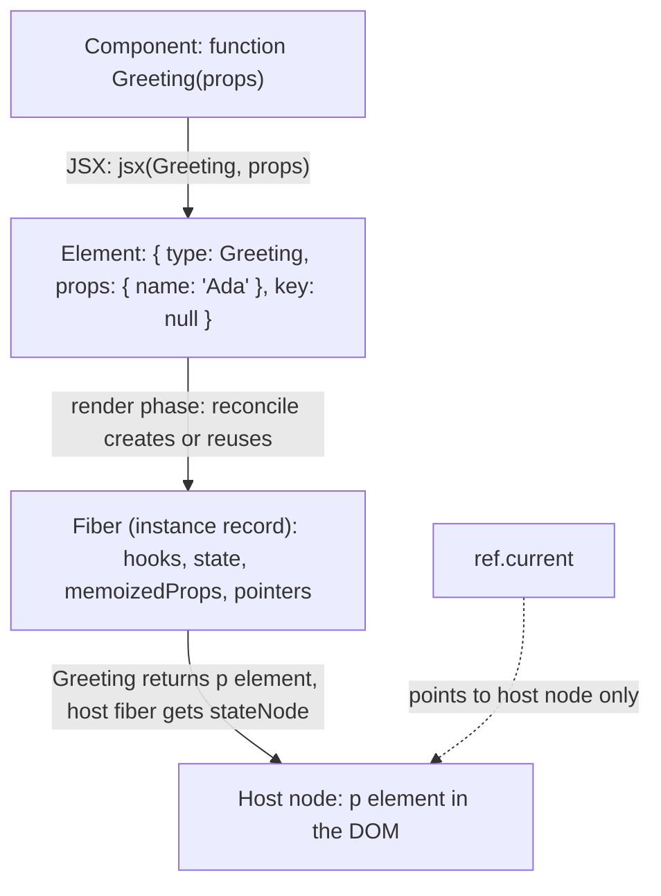

# 02 / 05 — React Elements vs DOM Nodes

## 1. Lesson metadata

| | |
|---|---|
| **Level** | Intermediate |
| **Study time** | 4 hours (reading 1.5 h, console experiments 1 h, exercises 1.5 h) |
| **Prerequisites** | [02 / 04 — The "virtual DOM": what it is and is not](./04-virtual-dom-what-it-means.md); [Phase 1 / 04 — Elements, components, instances](../01-react-fundamentals/04-elements-components-instances.md); [Phase 1 / 05 — JSX and its transformation](../01-react-fundamentals/05-jsx-explained.md); [Phase 0 / 04 — DOM structure, mutation, and the cost of touching it](../00-web-and-javascript-foundations/04-dom-structure-and-mutation.md) |
| **Next** | [06 — Reconciliation: the diffing heuristics](./06-reconciliation-fundamentals.md) |
| **Related later** | [07 — Component identity and keys, revisited](./07-identity-keys-and-reconciliation.md), [09 — Fiber nodes and units of work](./09-fiber-nodes-and-units-of-work.md), [20 — Commit work and DOM mutations](./20-commit-and-dom-mutation.md), [Phase 5 / 20 — Slot patterns](../05-design-patterns/20-slot-patterns.md), [Phase 9 / 03 — Server Components in depth](../09-advanced-rendering-and-ecosystem/03-server-components-in-depth.md) |

**Learning objectives.** After this lesson you can:

1. Write down, from memory, the documented fields of a React element and say which are public and which are internal.
2. Distinguish four things that are routinely confused: an **element**, a **component** (type), a **fiber/instance**, and a **DOM node**, using lifetimes, mutability, and identity.
3. Explain why creating an element never renders anything, and why calling a component as a plain function is a bug.
4. Map React props to DOM properties, attributes, and event handlers, and name where the mapping is *not* 1:1.
5. Type slots and component props correctly in TypeScript (`ReactNode`, `ReactElement`, `ComponentType`, `ElementType`).
6. Diagnose the family of errors: "Objects are not valid as a React child," "Functions are not valid as a React child," "Element type is invalid."

**Concepts covered:** element shape, `type` kinds (string, function, special objects/symbols), `props`, `key`, `ref` (React 19 change), element immutability, JSX runtime, element vs component vs instance vs DOM node, refs and what they point to, prop → DOM mapping, elements as data (slots, storing JSX in state), `cloneElement`, `Children`, TypeScript element types.

---

## 2. Deep conceptual explanation

### 2.1 What problem is this lesson solving?

Most React confusion about "what is this thing?" dissolves once you separate four objects that all get called "the component" or "the element" in everyday speech:

```tsx
function Greeting({ name }: { name: string }) {   // (1) a COMPONENT (a function; "type")
  return <p className="hi">Hello, {name}</p>;     // (2) JSX creates ELEMENTS
}
const el = <Greeting name="Ada" />;               // (2') an ELEMENT whose type is the Greeting function
// After React renders el into a root:
//   (3) a FIBER (React's internal record) exists for this Greeting instance
//   (4) a DOM NODE (HTMLParagraphElement) exists for the <p>
```

If you cannot say which of the four you are talking about, you will make category errors: "I'll store the component in state" (the element? the type? the instance?), "I need a ref to the component" (a ref gives you a DOM node, not the element), "the element updates" (elements never update, they are replaced).

### 2.2 Anatomy of a React element

> **Public guarantee (documented, `createElement` reference).** An element is a plain object with at least: `type`, `props`, `key`. In React 18 and earlier it also had a top-level `ref`; **in React 19, `ref` is an ordinary prop** and is found in `props.ref`. Elements are *immutable*: you must never change their props. React freezes them in development builds. You create them with JSX or `createElement`; `isValidElement(x)` tests for one.

```ts
// Conceptual shape (React 19-style), NOT a type you should rely on:
type ReactElementShape = {
  $$typeof: symbol;          // internal brand; in 19 it is Symbol.for("react.transitional.element")
                             // (18: "react.element"); verified by logging an element on 19.3.1
  type: string | Function | symbol | object;   // what to render
  key: string | null;
  props: { children?: unknown; [prop: string]: unknown };
  // dev-only/internal fields vary by version: _owner, _store, _debugInfo, _debugStack, ...
};
```

Field by field:

| Field | Meaning | Visible to your code? |
|---|---|---|
| `type` | **What** to render. A string for a host element (`"div"`), a function/class for a component, or a special type for built-ins (`Fragment`, `Suspense`, `StrictMode`, `Profiler` are symbols; `memo`, `forwardRef`, `lazy`, and context are objects wrapping a render function or value). | Yes (`el.type`), rarely needed |
| `props` | The input object. Contains `children` when present. Does **not** contain `key`. In React 19 contains `ref` if provided. Treated as read-only. | Yes |
| `key` | Reconciliation identity hint among siblings, always a string or `null` (numbers are stringified). **Not** exposed to the component via `props` (reading `props.key` warns/`undefined`). | Yes on the element, not inside the component |
| `ref` | React ≤18: separate element field. React 19: a prop. Reading `element.ref` still returns the value but logs a dev warning ("Accessing element.ref was removed in React 19"); use `element.props.ref`. | Version-dependent |
| `$$typeof` | A symbol brand that lets React recognize genuine elements; a *security measure*: an object parsed from untrusted JSON cannot contain a `Symbol`, so injected JSON can't masquerade as an element (historically defends against XSS via data). | Internal |
| `_owner`, `_store`, `_debug*` | DevTools / warnings bookkeeping (owner component, validation flags, stack info). | Internal. Never depend on them. |

### 2.3 What `type` can be (and why `type` identity matters)

| `type` is… | Example | Meaning |
|---|---|---|
| A **string** | `"div"`, `"input"` | Host element: React DOM creates this DOM tag |
| A **function** | `Greeting` | Function component: React will *call* it |
| A **class** | `class X extends Component` | Legacy class component: React will *construct* it |
| A **symbol** | `Fragment`, `Suspense`, `StrictMode`, `Profiler` | Built-in structural element |
| An **object** | `memo(Fn)`, `forwardRef(Fn)` (legacy in 19), `lazy(() => import())`, `Context` | Wrapper types with their own `$$typeof` and handling |

> **Why this matters for the rest of Phase 2:** reconciliation compares `type` values with `===` ([06](./06-reconciliation-fundamentals.md)). Two elements whose `type`s are *different function objects* are different types even if the functions' code is identical. That is why defining a component inside another component's body remounts it on every render ([03](./03-initial-mount-and-updates.md) §5.6).

### 2.4 Elements vs DOM nodes: a systematic comparison

| Property | React element | DOM node (e.g., `HTMLDivElement`) |
|---|---|---|
| What it is | A plain JS object *describing* UI | A browser host object that *is* part of the document model |
| Created by | `jsx()` / `createElement` (your render) | The browser (parser, `document.createElement`) or React DOM during commit |
| Size/weight | A handful of fields; extremely cheap | Hundreds of properties and methods via prototype chain; backed by native objects; costly relative to an element |
| Mutability | Immutable (never edit props) | Mutable (`el.textContent = …`) |
| Lifetime | Typically one render; garbage collected after | Persists until removed and unreferenced |
| Identity | Meaningless: a *new* object every render even when equal; compared only by `type`/`key`/position | Meaningful: the same node object across the page's life |
| Tree structure | Nested via `props.children`; no parent pointer | `parentNode`, `childNodes`, `nextSibling`… maintained by the browser |
| Can describe a component? | Yes (`type` is a function) | No: DOM nodes exist only for host elements and text |
| Layout/style | None. Pure data | Has geometry, computed styles, and triggers layout/paint |
| Events | Handler functions are *props* on the element | Listeners are registered with the browser (React registers delegated listeners at the root) |
| Reuse | The same element object may appear in several places in a tree; each position gets its own fiber/DOM node | One node can be in only one place in the document |
| Where you access it | In render (as values you create/receive) | In effects/handlers via refs, never in render |

> **Teaching model:** *elements are the instructions; DOM nodes are the building.* You re-issue instructions every render (cheap); React reconciles them against what already stands and changes the building minimally.

### 2.5 Component vs element vs instance (the classic triad)

| Concept | What it is | Count |
|---|---|---|
| **Component (type)** | The function (or class) you wrote | One per definition |
| **Element** | An object `{ type: Component, props }` returned by JSX; a *request* to render that component with these props | New ones each render |
| **Instance** | The persistent record React keeps for a mounted use of a component: its fiber, hook state, effects. For class components, also the `new Component()` object (`this`) | One per mounted position |

Function components have **no user-visible instance** (`this` doesn't exist); "instance" means React's fiber state ([09](./09-fiber-nodes-and-units-of-work.md), [17](./17-hooks-and-fiber-state.md)). Refs on a function component (in 19, passed as a `ref` prop) point to whatever the component forwards them to (often a DOM node or an imperative handle via `useImperativeHandle`), not to "the component."

The canonical historical explanation is Dan Abramov's 2015 blog post "React Components, Elements, and Instances" on the legacy React blog (<https://legacy.reactjs.org/blog/2015/12/18/react-components-elements-and-instances.html>; link checked 2026-10-22). It predates Fiber and hooks, but its vocabulary remains correct.

### 2.6 Creating an element does not render anything

```tsx
const a = <Expensive />;     // runs jsx(Expensive, null): an object allocation. Expensive is NOT called.
```

`Expensive` runs only when React encounters that element during a render pass *and decides to render it*. Consequences:

- `const a = <Expensive/>; const b = <Cheap/>; return cond ? a : b;` creates two elements but renders one component.
- Creating an element and *never returning it* costs a small allocation and zero rendering.
- The same element object returned by the parent on a subsequent render allows React to skip the subtree by reference equality ([01](./01-what-triggers-a-render.md) §3.4).

### 2.7 Misconceptions

| Misconception | Reality |
|---|---|
| "JSX produces HTML." | JSX compiles to function calls that return element *objects*. HTML/DOM is produced by React DOM at commit. |
| "`<Foo />` calls `Foo`." | It creates an element. `Foo` is called later, by React, if/when it renders. |
| "A ref gives me the element/component." | A ref gives you the **host node** (for DOM elements), a class instance (for class components), or whatever the component's author exposed. |
| "Props are copied to DOM attributes." | Props are *inputs* to components. Only the props of **host elements** are applied to DOM nodes, via a mapping (`className` → `class`, events → listeners, `style` object → CSS properties). |
| "If I mutate `props.children`/`props`, React will notice." | Elements are immutable; mutation throws in strict-mode code in development (frozen) or silently corrupts in production. |
| "Storing JSX in state is fine." | The element captures the props of the render that created it; storing it freezes *stale* props (§5.3). Store data; create elements in render. |
| "An element and a component instance are the same." | Elements are descriptions recreated each render; the instance is React's persistent record. |

---

## 3. Internal mechanics

### 3.1 From JSX to element objects (the JSX runtime)

**[Public guarantee]** JSX is syntax sugar. With the automatic runtime (the default in Vite/Next/TS `jsx: "react-jsx"`), the compiler emits calls to `jsx`/`jsxs` imported from `react/jsx-runtime` (and `jsxDEV` from `react/jsx-dev-runtime` in development):

```tsx
// Source
<Card title="Hi" key="a">
  <Button onClick={go}>Go</Button>
</Card>

// Compiled (conceptually, automatic runtime)
jsx(Card, { title: "Hi", children: jsx(Button, { onClick: go, children: "Go" }) }, "a")
```

Points: `key` is passed as a separate third argument (so the runtime can extract it); `jsxs` is used when `children` is a static array of multiple children (React uses this distinction in dev warnings: static arrays don't require keys); `children` becomes a prop. Classic runtime emitted `React.createElement(type, props, ...children)`. See [Phase 1 / 05](../01-react-fundamentals/05-jsx-explained.md) and [Phase 0 / 20](../00-web-and-javascript-foundations/20-tooling-transpilation-and-bundling.md).

### 3.2 The element → fiber → DOM pipeline for one `<p>`

| Step | Object | Created/updated by |
|---|---|---|
| 1. Your component returns `<p className="hi">Hello</p>` | Element `{ type: "p", props: { className: "hi", children: "Hello" }, key: null }` | `jsx()` |
| 2. Reconciler creates/updates a host fiber for it | Fiber with `type: "p"`, `pendingProps` = element's props | React (render phase) |
| 3. Host config creates a DOM node (on mount) | `HTMLParagraphElement` with `class="hi"` and a text child | `react-dom` (completion step) |
| 4. Commit inserts it into the document | Node attached | `react-dom` (commit) |
| 5. Fiber records `memoizedProps` = element's props; `stateNode` = DOM node | – | React |
| 6. Element object becomes garbage | – | GC |

**[Implementation detail]** After step 5, the element is unreferenced by React; only its *props object* lives on in the fiber as `memoizedProps`. This is the reason "the old virtual DOM" in React is really "old props on fibers" ([04](./04-virtual-dom-what-it-means.md) §3.2).

### 3.3 Props → DOM: the host-config mapping

For host elements, `react-dom` interprets props. This is a documented behavior in the sense of React DOM's reference docs for components like `<input>`, `<div>`; some detail is implementation.

| Prop kind | Example | What React DOM does |
|---|---|---|
| Renamed attribute | `className`, `htmlFor`, `tabIndex`, `acceptCharset` | Sets the corresponding attribute/property (`class`, `for`, `tabindex`) |
| `style` | `style={{ backgroundColor: "red" }}` | Object of camelCase CSS properties; **property-wise** updates; custom properties via `"--x"` keys. A string `style` is not accepted. |
| Event handlers | `onClick`, `onChange` | Not set as DOM attributes. React attaches *delegated* listeners at the root container and dispatches synthetic-ish events to handlers following React's tree ([Phase 1 / 10](../01-react-fundamentals/10-event-handling.md)). |
| Boolean attributes | `disabled`, `checked`, `hidden` | `true` sets the attribute/property; `false` removes it |
| Form value props | `value`, `checked`, `defaultValue` | `value` makes an input *controlled*: React sets and restores the DOM property. `defaultValue` sets the initial attribute only ([Phase 1 / 11](../01-react-fundamentals/11-controlled-and-uncontrolled-inputs.md)). |
| `dangerouslySetInnerHTML` | `{ __html: html }` | Sets `innerHTML`; you own sanitization ([Phase 10 / 06](../10-production-engineering/06-security-xss-csrf-csp.md)) |
| `data-*`, `aria-*` | `data-id="3"`, `aria-label="x"` | Passed through as attributes (hyphenated names are kept) |
| `key`, `ref`, `children` | – | `key` is for reconciliation, not applied; `ref` attaches the node ([02](./02-render-reconcile-commit-paint.md)); `children` become child nodes |
| Unknown props | `foo="bar"` | Passed as attributes for known-safe values (strings/numbers); `false`/functions for unknown names are not rendered, with dev warnings (verified on 19.3.1: `foo={false}` and function-valued unknown props are dropped with a console error) |
| Custom elements (`<my-widget>`) | `<my-widget foo={obj} />` | React 19 added full custom-element support (react.dev React 19 post, "Support for Custom Elements"): on the client, props matching a property on the element instance are set as properties, otherwise as attributes; during SSR, primitive values (and `true`) render as attributes while objects, functions, symbols and `false` are omitted |

**Property vs attribute.** The DOM distinguishes the HTML *attribute* (initial markup string) from the JS *property* (live state). `input.value` is a property that diverges from `getAttribute("value")` after typing. React DOM chooses property or attribute per prop; for form controls it maintains the property. This difference explains why `defaultValue` vs `value` behave differently and why reading the *attribute* of a controlled input in DevTools shows stale values.

### 3.4 What a ref points to

| Ref placed on | `ref.current` becomes |
|---|---|
| Host element (`<div ref={r} />`) | The DOM node (`HTMLDivElement`) |
| Class component | The class instance (`this`) |
| Function component | Nothing automatic. In React 19, `ref` arrives as a normal prop (`props.ref`) which you forward to a DOM node or bind with `useImperativeHandle`. In React ≤18 you needed `forwardRef`; in 19 it still works but is legacy (new code does not need it). |

When does it point? **Set during commit**, detached during commit when the node unmounts or the ref changes; never valid during render ([02](./02-render-reconcile-commit-paint.md) §3.3).

### 3.5 Element immutability and `Children` utilities

**[Public guarantee]** Don't mutate elements. To derive a modified element you create a new one: `cloneElement(element, extraProps)` (returns a new element with merged props; documented, but the React docs now discourage it in favor of explicit props, render props, or context because it is fragile with wrappers/typing). `Children.map/forEach/count/toArray/only` operate on `children`; `Children.toArray` flattens and assigns keys. They don't deeply traverse *rendered output* of components, only the element objects you passed. Docs call these "uncommon," and note alternatives.

### 3.6 Elements across the server boundary (preview)

With Server Components, a server render produces element trees that are *serialized* (a "payload") to the client rather than HTML only. Elements whose `type` are Client Component references become placeholders the client resolves. This only works because elements are plain data. Functions and class instances in props cannot be serialized across that boundary except Server Actions/specific cases ([Phase 9 / 04](../09-advanced-rendering-and-ecosystem/04-client-server-boundaries-and-serialization.md), [27](./27-react-server-components-intro.md)). The list of serializable prop types is documented on react.dev (`'use client'` reference, "Serializable types"); the bundler/framework integration is framework-specific.

---

## 4. Step-by-step execution walkthrough

Scenario: `Profile` renders a card. First mount with `user={ name: "Ada" }`, then an update with `name: "Alan"`.

```tsx
function Profile({ user }: { user: { name: string } }) {
  return (
    <section className="card">
      <h2>{user.name}</h2>
      <Avatar seed={user.name} />
    </section>
  );
}
function Avatar({ seed }: { seed: string }) { return ; }
```

| # | Event | Elements created (garbage after) | Fibers | DOM nodes |
|---|---|---|---|---|
| 1 | Mount: `Profile` invoked with `name: "Ada"` | `section`-element, `h2`-element, `Avatar`-element | – | – |
| 2 | Reconcile: create fibers: `Profile`, `section`, `h2`, text, `Avatar` | – | 5 new | – |
| 3 | `Avatar` invoked | `img`-element | + `img` fiber | – |
| 4 | Completion: host instances created | – | host fibers get `stateNode` | `section`, `h2`, text, `img` created detached |
| 5 | Commit: insert `section` into container | – | – | **1 insertion** (subtree) |
| 6 | After commit: fibers keep `memoizedProps`; the 4 element objects are unreferenced | (collected) | persist | persist |
| 7 | Update (`name: "Alan"`): `Profile` invoked | **4 brand-new element objects**, not equal by `===` to step 1's | – | – |
| 8 | Reconcile: `section`/`h2`/`Avatar` types match → fibers reused; `h2` text differs; `Avatar` props `seed` differs → `Avatar` re-invoked | `img`-element (new) | clones of 5+ fibers | – |
| 9 | `img` `src` differs; `alt` unchanged | – | – | – |
| 10 | Commit | – | – | text node data set; `img.src` set. **2 DOM writes** |

Observations: the element tree is rebuilt completely each render (steps 1, 7); the *fibers and DOM nodes persist and are modified*. If `Avatar` were `memo` and `seed` unchanged, `Avatar` would be skipped; its element would still have been created in `Profile`'s render (the allocation cost is paid by the *parent*).

---

## 5. Code examples

### 5.1 Minimal example — look at an element and a DOM node

```tsx
import { isValidElement } from "react";

const el = <button className="primary" disabled>Save</button>;

console.log(isValidElement(el));          // true
console.log(el.type);                      // "button"
console.log(el.key);                       // null
console.log(el.props);                     // { className: "primary", disabled: true, children: "Save" }

// DOM node, from the live document after React rendered it:
const node = document.querySelector<HTMLButtonElement>("button.primary")!;
console.log(node instanceof HTMLButtonElement);   // true
console.log(node.disabled, node.className);        // true "primary"
```

**Predict:** What is `typeof el`? What is `el.props.children`? Does `el` have a `parentNode`?

**Result:** `"object"`; `"Save"`; no. `parentNode` exists only on DOM nodes. Elements know their children (through props) but not their parents.

### 5.2 Practical example — slots: passing elements vs component types

Design-system API choice:

```tsx
import type { ComponentType, ReactNode } from "react";

// (A) Slot as an ELEMENT (ReactNode): caller decides props; the slot is "already created"
type CardPropsA = { title: string; icon?: ReactNode };
export function CardA({ title, icon }: CardPropsA) {
  return <header>{icon}<h3>{title}</h3></header>;
}
// <CardA title="Billing" icon={<CreditCardIcon size={16} aria-hidden />} />

// (B) Slot as a COMPONENT TYPE: the Card decides props and when to render it
type IconProps = { size: number };
type CardPropsB = { title: string; Icon?: ComponentType<IconProps> };
export function CardB({ title, Icon }: CardPropsB) {
  return <header>{Icon && <Icon size={16} />}<h3>{title}</h3></header>;
}
// <CardB title="Billing" Icon={CreditCardIcon} />
```

**Predict:** Which one lets `Card` control the icon's `size` consistently? Which one lets the caller pass `aria-hidden` and `className` freely? Which is cheaper when the parent re-renders?

**Result:** (B) controls size; (A) lets the caller control everything but Card cannot enforce consistency. In (A) the icon element is created in the *caller's* render (allocation each parent render; if the caller's parent re-renders but `Card` is memoized, `icon` is a new object each time and defeats `memo`). In (B) `Icon` is a stable function reference, so `memo(CardB)` works. Trade-off summary: (A) is flexible (`ReactNode` accepts strings, fragments, null); (B) is constrained (typed props) and memo-friendly. Many libraries accept both patterns ([Phase 5 / 20](../05-design-patterns/20-slot-patterns.md)).

### 5.3 Incorrect example — storing JSX in state

```tsx
import { useState } from "react";

function Chart({ data }: { data: number[] }) { /* renders chart */ return <pre>{data.join(",")}</pre>; }

export function Report({ data }: { data: number[] }) {
  const [view, setView] = useState<React.ReactElement>(<Chart data={data} />);  // ❌ element frozen at mount

  return (
    <>
      <button onClick={() => setView(<p>other</p>)}>other</button>
      {view}
    </>
  );
}
```

**Predict:** The parent passes new `data` on a later render. What does the chart show?

**Result:** the **old** data. The stored element holds props from the first render (`{ data: <old array> }`); new `data` is never injected. This is "stale props" via elements. It also bypasses normal reasoning ("UI is a function of state") because the stored element is a *snapshot of output*, not state.

### 5.4 Corrected implementation

Store the minimal *data* that distinguishes views, and create elements during render:

```tsx
type View = "chart" | "other";

export function Report({ data }: { data: number[] }) {
  const [view, setView] = useState<View>("chart");
  return (
    <>
      <button onClick={() => setView(view === "chart" ? "other" : "chart")}>toggle</button>
      {view === "chart" ? <Chart data={data} /> : <p>other</p>}
    </>
  );
}
```

`Chart` receives current `data` on each render; `view` is serializable state. Exceptions where storing elements is acceptable: static, prop-independent elements (e.g., a constant `const ICON = <Icon />` at module scope, safe because it never depends on props), or a **modal service** that stores *an element plus an explicit update path* knowing the staleness trade-off. Prefer storing a descriptor (`{ kind: "confirm", props }`) and rendering from it.

### 5.5 Advanced example — calling a component as a function (identity and hooks)

```tsx
import { useState } from "react";

function Counter({ label }: { label: string }) {
  const [n, setN] = useState(0);
  return <button onClick={() => setN(n + 1)}>{label}: {n}</button>;
}

export function Parent({ showA }: { showA: boolean }) {
  const [flag, setFlag] = useState(false);
  return (
    <>
      <button onClick={() => setFlag(!flag)}>flag {String(flag)}</button>
      {/* ❌ direct call: Counter's hooks become Parent's hooks */}
      {showA ? Counter({ label: "A" }) : null}
      {/* ✅ element: Counter gets its own fiber and hooks */}
      <Counter label="B" />
    </>
  );
}
```

**Predict:** What goes wrong with the direct call, and what happens if `showA` toggles?

**Result:** `Counter({label:"A"})` runs *inside `Parent`'s render*, so `useState` inside it registers as a hook of **`Parent`**, not of a separate component. Consequences: (1) `Parent`'s hook count changes when `showA` toggles, which violates the Rules of Hooks ("Rendered more hooks than during the previous render" or silent state corruption); (2) there is no separate fiber, so DevTools shows no `Counter` component; (3) a state change in `A` re-renders all of `Parent`; (4) no independent identity/keys. With `<Counter label="A" />` React creates a *component boundary* with its own hooks, state, and re-render scope.

**When is calling a function acceptable?** For plain helper functions that return JSX without hooks (`renderRow(item)`), conceptually inlining part of `Parent`'s output; the result is elements, not a component. If the helper uses hooks, it must be a component.

---

## 6. Visual explanations

### 6.1 Four things, one line of JSX



### 6.2 One element object, two positions

```text
const icon = <Icon />;            // ONE element object

return (<>
  <Button>{icon}</Button>         // position 1 → fiber A → DOM node A
  <Link>{icon}</Link>             // position 2 → fiber B → DOM node B   (same element, different instances)
</>);

Elements are descriptions; the same description can be instantiated twice.
A DOM node, by contrast, cannot be in two places at once.
```

### 6.3 Lifetimes

```text
render 1:  [e1][e2][e3]  ──reconcile──►  fibers F1 F2 F3 + DOM D1 D2 D3
render 2:  [e1'][e2'][e3'] (new objects) ──reconcile (reuse by type/key)──► same F1 F2 F3, same D1 D2 D3, few writes
           ▲ garbage after commit                                 ▲ persist across renders
```

---

## 7. Alternative approaches and trade-offs

Question: how should a reusable `Dialog` accept its footer actions?

| Approach | Type | Flexibility | Consistency | Memo-friendliness | Testability | Notes |
|---|---|---|---|---|---|---|
| `footer: ReactNode` (element slot) | `ReactNode` | Highest | Caller's responsibility | Poor if inline elements (new each render) | High | Default for layout slots |
| `actions: ActionSpec[]` (data, Dialog renders buttons) | `{label, onClick, variant}[]` | Limited to supported shapes | Strong (Dialog enforces) | Good if array stable | High | Good for design-system consistency |
| `renderFooter: () => ReactNode` (render prop) | function | High; lazily invoked | Medium | Function identity matters | High | Useful when Dialog supplies state to the footer |
| `Footer: ComponentType<FooterProps>` | component type | Medium | Strong (Dialog supplies props) | Good (stable type) | High | When the Dialog owns the props contract |
| Compound components (`<Dialog.Footer>`) | children + context | High, ergonomic | Medium | Medium | Medium | Shared implicit state ([Phase 5 / 05](../05-design-patterns/05-compound-components.md)) |

**When the "pass elements" default is *not* best:** when the library must render the slot conditionally *many times* or inject props (focus management, size tokens). Data-driven APIs or component-type slots avoid `cloneElement` hacks. Conversely, when consumers need arbitrary content (a link, an icon plus a tooltip), forcing data specs would explode the API: use `ReactNode`.

---

## 8. Best practices and anti-patterns

**Do**
- Create elements during render from current props/state.
- Use `ReactNode` for "anything renderable" slots; `ReactElement` only when you need an element specifically; `ComponentType<P>` / `ElementType` when you need to render a type yourself.
- Treat `props` and `children` as read-only.
- Put refs on DOM elements to touch the DOM; forward refs as plain props in React 19.

**Beginner mistakes**
- `{Component}` (function as child) instead of `<Component />`.
- Rendering a plain object/array of objects as a child.
- Using an element as if it were a DOM node (`el.style`, `el.focus()`).
- Calling components as functions.

**Experienced-developer mistakes**
- Reaching for `cloneElement` to inject props into arbitrary children (breaks with wrappers, fragments, memo, and typing).
- Putting JSX in state, context values, or module-level caches that depend on props.
- Inspecting `element.type.name` to make decisions (minification, wrappers like `memo`); using `element.type === Button` identity checks that break when the library re-wraps components.
- Relying on private fields (`_owner`, `$$typeof`) in tests or tooling.

**Smells:** `React.Children.toArray(children).map(child => cloneElement(...))` in a library without documentation of the constraint; `typeof child.type === "string"` checks; large element trees created in module scope.

**Justified exceptions:** a design-system `Tabs` that reads `Children` to build tab headers (document the constraint "direct children must be `Tab`"; consider the compound/context alternative); module-scope constant elements for static content (cheap and skip re-render by identity).

---

## 9. Real-world application

**Design-system slots (multi-team).** A `Button` accepts `leftIcon?: ReactNode`. Product teams pass `<Spinner />` while loading, `<CheckIcon />` when done. The design-system maintainers' constraint: `Button` is wrapped in `memo`, but because callers pass inline elements, `memo` never skips. Resolution options: document that `memo` benefits only stable props, pass component types (`LeftIcon: ComponentType<IconProps>`), or provide a `loading` boolean that makes `Button` render the spinner itself.

**Form libraries.** `<Field render={({ field }) => <Input {...field} />} />`: a render prop returns an *element created per render* with current field state: never cache it across renders.

**Dashboards with widget registries.** A registry maps `type: string → ComponentType<WidgetProps>`. Layout JSON from the server describes widgets as data (`{ type: "chart", props }`), and a renderer creates elements: `const W = registry[w.type]; return <W key={w.id} {...w.props} />`. Why not store elements: JSON is serializable; elements with function props are not; and the data flows through React's normal update path.

**Server Components.** Elements are the unit of serialization: the server describes UI as elements; client references stand in for client components. Constraint: props crossing the boundary must be serializable (no functions except server actions) ([Phase 9 / 04](../09-advanced-rendering-and-ecosystem/04-client-server-boundaries-and-serialization.md)).

**Testing.** React Testing Library queries the DOM (what users see), not elements. Snapshots of element trees are brittle; snapshots of DOM output are less so ([Phase 8 / 16](../08-testing-and-quality/16-avoiding-brittle-tests.md)).

---

## 10. Debugging and troubleshooting

| Error / symptom | Cause | Investigation | Fix |
|---|---|---|---|
| **"Objects are not valid as a React child (found: object with keys {…})"** | You put a plain object (or `Date`, `Promise`, class instance) where a renderable child belongs | The error lists the keys; search for `{value}` where `value` is an object | Render a field (`{user.name}`), format (`date.toISOString()`), or for promises use `use()` / Suspense |
| **"Functions are not valid as a React child"** | `{Component}` instead of `<Component />`, or a render function placed in children | Look for a missing `<` `/>` | Write `<Component />` or call the render function: `{renderItem(item)}` |
| **"Element type is invalid: expected a string (for built-in components) or a class/function … but got: undefined"** | Import/export mismatch (default vs named), circular import, or a typo; `type` is `undefined` | Log the import; check the file's export; check barrel files and circularities | Fix the import; verify named vs default |
| **"Each child in a list should have a unique key"** | Array children without keys (element creation point) | Stack indicates the component that created the array | Provide stable keys ([07](./07-identity-keys-and-reconciliation.md)) |
| **"Cannot add property X, object is not extensible" / assigning to read-only `props`** | Mutating props/element | The stack points at the mutation | Copy: `{ ...props, x }` or create a new element |
| **`ref.current` is `null`/wrong type** | Ref on a component without forwarding (React ≤18), element not mounted yet, or conditional render | Check where ref is attached; in 19 pass `ref` as prop | Forward to DOM; read in effect/handler |
| **Stale UI from stored JSX** | Element stored in state/module/closure | Search for `useState(<…>)`, `useMemo(() => <…>, [])` with missing deps | Store data; create elements in render; fix memo deps |
| **`el.type.name` is wrong in production** | Minification renames functions; wrappers (`memo`) change shape | DevTools shows `displayName` | Don't branch on names; use identity or an explicit marker |

**DevTools notes.** In the *Components* tab, select a component and use `$r` in the console to get the selected fiber's component instance/props; in the *Elements* panel, `$0` is the selected DOM node. Use both to see the two universes side by side.

---

## 11. Exercises

### Level A — Knowledge
A1. List the documented fields of an element and say which are internal.
A2. What is the difference between an element and a component? Between a component and an instance?
A3. What does `<Foo />` evaluate to at runtime?
A4. What does a `ref` on a host element give you, and when?
A5. In React 19, where does `ref` live on an element and what happened to `forwardRef`'s necessity?

### Level B — Code comprehension
B1. Which of these log "render B"?
```tsx
function A() { console.log("render A"); return null; }
function B() { console.log("render B"); return null; }
function App({ x }: { x: boolean }) {
  const a = <A />;
  const b = <B />;
  return x ? a : b;
}
```
for `<App x={true} />`.
B2. Given `const el = <Foo bar={1}>hi</Foo>`, write the value of `el.props`. What is `el.key`?
B3. This renders twice in the tree. How many fibers and DOM nodes exist for `icon`?
```tsx
const icon = <svg />;
return <><p>{icon}</p><p>{icon}</p></>;
```
B4. What error occurs and why?
```tsx
function Page() { const user = { name: "Ada" }; return <div>{user}</div>; }
```

### Level C — Implementation
C1. Write a type-safe `Slot` helper: `renderSlot(slot: ReactNode | ComponentType<P>, props: P): ReactNode` that accepts either an element-like node or a component type, and explain the pitfalls of detecting which is which.
C2. Write `isElementOfType<P>(node: ReactNode, type: ComponentType<P>): node is ReactElement<P>` and explain why it can fail with `memo`'d or re-exported components.
C3. Implement a `Tabs` where tab labels come from *data* instead of `cloneElement` over children, and compare with the children-inspection version in terms of typing and robustness.

### Level D — Debugging
D1. The chart doesn't update when `data` changes: `const chart = useMemo(() => <Chart data={data} />, []);`. Why? Fix it, and say when `useMemo` for elements *is* appropriate.
D2. `Warning: Each child in a list should have a unique "key" prop` points at `List`, but `List` has `items.map(i => <Item key={i.id} />)`. What else could create the array?
D3. A `Counter` is called as `{Counter()}` and "Rendered more hooks than during the previous render" appears when toggling a condition. Explain.
D4. "Element type is invalid … got: object" after `export default memo(Foo)` was changed to `export const Foo = memo(...)` without updating imports. Explain the failure mode.

### Level E — Architecture decisions
E1. Your design system has 40 components with slot props typed `ReactNode`. Teams complain `memo` on design-system components never helps. Propose API and documentation changes, with trade-offs for each option.
E2. Decide between "children inspection" and "context-based compound components" for a `Select` with `Option`s that may be wrapped by app components (`<MyOption/>`). Justify with criteria.

### Level F — Expert challenge
F1. Without running it, draw the element tree, fiber tree, and DOM tree for the following, marking which objects are re-created on a state change in `Wrapper`, which fibers are reused, and which DOM nodes get writes. Then say whether `Memoized` re-invokes.
```tsx
const Memoized = memo(function Memoized({ n }: { n: number }) { return <i>{n}</i>; });
function Wrapper() {
  const [t, setT] = useState(0);
  return <div title={String(t)}><Memoized n={1} /><button onClick={() => setT(t + 1)}>+</button></div>;
}
```

---

## 12. Detailed answers and explanations

> Attempt the exercises first.

**A1.** Documented: `type`, `props`, `key` (and `ref` in ≤18; in 19 `ref` is inside `props`). Internal: `$$typeof`, `_owner`, `_store`, `_debug*`, anything underscored or version-varying.

**A2.** *Component*: the function/class (a type). *Element*: an object describing "render this type with these props"; many elements may reference one component. *Instance*: React's persistent record for one mounted use of the component (for classes also the `this` object); many instances may exist for one component, each with its own state.

**A3.** An element object `{ type: Foo, props: {…}, key: null, … }`. `Foo` is not called.

**A4.** The DOM node, set during commit once the node is inserted (before layout effects run), detached on unmount or when the ref changes. Never available during the first render.

**A5.** In `props.ref`. Function components can now accept `ref` as a prop and pass it down, so `forwardRef` is no longer needed for new code (still works; legacy). Reading `element.ref` logs a dev warning in 19 (verified on 19.3.1).

**B1.** None of them: `render B` is **not** logged. Only `render A` is logged (when `x` is true). `<B />` is created (an object allocation) but never returned, so React never calls `B`.

**B2.** `el.props` is `{ bar: 1, children: "hi" }`. `el.key` is `null`. (If JSX had `key="k"`, `el.key` would be `"k"` and `props` would not contain `key`.)

**B3.** The same element object appears at two positions. React creates two `svg` fibers and two DOM `svg` nodes (one per position). Not one: an element is a description, not an instance.

**B4.** "Objects are not valid as a React child (found: object with keys {name})". React can render strings, numbers, elements, arrays/iterables of those, portals, and `null`/`undefined`/booleans (which render nothing); plain objects are not renderable. Fix `{user.name}`.

**C1.**
```tsx
import { isValidElement, type ComponentType, type ReactNode } from "react";

export function renderSlot<P extends object>(slot: ReactNode | ComponentType<P>, props: P): ReactNode {
  if (typeof slot === "function") {
    const Slot = slot as ComponentType<P>;
    return <Slot {...props} />;
  }
  return slot;               // already a renderable node (element, string, array, null...)
}
```
Pitfalls: `typeof slot === "function"` covers function components and classes, but `memo(...)`/`forwardRef(...)`/`lazy(...)` components are **objects** (with `$$typeof`), so they'd be mistaken for nodes; React's `isValidElement(slot)` is false for them as well; `ReactNode` in React 19 types doesn't include them. Use `ElementType` and require callers to choose one form via a discriminated prop instead of sniffing types; the sniffing approach is brittle. Edge: functions returned as render props are also `typeof "function"`, ambiguous with components.

**C2.**
```tsx
import { isValidElement, type ComponentType, type ReactElement, type ReactNode } from "react";
export function isElementOfType<P>(node: ReactNode, type: ComponentType<P>): node is ReactElement<P> {
  return isValidElement(node) && node.type === type;
}
```
Fails when the consumer wraps or re-exports (`const MyOption = (p) => <Option {...p} />` has `type === MyOption`, not `Option`), with `memo` (`memo(Option).type` is the memo object, not `Option`), HMR in dev (fast refresh may replace function identities), and duplicate package copies (two versions of a library: different function objects). Hence the recommendation to prefer context/data.

**C3.** Data version:
```tsx
type TabSpec = { id: string; label: string; content: ReactNode };
export function Tabs({ tabs }: { tabs: TabSpec[] }) {
  const [active, setActive] = useState(tabs[0]?.id);
  return (
    <div>
      <div role="tablist">{tabs.map((t) => (
        <button key={t.id} role="tab" aria-selected={t.id === active} onClick={() => setActive(t.id)}>{t.label}</button>
      ))}</div>
      {tabs.map((t) => t.id === active ? <div key={t.id} role="tabpanel">{t.content}</div> : null)}
    </div>
  );
}
```
Compared with children inspection: typed, wrapper-safe, easy to test; but less ergonomic JSX (no `<Tab label>` nesting). Compound components with context regain ergonomics without inspecting children (see Phase 5 / 05).

**D1.** `useMemo(..., [])` with empty deps returns the *first* element forever; it captured the first `data`. Fix: just create `<Chart data={data} />` in render, or `useMemo(() => <Chart data={data} />, [data])`. Appropriate use of `useMemo` for an element: *to preserve element identity* so React can bail out of the subtree when inputs are equal and the subtree is expensive (equivalent to `memo` but at the call site). Always include all dependencies the element uses.

**D2.** The warning's component is the *owner* that created the array: `Children.map` result, a `.map` in a different file, an array literal `[<A />, <B />]`, or an array passed through `children`. Inspect the component stack and any helper that builds arrays; use `Children.toArray` to auto-key; ensure each array element has `key`.

**D3.** Direct invocation puts `Counter`'s hooks into `Parent`'s hook list; toggling the condition changes the hook count/order between renders → React detects mismatch. Fix with `<Counter />`.

**D4.** Default import `import Foo from "./Foo"` now gets `undefined` (no default export) → `type` is `undefined`; message says "got: undefined". If a *namespace-style or CommonJS interop* gave an object like `{ Foo: … }` the message says "got: object". In either case the element's `type` isn't a valid component. Fix imports; enable TS `verbatimModuleSyntax`/lint to catch.

**E1.** Evaluation: (1) document that slot props are caller-created elements and break `memo` unless stable; (2) offer data props for the common cases (`loading`, `icon: IconName` or `Icon: ComponentType`), keeping `ReactNode` for escape hatches; (3) don't `memo` leaf components that always receive new elements; memo the *consumers' expensive subtrees*; (4) adopt the React Compiler where possible (v1.0 is stable), which memoizes JSX; (5) measure. Trade-offs: data props reduce flexibility and increase API surface; component-type slots prevent per-call props; documentation costs are lowest but rely on discipline.

**E2.** Context-based compounds survive wrappers (`MyOption` can render `Select.Option` anywhere below the `Select`), avoid `cloneElement` and type checks, and work with Fragments. Children inspection can read labels statically (useful for SSR or typeahead) but breaks with wrappers/lazy/conditional children. Recommended: context + registration (`useEffect` registering option metadata) or require a data `options` prop for typeahead; document constraints. Criteria: robustness to wrapping, SSR, performance (registration causes extra renders), accessibility (roles), typing.

**F1.** Elements (re-created on each `Wrapper` render): `div`-element, `Memoized`-element (new object, same props `{ n: 1 }`), `button`-element, `i`-element only if `Memoized` runs. Fibers: `Wrapper`, `div`, `Memoized`, `i`, text, `button`, text: all reused (types/keys match). Reconcile: `div`'s `title` changes `"0"` → `"1"` (one attribute write); the `button`'s `onClick` prop is a new function → React updates its stored handler; no DOM write for the listener (events are delegated at the root, so nothing is rebound on the node); the button's text `+` is unchanged. `Memoized`: props `{ n: 1 }` shallow-equal to previous, no own pending work, no context → **skipped** (not invoked); its `i` fiber/DOM untouched. DOM writes: **1** (`title`). Evaluation criteria: correct separation of element re-creation (always) vs fiber reuse vs DOM writes; mention `memo` and event delegation.

---

## 13. Senior engineer interview questions

**Q1. "What is a React element? How is it different from a component and from a DOM node?"**
*Strong answer:* An element is an immutable plain object `{ type, props, key }` (plus `ref` in ≤18 and internal fields), a description of what to render. A component is the function that produces elements; an instance is React's persistent record of one mounted use. A DOM node is a mutable browser object that persists and has layout. Elements are recreated every render, cheaply; the reconciler uses them to update fibers and, at commit, DOM nodes.

**Q2. "Why shouldn't you store JSX in state?"**
*Strong answer:* A stored element is a snapshot of props at creation time, so later renders won't update it; it also makes state non-serializable and hard to reason about. Store data and derive elements in render. Exceptions: constants independent of props.

**Q3. "Why can't you call a function component as a plain function?"**
*Strong answer:* It bypasses React's component boundary: hooks register on the caller, there is no separate fiber/identity, conditional calls break hook ordering, and re-render scope widens. Helpers returning JSX without hooks are fine because they are just expression decomposition.

**Q4. "Why do slot props typed as `ReactNode` defeat `memo` on the receiver?"**
*Strong answer:* Inline elements are new objects each parent render, so shallow prop comparison fails; fix by passing data or component types, stabilizing elements with `useMemo`, or relying on a compiler that memoizes JSX.

**Q5. "What does a ref give me, and when?"**
*Strong answer:* The host node for DOM elements (class instance for classes, whatever the component exposes for function components in React 19 via `ref` prop and `useImperativeHandle`); it's assigned in commit, so read in effects/handlers.

**Q6. "How does `$$typeof` relate to security?"**
*Strong answer:* It brands genuine elements with a `Symbol`, which can't be created by JSON, so data from an API can't be forged into an element object that React would render as a component (historical XSS vector). It's internal; don't rely on it beyond understanding.

---

## 14. Further learning resources

| Resource | URL | Covers / why | Level | Study |
|---|---|---|---|---|
| React docs — `createElement` | <https://react.dev/reference/react/createElement> | Documented element fields, immutability | Beginner–Int. | Returns, Caveats |
| React docs — `isValidElement` | <https://react.dev/reference/react/isValidElement> | Testing for elements | Beginner | Whole page |
| React docs — `cloneElement` | <https://react.dev/reference/react/cloneElement> | Cloning and why it is discouraged | Intermediate | Caveats and Alternatives |
| React docs — `Children` | <https://react.dev/reference/react/Children> | Children utilities and limits | Intermediate | Caveats and Alternatives |
| React docs — Writing Markup with JSX | <https://react.dev/learn/writing-markup-with-jsx> | JSX rules | Beginner | Whole page |
| React docs — Manipulating the DOM with Refs | <https://react.dev/learn/manipulating-the-dom-with-refs> | What refs point to | Intermediate | Whole page |
| React docs — Common components (`<div>` etc.) | <https://react.dev/reference/react-dom/components/common> | Props → DOM mapping for host elements | Intermediate | Reference |
| React docs — React 19 upgrade guide | <https://react.dev/blog/2024/04/25/react-19-upgrade-guide> | `ref` as a prop, element changes | Intermediate | Breaking changes (ref, `element.ref`) |
| React docs — `memo` | <https://react.dev/reference/react/memo> | Props comparison semantics | Intermediate | Reference |
| Legacy blog — React Components, Elements, and Instances | <https://legacy.reactjs.org/blog/2015/12/18/react-components-elements-and-instances.html> | Canonical vocabulary (pre-hooks) | Beginner | Whole post |
| MDN — `Node` / `Element` | <https://developer.mozilla.org/en-US/docs/Web/API/Element> | DOM node surface for contrast | Beginner | Properties list |

---

## 15. Knowledge checkpoint

**You should now understand**
- Elements are immutable plain-object descriptions (`type`, `props`, `key`; `ref` in props in 19), recreated each render and not equal to components, instances, fibers, or DOM nodes.
- Creating an element never renders; React calls components later; same element object can occupy several positions.
- How host props map to DOM (attributes vs properties, events, style) and what refs point to.
- Why storing JSX, calling components as functions, or sniffing `type` leads to bugs.

**You should be able to explain without notes**
- The pipeline element → fiber → DOM for a single `<p>` on mount and update.
- Why `ReactNode` slots interfere with `memo`.

**You should be able to implement**
- Typed slot APIs; data-driven alternatives to `cloneElement`; safe ref forwarding in React 19.

**You should be able to debug**
- "Objects/Functions are not valid as a React child", "Element type is invalid", stale stored JSX, hook-order errors from direct calls.

**Before moving on:** read [06 — Reconciliation: the diffing heuristics](./06-reconciliation-fundamentals.md), where the `type`/`key`/position of elements decides which fibers and DOM nodes are reused.
