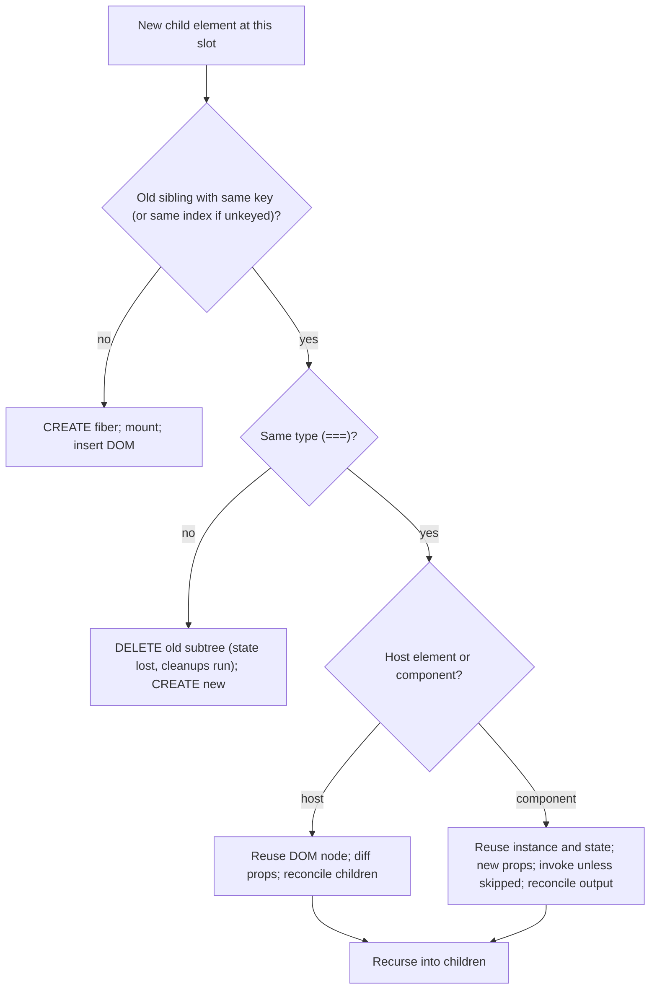
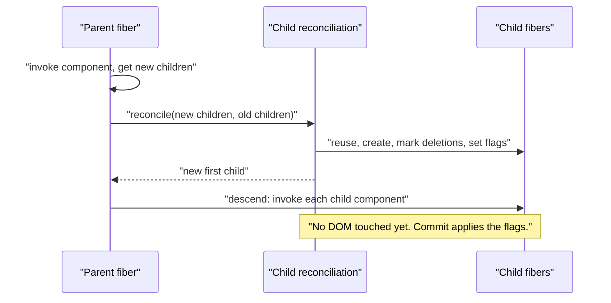

# 02 / 06 — Reconciliation: The Diffing Heuristics

## 1. Lesson metadata

| | |
|---|---|
| **Level** | Advanced |
| **Study time** | 6–7 hours (reading 2.5 h, running the planner and demos 1.5 h, exercises 2–3 h) |
| **Prerequisites** | [02 / 02 — Invocation vs render vs reconcile vs commit vs layout vs paint](./02-render-reconcile-commit-paint.md); [02 / 03 — Initial mount and subsequent updates](./03-initial-mount-and-updates.md); [02 / 04 — The "virtual DOM"](./04-virtual-dom-what-it-means.md); [02 / 05 — React elements vs DOM nodes](./05-elements-vs-dom-nodes.md); [Phase 1 / 09 — Lists, keys, identity](../01-react-fundamentals/09-lists-keys-and-identity.md); [Phase 1 / 16 — State preservation and reset](../01-react-fundamentals/16-state-preservation-and-reset.md) |
| **Next** | [07 — Component identity and keys, revisited](./07-identity-keys-and-reconciliation.md) |
| **Related later** | [08 — Why Fiber exists](./08-why-fiber.md), [09 — Fiber nodes and units of work](./09-fiber-nodes-and-units-of-work.md), [10 — Current and work-in-progress trees](./10-current-and-work-in-progress-trees.md), [20 — Commit work and DOM mutations](./20-commit-and-dom-mutation.md), [34 — Scenario C: list reorder with/without stable keys](./34-scenario-c-list-reorder.md), [Phase 7 / 08 — Rendering large collections](../07-performance/08-rendering-large-collections.md) |

**Learning objectives.** After this lesson you can:

1. State the two assumptions that make React's diff linear-time, and why a fully general tree diff is impractical.
2. Predict, for any pair of old/new element trees, which fibers and DOM nodes are **reused, updated, moved, created, or destroyed**, and what happens to state in each case.
3. Explain how children are matched (by position by default, by key when provided), including the role of `null`/`false` placeholders, fragments, and arrays.
4. Distinguish documented identity rules from implementation details such as the single-pass list algorithm and its "last placed index" heuristic, including its asymmetric move cost.
5. Run (and write) a small planner that reproduces React-like reuse/move/insert/delete decisions for children arrays.
6. Diagnose lost state, state leaks between "different" items, input focus loss, and restarting animations as reconciliation outcomes.

**Concepts covered:** tree-diff complexity, the two heuristics, same-type vs different-type, host element prop diffing, component update, children reconciliation (single child, arrays, text), position and holes, keys, move heuristics, fragments, portals, wrapper-type changes, bailouts vs reconciliation, unmount/remount side effects.

---

## 2. Deep conceptual explanation

### 2.1 What problem is this lesson solving?

Every render produces a *new* element tree. The browser has a *persistent* DOM, and React has persistent state attached to component instances. Something must decide, for each new element, **"is this the same thing as one that was there before?"** If yes: keep its DOM node and state, update what changed. If no: throw the old one away and build a new one.

That decision is *reconciliation*. Its outcome determines three things you care about:

1. **State survival.** Same thing → state kept. New thing → state reset.
2. **DOM efficiency.** Reuse a node (cheap patch) vs destroy and rebuild it (expensive, and loses focus, scroll, selection, animations, media playback).
3. **Effect lifecycle.** Reuse → effects re-run only if deps change. Replace → cleanups run, effects run again as for a fresh mount.

### 2.2 Why a general tree diff is impractical

The minimum-edit-distance problem between two arbitrary ordered trees has best known algorithms with roughly **O(n³)** complexity (n = number of nodes). For 1,000 elements that is on the order of a billion operations per update, which is absurd for UI. React instead trades *optimality* for *speed* via two heuristics (this framing comes from the legacy React docs on reconciliation; it remains the standard teaching model):

> **Heuristic 1.** Two elements of **different types** produce **different trees**. React doesn't try to find similar subtrees under a different parent type; it replaces the whole subtree.
> **Heuristic 2.** The developer can hint which child elements are **stable across renders** with a `key` prop.

With these, comparison is a single top-down walk, O(n) in the number of elements visited.

> **Public guarantee vs implementation.** *Documented, relied upon by everyone:* the identity rules (same position + same type + same key → same instance, state preserved; different → state reset). The React docs also note that React may in the future re-render more or differently, as long as the identity rules hold. *Implementation detail:* the exact algorithm for lists (see §3.5), when DOM nodes are moved vs recreated *within* the same identity, and prop-diff mechanics. Design code so correctness depends only on the identity rules.

### 2.3 The identity of a child

Within a parent, a child's identity is the triple:

```text
identity = (parent identity, position-or-key, type)
```

- **Position-or-key:** if the child has a `key`, that string identifies it among its siblings; otherwise its **index** in the sibling sequence does.
- **Type:** the element `type` compared by `===` (string tag, or the exact function/class/object reference).

State belongs to an identity. Same identity across renders → state preserved; different → the old instance is destroyed and a new one is created with initial state ([Phase 1 / 16](../01-react-fundamentals/16-state-preservation-and-reset.md), [07](./07-identity-keys-and-reconciliation.md)).

### 2.4 The rules, in order

**Rule 0: reconciliation of a component's output only happens if that component renders.** If a parent bails out of a child (same element reference, memo), the child's subtree isn't re-reconciled at all ([01](./01-what-triggers-a-render.md) §3.3).

**Rule 1: compare element type.**

| Old child | New child | Outcome |
|---|---|---|
| host `div` | host `div` | Reuse the DOM node; diff props; reconcile children recursively |
| host `div` | host `span` | **Destroy** the `div` subtree (all descendant components unmount, state lost); **create** a `span` subtree |
| component `A` | component `A` (same reference) | Reuse the instance; pass new props; re-invoke (unless skipped); reconcile its output |
| component `A` | component `B` | Unmount `A` subtree; mount `B` subtree |
| component `A` | host `div` | Same as different type: unmount, create |
| text `"x"` | text `"y"` | Reuse the text node; update its text |
| text | element (or vice versa) | Replace |
| something | `null`/`undefined`/boolean | Old child is removed; **but an empty slot is kept** for position purposes (§2.6) |

**Rule 2: same host type → diff props.** DOM node reused. For each prop: unchanged → skip; changed → apply; removed → remove. `style` is diffed property by property. Event handler changes replace the stored handler (no DOM listener churn thanks to root delegation). Then recurse into children.

**Rule 3: same component type → keep the instance.** Its hooks/state persist; new props flow in; the component function is re-invoked (if it isn't skipped); its returned element is reconciled against the previous output.

**Rule 4: recursion on children.** The *children* sequence of a reused parent is reconciled by position or key (§2.5–2.7).

### 2.5 Children without keys: positional matching

```text
Old children          New children (append)         New children (insert at front)
[Duke, Villanova]     [Duke, Villanova, Connecticut] [Connecticut, Duke, Villanova]
```

Positional matching compares children pairwise by index: old[0]↔new[0], old[1]↔new[1], then extras are created or deleted.

- **Append at the end**: old `[Duke, Villanova]`, new `[Duke, Villanova, Connecticut]`: first two match (no change), the third is created: **1 insertion.** Efficient.
- **Insert at the front**: old `[Duke, Villanova]`, new `[Connecticut, Duke, Villanova]`: old[0] (`Duke`) is compared with new[0] (`Connecticut`): same type `li`, text differs → **update**; old[1] (`Villanova`) with new[1] (`Duke`) → update; new[2] (`Villanova`) → create. **Two text updates and one insertion** instead of one insertion, and *if these were components with state*, the state would stay with the **position**, so "Duke's" state would now sit on the Connecticut row. This is the unkeyed-list bug class.

### 2.6 Holes: `null`, `false`, and conditional rendering

JSX children that evaluate to `null`, `undefined`, `true`, or `false` render nothing, but they **still occupy a position** in the children sequence:

```tsx
<div>
  {showBanner && <Banner />}   // slot 0: either Banner or false
  <Counter />                  // slot 1: always Counter
</div>
```

When `showBanner` flips, slot 0 changes between `false` and `<Banner />`, but `Counter` stays at slot 1: **its state is preserved.** That is why `cond && <X />` is safe next to stateful siblings, and why code like:

```tsx
{showBanner ? <><Banner /><Counter /></> : <Counter />}
```
is **dangerous**: the shapes differ (a fragment with two children vs `Counter` alone), so `Counter` sits at different positions/under different types and can lose state. React treats an *unkeyed top-level fragment* as if it were its array of children (an implementation optimization), so state can survive in some shapes. *Verified by execution on React 19.3.1:* `<><Counter/></>` vs `<Counter/>` and `<><Counter/><i/></>` vs `<Counter/>` both **preserve** `Counter`'s state (it stays at index 0), whereas `<><Banner/><Counter/></>` vs `<Counter/>` **loses** it (`Counter` moves from index 1 to 0). Never rely on that; keep slot structure identical across branches.

### 2.7 Arrays as one slot; static JSX children as many slots

```tsx
<div>
  <Header />          // slot 0
  {items.map(...)}    // slot 1: an ARRAY (its own keyed/positional sequence)
  <Footer />          // slot 2
</div>
```

An array child occupies **one** slot in the parent's children; inside it, children are matched by key (or index). So changing the number of array items doesn't shift `Footer`'s slot. Without the array wrapper, i.e. conditionally spreading elements inline, shifts would occur. JSX with several static children (`<A/><B/>`) uses *positional* identity; in development, React doesn't warn about missing keys for these because their shape is fixed by the source.

### 2.8 Keys: matching by identity instead of position

If children have keys, matching switches from index to key:

```text
old: [a, b, c]   new: [c, a, b]   (all <li key=...>)
```
React recognizes that `c` moved to the front, and `a`, `b` shifted. It **reuses all three DOM nodes and fibers** (and their state), updates props if changed, and records *moves*. Keys must be **unique among siblings** and **stable across renders** ([07](./07-identity-keys-and-reconciliation.md) in depth). A key is *not* a prop the component receives, and it only has meaning among siblings: the same key under different parents doesn't relate them.

### 2.9 Prop diffing for host elements

| Aspect | Behavior |
|---|---|
| Comparison | Previous vs next prop values by `===` (strings/numbers/booleans effectively by value; objects by reference, except `style`, compared property-wise) |
| `className` | Changed string → set `class` |
| `style` | Per-CSS-property diff; removed properties cleared |
| Event handlers | Stored handler replaced; no DOM `addEventListener`/`removeEventListener` per update (root delegation) |
| `children` as single string/number | Update text content (the text-node fast path) |
| `value`, `checked` on inputs | Controlled: React also reconciles the DOM *property* so it matches state after events ([Phase 1 / 11](../01-react-fundamentals/11-controlled-and-uncontrolled-inputs.md)) |
| `dangerouslySetInnerHTML` | Re-applied when `__html` string changes |
| Unchanged element | No DOM writes at all |

### 2.10 Misconceptions

| Misconception | Reality |
|---|---|
| "React finds the minimal set of DOM changes." | It finds a *cheap-enough, heuristic* set. Moves in lists use a one-pass heuristic and can do more moves than strictly necessary. |
| "React compares old and new DOM." | It compares new elements to old fiber data ([04](./04-virtual-dom-what-it-means.md) §3.2). |
| "Keys make renders faster." | Keys change *how matching works* (identity), preventing unnecessary updates/state bugs, and can reduce DOM work on reorders; they don't make invoking components faster. |
| "A different `className` re-creates the element." | Only a different **type** (tag/component) does. |
| "Wrapping in a `<div>` is harmless." | Adding/removing a wrapper changes the child's *parent type chain* and remounts everything below (if the wrapper appears/disappears around the same subtree). |
| "Index keys are always bad." | They are exactly the default positional behavior; fine for static, append-only, stateless lists; harmful when order changes or items hold state. |
| "A component is re-created when it re-renders." | Re-render ≠ remount. |

---

## 3. Internal mechanics

### 3.1 Where reconciliation lives in the render phase

**[Teaching model]** For each fiber being rendered (a component, host element, fragment, etc.), after invoking the component (or for host fibers, reading `props.children`), React calls its *child reconciliation* routine with the **new children** (element or array of elements) and the **current first child fiber** of this parent. That routine returns the new first child fiber of the work-in-progress tree, creating, cloning, or deleting fibers and setting flags (placement, update, deletion, ref, etc.) on them. Then React moves into the first child, and so on ([09](./09-fiber-nodes-and-units-of-work.md)).

**[Implementation detail]** In the source this routine is split by what the new children look like: a single element, a text/number, an array, an iterable, a portal, or nothing. The file is `ReactChildFiber` in `packages/react-reconciler` (`packages/react-reconciler/src/ReactChildFiber.js`; path and `createChildReconciler`/`lastPlacedIndex` logic checked against `main` on 2026-10-22; see [31](./31-reading-react-source.md)).

### 3.2 Single child: the straightforward path

For a single new child element and existing child fibers:

1. Look through the existing children for one whose **key** equals the new element's key (with `null` equal to `null`).
2. If found and the **type** matches → reuse it: clone the fiber with new props; delete any *other* old siblings (there should be at most the ones left over).
3. If found but the type differs → delete it (and the rest) and create a fresh fiber.
4. If not found → delete old children, create a fresh fiber.

Because a single child has no siblings to reorder, the work is trivial.

### 3.3 Text and primitives

A string/number child becomes a *text fiber* (unless it's the only child of a host element, in which case React DOM may set `textContent` directly, an optimization). Text → text: update; otherwise replace. In adjacent text children (`{a} {b}`), separate text nodes exist in the DOM (React doesn't merge them) which matters for external DOM mutators ([04](./04-virtual-dom-what-it-means.md) §9).

### 3.4 Arrays: the one-pass algorithm with a keyed fallback

**[Implementation detail, checked against `ReactChildFiber.js` on `main`, 2026-10-22]** For an array of new children and the linked list of old child fibers, React:

1. **Fast path (same order).** Walk the new array and old list *in lockstep*. While `new[i]` and `old[i]` have the **same key** (both `null` for unkeyed), reconcile them as an update (type match) or replace them (type mismatch), and continue. Stop at the first key mismatch.
2. **Only deletions / only insertions left.** If the new array is exhausted, delete the remaining old fibers. If the old list is exhausted, create fibers for the remaining new elements (appends).
3. **General case.** Put the *remaining* old fibers into a **map** (by key, or by index for unkeyed). For each remaining new element, look up its match in the map:
   - Found (and type matches): reuse; delete it from the map; decide whether this fiber must **move** (rule below).
   - Not found: create a new fiber (insertion).
4. Whatever remains in the map is deleted.

**The move rule (`lastPlacedIndex`).** Track the largest *old index* of an item that was left in place so far, `lastPlaced`. For each reused item with old index `oi`:
- if `oi < lastPlaced`: the item must **move** (flagged for placement: its DOM node will be `insertBefore`'d at commit);
- else: it stays; `lastPlaced = oi`.

Because items only ever move *forward* relative to others, the algorithm has an **asymmetry**:

| Change (n items) | Old order | New order | Moves |
|---|---|---|---|
| Move **last** item to the **front** | A B C D | D A B C | **3** (A, B, C all have old index < 3 once D is placed) |
| Move **first** item to the **end** | A B C D | B C D A | **1** (only A) |

So "move the last element to the front" costs n−1 moves while the mirrored operation costs 1. (Verified with a `MutationObserver` on React 19.3.1: `ABCD→DABC` produced 3 re-insertions, `ABCD→BCDA` produced 1.) It is still O(n) overall and correct; it is simply *not minimal*. This is an excellent example of "implementation detail that is true but not a guarantee": design list UIs with keys, **measure** before worrying, and use virtualization for very large lists.

### 3.5 What happens at commit

Reconciliation only *records* intent with flags:

| Flag (conceptual) | Commit action |
|---|---|
| Placement (new) | Create/insert DOM nodes (top-most node of the new subtree) |
| Placement (move) | `insertBefore` the existing DOM node at its new position |
| Update | Apply prop/text changes recorded for that host fiber |
| Deletion | Remove the host nodes; detach refs; run cleanups |
| (Ref / layout / passive flags) | Ref attach/detach, effects |

DOM operations happen in the commit phase ([20](./20-commit-and-dom-mutation.md)). Reconciliation itself touches no DOM.

### 3.6 Fragments, portals, and special types

- **Fragment:** a structural element with no DOM node; its children are reconciled as a children sequence under the *DOM parent*. A **keyed** fragment `<Fragment key={id}>` is how you key a group of siblings. An unkeyed fragment at the top of a children position is treated as transparent as an optimization (see §2.6; don't rely on equivalence between `<><A/></>` and `<A/>`).
- **Portal (`createPortal`):** reconciled as a child in the React tree (so context and event bubbling follow the React tree) while its host nodes are appended to a different DOM container.
- **`memo`, `lazy`, context, `Suspense`:** each has its own fiber kind; type identity is compared like any other. A `lazy` component resolves once; its resolved type is stable.
- **Class vs function components:** same rules; a class gets the *same instance* when reused.

### 3.7 Complexity

For a render that re-invokes a subtree of N elements: time is O(N) for comparisons plus map building for out-of-order lists (still O(k) in the number of children k). The *invocations* usually dominate ([04](./04-virtual-dom-what-it-means.md) §3.4). Deeply nested changes of *type at high levels* are expensive because the whole subtree is torn down and rebuilt (a DOM-heavy operation plus all effect cleanups and setups).

---

## 4. Step-by-step execution walkthrough

Four scenarios, each as a timeline. Notation: `fiber✔` reused, `fiber+` created, `fiber✖` deleted. All happen in one render pass; DOM changes occur at commit.

### 4.1 Scenario 1: same type, props change

`<Greeting name="Ada" />` → `<Greeting name="Alan" />` returning `<p className="hi">Hello, {name}</p>`.

| Step | Phase | Outcome |
|---|---|---|
| Parent renders | Render | New element `{ type: Greeting, props: { name: "Alan" } }` |
| Reconcile `Greeting` child | Render | `Greeting` same type, same position, no key → **reuse fiber** (state preserved), new props |
| Invoke `Greeting` | Render | Returns `<p className="hi">`: new element |
| Reconcile `p` | Render | Same host type → reuse; props: `className` equal, `children` text differs → flag update |
| Commit | Commit | **1 DOM write** (text) |

### 4.2 Scenario 2: wrapper type changes

```tsx
function Page({ compact }: { compact: boolean }) {
  return compact ? <section><Form /></section> : <div><Form /></div>;
}
```
`compact: false → true`.

| Step | Phase | Outcome |
|---|---|---|
| Reconcile `Page`'s child | Render | Old: `div`; new: `section` → **different type** |
| Deletion | Render (flagged) | `div✖`, and **all descendants** `Form✖` (hooks, state, DOM) |
| Creation | Render | `section+`, `Form+` (new instance, initial state; mount-mode hooks) |
| Commit | Commit | Remove old `div` DOM subtree; run cleanups (layout: mutation step; passive: later); insert new `section` subtree; mount effects |
| User impact | | Form fields reset, focus lost, scroll positions in subtree reset |

Fix: keep the type stable and vary props (`<div className={compact ? "compact" : ""}>`), or use `key` deliberately to reset.

### 4.3 Scenario 3: unkeyed list, insert at front, with state

```tsx
function Todos({ items }: { items: string[] }) {
  return <ul>{items.map((t) => <TodoRow label={t} />)}</ul>;   // no keys; each TodoRow has local `checked` state
}
```
`["a","b"]` → `["z","a","b"]`; before the update the user checked row `a` (`checked` state true at position 0).

| Step | Outcome |
|---|---|
| Positional match | old[0]↔new[0] (`TodoRow`, same type): **reuse**, props `label: "a" → "z"` |
| | old[1]↔new[1]: reuse, `label: "b" → "a"` |
| | new[2]: **create** `TodoRow` with `label: "b"`, `checked: false` |
| Result | Row 0 (state `checked: true`) now displays "z"; row 1 (state false) displays "a"; the **checkmark stays at the top position**, now on the wrong item |
| DOM | 2 text updates + 1 insertion |

(React also warns in development: missing `key`.) With `key={t}` (or ids): `z` created at front; `a`, `b` reused with state intact.

### 4.4 Scenario 4: keyed reorder with the move heuristic

`[a,b,c,d]` → `[d,a,b,c]`, keys = ids, all `li`.

| Step (new order) | Old index | `lastPlaced` before | Decision | `lastPlaced` after |
|---|---|---|---|---|
| `d` | 3 | 0 | 3 ≥ 0 → stay | 3 |
| `a` | 0 | 3 | 0 < 3 → **move** | 3 |
| `b` | 1 | 3 | 1 < 3 → **move** | 3 |
| `c` | 2 | 3 | 2 < 3 → **move** | 3 |

DOM at commit: three `insertBefore` operations, **no node recreated**, no state lost. Inverse order `[a,b,c,d]` → `[b,c,d,a]` costs one move. Both are correct.

---

## 5. Code examples

### 5.1 Minimal example — same position, same type: state is preserved

```tsx
import { useState } from "react";

function Counter({ person }: { person: string }) {
  const [score, setScore] = useState(0);
  return (
    <div>
      <h3>{person}: {score}</h3>
      <button onClick={() => setScore(score + 1)}>+1</button>
    </div>
  );
}

export function Scoreboard() {
  const [isAlice, setIsAlice] = useState(true);
  return (
    <>
      {isAlice ? <Counter person="Alice" /> : <Counter person="Bob" />}
      <button onClick={() => setIsAlice(!isAlice)}>Switch player</button>
    </>
  );
}
```

**Predict:** score Alice to 3, click "Switch player". What does the heading show?

**Result:** `Bob: 3`. **Why:** both branches render `<Counter>` at the same position (slot 0 of the fragment) with the same type and no key → same identity → instance and its state persist; only the prop changes. The UI "lies" in the sense that Bob inherited Alice's score, usually unintended ([Phase 1 / 16](../01-react-fundamentals/16-state-preservation-and-reset.md)). Fix with different `key`s (`<Counter key="alice" …/>`) or by rendering `<Counter key={person} person={person} />` once.

### 5.2 Practical example — conditional wrappers and state loss

```tsx
import { useState } from "react";

function Field({ label }: { label: string }) {
  const [text, setText] = useState("");
  return <label>{label}<input value={text} onChange={(e) => setText(e.target.value)} /></label>;
}

export function Settings({ boxed }: { boxed: boolean }) {
  // ❌ Toggling `boxed` changes the type at this position (div ↔ fieldset)
  return boxed
    ? <fieldset><Field label="Name" /></fieldset>
    : <div><Field label="Name" /></div>;
}
```

**Predict:** the user types "Ada" into the input, then `boxed` toggles. What does the input show, and does it keep focus?

**Result:** empty, and focus is lost. `fieldset` vs `div` are different types at the same position → the whole subtree is replaced; `Field` is a **new instance** (state reset) with a **new input DOM node**.

**Corrected:**
```tsx
export function Settings({ boxed }: { boxed: boolean }) {
  return (
    <div className={boxed ? "box" : undefined}>
      <Field label="Name" />
    </div>
  );
}
```
Type stays `div`; only a prop changes; `Field` survives. If you truly need `fieldset` semantics in one mode, render `<fieldset>` always and use `disabled`/CSS, or **lift** the `text` state above the toggle.

### 5.3 Incorrect example — component defined inside a component; index keys on a reorderable list

```tsx
import { useState } from "react";

export function Inbox({ messages }: { messages: { id: string; subject: string }[] }) {
  const [sortAsc, setSortAsc] = useState(true);
  const sorted = [...messages].sort((a, b) =>
    sortAsc ? a.subject.localeCompare(b.subject) : b.subject.localeCompare(a.subject));

  function Row({ subject }: { subject: string }) {            // ❌ new function identity each Inbox render
    const [expanded, setExpanded] = useState(false);
    return <li onClick={() => setExpanded(!expanded)}>{expanded ? `${subject} (open)` : subject}</li>;
  }

  return (
    <>
      <button onClick={() => setSortAsc(!sortAsc)}>Sort</button>
      <ul>{sorted.map((m, i) => <Row key={i} subject={m.subject} />)}</ul>   {/* ❌ index keys */}
    </>
  );
}
```

**Predict:** the user expands the first row, then clicks Sort. What happens?

**Result:** *Every* row collapses on *every* `Inbox` render, even for unrelated updates, because `Row` is a different function each render → different type → all rows unmount/remount (state reset, effects re-run, DOM rebuilt). Even if `Row` were hoisted to module scope, the index keys would leave `expanded` on the *first position* after sorting instead of following its message.

### 5.4 Corrected implementation

```tsx
import { useState } from "react";

type Message = { id: string; subject: string };

function Row({ subject }: { subject: string }) {            // ✅ module scope: stable type
  const [expanded, setExpanded] = useState(false);
  return <li onClick={() => setExpanded(!expanded)}>{expanded ? `${subject} (open)` : subject}</li>;
}

export function Inbox({ messages }: { messages: Message[] }) {
  const [sortAsc, setSortAsc] = useState(true);
  const sorted = [...messages].sort((a, b) =>
    sortAsc ? a.subject.localeCompare(b.subject) : b.subject.localeCompare(a.subject));
  return (
    <>
      <button onClick={() => setSortAsc(!sortAsc)}>Sort</button>
      <ul>{sorted.map((m) => <Row key={m.id} subject={m.subject} />)}</ul>   {/* ✅ stable id */}
    </>
  );
}
```
Now expansion follows the message across sorting; sorting reuses all `Row` instances and their DOM nodes (with moves as needed), and unrelated updates don't remount anything.

### 5.5 Advanced example — a planner that mimics list reconciliation

A *teaching model* of §3.4: it reproduces reuse/move/insert/delete decisions for a children array. It is **not** React's code; it is deliberately simplified (no fast-path, no props) so you can experiment with the move heuristic.

```ts
// plan-children.ts
export type Child = { key: string | null; type: string };
export type Op =
  | { op: "reuse"; id: string }     // matched, stays in place
  | { op: "move"; id: string }      // matched, DOM node must be re-inserted
  | { op: "insert"; id: string }    // new fiber + DOM
  | { op: "delete"; id: string };   // removed (state lost)

export function plan(oldC: readonly Child[], newC: readonly Child[]): Op[] {
  const idOf = (c: Child, i: number): string => c.key ?? `#${i}`;
  const oldMap = new Map<string, { c: Child; index: number }>();
  oldC.forEach((c, i) => oldMap.set(idOf(c, i), { c, index: i }));

  const ops: Op[] = [];
  let lastPlaced = 0;
  newC.forEach((c, i) => {
    const id = idOf(c, i);
    const hit = oldMap.get(id);
    if (hit && hit.c.type === c.type) {
      oldMap.delete(id);
      if (hit.index < lastPlaced) ops.push({ op: "move", id });
      else { lastPlaced = hit.index; ops.push({ op: "reuse", id }); }
    } else {
      ops.push({ op: "insert", id });         // same key, different type: old stays in map and is deleted below
    }
  });
  for (const id of oldMap.keys()) ops.push({ op: "delete", id });
  return ops;
}

// Demo
const k = (key: string, type = "li"): Child => ({ key, type });
const u = (type = "li"): Child => ({ key: null, type });

console.log(plan([k("a"), k("b"), k("c"), k("d")], [k("d"), k("a"), k("b"), k("c")]));
console.log(plan([k("a"), k("b"), k("c"), k("d")], [k("b"), k("c"), k("d"), k("a")]));
console.log(plan([u(), u()], [u(), u(), u()]));              // unkeyed append
console.log(plan([k("a"), k("b")], [k("z"), k("a"), k("b")])); // keyed prepend
console.log(plan([u(), u()], [u("section"), u(), u()]));      // unkeyed with type change at 0
```

**Predict** the number of `move`s for the first two calls, and for the unkeyed prepend `[u,u] → [u,u,u]`.

**Result:**
1. `[a,b,c,d] → [d,a,b,c]`: ops = reuse d, **move a, move b, move c** → 3 moves.
2. `[a,b,c,d] → [b,c,d,a]`: reuse b, c, d, then **move a** → 1 move.
3. Unkeyed `[u,u]→[u,u,u]` (ids `#0,#1,#2`): reuse `#0`, reuse `#1`, insert `#2`. (Note the planner can't show the *content* shifting; it only shows reuse by position. The semantic bug of §4.3 is that the reused fibers receive different props/data.)
4. Keyed prepend: insert z, reuse a, reuse b.
5. Type change at index 0: `#0` exists but type `li` ≠ `section` → insert `#0` (and delete the old `#0` at the end); `#1` reuse; `#2` insert.

Use it to explore: swapping two items, reversing a list, and mixing keyed and unkeyed children. Remember the planner decides *fiber reuse/moves*; actual DOM operations occur in commit.

---

## 6. Visual explanations

### 6.1 The decision tree for one child



### 6.2 Positional vs keyed matching

```text
UNKEYED (match by index)                   KEYED (match by key)
old:  [Duke ] [Villa ] [      ]            old:  [Duke:k1] [Villa:k2]
new:  [Conn ] [Duke  ] [Villa ]            new:  [Conn:k3] [Duke:k1] [Villa:k2]
        │        │        │                        │           │          │
      update   update    create                  create      reuse      reuse
   (Duke's state now on Conn row!)          (Duke and Villa keep DOM + state)
```

### 6.3 Where reconciliation sits in a render



---

## 7. Alternative approaches and trade-offs

Problem: rendering a reorderable list of 200 items, each with local expand/collapse state.

| Approach | Correctness of state | DOM work on reorder | Complexity | Testability | Notes |
|---|---|---|---|---|---|
| Stable id keys (recommended) | State follows item | Moves only | Low | High | Needs a stable id from data |
| Index keys | State sticks to position (bug when reordering) | Many updates | Lowest | High | Acceptable for static lists |
| Remount-on-sort (`key={sortOrder}` on the list) | State **reset** each sort | Full rebuild | Low | High | Right choice when resetting is desired (e.g., resetting scroll/expansion on new sort) |
| Lift item UI state to a `Map<id, state>` in the parent/store | State follows item *and* survives unmounts (virtualization) | Moves only | Medium | High | Required with windowing, since off-screen rows unmount |
| Virtualized list (windowing) | State must be lifted (rows unmount) | Bounded DOM size | Medium–High | Medium | Best for thousands of items ([Phase 7 / 09](../07-performance/09-windowing-and-virtualization.md)) |
| Imperative DOM reorder (refs) | Manual | Minimal | High | Low | Only for extreme hot paths |

**When the recommended approach (keys on ids) is not best:** when items have **no stable identity** (a transient list of generated strings that may duplicate), or when you *want* state to reset whenever the list changes (a quiz re-shuffle where each question should start fresh): there, an intentionally changing key (or index keys on a static list) is the correct design.

---

## 8. Best practices and anti-patterns

**Do**
- Keep the **structure** (types and positions) of stateful subtrees stable across renders; vary props, not wrappers.
- Use `key` from data identity for dynamic lists; use `key` deliberately to reset state.
- Define components at module scope.
- Use `cond && <X />` (placeholder-preserving) next to stateful siblings, or give every branch the same shape.

**Beginner mistakes**
- Index keys on lists that reorder/insert/delete with stateful rows or inputs.
- Components defined in render.
- Wrapping/unwrapping a subtree in a conditional `div`.
- Expecting state to reset when props change (it won't unless identity changes).

**Experienced-developer mistakes**
- Random keys (`Math.random()`, `uuid()` at render): every render remounts every item.
- Using the item *content* as key when duplicates are possible.
- Believing keys are passed as props or reading `props.key`.
- Optimizing "list reorder moves" without measuring, or assuming React's moves are minimal.
- Treating fragment/array equivalences as guaranteed.

**Smells:** `key` composed of index + data ("`${i}-${id}`") that changes when position changes; `useEffect` copying props to state to "reset" on prop change (use `key`); `switch` rendering different top-level wrappers for the same content.

**Justified exceptions:** index keys for static lists; intentional key changes to remount; remounting on route/user switch via `key={userId}`.

---

## 9. Real-world application

**Chat/feed (realtime).** New messages prepend or append; users type a draft reply in an input at the bottom; some messages are expanded. Constraint: the draft input must never lose focus or text when messages arrive. Keys by message id; the composer lives outside the keyed list; avoid wrapping the composer in a conditional container that appears/disappears.

**Sortable data grid (finance).** Rows have local state (expanded detail, in-flight edits). Sorting by columns reorders rows. With id keys state follows rows, but a *virtualized* grid unmounts off-screen rows: edits must live in a parent store keyed by row id. Constraint: sorting 5,000 rows must stay under a frame or two; use virtualization and avoid index keys.

**Multi-step wizard (forms).** Steps are all `<StepForm step={n} />`: same type, same position → state leaks between steps (typed values from step 1 appear in step 2). Fix with `key={step}` (reset) or per-step components, and keep the draft in a reducer so it survives intentionally ([Phase 3 / 21](../03-react-state-and-hooks/21-forms-and-complex-state.md)).

**Layout shells in a multi-team app.** `AuthedLayout` vs `GuestLayout` different component types at the app root: switching between them remounts the entire page below, losing all state. If this is acceptable at login/logout boundaries (it usually is, and even desirable for security: no stale authenticated state), it should be a **deliberate** boundary, not an accident of shared wrappers.

**Drag-and-drop dashboards.** Widget order is user-configurable; widget identity = id. Keys must be widget ids, not positions, so charts keep their internal state/zoom while moving.

**E-commerce filters.** Product cards keyed by sku, so applying filters keeps matching cards mounted (images don't flicker, hover states persist) and only inserts/removes changed ones.

---

## 10. Debugging and troubleshooting

### Symptom A: "State is shared/leaking between items or modes."
Cause: same position and type → same instance. Investigation: in React DevTools *Components*, select the component and watch whether it keeps the same instance (state values persist while props change). Add a temporary `useEffect(() => { console.log("mount"); return () => console.log("unmount"); }, [])`; if "mount" doesn't log when you expect a fresh item, identity is being preserved. Fix: change `key`, or lift/reset state intentionally.

### Symptom B: "State resets / input loses focus when I type or when data updates."
Cause: remount due to type change, unstable key, or a component defined inside another. Investigation: mount/unmount logs fire on each update; the *Elements* panel shows the DOM node flash/replace (Chrome's "Rendering → Paint flashing" or just see the node re-inserted); DevTools Profiler shows `mount` phases for components that should be `update`. Fix: hoist component definitions; use stable keys; keep wrappers stable.

### Symptom C: "CSS transitions/animations restart or never run."
Replaced DOM nodes don't transition (a new node starts at the final style, an old one is removed). Preserve the node (same type/key) so the browser can interpolate between style values. For exit animations you need libraries that keep nodes mounted until the animation ends.

### Symptom D: "Reorder is slow."
Record in Profiler/Performance. Check: components invoked (rows re-rendering), keys changing (remounts), number of DOM moves, layout cost. Use `memo` rows with stable props, virtualization, and ensure keys are stable. Don't assume the move heuristic is your bottleneck without measurement.

### Symptom E: "Duplicate keys" warning; items duplicated or missing after updates.
Two siblings share a key; React may reuse the wrong fiber and produce inconsistent output. Dedupe keys (use ids, combine with an occurrence counter when duplicates are legitimate).

**Validate fixes:** reproduce the interaction before/after with mount/unmount logs, confirm no unexpected `mount` phases in the Profiler, and keep a regression test (React Testing Library: type into an input, trigger the reorder, assert value and `document.activeElement`).

---

## 11. Exercises

### Level A — Knowledge
A1. State the two heuristics behind React's diffing and the complexity they enable.
A2. What happens to a subtree when the parent element's type changes from `div` to `section`? What about from `<A />` to `<B />` where both render identical markup?
A3. How are unkeyed children matched? How are keyed children matched?
A4. Why does `{cond && <Banner />}` not disturb the state of the next sibling?
A5. What is *not* guaranteed about React's list reordering algorithm?

### Level B — Code comprehension
B1. For each pair, state whether `Counter`'s state is preserved:
```tsx
// (a)
cond ? <Counter /> : <Counter />
// (b)
cond ? <div><Counter /></div> : <Counter />
// (c)
cond ? <Counter key="x" /> : <Counter key="y" />
// (d)
<>{cond && <Banner />}<Counter /></>
// (e)
cond ? <><Banner /><Counter /></> : <><Counter /></>
```
B2. Use the planner semantics to list ops for `[a,b,c] → [c,b,a]` (keyed). How many moves?
B3. In `<ul>{["a","b"].map((t) => <li>{t}</li>)}</ul>` re-rendered as `["b"]`, which DOM updates occur without keys? With keys equal to the text?
B4. The following is rendered with `items` going from `[1,2,3]` to `[4,1,2,3]`. Describe what updates and what state each `Row` holds afterward.
```tsx
{items.map((n, i) => <Row key={i} n={n} />)}  // Row has useState(false) `open`
```

### Level C — Implementation
C1. Extend `plan()` to also emit `update` operations when a reused child's props changed (add `props: Record<string, unknown>` to `Child`, shallow compare).
C2. Write `minimalMoves(old, new)` that computes the true minimum number of moves for keyed arrays (hint: items in the longest increasing subsequence of old indices need not move), and compare its output with the `lastPlaced` heuristic on reversals and rotations.
C3. Write a test (React Testing Library) proving that a list keyed by id preserves an input's value when the list is reordered, and loses it with index keys.

### Level D — Debugging
D1. "Filtering the table resets the row editors." Code: `rows.filter(...).map((r, i) => <EditableRow key={i} row={r} />)`. Explain and fix.
D2. "Every keystroke in the form field remounts the section below, resetting scroll." Code: `function Page() { const [q,setQ] = useState(""); const Results = () => <ResultList q={q} />; return (<><input .../><Results /></>); }` Explain and fix.
D3. A tooltip re-attaches and flickers when a parent toggles between `<>{children}</>` and `<div>{children}</div>`. Explain.
D4. Duplicate keys warning after merging two API lists (`id` collisions across lists). Fix without changing the data source.

### Level E — Architecture decisions
E1. You are designing a `<VirtualList>` component. Row state (expanded, draft input) must survive scrolling out of view and back. Where do you store it and what do you use as identity? Compare 3 designs.
E2. Your app switches between `<AdminLayout>` and `<UserLayout>` depending on role, and QA complains about flashes and lost scroll positions when the role switches mid-session. Decide whether to unify the layout component or to accept the remount, with criteria.

### Level F — Expert challenge
F1. A drag-sort list of 2,000 cards (each with a chart that retains zoom state) feels slow when you move the last card to the top. Using the move heuristic, estimate DOM moves and render invocations, propose three mitigations (e.g., virtualization, cutting remounts, alternative data structure for ordering), and describe how you'd verify each with a Profiler trace.

---

## 12. Detailed answers and explanations

> Attempt the exercises first.

**A1.** (1) Different element types yield different trees (no cross-type subtree matching); (2) `key` hints stable children across renders. Together they allow a single top-down pass, O(n), instead of the O(n³) general tree edit distance.

**A2.** `div → section`: the entire old subtree is deleted (descendant components unmount; their effect cleanups run; state lost) and the new one is created (mount; effects run). `<A/> → <B/>`: same: types differ by `===`, so unmount A's subtree and mount B's, even if their markup is identical.

**A3.** Unkeyed: pairwise by index. Keyed: by key within the sibling set; unmatched new keys create, unmatched old keys delete; matched keys reuse (and may move).

**A4.** The `false` placeholder keeps slot 0 occupied, so `Counter` remains slot 1 in both cases: same position, same type → same instance.

**A5.** That it's minimal (moves can exceed the minimum), that DOM nodes are reused in specific situations beyond the identity rules, and that the algorithm stays the same across versions. Guaranteed: the identity/state semantics.

**B1.** (a) **Preserved**: same position, same type, no key. (b) **Not preserved**: different types at the slot (`div` vs `Counter`); `Counter` moves under a different parent. (c) **Not preserved**: different keys → different identity. (d) **Preserved**: the `false` placeholder holds slot 0. (e) **Implementation-dependent, don't rely**: the shapes differ (a fragment of two children vs a fragment of one). In current implementations, the top-level unkeyed fragment is treated as its children array, so `Counter` is at index 1 in the first and index 0 in the second → positional mismatch → `Counter`'s state is **not** reliably preserved; the safe form is `<>{cond && <Banner />}<Counter /></>`. Common wrong answer: "preserved because both are fragments".

**B2.** New order `c,b,a`: `c` old index 2 ≥ 0 → reuse, `lastPlaced = 2`; `b` old 1 < 2 → move; `a` old 0 < 2 → move. **2 moves** (the minimum is also 2 since the LIS of old indices `[2,1,0]` is length 1, so 3−1 = 2 elements must move). So for a full reversal the heuristic happens to be optimal.

**B3.** Without keys, `["a","b"] → ["b"]`: index 0 `li` text "a" → "b" (**1 text update**); index 1 removed (**1 removal**). With keys: `b` matched at old index 1: `a` deleted (**1 removal**), `b` reused: **no update, no move**. Fewer operations *and* correct identity.

**B4.** Index keys: key 0 → `Row n=4` reuses old position-0 fiber (previously `n=1`), and so on: rows at positions 0–2 get new props (4,1,2) and keep their `open` states by *position*; position 3 is created with `n=3`, `open=false`. If the user had opened the row for `1` (position 0), after the update position 0 shows `4` and is open: the open state is attached to the wrong data. Fix: key by a stable id of the data.

**C1.**
```ts
export type Child = { key: string | null; type: string; props?: Record<string, unknown> };
export type Op =
  | { op: "reuse" | "move" | "insert" | "delete" | "update"; id: string };

const shallowEqual = (a: Record<string, unknown> = {}, b: Record<string, unknown> = {}) => {
  const ka = Object.keys(a), kb = Object.keys(b);
  return ka.length === kb.length && ka.every((k) => Object.is(a[k], b[k]));
};
// inside plan(): after deciding reuse/move for a hit, add:
//   if (!shallowEqual(hit.c.props, c.props)) ops.push({ op: "update", id });
```
Note: an "update" can accompany "move" or "reuse"; a real implementation records flags on the same fiber rather than separate ops.

**C2.** The minimum moves equals `n − LIS`, where LIS is the length of the longest increasing subsequence of the old indices (in new order) of items present in both lists. Items in the LIS can stay; others move.
```ts
export function minimalMoves(oldKeys: string[], newKeys: string[]): number {
  const pos = new Map(oldKeys.map((k, i) => [k, i]));
  const seq = newKeys.filter((k) => pos.has(k)).map((k) => pos.get(k)!);
  const tails: number[] = [];                       // patience sorting LIS, O(n log n)
  for (const x of seq) {
    let lo = 0, hi = tails.length;
    while (lo < hi) { const mid = (lo + hi) >> 1; if (tails[mid] < x) lo = mid + 1; else hi = mid; }
    tails[lo] = x;
  }
  return seq.length - tails.length;
}
```
Comparison: `[a,b,c,d]→[d,a,b,c]`: seq `[3,0,1,2]`, LIS = 3 (`0,1,2`) → minimum **1 move** versus the heuristic's **3**. `[a,b,c,d]→[b,c,d,a]`: seq `[1,2,3,0]`, LIS 3 → 1 move; heuristic 1. Reversal of 4: LIS 1 → 3 moves; heuristic: `d`,then c(2<3) move, b move, a move → 3. React trades this optimality for a simpler pass; typical lists don't hit the worst case.

**C3.** Sketch:
```tsx
import { render, screen } from "@testing-library/react";
import userEvent from "@testing-library/user-event";
import { useState } from "react";

function Item({ label }: { label: string }) {
  const [v, setV] = useState("");
  return <input aria-label={label} value={v} onChange={(e) => setV(e.target.value)} />;
}
function List({ keyed }: { keyed: boolean }) {
  const [ids, setIds] = useState(["a", "b"]);
  return (
    <>
      <button onClick={() => setIds([...ids].reverse())}>reverse</button>
      {ids.map((id, i) => <Item key={keyed ? id : i} label={id} />)}
    </>
  );
}

test("keyed: input value follows the item", async () => {
  const user = userEvent.setup();
  render(<List keyed />);
  await user.type(screen.getByLabelText("a"), "hello");
  await user.click(screen.getByText("reverse"));
  expect(screen.getByLabelText("a")).toHaveValue("hello");
});
test("index: input value stays at the position (bug)", async () => {
  const user = userEvent.setup();
  render(<List keyed={false} />);
  await user.type(screen.getByLabelText("a"), "hello");
  await user.click(screen.getByText("reverse"));
  expect(screen.getByLabelText("a")).toHaveValue("");   // the "hello" is now on the other item
});
```
Reasoning: with index keys the first `Item` instance (holding "hello") receives `label="b"` after the reverse.

**D1.** Index keys: after filtering, rows shift positions, so each `EditableRow` instance (and its edit state) stays at its position but receives a different `row`. Fix: `key={r.id}`; to keep edits across filtering/unmounting, lift drafts to a `Map<id, Draft>` in the parent/store.

**D2.** `Results` is defined *inside* `Page`; each keystroke re-renders `Page`, creating a new `Results` function → new type → unmount/mount of the subtree (and scroll reset). Fix: define `Results` outside or inline `<ResultList q={q} />` directly.

**D3.** A fragment and a `div` are different types at that position; the `children` subtree is destroyed and recreated when toggling, losing instances (the tooltip). Fix: always use one wrapper type, vary props/styles; or restructure so the tooltip lives outside the toggled wrapper.

**D4.** Namespace keys: `` key={`${source}:${id}`} `` where `source` identifies the list; or merge/dedupe the data if the ids refer to the same entity. If duplicates are legitimate within one list, add an occurrence counter to the key (`${id}#${n}`) computed deterministically from data order (with the caveat that keys then depend on order again).

**E1.** Options: (1) *Unmanaged* row state inside rows: rows unmount when scrolled out → state lost (reject). (2) *Lift to a store keyed by row id*: `Map<id, RowState>` in the list parent/reducer; rows read/write by id: survives virtualization and sorting; downside: more plumbing, re-render scope concerns (use per-row selectors or `useSyncExternalStore`). (3) *Keep mounted but hidden (overscan large)*: state preserved but DOM/memory costs return; only for modest lists. Identity: a stable domain id, never the index. Recommended: (2). Evaluation criteria: addresses unmount-on-scroll, id identity, re-render scope, persistence (maybe sessionStorage), and tests.

**E2.** Criteria: how often role switches happen mid-session (rare), UX impact, state that must survive (scroll, drafts), security (stale privileged state should be discarded on role change), engineering cost. A reasonable answer: role changes mid-session are rare and security-sensitive; accept a deliberate remount but reduce its jarring effects (preserve scroll via router/state, avoid flash with a transition or skeleton), *or* unify to one `Layout` component with role-based config if the chrome is mostly shared and no privileged state would leak. Reject: accidental remount via inline layout definitions. Make the boundary explicit with `key={role}`.

**F1.** Moving the last card to the front: with `lastPlaced`, 1999 cards are moved (n−1) → ~1,999 `insertBefore` operations; none remount (keys are ids) so charts keep zoom state; invocations: if the parent re-renders all cards (no `memo`), 2,000 invocations. Mitigations: (1) virtualize: only ~20 visible cards exist, so moves and invocations drop by ~100×; zoom state must be lifted to a store by id; (2) `memo(Card)` with stable props to cut invocations to the changed few; (3) represent drag-in-progress as a transform on one element, commit the reorder on drop (one reorder per drag instead of per frame); (4) alternatively store order so that the common operation is a "move first to end" shape (rotation) which costs 1 move; not generally possible. Verification: Performance panel: count "Layout"/"Recalculate style" and scripting time; Profiler: commits and render durations; count `insertBefore` calls with a `MutationObserver` in a test; compare p75 INP in RUM for the drag interaction.

---

## 13. Senior engineer interview questions

**Q1. "How does React decide whether to reuse or recreate a component instance?"**
*Strong answer:* Identity = position-or-key + type, relative to the parent's identity. Same type (by `===`) and same key/position at the same parent → reuse (state kept, props updated, re-invoke). Otherwise unmount the old subtree and mount a new one. Mention practical consequences: wrapper changes, inline component definitions, and `key` as a deliberate reset.

**Q2. "Why are index keys problematic?"**
*Strong answer:* They equal React's default positional matching, so identity follows position rather than data. On insert/delete/reorder, state and DOM (focus, inputs, animations) stay at positions while data shifts, causing wrong state attachments and excess updates. Fine for static, append-only, stateless lists.

**Q3. "Is React's list diff minimal?"**
*Strong answer:* No. It's a heuristic single pass with a "last placed index" rule; moving the last item to the front costs n−1 moves, the reverse costs one. It is O(n) and correct; true minimal moves (n minus LIS) is more complex and not worth it in general. Don't depend on it; virtualize large lists.

**Q4. "Why can `cond ? <A/> : <A/>` preserve state but `cond ? <div><A/></div> : <A/>` not?"**
*Strong answer:* The first has the same type at the same position; the second changes the type at that position (`div` vs `A`), so the whole subtree below is replaced.

**Q5. "How would you reset a form when the selected user changes?"**
*Strong answer:* Give the form a `key={userId}`; reconciliation sees a different identity and remounts with fresh state; it's simpler and less error-prone than effects that copy props to state. Trade-off: remount cost and loss of any state you *wanted* to keep (lift those).

**Q6. "What cost does a type change near the root impose?"**
*Strong answer:* All descendant fibers are discarded and recreated: invocations, host node creation, effect cleanup and setup, lost state, layout/paint of a large subtree. Make high-level structure stable; vary props.

---

## 14. Further learning resources

| Resource | URL | Covers / why | Level | Study |
|---|---|---|---|---|
| React docs — Preserving and Resetting State | <https://react.dev/learn/preserving-and-resetting-state> | Official identity/position/key rules with examples | Intermediate | Whole page |
| React docs — Rendering Lists | <https://react.dev/learn/rendering-lists> | Keys and rules for keys | Beginner | "Keeping list items in order with key" |
| React docs — `<Fragment>` | <https://react.dev/reference/react/Fragment> | Keyed fragments and state behavior | Intermediate | Caveats |
| React docs — Render and Commit | <https://react.dev/learn/render-and-commit> | Where reconciliation fits | Beginner | Whole page |
| React legacy docs — Reconciliation | <https://legacy.reactjs.org/docs/reconciliation.html> | The two heuristics, historical description | Intermediate | Whole page |
| React docs — `memo` | <https://react.dev/reference/react/memo> | Skipping re-renders vs reconciliation | Intermediate | Whole page |
| React repository — `react-reconciler` | <https://github.com/facebook/react/tree/main/packages/react-reconciler> | Child reconciliation source (`ReactChildFiber.js`) | Advanced | See [31](./31-reading-react-source.md) |
| MDN — `Node.insertBefore` | <https://developer.mozilla.org/en-US/docs/Web/API/Node/insertBefore> | The DOM operation behind moves | Beginner | Whole page |

---

## 15. Knowledge checkpoint

**You should now understand**
- The two heuristics and the identity triple (parent, position-or-key, type) that define reuse vs replacement.
- Positional vs keyed matching; holes; arrays as single slots; wrapper-type changes; component definitions inside components.
- That list moves use a one-pass heuristic that is correct, linear, and not minimal.
- Reconciliation records decisions during render; commit applies them.

**You should be able to explain without notes**
- Why `cond && <X/>` preserves siblings' state and `cond ? <div>…</div> : …` can destroy it.
- Why moving the last item to the front costs more moves than the reverse.

**You should be able to implement**
- A children planner; correct keyed lists; deliberate resets via `key`; lifted state for virtualized lists.

**You should be able to debug**
- State leaks, focus loss, restarting animations, remount storms (via mount/unmount logs and Profiler).

**Before moving on:** read [07 — Component identity and keys, revisited](./07-identity-keys-and-reconciliation.md) for key design, resets, and edge cases; then [08 — Why Fiber exists](./08-why-fiber.md) for the data structures that make all this interruptible.
