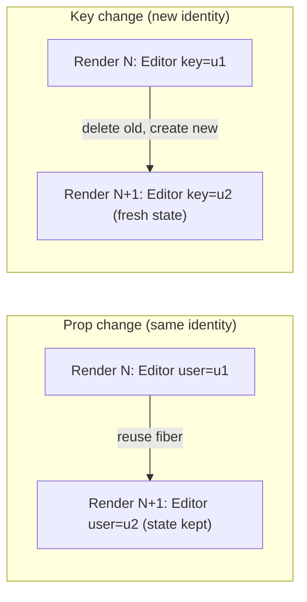
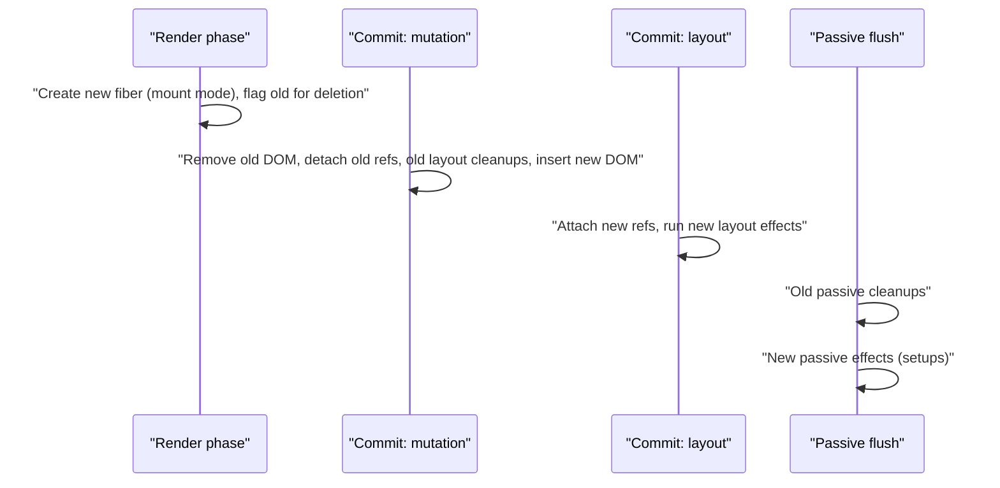

# 02 / 07 — Component Identity and Keys, Revisited

## 1. Lesson metadata

| | |
|---|---|
| **Level** | Advanced |
| **Study time** | 5–6 hours (reading 2 h, experiments 1.5 h, exercises 2 h) |
| **Prerequisites** | [02 / 06 — Reconciliation: the diffing heuristics](./06-reconciliation-fundamentals.md); [02 / 03 — Initial mount and subsequent updates](./03-initial-mount-and-updates.md); [Phase 1 / 09 — Lists, keys, identity](../01-react-fundamentals/09-lists-keys-and-identity.md); [Phase 1 / 16 — State preservation and reset](../01-react-fundamentals/16-state-preservation-and-reset.md) |
| **Next** | [08 — Why Fiber exists (stack reconciler history)](./08-why-fiber.md) |
| **Related later** | [28 — Strict Mode development behavior](./28-strict-mode-behavior.md), [34 — Scenario C: list reorder with/without stable keys](./34-scenario-c-list-reorder.md), [Phase 3 / 07 — You might not need an effect](../03-react-state-and-hooks/07-you-might-not-need-an-effect.md), [Phase 3 / 17 — Derived state](../03-react-state-and-hooks/17-derived-state.md), [Phase 5 / 05 — Compound components](../05-design-patterns/05-compound-components.md), [Phase 6 / 05 — Optimistic updates](../06-data-fetching-and-state-ecosystems/05-optimistic-updates.md) |

**Learning objectives.** After this lesson you can:

1. State the formal definition of component identity in React and the three levers that change it: **type**, **position**, **key**.
2. Design keys for any list: choose the *source* of identity (server id, client-assigned id at ingestion, content hash), and justify it against duplicates, reorders, pagination, optimistic creation, and drag-and-drop.
3. Use `key` as a **deliberate reset mechanism** and compare it, with timelines, against effect-based and derived-state resets.
4. Walk through, step by step, what React does (render, reconcile, commit, effects) when a key changes, a keyed item is removed, and a key is unstable.
5. Distinguish documented key semantics from implementation details (matching algorithm, warning logic, key normalization).
6. Diagnose remount storms, state leaks, optimistic-update flicker, duplicate-key corruption, and lost focus.

**Concepts covered:** identity triple, key semantics and coercion, key uniqueness scope, key sources, client ids vs server ids, composite keys, keys on fragments, keys outside lists, `key` as reset, effect-lifecycle consequences of remount, optimistic items and key continuity, duplicate keys, random keys, index keys (when acceptable), keyed transitions, testing identity.

---

## 2. Deep conceptual explanation

### 2.1 What problem is this lesson solving?

[Lesson 06](./06-reconciliation-fundamentals.md) explained *how* React matches old and new children. This lesson is about **identity as a design tool**: what should "the same thing" mean in *your* domain, and how do you encode it so that React's matching agrees?

Three practical questions drive everything here:

1. *When should state survive a re-render?* (Same identity.)
2. *When should state be thrown away?* (New identity.)
3. *What in my data tells React which is which?* (The key, the type, the position.)

Get these right and large classes of bugs vanish: inputs cross-contaminating, expanded rows jumping, effects not re-running for a new entity, video elements restarting, optimistic items flickering on confirmation. Get them wrong and you will write `useEffect` workarounds that cause extra renders and flashes.

### 2.2 Identity, formally

> **Public guarantee (documented).** React preserves a component's state as long as it renders the **same component type at the same position in the tree** (relative to its parent, with the `key` taking the place of the position if present). If the type, the position (or key) differs, React destroys the old state/DOM and creates new ones. This applies to host elements as well as components. (React docs: "Preserving and Resetting State.")

Identity levers:

| Lever | Changes identity when… | Typical accidental cause | Typical deliberate use |
|---|---|---|---|
| **Type** (`===` on `element.type`) | A different component/tag is rendered at the slot | Component defined inside component; conditional wrapper `div`↔`fragment` | Switching between two truly different views |
| **Position** | The child's index among siblings (unkeyed) shifts | Inserting/removing earlier siblings; inline conditional spreads; index keys | – (position is the default, implicit identity) |
| **Key** | The `key` value differs from the previous render's key at that sibling set | Random/unstable keys; ids that change on save | `key={entityId}` to reset on entity change |

Key points that follow from the definition:

- **Key scope is siblings.** Uniqueness is only required among children of the same parent *in the same array/sibling list*; keys in different arrays or parents never conflict.
- **A key is an identity, not a prop.** It is never passed to the component (`props.key` is not available). If the component needs the value, pass it again under another name (`id={item.id}`).
- **Keys are strings** (or coerced to strings): `key={1}` and `key="1"` are the same key. The React TypeScript types accept `string | number | bigint` for `Key` (checked in `@types/react` 19.3). Don't mix representations of the same id.
- **`key` works on any element**, not only in lists, including a single component, a fragment, or a host element.
- **Equality is by value after coercion**, not by reference: two renders producing `key="a"` match.
- `key={undefined}`/`key={null}` means "no key" (positional).

> **Teaching model:** *state lives in a "slot" named (type, key-or-position) under a parent slot.* Rendering something that doesn't fit the existing slot name creates a new slot and discards the old.

### 2.3 What makes a good key

A key should be:

1. **Unique among siblings** (duplicates make matching ambiguous).
2. **Stable across renders for the same logical item** (same item → same key every render).
3. **Not derived from position** if the list can reorder/insert/delete (otherwise it *is* the positional default).
4. **Derived from data identity, not content that can change** (a title can be edited; a database id cannot).
5. **Created when the data enters the system, not when it is rendered.** Generating keys inside `render` makes them unstable by definition.

Sources of identity, ranked roughly by reliability:

| Source | Example | Pros | Cons / pitfalls |
|---|---|---|---|
| Server/database primary key | `order.id`, `user.uuid` | Stable, unique, persistent across sessions | Missing for items not yet persisted (optimistic/new rows); collisions across *types* if you merge lists |
| Natural business key | `sku`, `ticker`, `isoCode` | Meaningful; stable if truly unique | Uniqueness assumptions break (duplicate SKU across warehouses); changeable identifiers (renamed symbol) |
| **Client-assigned id at ingestion** | `crypto.randomUUID()` when the row is created or normalized | Works for new/unsaved rows; independent of server | Must be stored with the item (state/store), not regenerated per render; `randomUUID` requires a secure context (HTTPS/localhost) |
| Composite key | `` `${source}:${id}` `` | Disambiguates merged lists | Verbose; ensure no delimiter collisions |
| Content-derived (hash/string) | The text itself | No ids needed | **Breaks when content edits** (remount while typing) and with duplicates |
| Index | `i` | Free | Identity = position; OK only for static, append-only/stateless lists |
| Random per render | `Math.random()` | – | **Always wrong**: new identity every render → remount every render |

### 2.4 `key` as a deliberate reset

Because a changed key means "new identity," you can **reset a subtree's state on purpose**:

```tsx
<ProfileEditor key={userId} userId={userId} />
```
When `userId` changes, React unmounts the old editor (cleanups run) and mounts a fresh one (initial state). Compare alternatives for "reset state when prop X changes":

| Strategy | Mechanism | Renders after change | Visible stale frame? | Risk |
|---|---|---|---|---|
| **`key={x}`** | New identity → remount | 1 (fresh mount) | No | Remount cost; loses *all* state in subtree (including state you wanted to keep) |
| `useEffect(() => setState(initial), [x])` | Effect resets after commit | 2 (stale commit, then reset commit) | **Yes** (a frame with old state/new props) | Easy to forget fields; flicker; "You might not need an effect" |
| Derive during render ("adjust state while rendering": `if (x !== prevX) { setPrevX(x); setState(initial); }`) | Render-phase update of own state | 1 pass (re-invoked before commit) | No | More code; only resets that component's own state, not children's |
| Controlled (parent owns state, passes `value`) | State lives above | Depends | No | Parent complexity |
| No state: derive from props | Compute during render | 1 | No | Only possible if the state is truly derivable |

**Default advice:** *if the thing you're resetting is "everything below this component should start over when this id changes," use `key`.* If you only need to reset one value, derive or reset during render. Avoid effect-based resets for purely visual state.

### 2.5 Keys on things that aren't list items

| Use | Example | Why |
|---|---|---|
| Reset a subtree | `<Form key={recordId} … />` | New identity → fresh state, fresh uncontrolled inputs, new effects |
| Restart a CSS animation / re-trigger mount animation | `<Toast key={toast.id} />` | New DOM node replays CSS animation from its start |
| Re-initialize an imperative widget | `<Chart key={datasetId} … />` | Easier than updating all widget options in an effect |
| Group siblings in a list | `<Fragment key={row.id}><tr/><tr/></Fragment>` | A fragment can't take other props, but `key` is allowed |
| Reset uncontrolled inputs | `<input key={formVersion} defaultValue={x} />` | `defaultValue` only applies at mount; remount applies the new default |

### 2.6 Misconceptions

| Misconception | Reality |
|---|---|
| "Keys are for performance." | Keys are for **identity**. Performance benefits (fewer updates/moves) are a side effect. Wrong keys can reduce performance (remount storms). |
| "Keys must be globally unique." | Only unique among siblings in the same list. |
| "Keys are props I can read." | No. Pass another prop if needed. |
| "`key={index}` is the same as no key." | Almost: React warns when a list has no key; with index keys React stops warning, but behavior is the same positional matching. |
| "A key change updates the component." | It *replaces* it (unmount + mount). |
| "Keys on the inner `<li>` inside my `ListItem` component are enough." | The key must be on the **outermost element returned by the `map` callback** (the element in the array), not on something inside the component. |
| "I'll use `useId` for keys." | `useId` generates ids stable per *component instance* for accessibility attributes; calling it in a loop is invalid (hooks), and it doesn't identify *data items*. |
| "If keys are stable I can reorder freely with no cost." | Reuse is guaranteed, but moves still cost DOM operations and re-renders of invoked rows; `memo`/virtualization may still be needed. |

---

## 3. Internal mechanics

### 3.1 How a key is carried

**[Public guarantee]** The key is stored on the element (`element.key`) as a string or `null`; it's not in `props`. During reconciliation React reads `element.key` from new elements and `fiber.key` from existing fibers. With the automatic JSX runtime, the compiler passes `key` as a separate argument to `jsx(type, props, key)`; in `createElement`, `key` is extracted from the config.

**[Implementation detail]** The fiber copies the key from the element. Matching uses string equality (`===`) after coercion (`"" + key`). `Children.toArray` prefixes keys to keep them unique across flattened nesting (so keys in its output look like `.$a`); never depend on those strings.

### 3.2 Matching with keys (recap + extension)

From [06](./06-reconciliation-fundamentals.md) §3.4: lockstep fast path while keys at the same index are equal; then a map from key→old fiber for the rest; move decisions via `lastPlaced`. Facts relevant to key design:

| Situation | Outcome |
|---|---|
| New key found in old map, same type | Reuse fiber and DOM; state preserved |
| New key found in old map, **different type** | Old fiber deleted, new created (same key does *not* force reuse) |
| New key not found | Create |
| Old key not in new list | Delete (cleanups run; state lost) |
| **Duplicate keys** among new children | Undefined-quality outcome: React warns in development ("Encountered two children with the same key ... Non-unique keys may cause children to be duplicated and/or omitted"). *Verified by execution on 19.3.1:* rendering keys `[1,1,2]` with items `a,b,c` showed all three on mount, but re-rendering the same data reordered as `[2,1,1]` produced a DOM of **four** `<li>` (`a,c,a,b`): children were duplicated. Treat as a bug. |

### 3.3 Dev-only validation

In development React warns about:

- arrays of children without keys (when an array is created by `.map` etc., i.e., not static JSX children, as determined by whether the compiler used `jsxs` for static children),
- duplicate keys among siblings,
- key spread into JSX (`const props = { key, ...rest }; <div {...props} />`): React 19 logs "A props object containing a `key` prop is being spread into JSX ... React keys must be passed directly to JSX without using spread" (verified by execution on 19.3.1); writing `<div {...rest} key={id} />` does not warn.

These checks are **development-only**; production silently proceeds. Therefore a missing-key warning disappearing in production is not evidence the code is fine; fix it at the source.

### 3.4 What a key change triggers (the mechanics)

When the key of an element at a position changes:

1. **Render phase:** the parent is invoked and returns the element with the new key. Child reconciliation can't match any old fiber with that key → **create** a new fiber; the old fiber (key mismatch) is flagged for **deletion**. The new subtree renders in *mount mode* ([03](./03-initial-mount-and-updates.md) §2.3): initializers run, hooks allocate, DOM nodes created detached.
2. **Commit, mutation step:** old host nodes removed; refs of old subtree detached; old **layout-effect cleanups** run; new host nodes inserted.
3. **Commit, layout step:** new refs attached; new **layout effects** run.
4. **Passive flush:** old subtree's **passive cleanups** run first, then new subtree's **passive effects** run (cleanups for the commit precede setups).

Observable consequences: the old instance's cleanup (e.g., `abort()` fetch, unsubscribe) is guaranteed to run before the new instance's setup *within the same commit's effect flush*; there is **no** window where both are subscribed after the flush completes. Exact interleaving of mutation vs layout cleanup vs ref detach is an implementation detail (verified on 19.3.1 for a key change: `render b`, old layout cleanup, old ref detach, new ref attach, new layout setup, then old passive cleanup, then new passive setup; note that for a *deleted* subtree the component's layout cleanup runs before its child's ref detach, the opposite of the order for an in-place update).

### 3.5 Keys and concurrent features

When a key change happens inside a **transition** (for example, selecting a different record with `startTransition`), React renders the *new* keyed subtree as a background render; the old subtree remains on screen and interactive until the new render is ready to commit (documented behavior of transitions: they don't show already-revealed content being replaced by a fallback). If the new subtree suspends, React keeps the old UI instead of showing a fallback for a transition. So "key as reset" combined with transitions yields a smooth "stay on old record until the new one is ready" experience ([23](./23-transitions-and-deferred-rendering.md), [24](./24-suspense-conceptual-internals.md)). The old state is retained only until the commit swaps the trees.

---

## 4. Step-by-step execution walkthrough

### 4.1 Timeline T1 — `key` reset on entity switch

```tsx
function Page({ userId }: { userId: string }) {
  return <ProfileEditor key={userId} userId={userId} />;
}
function ProfileEditor({ userId }: { userId: string }) {
  const [name, setName] = useState("");
  useEffect(() => {
    const c = new AbortController();
    fetchUser(userId, c.signal).then((u) => setName(u.name)).catch(() => {});
    return () => c.abort();
  }, [userId]);
  return <input value={name} onChange={(e) => setName(e.target.value)} />;
}
```
User "u1" is shown with the name "Ada" typed in; navigation changes `userId` to "u2".

| Step | Phase | Event | State/DOM |
|---|---|---|---|
| 1 | Render | `Page` invoked with `userId="u2"` → element `{type: ProfileEditor, key: "u2"}` | – |
| 2 | Reconcile | Old child key `"u1"` ≠ `"u2"` → no match: **create** new fiber; flag old fiber **deletion** | – |
| 3 | Render | `ProfileEditor` (new) invoked in **mount mode**: `name = ""`; effect recorded | new fiber state `""` |
| 4 | Commit–mutation | Old `<input>` removed (value "Ada" gone); new `<input value="">` inserted | DOM replaced; **focus lost** |
| 5 | Commit–layout | (no layout effects) | – |
| 6 | Passive flush | **Old** effect cleanup: `abort()` the `u1` fetch. Then **new** effect: fetch `u2` | no stale response can set state |
| 7 | Later | `u2`'s response → `setName("Alan")` → update render | input shows "Alan" |

Without the `key`: step 2 would reuse the fiber; state `"Ada"` persists for `u2` until the fetch completes (stale-state flash); the effect's deps `[userId]` changed so cleanup/fetch run, but the *state* is not reset, which is exactly the bug the key solves.

### 4.2 Timeline T2 — delete the middle item, index keys vs id keys

List `[A, B, C]`, each `Row` has an uncontrolled input; the user typed `"a"`, `"b"`, `"c"` into A, B, C respectively; then B is deleted (data → `[A, C]`).

**With `key={index}`:**

| Step | Event |
|---|---|
| Reconcile | new[0]=A ↔ old[0] (key 0): reuse; props same |
| | new[1]=C ↔ old[1] (key 1): **reuse** fiber that held B's DOM/input ("b"), with props now C's → label "C", input still shows **"b"** |
| | old[2] (key 2, input "c") has no match → **deleted** |
| Result | Screen shows rows A("a"), C("b"). C's typed text is lost and B's text appears on C. 1 DOM removal + 1 text update. |

**With `key={item.id}`:**

| Step | Event |
|---|---|
| Reconcile | A ↔ key a: reuse. C ↔ key c: reuse (old index 2 ≥ lastPlaced 0, no move). Old key b has no match → **deleted** |
| Result | A("a"), C("c"); B's DOM and state removed. 1 DOM removal, nothing else. |

### 4.3 Timeline T3 — optimistic add with a changing key (the flicker bug)

A todo list adds an item optimistically with a temporary key `tmp-1`, then replaces it with the server id `42` on success.

| Step | Event | Effect |
|---|---|---|
| 1 | User submits; list renders `[…, {key:"tmp-1", title:"Buy milk", pending}]` | New row created and inserted |
| 2 | Server responds `{id: 42}`; state replaced: the same logical row now has `key:"42"` | – |
| 3 | Reconcile: key `"tmp-1"` missing from new list → **delete**; key `"42"` not in old → **create** | The row **remounts**: DOM recreated, any local state (focus in an inline editor, hover, in-flight animation) lost; visible flicker |

Fix: keep a **stable client key** (`clientId`) on the item for its whole life and attach the server `id` as data (§5.5). The key never changes, so step 3 becomes "reuse; update props: `pending: false`".

---

## 5. Code examples

### 5.1 Minimal example — key resets a counter

```tsx
import { useState } from "react";

function Counter() {
  const [n, setN] = useState(0);
  return <button onClick={() => setN(n + 1)}>clicked {n}</button>;
}

export function Demo() {
  const [version, setVersion] = useState(0);
  return (
    <>
      <Counter key={version} />
      <button onClick={() => setVersion((v) => v + 1)}>reset counter</button>
    </>
  );
}
```

**Predict:** click the counter 3 times, then "reset counter". What does it show? And if you click "reset counter" twice quickly without touching the counter?

**Result:** `clicked 0` after reset. Two quick resets: the key becomes `1`, then `2` (batched or separate); either way the final result is a fresh instance with `n = 0`; at most one remount is committed if batched, two if not. **Why:** different key → different identity → new instance, initial state.

### 5.2 Practical example — reset by key vs reset by effect

```tsx
import { useEffect, useState } from "react";

type Contact = { id: string; name: string; email: string };

// ❌ Effect-based reset
function EditorWithEffect({ contact }: { contact: Contact }) {
  const [name, setName] = useState(contact.name);
  const [email, setEmail] = useState(contact.email);
  useEffect(() => { setName(contact.name); setEmail(contact.email); }, [contact]);  // runs AFTER paint
  return <Form name={name} email={email} onName={setName} onEmail={setEmail} />;
}

// ✅ Key-based reset
function EditorWithKey({ contact }: { contact: Contact }) {
  const [name, setName] = useState(contact.name);       // initial value only
  const [email, setEmail] = useState(contact.email);
  return <Form name={name} email={email} onName={setName} onEmail={setEmail} />;
}
export function ContactPage({ contact }: { contact: Contact }) {
  return <EditorWithKey key={contact.id} contact={contact} />;
}
```

**Predict:** `contact` switches from Ada to Alan. For each version count renders of the editor and say whether the user can see Ada's data under Alan's heading.

**Result:** *Effect version:* render 1 (new `contact` prop, old `name/email` state: **stale**), commit (Alan's heading with Ada's fields), browser may paint, effect runs → `setName`, `setEmail` (batched) → render 2, commit. **2 renders, one possibly visible stale frame**, and the effect also resets on *every* identity change of the `contact` object, e.g., a refetch that returns an equal object with a new reference would wipe unsaved edits (a bug: the reset is keyed on reference rather than on identity). *Key version:* 1 render in mount mode (fresh state from `contact`), no stale frame; refetches with the same `id` don't reset because the key didn't change.

**Trade-off:** the key version also remounts the `Form` subtree: its DOM and any state you *wanted* to keep (scroll position of a sidebar inside the editor) are lost; lift those out of the keyed subtree.

### 5.3 Incorrect example — unstable keys

```tsx
import { useState } from "react";

type Row = { name: string };

export function Names({ rows }: { rows: Row[] }) {
  const [filter, setFilter] = useState("");
  return (
    <>
      <input value={filter} onChange={(e) => setFilter(e.target.value)} />
      <ul>
        {rows
          .filter((r) => r.name.includes(filter))
          .map((r) => (
            <li key={Math.random()}>               {/* ❌ new identity every render */}
              <input defaultValue={r.name} />
            </li>
          ))}
      </ul>
    </>
  );
}
```

**Predict:** The user types a character in the filter input. What happens to the row inputs? What if the filter input *is itself inside the list*?

**Result:** On every keystroke `Names` re-renders; every `li` gets a new random key, so **every row is unmounted and a fresh one mounted**: the DOM for all rows is rebuilt, uncontrolled edits in rows are lost, effects re-run. If the controlling input were inside the keyed list, it would lose focus after each character. Cost: O(rows) DOM creation per keystroke. Variants of the same bug: `key={crypto.randomUUID()}` in render, `` key={`${i}-${r.name}`} `` (changes with position and with edits), `key={JSON.stringify(item)}`.

### 5.4 Corrected implementation

Assign ids where the data enters the system, not in render:

```tsx
import { useMemo, useState } from "react";

type RawRow = { name: string };
type Row = { id: string; name: string };

function withIds(rows: RawRow[]): Row[] {
  return rows.map((r) => ({ id: crypto.randomUUID(), name: r.name }));
}

export function Names({ initial }: { initial: RawRow[] }) {
  const [rows] = useState<Row[]>(() => withIds(initial));   // ids assigned ONCE at ingestion
  const [filter, setFilter] = useState("");
  const visible = useMemo(() => rows.filter((r) => r.name.includes(filter)), [rows, filter]);
  return (
    <>
      <input value={filter} onChange={(e) => setFilter(e.target.value)} />
      <ul>
        {visible.map((r) => (
          <li key={r.id}><input defaultValue={r.name} /></li>
        ))}
      </ul>
    </>
  );
}
```

Notes: the lazy initializer runs once per mount (twice in dev Strict Mode with one result kept: ids differ between the two invocations, but only the kept result is used). If the source of rows changes over time (e.g., server refetch), assign ids in the normalization layer keyed on a business key (reuse previous id when the business key matches) so identity survives refreshes. Prefer server ids whenever they exist ([Phase 6 / 04](../06-data-fetching-and-state-ecosystems/04-api-normalization.md)).

### 5.5 Advanced example — optimistic items with a stable client key

```tsx
import { useOptimistic, useRef } from "react";

export type Todo = {
  clientId: string;       // identity for React: assigned once when the todo is created, never changes
  id?: string;            // server id: appears after persistence; DATA, not identity
  title: string;
  pending?: boolean;
};

type Props = {
  todos: Todo[];
  onCreate: (todo: Todo) => Promise<void>;   // parent persists and stores the todo WITH the same clientId
};

export function Todos({ todos, onCreate }: Props) {
  const [optimistic, addOptimistic] = useOptimistic(
    todos,
    (current: Todo[], next: Todo) => [...current, { ...next, pending: true }],
  );
  const formRef = useRef<HTMLFormElement>(null);

  async function createTodo(formData: FormData) {
    const todo: Todo = { clientId: crypto.randomUUID(), title: String(formData.get("title") ?? "") };
    addOptimistic(todo);          // shows immediately with pending: true
    formRef.current?.reset();
    await onCreate(todo);         // when `todos` updates, the item has the same clientId (plus id)
  }

  return (
    <form ref={formRef} action={createTodo}>
      <input name="title" />
      <ul>
        {optimistic.map((t) => (
          <li key={t.clientId} aria-busy={t.pending}>{t.title}</li>   // ✅ stable across optimistic → confirmed
        ))}
      </ul>
    </form>
  );
}
```

Points:
- `useOptimistic` (React 19) shows the optimistic value while the Action (here the form action) is pending, then falls back to the real `todos`. If the confirmed `todos` entry has the **same `clientId`**, React matches it with the optimistic row: reuse, not remount, only `pending` changes. If the key changed on confirmation (using the server id), you'd get the T3 flicker.
- `crypto.randomUUID()` is called in the **action** (an event-like context), not in render or in the optimistic reducer, so renders stay pure and idempotent.
- `useOptimistic`/Actions are React 19 APIs; see [Phase 3 / 22](../03-react-state-and-hooks/22-modern-hooks-and-apis.md) and the [`useOptimistic` reference](https://react.dev/reference/react/useOptimistic) for edge cases (the optimistic value reverts to the real state when the action settles, including on error).
- Trade-off: you carry two ids (client and server). The alternative is server-provided idempotency keys (the client generates the id and the server accepts it as the primary key), which unifies identity at the cost of server design.

### 5.6 Practical example — dev-only duplicate key detector

```tsx
export function assertUniqueKeys<T>(items: readonly T[], getKey: (item: T) => string | number, where: string): void {
  if (process.env.NODE_ENV === "production") return;          // bundler-provided; use import.meta.env.DEV in Vite
  const seen = new Map<string, number>();
  items.forEach((item, i) => {
    const k = String(getKey(item));
    if (seen.has(k)) {
      console.error(`[${where}] duplicate key "${k}" at indexes ${seen.get(k)} and ${i}`);
    } else {
      seen.set(k, i);
    }
  });
}
// usage: assertUniqueKeys(orders, (o) => o.id, "OrdersTable"); before rendering the list
```
React's built-in warning tells you *that* duplicates exist; this tells you *which* and *where*. Don't call it in tight render loops of huge lists; use it in the data layer or tests.

---

## 6. Visual explanations

### 6.1 The identity slots

```text
Root
└─ Page                                   slot: (Page)
   └─ ProfileEditor key="u1"               slot: (ProfileEditor, "u1")   ← state lives here
      └─ input                              slot: (input, position 0)

userId changes to "u2":
   └─ ProfileEditor key="u2"               slot: (ProfileEditor, "u2")   ← NEW slot: old destroyed, new mounted
```

### 6.2 Key change vs prop change



### 6.3 Effect ordering when a key changes



### 6.4 Optimistic key continuity

```text
Unstable:  key=tmp-1 ──(server ack)──► key=42      ⇒ delete + create  ⇒ remount flicker
Stable:    key=clientId ─(server ack)─► key=clientId, id=42 added ⇒ reuse ⇒ no flicker
```

---

## 7. Alternative approaches and trade-offs

Scenario: switch between records in a master/detail screen; the detail pane has a form, a chart, and a video preview.

| Approach | Reset fidelity | Cost | Complexity | Testability | Notes |
|---|---|---|---|---|---|
| `key={recordId}` on the whole pane | Total reset | Remount whole pane (DOM, effects, video reload) | Lowest | High | Best when everything should start fresh |
| `key` only on the form; props for chart/video | Form resets; chart/video update in place | Remount form only | Low | High | Targeted; recommended when the chart/video can update from props cheaply |
| Controlled form with parent-owned drafts `Map<id, Draft>` | Per-record drafts **persist** when switching away and back | Medium (state management) | Medium | High | Choose if users expect unsaved drafts to survive switching |
| Effect-based reset | Partial (only what you remember) | Extra renders, stale frame | Medium (error-prone) | Medium | Avoid for state that is purely a function of identity |
| Render-phase derived reset | Only own state | 1 pass | Medium | Medium | OK for one or two values |
| Keep all panes mounted, hide inactive (`hidden`, `<Activity>`) | Everything preserved | Memory/effects for hidden panes | Medium | Medium | For tab-like UIs; `<Activity>` is stable since React 19.2 (`mode="hidden"` preserves state and DOM, unmounts effects) |

**When `key` reset is *not* best:** the subtree contains **expensive-to-recreate or stateful resources that should survive** the identity change (a video player that should keep playing while metadata changes, a WebSocket-backed component, a large chart with GPU context). There, keep identity stable and update via props/effects, or hoist the long-lived resource above the keyed boundary. Also when users expect unsaved edits to be preserved across switches (use per-record drafts).

---

## 8. Best practices and anti-patterns

**Do**
- Use a stable domain id as key; assign client ids at ingestion for unsaved items.
- Put the key on the outermost element in the `map` callback (or on a keyed `Fragment`).
- Use `key={entityId}` to reset subtrees when the entity changes.
- Keep id and key stable across optimistic → confirmed transitions.
- Make identity changes *deliberate and localized*.

**Beginner mistakes**
- No key; index keys on dynamic lists; keys on the inner element rather than the mapped element.
- `key={item.name}` when names can duplicate or be edited.
- Reading `props.key`.

**Experienced-developer mistakes**
- Random/Date-based keys in render; keys that include mutable fields (status, title) or the index.
- Changing id schemes mid-flight (temp id → server id) without a stable client key.
- Keying huge subtrees at the app root for convenience, causing global remounts.
- Using effects to reset state that `key` handles better.
- Merging lists from different sources without namespacing ids.

**Smells:** `key={i}` plus drag-and-drop; `key={`${id}-${new Date()}`}`; effects whose only job is `setX(props.x)` on change; "force rerender" counters used as keys to repair bugs without understanding them.

**Justified exceptions:** index keys for static display lists (menus defined in code); `key={refreshCounter}` for an explicit "retry" that must reinitialize a failing subtree; content keys for immutable, unique strings (e.g., a list of country ISO codes).

---

## 9. Real-world application

**Multi-tenant admin (multi-team, security).** Switching tenant must discard *all* in-memory per-tenant state (caches in component state, form drafts). Put `key={tenantId}` at the tenant-scoped layout root so stale data cannot leak across tenants; combine with clearing client caches (TanStack Query `queryClient.clear()` or tenant-scoped keys) because component keys don't reset external stores ([Phase 6 / 08](../06-data-fetching-and-state-ecosystems/08-tanstack-query.md)). Constraint: remount cost at switch time is acceptable because switching is rare.

**Chat application (realtime).** `key={roomId}` on the conversation pane unsubscribes the previous room and subscribes the new one (cleanup/setup via effects) and resets the composer draft. But the sidebar of rooms must not be inside that keyed subtree. Messages are keyed by server id with a client id for pending messages (T3 pattern) to avoid flicker when acks arrive.

**Trading blotter.** Rows keyed by instrument symbol; prices stream in. Reordering by column sort changes positions constantly; id keys preserve per-row flash animations and selection. Virtualize if more than a few hundred rows; selection state lives in a store by symbol.

**E-commerce cart.** Cart lines keyed by `lineId` (not `sku`; the same sku can appear with different options). Quantity inputs keep focus while totals update; removing a line animates out only if the node stays mounted until the animation finishes (requires exit-animation support, not just keys).

**Forms with dynamic field arrays.** "Add another phone number" rows: keys must be client-assigned ids on creation (index keys cause value mix-ups when removing a middle row). Form libraries that expose `fields.map(field => <Row key={field.id} />)` generate such ids for you ([Phase 3 / 21](../03-react-state-and-hooks/21-forms-and-complex-state.md)).

**Toast/notification system.** `key={toast.id}` plays each toast's entrance animation once on mount; reusing an index key would reuse DOM nodes and skip the animation for replaced toasts.

---

## 10. Debugging and troubleshooting

### Symptom A: "Input loses focus on every keystroke."
Hypothesis: the input (or an ancestor) is remounting each render. Check: (1) key from `Math.random()`/`uuid()` in render; (2) component defined inside component; (3) conditional wrapper change; (4) `key` composed from the typed value. Investigation: add `useEffect(() => { console.log("mount"); return () => console.log("unmount"); }, [])` in the component; if it logs on each keystroke, it's remounting. In DevTools Components, remounted components lose their selection or flash in the tree. Fix the identity source; verify "mount" no longer logs.

### Symptom B: "State shows up on the wrong item after delete/reorder/insert."
Hypothesis: index keys or position-based identity. Investigation: print the key you pass; compare across renders for the same logical item. Fix: stable ids; if no ids exist, assign them at ingestion.

### Symptom C: "Items duplicated/missing/glitchy after updates; console shows duplicate key warning."
Duplicate keys. Investigation: use the §5.6 detector or `new Set(items.map(getKey)).size !== items.length`. Fix: namespace keys (`source:id`), dedupe data, or create occurrence-suffixed keys.

### Symptom D: "Optimistic row flickers/loses state when the server confirms."
Key changed from temp id to server id. Fix: stable client key (§5.5).

### Symptom E: "Reset didn't happen."
Key didn't change (e.g., `key={user}` where `user` is an object; coerces to `"[object Object]"` for every user), or the key is on an inner element rather than the component you intended. Log `String(key)`; ensure it is a primitive id.

### Symptom F: "Remounting is slow / video restarts."
You keyed something that should survive. Move the key down, or hoist the heavy element above the keyed boundary, or stop keying and update by props.

**Validate fixes:** mount/unmount logs (or Profiler "mount" phase counts); React Testing Library assertions on preserved values; check `document.activeElement` after updates; run in Strict Mode.

---

## 11. Exercises

### Level A — Knowledge
A1. State React's rule for when a component's state is preserved.
A2. What is the scope of key uniqueness? Can two unrelated lists reuse the same keys?
A3. Is `key` accessible as `props.key`? What do you do if the child needs the id?
A4. List four *bad* key sources and one-line reasons.
A5. Why can `key` be used on a non-list element, and what does changing it do?

### Level B — Code comprehension
B1. Predict the final state of the inputs. Rows `[A,B,C]`, uncontrolled inputs hold "a","b","c". The code is `rows.map((r, i) => <Row key={i} row={r} />)`. After removing **A**, what does each remaining row display for label and input value? Repeat for `key={r.id}`.
B2. Which of these remount `Panel` when `tab` changes from `"a"` to `"b"`?
```tsx
(1) <Panel tab={tab} />
(2) <Panel key={tab} tab={tab} />
(3) {tab === "a" ? <Panel tab="a" /> : <Panel tab="b" />}
(4) {tab === "a" ? <Panel key="a" /> : <Panel key="b" />}
```
B3. What happens here when `selected` changes?
```tsx
<Details key={selected} item={selected} />
```
where `selected` is an object `{ id, name }` taken from an array that is re-fetched every 10 seconds (new object identities).
B4. Does the key on `<li>` inside `Item` fix the warning? Why/why not?
```tsx
function Item({ t }: { t: string }) { return <li key={t}>{t}</li>; }
items.map((t) => <Item t={t} />)
```

### Level C — Implementation
C1. Write `useStableIds<T>(items: T[], businessKey: (t: T) => string): Array<T & { _id: string }>` that assigns a client id the first time a business key is seen and **reuses it on later renders** and when the item array is replaced with an equal-keyed array (e.g., after refetch). Discuss memory growth and Strict Mode.
C2. Implement `ResetOnChange({ resetKey, children })` that remounts its children whenever `resetKey` changes, and explain why this is just a wrapper around `Fragment key`.
C3. Implement a keyed toast list where each toast plays an enter animation on mount only (CSS animation), and demonstrate that a reused index key would skip it.

### Level D — Debugging
D1. "When I type in the search box above the list, the row checkboxes uncheck." Code: `<li key={r.name + filter}>…<input type="checkbox" /></li>`. Find the cause and fix.
D2. After the server confirms a new comment, the inline reply box inside it closes. Explain with keys and fix.
D3. The React warning says "Encountered two children with the same key" after merging "orders" and "returns" lists that both have ids starting at 1. Fix and discuss.
D4. A `key={user}` reset never triggers when switching users (object). Explain and fix.

### Level E — Architecture decisions
E1. Your app has a master/detail "orders" screen. Product wants (a) unsaved edits to persist when switching between orders and returning, (b) the detail panel to reset scroll when the order changes, (c) the sidebar to remain mounted. Design the identity and state strategy (what is keyed, what is lifted).
E2. Choose an identity scheme for items created offline (no server id yet) that may be reordered, edited, synced, and de-duplicated on the server. Address id generation, key stability, and server reconciliation.

### Level F — Expert challenge
F1. You must implement a drag-and-drop sortable list of 5,000 items with per-item local state (collapsed/expanded plus unsaved draft text), virtualized rendering, and optimistic reordering that the server may reject. Specify: the key and state design, what lives in React state vs a store, what happens to rows when scrolled out and back, and how the reject-and-rollback path preserves identity. Describe tests that would catch identity regressions.

---

## 12. Detailed answers and explanations

> Attempt the exercises first.

**A1.** State is preserved while the same component type renders at the same position (or with the same key) in the same parent identity; a different type, position, or key discards it.

**A2.** Uniqueness is required only among siblings in the same list; different lists/parents may reuse keys freely.

**A3.** No. `key` is consumed by React and not passed. Pass the value under another prop (`id={item.id}`).

**A4.** Random per render (new identity each render); index in a reorderable list (position-based, state attaches to wrong item); mutable content like a title (changes remount while editing); non-unique values (duplicates break matching); also whole-object `JSON.stringify` (changes on any edit and expensive).

**A5.** Identity applies to every element. Changing the key tells React it is a different thing: the old is unmounted, a new one mounted, so state and DOM reset (useful for resetting a form or replaying an animation).

**B1.** `key={i}`: after removing A, data is `[B, C]`. Position 0 (old A fiber with "a" typed) now gets B's props: label **B**, input value **"a"**; position 1 (old B fiber with "b") now gets C: label **C**, value **"b"**; position 2 (old C, "c") is deleted. So the user sees B("a") and C("b"): wrong values. `key={r.id}`: A's fiber deleted; B keeps "b"; C keeps "c": B("b"), C("c").

**B2.** (1) No: same type, no key. (2) Yes: key changes. (3) No: same type `Panel`, same position, no key (props differ only). (4) Yes: different keys. Common mistake: believing (3) remounts because two different JSX expressions exist.

**B3.** `key={selected}` coerces the object to the string `"[object Object]"`, the same for every plain object, so the key **never changes** when you select a different item: `Details` is never reset and keeps stale state. (Whether the objects are re-created by a refetch is irrelevant; the key is constant.) Fix: `key={selected.id}`, a primitive that identifies the entity, so refetches with new object identities don't reset, while selecting a different entity does.

**B4.** No (and it's a smell). The warning is about the elements created in the array by `map`: `<Item t={t} />` has no key. The `key` on the inner `li` is on an element in `Item`'s return, which is a single child, not an array member. Fix: `items.map((t) => <Item key={t} t={t} />)` (assuming unique `t`).

**C1.**
```tsx
import { useRef } from "react";

export function useStableIds<T extends object>(items: readonly T[], businessKey: (t: T) => string): Array<T & { _id: string }> {
  const idsRef = useRef(new Map<string, string>());
  const next = items.map((item) => {
    const bk = businessKey(item);
    let id = idsRef.current.get(bk);
    if (!id) { id = crypto.randomUUID(); idsRef.current.set(bk, id); }   // ⚠ writes to a ref during render
    return { ...item, _id: id };
  });
  return next;
}
```
Discussion: this writes a ref during render, which is a *lazily-initialized cache* pattern: tolerated when the write is idempotent for the same input (same business key → same id eventually). But under Strict Mode double render or an abandoned concurrent render, a key may be assigned in a render that never commits; the id is still unique and stable on the retry because the ref persists on the fiber; since renders of the same component instance share the ref, the second invocation sees the id created by the first (acceptable). It does not clean up ids for removed items (memory grows; prune keys not present). A purer design assigns ids in the data layer (reducer/store/normalizer), not in a hook. Also `crypto.randomUUID` requires a secure context; fall back to a counter. Evaluation criteria: stable across re-fetch, idempotent, explains purity trade-off, mentions pruning.

**C2.**
```tsx
import { Fragment, type ReactNode } from "react";
export function ResetOnChange({ resetKey, children }: { resetKey: string | number; children: ReactNode }) {
  return <Fragment key={resetKey}>{children}</Fragment>;
}
```
`Fragment` has no DOM node; giving it a `key` changes the identity of everything inside. Usage: `<ResetOnChange resetKey={userId}><Editor /></ResetOnChange>`. Note the wrapper itself must remain mounted; only the keyed fragment inside is replaced.

**C3.**
```tsx
type Toast = { id: string; text: string };
export function Toasts({ toasts }: { toasts: Toast[] }) {
  return (
    <div className="toasts">
      {toasts.map((t) => <div key={t.id} className="toast enter">{t.text}</div>)}
    </div>
  );
}
/* CSS: .toast.enter { animation: slide-in 200ms ease-out; } */
```
CSS animations start when an element is inserted/styled; reusing a DOM node (index keys: replacing toast 0's text with the next toast's) does not restart the animation, whereas a new `id` mounts a new DOM node which animates. Demonstration: show toast "A", remove it and add "B": with `key={i}` the same node is reused (no animation); with `key={t.id}` a new node animates. Exit animations need the node to stay mounted until finished (libraries such as Motion/React Transition Group; verify current APIs).

**D1.** The key `r.name + filter` changes whenever the filter changes (and typing changes `filter`), so every row remounts and loses its checkbox state. Fix: `key={r.id}`; keep filter out of the key. Also, if checkbox state matters, it should live in data/state keyed by id.

**D2.** The reply box's open state lives in the comment row. The comment's key changed from temp id to server id when confirmed (T3), so the row remounted. Fix: stable `clientId` key (§5.5), or lift the open state to a store keyed by `clientId`.

**D3.** Namespace keys: `` key={`order:${o.id}`} `` and `` key={`return:${r.id}`} ``. Alternatively render the lists in separate parents/arrays (keys only need uniqueness among siblings in the same array). Discussion: namespacing also protects against future merges; don't concatenate with a delimiter that could appear in ids without escaping (use a separator that cannot appear or an object-keyed map).

**D4.** `String({})` is `"[object Object]"`, constant for all objects, so the key never changes. Use `key={user.id}`.

**E1.** Evaluation criteria: addresses each requirement and the interplay. Example: (a) drafts live in a `Map<orderId, Draft>` in a store or parent (or per-order form libraries with persisted state), not in the detail component's local state, so they survive remount; (b) `key={orderId}` on the *scroll container* (or reset `scrollTop` in a layout effect keyed on `orderId`) so scroll resets; (c) the sidebar sits outside the keyed boundary. Trade-off: with `key` remounting the detail pane, expensive child resources reload; if that's a problem, key only the form and scroll container. Reject: effect-based resets which leave stale frames and miss fields.

**E2.** Example: generate a **UUID v4/v7 on the client at creation** and use it as the primary key sent to the server (server accepts client ids, idempotent create). React key = that id for the item's entire life; no temp→server id swap. If the server must assign ids, keep `clientId` as the React key and store `serverId` as data; maintain a `clientId → serverId` map for sync and de-dupe by business key or idempotency token. Address reorder (position stored separately, e.g., fractional index/rank), merges (conflict policy), and the cost: two ids vs server design changes.

**F1.** Design sketch: identity = stable item id (client-assigned if needed); order is data (array of ids) in the store; React keys = ids. Item UI state (collapsed, draft) lives in a store keyed by id (`Map<id, ItemUi>`), **not** inside rows, because the virtualizer unmounts off-screen rows; rows read their slice via `useSyncExternalStore` selectors. Optimistic reorder: apply the new order immediately; on rejection, restore the previous order array: since keys are ids, rows are matched back (moves only; no remount, no state loss). Drag in progress: render a transform on the dragged element and commit order on drop (avoid reordering 5,000-element arrays every pointer move). Scrolled-out rows: unmounted; state persists in the store; scrolled back: remounted with state from the store. Tests: (1) typing in an item's draft, reorder, scroll away/back: draft intact; (2) reject path: order restored and drafts intact; (3) mount-count assertion: use a `Profiler` or mount-effect counter to assert zero remounts of unaffected rows on reorder; (4) no duplicate keys property test; (5) Strict Mode test run.

---

## 13. Senior engineer interview questions

**Q1. "Explain what a key is and what it isn't."**
*Strong answer:* A key is an identity hint among siblings: it tells reconciliation which old child corresponds to which new child, and decides state preservation and DOM reuse. It is not a prop, not a performance flag, and not globally unique. It has to be stable and unique among siblings, derived from data identity, generated when data is created, not in render.

**Q2. "How would you reset a component's state when a prop changes?"**
*Strong answer:* Prefer `key={identity}` on the component: React remounts with fresh state in one render with no stale frame. Alternatives: derive during render, lift state, or effect (last resort, causes extra render and stale frame). Mention costs (remount) and when not to use (heavy resources/preserved drafts).

**Q3. "What breaks when a list item's key changes from a temporary id to a server id?"**
*Strong answer:* The reconciler sees a deleted key and a new key: it unmounts and remounts the row, losing local state/focus and causing flicker. Keep a stable client key and treat the server id as data, or let the client generate the canonical id.

**Q4. "Are index keys ever acceptable?"**
*Strong answer:* Yes: static lists, never reordered/filtered/inserted, items stateless or purely derived. Otherwise identity follows position and state attaches to the wrong items.

**Q5. "A form shows the previous record's data briefly after switching records. Why and how to fix?"**
*Strong answer:* State persisted across the switch because identity didn't change; an effect-based reset runs after the first render/commit, leaving a stale frame. Use `key={recordId}`; verify with mount logs; optionally lift drafts if they must persist across switches.

**Q6. "What happens to effects when a key changes?"**
*Strong answer:* Old subtree is unmounted: its cleanups run (layout cleanups during mutation, passive cleanups in the passive flush), then the new subtree's effects run; in one commit's flush, all cleanups precede new setups. This makes `key` a clean way to re-run subscriptions for a new entity but beware of Strict Mode's extra dev setup/cleanup cycle.

---

## 14. Further learning resources

| Resource | URL | Covers / why | Level | Study |
|---|---|---|---|---|
| React docs — Preserving and Resetting State | <https://react.dev/learn/preserving-and-resetting-state> | Official identity and key-reset semantics, with examples | Intermediate | Whole page, especially "Resetting state with a key" |
| React docs — Rendering Lists | <https://react.dev/learn/rendering-lists> | Rules of keys and where to get them | Beginner | "Keeping list items in order with key" |
| React docs — You Might Not Need an Effect | <https://react.dev/learn/you-might-not-need-an-effect> | Resetting state with a key vs effects | Intermediate | "Resetting all state when a prop changes", "Adjusting some state when a prop changes" |
| React docs — `<Fragment>` | <https://react.dev/reference/react/Fragment> | Keyed fragments | Beginner–Int. | "Rendering a list of Fragments" |
| React docs — `useOptimistic` | <https://react.dev/reference/react/useOptimistic> | Optimistic UI (React 19) | Intermediate | Usage; verify current caveats |
| React docs — `useId` | <https://react.dev/reference/react/useId> | Why it's not for list keys | Intermediate | "Do not call useId to generate keys in a list" |
| MDN — `Crypto.randomUUID()` | <https://developer.mozilla.org/en-US/docs/Web/API/Crypto/randomUUID> | Client id generation; secure-context requirement | Beginner | Whole page |
| React repository | <https://github.com/facebook/react/tree/main/packages/react-reconciler> | Child reconciliation source (`ReactChildFiber`, verify path) | Advanced | See [31](./31-reading-react-source.md) |

---

## 15. Knowledge checkpoint

**You should now understand**
- Identity as (type, key-or-position) under a parent identity, and that state belongs to identity.
- How to choose and generate keys; why keys must be created at ingestion and remain stable across optimistic/confirmed states.
- `key` as a first-class reset mechanism, its lifecycle consequences, and when not to use it.
- Documented key semantics vs implementation details (matching algorithm, warnings, normalization).

**You should be able to explain without notes**
- The step-by-step effect/DOM consequences of a key change.
- Why random/index/content keys fail, and the temp-id → server-id flicker.

**You should be able to implement**
- Stable id assignment, key-based resets, optimistic lists with stable client keys, a duplicate-key detector.

**You should be able to debug**
- Remount storms, focus loss, state attached to the wrong item, duplicate-key corruption, and non-resetting `key` bugs.

**Before moving on:** continue to [08 — Why Fiber exists (stack reconciler history)](./08-why-fiber.md) to see why this identity-and-diff process was re-architected to be interruptible; later, apply everything here in [34 — Scenario C: list reorder with/without stable keys](./34-scenario-c-list-reorder.md).
