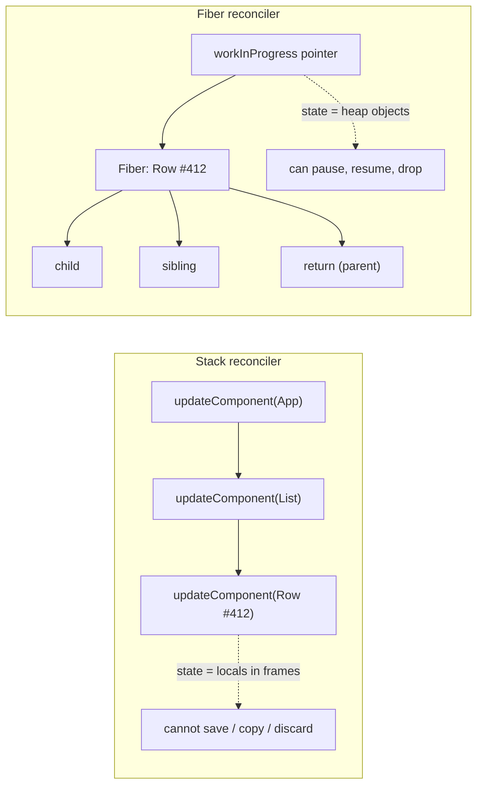
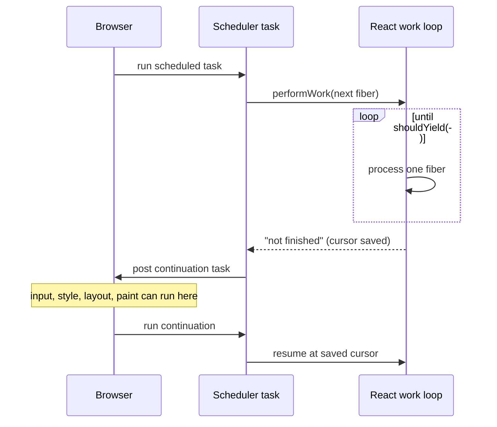

# 02 / 08 — Why Fiber Exists (Stack Reconciler History)

## 1. Lesson metadata

| | |
|---|---|
| **Level** | Advanced |
| **Study time** | 5–6 hours (reading 2.5 h, experiments 1.5 h, exercises 1.5 h) |
| **Prerequisites** | [00/01 — How the browser works](../00-web-and-javascript-foundations/01-how-the-browser-works.md), [00/05 — Execution contexts and the call stack](../00-web-and-javascript-foundations/05-execution-contexts-and-call-stack.md), [00/11 — Event loop, tasks, microtasks](../00-web-and-javascript-foundations/11-event-loop-tasks-microtasks.md), [02/02 — Render vs reconcile vs commit](./02-render-reconcile-commit-paint.md), [02/06 — Reconciliation fundamentals](./06-reconciliation-fundamentals.md), [02/07 — Identity, keys, and reconciliation](./07-identity-keys-and-reconciliation.md) |
| **Next** | [09 — Fiber nodes and units of work](./09-fiber-nodes-and-units-of-work.md) |
| **Related** | [00/17 — JavaScript performance fundamentals](../00-web-and-javascript-foundations/17-javascript-performance-fundamentals.md), [13 — Scheduling and priorities](./13-scheduler-and-priorities.md), [15 — Interruptible, restartable, abandoned renders](./15-interruptible-restartable-abandoned-rendering.md) |

**Learning objectives.** After this lesson you can:
1. Explain, from the JavaScript call stack up, why a recursive reconciler cannot be paused.
2. Describe what the "stack reconciler" (React 15 and earlier) did, at a conceptual level, and the specific failure mode (long synchronous renders blocking input and animation) that motivated a rewrite.
3. State the design goals of Fiber (pause, resume, prioritize, reuse, abort) and map each goal to a structural decision (a heap-allocated, linked work unit; an explicit work loop).
4. Distinguish what Fiber *shipped* in React 16 (a new architecture, still synchronous by default) from what it *enabled later* (concurrent rendering, transitions, Suspense improvements).
5. Reproduce the "recursion cannot yield, loop can" idea in ~30 lines of TypeScript and predict its behavior.
6. Debunk the common misconceptions: "Fiber makes React faster", "Fiber uses threads", "Fiber is the virtual DOM".

**Concepts covered:** stack reconciler, synchronous recursive rendering, main-thread starvation, frame budget, cooperative scheduling, continuation / re-entrancy, heap-allocated frames vs call-stack frames, work loop, unit of work, "fiber" as a re-implementation of the stack frame, legacy mode vs concurrent root, Fiber release timeline.

> **Labelling convention used in this phase.** Every internals lesson separates three kinds of statement:
> - **Public guarantee** — documented on [react.dev](https://react.dev) and safe to depend on.
> - **Teaching model** — a simplification that predicts behavior correctly but is not literally how the code reads.
> - **Implementation detail** — true of a particular React release, may change at any time. ⚠ Names of internal functions, fields and constants are given only where the author is confident, and always as "conceptually" or "at the time of writing". (Checked against <https://github.com/facebook/react> `main` and `react-dom@19.3.1` on 2026-10-22.) (the reconciler lives under `packages/react-reconciler`, the scheduler under `packages/scheduler`) before quoting any of it in a design document.

---

## 2. Deep conceptual explanation

### 2.1 What problem is this lesson solving?

You already know the *what* of rendering from [02/02](./02-render-reconcile-commit-paint.md): React calls your components, compares the resulting elements with the previous ones, and mutates the DOM. This lesson answers the *why is it built like this*: why does React contain a hand-written work loop, linked-list-shaped data structures called Fibers, two trees, a scheduler, and a priority system, instead of a straightforward recursive function that walks elements and patches the DOM?

The answer is one sentence: **a recursive algorithm borrows the JavaScript call stack to remember where it is, and you cannot pause, reorder, or throw away a call stack you do not own.** Everything in Fiber — the shape of the node, the traversal order, the existence of a "work-in-progress" tree, lanes, the scheduler — is a consequence of taking back ownership of "where am I in the tree?" so React can stop in the middle, do something more urgent, and later continue or start over.

If you skip this, concurrent features look like magic and their constraints (purity, no render-phase side effects, "renders may run and be discarded") look arbitrary. They are not arbitrary; they are the price of the design in this lesson.

### 2.2 The world before Fiber: the stack reconciler

React 15 and earlier (and the 16.0 era's idea of "legacy mode" rendering, which still exists as a compatibility behavior) processed an update by **recursion**. Conceptually:

```text
updateComponent(instance, nextElement)
  nextChildElement = instance.render()              // call user code
  for each child:
      compare to previous child (type, key)
      if same type: updateComponent(childInstance, nextChildElement)   // RECURSE
      else:         unmount(old); mountComponent(new)                  // RECURSE
  apply DOM mutations along the way
```

**Implementation detail.** In that era the long-lived objects were *internal instances* (one per mounted component, holding the previous element, the rendered child instance, the public instance and, for host components, the DOM node). The public entry points had names such as `mountComponent`, `receiveComponent`, `updateComponent` — treat these as historical vocabulary; the point is the recursive structure, not the names.

Properties of this design:

| Property | Consequence |
|---|---|
| Recursion uses the **JS call stack** to track "current position" | The position in the tree *is* the stack. No other representation exists. |
| One update = one uninterrupted traversal of the affected subtree | A big subtree means one big task on the main thread. |
| DOM mutation is interleaved with traversal | Aborting midway would leave a half-updated DOM, so abort was never an option. |
| No notion of "importance" of an update | A keystroke and a background poll result are processed in arrival order, each to completion. |
| Cheap to understand and fast for small trees | It was a perfectly good design for the workloads of 2013. |

The design is not "bad". It is **synchronous run-to-completion**, which is exactly how most JavaScript executes ([00/05](../00-web-and-javascript-foundations/05-execution-contexts-and-call-stack.md), [00/11](../00-web-and-javascript-foundations/11-event-loop-tasks-microtasks.md)). The trouble starts only when the amount of work in one run grows past what a frame can afford.

### 2.3 The failure mode: the main thread is shared

From [00/01](../00-web-and-javascript-foundations/01-how-the-browser-works.md): one main thread runs JavaScript, style, layout, paint recording and input dispatch. At 60 Hz a frame has roughly 16.7 ms; some of that belongs to the browser. A stack-reconciler update that needs 120 ms of JS runs as a **single long task**:

```text
time (ms)   0    4                                   124      136
main thread |ev|====== recursive reconcile + DOM mutate ======|style/layout/paint|
input            ^ key #2 (t=40) waits     ^ key #3 (t=90) waits
```

What the user feels: typing stutters, CSS animations driven from the main thread freeze, scroll handlers lag, a click on a button "does nothing" for a tenth of a second. Everything the browser could have done between frames is delayed. This is the *jank* described in [00/01 §2.5](../00-web-and-javascript-foundations/01-how-the-browser-works.md).

Two observations drive the redesign:

1. **Not all updates are equally urgent.** Echoing a typed character, a hover effect, a press-and-hold interaction must feel instant. Filtering a 10,000-row table with the new input value, rendering a chart for a tab the user just clicked, or applying a network response can take longer, provided the urgent things never wait on them.
2. **Much work is speculative.** If the user types another character before the previous result is on screen, the previous render is already obsolete. Finishing it is wasted work that *also* delays the next one. The ideal system would throw it away.

Neither is achievable if the only data structure that knows "where the render is" is the call stack.

### 2.4 Why you cannot pause a recursion

Concretely, in a recursive implementation, at the moment React is inside `updateComponent(grandchild)` the JS engine holds frames for: the root update → parent → child → grandchild (plus several helper frames per level). All the partial state of the traversal (loop indices, the "previous children" being compared, the DOM nodes accumulated so far) lives in **local variables inside those frames**.

JavaScript gives you exactly two ways to leave a function in the middle and come back:

1. **Return.** The frame is destroyed; local state is gone.
2. **Suspend via `await`/generator `yield`.** The *calling* function becomes suspended too, but only if every function up the chain is itself an async function/generator. Making a hot, recursive library path async-all-the-way-down imposes overhead on every node (promise allocation, microtask scheduling, or generator objects) — and, importantly, `await` on an already-resolved promise only yields to the **microtask queue**, which does *not* let the browser render or handle input ([00/11](../00-web-and-javascript-foundations/11-event-loop-tasks-microtasks.md), and the incorrect example in §5.3 below).

There is also no standard way to *inspect, copy, reorder, or discard* a suspended frame. You can resume it exactly as it was, or you can drop it; you cannot say "resume it, but with a new input" or "keep the results for the 400 nodes that did not change". Those operations are the interesting part of concurrent rendering.

### 2.5 What Fiber changes: reimplement the stack in the heap

The React team's solution, announced in 2016 and shipped in React 16.0 (September 2017), is conceptually small:

> **Represent each unit of work as a plain JavaScript object (a *fiber*), link those objects into a tree with explicit pointers, and drive the traversal with an ordinary `while` loop instead of recursion.**

A fiber is, in the words of the community's most-cited early write-up (Andrew Clark's *React Fiber Architecture* notes, <https://github.com/acdlite/react-fiber-architecture>), "a reimplementation of the stack, specialized for React components": you can think of a single fiber as **a virtual stack frame** whose lifetime you control. Because the frames live on the heap and are linked by pointers (`child`, `sibling`, `return`; see [09](./09-fiber-nodes-and-units-of-work.md)), React can:

| Goal (as stated in the Fiber design notes) | How the structure serves it |
|---|---|
| **Pause work and come back to it later** | The "current position" is a single variable (a pointer to the next fiber to process). Stop the loop; keep the pointer; resume later. |
| **Assign priority to different types of work** | Work is attached to fibers/roots with a priority label (today: *lanes*, see [14](./14-lanes.md)); the loop is started for a particular priority. |
| **Reuse previously completed work** | A fiber that had no relevant changes can be reused (bailed out) along with its entire subtree. A second copy of the tree can share unchanged fibers with the first ([10](./10-current-and-work-in-progress-trees.md)). |
| **Abort work if it's no longer needed** | In-progress work is built on a *separate* copy of the tree; discarding it means resetting a pointer, not undoing DOM mutations. |
| **Support layout, error boundaries and (later) Suspense as first-class concerns** | Fibers can be *tagged* with what they are (function component, host element, Suspense boundary…), so special handling lives in the traversal rather than in ad hoc code. |

Two simple structural choices make all of that possible:

1. **A single, explicit "next unit of work" pointer.** The call stack is replaced by `workInProgress` (conceptual name) — "the fiber I will process next". Pausing = stop the loop and remember the pointer.
2. **Separation of "decide what changed" from "make it visible".** Work done while pausing/abandoning must have *no externally visible effect*, so React splits an update into a **render phase** (interruptible; builds a tree of intended changes; touches no DOM) and a **commit phase** (synchronous; applies the changes). That split is the subject of [11](./11-render-phase-and-commit-phase.md), and its consequence for your code (render must be pure) is [12](./12-why-rendering-must-be-pure.md).

### 2.6 The rule that remains: yielding happens *between* units

Fiber does **not** let React interrupt a single JavaScript function that is already running. If one component's function body takes 300 ms, nothing — not Fiber, not the scheduler — can preempt it; the main thread is busy until it returns. What changed is the *granularity*: instead of one task per update, React can check "should I yield?" **between fibers**, i.e. between component function calls. A tree of 1,000 components each costing 0.3 ms becomes 1,000 separately yieldable units; a single 300 ms component remains one unit.

This is the single most important practical consequence of the design:

> **Concurrent rendering makes many small units cooperative. It does not make a large unit small.**

### 2.7 A short timeline (for orientation)

Release facts below were checked against <https://react.dev/versions> and the release posts on 2026-10-22.

| Release | Relevance to this lesson |
|---|---|
| React ≤ 15 | Stack reconciler (recursive, synchronous). |
| **React 16.0 (Sept 2017)** | Fiber ships as the new core. The default behavior was still **synchronous** rendering; the benefits shipped first were architectural: error boundaries, fragments/arrays from `render`, portals, a platform for what followed. |
| React 16.x | Experimental "async mode" work, later renamed; asynchronous behaviors were available behind opt-ins and unstable APIs, not as the default. |
| React 17 (Oct 2020) | A "no new features" release focused on gradual upgrades; internally, the reconciler's priority model was being rewritten (the *lanes* model, see [14](./14-lanes.md)). |
| **React 18 (Mar 2022)** | Concurrent rendering becomes available through the new root API (`createRoot`); features that *use* it (transitions, `useDeferredValue`, streaming SSR with Suspense) become public. Rendering with `ReactDOM.render` (legacy root) keeps the old synchronous behavior. |
| React 19 (Dec 2024) | Builds on the same architecture; adds Actions, `use`, etc. (see [03/22](../03-react-state-and-hooks/22-modern-hooks-and-apis.md)). |
| React 19.2 (Oct 2025) / 19.3 (Sep 2026) | `<Activity>`, `useEffectEvent`, Performance Tracks (19.2); stable `<ViewTransition>` and Fragment Refs (19.3). Latest on npm at review time: 19.3.1. |

The sequence matters: **Fiber was a prerequisite, not the feature.** Years passed between the architectural rewrite and the first public concurrent features, because the structure had to exist, then the scheduler, then the priority model, then APIs that let developers express priority.

### 2.8 Common misconceptions

| Misconception | Reality |
|---|---|
| "Fiber made React faster." | Not primarily. Total CPU work for a given update is similar or can be slightly higher (extra bookkeeping). What improves is **responsiveness**: urgent work can run first and long work can yield. |
| "Fiber is multithreaded." | No. Everything runs on the main thread. Concurrency here means *interleaving* in time, not parallelism. |
| "Fiber is the virtual DOM." | Related but different. Elements ([02/05](./05-elements-vs-dom-nodes.md)) are the description you return; fibers are React's *internal bookkeeping* that persists across renders and also carries state, effects and scheduling metadata. See [04](./04-virtual-dom-what-it-means.md). |
| "Since React 16, all rendering is interruptible." | The architecture permits it, but interruptibility is used only for renders started at a non-urgent priority in a concurrent root. A legacy root, or an urgent update like a discrete event (click), renders without yielding. See [13](./13-scheduler-and-priorities.md). |
| "A Fiber is a lightweight thread / green thread." | A fiber (as in OS or Ruby/Win32 "fibers") is a coroutine; React borrowed the name for the same idea — a unit of execution that can be suspended — but React's fibers are **data**, driven by React's loop, with no stack of their own. |
| "Hooks or concurrent features need classes/generators/Fiber knowledge to use." | You can use them without reading this; the lesson explains *why their rules exist*. |

---

## 3. Internal mechanics

### 3.1 Public guarantee

What React documents and you may rely on:

- React may **render a component multiple times** and may **discard** a render before committing it; therefore render must be pure ([12](./12-why-rendering-must-be-pure.md); [react.dev — Keeping components pure](https://react.dev/learn/keeping-components-pure)).
- With a concurrent root (`createRoot`), updates marked as transitions or deferred values can be interrupted by more urgent updates (see [react.dev — `startTransition`](https://react.dev/reference/react/startTransition), [`useDeferredValue`](https://react.dev/reference/react/useDeferredValue)).
- Rendering never *partially* updates the DOM in a visible way: the user sees either the previous committed UI or the next one (React makes the DOM change in one synchronous commit; the browser then paints).
- Calling `setState` does not synchronously run your component; it schedules work.

You may **not** rely on: *when* a render yields, *how many times* a component function is invoked beyond "at least once per committed render", or any property of the Fiber objects.

### 3.2 Teaching model

> React keeps a tree of work units (fibers). To render, it picks the next unit, calls the component for it (if needed), creates units for its children, and moves on, using explicit pointers to walk down, across, and back up. After each unit, if it is allowed to yield and a deadline has passed, it stops and hands the thread back to the browser. When it has walked the whole tree it commits the result synchronously.

The simple pictures in this phase (a current tree, a work-in-progress tree, a loop that begins and completes fibers) are all this model. It predicts every behavior you need for application code.

### 3.3 Implementation details (may change)

The shape below was checked against `packages/react-reconciler` on `main` and the installed `react-dom@19.3.1` on 2026-10-22:

- The reconciler is a **separate package** (`react-reconciler`) from the renderer (`react-dom`, `react-native`, …). A *host config* lets a renderer say how to create/append/update host nodes. This is why one reconciliation algorithm powers the web, native, test renderers, and custom renderers (`react-three-fiber`, Ink, etc.).
- The traversal is a `while` loop over a pointer to the next fiber. Conceptually there are two loop variants: one that never yields (used for synchronous/urgent work) and one that checks a `shouldYield()`-style predicate before processing each fiber (used for time-sliced work). Search the source for `workLoopSync` and `workLoopConcurrentByScheduler` (in the published 19.3.1 `react-dom` build; `main` additionally has a `workLoopConcurrent` variant used by an experimental throttling flag). These names are not a public API and have changed before.
- Per unit, the reconciler runs a "begin" step on the way down (conceptually `beginWork`) and a "complete" step on the way back up (`completeWork`). [09](./09-fiber-nodes-and-units-of-work.md) explains why both exist.
- Yielding to the browser is done by a **separate package, `scheduler`**, which posts a task (by default using a `MessageChannel` where available) so the browser can run input and rendering in between. See [13](./13-scheduler-and-priorities.md).

### 3.4 Why a stack of heap objects is not free

Fiber has costs, and it is honest to name them:

| Cost | Detail |
|---|---|
| Allocation and GC | Fibers are objects with dozens of fields. React minimizes allocation by *reusing* a fiber's twin across renders ([10](./10-current-and-work-in-progress-trees.md)) but there is still memory overhead per mounted component. |
| Traversal bookkeeping | Pointer chasing and flags; the traversal visits parents twice (begin/complete). |
| Conceptual complexity | Anyone debugging React internals must learn a non-obvious traversal. |
| Constraints on user code | Purity and idempotent render, because React can call it repeatedly or never commit it. |

The designers accepted these costs because the alternative cannot express the product requirement ("urgent things first, stale work abandoned").

---

## 4. Step-by-step execution walkthrough

**Scenario.** A search page. State: `query` (text input) and a derived `results` list of 600 components costing roughly 0.5 ms each (≈ 300 ms to render the list). The user types "react" quickly: five keystrokes 80 ms apart.

### 4.1 Stack-reconciler-style (synchronous) behavior

1. t=0: keystroke "r". Event handler calls `setQuery("r")`.
2. The update is processed synchronously to completion: input fiber, list of 600 children, DOM patch. **Main thread busy for ~300 ms.**
3. t=80, 160, 240: keystrokes "e", "a", "c" arrive; the browser queues the events (input delay grows). Nothing can run.
4. t≈300: the first render finishes; React/ browser handles queued input in order: each keystroke triggers another ~300 ms render (unless batching merges them). Total latency for the last character: roughly ≥ 600 ms. The input visibly lags behind typing.

### 4.2 Fiber with a concurrent root and a deferred/transition render

Assume the app puts the list on a deferred value (`useDeferredValue(query)`) so the input is urgent and the list is not ([react.dev — `useDeferredValue`](https://react.dev/reference/react/useDeferredValue)).

1. t=0: keystroke "r" → `setQuery("r")` is an **urgent** update. React renders the input subtree only (the list is memoized and its deferred prop has not changed yet) — a few milliseconds — and commits. The input shows "r".
2. Right after, React schedules a **second, lower-priority render** where the deferred value equals "r". The work loop starts on the list, yielding to the scheduler every few milliseconds (default slice 5 ms: `frameYieldMs = 5` in the Scheduler's feature flags, verified 2026-10-22; an implementation detail).
3. t=80: keystroke "e". The browser can dispatch it because the work loop has yielded recently. `setQuery("re")` is urgent. React **abandons** the in-progress list render (it is now stale), renders the urgent input update, commits, then starts a new low-priority render for the list with the value "re".
4. t=160, 240, 320: same pattern. Each keystroke shows in the input within a frame or so.
5. After the user pauses, the last low-priority render runs to completion (≈ 300 ms spread over many slices, with the browser free to paint and handle input in between), then commits once. The list jumps from the results for "r" to the results for "react"; the intermediate lists were never committed.

| | Sync recursive | Fiber + deferred value |
|---|---|---|
| Work for the list rendered in total | ≥ 5 × 300 ms (or batched down) | ~300 ms for the final value + partial wasted slices |
| Input latency per keystroke | grows up to hundreds of ms | ≈ one frame |
| DOM states visible | every intermediate list | only the final list |
| Cost | simple | extra bookkeeping; stale intermediate results; code must be pure |

Note the honest trade-off: Fiber did not make the list cheaper; it made the *input* independent of the list and let obsolete list work be dropped.

---

## 5. Code examples

### 5.1 Minimal example — a recursive walk cannot be paused

```ts
interface TreeNode {
  name: string;
  children?: TreeNode[];
}

// Recursive "render": the call stack stores where we are.
function renderRecursive(node: TreeNode, log: string[]): void {
  log.push(`begin ${node.name}`);
  for (const child of node.children ?? []) {
    renderRecursive(child, log);
  }
  log.push(`complete ${node.name}`);
}

const tree: TreeNode = {
  name: "A",
  children: [{ name: "B", children: [{ name: "D" }] }, { name: "C" }],
};

const log: string[] = [];
renderRecursive(tree, log);
console.log(log.join(", "));
```

**Predict.** What is the order of `begin`/`complete` lines? Can you stop after `begin D` and resume later?

**Result.** `begin A, begin B, begin D, complete D, complete B, begin C, complete C, complete A`. You cannot stop after `begin D` and resume later: the "I am in the middle of B's loop, next is C" information is in the *local variables of the suspended frames*, which you cannot save. You could only `throw` to abort (losing everything).

**Why it matters.** This is exactly the shape of the stack reconciler. The `begin` step maps onto "call the component and reconcile children"; `complete` maps onto "create the DOM node and flush results upward".

### 5.2 Practical example — the same walk as a loop with an explicit cursor

Replace the call stack with pointers and one variable, `next`:

```ts
interface Unit {
  name: string;
  child: Unit | null;
  sibling: Unit | null;
  parent: Unit | null; // React calls this pointer `return`
}

function toUnits(node: TreeNode, parent: Unit | null = null): Unit {
  const unit: Unit = { name: node.name, child: null, sibling: null, parent };
  let previous: Unit | null = null;
  for (const childNode of node.children ?? []) {
    const childUnit = toUnits(childNode, unit);
    if (previous) previous.sibling = childUnit;
    else unit.child = childUnit;
    previous = childUnit;
  }
  return unit;
}

// Process one unit; return the next unit to process (or null when done).
function performUnitOfWork(unit: Unit, log: string[]): Unit | null {
  log.push(`begin ${unit.name}`);
  if (unit.child) return unit.child; // go down

  // No children: complete this unit, then walk up/across.
  let current: Unit | null = unit;
  while (current) {
    log.push(`complete ${current.name}`);
    if (current.sibling) return current.sibling; // go across
    current = current.parent;                    // go up
  }
  return null; // whole tree done
}

function workLoop(
  start: Unit,
  log: string[],
  shouldYield: () => boolean,
): Unit | null {
  let next: Unit | null = start;
  while (next !== null && !shouldYield()) {
    next = performUnitOfWork(next, log);
  }
  return next; // non-null = paused; pass it back in later to resume
}

// Drive it: yield after every 2 units, resuming each time.
const rootUnit = toUnits(tree);
const log2: string[] = [];
let cursor: Unit | null = rootUnit;
let budget = 0;
while (cursor) {
  budget = 2;
  cursor = workLoop(cursor, log2, () => budget-- <= 0);
  log2.push("--- yielded to browser ---");
}
console.log(log2.join("\n"));
```

**Line notes.**
- `toUnits` converts a plain tree into **first-child / next-sibling / parent** pointers. This is the same linkage React uses (`child`, `sibling`, `return`).
- `performUnitOfWork` returns *the next unit*. That return value is the entire "continuation". Hand it to someone else and they can resume.
- `shouldYield` is injected, so the loop's policy ("time", "count", "input pending") is separate from the traversal. React's version consults the clock and the scheduler.
- The `complete` loop walks up until it finds a sibling — a parent can complete only after *all* children completed.

**Predict.** What does the output look like?

**Result.** Each slice processes exactly two units (the injected `shouldYield` allows two checks to pass). Trace: slice 1 processes A and B; slice 2 processes D (which logs `complete D`, `complete B` while walking up) and C (which logs `complete C`, `complete A`). Output:

```text
begin A
begin B
--- yielded to browser ---
begin D
complete D
complete B
begin C
complete C
complete A
--- yielded to browser ---
```

The eight `begin`/`complete` entries are in the same order as §5.1; only the pauses are new. Note that a yield counts *units* (calls to `performUnitOfWork`), not log lines, because one call can log several `complete` lines while walking up.

**Why.** Because all state of the traversal is in `cursor` and the `Unit` pointers, the pause costs nothing and is trivial to resume — or to discard (`cursor = null`; start from a different root).

**Trade-off.** More code, more allocation, harder to read than the recursion. Worth it only when pausing/abandoning is a requirement.

### 5.3 Incorrect example — "make it async so it can yield"

```ts
async function renderAsync(node: TreeNode, log: string[]): Promise<void> {
  log.push(`begin ${node.name}`);
  for (const child of node.children ?? []) {
    await Promise.resolve();      // "yield" so the browser can breathe
    await renderAsync(child, log);
  }
  log.push(`complete ${node.name}`);
}
```

**Why it fails.**
1. `await Promise.resolve()` continues in a **microtask**. Microtasks run before the browser gets a chance to render or process input, so the main thread is as starved as before ([00/11](../00-web-and-javascript-foundations/11-event-loop-tasks-microtasks.md)). This is the same mistake as Exercise D1 in [00/01](../00-web-and-javascript-foundations/01-how-the-browser-works.md).
2. Even with a real macrotask yield (`setTimeout`/`MessageChannel`), you have only made the *recursion* pausable; there is still no way to **inspect, reprioritize, or discard** what is in flight, and every level pays async overhead.
3. Results are returned as a promise chain; you cannot reuse partial results from a previous attempt.

### 5.4 Corrected implementation — yield to the macrotask queue from the loop

```ts
function yieldToBrowser(): Promise<void> {
  return new Promise((resolve) => {
    const channel = new MessageChannel();
    channel.port1.onmessage = () => resolve();
    channel.port2.postMessage(null);
  });
}

async function renderCooperatively(root: Unit, log: string[], sliceMs = 5): Promise<void> {
  let next: Unit | null = root;
  while (next) {
    const deadline = performance.now() + sliceMs;
    next = workLoop(next, log, () => performance.now() >= deadline);
    if (next) await yieldToBrowser(); // a real task boundary: input & paint can run
  }
}
```

**Line notes.**
- Yield happens **outside** the traversal; the traversal itself is a plain synchronous loop.
- A `MessageChannel` message is a **macrotask** that does not have the ≥ 1–4 ms clamp that nested `setTimeout(0)` can incur in some browsers. This is, conceptually, the same technique React's scheduler uses in browsers (Node/jsdom use `setImmediate` instead; implementation detail; see [13](./13-scheduler-and-priorities.md)).
- This toy resumes the *same* work. React's real loop can also decide to restart from a different root with different priorities when it wakes up.

### 5.5 Advanced example — observe the benefit in a real React 19 app

```tsx
import { memo, useDeferredValue, useState } from "react";
import { createRoot } from "react-dom/client";

function SlowRow({ text }: { text: string }) {
  // Deliberately burn ~1 ms per row. Do this ONLY in a demo.
  const end = performance.now() + 1;
  while (performance.now() < end) {}
  return <li>{text}</li>;
}

const SlowList = memo(function SlowList({ text }: { text: string }) {
  const rows = Array.from({ length: 250 }, (_, i) => (
    <SlowRow key={i} text={`${text} #${i}`} />
  ));
  return <ul>{rows}</ul>;
});

function App() {
  const [text, setText] = useState("");
  const deferredText = useDeferredValue(text);
  return (
    <>
      <input value={text} onChange={(e) => setText(e.target.value)} aria-label="Search" />
      <SlowList text={deferredText} />
    </>
  );
}

createRoot(document.getElementById("root")!).render(<App />);
```

**Predict.** Type quickly. (a) With the `useDeferredValue` line as written, does the input echo characters promptly? (b) If you replace `deferredText` with `text`, what changes? (c) What if you remove `memo`?

**Result and reasoning.**
- (a) Yes. Each keystroke is an urgent update that re-renders `App`; `SlowList` receives the *old* `deferredText`, and because it is memoized it bails out, so the urgent render is cheap. A second, low-priority render then updates `deferredText` and re-renders the list in slices; typing again discards the stale list render.
- (b) Each keystroke renders 250 × ~1 ms ≈ 250 ms synchronously (urgent renders do not yield): typing lags noticeably.
- (c) Without `memo`, the urgent render of `App` re-renders `SlowList` (new element, parent rendered) with the *old* text; every keystroke still costs ~250 ms. **`useDeferredValue` helps only if the expensive child can skip re-rendering for the old value** — a point that surprises many people.

**Trade-offs.** The list lags behind the input by design; stale data is visible during typing; extra renders occur. For 250 cheap rows, none of this is warranted — measure first (Phase 7).

---

## 6. Visual explanations

### 6.1 Stack frames vs heap fibers



### 6.2 Same work, two schedules

```text
Synchronous (stack):
 main  |■■■■■■■■■■■■■■■■■■■■■■■■■■■■■■■■|  paint
 input     ^key ^key ^key (all wait)

Time-sliced (fiber, concurrent root):
 main  |■■|i|■■|i|■■|p|■■|i|■■|...   ■ = React slice (~5 ms), i = input handled, p = paint
 input     ^key handled promptly
```

### 6.3 What a pause is



---

## 7. Alternative approaches and trade-offs

| Approach | Responsiveness for big updates | Can discard stale work | Complexity | Where it fits |
|---|---|---|---|---|
| Recursive synchronous reconciler (React ≤ 15, legacy root) | Poor beyond a few ms per update | No | Low | Small/medium trees; simple libraries |
| **Fiber work loop + scheduler (React 16+)** | Good for many small units; urgent work first | Yes (concurrent root) | High (inside React) | General UI with mixed urgent/non-urgent updates |
| Manual chunking in app code (`setTimeout` batches, `requestIdleCallback`) | Good for CPU work you own | You must build it | Medium | Data processing, not component rendering |
| Web Worker for the heavy computation | Excellent: main thread free | n/a (computation) | Medium–high (serialization) | Parsing, sorting, search indexes |
| Windowing / virtualization (render fewer nodes) | Excellent | n/a | Medium | Long lists/tables ([Phase 7/09](../07-performance/09-windowing-and-virtualization.md)) |
| Fine-grained reactivity (signals-style frameworks, e.g. Solid) | Excellent: updates touch only the affected DOM/computation, no tree walk | Not needed as often | Different mental model; ecosystem trade-offs | UIs where per-update cost is already tiny |
| Rendering in a worker (offscreen DOM not available) | Not feasible with the DOM | — | — | Canvas/OffscreenCanvas only |

**A scenario where the Fiber approach is *not* best.** A mostly static marketing page with a few small components: the extra bookkeeping buys nothing. And for a dashboard whose slowness is one 400 ms `useMemo` computation inside a single component, concurrent rendering cannot slice it — move it to a worker, precompute, or paginate. Fiber is for *trees of many modest units*, not for single heavy functions.

---

## 8. Best practices and anti-patterns

**Best practices**
- Think "many small components, each cheap" — Fiber can only yield between units. Splitting one 200 ms component into 200 × 1 ms children is a legitimate technique when the work cannot be eliminated.
- Reach for concurrent features (`useTransition`, `useDeferredValue`) to express *urgency*, not to mask expensive code. Measure with the Profiler first ([30](./30-react-devtools-profiler.md), [Phase 7/01](../07-performance/01-measure-before-optimizing.md)).
- Write components so that calling them twice, or calling them and throwing the result away, is harmless ([12](./12-why-rendering-must-be-pure.md)).
- Use a **concurrent root** (`createRoot`) on every new application. The legacy root exists only for migration.

**Beginner mistakes**
- Believing `async` or `await` inside a component "moves work off the main thread".
- Expecting `startTransition` to speed up a slow component's own render time.
- Expecting the Profiler to show the same flame graph under heavy interruption as under a sync render (an interrupted render appears in several chunks).

**Experienced-developer mistakes**
- Treating internals as API: reading fiber fields from user code (for example via `__reactFiber$…` keys on DOM nodes or DevTools hooks) in production code. Those are private and change; reserve them for tooling and debugging.
- Building elaborate scheduling in app code that competes with React's scheduler (double-scheduling) instead of using transitions/`useDeferredValue`.
- Assuming Fiber gives automatic parallelism ("it'll handle 50k nodes").

**Smells**
- A component that does O(n) work on each render for large n, while claiming "concurrent React will handle it".
- Module-level mutable variables read in render (breaks when renders are repeated or abandoned).

**Justified exceptions**
- Legacy roots remain reasonable for a very large legacy application mid-migration; mark it as debt with an owner and a plan ([Phase 10/13](../10-production-engineering/13-application-migrations.md)).
- Direct fiber inspection in a devtools-like internal tool is acceptable when pinned to a React version and covered by tests.

---

## 9. Real-world application

| Domain | How the Fiber design shows up | Engineering constraints |
|---|---|---|
| **E-commerce search/filters** | Typing in a search box must stay instant while thousands of product cards re-filter. Use a deferred value or transition for the result list. | SEO/SSR unaffected; memoize cards; keep the filtered data derivation cheap; prefer server-side filtering for catalogs beyond a few thousand items. |
| **Finance dashboards** | Streams of ticks arriving at high frequency; the user's click on "sell" must not wait behind a chart re-render. Low-priority updates for charts, urgent for controls. | Never let background data update block order entry. Throttle ticks at the data layer; do not rely on React alone. |
| **Rich forms** | Field echo is urgent; validation summaries and previews are not. | Validation logic must be pure so it may run more than once; avoid effects that submit/log during render. |
| **Realtime collaboration** | Remote operations arrive constantly; local typing is urgent. | Use `useSyncExternalStore` for external stores to avoid tearing ([03/20](../03-react-state-and-hooks/20-usesyncexternalstore-and-external-stores.md)). |
| **Multi-team design systems** | A component library cannot assume it is rendered once per update; it may be double-invoked in Strict Mode, or discarded. | Library authors must keep render pure; effects must be idempotent. |

---

## 10. Debugging and troubleshooting

**Symptom 1: typing in an input is laggy when a large sibling subtree re-renders.**
- *Repro:* §5.5 with `text` instead of `deferredText`.
- *Investigation:* Chrome DevTools → Performance: record while typing; you see long tasks (≥ 50 ms) labelled with React render functions. React DevTools Profiler: the list's commit duration is large; "Why did this render?" shows the parent re-rendered ([30](./30-react-devtools-profiler.md)).
- *Root cause:* urgent (sync) update renders the whole expensive subtree with no yielding.
- *Fix and validation:* either restructure state (colocate the input state away from the list — [Phase 3/18](../03-react-state-and-hooks/18-state-colocation-and-lifting.md)), or defer the list. Validate: the long task disappears from the typing path in the Performance panel; the keystroke's interaction time (INP) falls.

**Symptom 2: "I used `startTransition`, but the UI still freezes."**
- *Investigation:* Look for a single long task whose stack shows one component function consuming most of the time (a flame chart with one wide, non-subdivided box).
- *Root cause:* a single unit exceeds the budget; Fiber can yield only between units.
- *Fix:* split the work, virtualize, memoize, or move computation off-thread. Validate by seeing the long task broken into ≤ 5 ms slices separated by gaps.

**Symptom 3: component logs render messages "too many times".**
- *Investigation:* distinguish (a) Strict Mode dev double-invocation ([28](./28-strict-mode-behavior.md)), (b) discarded concurrent renders, (c) real re-renders caused by state/props changes ([01](./01-what-triggers-a-render.md)).
- *Root cause:* render is allowed to run more than once without a commit; log counts are not commit counts.
- *Fix:* move side effects to effects or event handlers; use the Profiler/`<Profiler>` for commit counts.

---

## 11. Exercises

### Level A — Knowledge
A1. Why can a recursive algorithm not be paused in the middle by library code? Name the location of the "where am I" information.
A2. List the five goals commonly stated for Fiber's design.
A3. What does a fiber replace, conceptually, in the stack reconciler?
A4. True or false: Fiber runs React rendering on a separate thread. Justify.
A5. What is the smallest unit at which React can yield during render? What does that imply about a single slow component?
A6. Which React release introduced Fiber, and which release made concurrent rendering available to application authors (and through what API)?

### Level B — Code comprehension
B1. In §5.2, change `shouldYield` to always return `true`. What does `workLoop` return on its first call, and how many log lines are produced?
B2. In §5.3, if you replace `await Promise.resolve()` with `await new Promise(r => setTimeout(r, 0))`, does the code become a good model of Fiber? List two remaining differences.
B3. In §5.5 variant (c) (no `memo`), explain precisely what is rendered on each keystroke and in which order, and why the user still sees lag.

### Level C — Implementation
C1. Extend the `Unit`/`workLoop` toy with a `priority` per work request: `urgent` requests must run to completion without yielding, `idle` requests yield every 2 ms. If an `urgent` request arrives while an `idle` loop is paused, the idle traversal must be *discarded* and restarted afterwards from the root. Sketch the data you must keep and write the scheduler function.
C2. Write a React component `FilteredList` with an input and a list of 5,000 items where typing remains responsive using `useDeferredValue`; include `memo` where required and explain why.

### Level D — Debugging
D1. A teammate wrapped a 400 ms synchronous `computeLayout(rows)` call inside a component in `startTransition`. The input still freezes for 400 ms. Diagnose with reference to the unit-of-work granularity and propose two fixes.
D2. A module-level `let renderCount = 0; renderCount++` in a component is used to "count commits" and reports numbers larger than the Profiler's commit count. Explain every legitimate reason, and give a correct way to count commits.

### Level E — Architecture and engineering decisions
E1. Your product has a 2,000-row editable grid. Updates come at 20 Hz from a websocket; editing a cell must feel instant. Compare (1) virtualization only, (2) transitions for incoming updates, (3) worker-side diffing. Select a combination and justify against criteria: input latency, complexity, memory, accessibility.
E2. A team asks whether to adopt concurrent features in an application with many class components relying on `componentWillReceiveProps`-style side effects. What are the risks and what migration steps do you recommend?

### Level F — Expert challenge
F1. Argue for or against: "If browsers provided a native way to run JavaScript on multiple threads with shared DOM access, Fiber's design would be unnecessary." Consider determinism, locking, and the commit model.
F2. Design an experiment (code + measurements) that distinguishes "React yields between fibers" from "React yields at a fixed wall-clock interval regardless of fibers", using only public APIs and the Performance panel. State the expected outcome under each hypothesis.

---

## 12. Detailed answers and explanations

> Attempt the exercises first.

**A1.** Recursion keeps the traversal position (loop counters, the node being processed, partial results) in local variables of live stack frames. Those frames are owned by the JS engine; library code can neither serialize, copy, nor discard them selectively. The only ways out are returning (destroying state) or async/generator suspension (which must be threaded through every caller and which does not give a task boundary unless it awaits a macrotask). *Wrong but plausible:* "use `setTimeout` inside the recursion" — you would need the whole chain to be async, and still could not discard or reprioritize.

**A2.** Pause and resume; assign priorities; reuse completed work; abort work no longer needed; (and, as a framework for features) make layout/error handling/suspension first-class concerns by tagging work units. If you listed "make rendering faster" — that was not a goal in itself.

**A3.** The call-stack frame for a component's reconciliation: it is "a reimplementation of the stack", one frame per unit, but heap-allocated, linked by pointers and with a lifetime React controls.

**A4.** False. Concurrency here is cooperative interleaving on the main thread; there is no parallelism and the DOM is main-thread-only. React 19's server rendering and other runtimes are separate topics.

**A5.** A single fiber, i.e. one component function call (plus its begin/complete work). A single slow component cannot be sliced; yielding happens before/after it, never inside it. Fixes are to split or offload.

**A6.** Fiber: React 16.0 (2017). Concurrent rendering for application authors: React 18 (2022) via the `createRoot` API; features like `startTransition` and `useDeferredValue` use it. (Dates checked against react.dev/versions.)

**B1.** With `shouldYield` always `true`, `while (next !== null && !shouldYield())` never enters the body. `workLoop` returns `start` (the root unit) immediately; zero log lines from `workLoop`. The driver in §5.2 would then loop forever appending `--- yielded to browser ---` — a good demonstration of a liveness bug: a yielding policy must guarantee **at least one unit per slice** (React guarantees progress; see [13](./13-scheduler-and-priorities.md) for starvation/expiration). Fix: do one unit before checking `shouldYield`, or use a do/while.

**B2.** Yes, it is closer: a macrotask boundary allows input and paint. Remaining differences: (1) there is still a recursion whose state is in promise continuations — cannot be reprioritized or discarded; (2) no separation of render vs commit, so partial results are visible in the DOM as they are produced (if this were real rendering), and (3) no priority model, no reuse of unchanged subtrees. Any two valid.

**B3.** Each keystroke: urgent render of `App` (new `text`; `deferredText` unchanged, so first render pass of that urgent update uses the old deferred value) → `SlowList` is not memoized so it re-renders (props object new, even though `text` equals the old deferred value) → 250 `SlowRow`s run (≈250 ms) → commit. Then the deferred render re-renders again with the new text (another ≈250 ms, interruptible). So lag is *worse* than not using `useDeferredValue` — every keystroke pays the cost twice, and the urgent one is not interruptible. Lesson: deferral only works if the expensive subtree can bail out for the old value (memoization).

**C1.** Evaluation criteria: (1) state includes `root`, `cursor`, `currentPriority`; (2) urgent requests call a no-yield loop; (3) arrival of urgent work when an idle cursor exists sets `cursor = null` (discard) and re-enqueues "restart idle from root" afterwards; (4) a guarantee of progress per slice; (5) no mutation of externally visible output during idle traversal (collect results; "commit" at the end). Sketch:

```ts
type Priority = "urgent" | "idle";
interface Request { priority: Priority; root: Unit }

class MiniScheduler {
  private idleRoot: Unit | null = null;
  private cursor: Unit | null = null;
  constructor(private log: string[]) {}

  requestUrgent(root: Unit): void {
    // Discard any in-flight idle traversal: its inputs may be stale.
    const hadIdle = this.cursor !== null;
    this.cursor = null;
    let next: Unit | null = root;
    while (next) next = performUnitOfWork(next, this.log); // no yielding
    if (hadIdle && this.idleRoot) this.cursor = this.idleRoot; // restart from the top
  }

  requestIdle(root: Unit): void {
    this.idleRoot = root;
    this.cursor = root;
  }

  // Called from the host's task loop.
  runIdleSlice(sliceMs = 2): boolean {
    if (!this.cursor) return false;
    const deadline = performance.now() + sliceMs;
    let first = true;
    while (this.cursor && (first || performance.now() < deadline)) {
      this.cursor = performUnitOfWork(this.cursor, this.log);
      first = false;
    }
    return this.cursor !== null; // true = more work remains
  }
}
```

Edge cases: urgent work arriving *during* an idle slice cannot happen on one thread unless the idle slice yields, which is the point; and restarting from the root versus reusing finished subtrees is where the real React uses work-in-progress reuse.

**C2.**

```tsx
import { memo, useDeferredValue, useMemo, useState } from "react";

interface Item { id: number; label: string }

const Rows = memo(function Rows({ items, query }: { items: readonly Item[]; query: string }) {
  const q = query.trim().toLowerCase();
  const visible = useMemo(
    () => (q ? items.filter((i) => i.label.toLowerCase().includes(q)) : items),
    [items, q],
  );
  return (
    <ul>
      {visible.map((i) => (
        <li key={i.id}>{i.label}</li>
      ))}
    </ul>
  );
});

export function FilteredList({ items }: { items: readonly Item[] }) {
  const [query, setQuery] = useState("");
  const deferred = useDeferredValue(query);
  const stale = deferred !== query;
  return (
    <div>
      <input aria-label="Filter" value={query} onChange={(e) => setQuery(e.target.value)} />
      <div style={{ opacity: stale ? 0.6 : 1 }}>
        <Rows items={items} query={deferred} />
      </div>
    </div>
  );
}
```

`memo` makes the urgent render skip `Rows` while `deferred` is unchanged. `items` must be referentially stable (else memo is defeated). Showing "stale" feedback is good UX. Edge: an empty query with 5,000 items still renders all 5,000 rows — for real products virtualize.

**D1.** The unit of work is one component function; `computeLayout` runs inside it (or inside a render-phase call), so the transition's render phase contains a 400 ms unit; `shouldYield` is only consulted between units, so the main thread is busy for 400 ms regardless of lane. Fix 1: move computation to a Web Worker and render when the result arrives (state). Fix 2: restructure so the work is spread over many components or incremental computations (or cache/memoize with `useMemo` keyed by inputs so it is not recomputed each time); also consider server-side computation. A `useEffect` does not help by itself (it just moves the work after paint, still blocking input for 400 ms).

**D2.** Legitimate reasons the counter is higher: Strict Mode dev double-invocation (both component body calls count), renders that were discarded/abandoned (concurrent), renders that bailed out before commit, re-renders after an error/Suspense retry, and renders in other (e.g., offscreen/hidden) trees. Also, a module-level counter shared by all instances aggregates across instances. Correct counting: `<Profiler onRender>` (called per commit of its subtree), or the DevTools Profiler, or count in an effect (`useEffect(() => { commits++ })`) acknowledging effect semantics ([18](./18-effects-and-their-timing.md)).

**E1.** Evaluation criteria: identifies that the unit of cost differs: 2,000 rows × cells is DOM-heavy; virtualization reduces DOM and render work without any scheduling cleverness; transitions only help when work is *interruptible and deferrable* — the realtime stream may be treated as non-urgent so edits stay urgent; worker diffing reduces main-thread JS but adds serialization and complexity. A well-reasoned answer: virtualize rows (essential for DOM size and a11y via correct `aria-rowcount`/`aria-rowindex`), apply websocket updates through a batched store with `useSyncExternalStore` and transitions for non-visible columns, keep edit state local to the edited cell, skip the worker unless profiling shows data transformation dominates. Explicitly state what would change the decision (e.g., 50k rows, heavy formulas).

**E2.** Risks: class lifecycles with side effects in render-phase methods (`componentWillMount`/`WillReceiveProps`/`WillUpdate`, legacy `UNSAFE_` variants) can run multiple times or be discarded; Strict Mode will surface them. Steps: enable Strict Mode in dev, fix warnings, move side effects to `componentDidMount`/`componentDidUpdate` or effects, migrate to `createRoot`, adopt concurrent features gradually per screen, add regression tests. Say "mixed" is supported; no big-bang rewrite needed.

**F1.** Evaluation criteria: a good answer notes that Fiber addresses two problems — (a) CPU starvation (parallelism could help) and (b) *prioritization/abandonment of speculative work* plus *consistency* (the UI must be a coherent snapshot); shared-memory threads would add locking and nondeterminism to a model built on pure, repeatable rendering, and the commit must still be atomic and ordered with respect to the DOM. So partially unnecessary (slicing), but not the priority/abandon/commit split. Ongoing work in the ecosystem (workers for computation, OffscreenCanvas) addresses only parts.

**F2.** Create a tree of N tiny components (e.g., 5,000 × 0.05 ms) rendered under a transition, and a tree of 1 component costing 250 ms. Record the Performance panel. Hypothesis "yields between fibers": the first shows a chain of short tasks (≈5 ms each; implementation detail) separated by gaps; the second a single 250 ms task. Hypothesis "fixed interval regardless": both would show ~5 ms tasks — which cannot be true for the second because nothing can interrupt a running function. Add a variant with the transition replaced by an urgent update to confirm *no* slicing occurs for urgent work (expect one long task for the first tree).

---

## 13. Senior engineer interview questions

**Q1. Why did React rewrite its core as Fiber instead of optimizing the old reconciler?**
*Strong answer.* The old reconciler was recursive and synchronous; its key limitation was structural: the call stack was the only record of progress, so it could not pause, prioritize, or discard work. Micro-optimizations could shave constants but not change the unit of scheduling. The goal was control over *when and in what order* work occurs (responsiveness), so the traversal state had to move into heap-allocated, linked work units and a loop that React owns.

**Q2. Does Fiber make rendering faster?**
*Strong answer.* Not in total CPU. Equal-ish or more bookkeeping. It improves *perceived* performance by letting urgent updates preempt non-urgent ones and by allowing stale work to be dropped. For a single synchronous update with no competing urgent work, you gain nothing.

**Q3. If I wrap a slow computation in `startTransition`, why is the page still janky?**
*Strong answer.* The transition changes the lane (priority) of the update and makes its render interruptible *between fibers*. A long computation inside one component is one unit; nothing can preempt it. Fix by reducing/off-loading the work or spreading it across components/slices.

**Q4. Why is it unsafe to perform side effects during render in a Fiber-based React?**
*Strong answer.* Render-phase work may be repeated (Strict Mode, retries after Suspense), abandoned before commit, or run in a different priority order. A side effect would then fire zero, one, or many times unpredictably; the commit/effect phases are the only places with at-most-once-per-commit semantics.

**Q5. What is the relationship between Fiber, the scheduler and lanes?**
*Strong answer.* Fiber is the data structure and traversal that make work divisible; lanes are the priority labels attached to updates and used to choose *which* work a render pass includes; the scheduler is the mechanism that decides *when* a React task runs relative to the browser's other work. Three layers: *what* (lanes), *how* (fibers/work loop), *when* (scheduler). Names and boundaries are implementation details.

**Q6. Where would Fiber's approach be a poor trade-off?**
*Strong answer.* Single heavy synchronous computations (cannot slice), tiny apps (overhead without benefit), and apps that can eliminate the tree walk via fine-grained reactivity. A staff-level answer also says: the cost surfaces in constraints on user code (purity) that may not be justified for a simple widget library, though they are cheap to meet.

---

## 14. Further learning resources

| Resource | URL | Covers / why | Level | Study |
|---|---|---|---|---|
| React docs — Keeping components pure | <https://react.dev/learn/keeping-components-pure> | The public contract that Fiber's design depends on | Beginner–Int. | Whole page |
| React docs — `startTransition` | <https://react.dev/reference/react/startTransition> | Public API for marking non-urgent updates | Intermediate | Reference + caveats |
| React docs — `useDeferredValue` | <https://react.dev/reference/react/useDeferredValue> | Deferral pattern used in §5.5 | Intermediate | "Deferring a value" |
| React 18 release post | <https://react.dev/blog/2022/03/29/react-v18> | What concurrent rendering means to users | Intermediate | Concurrent React section |
| React Versions page | <https://react.dev/versions> | Authoritative release list | All | Whole page |
| React Fiber Architecture (Andrew Clark) | <https://github.com/acdlite/react-fiber-architecture> | Original conceptual write-up of Fiber's goals | Advanced | Whole doc; note it predates later changes (lanes, hooks) |
| React repository | <https://github.com/facebook/react> | Source: `packages/react-reconciler`, `packages/scheduler` | Advanced | Reconciler work loop |
| React Working Group — React 18 | <https://github.com/reactwg/react-18> *(index page checked 2026-10-22; individual threads not checked)* | Design discussions on concurrent features | Advanced | Discussions about concurrent rendering and Strict Mode |
| Lin Clark — "A Cartoon Intro to Fiber" (React Conf 2017) | search the title on YouTube *(URL not given; search the title)* | Visual introduction to the work loop and time slicing | Intermediate | Whole talk; historical (pre-hooks, pre-lanes) |
| MDN — Event loop | <https://developer.mozilla.org/en-US/docs/Web/JavaScript/Event_loop> | Why microtask yielding does not help | Beginner–Int. | Whole page |

URLs in this table were checked for HTTP 200 on 2026-10-22; any still marked *(unverified)* could not be checked automatically. A 200 does not guarantee the page content still matches the description; if a link has moved, search the site for the quoted title.

---

## 15. Knowledge checkpoint

**You should now understand**
- A recursive reconciler stores its position on the call stack and therefore cannot be paused, prioritized, or discarded.
- Fiber reimplements that stack as heap objects with explicit pointers and a single "next unit" cursor.
- Fiber enabled (but did not by itself deliver) concurrent rendering; yielding is possible only *between* units, never inside a component function.
- Concurrency here is interleaving on one thread, not parallelism, and the cost of the design is constraints on user code (purity).

**You should be able to explain without notes**
- Why `await Promise.resolve()` does not let the browser paint.
- Why `useDeferredValue` without `memo` can make typing worse.
- The difference between "faster" and "more responsive".

**You should be able to implement**
- A pausable, resumable traversal using child/sibling/parent pointers.
- A deferred-list component with a stable-props child.

**You should be able to debug**
- A long task caused by a single large component vs many small ones, using the Performance panel.
- Misleading "render count" numbers (Strict Mode, abandoned renders).

**Before moving on:** read [09 — Fiber nodes and units of work](./09-fiber-nodes-and-units-of-work.md), which opens the fiber object and walks the begin/complete traversal in detail.
