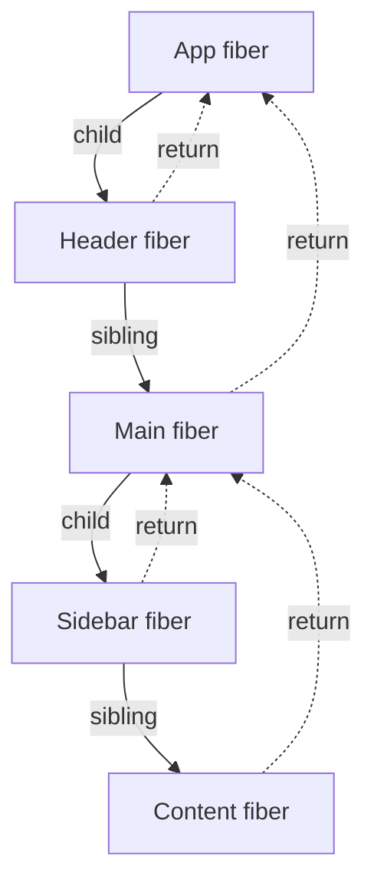
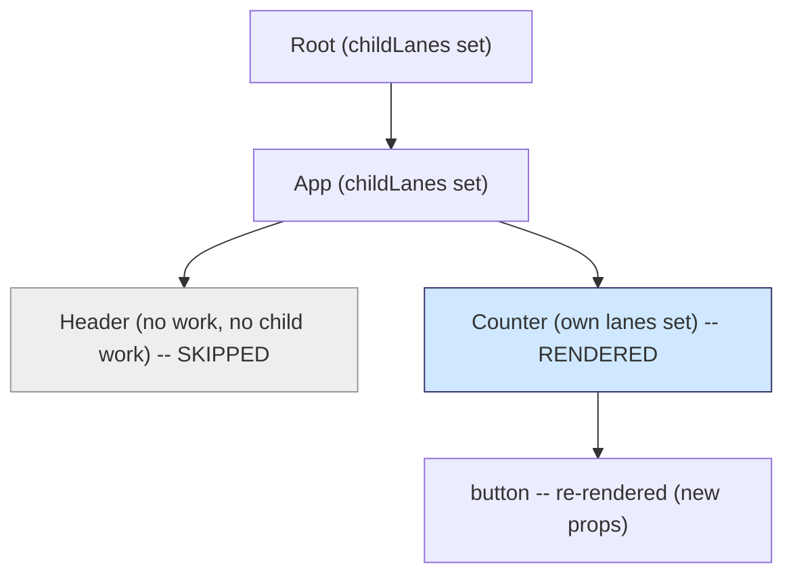
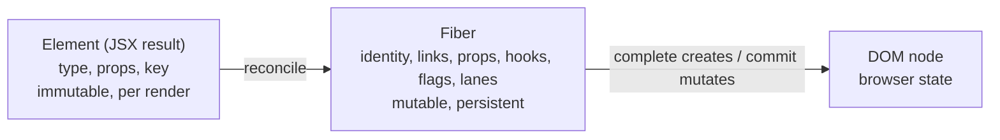

# 02 / 09 — Fiber Nodes and Units of Work

## 1. Lesson metadata

| | |
|---|---|
| **Level** | Advanced |
| **Study time** | 5–6 hours (reading 2.5 h, experiments 1.5 h, exercises 1.5 h) |
| **Prerequisites** | [08 — Why Fiber exists](./08-why-fiber.md), [02/05 — Elements vs DOM nodes](./05-elements-vs-dom-nodes.md), [02/06 — Reconciliation fundamentals](./06-reconciliation-fundamentals.md), [02/07 — Identity, keys, and reconciliation](./07-identity-keys-and-reconciliation.md), [01/04 — Elements, components, instances](../01-react-fundamentals/04-elements-components-instances.md) |
| **Next** | [10 — Current and work-in-progress trees](./10-current-and-work-in-progress-trees.md) |
| **Related** | [11 — Render phase and commit phase](./11-render-phase-and-commit-phase.md), [17 — How hooks attach to Fiber](./17-hooks-and-fiber-state.md), [31 — Reading React's source](./31-reading-react-source.md) |

**Learning objectives.** After this lesson you can:
1. Say what a fiber *is* (a mutable JavaScript object with several roles) and how it differs from an element, a component, a DOM node, and a "component instance".
2. Name and group the main fields of a fiber and explain what each group is for, while knowing which names are stable concepts and which are volatile implementation details.
3. Describe the traversal order — down via `child`, across via `sibling`, up via `return` — and explain why every fiber is visited **twice** (a "begin" step going down, a "complete" step coming up).
4. Explain what happens in each step at a conceptual level: reconcile children and decide whether to render, versus build host instances and bubble results up.
5. Explain bailouts: how React skips an entire subtree (or re-uses it) without calling any component in it, and what exactly the check compares.
6. Implement a toy begin/complete traversal with flag bubbling and predict its trace.
7. Inspect fibers safely from the browser console for *learning*, and know why that must never reach production code.

**Concepts covered:** fiber as unit of work / instance record / tree node, `tag`, `type`, `key`, `stateNode`, `return`/`child`/`sibling`/`index`, `pendingProps`/`memoizedProps`/`memoizedState`, `updateQueue`, `flags`/`subtreeFlags`, `lanes`/`childLanes`, `alternate`, FiberRoot vs HostRoot fiber, `beginWork`/`completeWork`, `performUnitOfWork`, bailout, effect/flag bubbling.

> **Internals warning for the entire lesson.** Field names below (`child`, `sibling`, `return`, `memoizedState`, `flags`, …) and function names (`beginWork`, `completeWork`, `performUnitOfWork`) are ones the author is confident exist at the time of writing in `packages/react-reconciler` of <https://github.com/facebook/react>. They are **implementation details**: they have been renamed before (for example, an older "effect list" with `effectTag`/`nextEffect` was replaced by `flags`/`subtreeFlags`), and several fields change meaning between releases. Use them to build a mental model. (Field names were checked by inspecting a live fiber on `react-dom@19.3.1`, and function names against `main`, on 2026-10-22.)

---

## 2. Deep conceptual explanation

### 2.1 What problem is this lesson solving?

[08](./08-why-fiber.md) argued that React needs a pausable traversal, and therefore needs the traversal state in heap objects. This lesson looks at those objects and at the loop that walks them. Without this you cannot answer questions that come up daily:

- *Why does a parent re-render re-run its children's functions even though "nothing changed"?* (What exactly is compared when React decides to skip?)
- *Where does my `useState` value live between renders?* (On a fiber.)
- *Why do effects of children run before effects of their parent?* (Completion order of the traversal.)
- *How can React skip 5,000 unchanged components without visiting them?* (Priority bookkeeping on ancestors lets it prune.)
- *What is "a unit of work" and why can a single big component not be time-sliced?*

### 2.2 Three things a fiber is at once

A fiber is a plain JS object. It plays three roles, and most confusion comes from mixing them up.

| Role | What it means | Consequence |
|---|---|---|
| **A unit of work** | "A thing React has to process in the work loop": call a component function, reconcile its children, or create/update a host node. | The loop's granularity; time-slicing can pause between fibers. |
| **A record of a mounted component/node (the "instance")** | The place where long-lived data for *this position in the tree* is stored: state (hooks), DOM node, ref, pending updates. | State survives across renders because the fiber survives; position/type determines identity ([07](./07-identity-keys-and-reconciliation.md)). |
| **A node in a tree** | Linked to its parent, first child and next sibling. | Tree traversal without recursion. |

Contrast with its neighbors:

| Thing | Lifetime | Mutability | Carries state? |
|---|---|---|---|
| **Element** (`<Foo a={1} />`, result of `createElement`/JSX runtime) | One render | Treated as immutable | No — a *description* ([01/04](../01-react-fundamentals/04-elements-components-instances.md), [02/05](./05-elements-vs-dom-nodes.md)) |
| **Fiber** | From mount to unmount (and a twin, see [10](./10-current-and-work-in-progress-trees.md)) | Mutated by the reconciler | Yes (hooks list, class instance pointer, DOM node pointer) |
| **DOM node** | Created at commit, removed at commit | Mutated by commit phase | The browser's state (value, focus, scroll) |
| **"Component instance"** | Meaningful for class components (an actual `this`). For function components there is **no instance object**; the fiber plays that role. | | |

> A common phrasing: "React keeps a *fiber tree* parallel to the element tree and the DOM tree." Elements are rebuilt each render; the fiber tree is updated to match them; the DOM tree is updated to match the fiber tree.

### 2.3 What kinds of fibers exist: `tag`

Not every fiber corresponds to something you wrote. Each fiber has a **tag** (a small integer enum in the source) saying what kind of unit of work it is; the traversal's `begin`/`complete` logic switches on it. Conceptually the common kinds are:

| Kind (conceptual name) | Created for | Does its `begin` call user code? | Has a DOM node? |
|---|---|---|---|
| HostRoot | The root container (`createRoot(container)`'s tree top) | No | Points at the container's root record |
| FunctionComponent | `<Foo />` where `Foo` is a function | Yes: calls `Foo(props)` (running hooks) | No |
| ClassComponent *(legacy)* | `<Foo />` where `Foo` extends `Component` | Yes: lifecycle + `render()` | No (has a class instance as `stateNode`) |
| HostComponent | `<div>`, `<button>` … | No | Yes (after completion) |
| HostText | A string/number child | No | Yes (a Text node) |
| Fragment | `<>…</>` or arrays | No | No |
| Context provider / consumer | `<Ctx.Provider>` / `<Ctx.Consumer>` (and `<Ctx>` in 19) | Provider pushes a value | No |
| Suspense, Offscreen/Activity, Memo, Lazy… | Respective features | Special handling | Usually no |

The exact list and the numeric values of tags change between releases. Never branch on them; treat "kind" as a concept.

Why this matters: **component functions are only one kind of fiber.** A tree with 1,000 `<div>`s has 1,000 host fibers that never call user code but still participate in the walk. And a fiber for `<Foo />` is distinct from the host fiber(s) for what `Foo` returns.

### 2.4 The anatomy: fields grouped by purpose

Rather than memorize a list, learn the **groups**.

| Group | Representative fields | Purpose |
|---|---|---|
| **Identity** | `tag`, `key`, `elementType`, `type`, `stateNode` | What this unit is; `key`+`type` drive reconciliation matching ([07](./07-identity-keys-and-reconciliation.md)). `stateNode` points at the DOM node (host), class instance (class), or the root record (HostRoot). |
| **Tree links** | `return`, `child`, `sibling`, `index` | Parent pointer (named `return` because it is "where to return to" when this unit completes — the stack-frame analogy), first child, next sibling, position among siblings. |
| **Input props** | `pendingProps`, `memoizedProps` | `pendingProps` = props from the element being rendered now; `memoizedProps` = props used for the last completed render. Comparing them (by identity) is the first bailout test. |
| **State and hooks** | `memoizedState`, `updateQueue`, `dependencies` | For function components, `memoizedState` holds the head of the **linked list of hooks** ([17](./17-hooks-and-fiber-state.md)); for class components it holds the state object; for HostRoot it holds the rendered element. `updateQueue` holds pending updates / effects. `dependencies` records which contexts the component read (so a context change can find and mark it). |
| **Output flags** | `flags`, `subtreeFlags`, `deletions` | Bits recording *what the commit phase must do for this fiber* (place, update, delete children, run layout/passive effects, attach ref…). `subtreeFlags` is the OR of flags in the subtree, letting commit skip clean branches. |
| **Priority** | `lanes`, `childLanes` | `lanes`: work scheduled on this fiber; `childLanes`: work scheduled somewhere below ([14](./14-lanes.md)). |
| **Twin** | `alternate` | Pointer to the other copy of this fiber (current ↔ work-in-progress), see [10](./10-current-and-work-in-progress-trees.md). |
| **Misc** | `ref`, `mode` | Ref attached to this host/class fiber (in React 19 `ref` is also just a prop for function components); `mode` records root mode (concurrent, Strict Mode flags, …). |

**The root has two objects, not one.** Internally there is a **FiberRoot** (a record per `createRoot`: the container, which fiber tree is `current`, pending lanes, a finished work-in-progress tree waiting for commit, scheduler callback bookkeeping) and a **HostRoot fiber** (the top fiber of the tree). FiberRoot is *not* a fiber; its `current` pointer refers to the HostRoot fiber that is currently committed. [10](./10-current-and-work-in-progress-trees.md) uses this pointer for the double-buffer flip.

### 2.5 The traversal: down, across, up

Because fibers are linked by `child`/`sibling`/`return`, a tree traversal needs no recursion. For a tree

```text
App
├── Header
└── Main
    ├── Sidebar
    └── Content
```

React's DFS visits each fiber going **down** and then again when it **completes**, producing:

```text
begin App → begin Header → complete Header → begin Main → begin Sidebar → complete Sidebar
→ begin Content → complete Content → complete Main → complete App
```

The rules:
1. After `begin X`, if X has a `child`, process that child next (go down).
2. If X has no child, `complete X`. Then, if X has a `sibling`, process the sibling next (go across); otherwise complete the `return` (parent), and repeat.
3. When completing the root, the traversal is finished.

This is exactly the toy in [08 §5.2](./08-why-fiber.md). The name `return` matches the stack-frame analogy: it is where control returns after the unit finishes.

### 2.6 What happens in "begin" and "complete"

**Begin (`beginWork`, conceptually) — going down.** Its job: *given this fiber and its new props/pending work, work out what its children should be*.

- Decide whether the fiber needs work at all (bailout test, §2.7).
- If it needs work: for function components, **call the function** (with hooks dispatcher set up) to obtain child elements; for host components, take the children from props; for providers, push context; for Suspense/others, run feature logic.
- **Reconcile children**: compare the new child elements with the existing child fibers (type/key rules from [06](./06-reconciliation-fundamentals.md) and [07](./07-identity-keys-and-reconciliation.md)) and create/reuse/mark fibers: set `child`/`sibling`/`return`/`index`, and set flags like "placement" for new nodes or add to `deletions` for removed ones.
- Return the first child fiber (the next unit) or nothing.

**Complete (`completeWork`, conceptually) — coming up.** Its job: *finalize this fiber now that all of its descendants are finalized*.

- For **host** fibers: on mount, create the DOM node (not yet attached to the document), append the already-completed child DOM nodes into it, and set initial properties; on update, work out what changed in properties and flag the fiber for update. All **without touching the live document**: nodes created here are detached until commit.
- Pop context/other stacks that begin pushed.
- **Bubble** results upward: OR the flags and lanes of children into this fiber's `subtreeFlags`/`childLanes` so that ancestors know "there is something to do below".

Why two steps? Because some work needs information from *above* (props, context, parent type) and some needs *completed children* (a host node cannot be fully assembled until its child nodes exist; flags can be summarized only after children are known). Going down computes the tree shape; coming up assembles output. This is the same shape as a post-order computation on a recursive tree, made resumable.

Key consequence: **children complete before parents.** The order in which effects run (layout effects, passive effects, ref attachment, `componentDidMount`) follows completion order: leaf-first. In the example above, `Header`'s effects run before `Main`'s children, and `App`'s run last.

### 2.7 Bailouts: how React skips work

On an update, React starts at the root and walks down. For each fiber it asks (conceptually) in `beginWork`:

1. **Did the props change?** Compare the fiber's `memoizedProps` (last render) with `pendingProps` (this render's) **by object identity** (`!==`, not deep equality). Also: did a legacy context change, or has the element type changed?
2. **Does this fiber itself have scheduled work at the current priority?** (Check its `lanes` against the lanes being rendered.) E.g., it called `setState`, or it consumed a context that changed.
3. If neither: **bail out**. Then ask: **does any descendant have scheduled work?** (`childLanes`). If not, skip the whole subtree: return "no child" and the traversal moves on without visiting a single descendant. If yes, *clone* the existing child fibers (re-use them without calling components) and descend only to reach the descendant(s) with pending work.

This is the mechanism behind [Phase 1's claims](../01-react-fundamentals/13-rendering-mental-model.md) that "when a parent re-renders, children re-render by default":

- When a parent function **runs**, it creates **new element objects** for its children, and each element carries a **new props object** — even if the props' *contents* are equal. So for every child, `pendingProps !== memoizedProps`: no bailout; the child function is called.
- `React.memo` changes the rule for a component: before running, it shallow-compares old and new props (or uses your comparator) and treats equal props as "no change", then falls into the same bailout path.
- When a component is **not** re-run (because a higher ancestor bailed out and cloned children), its children's elements are the *same objects* as before, so props are identical and they bail out too. This is why **state colocation** works: put state in a small component, and only that component's subtree re-runs while siblings and ancestors are cloned without being called ([Phase 3/18](../03-react-state-and-hooks/18-state-colocation-and-lifting.md), [Phase 7/07](../07-performance/07-state-colocation-for-perf.md)). It is also why passing `children` as a prop through a state-owning wrapper avoids re-rendering `children`: the `children` elements were created by the *outer* parent, which did not re-run.

The ancestors' `childLanes` are what make "skip this whole subtree" cheap: when a state update is scheduled, React walks from the updated fiber **up** to the root, marking each ancestor's `childLanes`. Later, walking down, an ancestor with no matching `childLanes` and no work of its own can be skipped in O(1).

### 2.8 Flags and bubbling: how render output reaches commit

During begin/complete, React does **not** call DOM methods. Instead it writes *descriptions of intended effects* onto fibers as bit flags:

| Concept | Meaning at commit |
|---|---|
| Placement | Insert this host node (or subtree) into its parent. |
| Update | Apply property changes to a host node; or run lifecycle/layout effects for a component. |
| ChildDeletion (+ the parent's `deletions` list) | Remove these child fibers' host nodes and run their cleanups. |
| Ref | Attach/detach a ref. |
| Passive | This fiber has passive effects (`useEffect`) to schedule. |
| Snapshot | Class `getSnapshotBeforeUpdate`. *(legacy)* |

When a fiber completes, its children's flags are OR'd into `subtreeFlags`. At commit React can then ask "does this subtree have any mutation to apply?" and skip it if not. Older React versions (≤ 17) instead built a linked *effect list* of fibers with effects during completion; the flags-and-bubbling approach replaced it. If you read blog posts that discuss `firstEffect`/`nextEffect`, they describe the older mechanism.

### 2.9 Common misconceptions

| Misconception | Reality |
|---|---|
| "A fiber is a component instance." | Only conceptually for class components. A function component has no instance; the fiber stores its hooks and position. |
| "Every fiber corresponds to JSX I wrote." | Host text, fragments, providers, the root, and others have fibers too. |
| "Fibers are recreated on every render." | Mostly reused (via a twin). Elements are recreated; fibers persist while the position/type/key match. |
| "`React.memo` prevents a component from being a fiber / removes it from the tree." | The fiber exists; memo affects whether `beginWork` re-runs the component function. |
| "If props are deep-equal the child won't render." | The default test is **identity** (`!==`); a fresh object each render fails it. |
| "Completion order is the order of my JSX." | Siblings complete in order, but children complete *before* their parent: post-order. |
| "State is stored inside the component function." | It is stored on the fiber (`memoizedState`); the function re-runs and reads it back. |
| "`return` on a fiber is the return value of the component." | `return` is the **parent pointer**. The component's return value is elements, turned into child fibers. |

---

## 3. Internal mechanics

### 3.1 Public guarantee

- Component functions are called by React during render, in an order that visits parents before children (a parent's function runs before its child's) — but **calling order is not a contract you should encode** (Strict Mode double-invokes; concurrent features may restart).
- State persists for a component *position* as long as type and position match ([01/16](../01-react-fundamentals/16-state-preservation-and-reset.md)). Effects/cleanups run in commit, and children's effects run before parents' ([react.dev — `useEffect`](https://react.dev/reference/react/useEffect)); layout effects likewise ([`useLayoutEffect`](https://react.dev/reference/react/useLayoutEffect)).
- Props objects are new on each parent render; compare by value only if you opt in (`memo`) ([react.dev — `memo`](https://react.dev/reference/react/memo)).
- Fiber objects are **not** part of the public API.

### 3.2 Teaching model

> Each position in the UI has a fiber. React walks the fiber tree depth-first. Going down it asks each fiber "do you need to run, and what are your children?"; coming up it asks "what DOM and what flags do you produce, and what do your descendants need?" Unchanged subtrees are skipped; results are summarized with flags; nothing visible to the user happens until the commit.

### 3.3 Implementation details

The function that drives one unit (conceptually `performUnitOfWork`) does approximately this (paraphrased, not copied):

```text
performUnitOfWork(unit):
    current = unit.alternate                      // the committed twin (may be null on mount)
    next = beginWork(current, unit, renderLanes)  // go down: may call user code
    unit.memoizedProps = unit.pendingProps        // props are now "processed"
    if next === null: completeUnitOfWork(unit)    // leaf: start going up
    else:             workInProgress = next       // continue down

completeUnitOfWork(unit):
    do:
        completeWork(current, unit, renderLanes)  // build host node / bubble flags
        if unit.sibling:  workInProgress = unit.sibling; return   // across
        unit = unit.return                        // up
    while unit !== null
    // reached root: render phase done; mark root "complete"
```

Notes:
- The "unit" boundary (what the yield check wraps) is this `performUnitOfWork`; a `beginWork` that calls a 300 ms component function is one unit.
- `beginWork` has a fast path: if `current !== null` and props/context are unchanged and no lanes match, it takes the **bailout path** (it does not call the component and may return `null` when `childLanes` don't intersect).
- When `beginWork` re-runs a function component, the call goes through a helper that installs the hooks dispatcher, calls the function, then resets it. Hooks are covered in [17](./17-hooks-and-fiber-state.md).
- For *host* fibers, `completeWork` on mount creates the DOM element and appends children's DOM nodes ("append all children" step); on update it determines a property diff and flags it. In React 19 the `updatePayload` mechanism of 17/18 is gone (no `updatePayload` identifier remains in `react-dom@19.3.1`); do not rely on any "update payload" folklore.
- Error handling (`throw`) is caught around the loop; fibers get "incomplete" flags and the traversal unwinds to an error boundary or Suspense boundary instead of completing normally ([24](./24-suspense-conceptual-internals.md), [Phase 4/19](../04-react-architecture/19-error-boundaries.md)).
- In the DOM renderer, fibers are discoverable from DOM nodes through a private property with a `__reactFiber$…` prefix. That is how DevTools and event dispatch find the fiber for a DOM target. It is private.

### 3.4 Memory and cost

A fiber has on the order of dozens of fields. Per mounted *element position*, not per component call. Large trees (tens of thousands of nodes) produce tens of thousands of fibers plus their twins plus DOM nodes; this is one reason virtualization remains valuable ([Phase 7/09](../07-performance/09-windowing-and-virtualization.md)). Reusing the twin (§[10](./10-current-and-work-in-progress-trees.md)) avoids allocating a new fiber every render.

---

## 4. Step-by-step execution walkthrough

We trace a state update in a small app and show exactly which fibers are visited, which user functions run, and which are skipped.

```tsx
function App() {
  return (
    <>
      <Header />
      <Counter />
    </>
  );
}
function Header() { return <h1>Shop</h1>; }
function Counter() {
  const [n, setN] = useState(0);
  return <button onClick={() => setN(n + 1)}>Count: {n}</button>;
}
```

Fiber tree (mounted): `HostRoot → App → Fragment → [Header → h1 → "Shop", Counter → button → ["Count: ", "0"]]`. (The top-level unkeyed Fragment returned by `App` does **not** get its own fiber: verified on 19.3.1, where the chain from the `button` is `button ← Counter ← App ← HostRoot`. Treat the presence of a Fragment fiber as a detail; the traversal story is identical. Step 12 below says "Fragment/App/HostRoot" for that reason.)

**Click.** `setN(1)` is called inside a click handler.

1. **Scheduling (before any traversal).** React creates an update object on `Counter`'s hook queue, marks `Counter.lanes` with the update's lane, and walks **up** `return` pointers marking `childLanes` on every ancestor, ending at the root, which now records "pending work". A render is scheduled ([13](./13-scheduler-and-priorities.md), [14](./14-lanes.md)). *Nothing renders yet; `Counter` has not been called.*
2. **Render starts at the root.** A work-in-progress tree is created by cloning from the current one lazily as the loop goes ([10](./10-current-and-work-in-progress-trees.md)).

| Step | Unit | What happens | User code runs? |
|---|---|---|---|
| 1 | begin HostRoot | No own work, but `childLanes` non-empty → clone child, descend. | No |
| 2 | begin App | Props identical (same element as last time; `App` was not re-run), no own lanes, `childLanes` non-empty → bail out *cloning children*, descend. | **No** (`App` function not called) |
| 3 | begin Header | Same props as before, no lanes, `childLanes` empty → **skip subtree** (return null). | **No** |
| 4 | complete Header | Nothing to do; bubble nothing. | — |
| 5 | begin Counter | Own lanes match → **call `Counter()`** with the hooks dispatcher: `useState` processes the update queue, returns `n = 1`. Output: a `<button>` element with new props. Reconcile: the `button` fiber is matched by type, updated. | **Yes** |
| 6 | begin button | New props object (`children: ["Count: ", 1]`) !== memoized → work. Children reconciled: text "Count: " unchanged; the number child is a text node whose content changed `"0" → "1"`. | No (host) |
| 7 | begin text "Count: " | Text equal → no work, complete. | No |
| 8 | begin text "1" | Text changed → flag Update. | No |
| 9 | complete text "1" | Mark flag; bubble. | No |
| 10 | complete button | Compute property diff (`onClick` is a new function identity, handled specially by the event system); flag Update; bubble `subtreeFlags` from the text child. | No |
| 11 | complete Counter | Bubble flags/lanes. (Note: `Counter` has no DOM node.) | No |
| 12 | complete Fragment/App/HostRoot | Bubble flags: root's subtree has an Update flag. | No |

3. **Render phase ends.** `root.finishedWork` is the completed work-in-progress tree. **Zero DOM mutations have happened.**
4. **Commit phase** ([11](./11-render-phase-and-commit-phase.md), [20](./20-commit-and-dom-mutation.md)) walks the tree following `subtreeFlags`; the `Header` branch has no flags and is skipped; the text node's data is set to `"1"`.

**What the logs would show** if you put `console.log` in each function body (not in Strict Mode): only `Counter` logs. `App` and `Header` are silent. If you move `useState` up into `App`, then the click re-runs `App`, which creates new elements for `<Header />` and `<Counter />`; `Header` gets fresh props, fails the identity test, and **runs** — even though it renders the same output.

---

## 5. Code examples

### 5.1 Minimal example — inspect fibers in the console (exploration only)

```ts
// Paste in the browser console on a page rendered by React DOM.
// Uses private properties (verified working on React 19.3.1: `__reactFiber$…` key on the DOM node). Learning aid only; never ship this.
type AnyFiber = {
  type: unknown;
  return: AnyFiber | null;
  child: AnyFiber | null;
  sibling: AnyFiber | null;
  tag: number;
};

function fiberOf(node: Element): AnyFiber | null {
  const key = Object.keys(node).find((k) => k.startsWith("__reactFiber$"));
  return key ? ((node as unknown as Record<string, AnyFiber>)[key] ?? null) : null;
}

function label(f: AnyFiber): string {
  const t = f.type as { name?: string; displayName?: string } | string | null;
  if (typeof t === "string") return `<${t}>`;
  return t?.displayName ?? t?.name ?? `(tag ${f.tag})`;
}

const el = document.querySelector("button");
let f = el ? fiberOf(el) : null;
const chain: string[] = [];
while (f) {
  chain.push(label(f));
  f = f.return;
}
console.log(chain.join(" ← "));
```

**Predict.** For the `Counter` example in §4, what chain prints?

**Result.** `<button> ← Counter ← App ← (tag 3)`, with the final entry being the HostRoot fiber (its `type` is `null`, so it prints as a tag number; tag 3 on React 19.3.1, verified by execution). The top-level Fragment does not appear. The exact tail varies by version and by whether the app is in Strict Mode, wrapped in providers, etc.

**Why.** The DOM node carries a pointer to its host fiber; `return` links climb through parents. The component fiber (`Counter`) is *not* the host node's parent in the DOM sense — the DOM has no `Counter` — but it is the fiber parent.

**Trade-off / limits.** Private key and shape change; production minifiers and different React versions differ; use React DevTools ([Phase 1/18](../01-react-fundamentals/18-react-devtools.md), [30](./30-react-devtools-profiler.md)) for real work. Even DevTools uses an official-but-unstable hook interface, not a public API.

### 5.2 Practical example — a toy begin/complete traversal with bailout and flag bubbling

This models §2.6–2.8 in about 60 lines. It is **not** React's code; names are chosen to echo it.

```ts
const UPDATE = 0b01;

interface Fiber {
  name: string;
  child: Fiber | null;
  sibling: Fiber | null;
  parent: Fiber | null;   // React: `return`
  hasWork: boolean;       // React: roughly `lanes` intersects the render lanes
  childHasWork: boolean;  // React: roughly `childLanes` intersects
  flags: number;
  subtreeFlags: number;
}

function mk(name: string, children: Fiber[] = []): Fiber {
  const f: Fiber = {
    name,
    child: children[0] ?? null,
    sibling: null,
    parent: null,
    hasWork: false,
    childHasWork: false,
    flags: 0,
    subtreeFlags: 0,
  };
  children.forEach((c, i) => {
    c.parent = f;
    c.sibling = children[i + 1] ?? null;
  });
  return f;
}

// "setState": mark the fiber, then walk up marking ancestors.
function scheduleUpdate(f: Fiber): void {
  f.hasWork = true;
  for (let p = f.parent; p; p = p.parent) p.childHasWork = true;
}

function beginWork(f: Fiber, log: string[]): Fiber | null {
  if (!f.hasWork) {
    if (!f.childHasWork) {
      log.push(`skip ${f.name}`);       // bailout: skip the entire subtree
      return null;
    }
    log.push(`descend ${f.name}`);      // bailout but must visit descendants
    return f.child;
  }
  log.push(`render ${f.name}`);         // "calls the component"
  f.flags |= UPDATE;
  for (let c = f.child; c; c = c.sibling) c.hasWork = true; // new props objects
  return f.child;
}

function completeWork(f: Fiber, log: string[]): void {
  log.push(`complete ${f.name}`);
  for (let c = f.child; c; c = c.sibling) {
    f.subtreeFlags |= c.flags | c.subtreeFlags; // bubble
  }
}

function performUnitOfWork(f: Fiber, log: string[]): Fiber | null {
  const next = beginWork(f, log);
  if (next) return next;
  let cur: Fiber | null = f;
  while (cur) {
    completeWork(cur, log);
    if (cur.sibling) return cur.sibling;
    cur = cur.parent;
  }
  return null;
}

// Build:  App > [Header, Counter > [Button, Label]]
const header = mk("Header");
const counter = mk("Counter", [mk("Button"), mk("Label")]);
const app = mk("App", [header, counter]);

scheduleUpdate(counter);

const log: string[] = [];
for (let next: Fiber | null = app; next; ) next = performUnitOfWork(next, log);
console.log(log.join("\n"));
console.log("App.subtreeFlags =", app.subtreeFlags, "| Header.flags =", header.flags);
```

**Line notes.**
- `scheduleUpdate` is the scheduling step from §4: mark the fiber, then mark `childHasWork` on every ancestor via parent pointers. That upward marking is what makes the downward pruning possible.
- `beginWork` has three outcomes: skip subtree (`null`), pass through without rendering (`descend`), or render. This mirrors the bailout/render split in §2.7.
- When a fiber "renders", it hands its children `hasWork = true` to model "new props objects ⇒ identity test fails".
- `completeWork` ORs the children's flags into `subtreeFlags`.

**Predict.** Write the log before reading on.

**Result.**

```text
descend App
skip Header
complete Header
render Counter
render Button
complete Button
render Label
complete Label
complete Counter
complete App
App.subtreeFlags = 1 | Header.flags = 0
```

**Why.** `App` has no work but a descendant does, so it descends; `Header` has neither, so it is skipped (no component call, no children visited) but still "completes" — the loop treats a `null` begin result as a leaf. `Counter` renders; its children inherit new props and render; completion is post-order: `Button`, `Label`, then `Counter`, then `App`. `App.subtreeFlags` is nonzero because of `Counter`'s flag, so commit knows to look inside `App` but can skip `Header`.

**Trade-offs.** The toy has no keys, no types, no priorities, no twin. Its point is the *shape* of the control flow.

### 5.3 Incorrect example — "the props are the same, so Header will skip"

```tsx
function Page() {
  const [open, setOpen] = useState(false);
  return (
    <>
      <Header title="Shop" />                     {/* looks unchanged... */}
      <button onClick={() => setOpen(!open)}>Toggle</button>
      {open && <Panel />}
    </>
  );
}
function Header({ title }: { title: string }) {
  console.log("Header render");                   // fires on every toggle
  return <h1>{title}</h1>;
}
```

**Predict.** On each click, does "Header render" print?

**Result.** Yes. `Page` re-runs (it owns the state), creating a new element for `<Header title="Shop" />` and therefore a new props *object*. Identity comparison (`pendingProps !== memoizedProps`) fails; `Header` is not bailed out.

**Why it is a common mistake.** Reading JSX as "the same props" instead of "a new object each time". The bailout checks identity of the *props object*, not of each prop.

### 5.4 Corrected implementations

Three ways, in order of preference:

```tsx
// (1) State colocation: move the state down so Page does not re-run.
function Page() {
  return (
    <>
      <Header title="Shop" />
      <PanelToggle />   {/* owns `open` */}
    </>
  );
}

// (2) Pass the stable subtree as children (the elements are created by the parent that does not re-run).
function Toggler({ children }: { children: React.ReactNode }) {
  const [open, setOpen] = useState(false);
  return (
    <>
      {children}
      <button onClick={() => setOpen(!open)}>Toggle</button>
      {open && <Panel />}
    </>
  );
}
// <Toggler><Header title="Shop" /></Toggler>

// (3) Opt in to value comparison.
const Header = memo(function Header({ title }: { title: string }) {
  return <h1>{title}</h1>;
});
```

**Explanation.** (1) and (2) change *which fibers are processed*: `Header`'s fiber is bailed out (props identity preserved, no lanes). (3) keeps the re-run of `Page` but lets `Header`'s `beginWork` short-circuit using a shallow comparison. Prefer (1)/(2) when natural because they remove work and need no comparison code; use (3) when state genuinely must live above. Never add `memo` blindly: the comparison costs time too and objects/functions passed as props defeat it unless stabilized ([Phase 3/12](../03-react-state-and-hooks/12-react-memo.md), [Phase 7/04](../07-performance/04-memoization-trade-offs.md)).

### 5.5 Advanced example — observing unit-of-work granularity with the Profiler API

```tsx
import { Profiler, type ProfilerOnRenderCallback, useState } from "react";

const onRender: ProfilerOnRenderCallback = (id, phase, actualDuration, baseDuration) => {
  // phase: "mount" | "update" | "nested-update"
  console.log(id, phase, `actual=${actualDuration.toFixed(2)}ms`, `base=${baseDuration.toFixed(2)}ms`);
};

function Slow({ ms }: { ms: number }) {
  const end = performance.now() + ms;
  while (performance.now() < end) {} // demo only
  return null;
}

export function Demo() {
  const [n, setN] = useState(0);
  return (
    <Profiler id="demo" onRender={onRender}>
      <button onClick={() => setN(n + 1)}>{n}</button>
      <Slow ms={20} />
      <Slow ms={20} />
    </Profiler>
  );
}
```

**Predict.** After a click, what are `actualDuration` and `baseDuration` roughly?

**Result.** Both slow components re-run (new props objects), so `actualDuration` ≈ 40 ms+ and `baseDuration` ≈ 40 ms+. If you wrap `Slow` in `memo` and pass the same `ms`, `actualDuration` drops to ~0–1 ms (bailout: no function call) while `baseDuration` — an *estimate of the cost of rendering the subtree without memoization*, computed from the last render durations of its fibers — stays ≈ 40 ms. The gap between them quantifies what memoization saves ([30](./30-react-devtools-profiler.md)).

**Why this belongs here.** `actualDuration` is literally the sum of time spent in `beginWork`/`completeWork` for fibers that were *not* bailed out; it is a measurement of the traversal you just learned. `<Profiler>` is disabled in the production build by default (profiling builds are separate); as documented in [react.dev — `<Profiler>`](https://react.dev/reference/react/Profiler).

**Trade-offs.** Busy-wait costs are for demonstration; in real apps use the Profiler recording in DevTools instead of instrumenting code.

---

## 6. Visual explanations

### 6.1 Pointers



Parents have only a `child` pointer to the **first** child; siblings form a singly linked list through `sibling`; every fiber points back with `return`. No arrays of children are stored on the fiber.

### 6.2 Visit order (begin ▼ / complete ▲)

```text
begin App ▼
  begin Header ▼   complete Header ▲
  begin Main ▼
    begin Sidebar ▼   complete Sidebar ▲
    begin Content ▼   complete Content ▲
  complete Main ▲
complete App ▲
```

### 6.3 Bailout pruning with `childLanes`



### 6.4 What lives where



---

## 7. Alternative approaches and trade-offs

| Design | Skips unchanged subtrees? | Resumable? | State location | Notes |
|---|---|---|---|---|
| **Fibers with child/sibling/return pointers** (React) | Yes, via identity + lane bookkeeping | Yes (cursor) | On fiber (hooks list) | General, but requires pure render and some allocation |
| Recursive virtual-DOM diff (stack reconciler; classic Preact/Vue 2-style) | Via memo/`shouldComponentUpdate`-style checks | No | On component instance objects | Simple and fast for modest trees |
| Compiler-optimized templates + dependency tracking (Vue 3, Svelte, Solid) | Yes, at the granularity of bindings/signals | Not needed as often | In reactive cells | Less work per update; different authoring constraints; no priority lanes in the same sense |
| Immediate-mode UI (rebuild everything per frame, e.g. game UIs) | N/A | N/A | App-owned | Different domain |
| React Compiler auto-memoization *(1.0 stable since Oct 2025; see [Phase 9/08](../09-advanced-rendering-and-ecosystem/08-react-compiler.md))* | Adds memoization at compile time so more props identities are stable | Same runtime | Same | Doesn't change fiber mechanics; changes how often the identity test succeeds |

**Where the recommended approach is not best.** If you only need to update a handful of text bindings at high frequency (a ticking clock, a live price), React's walk down from the state owner, the child function calls and the reconciliation, is more machinery than needed. Options outside the React render path (a ref + `textContent`, a subscription that updates a single DOM node, or a signals-based component) can be cheaper; the trade is leaving React's declarative model for that node ([Phase 7/18](../07-performance/18-react-vs-browser-bottlenecks.md)).

---

## 8. Best practices and anti-patterns

**Best practices**
- Reason about **fibers visited and functions called**, not "components that changed". A re-render is a function call; a bailout is the absence of one.
- Put state as low as it can go; pass static subtrees as `children`. These remove work at the root of the problem.
- Keep component output deterministic from props/state/context so that skipping or repeating a unit is always safe.
- Use the Profiler's "why did this render" and the flame chart; do not guess.
- Name components (and set `displayName` for wrappers) so fibers are identifiable in DevTools.

**Beginner mistakes**
- Treating "re-render" as "DOM update". Most re-renders touch no DOM; they call functions and find no change.
- Memoizing everything "to avoid fibers being created".
- Reading values from `ref.current` during render as if the fiber were a global store ([12](./12-why-rendering-must-be-pure.md)).

**Experienced-developer mistakes**
- Inline object/array/function props to a `memo` child ("memo isn't working").
- Believing `memo` makes the *children* of the memoized component skip when the component itself re-renders. Its own children are re-run unless they are themselves bailed out.
- Relying on children-before-parents order in a way that breaks under Suspense/Offscreen replays.

**Smells**
- A deep tree where a top-level context value changes every render (every consumer is marked; see [Phase 3/14](../03-react-state-and-hooks/14-context-performance.md)).
- Code that reads `__reactFiber$`/`_owner`/`_debugOwner` outside of dev tooling.

**Justified exceptions**
- Test utilities and DevTools-like tooling may inspect fibers via the official DevTools global hook; pin the React version.
- A library may use `memo` on every exported component to stabilize behavior for consumers who pass inline props, when benchmarked.

---

## 9. Real-world application

| Domain | Where fiber mechanics matter | Constraints |
|---|---|---|
| **Dashboards** | A tick updates one widget. With state colocated in the widget (or an external store consumed via `useSyncExternalStore` selectors), only that widget's path is visited; ancestors are cloned, siblings skipped. | Keep stores granular; one store object that every widget subscribes to completely defeats pruning. |
| **E-commerce product lists** | Hundreds of cards share a parent that owns filter state. Filter changes legitimately re-run the list; card components should be cheap or memoized with stable props. | Stable `key` = product id so fibers are reused across reorderings ([07](./07-identity-keys-and-reconciliation.md)). |
| **Forms** | Each keystroke updates one field. If all form state lives in the root, every field's function runs on each keystroke. | Colocate or use uncontrolled fields for large forms ([Phase 3/21](../03-react-state-and-hooks/21-forms-and-complex-state.md)). |
| **Realtime collaboration** | Presence/cursor updates at 30 Hz can dwarf content updates. | Isolate high-frequency state in leaf components or outside React; ensure content subtree has stable identity. |
| **Design systems** | Wrapper-heavy components (providers, polymorphic wrappers) add fibers per usage. A table with 5,000 cells each wrapped in five components is 25,000 fibers. | Budget wrapper depth; measure with the Profiler; consider specialized cell components. |

---

## 10. Debugging and troubleshooting

**Symptom: "Component X re-renders even though its props don't change."**
- *Repro:* §5.3.
- *Investigation:* React DevTools → Profiler → enable "Record why each component rendered while profiling" in settings; look at the reason ("Props changed: (title)" or "The parent component rendered"). If "parent rendered", the cause is the identity test in §2.7.
- *Root cause:* a new props object (from a parent function run). Even with `title="Shop"` constant.
- *Fix and validation:* colocate state / pass as children / `memo` with stable props. Validate: the component's bar becomes gray ("did not render") in the Profiler, and `console.log` stops firing.

**Symptom: "`memo` is not working."**
- *Investigation:* Profiler reason says "Props changed: (onSelect, style)".
- *Root cause:* inline function/object literals produce a new identity every parent render.
- *Fix:* hoist constants, `useCallback`/`useMemo` where justified, or restructure (pass IDs not objects). Validate by re-profiling.

**Symptom: "State resets unexpectedly."**
- *Investigation:* The fiber was replaced: a changed `type` at that position (component defined inside another component), or a changed `key`. In DevTools, the component shows as unmounted/remounted (look at the effect logs or a mount-time `console.count`).
- *Root cause:* identity rules in [07](./07-identity-keys-and-reconciliation.md); a new component *type* every render yields a new fiber each time.
- *Fix:* define components at module scope; use stable keys. Validate: mount count remains 1.

**Symptom: a single slow component blocks the UI even under `startTransition`.** See [08 §10](./08-why-fiber.md): one `beginWork` is one unit.

**Tooling tip:** the Profiler flame graph's colored bars are fibers that were *not* bailed out; gray bars were skipped. The "ranked" view lists by self time. Memorize this mapping to the traversal.

---

## 11. Exercises

### Level A — Knowledge
A1. Name the three roles a fiber plays.
A2. What are the three tree-link fields, and which one points to the parent? Why that name?
A3. What does `memoizedProps` vs `pendingProps` represent, and how are they compared in the default bailout test?
A4. In which direction (down/up) does React create DOM nodes for host fibers, and when are they attached to the document?
A5. Why do children's effects run before their parents'?
A6. Name two fiber kinds that do **not** call user code during `begin`.

### Level B — Code comprehension
B1. Given `App > [A, B > [C, D], E]`, write the begin/complete order for a full traversal.
B2. In §5.2, if you also call `scheduleUpdate(header)`, what changes in the log?
B3. In §4, `useState` is moved up into `App` (same JSX). Which function calls happen after a click? Which fibers bail out?
B4. What does `App.subtreeFlags` equal in §5.2 if `scheduleUpdate` is called on `Label` instead of `Counter`? Write the log.

### Level C — Implementation
C1. Extend the toy `Fiber` with `lanes`/`childLanes` as bitmasks and a `renderLanes` parameter so that `beginWork` bails out only when `(f.lanes & renderLanes) === 0`. Show that an update in lane `0b10` is skipped when rendering lane `0b01`, yet `childLanes` correctly keep ancestors from being pruned for the later render.
C2. Write a React component pair that demonstrates that passing the stable subtree as `children` avoids re-rendering it, with a `console.count` proving it.

### Level D — Debugging
D1. A teammate wraps `Row` in `memo` but the Profiler says "Props changed: (data)". The parent does `<Row data={{ id, name }} />`. Explain and fix.
D2. After refactoring, a text input loses its value on every keystroke. The code defines `function Field()` inside `Form`'s body. Explain via fibers and fix.

### Level E — Architecture and engineering decisions
E1. A dashboard page has 40 widgets under one `DashboardProvider` whose value object changes whenever any widget's data changes. Using what you know about `dependencies` and `childLanes`, explain why this is slow and compare three redesigns.
E2. When is it reasonable to deliberately keep a component *un*-memoized even if its parent re-renders often? Give criteria.

### Level F — Expert challenge
F1. Design a test (using only public APIs) that demonstrates a bailout via `children` without reading fibers. State what you assert and why it won't be flaky under Strict Mode.
F2. Explain how a `key` change on the **same type** leads to a different traversal outcome than a `key`-less rerender, in terms of begin/complete and flags (placement, deletions).

---

## 12. Detailed answers and explanations

> Attempt the exercises first.

**A1.** Unit of work; record of a mounted position (state/DOM/ref holder, "instance"); node in the tree.

**A2.** `child` (first child), `sibling` (next sibling), `return` (parent). `return` because the pointer says where the traversal "returns" to when this unit completes — analogous to a call-stack frame's return address.

**A3.** `pendingProps` = props from the element in the current render; `memoizedProps` = props used for the last completed render. The default test is identity (`!==`) of the props objects; `memo` replaces it by a shallow (or custom) comparison before reaching the same bailout.

**A4.** Created during the *complete* step (coming up), after children exist; they are appended into their parent DOM node **detached from the document**, and the root's finished tree is inserted/mutated in the commit phase. *Wrong:* "during begin" — children don't exist yet; "directly as components run" — that would make render impure and un-abortable.

**A5.** Effects/lifecycles are executed following completion (post-order) traversal of the finished tree: a parent can't be complete until its children are. Child effect setup therefore runs first; for unmount, cleanup of parents runs before children's in some phases, an asymmetry examined in [18](./18-effects-and-their-timing.md) and [19](./19-layout-vs-passive-effects.md). Do not generalize "cleanups run child-first" from this answer: verified on 19.3.1, update-time cleanups run child-first (`C1, C2, P`) but unmount/deletion cleanups run parent-first (`P, C1, C2`).

**A6.** Host components (`<div>`), host text, fragments, HostRoot, context providers (only push a value).

**B1.** `begin App, begin A, complete A, begin B, begin C, complete C, begin D, complete D, complete B, begin E, complete E, complete App`.

**B2.** `Header` now has work: log shows `render Header` instead of `skip Header`; it has no child so `complete Header` follows. `Header.flags = 1`, and `App.subtreeFlags` includes both. Full log: `descend App, render Header, complete Header, render Counter, render Button, complete Button, render Label, complete Label, complete Counter, complete App`.

**B3.** After the click, `App` runs (own lanes), producing new elements for `<Header />` and `<Counter />`. `Header` and `Counter` get fresh props ⇒ both run (unless memoized). No component bails out apart from host nodes whose props are truly identical. In the original structure only `Counter` ran. This is the cost of state placement.

**B4.** `scheduleUpdate(label)` marks `label.hasWork`, and `childHasWork` on Counter and App. Log: `descend App, skip Header, complete Header, descend Counter, skip Button, complete Button, render Label, complete Label, complete Counter, complete App`. `App.subtreeFlags = 1` (from Label). Note `Counter` merely descends: **`Counter` does not run**, because its own `hasWork` is false. This is exactly how a child's `setState` re-runs only that child.

**C1.** Sketch:

```ts
interface LFiber { name: string; lanes: number; childLanes: number; child: LFiber | null; sibling: LFiber | null; parent: LFiber | null; }

function schedule(f: LFiber, lane: number): void {
  f.lanes |= lane;
  for (let p = f.parent; p; p = p.parent) p.childLanes |= lane;
}

function begin(f: LFiber, renderLanes: number, log: string[]): LFiber | null {
  if ((f.lanes & renderLanes) === 0) {
    if ((f.childLanes & renderLanes) === 0) { log.push(`skip ${f.name}`); return null; }
    log.push(`descend ${f.name}`); return f.child;
  }
  log.push(`render ${f.name}`);
  return f.child;
}
```

Schedule lane `0b10` on a leaf; rendering with `renderLanes = 0b01` skips the whole path (ancestors' `childLanes & 0b01 === 0`), while a later render with `0b10` descends through them. The point: the *same* bits that prune also must remain set until their lane is rendered — React clears a fiber's lanes when it processes them, and ancestors recompute `childLanes` when they complete (bubbling). Edge case: if you clear ancestor `childLanes` on skip, the later lane would never be found.

**C2.**

```tsx
import { type ReactNode, useState } from "react";

function Static() {
  console.count("Static render");
  return <p>I do not depend on the toggle.</p>;
}

function Toggle({ children }: { children: ReactNode }) {
  const [on, setOn] = useState(false);
  return (
    <section>
      <button onClick={() => setOn(!on)}>{on ? "On" : "Off"}</button>
      {children}
    </section>
  );
}

export function Demo() {
  return (
    <Toggle>
      <Static />
    </Toggle>
  );
}
```

`Demo` never re-runs; `Static`'s element object is created once by `Demo` and passed through. Clicking increments nothing on `Static render` (outside Strict Mode double rendering of the mount). Explain: `Toggle` re-runs, but the `children` prop's element is identical, so `Static`'s fiber bails out.

**D1.** The inline `{ id, name }` creates a new object each render, so shallow comparison of `data` fails. Fix: pass primitives (`id`, `name`), hoist/memoize the object (`useMemo`), or pass the record from a stable source (the item object from state). Don't "fix" by a deep-equal comparator unless profiling proves it pays.

**D2.** Defining `Field` inside `Form` creates a **new function identity (a new component type) on every `Form` render**. At that position, the fiber's `type` differs from the new element's type, so React unmounts the old subtree (state and DOM, including input value/focus) and mounts a new one. Fix: define `Field` at module scope and pass what it needs via props.

**E1.** Every component that read the context has the context recorded in its `dependencies`; when the provider's value identity changes, React marks all of those consumers for work, and ancestors' `childLanes`, regardless of whether the specific slice they use changed. 40 widgets all re-render for any change. Options: (1) split contexts per domain slice (cheap, limited); (2) move to an external store with selector subscriptions via `useSyncExternalStore` (fine-grained; adds a dependency or custom code) ([Phase 3/20](../03-react-state-and-hooks/20-usesyncexternalstore-and-external-stores.md), [Phase 6/11](../06-data-fetching-and-state-ecosystems/11-context-vs-external-stores.md)); (3) memoize widgets and keep context value stable but then updates never arrive — only works if context carries stable references and updates flow elsewhere. Criteria: update frequency, widget count, team familiarity, testability, tearing correctness.

**E2.** Keep it un-memoized when: the component is cheap (comparison cost ≈ render cost), props are almost always different (comparison always fails), it is a leaf with trivial output, or you lack evidence from profiling. Also when a Compiler is adopted that memoizes automatically (check your project's setup). Evaluation: reasoning includes measurement and maintenance cost (stale-closure risks from over-memoization).

**F1.** Test with Testing Library: render `<Toggle><Static/></Toggle>`, with `Static` calling a mock (`vi.fn()`) from its body; click the toggle N times; assert the mock was called the same number of times as after mount (not N more). To avoid Strict Mode flakiness: assert **relative** to the count after mount (`const baseline = mock.mock.calls.length` then compare after clicks), or render without `StrictMode` in this test, and assert `toHaveBeenCalledTimes(baseline)`. Mention that test must not rely on exact absolute counts since React may call render more than once.

**F2.** Same-type, same-key rerender: the child fiber is *reused* (twin updated), may bail out or update, flags are Update at most. A key change (same type) makes the matching fail: the old child fiber is added to the parent's deletions (ChildDeletion flag), a new fiber is created for the new key with Placement; during complete its host nodes are *created* (not updated) and on commit the old subtree's DOM is removed and the new inserted; state is discarded and effects of old run cleanup, new run setup. The traversal also *cannot bail out* for the new subtree (no `current` counterpart). This is the "reset state with a key" technique ([01/16](../01-react-fundamentals/16-state-preservation-and-reset.md)).

---

## 13. Senior engineer interview questions

**Q1. Explain what happens between `setState` and the DOM update, in terms of fibers.**
*Strong answer.* An update object goes on the hook's queue of the component's fiber; React marks that fiber and every ancestor (`childLanes`) with the lane; a render is scheduled. The work loop walks from the root, pruning subtrees without matching lanes, running `beginWork` on fibers with work (calls the component, reconciles children), `completeWork` on the way up (creating detached host nodes and bubbling flags). The finished tree is committed synchronously: flagged fibers mutate the DOM, then effects run. Emphasize that no DOM is touched in render and that unchanged subtrees are skipped by lane/identity checks.

**Q2. Why does a parent re-render re-run its children, and when does it not?**
*Strong answer.* The parent function runs, producing new element objects with new props objects; the child's `pendingProps !== memoizedProps`. It does *not* re-run children when the parent itself bails out (so the old elements are reused), when the child is wrapped in `memo` and shallow-equal, or when the same element object is passed through (`children`). Mention that "re-run" is a function call plus reconciliation, not a DOM update.

**Q3. What is the difference between a fiber and an element?**
*Strong answer.* Element: immutable, per-render description (type, props, key). Fiber: mutable, persistent work/instance record tied to a position that holds state (hooks), DOM pointer, flags, lanes, links; reconciled from elements. The fiber for the next render is derived from the element and the previous fiber.

**Q4. Where is `useState` state stored and what breaks if you define a component inside another component?**
*Strong answer.* In the fiber's `memoizedState` hook list. An inner component's type changes each outer render, so the matching test (type) fails, the old fiber is deleted and a new one mounted: state, DOM and focus are lost every time.

**Q5. Why is `return` the parent pointer, and why do effects run child-first?**
*Strong answer.* Stack-frame analogy; completion is post-order because a parent is finalized only after its children; commit-phase effect traversal follows the same order for mount effects. Add the nuance that unmount cleanup ordering differs and shouldn't be assumed.

**Q6. How would you decide between state colocation, `children` composition, and `memo`?**
*Strong answer.* Prefer structural fixes that remove the work (colocation/children), because they remove both function calls and comparisons and don't depend on stable props; use `memo` when state must live above and the component is expensive with stable props; measure with the Profiler; consider the compiler's role (1.0 is stable).

---

## 14. Further learning resources

| Resource | URL | Covers / why | Level | Study |
|---|---|---|---|---|
| React Fiber Architecture (Andrew Clark) | <https://github.com/acdlite/react-fiber-architecture> | Original description of fiber structure, work loop, priorities | Advanced | "What is a fiber", "Structure of a fiber"; note it predates hooks and lanes |
| React source — reconciler package | <https://github.com/facebook/react> (`packages/react-reconciler`) | The actual work loop, begin/complete, fiber creation | Advanced | Search `performUnitOfWork`, `beginWork`, `completeWork` |
| react.dev — Preserving and resetting state | <https://react.dev/learn/preserving-and-resetting-state> | Public behavior that follows from fiber identity | Intermediate | Whole page |
| react.dev — `memo` | <https://react.dev/reference/react/memo> | Official semantics of prop comparison | Intermediate | Reference + caveats |
| react.dev — `<Profiler>` | <https://react.dev/reference/react/Profiler> | `actualDuration`/`baseDuration` | Intermediate | Reference |
| react.dev — Render and commit | <https://react.dev/learn/render-and-commit> | The official three-step mental model | Beginner–Int. | Whole page |
| React DevTools docs | <https://react.dev/learn/react-developer-tools> | How to inspect the component tree | Beginner | Whole page |
| Dan Abramov — "React as a UI Runtime" (overreacted.io) | <https://overreacted.io/react-as-a-ui-runtime/> *(URL checked 2026-10-22)* | Conceptual runtime model: reconciliation, purity, batching | Intermediate | Whole article; some sections predate Fiber details |


---

## 15. Knowledge checkpoint

**You should now understand**
- A fiber is a persistent, mutable record per tree position: unit of work, state holder, and tree node, with a twin.
- The traversal visits each fiber twice: begin (down; call user code; reconcile children) and complete (up; build detached host nodes; bubble flags/lanes).
- Bailouts rely on **identity** comparison of props objects and on lane bookkeeping propagated to ancestors so whole subtrees can be skipped.
- Children complete (and their mount effects run) before parents.

**You should be able to explain without notes**
- Why a parent's re-render re-runs children, and three ways to avoid it.
- What a "unit of work" is and why a slow component can't be sliced.
- Why defining components inside components loses state.

**You should be able to implement**
- The toy traversal with bailout and flag bubbling; both state colocation and `children` composition to prune.

**You should be able to debug**
- "Why did this render" using the Profiler; remount bugs due to type/key identity changes.

**Before moving on:** read [10 — Current and work-in-progress trees](./10-current-and-work-in-progress-trees.md), which explains the `alternate` pointer, double buffering, and how an abandoned render leaves the screen untouched.
