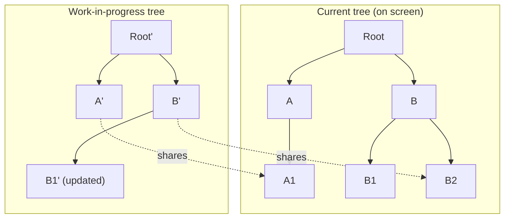
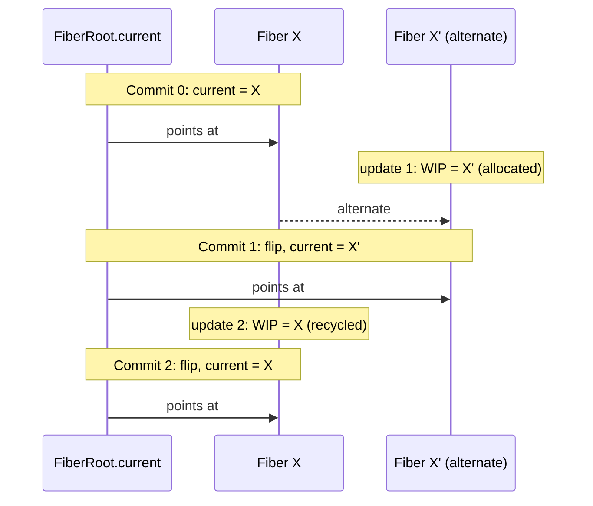
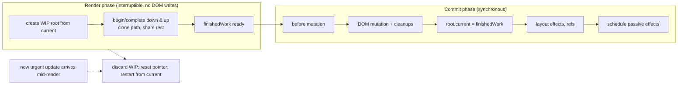

# 02 / 10 — Current and Work-in-Progress Trees, Double Buffering

## 1. Lesson metadata

| | |
|---|---|
| **Level** | Advanced |
| **Study time** | 5 hours (reading 2 h, experiments 1.5 h, exercises 1.5 h) |
| **Prerequisites** | [08 — Why Fiber exists](./08-why-fiber.md), [09 — Fiber nodes and units of work](./09-fiber-nodes-and-units-of-work.md), [03 — Initial mount and updates](./03-initial-mount-and-updates.md), [02 — Render, reconcile, commit, paint](./02-render-reconcile-commit-paint.md) |
| **Next** | [11 — Render phase vs commit phase](./11-render-phase-and-commit-phase.md) |
| **Related** | [12 — Why rendering must be pure](./12-why-rendering-must-be-pure.md), [15 — Interruptible, restartable, abandoned renders](./15-interruptible-restartable-abandoned-rendering.md), [17 — Hooks and Fiber state](./17-hooks-and-fiber-state.md) |

**Learning objectives.** After this lesson you can:
1. Define the **current tree** (what the last commit put on screen) and the **work-in-progress tree** (what a render is building), and explain why React keeps both.
2. Explain the `alternate` pointer: every fiber has at most one twin, so at most two fibers exist per tree position; and explain how React *reuses* the twin instead of allocating each render.
3. Describe **structural sharing**: how a work-in-progress tree shares untouched subtrees with the current tree so that an update to one leaf does not copy the application.
4. State precisely when the swap ("`root.current = finishedWork`") occurs, why it is a single pointer assignment, and where it falls relative to the commit sub-phases.
5. Explain how abandoning or restarting a render is cheap and safe *because* the current tree is never modified during render.
6. Walk through mount, update, bailout, abandoned-render and error scenarios in terms of the two trees.
7. Implement a toy double-buffered tree and verify sharing, reuse and atomic swap with assertions.

**Concepts covered:** double buffering, `FiberRoot.current`, HostRoot fiber, `alternate`, work-in-progress fiber creation/reuse (`createWorkInProgress`, conceptually), cloning child lists, structural sharing, `finishedWork`, the commit-time pointer flip, abandonment (`prepareFreshStack`, conceptually), render isolation, memory trade-offs.

> **Internals warning.** Function and field names used here (`current`, `alternate`, `finishedWork`, `createWorkInProgress`, `cloneChildFibers`, `prepareFreshStack`) are ones the author is confident exist in `packages/react-reconciler` at the time of writing. They are **implementation details**. Everything in the "teaching model" is stable enough to reason with; they were checked against `main` and `react-dom@19.3.1` on 2026-10-22, but verify any specific claim in <https://github.com/facebook/react> before relying on it in design documents. (`prepareFreshStack`, `createWorkInProgress` and `finishedWork` exist in 19.3.1; `cloneChildFibers` is a `main`-branch name that no longer appears as a function name in the published dev bundle.)

---

## 2. Deep conceptual explanation

### 2.1 What problem is this lesson solving?

[08](./08-why-fiber.md) said React must be able to **abandon** in-progress work. [09](./09-fiber-nodes-and-units-of-work.md) said fibers are **mutable** records that carry flags, lanes, props, and state. These two statements collide: if render mutates the fibers that describe what is on screen, then an abandoned render has *already corrupted* the record of the screen. Worse, any component that React reads while rendering (event handlers, DevTools, the commit phase itself) could observe a half-updated world.

The standard answer from computer graphics, databases and many functional data structures is **double buffering** (also: shadow copy, copy-on-write, persistent data structures):

> Keep a **stable, consistent version** that represents the committed state. Build the next version **separately**. When it is complete and valid, **publish it atomically**. If it is no longer wanted, **drop it**.

In React: the stable version is the **current tree**; the separate version is the **work-in-progress (WIP) tree**; publishing is `root.current = finishedWork`; dropping is resetting a pointer.

Why you should care in application code: the entire purity story ([12](./12-why-rendering-must-be-pure.md)) is about the fact that a render builds the WIP tree and may then drop it. Your component function is executed on behalf of a draft that might never be published.

### 2.2 Two trees, one root

```text
FiberRoot (one per createRoot; not a fiber)
   │ current ───────────────────────────►  HostRoot fiber  (the committed tree's top)
   │                                             │ alternate
   │                                             ▼
   │ finishedWork (set when a render completes)  HostRoot' fiber  (the WIP tree's top)
```

- **FiberRoot** holds root-level bookkeeping: the container DOM node, a `current` pointer, pending-lane information ([14](./14-lanes.md)), the finished WIP tree waiting for commit, and scheduling bookkeeping.
- The **HostRoot fiber** is the top of the fiber tree. FiberRoot's `current` field points at whichever HostRoot twin is committed.
- Every fiber has an `alternate` field pointing at its twin (or `null` if it has never been updated since mount).

Naming: "current" means "this is the tree whose output is on screen (as of the last commit)". It does not mean "the tree being worked on" — that is the *work-in-progress* tree. Informal talk of "the current render" is a frequent source of confusion; in this lesson **current = committed**.

### 2.3 The invariant

**Invariant (teaching model):** *During the render phase React reads from the current tree and writes only to the WIP tree.* The current tree is a stable snapshot until the commit flips the pointer.

Consequences:
1. A render that is abandoned at any point leaves the committed UI and its bookkeeping intact — correctness without "undo".
2. Reads for diffing (`current.memoizedProps` vs `workInProgress.pendingProps`) always see a consistent *previous committed* state.
3. Commit is a short, synchronous operation: apply the flagged DOM changes, flip the pointer, then run layout effects (passive effects follow later).

The invariant is not literally absolute in the implementation. A few structures are shared between twins by design (for example, the queue of pending updates for a hook is conceptually owned by the *component position*, not by one twin) and some bookkeeping is stored on the root; these are designed so that abandoning a render is still safe (this is why update *rebasing* exists, see [14](./14-lanes.md)). Treat the invariant as the model, and the exceptions as part of React's internal engineering.

### 2.4 Creating the WIP tree: clone on demand, reuse the twin

React does not clone the entire tree at the start of an update. It creates WIP fibers **lazily as the work loop reaches them**:

1. The render starts by creating (or reusing) the **WIP HostRoot** from `root.current` (conceptually `createWorkInProgress(root.current, …)`).
2. In `beginWork` of a fiber, when React reconciles children, each child fiber of the WIP is produced by **cloning** the child fiber of the current tree (`createWorkInProgress(currentChild, newProps)`), or by creating a new fiber when no match exists.
3. If a fiber has **no pending work** and no descendant with pending work, its subtree is **not touched at all**: the WIP fiber's `child` pointer simply points at the *current* children (structural sharing).

What `createWorkInProgress` does, conceptually:

```text
createWorkInProgress(current, pendingProps):
    wip = current.alternate
    if wip === null:
        wip = new Fiber(same identity fields as current)    // first update at this position
        wip.alternate = current ; current.alternate = wip
    else:
        reuse wip object; reset its transient output fields
        (flags, subtreeFlags, deletions → cleared)
    wip.pendingProps = pendingProps
    copy from current: lanes, childLanes, child, memoizedProps, memoizedState,
                       updateQueue, sibling, index, ref, (dependencies)
    return wip
```

Key points:

| Point | Explanation |
|---|---|
| **At most two objects per position** | After the first update at a position, `current` and `wip` are twins pointing at each other. Further updates *recycle* the idle twin instead of allocating a third. This is the "pooling" that makes double buffering cheap in allocations. |
| **The twin may hold stale data** | The idle twin still contains whatever the *previous-previous* render put there. That is why `createWorkInProgress` explicitly resets output fields (flags, deletions…) and recopies inputs. |
| **Flags start clean** | A new WIP fiber begins with no output flags; they are recomputed by this render. (Some "static" flags persist by design.) |
| **First mount has no twin** | On mount, `current` is `null` for every position below the root; fibers are created fresh via element-to-fiber creation. Only the root has a twin from the start. |

### 2.5 Structural sharing: only the path to the change is cloned

Suppose a deep tree and an update in one leaf. React:

- Clones the **path** from root to the updated leaf (and the *sibling lists* along that path; see below).
- For siblings and subtrees that do not contain pending work and whose props are identical, **reuses the current fibers** — the WIP tree points to them.



Here the update is in `B1`. `Root`, `B`, `B1` are cloned (twins `Root'`, `B'`, `B1'`); `A` gets a clone because it is in the *child list being rebuilt* (see next paragraph) but its subtree `A1` is shared; `B2` is shared.

**Why sibling lists are cloned.** Children of a fiber are linked as `child → sibling → sibling`. The `sibling` pointer lives on the sibling fiber itself. If `B'` is a new fiber that must point to the *new* next sibling, and the current `B` points to the *current* next sibling, the WIP list must consist of WIP fibers all the way — so when a parent's children are cloned (via a function conceptually named `cloneChildFibers`), each child in the list gets a WIP twin, while *their* children (grandchildren) are still shared. The cost of an update is therefore proportional to **depth × average siblings per level on the path**, not to the size of the tree.

**Shared children may point back to the "wrong" parent twin.** Because grandchildren are shared, a shared fiber's `return` pointer may reference either twin of its parent, depending on history. React's code is written to tolerate this (for example by consulting `alternate` when it needs the parent). Application code never sees this; if you read the source, remember the pointer is only reliable as "one of the two twins".

### 2.6 The flip: publishing atomically

When the render phase completes (the work loop reached the root's completion without being interrupted), React stores the finished WIP tree on the root (`finishedWork`) and enters the commit phase. During commit:

1. **Before mutation:** reads that need the old DOM (class `getSnapshotBeforeUpdate`).
2. **Mutation:** apply DOM changes according to flags (insert, update, delete); run cleanups of destroyed layout effects; detach refs.
3. **Pointer flip:** `root.current = finishedWork`.
4. **Layout:** run layout effects/`componentDidMount`/`componentDidUpdate`, attach refs.
5. **After:** schedule passive effects; flush synchronous follow-ups.

The ordering of step 3 relative to steps 2 and 4 is documented in the source in a comment (paraphrased): *the work-in-progress tree becomes current **after the mutation phase**, so that during `componentWillUnmount` the previous tree is still current, and **before the layout phase**, so that in `componentDidMount`/`componentDidUpdate` the finished tree is current.* This detail explains observable behavior: when a layout effect or `componentDidMount` runs, the committed tree (and everything React-owned that reads "current") is already the new one, and the DOM is already mutated.

Why a pointer flip? A single pointer write is atomic with respect to JavaScript's single thread; nothing can observe an inconsistent `current` because no JS runs between the assignment and the next statements in the same synchronous commit. (The *DOM* mutation phase is also synchronous; the browser cannot paint in the middle.)

After the flip, the **old current becomes the idle twin**: the next update's `createWorkInProgress` will recycle it, which is why it is also called "the alternate".

### 2.7 Abandoning: cheap by construction

Suppose a transition render is half done when an urgent keystroke arrives. React:

1. Stops the work loop (the cursor `workInProgress` is not advanced).
2. Handles the urgent update. To render it, React **resets** the render stack: it sets the cursor to `null` and creates a fresh WIP root from `root.current` (conceptually `prepareFreshStack`), which recycles the same twin objects but resets their output flags and recopies inputs from `current`.
3. The half-built subtree is simply unreachable from the new WIP tree (garbage, or recycled later).

Nothing needs to be undone: no DOM was touched, `current` was never modified. Contrast with the stack reconciler where partial DOM mutations would need compensating logic. [15](./15-interruptible-restartable-abandoned-rendering.md) builds on this.

What *is* lost: the CPU time already spent. React tries not to waste it unnecessarily (it may continue a paused render if no higher-priority work arrived, because the WIP tree can be resumed as long as the root's lanes did not change).

### 2.8 What "current" means for hooks and state

A function component's state lives on its fiber (`memoizedState`, a linked list of hook objects; see [17](./17-hooks-and-fiber-state.md)). On update, the WIP fiber's hooks are derived from the current fiber's hooks while the component runs: each `useState` call reads the previous hook (from `current`) and writes a new hook object into the WIP fiber. After commit the WIP fiber (with the new hook objects) is current. So *the state you read during render is the committed state plus the updates being processed in this render*, and the state of an abandoned render is dropped with the WIP fiber.

This is why setting state does not "mutate" anything immediately: the update is queued; the next render computes a new state value into the WIP fiber ([01/14 — State as a snapshot](../01-react-fundamentals/14-state-as-a-snapshot.md)).

### 2.9 Common misconceptions

| Misconception | Reality |
|---|---|
| "React clones the whole tree on every update." | Only the path with work (plus sibling lists along it). Untouched subtrees are shared. |
| "The WIP tree is a *virtual DOM* diffed against the real DOM." | Both trees are fiber trees. The DOM is touched only at commit, driven by flags. |
| "The old fiber tree is garbage collected after each commit." | The old current becomes the idle twin and is **reused** for the next render (pooled by position). |
| "Strict Mode's double render builds two trees." | In development Strict Mode calls the component function **twice within the same `beginWork`** on the same WIP fiber; there is not a second tree. |
| "The root flip happens at the start of commit." | It happens after the mutation phase and before layout effects. |
| "Interrupting a render mutates the DOM partially." | Render never mutates the DOM (host nodes created during `completeWork` are detached until commit). |
| "Current = the tree being rendered." | Current = the committed tree. The tree being rendered is work-in-progress. |
| "`useRef` values are part of the WIP/current separation." | A ref object is a plain mutable object stored in hook state; it is shared, not double-buffered. Writing it during render breaks the guarantees ([12](./12-why-rendering-must-be-pure.md)). |

---

## 3. Internal mechanics

### 3.1 Public guarantee

- A render either commits as a whole or does not commit; users never see a half-rendered tree on screen (React makes DOM changes in a single synchronous commit and the browser paints afterwards). This is the observable consequence of the model; React documents the three steps in [Render and commit](https://react.dev/learn/render-and-commit).
- React may call your components without committing the result ([Keeping components pure](https://react.dev/learn/keeping-components-pure)).
- Refs and effects see the committed tree: `ref.current` is set during commit; layout effects run after DOM mutation ([`useLayoutEffect`](https://react.dev/reference/react/useLayoutEffect)).

Not guaranteed: how many fibers or twins exist, when memory is released, when exactly the flip occurs relative to other internal steps (the ordering above is what the source does *today*).

### 3.2 Teaching model

> React edits a *draft* of the UI tree, never the committed one. A draft starts as a copy-on-demand of the committed tree: only nodes that must change are copied; everything else is shared. When the draft is finished, React updates the DOM to match it and then declares the draft to be the committed tree. If the draft becomes outdated, React discards it and starts a new draft from the committed tree.

### 3.3 Implementation details

- `FiberRoot.current` points to the committed HostRoot fiber; `FiberRoot.finishedWork` holds the finished WIP root between render completion and commit.
- A module-level variable (conceptually `workInProgress`) holds the cursor; another holds the root being rendered and the lanes being rendered. A single JS module state means React renders one root at a time on the main thread.
- At the start of each render attempt React checks whether the root and render lanes are the same as the last attempt: if yes and a WIP exists, it can **resume**; otherwise it calls the "fresh stack" routine which discards the WIP cursor and builds a new root WIP.
- When a fiber is deleted, React detaches its pointers after the commit (to help GC and prevent leaks through twins/closures). This area changed several times; do not rely on a particular detaching strategy.
- `createWorkInProgress` copies a defined set of fields and resets others; fields not in that list stay stale on the twin until overwritten. Reading the function body in the source is the best way to see the exact lists.
- The DOM host node (`stateNode` of a host fiber) is shared by both twins. Mount creates it once; updates mutate that same DOM node in commit. The twin fibers share one DOM node.

### 3.4 Memory implications

Twinning means that for each updated position there are two fiber objects alive. For a large application where most positions are updated at least once, memory for fibers is roughly doubled compared to a single copy. Hidden/offscreen content (Suspense fallbacks, `<Activity>`/Offscreen, kept-alive trees) also retains fibers. This is a legitimate reason to avoid giant mounted trees and an argument for virtualization ([Phase 7/09](../07-performance/09-windowing-and-virtualization.md)).

---

## 4. Step-by-step execution walkthrough

We follow three situations on the same app: a small list.

```tsx
function App() {
  const [filter, setFilter] = useState("");
  return (
    <>
      <input value={filter} onChange={(e) => setFilter(e.target.value)} />
      <Results filter={filter} />
    </>
  );
}
```

### 4.1 Initial mount

| Step | Current tree | WIP tree | DOM |
|---|---|---|---|
| 0. `createRoot(container)` | HostRoot (no children) | — | empty container |
| 1. `root.render(<App/>)` | unchanged | WIP HostRoot created from current; update (new element) queued onto HostRoot | unchanged |
| 2. begin HostRoot | | reconcile children: `App` has no current counterpart → **new fiber, no twin** | |
| 3. begin App ... down the tree | | new fibers for input, `Results`, rows | |
| 4. complete (up) | | host fibers create **detached** DOM nodes; children appended into parents; only the topmost new node gets a *Placement* flag (the rest are inside it) | still empty (detached nodes exist in memory) |
| 5. commit mutation | | Placement: append the top DOM node to the container | **DOM now has the UI** |
| 6. flip | `root.current = WIP HostRoot` | (becomes current; old HostRoot is the idle twin) | |
| 7. layout effects, then passive effects scheduled | | | |

Note: On mount only the *root* has a twin. Each child fiber has `alternate === null` until its first update.

### 4.2 Update (typing "r")

1. `setFilter("r")` queues an update on `App`; lanes bubble to the root ([14](./14-lanes.md)).
2. Render begins; WIP HostRoot is created from the current one, then `App'` is created from `App` (`alternate` is `null` → allocate a new fiber and link twins).
3. `App` runs with `filter = "r"`. New elements → reconcile children: `input'` and `Results'` are WIP clones of `input` and `Results` (first update → allocate twins).
4. `Results` re-runs; each row fiber is cloned or created.
5. Completion: `input'`'s property diff (`value` changed) flagged; rows flagged as needed.
6. Commit: DOM mutated for `input.value` and row changes; `root.current = WIP HostRoot'`. Now `App'`, `input'`, ... are current; `App`, `input`, ... are the idle twins.

### 4.3 Second update (typing "re")

Everything repeats, but `createWorkInProgress` now **finds** `App.alternate` (the old `App`) and **reuses** it as the WIP: output fields reset, input fields recopied from `App'` (the current). No new fiber objects are allocated for positions that already have twins; only new positions (new rows) allocate.

### 4.4 An abandoned render (concurrent)

Assume the app defers the list (`useDeferredValue(filter)`), so a keystroke is an urgent update and the list render for the new deferred value is low priority. The list has 500 rows; the user types a second character 20 ms into the deferred render.

| Time | Event | Current tree | WIP tree | DOM |
|---|---|---|---|---|
| 0 ms | deferred render for `"r"` starts (low priority) | R0 (committed; input already shows "r") | WIP built progressively: `App'`, `Results'`, 80 of 500 rows done | unchanged |
| 20 ms | keystroke "e": urgent update queued | R0 | WIP partially built (now stale) | unchanged |
| 21 ms | React sees a higher-priority lane on the root and resets its render stack | R0 | **old WIP cursor dropped**; new WIP root created from R0 for the urgent lane | unchanged |
| 22-25 ms | urgent render: `App` re-runs with the new text; `Results` receives the *old* deferred value and bails out | R0 | small WIP | unchanged |
| 26 ms | urgent commit | **R1** (input shows "re") | old WIP recycled as idle twin | input updated |
| 27 ms+ | new low-priority render for deferred value `"re"`, sliced | R1 | WIP rebuilt | unchanged until its own commit |

At no time did the DOM show a partial result. The cost of the abandoned work is the 20 ms spent.

### 4.5 An error during render

If a component throws during render, React unwinds the WIP traversal to the nearest error boundary ([Phase 4/19](../04-react-architecture/19-error-boundaries.md)), marks that boundary for re-render with the error (a new WIP for that part), and continues; if there is no boundary, the root's render fails and the whole root is unmounted — in React 19 the error is reported via the root's error callbacks (`onUncaughtError` for errors no boundary caught, `onCaughtError` for errors caught by an error boundary, `onRecoverableError` for errors React recovered from automatically; see [react.dev — `createRoot`](https://react.dev/reference/react-dom/client/createRoot)). In all cases the *committed tree remains untouched* until a successful commit.

---

## 5. Code examples

### 5.1 Minimal example — twin creation and reuse (toy)

```ts
interface N {
  id: string;
  text: string;
  child: N | null;
  sibling: N | null;
  alternate: N | null;
}

function mk(id: string, text: string, children: N[] = []): N {
  const node: N = { id, text, child: children[0] ?? null, sibling: null, alternate: null };
  children.forEach((c, i) => {
    c.sibling = children[i + 1] ?? null;
  });
  return node;
}

// Conceptually React's createWorkInProgress.
function createWIP(cur: N): N {
  let wip = cur.alternate;
  if (wip === null) {
    wip = { ...cur, alternate: cur }; // first update at this position: allocate twin
    cur.alternate = wip;
  } else {
    wip.id = cur.id; // reuse the idle twin: recopy inputs
    wip.text = cur.text;
    wip.child = cur.child;
    wip.sibling = cur.sibling;
  }
  return wip;
}

const root = mk("Root", "", [mk("A", "a"), mk("B", "b")]);
const w1 = createWIP(root);
const w2 = createWIP(w1); // twin of the twin
console.log(w1 === root, w1.alternate === root, root.alternate === w1, w2 === root);
```

**Predict.** What does the last line print?

**Result.** `false true true true`. `w1` is a new object linked as `root`'s twin. `createWIP(w1)` looks at `w1.alternate`, which is `root`, and reuses it: no third object exists. This is the "at most two fibers per position" invariant.

**Why.** Allocation only happens on the *first* update at a position; afterwards the two objects alternate roles between "current" and "work-in-progress" with each commit. The name *alternate* is literal.

### 5.2 Practical example — path cloning with structural sharing and an atomic swap (toy)

```ts
function contains(n: N, id: string): boolean {
  if (n.id === id) return true;
  for (let c = n.child; c; c = c.sibling) if (contains(c, id)) return true;
  return false;
}

// Build a WIP tree where `id`'s text is replaced. (Recursion is for brevity;
// React uses an explicit work loop, see lessons 08-09.)
function renderPath(cur: N, id: string, text: string): N {
  const wip = createWIP(cur);
  if (cur.id === id) {
    wip.text = text; // children stay shared
    return wip;
  }
  let prev: N | null = null;
  wip.child = null;
  for (let c = cur.child; c; c = c.sibling) {
    const w = contains(c, id) ? renderPath(c, id, text) : createWIP(c); // shallow clone, shares c.child
    w.sibling = null;
    if (prev) prev.sibling = w;
    else wip.child = w;
    prev = w;
  }
  return wip;
}

const tree = mk("Root", "", [
  mk("A", "a", [mk("A1", "a1")]),
  mk("B", "b", [mk("B1", "b1"), mk("B2", "b2")]),
]);

const holder = { current: tree };                   // FiberRoot.current
const finished = renderPath(holder.current, "B1", "NEW");

const A = tree.child!;
const B = A.sibling!;
console.log("1", holder.current.child!.sibling!.child!.text);  // committed B1 text
console.log("2", finished.child!.sibling!.child!.text);        // draft B1 text
console.log("3", finished.child!.child === A.child);           // A1 shared?
console.log("4", finished.child!.sibling!.child!.sibling === B.child!.sibling); // B2 shared?
console.log("5", finished.child === A);                        // A cloned?

holder.current = finished;                                      // commit: atomic flip
const next = renderPath(holder.current, "A1", "X");
console.log("6", next === tree);                                // root twin reused?
```

**Predict** the six lines before reading on.

**Result.**
```text
1 b1
2 NEW
3 true
4 false
5 false
6 true
```

**Why.**
- (1) The committed tree is untouched while the draft exists.
- (2) The draft has the new text.
- (3) `A'` is a shallow clone of `A` created by `createWIP`, so `A'.child === A.child`: the subtree below `A` is shared.
- (4) `B2` is a **sibling in the rebuilt list** on the path, so it also gets a WIP twin (`B2'`), which is not the same object as the current `B2`: `finished…B1'.sibling` is `B2'`, `B.child.sibling` is `B2`. The grandchildren *of* `B2` would be shared, but `B2` itself is cloned. This is the "sibling lists are cloned" rule from §2.5.
- (5) `A` is cloned too (`finished.child` is `A'`, a different object) because it is in the child list of Root being rebuilt.
- (6) After the flip, the next draft root recycles the old root (`tree`) as its twin.

**Trade-offs.** Cost is proportional to depth × siblings on the path. For a very wide level (10,000 siblings), a change in one sibling still clones the whole sibling list of that level — a real reason why large flat lists benefit from virtualization or chunking.

### 5.3 Incorrect example — mutating shared state during render

```tsx
const cache = new Map<string, number>(); // module scope, shared across all renders

function Price({ sku }: { sku: string }) {
  // ❌ writes to shared mutable state during render
  if (!cache.has(sku)) cache.set(sku, Date.now());
  return <span>{cache.get(sku)}</span>;
}
```

**Predict.** Is this safe if the render is abandoned?

**Result.** The write persists even if the WIP tree is discarded, so a later render observes data from a render that never committed. In concurrent rendering, the same component may also run for two different drafts (urgent vs transition) with different props, interleaving writes. Plus `Date.now()` makes the output depend on *when* React happened to run, so repeated renders disagree. The two-tree model protects **fibers**; it cannot protect **your** mutable globals.

**Why it is plausible.** Memoization caches look harmless. The danger is conflating "idempotent derived cache" (safe: the value is a pure function of the key) with "first-writer-wins state" (unsafe).

### 5.4 Corrected implementation

```tsx
import { useMemo } from "react";

function Price({ sku, priceCents }: { sku: string; priceCents: number }) {
  const label = useMemo(() => formatCents(priceCents), [priceCents]); // pure derived value
  return <span aria-label={`Price for ${sku}`}>{label}</span>;
}

function formatCents(cents: number): string {
  return new Intl.NumberFormat("en-US", { style: "currency", currency: "USD" }).format(cents / 100);
}
```

If a module-level cache is truly required, make it a **pure memo of a pure function** (`key → value` with no time/random dependency), or use `useMemo`/`use` with a cache designed for React ([react.dev — `cache`](https://react.dev/reference/react/cache) for Server Components; `cache` is for Server Components per react.dev). Put side effects in event handlers or effects ([12](./12-why-rendering-must-be-pure.md)).

### 5.5 Advanced example — observing "rendered but not committed" in a real app

```tsx
import { memo, useDeferredValue, useEffect, useState } from "react";

function burn(ms: number): void {
  const end = performance.now() + ms;
  while (performance.now() < end) {}
}

const Results = memo(function Results({ q }: { q: string }) {
  console.log("render Results", JSON.stringify(q));  // render phase: may run for drafts
  burn(120);                                          // demo only
  useEffect(() => {
    console.log("commit  Results", JSON.stringify(q)); // after commit only
  }, [q]);
  return <p>Results for {q}</p>;
});

export function App() {
  const [q, setQ] = useState("");
  const deferred = useDeferredValue(q);
  return (
    <>
      <input value={q} onChange={(e) => setQ(e.target.value)} aria-label="q" />
      <Results q={deferred} />
    </>
  );
}
```

Mount in a **non-Strict** concurrent root (`createRoot`) to keep logs clean. Type "abc" quickly (three characters within ~100 ms).

**Predict.** What pattern do the logs show?

**Result (typical, timing-dependent).**
```text
render Results ""
commit  Results ""
render Results "a"        ← draft; interrupted or superseded by the next keystroke
render Results "ab"       ← draft; may be interrupted again
render Results "abc"
commit  Results "abc"
```
There can be several `render` lines with no matching `commit` line. Exact counts depend on how quickly you type relative to the 120 ms burn per render and on whether React starts a deferred render between keystrokes; **never assert exact sequences**. The invariant to observe: *every `commit` line is preceded by a `render` line with the same value, but not every `render` line is followed by a commit.*

**Why.** The deferred render for `"a"` is built in the WIP tree. A new urgent update arrives, React discards that draft, renders the urgent update, and begins a draft for the newest deferred value. Only drafts that finish uninterrupted commit. `burn(120)` is a single unit of work inside `Results`, so React cannot interrupt *inside* it. What it can do is yield **after** `Results` has run: the 120 ms has long exceeded the time slice, so before processing the remaining fibers of that draft (the `<p>` and its text) React yields to the browser, notices newer work, and drops the draft. That is how a `render` line can appear with no `commit` line even though the component function ran to its end. If the draft had been fully completed before newer work was noticed, it would simply have been committed (stale but consistent). To see finer-grained interruption, use many small children (as in [08 §5.5](./08-why-fiber.md)).

**Trade-offs.** Logging in render is a diagnostic technique here only; in app code, render-phase logging is acceptable for debugging but must not be mistaken for a commit count.

---

## 6. Visual explanations

### 6.1 Two roles, alternating



### 6.2 Update lifecycle around the flip



### 6.3 Memory view after several updates

```text
position:   App        input       Results     Row#7
current:    App'       input       Results'    Row#7        ← mixed! each position flips independently
idle twin:  App        input'      Results     (none yet)

(Each position's twin pair flips roles only when that position is part of a committed update;
 untouched positions keep whatever twin was current.)
```

Note the important detail in the third row: **the tree-level flip does not mean every fiber is new**. After a commit, the new current tree is a mix of cloned (twin) fibers and shared (unchanged) fibers.

---

## 7. Alternative approaches and trade-offs

| Approach | How it isolates in-progress work | Cost | Used by / note |
|---|---|---|---|
| **Double buffering with structural sharing (React Fiber)** | Draft tree, atomic pointer flip, reuse twins | Two fibers per updated position; discipline in reconciler | React |
| **Mutate in place** (stack reconciler, most imperative UI libs) | None; a partial update is visible and unrecoverable | Minimal memory | React ≤ 15; many DOM libs |
| **Immutable persistent trees** (Clojure-like, Elm's virtual DOM diff on immutable models) | New tree each update shares unchanged nodes; old one stays valid | Allocation of changed paths; GC | Elm, ClojureScript wrappers |
| **Transactional DOM / undo log** | Apply DOM changes and roll back on abort | Complex, slow rollback; layout thrash | Rare |
| **Fine-grained reactive graph** (signals) | Computation graph updated glitch-free; no tree draft | Different constraints on consistency; transitions are harder | Solid, Vue, Svelte; React has no direct equivalent |
| **Render offscreen DOM and swap** (hidden `DocumentFragment` / hidden container) | Build real DOM nodes detached, then swap | Real DOM nodes are heavier than JS objects; can't be abandoned cheaply; layout cost | Manual optimization |

**Where React's approach is *not* the best.** If a UI has a tiny number of nodes and updates are always atomic and fast, the double buffer adds memory and complexity with no user-visible benefit; a small signals-based or imperative widget can be simpler and faster. Likewise, if you require *transactional* guarantees across **external** state (a global mutable store), React's double buffering gives no help — the store is not part of the fiber trees, which is why external stores need `useSyncExternalStore` to avoid tearing ([Phase 3/20](../03-react-state-and-hooks/20-usesyncexternalstore-and-external-stores.md)).

---

## 8. Best practices and anti-patterns

**Best practices**
- Treat render as "writing a draft": read props/state/context, produce elements; no writes to anything outside.
- Think of effects and event handlers as the *only* places where work escapes the draft.
- Keep the committed/unchanged subtrees large: structural sharing is why colocated state and stable props pay off.
- Expect `console.log` in render to print more times than there are commits; use effects/Profiler for commit-level facts.
- Use `useSyncExternalStore` for external mutable sources so that every draft reads a consistent snapshot ([Phase 3/20](../03-react-state-and-hooks/20-usesyncexternalstore-and-external-stores.md)).

**Beginner mistakes**
- Assuming a `render` log equals "the UI updated".
- Mutating props, state objects, or module variables in render; "it works in dev" because only one draft ever happens.

**Experienced-developer mistakes**
- Reading mutable external state (a `let` variable, DOM measurements via `getBoundingClientRect`) during render and assuming it matches the committed UI ([Phase 3/08](../03-react-state-and-hooks/08-uselayouteffect.md)).
- Writing `ref.current` during render to "remember" the latest value; the draft may be dropped, so the ref may hold data from an uncommitted render. (Use effects or event handlers.)
- Using singleton "ID generators" in render (`nextId++`) → mismatches across drafts/SSR; use `useId`.

**Smells**
- Logic that "only works because renders happen once".
- Code depending on `StrictMode` being off.

**Justified exceptions**
- **Local** mutation is fine: creating a fresh array/object in render and mutating it before returning is invisible to other drafts (see [react.dev — Keeping components pure → local mutation](https://react.dev/learn/keeping-components-pure)).
- Lazy initialization of a ref (`if (ref.current === null) ref.current = new Thing()`) is a documented safe pattern when the value is a pure function of nothing and will be identical regardless of how many times it runs; check [`useRef` docs](https://react.dev/reference/react/useRef).

---

## 9. Real-world application

| Domain | Where the two-tree model shows | Engineering constraints |
|---|---|---|
| **Autocomplete / search** | Every keystroke produces a draft of the result list; most are discarded. | Render must be pure, results derived from props/state; any "analytics on render" must move to events/effects or you will count non-committed drafts. |
| **Dashboards with live charts** | Tick bursts create many drafts; with transitions, stale drafts are dropped. | Stores must expose immutable snapshots (`useSyncExternalStore`) so a draft reads one consistent value. |
| **Forms with validation previews** | Preview computed during render may run for drafts never shown. | Validation functions must be pure/idempotent; submit side effects in handlers. |
| **Auth/permission gating** | Reading `localStorage`/cookies directly in render yields different values across drafts/hydration. | Read once via state/initializer or external store; handle hydration separately ([Phase 9/02](../09-advanced-rendering-and-ecosystem/02-hydration-internals-deep-dive.md)). |
| **Large admin tables** | One cell edit clones the path and *sibling lists*, so very wide parents are costly. | Virtualize; limit sibling counts per parent (chunk rows into groups) when profiling shows reconcile cost. |
| **Multi-team component libraries** | Library code runs inside consumers' drafts. | Never use module-level counters/singletons in render; document SSR/concurrent safety. |

---

## 10. Debugging and troubleshooting

**Symptom: analytics "view" event fires more than once per visible change.**
- *Repro:* put `track("viewed", id)` in the component body; type in an input that triggers deferred renders.
- *Investigation:* compare with a `useEffect` log; the render log count exceeds the effect log count ([§5.5](#55-advanced-example--observing-rendered-but-not-committed-in-a-real-app)). Check Strict Mode, transitions, Suspense retries.
- *Root cause:* side effect in render fires for drafts.
- *Fix:* move into an effect keyed on the identifying value, or an event handler; for "once per mount" semantics under Strict Mode use an idempotent design (see [28](./28-strict-mode-behavior.md)). *Validate:* effect log count equals visible change count in production-like (non-Strict) run and is idempotent under Strict Mode.

**Symptom: "`ref.current` has a stale/odd value after an interrupted update."**
- *Root cause:* ref written during render by a draft that never committed.
- *Fix:* write refs in effects/handlers. Validate by forcing a transition and interrupting it (type quickly); the ref now only reflects committed values.

**Symptom: two components using the same module-level cache show inconsistent values.**
- *Root cause:* drafts for different priorities interleave and read different phases of a non-versioned mutable store.
- *Fix:* external store with snapshot semantics; or put the value in React state.

**Symptom: memory grows when many routes stay mounted (keep-alive, hidden tabs).**
- *Investigation:* Chrome DevTools → Memory → heap snapshot; filter by `FiberNode`; count grows with hidden trees.
- *Root cause:* retained fibers + twin + DOM for hidden content.
- *Fix:* unmount truly inactive screens or limit kept-alive count; re-profile. Snapshot internals (`FiberNode` constructor name; present in 19.3.1 dev builds) may differ between builds/minified production code.

**Tooling notes:** DevTools Profiler shows commits, not drafts. To see drafts, add render-phase logging temporarily, or the performance tracks available in recent React/Chrome DevTools versions *(React Performance Tracks, introduced in React 19.2)*.

---

## 11. Exercises

### Level A — Knowledge
A1. Define current tree and work-in-progress tree. Which one is on screen?
A2. What does `alternate` point to? When is it `null`?
A3. At what point of the commit is `root.current` reassigned? Name the two events it is positioned between.
A4. What is structural sharing in this context? Give an example from a three-level tree.
A5. How many fiber objects exist per position after 100 updates at that position?
A6. Does the render phase touch the DOM? Does it create DOM nodes?

### Level B — Code comprehension
B1. In §5.1, what are `w1.alternate`, `root.alternate`, and `createWIP(w2) === w1`?
B2. In §5.2 line 4, explain why the result is `false` even though `B2`'s text did not change.
B3. In §5.5, why can the same `Results` render log appear without a commit log? Could the opposite happen (a commit without a prior render log for that value)?
B4. A component writes `latest.current = value` in its body. In a concurrent render where a draft is discarded, what could `latest.current` contain after the *committed* tree is on screen?

### Level C — Implementation
C1. Extend §5.2 with an `abandon()` path: build a draft, then discard it. Prove with assertions that `holder.current` and every node reachable from it are deep-equal to a snapshot taken before the draft.
C2. Implement `commit(holder, finished)` that returns the list of ids of nodes whose `text` differs between the old current and finished trees (a stand-in for flags). Walk only through nodes that are *not* shared (hint: use identity).
C3. Write a React component with `useDeferredValue` whose child logs in render and in an effect, and a Testing Library test that asserts "every committed value was rendered" (without asserting exact render counts).

### Level D — Debugging
D1. A page shows "Viewed 3 times" for a product after one visit. The code `counter++` is in the component body; it is wrapped in `<StrictMode>`. List all reasons and a correct design.
D2. A team caches the last server response in a module-level variable written in render ("so children can read it"). Under a transition, a sibling renders data from a response whose request was later cancelled. Explain the cause with drafts and propose two fixes.

### Level E — Architecture and engineering decisions
E1. Your application keeps 12 tab panels mounted but hidden to preserve state. Memory is growing. Compare (a) unmount + restore from a store, (b) `<Activity>` hiding (stable since React 19.2), (c) CSS-hidden mounted panels. Decide with criteria: state fidelity, memory, effects running, a11y, complexity.
E2. A realtime page receives 60 updates per second to a store. Describe an architecture ensuring each draft reads a consistent snapshot and discuss the trade-off between `useSyncExternalStore` (urgent, non-interruptible re-render) and transitions.

### Level F — Expert challenge
F1. Prove or refute: "After `n` commits, a position that was updated every time has exactly two fiber objects, and the pair `(current, wip)` alternates." What breaks this when the position is deleted and recreated (same key/type) later? When it is moved by a keyed reorder?
F2. Why can't React simply flip `root.current` at the *start* of commit? Walk through what `componentWillUnmount` (legacy) and `componentDidMount` would each observe in the two alternatives.

---

## 12. Detailed answers and explanations

> Attempt the exercises first.

**A1.** Current = the fiber tree committed by the last commit; its output is on screen. WIP = the tree being (re)built for the next commit; invisible until published. *Plausible wrong:* "current = what is being rendered now" — reverse.

**A2.** The twin fiber (the other copy of the same position). `null` for a fiber that has only ever existed in one tree: e.g., all non-root fibers right after the initial mount, and newly created positions.

**A3.** After the DOM mutation phase and before the layout phase. Reason: during unmount lifecycles the previous tree should still be current; in mount/update lifecycles the finished tree should be current.

**A4.** Unchanged subtrees are referenced by both trees rather than copied. Example: root → `[A → A1, B → B1]`, update in `B1`: `A1` is the same object in both trees.

**A5.** Two (one current and one idle twin). Rare exceptions: transient extra objects during fresh creation; deleted-and-recreated positions create new pairs.

**A6.** The render phase never mutates the **live** DOM. It *does* create detached DOM nodes during completion of newly mounted host fibers; those are attached during commit.

**B1.** `w1.alternate` is `root`; `root.alternate` is `w1`; and `createWIP(w2) === w1` is `true`. Trace: `w2 = createWIP(w1)` returns `root` (it is `w1.alternate`, reused), so `createWIP(w2)` is `createWIP(root)`, whose `alternate` is `w1`, so it returns `w1`. The two objects simply alternate.

**B2.** `B.child.sibling` is the *current* `B2`. The draft's `B1'.sibling` is `B2'`, a clone created because `B2` is in the rebuilt sibling list (the pointer to the next sibling lives on the sibling fiber; since `B1'` is new, the list must be WIP fibers). The text equal; identity different. *Edge:* if `B` were skipped entirely (no pending work below), `B`'s children would remain the current ones and identity would be equal.

**B3.** The render log appears when the function runs, including drafts that are later dropped. The effect log appears after commit, so unmatched render logs are drafts that were discarded or superseded. The opposite (commit without render) cannot happen for a *new value*, because effects with changed dependencies derive from a committed render of that value. (A commit may happen without a *new* render log if React reuses a render completed earlier, but then the log line for that value occurred earlier.)

**B4.** It could contain a value from a discarded draft (for example a transition's value), not the committed value, since writes to a ref persist across drafts. Fix: write in effect/handler.

**C1.** Example:

```ts
function snapshot(n: N | null): unknown {
  if (!n) return null;
  return { id: n.id, text: n.text, child: snapshot(n.child), sibling: snapshot(n.sibling) };
}

const before = JSON.stringify(snapshot(holder.current));
const draft = renderPath(holder.current, "B1", "DRAFT");   // never committed
void draft;
console.assert(JSON.stringify(snapshot(holder.current)) === before, "current must be untouched");
```

Note `createWIP` mutates only the **twin**, never the argument `cur`, apart from setting `cur.alternate` once on first creation (a twin link, not content). The assertion on content passes. If you include `alternate` in the snapshot you create cycles; that is why the snapshot omits it. *Edge case:* if you wrote `cur.text = text` directly, the test would fail — this is exactly what the invariant forbids.

**C2.**

```ts
function diffTexts(oldRoot: N, finished: N): string[] {
  const out: string[] = [];
  function walk(oldNode: N | null, newNode: N | null): void {
    if (oldNode === newNode) return;             // shared subtree: nothing changed below
    if (!oldNode || !newNode) return;            // (insert/delete omitted in this toy)
    if (oldNode.text !== newNode.text) out.push(newNode.id);
    walk(oldNode.child, newNode.child);
    walk(oldNode.sibling, newNode.sibling);
  }
  walk(oldRoot, finished);
  return out;
}
```
The `oldNode === newNode` short-circuit is the payoff of structural sharing: whole subtrees are skipped by one pointer comparison (React's `subtreeFlags` plays the same role).

**C3.** Sketch: render `App` (as §5.5, with `burn` removed and a `vi.fn()` recorder), type with `userEvent.type`, collect `renders: string[]` and `commits: string[]` via mocks; assert `commits.every(v => renders.includes(v))` and `commits.at(-1) === "abc"`. Don't assert `renders.length`. Evaluation: a test that asserts exact render counts is brittle and wrong.

**D1.** Reasons: Strict Mode double-invokes the component body in dev (two increments per render), renders may repeat (updates, transitions), drafts may be discarded, and module-level state accumulates across mounts. Correct: record the view in an effect keyed on the product id (idempotent server-side dedupe, e.g., a per-session event id), or on the server; do not count in render.

**D2.** The module variable is written by drafts for different transition lanes; a discarded draft's write persists. A sibling reading it in a later draft sees the discarded draft's data. Fixes: (1) hold the response in React state (or an external store with snapshot reads) so that each draft sees a consistent value tied to commits; (2) pass the data down as props from the owner. Also cancel requests via `AbortController` in effects ([Phase 6/02](../06-data-fetching-and-state-ecosystems/02-cancellation-and-race-conditions.md)).

**E1.** Criteria and sample reasoning: (a) unmount + store: lowest memory; state restored from store; effects restart; best for rarely visited panels. (b) `<Activity>` hiding (stable since 19.2): preserves state and (per docs) pauses effects/de-prioritizes hidden rendering; still retains fibers and DOM. (c) CSS-hidden mounted: simplest; effects keep running, hidden updates still cost renders, a11y trees need `hidden`/`inert` handling. A good answer chooses by measured memory and by how stateful panels are (e.g., a form draft deserves retention; a read-only report does not), and states what would change the decision.

**E2.** Architecture: store holds immutable snapshots; subscribe via `useSyncExternalStore` with selectors; coalesce incoming messages into one batched store update per animation frame (or ~100 ms) to cut commits; mark non-critical derived views using `useDeferredValue` on values read from the store. Trade-off: `useSyncExternalStore` updates are processed synchronously/urgently (to avoid tearing) so they cannot be time-sliced; reading the store value into a deferred copy retains slicing for heavy children but reintroduces slight staleness. Highlight tearing: a consistent snapshot per draft is the point.

**F1.** Mostly true: the position is represented by exactly two objects that alternate roles with each commit that includes it. Breaks: (i) **deletion**: both twins become unreachable; recreating the same key/type later makes a *new* fiber (a fresh pair), so identity of the objects doesn't persist (although React state doesn't either, since the position was unmounted). (ii) **keyed moves**: the fiber for a key is matched by key among the old children, so the same fiber (and twin) is reused at a new `index`; its pair persists but its sibling links are rewritten by the reconciliation of the new list. (iii) **bailouts**: if a position is skipped by a commit, it does not flip: some positions in the current tree remain the older twin (see §6.3). Also (iv) transient: first update allocates; unreachable idle twins may be dropped/cleared when a position is deleted.

**F2.** If the flip happened at the start, `componentWillUnmount` (and layout-effect cleanups of removed components) would run while "current" already denotes the new tree, so React-owned lookups (for example "which fiber is mounted", context reads in cleanups, parent chains for removed nodes) would see the wrong tree; mutation code compares old vs new via flags that assume the old is still current. If the flip happened after layout, `componentDidMount`/`componentDidUpdate`/layout effects would run while "current" still pointed to the old tree, so any update scheduled from inside them, or any read of the committed tree (refs, `getSnapshot`, sync re-render requested from a layout effect), would act on stale structure. Placing the flip between the two phases gives each lifecycle a consistent view of "what is committed".

---

## 13. Senior engineer interview questions

**Q1. What are the "current" and "work-in-progress" trees, and why does React need both?**
*Strong answer.* Current is the committed, on-screen tree; WIP is a draft. Render reads current and writes WIP, which makes abandoning free (drop the WIP) and committing atomic (pointer flip). Without two trees, interruptible rendering would require undoing partial mutations of the live structure.

**Q2. Does React copy the whole tree for each update?**
*Strong answer.* No: it clones lazily along the path to work and shares unchanged subtrees (structural sharing); sibling lists along the path are cloned since sibling links are stored on fibers. Complexity ∝ depth × siblings per level on the path. After the first update at a position, the twin is reused rather than reallocated.

**Q3. Why is it dangerous to write to a ref or module variable during render?**
*Strong answer.* The draft may be abandoned, repeated or run for several priorities; external mutations persist beyond the draft, so the committed UI can reflect uncommitted renders. React protects its own fibers, not your globals.

**Q4. When exactly does the tree swap happen and why there?**
*Strong answer.* After DOM mutation, before layout effects. Unmount lifecycles should see the old tree as current; mount/update lifecycles should see the new one. (Implementation detail; in `ReactFiberWorkLoop`, `root.current = finishedWork` is set after the mutation effects and before the layout effects, checked on `main` 2026-10-22.)

**Q5. How does this connect to Strict Mode's double render?**
*Strong answer.* Dev-only: React calls the component twice in the same unit on the same fiber to detect impurities; it doesn't create a second tree. It mimics a harsher environment (drafts that repeat/discard) so impure code fails early.

**Q6. How would you reason about memory in an app with many hidden but mounted screens?**
*Strong answer.* Each mounted position holds a fiber plus a twin (after updates) plus DOM nodes and closures; hidden trees still hold them. Measure with heap snapshots; limit kept-alive count, virtualize, unmount and restore state from a store when state fidelity allows.

---

## 14. Further learning resources

| Resource | URL | Covers / why | Level | Study |
|---|---|---|---|---|
| React docs — Render and commit | <https://react.dev/learn/render-and-commit> | Public three-step model | Beginner–Int. | Whole page |
| React docs — Keeping components pure | <https://react.dev/learn/keeping-components-pure> | The contract behind drafts; local mutation | Intermediate | "Side effects" and "local mutation" |
| React docs — `useRef` | <https://react.dev/reference/react/useRef> | Why not read/write `ref.current` during render | Intermediate | Caveats |
| React docs — `useSyncExternalStore` | <https://react.dev/reference/react/useSyncExternalStore> | Consistent snapshots (tearing) | Advanced | Whole page |
| React Fiber Architecture (Andrew Clark) | <https://github.com/acdlite/react-fiber-architecture> | "Current and work-in-progress trees" section; note: older, pre-lanes | Advanced | Sections on current/work-in-progress |
| React source | <https://github.com/facebook/react> | `packages/react-reconciler` (work loop, fiber creation, commit) | Advanced | Search `createWorkInProgress`, `commitRoot`; read the comments |
| React Working Group | <https://github.com/reactwg> | Design discussions about concurrent rendering | Advanced | React 18 discussions about Strict Mode and concurrent rendering *(index only)* |
| Chrome DevTools — Memory panel | <https://developer.chrome.com/docs/devtools/memory-problems> | Heap snapshots to see retained objects | Intermediate | Heap snapshot |


---

## 15. Knowledge checkpoint

**You should now understand**
- Render reads **current**, writes **WIP**; commit publishes WIP via one pointer flip (after mutation, before layout).
- Twins alternate and are reused; sharing means only the path to a change (plus sibling lists) is cloned.
- Abandoning a render is free because nothing visible was touched; what is lost is time.
- React isolates *its* bookkeeping per draft; your mutable globals and refs are **not** isolated.

**You should be able to explain without notes**
- Why logs in render can outnumber commits.
- Why the swap is positioned where it is.
- Why very wide sibling lists make single-item updates cost more than expected.

**You should be able to implement**
- A toy double-buffered tree with sharing and an atomic swap; a safe version of any render-phase cache.

**You should be able to debug**
- Duplicated analytics/side effects from render; stale refs after interrupted renders; retained fibers in hidden trees.

**Before moving on:** read [11 — Render phase vs commit phase](./11-render-phase-and-commit-phase.md) for the precise contract of what may happen in each phase and in what order.
