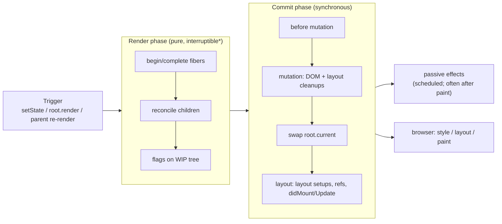
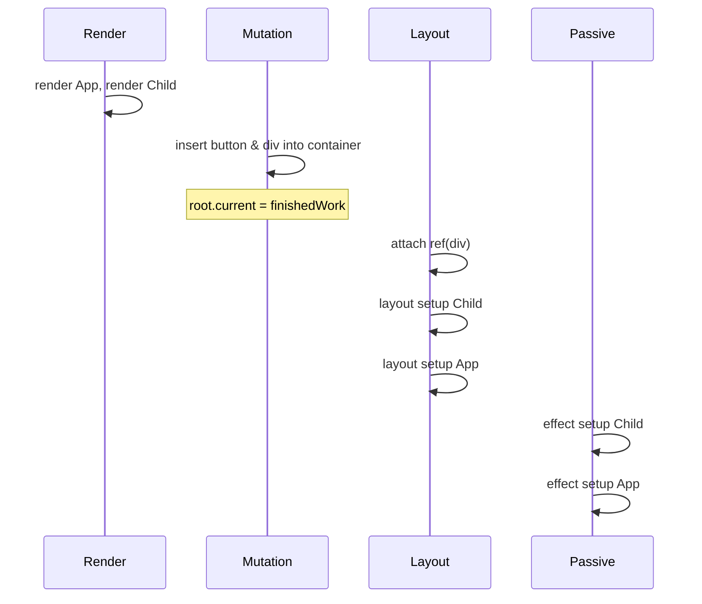

# 02 / 11 — Render Phase vs Commit Phase

## 1. Lesson metadata

| | |
|---|---|
| **Level** | Advanced |
| **Study time** | 5–6 hours (reading 2.5 h, experiments 1.5 h, exercises 1.5 h) |
| **Prerequisites** | [02 — Render, reconcile, commit, paint](./02-render-reconcile-commit-paint.md), [03 — Initial mount and updates](./03-initial-mount-and-updates.md), [09 — Fiber nodes and units of work](./09-fiber-nodes-and-units-of-work.md), [10 — Current and work-in-progress trees](./10-current-and-work-in-progress-trees.md), [01/12 — Component purity](../01-react-fundamentals/12-component-purity.md) |
| **Next** | [12 — Why rendering must be pure](./12-why-rendering-must-be-pure.md) |
| **Related** | [18 — Effects and their timing](./18-effects-and-their-timing.md), [19 — Layout vs passive effects](./19-layout-vs-passive-effects.md), [20 — Commit work and DOM mutations](./20-commit-and-dom-mutation.md), [21 — Browser paint and React updates](./21-browser-paint-and-react-updates.md) |

**Learning objectives.** After this lesson you can:
1. State the contract of each phase: what **may** happen in render (pure computation producing a draft) and what **may only** happen in commit (everything observable).
2. Name the sub-steps of commit in order (before-mutation, mutation, tree swap, layout) and place passive effects relative to them and to browser paint.
3. Predict, for any component tree, the complete order of render calls, ref attachments, layout effect cleanups/setups, DOM mutations and passive effects for mount and update.
4. Explain why render is interruptible and commit is not, and what each choice costs.
5. Identify render-phase operations that are legal (reducers, initializers, `useMemo` callbacks, render-phase `setState` on the same component) versus illegal (DOM access, subscriptions, network, mutation of shared data).
6. Use `useLayoutEffect`, `useEffect` and `flushSync` for the right reasons, and explain their relationship to paint.
7. Diagnose bugs caused by putting work in the wrong phase (flicker, double-firing, stale measurements, "setState in render" loops).

**Concepts covered:** render phase, commit phase, before-mutation / mutation / layout sub-phases, passive effects, `finishedWork`, flags-driven commit, synchronous commit, atomicity, render-phase updates, ref attachment timing, effect ordering (children first), cleanup-before-setup, discrete-event synchronous flush of passive effects, `flushSync`.

> **Version-sensitive.** The *public* model (render → commit → effects) is stable. The internal sub-phase names (before mutation, mutation, layout), the exact placement of passive-effect flushing, and what is synchronous versus scheduled changed between React 17, 18 and 19 and may change again. Where this lesson cites "at the time of writing", it was checked on 2026-10-22 against <https://github.com/facebook/react> `main` and `react-dom@19.3.1` (`ReactFiberWorkLoop`, `ReactFiberCommitWork` in `packages/react-reconciler`).

---

## 2. Deep conceptual explanation

### 2.1 What problem is this lesson solving?

[08](./08-why-fiber.md) and [10](./10-current-and-work-in-progress-trees.md) established that React builds a draft tree and then publishes it. This lesson formalizes the **contract** around that publication: which operations belong to the draft-building half and which to the publishing half, and the precise order inside the second half. This is the core mental model needed for:

- Understanding why `console.log` or analytics in the component body fires at "wrong" times.
- Choosing `useEffect` vs `useLayoutEffect` vs event handlers vs `flushSync`.
- Predicting the order in which parent and child effects, refs and DOM updates occur.
- Debugging flicker and layout-measurement bugs.
- Knowing what concurrent features may interrupt (render) and what they cannot (commit).

react.dev describes the same process as three steps — **trigger, render, commit** ([Render and commit](https://react.dev/learn/render-and-commit)). The official wording is deliberately simple: "rendering" = React calling your components; "committing" = React changing the DOM. This lesson refines that into an engineering contract.

### 2.2 The two phases at a glance

| | **Render phase** | **Commit phase** |
|---|---|---|
| **What happens** | React calls components and reconciles: begin/complete work over the WIP tree ([09](./09-fiber-nodes-and-units-of-work.md)). Output: a finished WIP tree annotated with flags. | React applies the flags: mutates the DOM, detaches/attaches refs, runs layout effect cleanups/setups and class lifecycles, swaps `root.current`, schedules passive effects. |
| **User-visible side effects?** | **None allowed** (contract). | **Yes** (that is its job). |
| **Touches the live DOM?** | No (creates detached DOM nodes during complete for new host elements). | Yes. |
| **Interruptible?** | Yes in concurrent renders: can yield between units, be restarted or discarded. Not interruptible when the render is urgent/synchronous. | **No.** Once started, runs to completion synchronously. |
| **May run more than once per commit?** | Yes (Strict Mode dev double-invoke, restarts, Suspense retries, render-phase updates). | Exactly once per committed render. |
| **May run zero times for a given render attempt?** | The *render* may be thrown away and never committed. | N/A: if commit runs, the render finished. |
| **Cost shows up as** | Long tasks in render functions; slicing under concurrency. | Long synchronous task of DOM work + layout effects; blocks paint. |
| **Where your code runs** | Component bodies, hook initializers/reducers/`useMemo`/`useState` initializer functions, class `render`/`getDerivedStateFromProps`/`shouldComponentUpdate`. | Ref callbacks, `useLayoutEffect`/`useInsertionEffect`, class `componentDidMount/Update/WillUnmount`, `getSnapshotBeforeUpdate`. |
| **After it** | Commit (or discard). | Passive effects (`useEffect`) and browser paint. |

### 2.3 Why split the work into two phases at all?

Three requirements force the split:

1. **Abandonability.** To discard or restart an update ([08 §2.1](./08-why-fiber.md)), render must not change anything that cannot be rolled back; the only way to guarantee that is to *forbid* render from changing anything outside the draft.
2. **Atomicity of visible change.** The user must never see half an update. Applying all DOM changes in one synchronous commit means the browser, which cannot run between statements of one task ([00/01](../00-web-and-javascript-foundations/01-how-the-browser-works.md)), paints either the old or the new UI.
3. **Knowing what is going to change before changing it.** Reconciliation computes *all* adds/moves/removes first; the commit applies them in a safe order (e.g., removing a node and running unmount cleanups before inserting new content, reading the old layout via `getSnapshotBeforeUpdate` before mutation).

The cost: commit is a stop-the-world step. For a very large DOM change, commit can be a long task and React cannot slice it. This is why reducing the *amount of DOM change* matters even in concurrent React ([Phase 7](../07-performance/08-rendering-large-collections.md)).

### 2.4 Render phase: the pure computation

During render React may call, in any order that respects data dependencies:

- Your component functions (and class `render`).
- The function you pass to `useState(() => …)` / `useReducer` init functions.
- `useMemo(() => …)` callbacks and the reducer functions passed to `useReducer` (reducers may be called during render to compute state; React may call them more than once).
- `getDerivedStateFromProps`, `shouldComponentUpdate` for classes *(legacy)*.
- Context consumers' reads, `use(promise/context)`.

Rules (the "purity contract", expanded in [12](./12-why-rendering-must-be-pure.md)): given the same props, state and context, the same output; no observable mutation of anything that existed before the render began; no reads of mutable external data that can change between draft and commit unless via the sanctioned APIs (`useSyncExternalStore`).

**Render-phase updates (a deliberate escape hatch).** A component may call its *own* `setState` during render (typically `if (prev !== prop) { setPrev(prop); setX(…) }`). React discards the output of that render pass and immediately re-runs the component with the new state, **before** reconciling children or committing. This is the documented way to adjust state in response to props ([react.dev — You Might Not Need an Effect: adjusting state when a prop changes](https://react.dev/learn/you-might-not-need-an-effect#adjusting-some-state-when-a-prop-changes)). Constraints: only the same component's state; guard with a condition or you get an infinite loop, which React stops with an error after a fixed number of re-renders (25: `RE_RENDER_LIMIT` in `ReactFiberHooks`, error "Too many re-renders. React limits the number of renders to prevent an infinite loop."; verified by execution on 19.3.1). Calling a *different* component's `setState` during render triggers a warning; do not.

### 2.5 Commit phase: sub-steps in order

The three sub-phases below describe the structure at the time of writing (class lifecycles and hooks mapped onto them). Names are conceptual.

**Setup.** Before applying anything, React records the finished tree on the root and clears the scheduling state for this render. If passive effects from an *earlier* commit are still pending, they are flushed first so effects never overlap across commits.

**1. Before mutation.** Reads that need the **old** DOM: class `getSnapshotBeforeUpdate` *(legacy)*. Function components have no direct equivalent; reading layout "just before" mutation is rare and usually done differently. Passive effects are *scheduled* here (queued to run after the commit).

**2. Mutation.** The fiber tree is traversed guided by `flags`/`subtreeFlags` (clean subtrees are skipped):
- **Deletions:** for each deleted subtree: detach refs, run layout-effect cleanups and class `componentWillUnmount`, remove host nodes from the DOM. (Passive cleanups of deleted components are deferred to the passive phase.)
- **Placements:** insert new host nodes into the DOM at the correct position (finding the next host sibling).
- **Updates:** apply host property changes (attributes, text, styles) to existing DOM nodes; for updated function components run **layout effect cleanups** (the cleanup of the previous layout effect) and `useInsertionEffect` work.
- Refs that are changing are detached here.

**Swap.** `root.current = finishedWork` ([10 §2.6](./10-current-and-work-in-progress-trees.md)). From here "current" is the new tree.

**3. Layout.** Traversing the tree **children first**: run layout effect *setups* (`useLayoutEffect`), class `componentDidMount`/`componentDidUpdate`, attach refs (ref callbacks run; `ref.current` set). At this point the DOM is fully updated and measurable (`getBoundingClientRect` returns the new layout — the browser computes layout synchronously on demand, but nothing has been **painted** yet).

**After layout (end of commit).** Any updates scheduled *synchronously* during layout (e.g., `setState` inside `useLayoutEffect`) are processed **synchronously before the commit call returns**, so the browser sees only the final result. This is why layout effects can fix visual positions without flicker, and why heavy work or cascading updates in layout effects delay the first paint.

### 2.6 Passive effects: after commit, usually after paint

`useEffect` setups/cleanups are **passive effects**. React does not run them inside the commit; it *schedules* a task to run them after the commit. The documented, safe summary ([`useEffect`](https://react.dev/reference/react/useEffect)): effects run **after the browser has painted** *in the common case*; but React may run them earlier, and results of a **discrete user event** (like a click) are flushed synchronously at the end of the commit so that effects observe the effect of the interaction before the next event. The latter is a React 18+ behavior, applied when the render ran in the `SyncLane` (react.dev `useEffect`: "If your Effect is caused by an interaction (like a click), React may run your Effect before the browser paints"; verified in source and by execution).

Within one flush of passive effects:
1. **All cleanups first** (for every fiber whose effects will re-run or that was unmounted), then
2. **all setups**.
3. Within each of those, children's effects before parents' (post-order) — an implementation property that matches documentation for mount effects; do not rely on cross-component ordering for cleanups.

If a passive effect calls `setState`, that triggers a new render+commit cycle (normal priority), not a synchronous one.

### 2.7 Where the browser fits

```text
[ task: input event dispatch ]
   handler runs -> setState queues update (does NOT render)
   (end of handler / microtask checkpoint) -> React processes the sync-lane update:
        RENDER PHASE (sync, uninterrupted for urgent lanes)
        COMMIT PHASE (before-mutation -> mutation -> swap -> layout; layout updates flushed)
        [ passive effects flushed synchronously here if the render came from a discrete event ]
[ browser: "update the rendering": style, layout, paint ]
[ later task ] passive effects flushed here for non-discrete renders (typical for default-priority updates)
```

The exact point at which React starts the render after an event (end of the handler vs a microtask) is version-dependent; the contract is that **it happens before the browser gets a chance to paint** for urgent updates. For transitions and default-priority updates outside discrete events, React schedules its work as macrotasks via the scheduler ([13](./13-scheduler-and-priorities.md)); the render may be sliced, but the commit is still one synchronous chunk.

### 2.8 Misconceptions

| Misconception | Reality |
|---|---|
| "Render phase = the browser rendering." | React's *render phase* is JS computation. Browser rendering (style/layout/paint) happens after commit. The word is overloaded ([02](./02-render-reconcile-commit-paint.md)). |
| "Render phase updates the DOM." | Never the live DOM. Commit does. |
| "`useEffect` runs in the commit phase." | It is *scheduled by* commit and runs after (usually after paint). Layout effects and refs run in commit. |
| "Commit can be interrupted by a higher-priority update." | No. Commit is synchronous. High-priority updates queued during commit are handled after it (or at its end for sync lanes). |
| "A component renders once per update." | May render several times (Strict Mode dev, restarts, render-phase updates, Suspense retries). Commit happens once. |
| "Effects run parent-first because parents render first." | Effects (mount) run children-first because they follow completion order. |
| "`setState` in `useLayoutEffect` causes two paints." | It causes two *renders/commits* but one paint: the second is flushed synchronously before the browser paints. |
| "Event handlers run in the render phase." | They run outside React's phases, between renders, on the event task. |
| "The commit phase is where React diffs." | Diffing (reconciliation) is in render; commit applies the result. |

---

## 3. Internal mechanics

### 3.1 Public guarantee

From [react.dev Render and commit](https://react.dev/learn/render-and-commit), [Keeping components pure](https://react.dev/learn/keeping-components-pure), [`useEffect`](https://react.dev/reference/react/useEffect) and [`useLayoutEffect`](https://react.dev/reference/react/useLayoutEffect):

- Components must be pure functions of props/state/context; React may call them multiple times.
- React applies DOM changes in a single commit; between commit and the next browser paint nothing else observable is inserted by React.
- `useLayoutEffect` runs after DOM mutations and before the browser repaints; updates scheduled there are processed synchronously before paint. `useEffect` runs after rendering and is not guaranteed to run before paint.
- Cleanup of an effect runs before the effect re-runs and when the component unmounts.
- Refs are attached during commit, before layout effects of the **owning** component run (children's refs are set before parents' effects).

Not guaranteed: relative order of effects across unrelated components other than "children before parents for setups"; the number of renders; whether passive effects run before or after paint for a given update.

### 3.2 Teaching model

> **Render** = "figure out what the UI should be" (pure, repeatable, abandonable). **Commit** = "make the screen match, then notify" (impure, once, uninterruptible). **Passive effects** = "things to do *because* the screen now looks like this, but not urgent enough to delay painting".

### 3.3 Implementation details

- The render phase is driven by a root-level function that picks lanes and chooses between a synchronous and a time-sliced loop; after completing the tree it hands the finished root to a "finish render" routine that decides whether to commit now, defer commit (e.g., to avoid flashing a Suspense fallback briefly), or restart.
- The commit root function runs the three traversals (before-mutation, mutation, layout) as **separate passes over the flagged tree**, not one interleaved pass. This is why *all* DOM mutation completes before *any* layout effect runs.
- `root.current` is reassigned between the mutation and layout passes.
- Passive effects are collected into scheduled work at commit time; the flush function is invoked from a scheduler task or earlier on demand (before the next render begins, or synchronously for discrete event results).
- Class `componentWillUnmount` and layout-effect cleanups of **deleted** components run during the mutation pass; passive-effect cleanups of deleted components run in the passive flush.
- `useInsertionEffect` (intended for CSS-in-JS libraries) runs during the mutation pass, **before** layout effects and before DOM changes that would need the styles, and cannot read layout or schedule updates ([Phase 3/09](../03-react-state-and-hooks/09-useinsertioneffect.md)).
- In React 19, ref callbacks may return a cleanup function; the commit's mutation/layout passes run those cleanups instead of calling the callback with `null` ([react.dev — `ref` as a prop](https://react.dev/blog/2024/12/05/react-19)).

### 3.4 Why commit order is "children first"

Layout effects, `componentDidMount`, and refs are processed in *completion order*. That is: the leaf-most host elements are attached/ready before ancestors' effects run, so a parent's effect can assume that all child DOM exists and all child refs are populated; a child's effect cannot assume the parent's effect already ran. Practical rule: **never depend on the order of effects across components; depend on "descendants are ready" only.**

---

## 4. Step-by-step execution walkthrough

Component tree and code (non-Strict-Mode, concurrent root):

```tsx
import { useEffect, useLayoutEffect, useRef, useState } from "react";

function Child({ n }: { n: number }) {
  console.log("render Child", n);
  const ref = useRef<HTMLDivElement>(null);
  useLayoutEffect(() => {
    console.log("layout setup Child", n, "| dom:", ref.current?.textContent);
    return () => console.log("layout cleanup Child", n);
  }, [n]);
  useEffect(() => {
    console.log("effect setup Child", n);
    return () => console.log("effect cleanup Child", n);
  }, [n]);
  return <div ref={ref}>n={n}</div>;
}

export function App() {
  const [n, setN] = useState(0);
  console.log("render App", n);
  useLayoutEffect(() => {
    console.log("layout setup App", n);
    return () => console.log("layout cleanup App", n);
  }, [n]);
  useEffect(() => {
    console.log("effect setup App", n);
    return () => console.log("effect cleanup App", n);
  }, [n]);
  return (
    <>
      <button onClick={() => setN(n + 1)}>inc</button>
      <Child n={n} />
    </>
  );
}
```

### 4.1 Mount

| Order | Log | Phase | Why here |
|---|---|---|---|
| 1 | `render App 0` | render | `App` is begun first (parent before child) |
| 2 | `render Child 0` | render | child begun after parent returns elements |
| — | (complete up: DOM nodes `button`, `div` created **detached**; `Child`/`App` completed) | render | no logs |
| — | commit starts; mutation: root container receives `button` and `div` | commit/mutation | one placement for the topmost new node |
| — | swap `root.current` | commit | |
| 3 | `layout setup Child 0 \| dom: n=0` | commit/layout | child before parent; ref already attached (the `div` host fiber is processed in the same layout pass before `Child`'s own effect), DOM text already set |
| 4 | `layout setup App 0` | commit/layout | parent after child |
| — | browser paint opportunity | | typically before passive effects for default-priority renders |
| 5 | `effect setup Child 0` | passive | children first |
| 6 | `effect setup App 0` | passive | |

(For the *first* render of a root created with `createRoot(...).render(...)`, the render is not a discrete event, so passive effects are scheduled rather than flushed synchronously.)

### 4.2 Click → `setN(1)`

1. Event handler runs; `setN(1)` queues an update; nothing logs yet. The update's lane is the **discrete event** lane (synchronous priority; [14](./14-lanes.md)).
2. Render phase (synchronous): `render App 1`, `render Child 1`.
3. Commit:
   - Before mutation: nothing logged.
   - **Mutation:** for updated function components, layout-effect cleanups run in this pass: `layout cleanup Child 0`, `layout cleanup App 0` (children before parents). The `div`'s text node is updated `n=0 → n=1`. (The relative order of cleanup logs vs DOM text update inside the mutation pass is an implementation detail; the guarantee is only that cleanups run *before* the new setups and before layout.)
   - Swap.
   - **Layout:** `layout setup Child 1 | dom: n=1`, `layout setup App 1`.
4. Because the render was caused by a discrete event, React flushes passive effects at the end of the commit (verified by execution on 19.3.1): `effect cleanup Child 0`, `effect cleanup App 0`, then `effect setup Child 1`, `effect setup App 1` — all cleanups, then all setups.
5. The browser then gets its rendering opportunity (style, layout, paint).

Full log for the click:
```text
render App 1
render Child 1
layout cleanup Child 0
layout cleanup App 0
layout setup Child 1 | dom: n=1
layout setup App 1
effect cleanup Child 0
effect cleanup App 0
effect setup Child 1
effect setup App 1
```

For a *non-discrete* update (e.g., `setN` from a `setTimeout`), the log is identical except that the four `effect …` lines happen in a later task, typically after paint.

### 4.3 Unmount

If `Child` is removed: mutation pass: `layout cleanup Child n`, the ref is detached, the DOM node removed; later in the passive flush: `effect cleanup Child n`. Note the **split cleanup timing** for one component.

---

## 5. Code examples

### 5.1 Minimal example — which phase is each line in?

```tsx
function Greeting({ name }: { name: string }) {
  const upper = name.toUpperCase();           // (1)
  useEffect(() => { document.title = name; }, [name]); // (2)
  return <h1 onClick={() => alert(name)}>{upper}</h1>;  // (3)
}
```

**Predict.** For each of (1) component body computation, (2) the effect callback, (3) the `onClick` handler: which phase runs it and how many times per committed render?

**Result.**
(1) Render phase; ≥ 1 time per commit (possibly more in dev/Strict Mode and under concurrent restarts). Pure → harmless.
(2) After commit as a passive effect; once per commit in which `name` changed (twice on mount in Strict Mode dev: setup, cleanup (none here), setup).
(3) Neither phase: it runs later, on a user click, as an ordinary event task. It is created in render but executed outside.

**Why.** The JSX creates a closure in render; the closure is stored in props; React attaches handlers via its event system; calling it is unrelated to rendering.

### 5.2 Practical example — measure-then-position without flicker

```tsx
import { useLayoutEffect, useRef, useState, type ReactNode } from "react";

interface TooltipProps {
  anchor: HTMLElement | null;
  children: ReactNode;
}

export function Tooltip({ anchor, children }: TooltipProps) {
  const tipRef = useRef<HTMLDivElement>(null);
  const [pos, setPos] = useState<{ top: number; left: number } | null>(null);

  useLayoutEffect(() => {
    if (!anchor || !tipRef.current) return;
    const a = anchor.getBoundingClientRect();
    const t = tipRef.current.getBoundingClientRect();
    setPos({ top: a.top - t.height - 8 + window.scrollY, left: a.left + (a.width - t.width) / 2 + window.scrollX });
  }, [anchor, children]);

  return (
    <div
      ref={tipRef}
      role="tooltip"
      style={{
        position: "absolute",
        top: pos?.top ?? 0,
        left: pos?.left ?? 0,
        visibility: pos ? "visible" : "hidden", // avoid showing at (0,0) on first commit
      }}
    >
      {children}
    </div>
  );
}
```

**Line notes.**
- The first render commits with `pos === null`, producing a hidden tooltip in the DOM so it can be **measured** (size is needed before placement).
- `useLayoutEffect` runs after DOM mutation, before paint: `getBoundingClientRect()` forces the browser to compute layout synchronously (a *forced reflow*) — acceptable here for a single measurement.
- `setPos` inside a layout effect triggers a **synchronous** re-render+commit before paint; the user never sees the hidden or mis-positioned state.
- `visibility: hidden` rather than `display: none`, because `display: none` yields zero size (no measurement).
- Accessibility: `role="tooltip"` plus the anchor's `aria-describedby` wiring is required for real usage; omitted for brevity.

**Predict.** If you replace `useLayoutEffect` with `useEffect`, what changes visually?

**Result.** On default-priority updates the browser may paint the hidden/mis-positioned first commit before the effect runs and `setPos` re-renders; with `visibility: hidden` the user sees a one-frame delay, without it a flicker at (0,0). With a discrete-event-triggered render React may flush the passive effect before paint, hiding the problem in testing but not for non-event cases — a classic "works on my machine" difference.

**Trade-offs.** Layout effects block paint: keep them tiny. Prefer CSS (anchor positioning, `position: sticky`, popover APIs) when it can do the placement without JS. Check browser support for newer CSS features before relying on them.

### 5.3 Incorrect example — DOM and measurement in render

```tsx
function Banner({ message }: { message: string }) {
  document.title = message;                                  // ❌ side effect in render
  const h = document.getElementById("header")?.offsetHeight; // ❌ reads live DOM in render
  return <div style={{ marginTop: h }}>{message}</div>;
}
```

**Why wrong.**
1. `document.title = …` is a side effect executed for drafts that might never commit (and in Strict Mode, twice).
2. `offsetHeight` read during render forces layout synchronously (a forced reflow) and reflects the *previous commit's* DOM, not the one about to be committed — the value is stale by construction and may differ between drafts.
3. The component's output depends on mutable external state that React doesn't track; the render isn't a function of props/state.

### 5.4 Corrected implementation

```tsx
function Banner({ message }: { message: string }) {
  const [headerHeight, setHeaderHeight] = useState(0);

  useEffect(() => {
    document.title = message;                      // external system sync: effect
  }, [message]);

  useLayoutEffect(() => {
    const el = document.getElementById("header");  // measurement: layout effect
    if (el) setHeaderHeight(el.offsetHeight);
  }, [message]);

  return <div style={{ marginTop: headerHeight }}>{message}</div>;
}
```

**Explanation.** Synchronization with the document title is a classic effect. Layout measurement belongs in a layout effect, which stores the result in state so rendering stays a pure function of state. Better still: avoid JS measurement via CSS (`position: sticky`, CSS variables, `ResizeObserver` if reflow is dynamic). Reading by `getElementById` couples to the outside DOM — in real code use a ref to an element you own.

### 5.5 Advanced example — `flushSync` to force a commit mid-handler

```tsx
import { useRef, useState } from "react";
import { flushSync } from "react-dom";

export function Todos() {
  const [todos, setTodos] = useState<string[]>([]);
  const [text, setText] = useState("");
  const listRef = useRef<HTMLUListElement>(null);

  function add() {
    flushSync(() => {
      setTodos((t) => [...t, text]);   // render + commit happen synchronously, here
      setText("");
    });
    // DOM is now updated; the new <li> exists:
    listRef.current?.lastElementChild?.scrollIntoView({ block: "nearest" });
  }

  return (
    <>
      <input value={text} onChange={(e) => setText(e.target.value)} aria-label="New todo" />
      <button onClick={add}>Add</button>
      <ul ref={listRef}>{todos.map((t, i) => <li key={i}>{t}</li>)}</ul>
    </>
  );
}
```

(Using the array index as key is acceptable only because items are append-only and never reordered here; see [07](./07-identity-keys-and-reconciliation.md). Use ids in real code.)

**Predict.** Without `flushSync`, what does `lastElementChild` refer to at the `scrollIntoView` call?

**Result.** Without it, `setTodos` only *queues* an update; the handler continues with the old DOM, so `lastElementChild` is the previous last item (or `null`), and the scroll targets the wrong element. With `flushSync`, React runs render and commit synchronously before the call returns (and flushes layout effects; since `flushSync` renders in the `SyncLane`, passive effects are flushed before it returns too: verified on 19.3.1, where the log was `render 1 | passive 1 | flushSync returned`, and react.dev says `flushSync` "may run pending Effects and synchronously apply any updates they contain before returning"), so the new `<li>` exists.

**Why / trade-offs.** `flushSync` opts out of batching and concurrency for that update (it renders at synchronous priority) and forces a commit now; use it only when you must read the DOM immediately after an update ([react.dev — `flushSync`](https://react.dev/reference/react-dom/flushSync)). Don't call it inside effects or lifecycle methods (React warns; it can cause nested renders). Alternatives: `useLayoutEffect` keyed on `todos.length` to perform the scroll after the commit — usually cleaner, because it stays within React's lifecycle.

---

## 6. Visual explanations

### 6.1 The pipeline



\* Interruptible only for non-urgent lanes in a concurrent root.

### 6.2 Time and the main thread

```text
main thread:
 | handler | RENDER (sync for urgent) | COMMIT (DOM, layout effects) | style/layout/paint | passive effects |
                                         ^ cannot be split              ^ browser                ^ scheduled task
 (for discrete events passive effects may instead run right after COMMIT, before paint)
```

### 6.3 Order within commit for a mount of `App > Child > div`



---

## 7. Alternative approaches and trade-offs

| Work to do | Option | Timing relative to paint | When best | When not |
|---|---|---|---|---|
| Derive a value from props/state | Compute in render (or `useMemo`) | Before commit | Almost always | If it's expensive and inputs rarely change, memoize |
| Adjust state when a prop changes | Render-phase `setState` guarded by condition | Before commit; no extra commit | Resetting/deriving state tied to props | If state could be avoided: derive instead, or use a `key` to reset ([Phase 3/17](../03-react-state-and-hooks/17-derived-state.md)) |
| Sync with external system (title, subscriptions, network) | `useEffect` | After commit, usually after paint | Most synchronization | When it affects visible layout before paint |
| Measure DOM and adjust before paint | `useLayoutEffect` | After mutation, before paint | Tooltips, popovers, scroll anchoring | When CSS can do it; when SSR warnings or long layout work |
| Need DOM updated *now*, mid-handler | `flushSync` | Immediately, synchronously | Scroll/focus after update | Almost every other case; costs batching |
| React to a user action | Event handler | Event task | Anything triggered by an interaction | When logic must run for non-event causes |
| Inject styles before layout reads | `useInsertionEffect` | During mutation | CSS-in-JS libraries only | App code |
| Run something once per **app start** | Module scope / entry point | Not tied to render | Analytics init, polyfills | Anything tied to component lifetime |

**Where the recommended approach (effects for side effects) is not best.** If a side effect is a *response to a specific user action* (submit, click), do it in the event handler, not in an effect that watches state ("effect as event handler" smell — [Phase 3/07](../03-react-state-and-hooks/07-you-might-not-need-an-effect.md)): handlers run exactly once per action and need no dependency bookkeeping. And for data fetching in a framework, prefer the router/framework loader or a data library to a hand-written effect.

---

## 8. Best practices and anti-patterns

**Best practices**
- Keep render a pure computation: no I/O, no DOM, no mutation of non-local data, no `Date.now()`/`Math.random()` unless confined to initial-state or effects.
- Use `useEffect` to synchronize with *external* systems; clean up in the returned function so mount → cleanup → mount in Strict Mode is harmless.
- Use `useLayoutEffect` only for measurement/positioning that must precede paint; keep it short.
- Treat effect ordering across components as unspecified, except "descendants have committed".
- Put reactions to user actions in event handlers.
- Test behavior, not call counts of render.

**Beginner mistakes**
- Fetching/logging/analytics in the component body.
- Using `useEffect` to compute derived state (extra render + flicker).
- Calling `setState` unconditionally in render.

**Experienced-developer mistakes**
- `setState` in `useLayoutEffect` with unstable dependencies → synchronous render loops that freeze the page.
- Assuming effects run after paint in all cases and writing code that *requires* a paint between (e.g., CSS transitions started in an effect) — use `requestAnimationFrame`/double-rAF or the Web Animations API deliberately, and test discrete-event versus non-discrete paths.
- Reading layout in `useEffect` and being surprised by flicker.
- Heavy work in `componentDidMount`/layout effects that delays first paint (blocks LCP/INP).

**Smells**
- `useEffect` whose body only calls `setState` from props (derived state).
- A component with more `useLayoutEffect` than `useEffect`.
- `flushSync` appearing in more than a few places.

**Justified exceptions**
- Render-phase `setState` pattern for derived/reset state — documented.
- `useLayoutEffect` for synchronous subscription setup in libraries that must read DOM before paint.
- `flushSync` for imperative integration (focus, scroll, third-party widgets, measuring after updates).

---

## 9. Real-world application

| Domain | Phase decisions | Constraints |
|---|---|---|
| **Data tables** | Column widths measured after render to align headers/body → layout effect or `ResizeObserver`; measurements stored in state. | Avoid measuring per cell; batch reads then writes to avoid layout thrash ([00/03](../00-web-and-javascript-foundations/03-browser-rendering-pipeline.md)). |
| **Forms** | Autofocus/scroll to first invalid field after submit → effect or `flushSync` + `focus()` in handler. Validation logic itself is render-pure. | A11y: move focus intentionally and announce errors (live regions). |
| **Auth** | Redirect after login: do in the event/Action handler, not an effect watching "isAuthenticated" (double fire in Strict Mode, flicker of protected UI). | Server-side checks remain authoritative. |
| **Realtime dashboards** | Subscriptions in effects with cleanup; high-rate updates through `useSyncExternalStore`; commit cost per tick is the limiting factor. | Throttle at the store; keep DOM changes small per commit. |
| **Animations** | Start a CSS transition after the initial style is committed: requires the element to be painted in the initial state first (force reflow or double-rAF); layout effect + reading `offsetHeight` is a documented technique but subject to forced-reflow cost. | Prefer CSS/Web Animations API; respect `prefers-reduced-motion`. |
| **Design systems** | Overlay components (popover, tooltip) use layout effects for placement; SSR requires care because layout effects don't run on the server (`renderToString` with `useLayoutEffect` logs no warning on `react-dom@19.3.1`, verified by execution; older versions warned). | Provide SSR-safe fallbacks (`visibility: hidden` until measured). |

---

## 10. Debugging and troubleshooting

**Symptom 1: "Flash" of wrong position/state for one frame.**
- *Repro:* §5.2 with `useEffect`.
- *Investigation:* Performance panel → record; look for a frame in which the first commit painted before the effect ran (screenshots in the recording show the intermediate state). React DevTools Profiler shows two commits.
- *Root cause:* measure/adjust in a passive effect: commit → paint → effect → second commit.
- *Fix:* `useLayoutEffect` (or CSS). *Validation:* one paint with final layout; Profiler still shows two commits but they occur before the same paint (the Performance recording shows no frame between them).

**Symptom 2: Logs/analytics fire twice (or more) per visible change.**
- *Investigation:* distinguish dev Strict Mode (component bodies and effects double-invoked on mount), repeated renders from state/props, abandoned renders. Put the same `console.log` in render and in `useEffect`; compare counts, and compare dev vs production build.
- *Root cause:* side effect in render, or effect not idempotent.
- *Fix:* idempotent effect with cleanup; move event-like logic to handlers; dedupe analytics server-side.

**Symptom 3: "Too many re-renders" error.**
- *Repro:* `setCount(count + 1)` in the body, or `onClick={setX(1)}` instead of `onClick={() => setX(1)}`.
- *Investigation:* stack trace; look for unconditional `setState` in render or in an effect with missing/unstable dependencies.
- *Root cause:* render-phase update without a guard (render loop) or effect loop (commit → effect → setState → render → commit …).
- *Fix:* guard the render-phase update with a comparison, or remove it; fix dependencies; call handlers lazily.

**Symptom 4: "`ref.current` is `null` in my effect."**
- *Investigation:* is the ref attached to a conditionally rendered element? Is the effect a parent effect reading a child ref (child refs are set first, so should be fine)? Is the element inside a component that suspended or not yet committed?
- *Root cause:* ref attached only at commit; reading in render always sees the previous value.
- *Fix:* read refs in effects/handlers; use a ref callback for conditional elements.

**Symptom 5: Janky typing while a big list updates.** Commit cost: Performance panel shows one long "Commit"/DOM-heavy task; see [21](./21-browser-paint-and-react-updates.md) and [Phase 7](../07-performance/20-long-tasks-and-main-thread.md). Fix by reducing DOM changed per commit (virtualize, paginate).

---

## 11. Exercises

### Level A — Knowledge
A1. Name the three sub-steps of the commit phase in order and one thing that happens in each.
A2. Is `useEffect` part of the commit phase? Explain precisely.
A3. List five kinds of code that run in the render phase.
A4. Why is commit not interruptible?
A5. In which order do children's and parents' layout effect *setups* run on mount? And passive effect setups?
A6. What are "render-phase updates" and when are they legitimate?

### Level B — Code comprehension
B1. In §4's code, wrap `Child` in a conditional so that clicking "inc" unmounts it when `n` becomes 1 (`{n < 1 && <Child n={n} />}`). Write the exact log sequence for the click.
B2. Same code, but `setN` is called from a `setTimeout(…, 0)` instead of the click handler. Which lines can move, relative to the browser paint?
B3. What does this print on mount? Explain the first `dom:` value.

```tsx
function X() {
  const ref = useRef<HTMLSpanElement>(null);
  console.log("render", ref.current === null);
  useLayoutEffect(() => console.log("layout", ref.current?.tagName), []);
  useEffect(() => console.log("effect", ref.current?.tagName), []);
  return <span ref={ref} />;
}
```
B4. What happens if a component calls `setCount(c => c + 1)` unconditionally during render?

### Level C — Implementation
C1. Implement `useWindowWidth()` that returns the width without flicker on first paint in the browser and without SSR errors. Choose the right primitive and justify (`useSyncExternalStore` vs `useLayoutEffect`).
C2. Implement a `FocusAfterAdd` list where adding an item focuses the new item's `<input>`, using (a) `flushSync`, (b) a layout effect. Compare.
C3. Write a toy `commit(finishedTree)` function that applies a list of operations (`insert`, `update`, `delete`) to a fake DOM in three passes (deletions/cleanups → mutations → layout callbacks) and returns the log order for a given plan.

### Level D — Debugging
D1. A modal measures its content in `useEffect` and sets `height`; testers see it "jump" on slow machines but not in dev. Find the cause and fix.
D2. A page counts "impressions" with `useEffect(() => track(id), [])` and QA sees 2 events in dev, 1 in production. A teammate "fixes" it by removing Strict Mode. Evaluate and propose a robust fix.
D3. `useLayoutEffect(() => { setSize(ref.current.offsetWidth); })` has no dependency array; the page freezes. Explain.

### Level E — Architecture and engineering decisions
E1. Your design system needs a popover that positions itself relative to an anchor, works with SSR, and doesn't flicker. Compare (a) layout effect + state, (b) CSS anchor positioning, (c) a positioning library. Decide with criteria: flicker, SSR, browser support, a11y, bundle size, maintenance.
E2. Decide where to place "send telemetry on page view" in an app with client navigation and Strict Mode in dev: component effect, router-level listener, or framework hook. Evaluate idempotency, correctness, testability.

### Level F — Expert challenge
F1. Explain why the pass structure (all mutations, then all layout effects) matters for the guarantee "in `useLayoutEffect`, the DOM of all components in this commit is up to date", and construct a scenario that would break if mutation and layout were interleaved per fiber.
F2. Argue whether React *could* time-slice the commit phase. Consider DOM atomicity, layout effects, refs, and event ordering. What would have to change in the programming model?

---

## 12. Detailed answers and explanations

> Attempt the exercises first.

**A1.** (1) Before mutation: read old DOM (class `getSnapshotBeforeUpdate`), schedule passive effects. (2) Mutation: delete/insert/update DOM nodes, run layout-effect cleanups and `componentWillUnmount`, detach refs. (3) Layout: run layout effect setups, `componentDidMount/Update`, attach refs. (The tree swap sits between 2 and 3.)

**A2.** No. Passive effects are *scheduled* by the commit and run afterwards (often after paint; synchronously at the end of commit for results of discrete events). `useLayoutEffect` is in commit. A common statement "effects run in the commit phase" is loose; precise statement: "effect callbacks run after React has committed".

**A3.** Component function bodies; `useState`/`useReducer` initializers; `useMemo` callbacks; reducers; class `render`/`getDerivedStateFromProps`/`shouldComponentUpdate`; context reads; `use()` of promises/context; ref callbacks are *not* (commit).

**A4.** Because DOM mutation, refs, layout effects and lifecycle must appear atomic; splitting would show half-updated UI or let handlers observe an inconsistent DOM. The cost is that large commits block the main thread.

**A5.** Layout setups: children before parents. Passive setups: children before parents; cleanups all run before setups. Don't rely on cross-component order beyond "descendants committed".

**A6.** Calling the component's own setter during render; React discards that pass's output and re-renders immediately without committing in between. Legitimate when adjusting state in response to a prop change, guarded by a condition. Prefer derivation or `key` where possible.

**B1.** Click → `setN(1)`. Render: `render App 1` (Child not rendered). Commit mutation: deleted `Child` → `layout cleanup Child 0` (layout cleanups for deletions run in mutation); `App` update: `layout cleanup App 0`. Layout: `layout setup App 1`. Passive flush: `effect cleanup Child 0` (deleted component's passive cleanup), `effect cleanup App 0`, `effect setup App 1`. Order of the first two mutation-phase cleanups: deletions are processed before updates of siblings/parents in the traversal in current implementations, but treat their relative order as unspecified. A wrong answer that omits `effect cleanup Child 0` misses that passive cleanup for deleted components still runs, later.

**B2.** The four `effect …` lines can run after the browser paints (they are scheduled as a task rather than flushed at the end of the commit). The render/commit lines happen in the timer's task either way; "layout" lines run before paint.

**B3.** `render true` (ref not yet attached on first render), then `layout SPAN`, then `effect SPAN`. In render `ref.current` is `null` because refs attach at commit.

**B4.** An infinite loop: render → update → re-render … React throws "Too many re-renders" after a fixed limit. Use a guard or move to handler/effect.

**C1.**

```tsx
import { useSyncExternalStore } from "react";

function subscribe(onChange: () => void): () => void {
  window.addEventListener("resize", onChange);
  return () => window.removeEventListener("resize", onChange);
}

export function useWindowWidth(serverFallback = 1024): number {
  return useSyncExternalStore(
    subscribe,
    () => window.innerWidth,   // client snapshot (must be stable between changes)
    () => serverFallback,      // server/hydration snapshot
  );
}
```
Why: `useSyncExternalStore` reads the external value consistently in every draft (no tearing), re-renders synchronously on change, and supports an SSR snapshot. A `useLayoutEffect` + state version would render once with a wrong/default width, then fix before paint (acceptable, but no tearing protection and layout effects warn/no-op on the server in some setups). Edge: resize events fire at high frequency; if only a breakpoint matters, subscribe to `matchMedia` and return a boolean to avoid re-rendering on every pixel.

**C2.** (a) In `add()`: `flushSync(() => setItems(...))` then `inputRefs.current.get(newId)?.focus()`. (b) State `focusId`; `useLayoutEffect(() => { if (focusId) refs.get(focusId)?.focus(); }, [focusId])`. Compare: (a) is imperative and local but opts out of batching; (b) is declarative, stays inside the lifecycle, and also handles non-handler causes. Prefer (b) unless you need DOM synchronously within the same handler for other reasons. Also `autoFocus` on the new input is the simplest option when applicable (check a11y implications).

**C3.** Evaluation criteria: three explicit passes; deletions' cleanups executed before insertions; layout callbacks run after **all** mutations; children before parents in layout pass; return the log. Example expected output for plan `[delete X, insert Y, update Z]` with callbacks: `cleanup X, remove X, insert Y, update Z, layout Y, layout Z`.

```ts
type Op =
  | { kind: "delete"; id: string; cleanup: () => void }
  | { kind: "insert"; id: string; layout: () => void }
  | { kind: "update"; id: string; layout: () => void };

function commit(ops: Op[], log: string[]): void {
  for (const op of ops) if (op.kind === "delete") { op.cleanup(); log.push(`remove ${op.id}`); }
  for (const op of ops) {
    if (op.kind === "insert") log.push(`insert ${op.id}`);
    if (op.kind === "update") log.push(`update ${op.id}`);
  }
  for (const op of ops) if (op.kind !== "delete") op.layout();
}
```

**D1.** The `useEffect` measurement commits first (possibly painted), then sets state: two commits with a paint between on slow devices. Dev machines are fast enough, or the click-driven path flushes passive effects before paint (verified above), hiding it. Fix: `useLayoutEffect` or CSS (`height: auto` with transitions via `grid-template-rows`/`interpolate-size` where supported; check caniuse). Validate with CPU throttling in DevTools and screen capture.

**D2.** Strict Mode double-invokes effects on mount in dev to reveal non-idempotent effects; production runs once. Removing Strict Mode hides the signal, not the bug: remounts happen in production too (Suspense/Offscreen reveal, navigations, `key` changes, concurrent features). Robust fix: treat "impression" as idempotent — dedupe by `(userId, pageViewId)` on the server or in a module-level `Set` keyed by view id (a module cache is acceptable *in an effect*), and fire it from a router-level navigation event if you need exactly-once per navigation.

**D3.** No dependency array means the layout effect runs after **every** commit; it calls `setSize` with a (possibly new) value each time; if the value differs, that triggers a new sync render and commit, which re-runs the effect; if it ever never stabilizes (e.g., measuring something that changes with size) you get an unbounded synchronous loop, blocking paint → freeze. Fix: add `[]`/proper deps, compare before setting (`setSize(prev => prev === w ? prev : w)`; React already bails out on `Object.is`-equal state but not when the value keeps changing), or use `ResizeObserver`.

**E1.** Evaluation criteria: flicker (a: none if hidden until measured; b: none, pure CSS; c: library handles), SSR (a: render hidden/unpositioned on server, position on client; b: works; c: depends), browser support (b: CSS anchor positioning and popover support must be checked against the support matrix and may need a fallback), a11y (all need roles, focus management, Escape handling, `aria-*` — popover API helps), bundle size (c adds), maintenance (c offloads edge cases: collision, flipping, scroll containers). Example reasoned answer: use native `popover` + CSS anchor positioning where supported, fall back to a positioning library inside the design system's one component, never ad-hoc layout effects in each product team.

**E2.** Component effects fire per mount (Strict Mode/duplicate mounts), tying telemetry to rendering structure; a router-level listener fires once per navigation regardless of component structure and is easily tested; framework hooks (`usePathname`-style) are fine if idempotent. Recommend router-level subscription with dedupe key, because correctness (exactly-once per navigation) matters more than colocating.

**F1.** The guarantee holds because mutation completes for the whole tree before any layout effect. Interleaved per fiber, a child's layout effect could measure layout while a *sibling or an ancestor's DOM updates were not yet applied* (e.g., a parent whose style changes the child's width, or a later sibling's insertion shifting positions); measured values would be wrong and non-deterministic with respect to tree shape. A concrete scenario: parent sets `style.width` on commit, child measures its own width in a layout effect; with interleaving and child-first traversal, the child would run before the parent's mutation.

**F2.** In principle commit could be sliced if the DOM were not observable mid-way: but the browser can run event handlers and paint between slices, exposing a half-updated DOM; handlers (and layout effects of other roots) would observe inconsistent state; refs would be partially attached. A sliced commit would require hiding updates (building off-DOM and inserting at the end — which is already what mount does: new subtrees are built detached and attached in a single operation), transactional batching, or accepting visible tearing. Programming model changes: effects/refs would need "may run later" semantics and handlers couldn't assume DOM matches committed state. The pragmatic design choice is "bounded, synchronous commit; do less DOM per commit".

---

## 13. Senior engineer interview questions

**Q1. Explain the difference between render and commit, and why `useEffect` is neither.**
*Strong answer.* Render is pure computation building a draft (may repeat/discard). Commit synchronously applies the draft to the DOM and runs layout effects/refs. Passive effects are scheduled after commit; they exist to avoid delaying paint, and (with a nuance) are flushed early for discrete event results.

**Q2. Why do effects run children-first, and when does that bite?**
*Strong answer.* Effects follow completion (post-order) so parents can rely on child DOM/refs. It bites when a child effect assumes a parent has set up something (e.g., registering with a context object set in the parent's effect); the child ran first. Use refs/callback registration or restructure.

**Q3. When would you use `useLayoutEffect` and what are its risks?**
*Strong answer.* Measure and adjust before paint (tooltips, scroll anchoring). Risks: blocks paint, forced reflows if mixing reads/writes, synchronous cascades, SSR no-op/warning in some environments; prefer CSS or ref callbacks where possible.

**Q4. How would you prove that a double-fired analytics event is a Strict Mode artifact versus a real double render?**
*Strong answer.* Compare dev vs production build, check the Profiler commit count and timing, log with a unique render id, inspect mount/unmount logging; Strict Mode double-invocation happens only in dev and affects mount effects (setup→cleanup→setup) and component body calls. If production also duplicates, look for key changes/remounts, Suspense retries, duplicated handlers.

**Q5. Can React split the commit phase across frames? Should it?**
*Strong answer.* No (it is synchronous); splitting would expose half-applied UI and break the guarantee that effects/handlers see a consistent DOM. The mitigation is reducing DOM churn (virtualization, minimal updates) and moving non-urgent state to transitions so that the *render* is sliced and the eventual commit is small.

**Q6. What does `flushSync` actually do and what does it cost?**
*Strong answer.* Forces the enclosed updates to render and commit synchronously, before it returns, at synchronous priority; it forfeits batching and concurrency for that update and may flush layout effects immediately; use for imperative integration (scroll/focus/measure) and avoid in effects.

---

## 14. Further learning resources

| Resource | URL | Covers / why | Level | Study |
|---|---|---|---|---|
| React docs — Render and commit | <https://react.dev/learn/render-and-commit> | Official trigger/render/commit model | Beginner–Int. | Whole page |
| React docs — `useEffect` | <https://react.dev/reference/react/useEffect> | Timing, cleanup, Strict Mode behavior | Intermediate | "Caveats", "Troubleshooting" |
| React docs — `useLayoutEffect` | <https://react.dev/reference/react/useLayoutEffect> | Before-paint semantics, performance warning | Intermediate | Whole page |
| React docs — `flushSync` | <https://react.dev/reference/react-dom/flushSync> | Forcing synchronous updates | Intermediate | Caveats |
| React docs — You Might Not Need an Effect | <https://react.dev/learn/you-might-not-need-an-effect> | Where logic belongs; render-phase state adjustment | Intermediate | "Adjusting state when a prop changes" |
| React docs — Synchronizing with Effects | <https://react.dev/learn/synchronizing-with-effects> | Effect lifecycle thinking | Intermediate | Whole page |
| React 19 release post | <https://react.dev/blog/2024/12/05/react-19> | Ref cleanup functions, other 19 behaviors | Intermediate | Ref callbacks section |
| React repository | <https://github.com/facebook/react> | `ReactFiberWorkLoop`, `ReactFiberCommitWork` in `packages/react-reconciler` | Advanced | Read `commitRoot`-related functions |
| HTML Standard — event loop processing model | <https://html.spec.whatwg.org/multipage/webappapis.html#event-loops> | Where "update the rendering" sits relative to tasks | Advanced | Event loop processing model |

---

## 15. Knowledge checkpoint

**You should now understand**
- Render is pure, repeatable, abandonable draft-building; commit is a single synchronous application of the draft, in the order before-mutation → mutation → swap → layout; passive effects follow.
- Layout effects and refs belong to the commit; `useEffect` is scheduled after it and is usually (not always) after paint.
- Children's effect setups precede parents'; cleanups precede setups; do not rely on cross-component order otherwise.
- Updates inside layout effects are flushed synchronously before paint; updates inside passive effects start a new cycle.

**You should be able to explain without notes**
- Why render may run more times than commit.
- Why a measurement in `useEffect` may flicker and in `useLayoutEffect` does not.
- Why commit cannot be time-sliced.

**You should be able to implement**
- Measure-and-position without flicker; an SSR-safe external subscription; a safe `flushSync` use.

**You should be able to debug**
- Duplicate side effects; flicker; "too many re-renders"; null refs; long commits.

**Before moving on:** read [12 — Why rendering must be pure](./12-why-rendering-must-be-pure.md), which turns the render-phase contract into concrete rules, with failure modes and tests.
